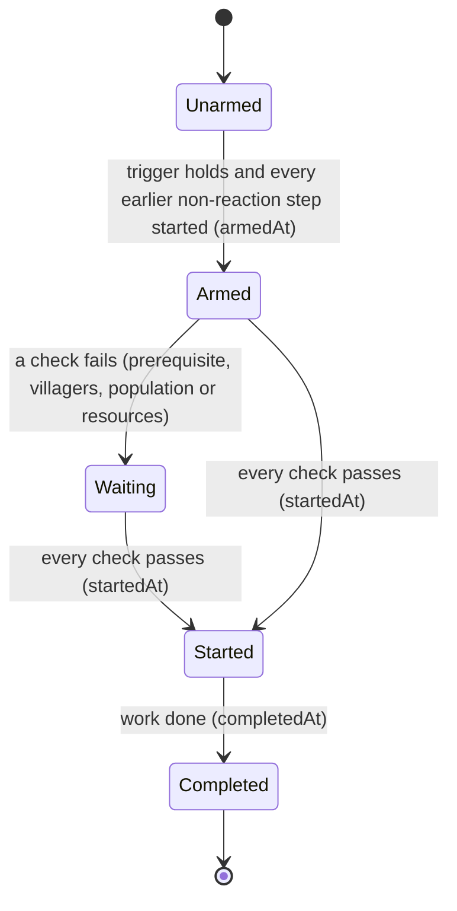

# AoE4 Build Order Simulator: format and API

The build order the simulator accepts (JSON and the paste text format), the issues it reports for bad input,
the simulate, builds and named-builds routes, the storage behind the builds routes, and the result the simulator
returns. The simulation rules are
in the [model doc](aoe4-build-order.md), which reviews judge simulator behavior against; what the page does
with a result is in the [page doc](aoe4-build-order-ui.md). `docs/api/openapi.json` is the authoritative
request and response contract (see [Route](#route)).

## Build order input

**JSON.** A `BuildOrder` is `{ civ, name, source?, start?, steps }` with `civ` = `english`.
`BuildStart` is `{ villagers?, rally? }`: `villagers` maps node refs to villager counts at t=0 (see
[Starting state and population](aoe4-build-order.md#model-rules)), and `rally` is the rally node for starting villager producers. Each `BuildStep` has an
optional `trigger` and one `action`:

| action | fields |
|---|---|
| `produce` | `producer`, `instance?`, `unit`, `count?` (absent = continuous), `rally?` (villager only; sets the producer's standing rally), `walkSeconds?` (only with `rally`) |
| `pause` | `producer`, `instance?` |
| `build` | `building`, `builders?` (default 1), `from`, `then?` (default `from`), `walkSeconds?`, `repeat?` |
| `research` | `tech`, `at?` (technologies and veterancy upgrades) |
| `move` | `count` (a number or `"all"`), `from`, `to`, `walkSeconds?`, `repeat?` |
| `rally` | `producer`, `instance?`, `to`, `walkSeconds?` |

`repeat` (an integer 1..200; absent or 1 runs the step once) runs a `build` or `move` step that many times in a
row; [Ordering and triggers](aoe4-build-order.md#model-rules) has the rule.

A trigger is a tagged object of one of four kinds: `{ "kind": "time", "seconds": 90 }`,
`{ "kind": "villagers", "count": 17 }`, `{ "kind": "depleted", "node": "gold" }` (`node` is a finite node
ref: `wood`, `farm` and `gold#1` are `invalid`) or `{ "kind": "bank", "resource": "wood", "atLeast": 400 }`
(`resource` is a `ResourceKind`). Any other `kind` is an `unknown-trigger-kind` issue. Every step also takes
an optional `"reaction": true`, allowed only beside a `depleted` trigger (any other value is `syntax`), and an
optional `repeat`, valid only on `build` and `move`. Gather nodes (`GatherNodeId`) are `sheep`, `berry`,
`deer`, `boar`, `farm`, `wood`, `gold` and `stone`. A node field takes a node ref (`NodeRef`): a gather
node, or a numbered gold deposit `gold#2`..`gold#8` (see Node references). The paste format writes the same
forms (see Paste format).

**Node references.** A node ref is written the same way in JSON and paste. `gold` is deposit 1 and `gold#2`
to `gold#8` are deposits 2 to 8; only gold has numbered deposits. The `#k` form matches the producer instance
form (`town-center#2`). A node ref is accepted in every node field of every step (`from`, `to`, `then`,
`rally`), in `start.rally` and as a `start.villagers` key, in the `depleted` trigger's `node` and as an
`inputs.nodeAmounts` key. The `depleted` trigger and `nodeAmounts` need a finite node, so there `farm` and
`wood` are not valid. Every node position gives the same issue for the same value:

| value | issue |
|---|---|
| `gold`, `gold#2`, `gold#8`, `wood` | valid |
| `gold#1` | `invalid`: deposit 1 is written `gold` |
| `gold#0`, `gold#9` | `out-of-range`: the deposit number is outside 2..8 |
| `wood#2`, `berry#2`, `stone#2` | `invalid`: only gold has numbered deposits |
| `iron`, `iron#2` | `unknown-id` |
| `gold#02`, `gold#`, `gold#x`, `gold#2#3` | `syntax` |
| `farm`, `wood` in a `depleted` trigger or as a `nodeAmounts` key | `invalid`: that node cannot run out |
| a value that is not a string | `syntax` |

The reason quotes a string value; a value that is not a string gets the reason `node must be a string`. For a step field, `start` and the `depleted` trigger the message reads
`<reason> in <path>` when it has no paste line, as in `unknown node "iron" in start.rally`; a paste message reads `line N: <reason>`; for a `nodeAmounts` key it reads
`inputs.nodeAmounts.<ref>: <reason>`, as in `inputs.nodeAmounts.iron: unknown node "iron"`. A quoted id longer than 40 characters is cut to its first 40 characters followed by `...` in every issue message that quotes it. The same cut applies to an object key shown in an issue label (`inputs.<path>`, `start.villagers.<node>`). In paste, any token shaped `<id>` or `<id>#<chars>` in a node position reaches validation
unchanged; the paste parser reports no node issue of its own.

`inputs.trips` and `inputs.houseBuilderSource` are checked against the gather node ids only:
`houseBuilderSource: "gold#2"` and a `trips["gold#2"]` key are `unknown-id` (`unknown node "gold#2"`).
`houseBuilderSource: "gold"` means deposit 1, and every deposit shares the `trips.gold` timings.

**Paste format.** One step per line. `#` comment lines and blank lines are ignored. An optional trigger
prefix comes first, then the action:

| line prefix | trigger | action syntax |
|---|---|---|
| `@m:ss ` | time | `produce <unit> from <producer>[#k] [xN] [-> <node>] [walk Ns]` |
| `at N vils ` | villagers | `pause <producer>[#k] [xN]` |
| `when <node> runs out ` | depleted | |
| `whenever <node> runs out ` | depleted, as a reaction | |
| `when <resource> >= N ` | bank | |
| (no prefix) | no condition | `build <building> [with N] from <node> [then <node>] [walk Ns] [xN]`; `research <tech> [at <building>] [xN]`; `move <N or all> <node> to <node> [walk Ns] [xN]`; `rally <producer>[#k] -> <node> [walk Ns] [xN]` |

One example per action; each line is a separate example:

```text
# opening
start 4 sheep 2 wood -> sheep
produce villager from capital-town-center x3 -> sheep walk 4s
@0:45 build house with 2 from wood then wood walk 6s
at 9 vils build mill from sheep then berry
research wheelbarrow at mill
move 3 sheep to berry walk 5s
build farm from wood walk 3s x4
@6:00 build council-hall with 4 from wood then gold
produce longbowman from archery-range#1 x5
research veteran-longbowmen
pause capital-town-center#1
rally capital-town-center#1 -> wood walk 3s
```

Grammar details:

- `@m:ss` is `@\d+:\d\d`: any number of minute digits and exactly two seconds digits, `00` to `59`.
  `@1:61` is a `syntax` issue; `@75:00` parses, then fails the 3600 s bound as `out-of-range`; `@60:00`
  is valid.
- On a `produce` line the suffixes are ordered `[xN]`, `[-> node]`, `[walk Ns]`; any other order is a
  `syntax` issue.
- `walk Ns` is the keyword `walk`, a space, an integer, and `s` with no space (`walk 6s`). On a `produce`
  line it is always last. On a `build`, `move` or `rally` line it is last except for a trailing `xN`.
- A `produce` walk without `-> node` (in JSON, `walkSeconds` without `rally`) is an `invalid` issue.
- Walk values in paste text are integers; JSON may use decimals.
- A trailing `xN` after a `build`, `move`, `research`, `pause` or `rally` line sets `repeat` to N (`build farm
  from wood x9`, `build farm from wood walk 3s x9`). It is the last token of the line, after `walk Ns` when
  both are present; anything after it is a `syntax` issue (`build farm from wood x9 walk 3s`,
  `build farm from wood x9 x2`). `repeat` on `research`, `pause` and `rally` parses and is then an `invalid`
  issue at validation. `x0` and `x201` parse and fail validation as `out-of-range`; `x09` parses as 9 and
  prints `x9`. `xN` is a repeat only in that last position: elsewhere it is a node or id (`move 3 sheep to x9`
  names the node `x9`, an `unknown-id` at validation). On a `produce` line `xN` stays the count in its place,
  and a second `xN`, or an `xN` after `-> node` or `walk Ns`, is a `syntax` issue; `produce` has no paste
  form of `repeat`.
- `xN` takes no space (`x5`), `#k` follows the producer with no space (`capital-town-center#1`), and `->` is
  delimited by whitespace.
- Whitespace between tokens is any run of spaces, tabs, `\r`, U+00A0 (no-break space) and U+202F (narrow
  no-break space). Lines are split on `\n` only.
- Ids (unit, producer, building, technology) and resource names are lowercase kebab-case
  `[a-z0-9]+(-[a-z0-9]+)*` and case-sensitive. Uppercase or other characters are a `syntax` issue; input
  is never lowercased for the user.
- A node token is `<id>` or `<id>#<chars>` (any non-space characters after `#`). The parser accepts the
  shape and validation classifies it as in Node references.
- `move all <node> to <node>` moves every villager at the node; the count is a number or the lowercase word
  `all`.
- `when <node> runs out` is a `depleted` trigger and `whenever <node> runs out` is the same trigger with
  `reaction: true`. `whenever` takes only that form. `when <resource> >= N` is a `bank` trigger; `>` alone
  is a `syntax` issue (only `>=` is supported). Whether the node or resource is valid is validation's job
  (`when farm runs out` is `invalid`, `when food runs out` is `unknown-id`).
- A `when` or `whenever` line that does not match these forms is a `syntax` issue, and so is either prefix
  on the `start` line.
- `formatBuildOrderText` and `formatBuildStep` print exactly these forms: `formatBuildStep` is one step as
  one line, and `reaction` prints (as `whenever`) only beside a `depleted` trigger.
- Keywords are lowercase. Numbers are unsigned decimal integers, with no sign and no decimals.
- The `start` line is `start [N <node>]... [-> <node>]` with at least one part, for example
  `start 4 sheep 2 wood -> sheep`. There is at most one, before every step line, with no trigger prefix. A
  repeated node, a second `start`, or a `start` after a step is a `syntax` issue. Only a step line that
  parsed counts as a step here: a line that fails to parse is its own issue and does not make a later `start`
  an issue. A `start` line that fails to parse still counts as the first `start`. `formatBuildOrderText`
  emits it first, with nodes in node-ref order (`gold`, then `gold#2`..`gold#8`).

**Issues.** Problems with the input are `BuildOrderIssue`s `{ code, message, step?, line?, suggestion? }`. Only the
page-side paste conversion (`textToBuildOrder`) sets `line`: a validation issue on a parsed paste step carries
both `step` and the 1-based `line` when the text parses, and `line` only while another line fails to parse; a `syntax` issue raised while parsing a paste line carries `line` only, as
does a paste `start` issue. The route never sets `line`: a JSON step issue carries `step` only and a JSON
`start` issue carries neither. The codes are complete and the
same for JSON and paste. `suggestion` is set only on an `unknown-id` issue for a unit, building, producer,
technology, research `at` or node field, and on an `unknown-trigger-kind` issue: it is the closest catalog
id (or trigger kind) to the given value, by case-insensitive edit distance of at most a third of the value's
length (at least 1), and is absent when nothing is that close.

| code | meaning |
|---|---|
| `syntax` | text cannot be parsed, or JSON structure is wrong: bad paste grammar, a step that is not an object, a missing or mistyped field, an unknown `action` value, a wrong-typed `trigger` |
| `unknown-trigger-kind` | the trigger's `kind` is not `time`, `villagers`, `depleted` or `bank` (an omitted trigger means no condition) (paste: unknown line prefix is `syntax`, and so is a `when` or `whenever` line that matches none of the forms above) |
| `unknown-id` | a well-formed id not in the civilization's data (unit, producer, building, technology, node, resource, civilization), including an unknown `start` node key |
| `unsupported-tech`, `unknown-tech-effect` | a technology rejected by `classifyTech` |
| `out-of-range` | a number outside `SIM_INPUT_BOUNDS` (including a `start.villagers` value outside 0..200 and a trigger `atLeast` outside 0..100,000), a non-integer, or a non-finite number; also a gold deposit number outside 2..8 (Node references) |
| `invalid` | well-formed, known ids, in range, but a cross-field rule fails (the rules below, and the node-ref cases in Node references) |

Shape or spelling is `syntax`; value size is `out-of-range`; a field combination is `invalid`. One
`invalid` rule covers reactions: `reaction: true` with no trigger, or with a `time`, `villagers` or `bank`
trigger (with an unknown trigger kind only the `unknown-trigger-kind` issue is reported). Reactions are
otherwise validated like any step, in list order, although a reaction may never fire. These `invalid`
rules cover `start` and rally:

- `start.villagers` values do not sum to the civ's starting villager count;
- `walkSeconds` without `rally` on a `produce`;
- `rally` on a `produce` whose unit is not a villager;
- a `rally` step whose `producer` is a known building that produces no villagers;
- no `start.rally` while a starting building is a villager producer;
- a `build` of a villager producer with no `start.rally` and no earlier `rally` or `produce` source for that
  `baseId` without `instance` (baseId-wide).

These `invalid` rules cover producers, research and repeats:

- a `produce` whose `producer` is not a `producedBy` building of any entry of its `unit`
  (`produce villager from house`);
- a `research` with `at` where `at` is not a `producedBy` building of the technology
  (`research wheelbarrow at house`); without `at` there is no check;
- a `research` of a technology an earlier `research` step already names, with or without `at`; the issue is
  on the later step and names the earlier one;
- `repeat` on a `produce`, `research`, `rally` or `pause` step (only `build` and `move` repeat):
  `steps[N]: repeat on research; only build and move steps repeat`.

Node refs have their own `invalid` cases (see Node references). The simulator assumes every rule above holds
and has no runtime check for them.

Checks run in three tiers:

- Field checks (type, presence, id, bound and node ref of each field) always run.
- A step's cross-field rules (producer can produce the unit, `rally` on a non-villager, `rally` step on a
  building with no villagers, `walkSeconds` without `rally`, research `at`, `repeat` on an action other than
  `build` and `move`) run only when that step's fields passed.
- The cross-step rules (repeated research, a villager producer built with no rally source) and the expanded
  step cap run only when every step's fields passed and the written order has at most 200 steps. The cap is
  one `out-of-range` issue on `steps` (no `step`, no `line`) when the order has more than 200 steps after
  repeats: `steps: 201 steps after repeats, more than 200`.
- The `start` rules (villager sum, required `start.rally`) run only when `start`'s fields passed.

So an `unknown-id` step gets no second issue, and the whole order gets one round of field issues before any
rule issue. A step whose `action` is unknown gets only its `unknown action` issue: its other fields,
`trigger` included, are not checked.

Issues come in this order: `civ`, `name`, the step-count cap (written, or after repeats), `start` (fields, then its rules), then each
step by index (its fields in field order with `trigger` first, then its cross-field issues), and last the
cross-step issues by the later step's index. A cross-step issue therefore follows every step's own issues.

A villager `produce` without `rally` is valid and uses the standing rally. Each issue is reported on its
step or `start`, with the location fields above. A message starts with where the issue is: a step (`steps[N]`) or
paste line (`line N`), an order field such as `civ`, `name` or `start`, `build order` for the whole order,
`inputs.<path>`, or, from the route, `request` or `request body`. It then names the offending id, kind or
property. Any issue stops the request; nothing is simulated.

```mermaid
flowchart LR
  subgraph browser["browser: the page"]
    text["paste text"] --> t2b["textToBuildOrder: 20,000-char cap, parseBuildOrderText, then checkBuildOrder with lines when the text parses, or the field and per-step checks of the parsed lines when a line fails to parse"]
    t2b -->|"issues with line"| pageIssues["page issue list"]
  end
  t2b -->|"order"| json["BuildOrder JSON"]
  json --> validate["route: checkBuildOrder + checkSimInputs"]
  data["loadGameData: aoe4world/english.json + rules/*.json"] --> catalog["buildOrderCatalog"] & simulate
  catalog --> validate
  validate -->|"issues"| error["400: SimulateError"]
  validate -->|"valid"| simulate["simulateBuildOrder"]
  simulate --> result["SimulationResult"]
  result --> units["graph: units produced"]
  result --> rates["graph: gather rates"]
  result --> gathered["graph: gathered resources"]
  result --> floating["graph: floating resources"]
```



## Route

`POST /api/aoe4-build-order/simulate` (`operationId: simulateBuildOrder`) runs one simulation. The request
is a `SimulateRequest` `{ buildOrder, inputs? }`: `buildOrder` (JSON, at most 200 steps, written and after repeats) is required, and
optional `inputs` is a `SimInputOverrides` whose absent fields take their defaults at any depth (`trips` per
node, then per field; `influenceCoverage` and `nodeAmounts` per key). The paste-format `text` field was removed
in API 2.0.0: a body with a `text` key (any value) is a 400 with one `syntax` issue
(`request: text is no longer accepted; convert the paste to buildOrder and send that`), `buildOrder` is not
checked then, and `inputs` still is. A body with no `buildOrder` is one `syntax` issue
`request: missing buildOrder`. To send a paste, use the page or convert it with `textToBuildOrder`
(browser-safe, in `lib/aoe4-build-order/text-to-build.ts`) and send the result as `buildOrder`.

- **200:** the `SimulationResult`.
- **400:** `SimulateError` `{ error, issues, omittedIssues? }`. The order (`buildOrder` only) is
  checked first and `inputs` second, and both always run, so order issues come first, then inputs issues.
  The combined list is then capped at `MAX_REPORTED_ISSUES` = 100: `issues` holds the first 100 in that
  order, so inputs issues past the 100th are dropped too, and `omittedIssues` is the number dropped,
  present only when above 0 (100 issues give no `omittedIssues`, 101 give `1`). `error` is the first issue's
  message. A body that is not a JSON object (an array, string, number or `null`) gives one `syntax` issue
  and nothing else is checked. No route issue carries `line`: a step's issue carries `step` only; a `start`
  issue, `inputs` issues and request-shape issues carry neither.
- **405:** `{ error }` with an `Allow: POST` header, for any other method.
- A body that is not valid JSON keeps Next's plain-text 400 `Invalid JSON`, and a body over Next's 1 MB
  default limit is its plain-text 413; neither reaches the handler.

`docs/api/openapi.json` is the authoritative request and response contract, with schema names equal to the
TypeScript names in `lib/aoe4-build-order/api.ts` and `model.ts`; this doc does not copy its field lists.

### Builds routes

`POST /api/aoe4-build-order/builds` (`operationId: saveBuild`) saves a build order, and `GET` and `DELETE`
`/api/aoe4-build-order/builds/{id}` (`getSavedBuild`, `deleteSavedBuild`) read and remove one. Their logic is in
`lib/aoe4-build-order/builds-routes.ts`; the files under `pages/api/aoe4-build-order/builds/` only adapt the
request and response.

- A save is validated before it costs a rate-limit slot or a store call, so an invalid body never counts
  against the limit. The 400 and 413 checks need no storage and run first.
- The id is content-addressed, so saving the same build again returns the same id with 200 instead of 201.
  A repeat save still takes a rate-limit slot.
- `GET` sends `Cache-Control: public, max-age=31536000, immutable`, because a saved build never changes. An id
  that is malformed and an id with no build give the same 404.
- `DELETE` exists outside production only; in production the route answers it with 405. It also answers 405
  when `VERCEL` is set without `VERCEL_ENV`, where every builds route answers 503 anyway (see
  [Storage](#storage)).
- The storage and the per-client limit (`SAVE_RATE_LIMIT`) are described under [Storage](#storage). A 429
  carries `Retry-After`.
- When the build id cannot be created the save answers 500 before any store call.

#### Named builds routes

A named build is a build that its creator can edit. `POST /api/aoe4-build-order/named-builds`
(`createNamedBuild`) stores one, and `GET`, `PUT`, `PATCH` and `DELETE` `/api/aoe4-build-order/named-builds/{id}`
(`getNamedBuild`, `updateNamedBuild`, `renameNamedBuild`, `deleteNamedBuild`) read, replace, rename and remove it. Their logic is in
`lib/aoe4-build-order/named-builds-routes.ts`; the files under `pages/api/aoe4-build-order/named-builds/` only
adapt the request and response.

- Every create makes a new random id and a new edit secret, even for a body posted before. The secret is in the
  create response only. The store keeps only its hash, and no route logs it.
- `GET` returns the latest revision with `Cache-Control: no-store`, and its `ETag` is the revision. The body never
  has the secret hash. A malformed id and an id with no build give the same 404.
- An update needs the edit secret as `Authorization: Bearer <secret>` and the current revision as `If-Match`.
  A revision that is not the stored one is 412, and so is a write that lands between the read and the replace;
  the other write is kept. A successful update stores the next revision even when the content is unchanged,
  and may change the name along with the rest.
- An update checks, in this order: the id (404), the secret's form (401), `If-Match` (428), the body (400 or
  413); then it takes a rate-limit slot (429), before it compares the secret, so guessing secrets is rate-limited;
  then whether the build exists (404), the secret (403) and the revision (412). The 404, 403 and 412 after the
  slot still cost it.
- A rename (`PATCH`) takes the same headers and the same `If-Match` rule as an update, with body `{ name }`; other
  keys are ignored. It checks, in this order: the id (404), the secret's form (401), `If-Match` (428), the name
  (400); then it takes a rate-limit slot (429), before it compares the secret; then whether the build exists
  (404), the secret (403) and the revision (412), and a write that lands between the read and the replace is 412.
  The name check is the only body check: the name is trimmed and must then be 1 to 100 characters, and the build
  is neither checked against the catalog nor measured against the saved-build size limit. A success writes the
  next revision, even for the same name, and changes only `buildOrder.name`, `revision` and `updatedAt`; the id,
  so `?n=<id>` links, stays the same.
- Creates, updates, renames and `POST /builds` saves share one per-client write budget, `SAVE_RATE_LIMIT`. Reads
  and deletes cost nothing.
- `DELETE` exists outside production only, as for saved builds: in production, and when `VERCEL` is set without
  `VERCEL_ENV`, it is 405 with `Allow: GET, PUT, PATCH`.

## Storage

The builds and named-builds routes read and write through the `BuildStore` interface in
`lib/aoe4-build-order/build-store.ts`. It has three implementations: a memory store and a file store in
`build-store.ts`, and the Vercel Blob store in `blob-build-store.ts`. Every store prefixes the keys it writes
with its env: `<env>/builds/<id>.json` for saved builds, `namedBuildKey` for named builds and
`<env>/rate-limit/<client>.json` for save counters.

**Choosing the store.** `buildStoreFromEnv` picks the store from the environment:

- The env prefix is `VERCEL_ENV` when it is `production` or `preview`, and `development` for any other
  value. When `VERCEL` is set without `VERCEL_ENV`, `buildStoreFromEnv` rejects, so every builds route
  answers 503.
- The Blob store is used only when `BUILDS_STORE_ID` is set and non-empty. It is loaded with a dynamic
  `import()`.
- Otherwise the file store is used. It writes under `.builds-local/`, or under `BUILDS_LOCAL_DIR` when that is
  set and non-empty.

**Saved builds.** `putBuild` gives `created`, or `exists` when the key is already stored. `getBuild` gives the
stored value or `null`, and `deleteBuild` removes it.

**Named builds.** Each store also holds editable named builds:

- `createNamed` gives `created` or `exists`.
- `getNamed` is always a fresh read, never a cached one, and returns the value with an opaque etag.
- `replaceNamed` is a compare-and-swap on that etag. It writes only when the key exists and its etag is still
  the one given, and it never re-reads the etag to try again. A changed etag or an absent build gives
  `conflict`, except that the Blob store gives `replaced` when its read-back (below) shows the JSON it sent.
- `deleteNamed` removes the build.

**Blob store.**

- Its fresh reads (`getNamed` and the counter read) request the blob uncompressed
  (`accept-encoding: identity`), so the etag is the strong form that `ifMatch` compares against. A fresh read
  that still gets a weak `W/` etag throws, which the routes answer as 503. The read-back (below) makes the
  same kind of read, but any error in it counts as not landed.
- When the `put` of a build write throws, the store makes a fresh read of the key. The build writes are
  `create`, behind `putBuild` and `createNamed`, and `replaceNamed`. The write counts as done when the stored
  value, serialized with `JSON.stringify`, is the exact text the store sent, because a write whose response
  was lost may have landed before the SDK's retry failed.
- Otherwise `create` gives `exists` when `head` finds the key and rethrows the put error when it does not.
  `replaceNamed` gives `conflict` for a precondition or not-found error, and for any other put error when
  `head` reports the key absent (`ifMatch` on a deleted blob raises a plain `BlobError`); it rethrows the put
  error otherwise.
- Creating the store sets `VERCEL_BLOB_RETRIES` to 1 when that variable is unset or empty, and keeps a value
  already set. `@vercel/blob` reads it as the retry count of each `put`, `head` and `del` call (default 10);
  `get` makes a single request.

**Save limit.** `save-rate-limit.ts` owns the per-client save limit (`SAVE_RATE_LIMIT`), and its counter
lives in the store. `bumpCounter` returns the new count, `refused` or `contended`:

- `nextCounter` in `build-store.ts` is the one counter step every store calls. A save past the limit is
  `refused` and writes nothing, so the stored count never passes the limit.
- The Blob store's `bumpCounter` makes no read-back after a failed write, because parallel saves from one
  client write identical counter JSON, and a read-back would count every losing writer as landed. After a 412,
  or when the counter it was creating now exists, it starts its next attempt with a fresh read and a new `put`.
  It rethrows any other error, and gives `contended` after its third attempt.

**Live test.** `blob-build-store.live.test.ts` checks a real Blob store. It is skipped unless `BLOB_LIVE=1`
(`npm run test:blob-live`).

## Outputs

A `SimulationResult` holds:

- `civ`, `durationSeconds` and `sampleSeconds` (5).
- `times`: the sample times in seconds, `0, s, 2s, ...` for `s` = `sampleSeconds`, up to and including
  `durationSeconds`. When `durationSeconds` is not a multiple of `s`, the last sample is `durationSeconds`
  itself, after the last multiple below it. Every series below has one value per sample. The t=0 sample
  reflects the state after the zero-time steps at t=0 have started.
- `unitsProduced`: one `UnitSeries` per unit entry and tier (`unitId`, `baseId`, `name`, `lineName`, `tier`, the
  entry's age) that held a produced unit at some instant, ordered by the first instant it held one, then
  `unitId`. `counts` are the produced units at that tier at each sample: a veterancy upgrade moves units to
  a higher tier's series, and a series whose units all moved stays listed at 0. The series of one `baseId`
  sum to its cumulative produced units. Starting units are not produced and never appear in it, so every
  series starts at 0. `lineName` is the display name of the whole unit line, equal for every series of one
  `baseId` whichever tiers the run produced: the longest run of whole words (split on single spaces) that
  ends the name of every tier of that `baseId`, else the name of its lowest-age entry (`Spearman` for
  `Hardened Spearman`, `Veteran Spearman`; `Man-at-Arms` for `Vanguard Man-at-Arms`, `Early Man-at-Arms`, `Man-at-Arms`,
  `Elite Man-at-Arms`).
- `productionBuildings`: one `BuildingSeries` (`baseId`, `name`, `counts`) per production building. A building
  `baseId` is a production building when some unit entry of the civ's data lists it in `producedBy`; the
  set comes from the data only, so `house` is not one and the starting `capital-town-center` and a built
  `town-center` are two series. Age tiers of one `baseId` are one series, and `name` is its lowest-age
  building entry's name. `counts` are the completed instances at each sample, starting buildings included;
  a building under construction is not counted, and one completing at a sample time is counted at that
  sample. Series are ordered by the first sample with a count above 0, then by `baseId` in code-unit order.
  A production building with no completed instance at any sample has no series.
- `gatherRates`: per `ResourceKind` (`food`, `wood`, `gold`, `stone`), the income rate per minute.
- `gatherers`: per `ResourceKind`, the number of villagers gathering that resource at each sample (those counted in
  `gatherRates`; walking, building and idle villagers are not).
- `floating`: per `ResourceKind`, the banked, unspent amount.
- `gathered`: per `ResourceKind`, the cumulative amount gathered since t=0; starting resources are not counted,
  and it never decreases.
- `spent`: per spend category (`villagers`, `military`, `buildings`, `research`), the cumulative resources
  paid, food, wood, gold and stone summed. `villagers` is villager production, `military` any other unit,
  `buildings` every construction including auto-houses, `research` every technology.
- `spawnedPopulation`: the population (summed `popcap`) of the villagers and units that have spawned, including the start villagers and
  start units and villagers still walking or idle. A paid unit still in its production queue is not counted
  until it spawns, unlike the supply-check population, which counts it at payment. It may exceed the
  population cap once the cap has been reached, since production then continues with supply at the cap
  ([Houses and supply](aoe4-build-order.md#model-rules)).
- `populationCapReachedAt`: the instant `spawnedPopulation` first reaches the population cap (`0` when the
  start already does), or `null`. It is a spawn instant, not rounded to a sample time, and keeps that first
  instant when later spawns take `spawnedPopulation` past the cap.
- `steps`: one `StepTiming` per step after repeats, in that order (a step with `repeat` n gives n consecutive
  entries), with `step` (its index in this list), `source` (the index of the submitted step it copies in
  `buildOrder.steps`), `copy` (1..n within that source; 1 for a step without `repeat`), `status`, `armedAt`, `startedAt`, `completedAt`,
  `waitSeconds`, `waitingOn`, `waitBreakdown`, `waitingFor` and `waitDetails`. `status` is one of `completed`, `in-progress`, `waiting` or
  `not-reached`. `waitingOn` is why the step has not started: `null` once it has started, the reason of its
  last failed check while `waiting`, `trigger` for a `not-reached` step whose own trigger never held (every
  unarmed reaction, and the first unstarted non-reaction step), and `earlier-step` for a `not-reached`
  non-reaction step behind an unstarted non-reaction step; a reaction is never `earlier-step`. `waitBreakdown` is the seconds from
  `armedAt` spent on each of `resources`, `villagers`, `population` and `prerequisite`; the values sum to
  `waitSeconds` for a started step and to the time from `armedAt` to the horizon for a `waiting` one, and a
  reason with 0 seconds is absent. `waitingFor` is what the last failed check waits for, a `StepWaitDetail`
  (below): it is set at each offer the step fails, `null` once the step starts, so at the horizon a `waiting`
  step has the detail of its last failed offer and every other step has `null`. A step offered more than
  once at one instant keeps the detail of the last offer, which the next waiting interval accrues. `waitDetails` lists the
  seconds waited per target ([Wait details](#wait-details)).
- `ages`: each age reached and its `reachedAt` time.
- `markers`: `ChartMarker`s (`kind`, `label`, `at`, and `unit` when set) for the charts: one `age-up` marker per age reached after
  the start age (label `Feudal`, `Castle` or `Imperial`, `at` its `reachedAt`) and one per completed research
  (label the tech's `baseId`, `at` the step's `completedAt`). `age-up` comes only from a landmark; a research
  marker's `kind` is the first match of: `economy` (class `economic_upgrade`), `unit-tier` (a veterancy
  upgrade: type `upgrade` or class `scar_unit_upgrade`), `blacksmith` (produced at the blacksmith), else
  `other`. `unit` is the `baseId` of the unit line a research upgrades, set whenever the researched tech is a
  unit upgrade of the civ data (whatever its `kind`); it is absent on `age-up` markers and on every other
  research. Markers are sorted by `at`,
  then by kind in the order `age-up`, `economy`, `unit-tier`, `blacksmith`, `other`, then by `label`; markers at
  the same instant are all kept. There is no marker for the start age or for work that has not completed by
  the horizon, and markers do not affect the simulation.
- `notes`: `BuildOrderNote`s, non-fatal, one per research step of a technology whose effects are not all
  simulated, whether or not the step is reached, in step order; a note's `step` indexes `steps` (after
  repeats): `tech-effect-ignored` (ignored combat
  properties listed) and `tech-effect-unmodeled` (empty `properties`). Every note has `severity: 'debug'`,
  and its message starts with the tech's `baseId`.
- `depletions`: `NodeDepletion`s (`node`, `amount`, `depletedAt`), one per finite node ref the run uses, in
  node-ref order: always the six finite nodes (`sheep`, `berry`, `deer`, `boar`, `gold`, `stone`), plus each
  numbered gold deposit (`gold#2` to `gold#8`) the order names. `amount` is the starting stock (`null` when
  infinite) and `depletedAt` when it ran out (`null` if it still had stock at the horizon). With no
  `nodeAmounts` the six start at their `rules/base.json` amounts, so a default run can emit `node-depleted`
  and `idle-arrival` warnings.
- `warnings`: non-fatal `SimWarning`s, each with a `code` (`node-depleted`, `idle-arrival`, `farm-idle`,
  `step-stuck`), a `severity` (one of `error`, `warning`,
  `info`, `debug`), a `message` and an `at` time. They hold the node warnings when a finite node runs out, at most one
  `farm-idle` warning (severity `warning`, with `idleVillagers`) when villagers wait idle at `farm` for lack of a
  built farm, message `1 villager arrived at farm from 0:50 on with no free farm and waits idle until one is
  built.`, and one `step-stuck`
  warning (severity `warning`) for each step still `waiting` at the horizon, whose message reads `step 12
  (build) was still waiting on prerequisite at 60:00, from 11:40.` (the 1-based number of the submitted
  step; `at` is the step's `armedAt`). A copy of a step with two or more copies reads `step 12 (build, copy 2
  of 9) was still waiting on ...`; a step with one copy (no `repeat`, or `repeat: 1`) keeps the plain form.
  The warning's `step` is the index in `steps` (after repeats). They are sorted by `at`; at the same `at`,
  node warnings come first in node-ref order with `node-depleted` before `idle-arrival` for one node, then
  `farm-idle`, then `step-stuck` by step index in `steps`. See
  [Severity](aoe4-build-order.md#severity).

The page draws four graphs over time from it, with the chart markers (see the [page doc](aoe4-build-order-ui.md#page); the warnings are lists beside them): units produced (one
line per unit line, or per production building), gather rates, gathered resources, and floating resources. `spent` and `populationCapReachedAt` feed the compare
table, and `spawnedPopulation` has no graph.

The life of one non-reaction step is shown below. The diagram is conceptual: its states are not values in
the result. At the horizon each state maps to a `StepTiming.status`:



| state at the horizon | `StepTiming.status` |
|---|---|
| Unarmed (trigger not met, or an earlier non-reaction step not started) | `not-reached` |
| Armed or Waiting, not started | `waiting` |
| Started, not completed | `in-progress` |
| Completed | `completed` |

A reaction skips the earlier-step condition: it is `not-reached` only while its node has not run out, and
otherwise follows the same states.

A step waits while it cannot be paid, while supply has no room (only before the population limit lifts,
[Houses and supply](aoe4-build-order.md#model-rules)), while the unit's entry is above the
current age, or while no building instance it targets exists. A `produce` or `research` step also waits
while the building instances it needs are busy ([Queues](aoe4-build-order.md#model-rules)). A `build` step also waits while its
building's entry is above the current age or while fewer than `builders` villagers are at `from`, gathering
or idle; a `move` step with a number `count` waits while fewer than `count` are. A reaction waits for the same
reasons from its run-out instant on, without waiting for earlier steps or holding back later ones. Each reason is reported: `waitingOn`
holds the current one, `waitingFor` what that check waits for, `waitBreakdown` the seconds spent on each
reason and `waitDetails` the seconds spent on each target. A handler checks in a fixed order and reports
the first check that fails, with the detail of that check:

| `waitingOn` | produced when | `waitingFor` kind |
|---|---|---|
| `prerequisite` | `produce`: the unit's entry is above the current age, or no targeted instance exists, or a targeted instance is not free. `build`: the building's entry is above the current age. `research`: every tier of the tech is above the current age, or no producing instance exists, or no candidate instance is free. An action with no handler always reports it, with a `null` detail; every `BuildStep` action has a handler, so every second in `waitBreakdown` has a detail | `age`, `building` (a missing building) or `building-busy` (a busy one) |
| `villagers` | `build`: fewer than `builders` villagers gather at `from` or idle there. `move` with a number `count`: fewer than `count` do. `move` with `count: all` never waits and never reports it | `villagers` |
| `population` | `produce`: the population after paying would pass supply. Only before the population limit lifts; after it no step waits on `population` | `population` |
| `resources` | every earlier check passes but the bank is short of the step's cost, plus a due auto-house's hold on the resources it spends, except for an explicit `build house` step ([Houses and supply](aoe4-build-order.md#model-rules)) | `resources` |

The order is an age, then a missing building (both `prerequisite`; a `produce` whose unit is above the age
and whose producer is not built reports the age), then `villagers` or `population`, then `resources`, then,
for `produce` and `research`, a busy building (`prerequisite`). A non-reaction step
waiting on `resources` or on a busy building reserves its cost; no other wait reserves. `rally` and `pause`
never wait. A `trigger` or `earlier-step` reason is only reported for a step that never armed. A `produce` step completes when no
instance carries its order any more: a counted one at the spawn of its last unit on the last instance, a
continuous one (or a counted one replaced early) when a later `produce` or `pause` on that producer
starts. `rally` and `pause` complete the instant they start; `build` completes when the building does,
`move` when its villagers arrive, and `research` when its research time ends.

### Wait details

A `StepWaitDetail` is tagged by `kind`; building names come from the snapshot (the `baseId` when it has
none), and every count is a whole number:

| `kind` | fields | given when |
|---|---|---|
| `age` | `age` (2 to 4), `landmark` (`{ baseId, name }` or `null`) | the entry is above the current age. `produce` and `build` name the entry's age; `research` names the lowest age among the tech's entries. `landmark` is set only when `age` is the next age: the landmark of the current age under construction that completes first (ties by `baseId`) |
| `building` | `buildings` (at least one `{ baseId, name }`), `instance` (number or `null`) | no targeted instance exists. `produce` names its producer and its `instance`; `research` names `at`, else every `producedBy` building in snapshot order, with `instance: null` |
| `building-busy` | `buildings`, `instance`, `every` (boolean) | a targeted instance is not free. `produce` names its producer and its `instance`; `every` is `true` only for a `produce` with no `instance` on two or more instances, which waits for all of them. `research` names the candidate buildings that have an instance, in candidate order, with `instance: null` and `every: false` |
| `villagers` | `node`, `needed`, `available` | the villagers the step needs at `node` and those gathering or idle there |
| `population` | `needed`, `used`, `supply` | the population of one unit per target, the population used and the supply at the offer; only before the population limit lifts |
| `resources` | `short` (at least one resource) | the amount missing of each resource short of the need the check used (the cost plus the auto-house hold where it applies), rounded up; a covered resource is absent |

`waitDetails` holds one `StepWaitEntry` (`detail`, `seconds`) per target, in the order each was first
waited for. Each interval the step waits under a `waitBreakdown` reason adds its seconds to the entry whose
target matches `waitingFor`, or appends an entry. Targets match by kind and, for `age`, the age; for
`building` and `building-busy`, the buildings and instance (so a missing Barracks and a busy one are two
entries); `resources`, `villagers` and `population` each have one target. An entry keeps the numbers of
the interval that created it (and, for `building-busy`, its `every`), except that an `age` entry takes the landmark a later interval names, and a
later `null` landmark does not clear it. A target never waited on for any time has no entry. `age`,
`building` and `building-busy` entries count under `prerequisite`, the others under the reason of the same
name, so for each reason the seconds of its entries add up to `waitBreakdown`. `waitDetails` is `[]` for a
step that never waited.
