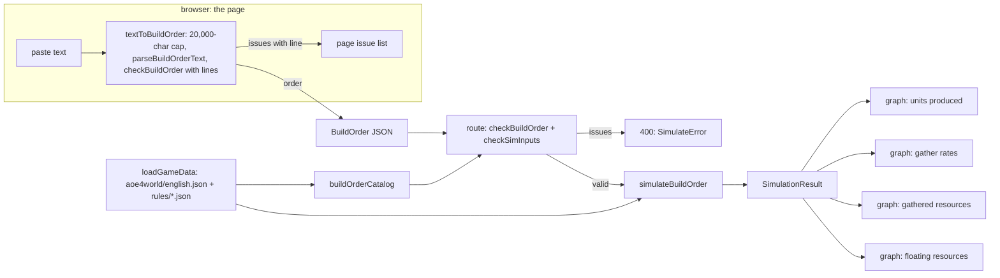
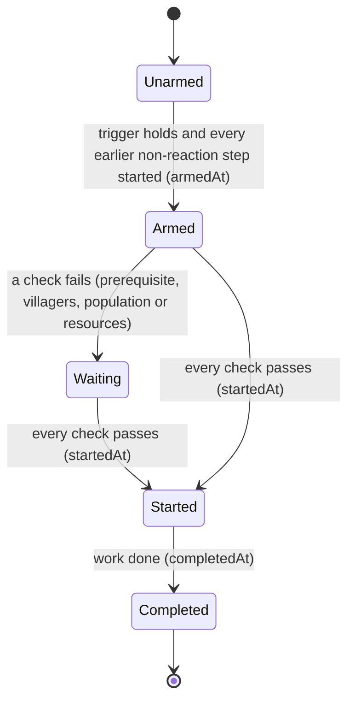

# AoE4 Build Order Simulator

The model the build order simulator follows, the data it reads, the build order format it accepts, its
input limits, and what it reports. Reviews judge the simulator's behavior against this doc. Each section
states the rule; the code and its tests implement it.

## Purpose and model

The simulator plays an *Age of Empires IV* build order step by step for the English civilization: villager
production, gathering, construction, research and age-ups. It returns one deterministic result per build
order and data set: when each step started and finished and why it waited, series over time of units
produced, gather rates, resources gathered, floating resources, spending and population, chart markers for age-ups and research,
and warnings and notes. English is the only civilization; other civilizations are a later extension
through the seams in Extension points.

Unit combat stats are not modeled. There is no combat: blacksmith and other combat technologies and unit
upgrades cost resources and queue time and mark the charts, but change no unit stat (hitpoints, attack,
armor or similar).

The model treats the game as a small set of ordinary rules:

- Town centers and landmarks are ordinary buildings. They are built, produce and research like any other
  building.
- Villager producers (town center, King's Palace) are production buildings. By default each one produces
  villagers continuously ("optimal villagers") until a step changes its order. Each spawned villager walks
  to its producer's rally node.
- An age-up is a landmark build. There is no separate age-up action.
- Every construction pulls its builders off their resource for the whole build time; they gather nothing
  while walking and building. Build time depends on the builder count.
- A finite node (sheep, berry, deer, boar, gold, stone) holds a starting stock and runs out; farm and wood
  never run out. By default the six finite nodes start at the owner-supplied, unverified amounts in
  `gatherNodes.<node>.amount` in `rules/base.json`; `inputs.nodeAmounts` overrides them per node, and a
  `null` override keeps a node infinite (see Depletion).

Every quantity that could vary between games (walk time, idle time, distance to each resource) is a named
simulator input, never a constant inside the step logic. The result and the API response are additive: a
later spread of outcomes is a new field beside the existing ones, not a change to them.

## Determinism, bounds and resources

- **Same input, same result.** The simulator uses no randomness and never reads the clock, so the same
  build order, inputs and data always give an identical result.
- **Game numbers come from data.** Every game number (cost, build time, gather rate, supply) is read from a
  versioned data file that records its source; no game number is written into the simulation code.
- **Resources never go negative.** A step that cannot be afforded waits until it can, and the wait shows
  in its timing as `waitSeconds > 0`.
- **Every request finishes in bounded time.** Every numeric input has a bound in `SIM_INPUT_BOUNDS`, and an
  input outside its bound is an `out-of-range` issue; nothing is simulated.

A non-integer where an integer is required, and a non-finite number, are also `out-of-range`. The bounds
apply to a pasted order too: the page converts the paste with `textToBuildOrder`, which caps it at 20,000
characters and checks each parsed line like a JSON step. The route accepts only JSON, so the character cap is
not a route bound.

| field | type | min..max | default |
|---|---|---|---|
| paste text (page-side conversion) / steps | | 20,000 chars / 200 steps | |
| `durationSeconds` | int | 60..3600 | 1200 |
| `Trigger.seconds` | int | 0..3600 (the largest `durationSeconds`) | |
| `Trigger.count` (villagers) | int | 1..200 (the population cap) | |
| `Trigger.atLeast` (bank) | int | 0..100,000 | |
| `produce.count`, `move.count` | int (`move.count` also `"all"`) | 1..200 | continuous (produce) |
| `builders`, `houseBuilders` | int | 1..200 | 1 |
| `instance` | int | 1..200 | every instance |
| `walkSeconds` (`SimInputs`) and per-step `walkSeconds` (`produce`, `build`, `move`, `rally`) | number | 0..60 | `rules/base.json`; step: inherit |
| `start.villagers` values | int | 0..200 | the civ split |
| `walkSecondsCamp`, `walkSecondsTownCenter` | number | 0..60 | `rules/base.json` |
| `dropOffSeconds` | number | 0..30 | `rules/base.json` |
| `influenceCoverage` values | number | 0..1 | `{ mill: 1 }` |
| `nodeAmounts` values | int or `null` (infinite) | 0..100,000 | `gatherNodes.<node>.amount` (gold's for `gold#k`); `null` is infinite |

Unknown extra properties on a build order, its `start`, its steps, their triggers and `inputs` are
ignored. Every omitted `inputs` field takes its default at any depth: `trips` merges per node and then
per field, and `influenceCoverage` and `nodeAmounts` per key, so `{ trips: { farm: { walkSecondsCamp: 3 } } }`
changes only that one value and `{ nodeAmounts: { berry: 500 } }` leaves the other nodes at their defaults. A build order with more than 200 steps is one `out-of-range` issue, and its steps are not
checked. A hole in a `steps` array (index `i` with no element) is the same `syntax` issue on step `i` as a step
that is not an object; only library callers can send one, since JSON cannot carry holes.

The result is sampled every `sampleSeconds` = 5 seconds.

## Data sources

**Game data snapshot.** Costs, build times, production times and technology effects come from a pinned
snapshot of aoe4world data (github.com/aoe4world/data), committed as
`data/aoe4-build-order/aoe4world/english.json`. Its entries are copied verbatim and filtered to those whose
`civs` contain `en`; the file holds `{ source, units, buildings, technologies, upgrades }`. Its
`SnapshotSource` records `repo`, `commit`, `committedAt`, `fetchedAt`, `patch` (the game patch live on
`committedAt`, since upstream files carry none) and `patchSource` (the URL stating that patch).

**Hand-entered rules.** Values the snapshot lacks are entered by hand in two files:

- `data/aoe4-build-order/rules/base.json`, civilization-agnostic: `gatherNodes` (per-node rate, carry
  capacity, the effect properties that modify them, drop-off buildings and trip seconds), `builderScaling`,
  `maxPopCap` (200) and `walkSeconds`.
- `data/aoe4-build-order/rules/english.json`, the English overlay: `startingState`, `supply`, `effects`
  and `upgradeTargets`.

Every hand-entered value carries its own `source` and its own `unverified` label: as a `HandValue`, or,
for an overlay effect row, as fields of the `OverlayEffect` itself. Supply, the starting state, the overlay
effect rows, the trip walk and drop-off defaults, and the six starting node amounts are labeled unverified. Not every value is: the sheep,
deer and boar carry capacities are observed in game and are not labeled unverified. The rules files are
the record of which value is which.

**Gather rates.** Raw per-resource rates come from the *Age of Empires* fandom wiki (Resource and Villager
pages): for example 0.75/s for sheep, farms, gold, stone and wood, and 0.69/s for berries since update
12.0.1974. Carry capacity is 10, and 25 for hunted meat. The trip model below combines rate and capacity.
Every node's rate and capacity (deer and boar included) and each one's source and label live in
`rules/base.json`; this doc does not restate them. The wiki-sourced gather rates are unverified, with no
patch stated.

**Builder scaling.** The construction formula comes from the wiki Villager page, Building construction
section, with no patch stated; it is unverified.

**Task-switch walk.** The base walk of 5 seconds per task switch (`walkSeconds` in `rules/base.json`) is an
unverified, unmeasured assumption: about 5-6 tiles at villager speed 1.12 tiles/s.

**Calibration and cross-check.** The trip walk and drop-off defaults in `rules/base.json` are tuned so
that effective rates land near the net effective rates of SichYuriy/aoe4-production-calculator; those
defaults are labeled unverified. The calculator's rates are otherwise a labeled cross-check in a test only,
and never a source of raw gather rates.

**Loading.** `loadGameData(civ)` is synchronous. It builds its `GameData` indexes (`byId`, `byBaseId` in
ascending age, `supply`, `upgradeTargets`) once per civilization and returns the same deep-frozen instance
on every call. It throws for a civilization with no data and for a duplicate `id`. Every id lookup goes
through those maps, so a user id such as `__proto__` finds nothing.

**Ids.** Build orders and rules reference aoe4world `baseId`s (`villager`, `town-center`, `house`,
`wheelbarrow`, `veteran-longbowmen`), never display names. The engine resolves a `baseId` to the
civilization's entry for the current age or tier.

**Patch policy.** The data reflects the current game only. There is no per-patch support: refreshing the
snapshot replaces it and records the new commit and patch. Effects the snapshot states only in description
text are listed in `data/aoe4-build-order/README.md` under Known data gaps.

## Model rules

**Starting state and population.** `startingState` in `rules/english.json` has exactly the fields `age`,
`resources`, `villagers`, `units` and `buildings`. `villagers` maps each gather node to the villagers on
it at t=0. `units` maps a unit `baseId` to the count of non-villager units present at t=0; English starts
with one scout. Starting units count toward population, so English starts at 7/10 (6 villagers and 1
scout), but they are not produced. Sheep are not units: sheep are the `sheep` gather node. The
`startingState` hook of `CivRules` may override the whole object. The starting values themselves live in
`rules/english.json`.

A build order's `start.villagers`, when present, replaces the civ's `villagers` split whole (omitted nodes
get 0). It is placed at t=0 with no walk, as the civ split is, and must sum to the civ's starting villager
count, the sum of `civData.startingState.villagers.value` (6 for English). `start.rally` is the rally node
for the starting villager producers. Both `start` fields are optional in the schema, and `start: {}` is
well-formed (not a `syntax` issue). An English order still needs `start.rally`, because its starting town
center is a villager producer.

**Ordering and triggers.** Steps run in list order. A trigger is one of four kinds: a time (`@m:ss`,
meaning "not before" that time), a villager count (`at N vils`, counting villagers alive), a node running
out (`depleted`, holding from the instant that node ref's stock reaches 0) or a bank amount (`bank`,
holding while the banked amount of one resource is at least `atLeast`; it reads the bank and never
changes it). A non-reaction step arms when its trigger holds and every earlier non-reaction step has
started; a step without a trigger arms as soon as those steps have started. Once armed, it waits while any check in the wait
reasons table (Outputs) fails, then starts. `waitSeconds = startedAt - armedAt`. At the horizon, a
step that never armed is `not-reached`, and a step that armed but never started is `waiting`.

A step marked `reaction` (only a `depleted` step may be one) arms when its trigger holds, without waiting
for earlier steps, and never delays a later step. Because run-outs apply first in the instant, its
`armedAt` is the node's `depletedAt`. Once armed it stays armed and is offered again at every later
instant until it starts, at most once. A reaction waiting on resources starts at the exact instant it
becomes affordable. At one instant, every armed reaction is offered in step order before the first
unstarted non-reaction step, so a reaction wins villagers or resources both need; several reactions on
one ref each see the villagers the earlier ones left.

At one instant, steps start (reactions first, then the rest in list order) before villagers spawn. A step armed by a spawn (a `villagers`
trigger) starts at that instant, after the spawn. So `@T rally` routes the villager spawning at T, and
`at N vils rally` routes villager N+1 onward.

**Priority.** At most one non-reaction step is armed and not started at a time. While it waits on resources
only, it reserves its cost; a reaction never reserves. A producer's order skips paying its next unit if
that would drop any resource the unit costs below the reserving step's cost of that resource. A step waiting on supply, on an age or on a building
instance that does not exist reserves nothing. At one instant, steps start before orders pay, so a step
wins a tie with an order payment.

**Queues.** Each building instance has one queue, shared by production and research. A `produce` step on
a busy producer replaces its order (a switch); `pause` clears the order. A step names a building by
`baseId`, which applies to every instance, or by `instance` (1-based) for one.

Every villager producer instance starts with a continuous villager order, which a `produce` or `pause`
step replaces. When a counted `produce` spawns its last unit, the instance's order becomes empty; the
villager order does not resume. Only a research resumes the instance's own order. A unit is paid before it is queued: its resource cost and its population are taken
together, and only when every resource covers its cost and supply has room for it. Each instance runs its
paid units first in, first out, one at a time. An order pays its next unit only when its instance has no
paid unit left.

A `produce` step pays its first unit on every targeted instance that exists when it starts, so it waits
while it cannot pay all of them. It waits while no targeted instance exists, and it does not cover
instances built after it starts. A switch or a pause lets the unit in production and every paid unit
finish: nothing is cancelled and there is no refund. The old order's unpaid units are dropped. `pause`
costs nothing, completes the instant it arms, and is a no-op for an instance that does not exist (it is
not held for one built later).

A `research` step goes to `at` if given, else to the first building in the tech's `producedBy` (snapshot
order) that has an instance, and within that building to its lowest-numbered instance (instance 1 first).
Queue length is not consulted, `research` has no `instance` field, and a tech with no producing building
and no `at` never starts. With a capital town center and two town centers, `research textiles` goes to
the capital town center and `research textiles at town-center` to town center 1.

A tech can have one entry per age. Each time a `research` step is offered it researches the tech's
highest-age entry at or below the current age; that entry gives its producing buildings, cost, research
time and effects. A step that waited for an age-up therefore researches the entry of the age it reaches.
A completed research records that entry's `id` (and the tech's `baseId`), and only the effects of
researched entries apply, not those of other entries of the same tech.

A `research` step pays its cost when it starts and is appended to its instance's paid units, behind any
unit already paid. It never replaces the instance's order, which resumes (pays its next unit) when the
research ends. A completed research adds a marker to the result's `markers`. It waits while no target instance exists or while no entry of the tech is at or below the
current age, and it reserves resources only when it is short of resources alone.

**Tiers.** A unit's tier is the entry for the highest tier whose upgrade has been researched, else the
lowest-age entry for its `baseId`. `upgradeTargets` maps an upgrade `baseId` to the unit `baseId` it
upgrades, because aoe4world's `unlocks` is empty; the target tier is the unit entry whose `age` equals the
`age` of the upgrade entry that was researched, not of any other entry of that upgrade. A veterancy
upgrade occupies its building's queue for its research time. When it completes, every spawned unit of its
target below its tier becomes that tier, at that instant. A unit takes its cost, production time and
population from the tier when it is paid, and spawns at the tier researched when it spawns, never below
the tier it was paid at. An upgrade with no unit entry at its age changes no tier and converts nothing,
and an upgrade below the tier units already hold converts nothing.

**Ages and landmarks.** A building whose `classes` match `^age[1-3]_landmark\d$` advances the age from its
`age` to `age + 1` when it completes, so any landmark reaches the next of the four ages. The age advances
only when the landmark's `age` equals the current age: a second landmark of an age already passed moves
nothing. Entries whose `age` is above the current age are unavailable. Entries of the new age are usable
at the instant of the age-up: steps and order payments are re-checked then. An age-up never changes a paid
item or a running production time; a unit paid before it spawns as the entry it was paid as. On a build's
completion the engine adds the instance, calls `onBuildingComplete`, advances the age, then calls
`onAgeAdvance`.

**Trip model.** A gathering villager repeats a cycle:

`cycle = capacity / rate + walk / moveSpeedMultiplier + dropOffSeconds`, and effective rate = `capacity / cycle`.

`rate` and `capacity` are the node's values after technology effects. `walk` is the node's
`walkSecondsCamp` when a building in the node's `dropOffs` exists (mill, lumber camp, mining camp), else
`walkSecondsTownCenter`. `moveSpeedMultiplier` is the villager `moveSpeed` multiplier from technology
effects (Wheelbarrow raises it). Income is credited continuously at the effective rate, not per trip.

**Task-switch walk.** Moving villagers between tasks costs one generic base walk, `SimInputs.walkSeconds`
(default from `rules/base.json`). A step's own `walkSeconds`, when present, overrides it for every villager
movement that step causes. The effective walk is
`(step.walkSeconds ?? inputs.walkSeconds) / moveSpeedMultiplier`, the same villager `moveSpeed` multiplier
the trip model uses, read when the walk starts. The villager is walking and gathers nothing. The
walk is paid:

- once per villager on `move`, from `from` to `to`;
- twice on `build`: once to the site, then once from the site to `then`. When `then` is the node the
  building creates (`gatherNodes.<node>.createdBy`, so `then farm` on a farm build), the builders start
  there at completion with no second walk;
- once per spawned villager, from spawn to its producer instance's rally node. The walk is
  `(source.walkSeconds ?? inputs.walkSeconds) / moveSpeedMultiplier`, where the source is the `rally` step
  or `produce` that set the rally; a `start.rally` route uses `inputs.walkSeconds / moveSpeedMultiplier`;
- for both legs by auto-house builders, at `inputs.walkSeconds / moveSpeedMultiplier` (no step to override it).

The trip model's per-node `walkSecondsCamp`, `walkSecondsTownCenter` and `dropOffSeconds` model the gather
cycle, not task switches.

**Rally rules.** A rally sends each villager a producer spawns to a gather node.

- Villager producers are the `producedBy` buildings of the civ's `villager` entries (English
  `capital-town-center`, `town-center` and `kings-palace`).
- Each producer instance holds a rally state `{ node, walkSeconds? }`.
- Two writers set it: a `rally` step, and a villager `produce` with `rally`. The last writer wins, from the
  writer's `startedAt`. A writer's scope is its `instance`, or with no `instance` every existing instance of
  the `baseId` plus the default for that `baseId`'s later instances.
- A new instance takes its `baseId` default, else `start.rally`.
- An instance-scoped rally for an instance not yet built is held for it.
- Villagers already spawned are never re-routed; `move` does that.
- A `rally` step has no cost and no supply: `startedAt = completedAt = armedAt`, `waitSeconds` is 0 and its
  status is `completed`. Its `walkSeconds` applies to the walk of every villager it routes.
- Same-instant order is in Ordering and triggers.
- The validation rules in Issues guarantee a rally is in effect whenever a villager spawns, so the engine
  reports no rally error.

**Construction.** Build time with N builders = base build time x 3 / (N + 2), the `builderScaling`
numerator 3 and offset 2 in `rules/base.json`:

| builders | 1 | 2 | 4 | 8 |
|---|---|---|---|---|
| share of base build time | 100% | 75% | 50% | 30% |

A `build` step pays the building's cost when it starts. Its builders come from the villagers at `from`,
gathering ones first, then idle ones (Depletion); the step waits while fewer than `builders` are there. Builders count as villagers for an
`at N vils` trigger throughout. Construction starts when they arrive at the site. The building counts for
nothing until it completes: its supply, its instance and its drop-off appear at that instant, which is
also the step's `completedAt`. The builders then walk to `then` (default `from`), or start there at once
when `then` is the node the building creates. A `build` step waits while its building's entry is above the
current age, while `from` has too few villagers, or while its cost cannot be paid; only the last reserves
resources.

A `move` step waits until `count` villagers are at `from` (gathering or idle), costs nothing, and takes
them off `from` for the walk, gathering ones first. Its `completedAt` is their arrival at `to`.
`move all` takes every villager at `from` when the step starts and never waits; with none there it
starts and completes at that instant and moves nobody, so a second `move all` from the same node at the
same instant is a no-op.

**Houses and supply.** `supply` in `rules/english.json` gives the supply each building provides; total
supply is capped at `maxPopCap`, 200. With `autoHouses` on (the default), the simulator builds houses on
its own so supply does not block production. At every instant, after production starts, it projects the
population one lead ahead, where the lead is the builders' walk to the site plus the house build time with
`houseBuilders` builders. The projection adds to the current population the combined rate of every
producer with an order, in population per second. When it passes the headroom, enough houses start at once
to cover the difference, each with its own `houseBuilders` builders; houses run concurrently. The headroom is
the supply plus the supply of the buildings under construction that finish within the lead (one finishing
exactly at the lead counts), so a long build such as a landmark does not hold houses back. Every building
under construction still counts toward `maxPopCap`, so planning stops once supply plus the supply of all of
them reaches 200.

`houseBuilderSource` is the preferred node (`gold` is deposit 1). When it has fewer than `houseBuilders`
villagers gathering, builders come from the node ref with the most gatherers (ties: the first in node order,
`sheep, berry, deer, boar, farm, wood, gold, gold#2..gold#8, stone`, counting only the deposits the order
names). Builders are taken from gatherers only, never from idle villagers. They walk
`inputs.walkSeconds / moveSpeedMultiplier` each way and return to the node they came from; returning to a
node that ran out meanwhile leaves them idle there. A house pays its whole cost (all four resources) when it starts. A house waits only when no node
has enough gatherers or a resource of its cost is short; supply may block production meanwhile. Auto-houses
are not order payments: they ignore a waiting step's resource reservation, and never take a resource below
zero.

Auto-houses are off until the last `build house` step in the order has started, and on from then; with no
`build house` step they are on from the start. If that step never starts, auto-houses stay off for the whole
run. The gate is not relaxed for either case; instead, with `autoHouses` on, the result warns:

- `auto-houses-never-start` when that last `build house` step is a reaction that never fired by the horizon;
  a reaction that fired but still waits gets `step-stuck` instead.
- `auto-houses-held` when production sat at the supply limit while that step had not started, for example a
  late explicit `build house`. An instant counts as held when a `produce` step waits on population or a
  producer's order cannot pay its next unit for supply, the step has not started by the end of that instant,
  and supply is below `maxPopCap`. `seconds` adds up the time from each held instant to the next instant the
  simulation looks at, and `at` is the first held instant; a hold only at the horizon adds nothing.

The warnings change no timing. With `autoHouses: false` production blocks at supply until a `build house`
step adds more, and neither warning is emitted.

**Farms and mill coverage.** A farm costs its snapshot cost and holds one villager. `influenceCoverage`
gives, per building `baseId`, the share of gatherers inside that building's influence once one exists;
the default is `{ mill: 1 }`.

**Overlay effects.** `effects` in `rules/english.json` are `OverlayEffect` rows in the aoe4world effect
schema, each active once its `grantedBy` (`civ`, or a building or technology `baseId`) is built or
researched, and each with its own `source` and `unverified` label. An optional `condition` holds only when
all its present fields hold:

- `age`: the current age is exactly this age.
- `nearBuilding`: the effect applies to the `influenceCoverage` share of gatherers for that building.
- `producer`: holds only when the modified value is a production time at an instance of that building.

A modified value is the base value plus every applying `change`, then multiplied by every applying
`multiply`. A missing `influenceCoverage` entry for a `nearBuilding` counts as 0, so the effect does nothing.

`productionSpeed` is a speed: production time = `costs.time` divided by the product of its multipliers.
The English farm bonus near a mill is four rows, one per age, with the wiki values +20%, +25%, +30% and
+30% by age, unverified. The King's Palace villager production bonus, +10%, is a `productionSpeed`
`multiply 1.1` row on `villager`, granted by `kings-palace` and conditioned on `producer: 'kings-palace'`.

**Coverage.** Modeled:

- villager production (town center, King's Palace +10%);
- gathering sheep, berries, hunt (deer and boar), farms, wood, gold and stone;
- mill, lumber camp and mining camp drop-offs;
- farms (cost, one villager per farm, mill coverage as an input, English farm bonus near a mill, wiki
  values +20/25/30/30% by age);
- generic military production: any production building queues any unit from the data, with continuous,
  pause and switch orders, and no combat;
- age-ups to all four ages via any landmark;
- every English technology whose effects use supported properties (gather rate, carry capacity, move
  speed, production speed);
- combat-only technologies (Blacksmith, University: hitpoints, attack and similar), accepted for cost and
  queue time with the effect ignored; technologies whose effects aoe4world lists as `unknown` (such as
  `forestry-1`) are rejected with a clear error;
- unit veterancy upgrades, researched at their building from data, which move the units already spawned
  and every later one to the upgraded tier; the units-produced graph shows tiers apart;
- houses, starting state and the population cap;
- depletion of finite nodes (Depletion), on by default: the six finite nodes start at the `rules/base.json`
  amounts, a `null` override keeps a node infinite, and `farm` and `wood` never run out.

Later: Council Hall longbow production speed, Network of Castles, Abbey of Kings. Out: sacred sites,
relics, trade, fishing and cattle, and unit combat stats (see Technologies).

## Depletion

**Stock.** Each run ref has a stock: the six finite nodes plus every gold deposit the order names
(`gold#2`..`gold#8`; deposit 1 is plain `gold`). It starts at `inputs.nodeAmounts[ref]`, whose default is
`gatherNodes.<node>.amount` in `rules/base.json` (`gold`'s for every `gold#k`), and `null` is infinite.
The six finite nodes ship owner-supplied, unverified amounts, so every ref is finite by default; a `null`
override keeps a ref infinite. `farm` and `wood` never run out. Over each interval a ref loses what its gatherers earn, the same amount credited to its resource,
and never goes below 0. Deposits draw down independently.

**Run-out instant.** The time a stocked ref reaches 0 is a wake, so a run-out lands on its exact time, not
on a sample; a stock within `RESOURCE_TOLERANCE` of 0 counts as empty, and a ref starting at 0 runs out at
t=0. Run-outs apply first in the instant, before any step: the ref's gatherers become idle there. A ref runs
out at most once and never refills.

**Idle villagers.** Idle villagers are alive: they count in `at N vils` and in population, and gather
nothing. Nothing moves them on its own; `move` and `build` take them from their node like gatherers. Every
arrival at a node that has run out (a spawn walking to its rally, a `move`, `build` builders at `then`, an
auto-house builder returning) leaves the villagers idle there.

**Results.** `depletions` has one entry per run ref in node-ref order: `amount` (the starting stock, `null`
when infinite) and `depletedAt` (`null` when the ref is still stocked at the horizon). `warnings` gets:

| code | severity | when |
|---|---|---|
| `node-depleted` | `warning` with villagers idle there, else `info` | once per run-out; `idleVillagers` is the idle count at the end of the run-out instant, so a step that moves them away at that instant leaves `info` |
| `idle-arrival` | `warning` | at most once per ref, at the first arrival at the depleted ref; `idleVillagers` adds up every villager that arrived idle there. The run-out's own gatherers do not count; an arrival at the run-out instant counts here and in `node-depleted` |

Warnings are sorted by `at`; at one instant node warnings come first in node-ref order, with `node-depleted`
before `idle-arrival` for the same ref, then `step-stuck` by step, then `auto-houses-never-start` and
`auto-houses-held` (see Houses and supply), never-start first.

## Severity

Every message the simulator returns has a severity level: `error`, `warning` or `info`, most severe first.

| item | severity |
|---|---|
| request issues (`BuildOrderIssue`, in a 400) | `error`, and they have no `severity` field |
| `node-depleted` | `warning` when `idleVillagers > 0`, else `info` |
| `idle-arrival` | `warning` |
| `step-stuck` | `warning` |
| `auto-houses-never-start` | `warning` |
| `auto-houses-held` | `warning` |
| `tech-effect-ignored`, `tech-effect-unmodeled` | `info` |

No item in a result has `error`: an invalid request is rejected before any simulation. The page lists
`warning` messages in a warnings list and `info` messages behind a toggle (see Page).

## Technologies

`SUPPORTED_EFFECT_PROPERTIES` are `foodGatherRate`, `woodGatherRate`, `goldGatherRate`, `stoneGatherRate`,
`farmGatherRate`, `berryGatherRate`, `huntGatherRate`, `carryCapacity`, `huntCarryCapacity`, `moveSpeed`
and `productionSpeed`. `IGNORED_EFFECT_PROPERTIES` are the combat properties (`hitpoints`, `meleeAttack`,
`rangedArmor` and others), enumerated from the snapshot's English technologies in `effects.ts`.

`classifyTech` returns a `TechSupport` by checking, in this order:

1. Any effect `property` is `unknown` (`forestry-1`): rejected as `unknown-tech-effect`.
2. Any property in neither set, or a supported property whose `effect` is not `change` or `multiply` or
   whose `type` is not `passive`: rejected as `unsupported-tech`. `buildTime` is in neither set, so
   `military-academy` and `lightweight-beams` are rejected rather than silently mis-timed.
3. Any property in `IGNORED_EFFECT_PROPERTIES`: `effects-ignored`. The technology costs resources and
   queue time and applies its supported effects. Each research step of it gets one `tech-effect-ignored`
   note naming the ignored properties, reached or not, in step order, worded with the tech's `baseId`
   (`bloomery: its effect on meleeAttack is not simulated; it still costs resources and queue time.`).
4. Empty or absent `effects` (`admiralty`) and no `OverlayEffect` with `grantedBy` equal to its
   `baseId`: `effects-unmodeled`. It costs resources and queue time like any technology, and each research
   step of it gets one `tech-effect-unmodeled` note with empty `properties`, worded with the tech's
   `baseId` so the user sees its effect is not simulated (`admiralty: its effect is not simulated; it still
   costs resources and queue time.`). With such an overlay row it is `supported`.
5. Otherwise: `supported`.

Notes classify a tech by its lowest-age entry, so they depend only on the build order and the data, not on
the age a step is reached at.

An upgrade (`type: 'upgrade'`) is supported if and only if `upgradeTargets` lists it; otherwise it is
rejected as `unsupported-tech` with `property: 'upgradeTargets'`. A rejection is a `BuildOrderIssue`
naming the technology and the property.

Effects stated only in a technology's description text, beside non-empty `effects`, are not detected.

Unit combat stats are not modeled. Combat technologies (blacksmith, university) and unit upgrades cost
resources and queue time and mark the charts, but change no unit stat: hitpoints, attack, armor and similar
properties are in `IGNORED_EFFECT_PROPERTIES` and never applied.

## Build order input

**JSON.** A `BuildOrder` is `{ civ, name, source?, start?, steps }` with `civ` = `english`.
`BuildStart` is `{ villagers?, rally? }`: `villagers` maps node refs to villager counts at t=0 (see
Starting state), and `rally` is the rally node for starting villager producers. Each `BuildStep` has an
optional `trigger` and one `action`:

| action | fields |
|---|---|
| `produce` | `producer`, `instance?`, `unit`, `count?` (absent = continuous), `rally?` (villager only; sets the producer's standing rally), `walkSeconds?` (only with `rally`) |
| `pause` | `producer`, `instance?` |
| `build` | `building`, `builders?` (default 1), `from`, `then?` (default `from`), `walkSeconds?` |
| `research` | `tech`, `at?` (technologies and veterancy upgrades) |
| `move` | `count` (a number or `"all"`), `from`, `to`, `walkSeconds?` |
| `rally` | `producer`, `instance?`, `to`, `walkSeconds?` |

A trigger is a tagged object of one of four kinds: `{ "kind": "time", "seconds": 90 }`,
`{ "kind": "villagers", "count": 17 }`, `{ "kind": "depleted", "node": "gold" }` (`node` is a finite node
ref: `wood`, `farm` and `gold#1` are `invalid`) or `{ "kind": "bank", "resource": "wood", "atLeast": 400 }`
(`resource` is a `ResourceKind`). Any other `kind` is an `unknown-trigger-kind` issue. Every step also takes
an optional `"reaction": true`, allowed only beside a `depleted` trigger (any other value is `syntax`). Gather nodes (`GatherNodeId`) are `sheep`, `berry`,
`deer`, `boar`, `farm`, `wood`, `gold` and `stone`. A node field takes a node ref (`NodeRef`): a gather
node, or a numbered gold deposit `gold#2`..`gold#8` (see Node references). The paste format writes the same
forms (see Paste format).

**Node references.** A node ref is written the same way in JSON and paste. `gold` is deposit 1 and `gold#2`
to `gold#8` are deposits 2 to 8; only gold has numbered deposits. The `#k` form matches the producer instance
form (`town-center#2`). A node ref is accepted in every node field of every step (`from`, `to`, `then`,
`rally`), in `start.rally` and as a `start.villagers` key, in the `depleted` trigger's `node` and as an
`inputs.nodeAmounts` key. The `depleted` trigger and `nodeAmounts` need a finite node, so there `farm` and
`wood` are not valid. Every node position gives the same issue for the same value:

| value | issue |
|---|---|
| `gold`, `gold#2`, `gold#8`, `wood` | valid |
| `gold#1` | `invalid`: deposit 1 is written `gold` |
| `gold#0`, `gold#9` | `out-of-range`: the deposit number is outside 2..8 |
| `wood#2`, `berry#2`, `stone#2` | `invalid`: only gold has numbered deposits |
| `iron`, `iron#2` | `unknown-id` |
| `gold#02`, `gold#`, `gold#x`, `gold#2#3` | `syntax` |
| `farm`, `wood` in a `depleted` trigger or as a `nodeAmounts` key | `invalid`: that node cannot run out |
| a value that is not a string | `syntax` |

The reason quotes a string value; a value that is not a string gets the reason `node must be a string`. For a step field, `start` and the `depleted` trigger the message reads
`<reason> in <path>`, as in `unknown node "iron" in start.rally`; for a `nodeAmounts` key it reads
`inputs.nodeAmounts.<ref>: <reason>`, as in `inputs.nodeAmounts.iron: unknown node "iron"`. In paste, any token shaped `<id>` or `<id>#<chars>` in a node position reaches validation
unchanged; the paste parser reports no node issue of its own.

`inputs.trips` and `inputs.houseBuilderSource` are checked against the gather node ids only:
`houseBuilderSource: "gold#2"` and a `trips["gold#2"]` key are `unknown-id` (`unknown node "gold#2"`).
`houseBuilderSource: "gold"` means deposit 1, and every deposit shares the `trips.gold` timings.

**Paste format.** One step per line. `#` comment lines and blank lines are ignored. An optional trigger
prefix comes first, then the action:

| line prefix | trigger | action syntax |
|---|---|---|
| `@m:ss ` | time | `produce <unit> from <producer>[#k] [xN] [-> <node>] [walk Ns]` |
| `at N vils ` | villagers | `pause <producer>[#k]` |
| `when <node> runs out ` | depleted | |
| `whenever <node> runs out ` | depleted, as a reaction | |
| `when <resource> >= N ` | bank | |
| (no prefix) | no condition | `build <building> [with N] from <node> [then <node>] [walk Ns]`; `research <tech> [at <building>]`; `move <N or all> <node> to <node> [walk Ns]`; `rally <producer>[#k] -> <node> [walk Ns]` |

One example per action; each line is a separate example:

```text
# opening
start 4 sheep 2 wood -> sheep
produce villager from capital-town-center x3 -> sheep walk 4s
@0:45 build house with 2 from wood then wood walk 6s
at 9 vils build mill from sheep then berry
research wheelbarrow at mill
move 3 sheep to berry walk 5s
@6:00 build council-hall with 4 from wood then gold
produce longbowman from archery-range#1 x5
research veteran-longbowmen
pause capital-town-center#1
rally capital-town-center#1 -> wood walk 3s
```

Grammar details:

- `@m:ss` is `@\d+:\d\d`: any number of minute digits and exactly two seconds digits, `00` to `59`.
  `@1:61` is a `syntax` issue; `@75:00` parses, then fails the 3600 s bound as `out-of-range`; `@60:00`
  is valid.
- On a `produce` line the suffixes are ordered `[xN]`, `[-> node]`, `[walk Ns]`; any other order is a
  `syntax` issue.
- `walk Ns` is always last on `produce`, `build`, `move` and `rally` lines: the keyword `walk`, a space, an
  integer, and `s` with no space (`walk 6s`).
- A `produce` walk without `-> node` (in JSON, `walkSeconds` without `rally`) is an `invalid` issue.
- Walk values in paste text are integers; JSON may use decimals.
- `xN` takes no space (`x5`), `#k` follows the producer with no space (`capital-town-center#1`), and `->` is
  delimited by whitespace.
- Whitespace between tokens is any run of spaces, tabs, `\r`, U+00A0 (no-break space) and U+202F (narrow
  no-break space). Lines are split on `\n` only.
- Ids (unit, producer, building, technology) and resource names are lowercase kebab-case
  `[a-z0-9]+(-[a-z0-9]+)*` and case-sensitive. Uppercase or other characters are a `syntax` issue; input
  is never lowercased for the user.
- A node token is `<id>` or `<id>#<chars>` (any non-space characters after `#`). The parser accepts the
  shape and validation classifies it as in Node references.
- `move all <node> to <node>` moves every villager at the node; the count is a number or the lowercase word
  `all`.
- `when <node> runs out` is a `depleted` trigger and `whenever <node> runs out` is the same trigger with
  `reaction: true`. `whenever` takes only that form. `when <resource> >= N` is a `bank` trigger; `>` alone
  is a `syntax` issue (only `>=` is supported). Whether the node or resource is valid is validation's job
  (`when farm runs out` is `invalid`, `when food runs out` is `unknown-id`).
- A `when` or `whenever` line that does not match these forms is a `syntax` issue, and so is either prefix
  on the `start` line.
- `formatBuildOrderText` and `formatBuildStep` print exactly these forms: `formatBuildStep` is one step as
  one line, and `reaction` prints (as `whenever`) only beside a `depleted` trigger.
- Keywords are lowercase. Numbers are unsigned decimal integers, with no sign and no decimals.
- The `start` line is `start [N <node>]... [-> <node>]` with at least one part, for example
  `start 4 sheep 2 wood -> sheep`. There is at most one, before every step line, with no trigger prefix. A
  repeated node, a second `start`, or a `start` after a step is a `syntax` issue. Only a step line that
  parsed counts as a step here: a line that fails to parse is its own issue and does not make a later `start`
  an issue. A `start` line that fails to parse still counts as the first `start`. `formatBuildOrderText`
  emits it first, with nodes in node-ref order (`gold`, then `gold#2`..`gold#8`).

**Issues.** Problems with the input are `BuildOrderIssue`s `{ code, message, step?, line?, suggestion? }`. Only the
page-side paste conversion (`textToBuildOrder`) sets `line`: a validation issue on a parsed paste step carries
both `step` and the 1-based `line`; a `syntax` issue raised while parsing a paste line carries `line` only, as
does a paste `start` issue. The route never sets `line`: a JSON step issue carries `step` only and a JSON
`start` issue carries neither. The codes are complete and the
same for JSON and paste. `suggestion` is set only on an `unknown-id` issue for a unit, building, producer,
technology, research `at` or node field, and on an `unknown-trigger-kind` issue: it is the closest catalog
id (or trigger kind) to the given value, by case-insensitive edit distance of at most a third of the value's
length (at least 1), and is absent when nothing is that close.

| code | meaning |
|---|---|
| `syntax` | text cannot be parsed, or JSON structure is wrong: bad paste grammar, a step that is not an object, a missing or mistyped field, an unknown `action` value, a wrong-typed `trigger` |
| `unknown-trigger-kind` | the trigger's `kind` is not `time`, `villagers`, `depleted` or `bank` (an omitted trigger means no condition) (paste: unknown line prefix is `syntax`, and so is a `when` or `whenever` line that matches none of the forms above) |
| `unknown-id` | a well-formed id not in the civilization's data (unit, producer, building, technology, node, resource, civilization), including an unknown `start` node key |
| `unsupported-tech`, `unknown-tech-effect` | a technology rejected by `classifyTech` |
| `out-of-range` | a number outside `SIM_INPUT_BOUNDS` (including a `start.villagers` value outside 0..200 and a trigger `atLeast` outside 0..100,000), a non-integer, or a non-finite number; also a gold deposit number outside 2..8 (Node references) |
| `invalid` | well-formed, known ids, in range, but a cross-field rule fails (the rules below, and the node-ref cases in Node references) |

Shape or spelling is `syntax`; value size is `out-of-range`; a field combination is `invalid`. One
`invalid` rule covers reactions: `reaction: true` with no trigger, or with a `time`, `villagers` or `bank`
trigger (with an unknown trigger kind only the `unknown-trigger-kind` issue is reported). Reactions are
otherwise validated like any step, in list order, although a reaction may never fire. These `invalid`
rules cover `start` and rally:

- `start.villagers` values do not sum to the civ's starting villager count;
- `walkSeconds` without `rally` on a `produce`;
- `rally` on a `produce` whose unit is not a villager;
- a `rally` step whose `producer` is a known building that produces no villagers;
- no `start.rally` while a starting building is a villager producer;
- a `build` of a villager producer with no `start.rally` and no earlier `rally` or `produce` source for that
  `baseId` without `instance` (baseId-wide).

These `invalid` rules cover producers and research:

- a `produce` whose `producer` is not a `producedBy` building of any entry of its `unit`
  (`produce villager from house`);
- a `research` with `at` where `at` is not a `producedBy` building of the technology
  (`research wheelbarrow at house`); without `at` there is no check;
- a `research` of a technology an earlier `research` step already names, with or without `at`; the issue is
  on the later step and names the earlier one.

Node refs have their own `invalid` cases (see Node references). The simulator assumes every rule above holds
and has no runtime check for them.

Checks run in three tiers. Field checks (type, presence, id, bound and node ref of each field) always run.
A step's cross-field rules (producer can produce the unit, `rally` on a non-villager, `rally` step on a
building with no villagers, `walkSeconds` without `rally`, research `at`) run only when that step's fields
passed. The cross-step rules (repeated research, a villager producer built with no rally source) run only
when every step's fields passed. The `start` rules (villager sum, required `start.rally`) run only when
`start`'s fields passed. So an `unknown-id` step gets no second issue, and the whole order gets one round of
field issues before any rule issue. A step whose `action` is unknown gets only its `unknown action` issue:
its other fields, `trigger` included, are not checked.

Issues come in this order: `civ`, `name`, the step-count cap, `start` (fields, then its rules), then each
step by index (its fields in field order with `trigger` first, then its cross-field issues), and last the
cross-step issues by the later step's index. A cross-step issue therefore follows every step's own issues.

A villager `produce` without `rally` is valid and uses the standing rally. Each issue is reported on its
step or `start`, with the location fields above. A message names the step or line and the offending id,
kind or property. Any issue stops the request; nothing is simulated.



## Route

`POST /api/aoe4-build-order/simulate` (`operationId: simulateBuildOrder`) runs one simulation. The request
is a `SimulateRequest` `{ buildOrder, inputs? }`: `buildOrder` (JSON, at most 200 steps) is required, and
optional `inputs` is a `SimInputOverrides` whose absent fields take their defaults at any depth (`trips` per
node, then per field; `influenceCoverage` and `nodeAmounts` per key). The paste-format `text` field was removed
in API 2.0.0: a body with a `text` key (any value) is a 400 with one `syntax` issue
(`request: text is no longer accepted; convert the paste to buildOrder and send that`), `buildOrder` is not
checked then, and `inputs` still is. A body with no `buildOrder` is one `syntax` issue
`request: missing buildOrder`. To send a paste, use the page or convert it with `textToBuildOrder`
(browser-safe, in `lib/aoe4-build-order/text-to-build.ts`) and send the result as `buildOrder`.

- **200:** the `SimulationResult`.
- **400:** `SimulateError` `{ error, issues, omittedIssues? }`. The order (`buildOrder` only) is
  checked first and `inputs` second, and both always run, so order issues come first, then inputs issues.
  The combined list is then capped at `MAX_REPORTED_ISSUES` = 100: `issues` holds the first 100 in that
  order, so inputs issues past the 100th are dropped too, and `omittedIssues` is the number dropped,
  present only when above 0 (100 issues give no `omittedIssues`, 101 give `1`). `error` is the first issue's
  message. A body that is not a JSON object (an array, string, number or `null`) gives one `syntax` issue
  and nothing else is checked. No route issue carries `line`: a step's issue carries `step` only; a `start`
  issue, `inputs` issues and request-shape issues carry neither.
- **405:** `{ error }` with an `Allow: POST` header, for any other method.
- A body that is not valid JSON keeps Next's plain-text 400 `Invalid JSON`, and a body over Next's 1 MB
  default limit is its plain-text 413; neither reaches the handler.

`docs/api/openapi.json` is the authoritative request and response contract, with schema names equal to the
TypeScript names in `lib/aoe4-build-order/api.ts` and `model.ts`; this doc does not copy its field lists.

## Outputs

A `SimulationResult` holds:

- `civ`, `durationSeconds` and `sampleSeconds` (5).
- `times`: the sample times in seconds, `0, s, 2s, ...` for `s` = `sampleSeconds`, up to and including
  `durationSeconds`. When `durationSeconds` is not a multiple of `s`, the last sample is `durationSeconds`
  itself, after the last multiple below it. Every series below has one value per sample. The t=0 sample
  reflects the state after the zero-time steps at t=0 have started.
- `unitsProduced`: one `UnitSeries` per unit entry and tier (`unitId`, `baseId`, `name`, `tier`, the
  entry's age) that held a produced unit at some instant, ordered by the first instant it held one, then
  `unitId`. `counts` are the produced units at that tier at each sample: a veterancy upgrade moves units to
  a higher tier's series, and a series whose units all moved stays listed at 0. The series of one `baseId`
  sum to its cumulative produced units. Starting units are not produced and never appear in it, so every
  series starts at 0.
- `gatherRates`: per `ResourceKind` (`food`, `wood`, `gold`, `stone`), the income rate per minute.
- `floating`: per `ResourceKind`, the banked, unspent amount.
- `gathered`: per `ResourceKind`, the cumulative amount gathered since t=0; starting resources are not counted,
  and it never decreases.
- `spent`: per spend category (`villagers`, `military`, `buildings`, `research`), the cumulative resources
  paid, food, wood, gold and stone summed. `villagers` is villager production, `military` any other unit,
  `buildings` every construction including auto-houses, `research` every technology.
- `spawnedPopulation`: the population (summed `popcap`) of the villagers and units that have spawned, including the start villagers and
  start units and villagers still walking or idle. A paid unit still in its production queue is not counted
  until it spawns, unlike the supply-check population, which counts it at payment.
- `populationCapReachedAt`: the instant `spawnedPopulation` first reaches the population cap (`0` when the
  start already does), or `null`. It is a spawn instant, not rounded to a sample time.
- `steps`: one `StepTiming` per step with `status`, `armedAt`, `startedAt`, `completedAt`,
  `waitSeconds`, `waitingOn` and `waitBreakdown`. `status` is one of `completed`, `in-progress`, `waiting` or
  `not-reached`. `waitingOn` is why the step has not started: `null` once it has started, the reason of its
  last failed check while `waiting`, `trigger` for a `not-reached` step whose own trigger never held (every
  unarmed reaction, and the first unstarted non-reaction step), and `earlier-step` for a `not-reached`
  non-reaction step behind an unstarted non-reaction step; a reaction is never `earlier-step`. `waitBreakdown` is the seconds from
  `armedAt` spent on each of `resources`, `villagers`, `population` and `prerequisite`; the values sum to
  `waitSeconds` for a started step and to the time from `armedAt` to the horizon for a `waiting` one, and a
  reason with 0 seconds is absent.
- `ages`: each age reached and its `reachedAt` time.
- `markers`: `ChartMarker`s (`kind`, `label`, `at`) for the charts: one `age-up` marker per age reached after
  the start age (label `Feudal`, `Castle` or `Imperial`, `at` its `reachedAt`) and one per completed research
  (label the tech's `baseId`, `at` the step's `completedAt`). `age-up` comes only from a landmark; a research
  marker's `kind` is the first match of: `economy` (class `economic_upgrade`), `unit-tier` (a veterancy
  upgrade: type `upgrade` or class `scar_unit_upgrade`), `blacksmith` (produced at the blacksmith), else
  `other`. Markers are sorted by `at`,
  then by kind in the order `age-up`, `economy`, `unit-tier`, `blacksmith`, `other`, then by `label`; markers at
  the same instant are all kept. There is no marker for the start age or for work that has not completed by
  the horizon, and markers do not affect the simulation.
- `notes`: `BuildOrderNote`s, non-fatal, one per research step of a technology whose effects are not all
  simulated, whether or not the step is reached, in step order: `tech-effect-ignored` (ignored combat
  properties listed) and `tech-effect-unmodeled` (empty `properties`). Every note has `severity: 'info'`,
  and its message starts with the tech's `baseId`.
- `depletions`: `NodeDepletion`s (`node`, `amount`, `depletedAt`), one per finite node ref the run uses, in
  node-ref order: always the six finite nodes (`sheep`, `berry`, `deer`, `boar`, `gold`, `stone`), plus each
  numbered gold deposit (`gold#2` to `gold#8`) the order names. `amount` is the starting stock (`null` when
  infinite) and `depletedAt` when it ran out (`null` if it still had stock at the horizon). With no
  `nodeAmounts` the six start at their `rules/base.json` amounts, so a default run can emit `node-depleted`
  and `idle-arrival` warnings.
- `warnings`: non-fatal `SimWarning`s, each with a `code` (`node-depleted`, `idle-arrival`, `step-stuck`,
  `auto-houses-never-start` or `auto-houses-held`), a `severity` (one of `error`, `warning`, `info`), a
  `message` and an `at` time. They hold the node warnings when a finite node runs out and one `step-stuck`
  warning (severity `warning`) for each step still `waiting` at the horizon, whose message reads `step 12
  (build) was still waiting on resources at 60:00, from 11:40.` (1-based step number; `at` is the step's
  `armedAt`). With `autoHouses` on they also hold at most one of each house-gate warning (severity
  `warning`, see Houses and supply), whose `step` is the 0-based index of the order's last `build house`
  step: `auto-houses-never-start` with `at` always 0, message `auto-houses never start: they wait for step 24
  (build house), a reaction that did not fire by 20:00, so no auto-house is built.`; and `auto-houses-held`
  with `at` the first held instant and `seconds` the total held time, message `production was held at the
  supply limit for 0:21 from 7:42 while auto-houses waited for step 24 (build house) to start.` They are
  sorted by `at`; at the same `at`, node warnings come first in node-ref order with `node-depleted` before
  `idle-arrival` for one node, then `step-stuck` by step index, then `auto-houses-never-start` and
  `auto-houses-held` by step, never-start first. See Severity.

The page draws four graphs over time from it, with the chart markers (see Page; the warnings are lists beside them): units produced (by
unit and tier), gather rates, gathered resources, and floating resources. `spent` and `populationCapReachedAt` feed the compare
table, and `spawnedPopulation` has no graph.

The life of one non-reaction step is shown below. The diagram is conceptual: its states are not values in
the result. At the horizon each state maps to a `StepTiming.status`:



| state at the horizon | `StepTiming.status` |
|---|---|
| Unarmed (trigger not met, or an earlier non-reaction step not started) | `not-reached` |
| Armed or Waiting, not started | `waiting` |
| Started, not completed | `in-progress` |
| Completed | `completed` |

A reaction skips the earlier-step condition: it is `not-reached` only while its node has not run out, and
otherwise follows the same states.

A step waits while it cannot be paid, while supply has no room, while the unit's entry is above the
current age, or while no building instance it targets exists. A `build` step also waits while its
building's entry is above the current age or while fewer than `builders` villagers are at `from`, gathering
or idle; a `move` step with a number `count` waits while fewer than `count` are. A reaction waits for the same
reasons from its run-out instant on, without waiting for earlier steps or holding back later ones. Each reason is reported: `waitingOn`
holds the current one and `waitBreakdown` the seconds spent on each. A handler checks in a fixed order
and reports the first check that fails:

| `waitingOn` | produced when |
|---|---|
| `prerequisite` | `produce`: no targeted instance exists, or the unit's entry is above the current age. `build`: the building's entry is above the current age. `research`: no producing instance exists, or every tier of the tech is above the current age. An action with no handler always reports it |
| `villagers` | `build`: fewer than `builders` villagers gather at `from` or idle there. `move` with a number `count`: fewer than `count` do. `move` with `count: all` never waits and never reports it |
| `population` | `produce`: the population after paying would pass supply |
| `resources` | the step is otherwise ready but the bank is short of its cost; this is the only reason that reserves |

The order is `prerequisite`, then `villagers` or `population`, then `resources`. `rally` and `pause`
never wait. A `trigger` or `earlier-step` reason is only reported for a step that never armed. A `produce` step completes when no
instance carries its order any more: a counted one at the spawn of its last unit on the last instance, a
continuous one (or a counted one replaced early) when a later `produce` or `pause` on that producer
starts. `rally` and `pause` complete the instant they start; `build` completes when the building does,
`move` when its villagers arrive, and `research` when its research time ends.

### Page

The page is `/apps/aoe4-build-order`. A run bar stays at the top of the viewport while the page scrolls. It
holds the prebuilt build select, the `durationSeconds` number input (default 1200), the run button and a
text/table toggle. Below it are two tabs, Build and Results. Results is enabled while there is a shown result or
a pinned run; a successful run selects Results and scrolls it into view, and a rejected or failed run selects
Build. Switching tabs changes nothing else, and both panels stay mounted. The Build tab shows one editor view
at a time: the text view is a textarea with a line number beside each line that grows to its text (at least 8
rows) and never scrolls vertically (a line longer than the box scrolls sideways), and the table view is the
step table. The view survives runs and tab switches but not a reload; the selected tab follows each run
(see above) and a reload starts on Build.
Choosing a prebuilt build replaces the text with that build's paste text; editing the text
leaves the select as it is. Run converts the text with `textToBuildOrder` and the English catalog and posts the
checked `buildOrder` and `inputs.durationSeconds` to the route. The issues list under the open editor view is
live: parse issues (and the length cap) show at once, and check issues show from the first Run on (of any
outcome), tracking every edit. It lists every issue in check order, adds `did you mean <id>?` where an issue
has a near match, and marks each issue's line in the gutter. An edit never clears a shown result. When the text
does not convert, Run sends nothing, clears the shown result, selects Build and scrolls to the first issue's
line, or to the list when that issue has no line or the table view is open. Server 400 issues stay in the
error list under the editor view, without lines. Gold run-outs and other info notes are in the collapsed info
list in Results. The duration is not checked in the browser: an
empty or non-numeric entry is sent as 0, and the route rejects any value outside its bounds.

Narrow layout: under 768 px the step rows are cards, the run bar wraps onto several rows with the select and
duration input at full width, and the step timeline and compare tables scroll sideways inside their own boxes. The
page itself does not scroll sideways at 390 px on either tab, even with a long unbroken token in an issue message.
At 1200 px and wider the step timeline sits in a column to the left of the charts and stays on screen just below the run
bar while the charts scroll; it scrolls vertically inside that column, and sideways inside its own box when the table is
wider than the column.

The page keeps one `text` state, and the step table is a view of it. The table renders
`parseBuildOrderText(text)`: one row per step with a trigger kind select and its fields, an action select and
the fields of that action under readable labels (Building, Rally to, Walk time (s), ...), a reaction checkbox
while the trigger is `depleted`, and icon buttons to move the row up or down or delete it, plus an add
button that appends `produce villager from <first villager producer>`. A field the step may omit (`instance`,
`count`, `rally`, `walkSeconds`, `builders`, `then`, `at`, depending on the action) sits behind a per-row More
control. Whether a row's control is open is kept per row index: it starts open where the step sets one of those
fields, is recomputed the same way when the number of rows changes, and closes when an edit changes that row's
action. The table is mounted only in Table view and only while the text parses, so switching between Text and
Table, or the text going unparseable and back, mounts it afresh and rows that set one of those fields open again;
switching the Build and Results tabs does not. The first row edits `start`: the rally node, one villager
count and node per pair (a node used by another pair is not offered), add and delete for pairs, and a
Customize button that inserts the civ's default `start` while the order has none; the table does not check
that the counts sum to the civ's total, and Run reports that. Under 768 px each row, the start row included,
is a card with its fields stacked. An edit builds the new order
and sets `text` to `formatBuildOrderText(order)`, so a table edit drops comments and blank lines and keeps
`start`; typing in the textarea never rewrites the text. While the text does not parse, the table view shows
a notice (`step-table-unavailable`) holding the first parse issue's message instead of the table, and the
toggle stays usable. Id selects list the English data's choices (a unit select lists what the row's producer can make, a
research `at` select lists the buildings that research the tech); a pasted id the choices do not list shows as
an extra selected `<id> (unknown)` choice that the table leaves alone, and Run reports it as an issue under
the editor view. Number fields take unsigned integers (`move` count also takes `all`, and the trigger time is
whole seconds); clearing an optional number field omits it, while an empty or invalid entry in a required
field leaves the step as it was. Bounds are checked on Run, not in the table. Editing while a run is in flight
does not change the result shown.

A 200 draws four line charts, each with a series legend titled "Series" (one toggle button per series):

| chart | series keys | series names |
|---|---|---|
| Units produced | each `unitsProduced` `unitId`, in result order | `<name> (tier <tier>)` |
| Gather rates (per minute) | `food`, `wood`, `gold`, `stone` | `Food`, `Wood`, `Gold`, `Stone` |
| Gathered resources | `food`, `wood`, `gold`, `stone` | `Food`, `Wood`, `Gold`, `Stone` |
| Floating resources | `food`, `wood`, `gold`, `stone` | `Food`, `Wood`, `Gold`, `Stone` |

Each series' line carries its key as `data-series` (a pinned run's line carries `pinned:<key>`). Clicking a legend item hides that series (the item is dimmed) and clicking
it again restores it; a pinned series' item follows its current series' item. Each chart also draws the result's `markers` as solid vertical lines labeled
`<label> <m:ss>` (for example `Castle 13:24`); the labels sit above the plot and are stacked in rows by their measured width so
each stays readable. A marker legend titled "Markers", in its own row below the series legend, lists one entry per
kind present: `Age-up` (`#b8860b`), `Economy` (`#008080`), `Unit tier` (`#c43bb0`), `Blacksmith` (`#5f7d8c`)
and `Other` (`#6b6bd6`). A run with no markers draws neither lines nor the marker legend. Clicking a series
legend item does not hide markers. The pinned run's `age-up` markers (no other kind) are drawn as dashed `6 4`
vertical lines in the age-up colour without text labels (hover title `<age> (pinned) <m:ss>`), and the marker legend ends with an
`Age-up (pinned)` item, shown even when the current run has no markers. Messages come from `warnings` and `notes`, `warnings` entries first.
Those of severity `warning` appear in a warnings list. Those of severity `info` sit behind a toggle reading
"Show N info messages" ("Show 1 info message" for one); clicking it lists them and the toggle reads
"Hide info messages". The toggle starts collapsed on page load and keeps its state across later runs. Each
message shows its `message` text only. With no message of a severity there is no list for it.

A step timeline sits above the charts (beside them at 1200 px and wider) and below the message lists: one row per `steps` entry in step order, with
the step's text, `startedAt` as `m:ss` (an en dash when null), `completedAt` as `m:ss` (`ongoing` for an
`in-progress` step, an en dash for a `waiting` or `not-reached` step) and `waitSeconds` as `m:ss`. The columns are
Started, Finished, Step, Waited and Blocked by, so reading down Started is the timeline. Each row has a step kind, shown
as a coloured left border on the Started cell and a text badge at the start of the Step cell, with a legend above the
table: Age up (a `build` of a landmark, bold; blue), Research (cyan), Military (a `produce` of any unit but the villager;
red), Villager (green), Building (any other `build`; grey), and Economy (`move`, `rally`, `pause`; light grey). The
kind comes from the step alone, so a landmark of a later age than the current one still reads Age up. A step missing from
the pasted text has no kind. The kind colour is independent of the flagged and long-wait highlight. Blocked by lists the non-zero `waitBreakdown` reasons as
`<reason> <m:ss>` in the order resources, villagers, population, prerequisite, joined with `, `. A `waiting` step
adds `still waiting on <waitingOn>` (alone when the breakdown is empty) and a `not-reached` step reads
`not reached (<waitingOn>)`. A `waiting` or `not-reached` row is flagged. A row whose `waitSeconds` is 60 or more is
highlighted as a long wait (exactly 60 counts, 59.9 does not). A reaction step's row is marked. The table scrolls
horizontally inside its wrapper when it is wider than the page. The
step text is the pasted text as it was when Run was clicked, so editing the text afterwards does not change
the labels until the next run. A result with empty `steps` (a `start`-only paste) shows no timeline, and a 400
shows none.

Under the "Results" heading, "Pin this run" (`pin-run`, enabled while a result is shown, unless its text and
duration both equal the pinned run's) keeps the shown result as the pinned run, and "Unpin" (`unpin-run`, enabled while a run is
pinned) drops it. The pin stays through later runs, text and build edits, and failed runs (a failed run clears the shown
result but not the pin) and a reload: the pin is kept in `localStorage` under
`aoe4-build-order.pinned-run` as the build text, duration and name (not the result), and the page re-runs it on
load. A stored value that is not valid, a text that no longer converts, or a 400 from the re-run drops it; a
network or server failure keeps it and shows no pin. A Pin or Unpin made before the re-run finishes wins. The label
`pinned-label` reads `Pinned: <name>, <m:ss>`. The name is fixed when the run is made: the prebuilt build's name
when the run's text equals one exactly, `<name> (edited)` (the build selected at the Run) otherwise, and `Custom
build` when there are no prebuilt builds. A shown result whose text or duration was edited since its Run is marked
stale (`results-stale`) until the edit is reverted or the next Run.

With a pinned run, each chart also draws the pinned run's series dashed, in the same color as the
current series with that key, with the name `<name> (pinned)` and the key `pinned:<key>`. The x axis covers
the union of both runs' sample times; a series has a gap at times outside its own run. Each pinned line
toggles from the series legend like any series.

With both a shown result and a pinned run, a compare table lists up to seven rows (`data-key`): military spent at
10, 15 and 20 minutes (`military-600`, `military-900`, `military-1200`; the cumulative `spent.military` at the
sample at that time), the Feudal, Castle and Imperial times (`age-2`, `age-3`, `age-4`; the `reachedAt` of that
age) and the time the population cap was reached (`pop-cap`). A row is omitted when both runs have no value for
it. A missing value reads `run ends at <m:ss>` (that run's duration) for a military time past the end of the run and
`not reached` for an age or the population cap that never happened. Each row shows the pinned value, the current
value and the delta (current minus pinned). Military deltas read `+120 resources` or `−120 resources`, time deltas
`0:35 earlier` or `0:35 later`, an equal pair `same`, and a delta with a missing value a dash. Each row carries
`data-direction` (`better`, `worse` or `same`; absent when a value is missing): more military is better and an
earlier time is better. A `better` delta is green and a `worse` delta red. When every row is omitted the table
is replaced by `compare-empty` reading "Nothing to compare yet". The table sits in a horizontally scrolling wrapper
(`compare-scroll`) and is hidden unless both runs exist.

A 400 shows every returned issue's `message` (each starts with the step or field it applies to, such as `steps[2]` or `inputs.durationSeconds`, or with `build order:` or `request:` for whole-body problems; the route never names a line) and removes any earlier charts and message lists, so only the error list shows; with a pinned run, Results stays enabled and still shows the compare panel (pin label and Unpin, no compare table without a shown result).
When the body has `omittedIssues`, the list ends with one more item, "N more issues not shown." Any
other HTTP failure shows "The simulation could not be run (HTTP <status>)."; a request or response-body
error shows "The simulation could not be run. Please try again."

Prebuilt builds live in `data/aoe4-build-order/builds/`, one `BuildOrder` JSON file per build, each
with a `source`. Every prebuilt build is paste-representable: it re-parses from its own paste text to the
same `start` and `steps`. At default inputs, with depletion on, every prebuilt build meets this bar: at
1200 s and at 3600 s no step is `waiting`, every non-reaction step has started, and a `not-reached`
reaction has `waitingOn: 'trigger'`; at both horizons every gold deposit that has run out has a `move all`
reaction from it whose `startedAt` is its `depletedAt`, and no gold warning has severity `warning`. ENG 1TC
ends with a `whenever gold runs out move all gold to gold#2` reaction.

The three prebuilt builds are `ENG 1TC`, `ENG Knight/Longbow (King's Palace)` and `ENG Spear/Longbow into
MAA/Crossbow`.

## CivRules seams

`CivRules` in `lib/aoe4-build-order/civ-rules.ts` is the set of per-civilization code hooks, all
optional:

| hook | kind |
|---|---|
| `gatherRateModifier` | value |
| `productionModifier` | value |
| `supplyProvider` | value |
| `villagerProducer` | value |
| `dropOffRule` | value |
| `startingState` | value |
| `onBuildingComplete` | event |
| `onAgeAdvance` | event |

A value hook is `(defaultValue, ctx) => value`; an event hook is `(state, ctx) => void`. The engine calls
every hook as `rules.hook?.(...) ?? default`, so an absent hook leaves the default behavior.
`onBuildingComplete` is called once per completed building, after its instance exists, and `onAgeAdvance`
after a landmark moves the age, in the order given in Ages and landmarks. English needs
none: `civRules('english')` returns `NO_CIV_RULES`, a frozen `{}`. English bonuses that the data can
express, such as the farm bonus and the King's Palace bonus, are `OverlayEffect` rows, not hooks.

## Extension points

Each direction below is additive: it adds data, a field or a branch at the named seam and leaves existing
fields and results unchanged.

| direction | seam |
|---|---|
| Other civilizations | a new `CivId` value with `aoe4world/<civ>.json` and `rules/<civ>.json`; the engine keys on ids only; `CivRules` hooks for rules the data cannot express |
| More triggers, combinators | four kinds exist (`time`, `villagers`, `depleted`, `bank`); a new `Trigger.kind` is one `triggerHolds` case and one `triggerWakeAt` case in `simulate.ts`, plus its row in the validation kind table; validation keeps rejecting unknown kinds |
| A spread of outcomes | every variable quantity is already in `SimInputs` and the simulator uses no randomness or clock; a `spread` field on `SimulationResult` and `runs` and `seed` on `SimulateRequest` |
| New step kinds (holding villagers idle, sacred sites, trade) | `BuildStep` is tagged on `action`; one handler per action |
| Military rally points, more `start` fields (resources, units) | an optional `unit` on the `rally` step; new optional `BuildStart` fields |
| More technology effects (`buildTime`, `influence`), unit combat stats and combat | move a property into `SUPPORTED_EFFECT_PROPERTIES` and the interpreter; `IGNORED_EFFECT_PROPERTIES` shrinks; combat stats also need a combat model, which does not exist |
| More English bonuses (Council Hall, Network of Castles, Abbey of Kings) | `OverlayEffect` rows in `rules/english.json`; no code |
| Node positions, per-deposit trips | `TripInputs` (stock and run-outs already in `depletion.ts`); rates live only in `gather.ts` |
| More series or notes (rates by node, idle villagers over time) | new `SimulationResult` fields; new `BuildOrderNote` codes |
| Community build order formats | a new parser beside `parseBuildOrderText` that produces a `BuildOrder` |
