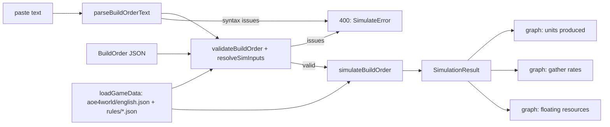
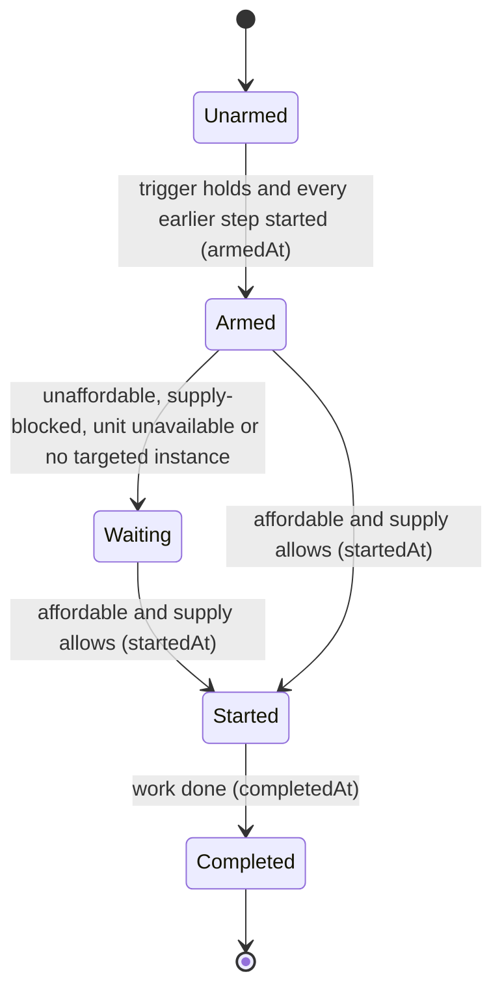

# AoE4 Build Order Simulator

The model the build order simulator follows, the data it reads, the build order format it accepts, its
input limits, and what it reports. Reviews judge the simulator's behavior against this doc. Each section
states the rule; the code and its tests implement it.

## Purpose and model

The simulator plays an *Age of Empires IV* build order step by step for the English civilization: villager
production, gathering, construction, research and age-ups. It returns one deterministic result per build
order and data set: when each step started and finished, and graphs over time of units produced, gather
rates and floating resources. English is the only civilization; other civilizations are a later extension
through the seams in Extension points.

The model treats the game as a small set of ordinary rules:

- Town centers and landmarks are ordinary buildings. They are built, produce and research like any other
  building.
- Villager producers (town center, King's Palace) are production buildings. By default each one produces
  villagers continuously ("optimal villagers") until a step changes its order. Each spawned villager walks
  to its producer's rally node.
- An age-up is a landmark build. There is no separate age-up action.
- Every construction pulls its builders off their resource for the whole build time; they gather nothing
  while walking and building. Build time depends on the builder count.
- Resources are infinite: a resource node never runs out.

Every quantity that could vary between games (walk time, idle time, distance to each resource) is a named
simulator input, never a constant inside the step logic. The result and the API response are additive: a
later spread of outcomes is a new field beside the existing ones, not a change to them.

## Determinism, bounds and resources

- **Same input, same result.** The simulator uses no randomness and never reads the clock, so the same
  build order, inputs and data always give an identical result.
- **Game numbers come from data.** Every game number (cost, build time, gather rate, supply) is read from a
  versioned data file that records its source; no game number is written into the simulation code.
- **Resources never go negative.** A step that cannot be afforded waits until it can, and the wait shows
  in its timing as `waitSeconds > 0`.
- **Every request finishes in bounded time.** Every numeric input has a bound in `SIM_INPUT_BOUNDS`, and an
  input outside its bound is an `out-of-range` issue; nothing is simulated.

A non-integer where an integer is required, and a non-finite number, are also `out-of-range`. The bounds
apply to JSON and paste input alike: a paste line is checked after it is parsed.

| field | type | min..max | default |
|---|---|---|---|
| text / steps | | 20,000 chars / 200 steps | |
| `durationSeconds` | int | 60..3600 | 1200 |
| `Trigger.seconds` | int | 0..3600 (the largest `durationSeconds`) | |
| `Trigger.count` (villagers) | int | 1..200 (the population cap) | |
| `produce.count`, `move.count` | int | 1..200 | continuous (produce) |
| `builders`, `houseBuilders` | int | 1..200 | 1 |
| `instance` | int | 1..200 | every instance |
| `walkSeconds` (`SimInputs`) and per-step `walkSeconds` (`produce`, `build`, `move`, `rally`) | number | 0..60 | `rules/base.json`; step: inherit |
| `start.villagers` values | int | 0..200 | the civ split |
| `walkSecondsCamp`, `walkSecondsTownCenter` | number | 0..60 | `rules/base.json` |
| `dropOffSeconds` | number | 0..30 | `rules/base.json` |
| `influenceCoverage` values | number | 0..1 | `{ mill: 1 }` |

Unknown extra properties on a build order, its `start`, its steps, their triggers and `inputs` are
ignored. Every omitted `inputs` field takes its default at any depth: `trips` merges per node and then
per field, and `influenceCoverage` per key, so `{ trips: { farm: { walkSecondsCamp: 3 } } }` changes only
that one value. A build order with more than 200 steps is one `out-of-range` issue, and its steps are not
checked. A hole in a `steps` array (index `i` with no element) is the same `syntax` issue on step `i` as a step
that is not an object; only library callers can send one, since JSON cannot carry holes.

The result is sampled every `sampleSeconds` = 5 seconds.

## Data sources

**Game data snapshot.** Costs, build times, production times and technology effects come from a pinned
snapshot of aoe4world data (github.com/aoe4world/data), committed as
`data/aoe4-build-order/aoe4world/english.json`. Its entries are copied verbatim and filtered to those whose
`civs` contain `en`; the file holds `{ source, units, buildings, technologies, upgrades }`. Its
`SnapshotSource` records `repo`, `commit`, `committedAt`, `fetchedAt`, `patch` (the game patch live on
`committedAt`, since upstream files carry none) and `patchSource` (the URL stating that patch).

**Hand-entered rules.** Values the snapshot lacks are entered by hand in two files:

- `data/aoe4-build-order/rules/base.json`, civilization-agnostic: `gatherNodes` (per-node rate, carry
  capacity, the effect properties that modify them, drop-off buildings and trip seconds), `builderScaling`,
  `maxPopCap` (200) and `walkSeconds`.
- `data/aoe4-build-order/rules/english.json`, the English overlay: `startingState`, `supply`, `effects`
  and `upgradeTargets`.

Every hand-entered value carries its own `source` and its own `unverified` label: as a `HandValue`, or,
for an overlay effect row, as fields of the `OverlayEffect` itself. Supply, the starting state, the overlay
effect rows, and the trip walk and drop-off defaults are labeled unverified. Not every value is: the sheep,
deer and boar carry capacities are observed in game and are not labeled unverified. The rules files are
the record of which value is which.

**Gather rates.** Raw per-resource rates come from the *Age of Empires* fandom wiki (Resource and Villager
pages): for example 0.75/s for sheep, farms, gold, stone and wood, and 0.69/s for berries since update
12.0.1974. Carry capacity is 10, and 25 for hunted meat. The trip model below combines rate and capacity.
Every node's rate and capacity (deer and boar included) and each one's source and label live in
`rules/base.json`; this doc does not restate them. The wiki-sourced gather rates are unverified, with no
patch stated.

**Builder scaling.** The construction formula comes from the wiki Villager page, Building construction
section, with no patch stated; it is unverified.

**Task-switch walk.** The base walk of 5 seconds per task switch (`walkSeconds` in `rules/base.json`) is an
unverified, unmeasured assumption: about 5-6 tiles at villager speed 1.12 tiles/s.

**Calibration and cross-check.** The trip walk and drop-off defaults in `rules/base.json` are tuned so
that effective rates land near the net effective rates of SichYuriy/aoe4-production-calculator; those
defaults are labeled unverified. The calculator's rates are otherwise a labeled cross-check in a test only,
and never a source of raw gather rates.

**Loading.** `loadGameData(civ)` is synchronous. It builds its `GameData` indexes (`byId`, `byBaseId` in
ascending age, `supply`, `upgradeTargets`) once per civilization and returns the same deep-frozen instance
on every call. It throws for a civilization with no data and for a duplicate `id`. Every id lookup goes
through those maps, so a user id such as `__proto__` finds nothing.

**Ids.** Build orders and rules reference aoe4world `baseId`s (`villager`, `town-center`, `house`,
`wheelbarrow`, `veteran-longbowmen`), never display names. The engine resolves a `baseId` to the
civilization's entry for the current age or tier.

**Patch policy.** The data reflects the current game only. There is no per-patch support: refreshing the
snapshot replaces it and records the new commit and patch. Effects the snapshot states only in description
text are listed in `data/aoe4-build-order/README.md` under Known data gaps.

## Model rules

**Starting state and population.** `startingState` in `rules/english.json` has exactly the fields `age`,
`resources`, `villagers`, `units` and `buildings`. `villagers` maps each gather node to the villagers on
it at t=0. `units` maps a unit `baseId` to the count of non-villager units present at t=0; English starts
with one scout. Starting units count toward population, so English starts at 7/10 (6 villagers and 1
scout), but they are not produced. Sheep are not units: sheep are the `sheep` gather node. The
`startingState` hook of `CivRules` may override the whole object. The starting values themselves live in
`rules/english.json`.

A build order's `start.villagers`, when present, replaces the civ's `villagers` split whole (omitted nodes
get 0). It is placed at t=0 with no walk, as the civ split is, and must sum to the civ's starting villager
count, the sum of `civData.startingState.villagers.value` (6 for English). `start.rally` is the rally node
for the starting villager producers. Both `start` fields are optional in the schema, and `start: {}` is
well-formed (not a `syntax` issue). An English order still needs `start.rally`, because its starting town
center is a villager producer.

**Ordering and triggers.** Steps run in list order. A trigger is either a time (`@m:ss`, meaning "not
before" that time) or a villager count (`at N vils`, counting villagers alive). A step arms when its
trigger holds and every earlier step has started; a step without a trigger arms as soon as the earlier
steps have started. Once armed, it waits until it is affordable and supply allows it, then starts.
`waitSeconds = startedAt - armedAt`. At the horizon, a step that never armed is `not-reached`, and a step
that armed but never started is `waiting`.

At one instant, steps start in list order before villagers spawn. A step armed by a spawn (a `villagers`
trigger) starts at that instant, after the spawn. So `@T rally` routes the villager spawning at T, and
`at N vils rally` routes villager N+1 onward.

**Priority.** At most one step is armed and not started at a time. While it waits on resources only, it
reserves its cost: a producer's order skips paying its next unit if that would drop any resource the unit
costs below the step's cost of that resource. A step waiting on supply, on an age or on a building
instance that does not exist reserves nothing. At one instant, steps start before orders pay, so a step
wins a tie with an order payment.

**Queues.** Each building instance has one queue, shared by production and research. A `produce` step on
a busy producer replaces its order (a switch); `pause` clears the order. A step names a building by
`baseId`, which applies to every instance, or by `instance` (1-based) for one.

Every villager producer instance starts with a continuous villager order, which a `produce` or `pause`
step replaces. When a counted `produce` spawns its last unit, the instance's order becomes empty; the
villager order does not resume. Only a research resumes the instance's own order. A unit is paid before it is queued: its resource cost and its population are taken
together, and only when every resource covers its cost and supply has room for it. Each instance runs its
paid units first in, first out, one at a time. An order pays its next unit only when its instance has no
paid unit left.

A `produce` step pays its first unit on every targeted instance that exists when it starts, so it waits
while it cannot pay all of them. It waits while no targeted instance exists, and it does not cover
instances built after it starts. A switch or a pause lets the unit in production and every paid unit
finish: nothing is cancelled and there is no refund. The old order's unpaid units are dropped. `pause`
costs nothing, completes the instant it arms, and is a no-op for an instance that does not exist (it is
not held for one built later).

A `research` step goes to `at` if given, else to the first building in the tech's `producedBy` (snapshot
order) that has an instance, and within that building to its lowest-numbered instance (instance 1 first).
Queue length is not consulted, `research` has no `instance` field, and a tech with no producing building
and no `at` never starts. With a capital town center and two town centers, `research textiles` goes to
the capital town center and `research textiles at town-center` to town center 1.

A `research` step pays its cost when it starts and is appended to its instance's paid units, behind any
unit already paid. It never replaces the instance's order, which resumes (pays its next unit) when the
research ends. It waits while no target instance exists or while the tech's age is not reached, and it
reserves resources only when it is short of resources alone.

**Tiers.** A produced unit is the entry for the highest tier whose upgrade has been researched, else the
lowest-age entry for its `baseId`. `upgradeTargets` maps an upgrade `baseId` to the unit `baseId` it
upgrades, because aoe4world's `unlocks` is empty; the target tier is the unit entry whose `age` equals the
upgrade's `age`. A veterancy upgrade occupies its building's queue for its research time, and units
paid afterwards are the upgraded tier. A unit's tier is fixed when paid: a unit paid before an upgrade
completes keeps the lower tier. An upgrade with no unit entry at its age does not change the tier.

**Ages and landmarks.** A building whose `classes` match `^age[1-3]_landmark\d$` advances the age from its
`age` to `age + 1` when it completes, so any landmark reaches the next of the four ages. The age advances
only when the landmark's `age` equals the current age: a second landmark of an age already passed moves
nothing. Entries whose `age` is above the current age are unavailable. Entries of the new age are usable
at the instant of the age-up: steps and order payments are re-checked then. An age-up never changes a paid
item or a running production time; a unit paid before it spawns as the entry it was paid as. On a build's
completion the engine adds the instance, calls `onBuildingComplete`, advances the age, then calls
`onAgeAdvance`.

**Trip model.** A gathering villager repeats a cycle:

`cycle = capacity / rate + walk / moveSpeedMultiplier + dropOffSeconds`, and effective rate = `capacity / cycle`.

`rate` and `capacity` are the node's values after technology effects. `walk` is the node's
`walkSecondsCamp` when a building in the node's `dropOffs` exists (mill, lumber camp, mining camp), else
`walkSecondsTownCenter`. `moveSpeedMultiplier` is the villager `moveSpeed` multiplier from technology
effects (Wheelbarrow raises it). Income is credited continuously at the effective rate, not per trip.

**Task-switch walk.** Moving villagers between tasks costs one generic base walk, `SimInputs.walkSeconds`
(default from `rules/base.json`). A step's own `walkSeconds`, when present, overrides it for every villager
movement that step causes. The effective walk is
`(step.walkSeconds ?? inputs.walkSeconds) / moveSpeedMultiplier`, the same villager `moveSpeed` multiplier
the trip model uses, read when the walk starts. The villager is idle and gathers nothing while walking. The
walk is paid:

- once per villager on `move`, from `from` to `to`;
- twice on `build`: once to the site, then once from the site to `then`;
- once per spawned villager, from spawn to its producer instance's rally node. The walk is
  `(source.walkSeconds ?? inputs.walkSeconds) / moveSpeedMultiplier`, where the source is the `rally` step
  or `produce` that set the rally; a `start.rally` route uses `inputs.walkSeconds / moveSpeedMultiplier`;
- for both legs by auto-house builders, at `inputs.walkSeconds / moveSpeedMultiplier` (no step to override it).

The trip model's per-node `walkSecondsCamp`, `walkSecondsTownCenter` and `dropOffSeconds` model the gather
cycle, not task switches.

**Rally rules.** A rally sends each villager a producer spawns to a gather node.

- Villager producers are the `producedBy` buildings of the civ's `villager` entries (English
  `capital-town-center`, `town-center` and `kings-palace`).
- Each producer instance holds a rally state `{ node, walkSeconds? }`.
- Two writers set it: a `rally` step, and a villager `produce` with `rally`. The last writer wins, from the
  writer's `startedAt`. A writer's scope is its `instance`, or with no `instance` every existing instance of
  the `baseId` plus the default for that `baseId`'s later instances.
- A new instance takes its `baseId` default, else `start.rally`.
- An instance-scoped rally for an instance not yet built is held for it.
- Villagers already spawned are never re-routed; `move` does that.
- A `rally` step has no cost and no supply: `startedAt = completedAt = armedAt`, `waitSeconds` is 0 and its
  status is `completed`. Its `walkSeconds` applies to the walk of every villager it routes.
- Same-instant order is in Ordering and triggers.
- The validation rules in Issues guarantee a rally is in effect whenever a villager spawns, so the engine
  reports no rally error.

**Construction.** Build time with N builders = base build time x 3 / (N + 2), the `builderScaling`
numerator 3 and offset 2 in `rules/base.json`:

| builders | 1 | 2 | 4 | 8 |
|---|---|---|---|---|
| share of base build time | 100% | 75% | 50% | 30% |

A `build` step pays the building's cost when it starts. Its builders come from the villagers gathering at
`from`; the step waits while fewer than `builders` gather there. Builders count as villagers for an
`at N vils` trigger throughout. Construction starts when they arrive at the site. The building counts for
nothing until it completes: its supply, its instance and its drop-off appear at that instant, which is
also the step's `completedAt`. The builders then walk to `then` (default `from`). A `build` step waits
while its building's entry is above the current age, while `from` has too few gatherers, or while its cost
cannot be paid; only the last reserves resources.

A `move` step waits until `count` villagers gather at `from`, costs nothing, and takes them off `from`
for the walk. Its `completedAt` is their arrival at `to`.

**Houses and supply.** `supply` in `rules/english.json` gives the supply each building provides; total
supply is capped at `maxPopCap`, 200. With `autoHouses` on (the default), the simulator builds houses on
its own so supply does not block production. At every instant, after production starts, it projects the
population one lead ahead, where the lead is the builders' walk to the site plus the house build time with
`houseBuilders` builders. The projection adds to the current population the combined rate of every
producer with an order, in population per second. When it passes the supply plus the supply of buildings
under construction, enough houses start at once to cover the difference, each with its own `houseBuilders`
builders; houses run concurrently. Planning stops once supply plus pending supply reaches `maxPopCap`.

`houseBuilderSource` is the preferred node. When it has fewer than `houseBuilders` villagers gathering,
builders come from the node with the most gatherers (ties: the first in node order, `sheep, berry, deer,
boar, farm, wood, gold, stone`). Builders walk `inputs.walkSeconds / moveSpeedMultiplier` each way and return to the node they
came from. A house pays its whole cost (all four resources) when it starts. A house waits only when no node
has enough gatherers or a resource of its cost is short; supply may block production meanwhile. Auto-houses
are not order payments: they ignore a waiting step's resource reservation, and never take a resource below
zero.

Auto-houses are off until the last `build house` step in the order has started, and on from then; if that
step never starts they stay off; with no `build house` step they are on from the start. With
`autoHouses: false` production blocks at supply until a `build house` step adds more.

**Farms and mill coverage.** A farm costs its snapshot cost and holds one villager. `influenceCoverage`
gives, per building `baseId`, the share of gatherers inside that building's influence once one exists;
the default is `{ mill: 1 }`.

**Overlay effects.** `effects` in `rules/english.json` are `OverlayEffect` rows in the aoe4world effect
schema, each active once its `grantedBy` (`civ`, or a building or technology `baseId`) is built or
researched, and each with its own `source` and `unverified` label. An optional `condition` holds only when
all its present fields hold:

- `age`: the current age is exactly this age.
- `nearBuilding`: the effect applies to the `influenceCoverage` share of gatherers for that building.
- `producer`: holds only when the modified value is a production time at an instance of that building.

A modified value is the base value plus every applying `change`, then multiplied by every applying
`multiply`. A missing `influenceCoverage` entry for a `nearBuilding` counts as 0, so the effect does nothing.

`productionSpeed` is a speed: production time = `costs.time` divided by the product of its multipliers.
The English farm bonus near a mill is four rows, one per age, with the wiki values +20%, +25%, +30% and
+30% by age, unverified. The King's Palace villager production bonus, +10%, is a `productionSpeed`
`multiply 1.1` row on `villager`, granted by `kings-palace` and conditioned on `producer: 'kings-palace'`.

**Coverage.** Modeled:

- villager production (town center, King's Palace +10%);
- gathering sheep, berries, hunt (deer and boar), farms, wood, gold and stone;
- mill, lumber camp and mining camp drop-offs;
- farms (cost, one villager per farm, mill coverage as an input, English farm bonus near a mill, wiki
  values +20/25/30/30% by age);
- generic military production: any production building queues any unit from the data, with continuous,
  pause and switch orders, and no combat;
- age-ups to all four ages via any landmark;
- every English technology whose effects use supported properties (gather rate, carry capacity, move
  speed, production speed);
- combat-only technologies (Blacksmith, University: hitpoints, attack and similar), accepted for cost and
  queue time with the effect ignored; technologies whose effects aoe4world lists as `unknown` (such as
  `forestry-1`) are rejected with a clear error;
- unit veterancy upgrades, researched at their building from data, after which produced units are the
  upgraded tier and the units-produced graph shows tiers apart;
- houses, starting state and the population cap.

Later: Council Hall longbow production speed, Network of Castles, Abbey of Kings. Out: sacred sites,
relics, trade, fishing, cattle, and resource depletion.

## Technologies

`SUPPORTED_EFFECT_PROPERTIES` are `foodGatherRate`, `woodGatherRate`, `goldGatherRate`, `stoneGatherRate`,
`farmGatherRate`, `berryGatherRate`, `huntGatherRate`, `carryCapacity`, `huntCarryCapacity`, `moveSpeed`
and `productionSpeed`. `IGNORED_EFFECT_PROPERTIES` are the combat properties (`hitpoints`, `meleeAttack`,
`rangedArmor` and others), enumerated from the snapshot's English technologies in `effects.ts`.

`classifyTech` returns a `TechSupport` by checking, in this order:

1. Any effect `property` is `unknown` (`forestry-1`): rejected as `unknown-tech-effect`.
2. Any property in neither set, or a supported property whose `effect` is not `change` or `multiply` or
   whose `type` is not `passive`: rejected as `unsupported-tech`. `buildTime` is in neither set, so
   `military-academy` and `lightweight-beams` are rejected rather than silently mis-timed.
3. Any property in `IGNORED_EFFECT_PROPERTIES`: `effects-ignored`. The technology costs resources and
   queue time and applies its supported effects. Each research step of it gets one `tech-effect-ignored`
   note naming the ignored properties, reached or not, in step order.
4. Empty or absent `effects` (`admiralty`) and no `OverlayEffect` with `grantedBy` equal to its
   `baseId`: `effects-unmodeled`. It costs resources and queue time like any technology, and each research
   step of it gets one `tech-effect-unmodeled` note with empty `properties`, worded so the user sees its
   effect is not simulated. With such an overlay row it is `supported`.
5. Otherwise: `supported`.

An upgrade (`type: 'upgrade'`) is supported if and only if `upgradeTargets` lists it; otherwise it is
rejected as `unsupported-tech` with `property: 'upgradeTargets'`. A rejection is a `BuildOrderIssue`
naming the technology and the property.

Effects stated only in a technology's description text, beside non-empty `effects`, are not detected.

## Build order input

**JSON.** A `BuildOrder` is `{ civ, name, source?, start?, steps }` with `civ` = `english`.
`BuildStart` is `{ villagers?, rally? }`: `villagers` maps gather nodes to villager counts at t=0 (see
Starting state), and `rally` is the rally node for starting villager producers. Each `BuildStep` has an
optional `trigger` and one `action`:

| action | fields |
|---|---|
| `produce` | `producer`, `instance?`, `unit`, `count?` (absent = continuous), `rally?` (villager only; sets the producer's standing rally), `walkSeconds?` (only with `rally`) |
| `pause` | `producer`, `instance?` |
| `build` | `building`, `builders?` (default 1), `from`, `then?` (default `from`), `walkSeconds?` |
| `research` | `tech`, `at?` (technologies and veterancy upgrades) |
| `move` | `count`, `from`, `to`, `walkSeconds?` |
| `rally` | `producer`, `instance?`, `to`, `walkSeconds?` |

A trigger is a tagged object: `{ "kind": "time", "seconds": 90 }` or `{ "kind": "villagers", "count": 17 }`.
An unknown `kind` is an `unknown-trigger-kind` issue. Gather nodes (`GatherNodeId`) are `sheep`, `berry`,
`deer`, `boar`, `farm`, `wood`, `gold` and `stone`.

**Paste format.** One step per line. `#` comment lines and blank lines are ignored. An optional trigger
prefix comes first, then the action:

| line prefix | trigger | action syntax |
|---|---|---|
| `@m:ss ` | time | `produce <unit> from <producer>[#k] [xN] [-> <node>] [walk Ns]` |
| `at N vils ` | villagers | `pause <producer>[#k]` |
| (no prefix) | no condition | `build <building> [with N] from <node> [then <node>] [walk Ns]`; `research <tech> [at <building>]`; `move N <node> to <node> [walk Ns]`; `rally <producer>[#k] -> <node> [walk Ns]` |

One example per action; each line is a separate example:

```text
# opening
start 4 sheep 2 wood -> sheep
produce villager from capital-town-center x3 -> sheep walk 4s
@0:45 build house with 2 from wood then wood walk 6s
at 9 vils build mill from sheep then berry
research wheelbarrow at mill
move 3 sheep to berry walk 5s
@6:00 build council-hall with 4 from wood then gold
produce longbowman from archery-range#1 x5
research veteran-longbowmen
pause capital-town-center#1
rally capital-town-center#1 -> wood walk 3s
```

Grammar details:

- `@m:ss` is `@\d+:\d\d`: any number of minute digits and exactly two seconds digits, `00` to `59`.
  `@1:61` is a `syntax` issue; `@75:00` parses, then fails the 3600 s bound as `out-of-range`; `@60:00`
  is valid.
- On a `produce` line the suffixes are ordered `[xN]`, `[-> node]`, `[walk Ns]`; any other order is a
  `syntax` issue.
- `walk Ns` is always last on `produce`, `build`, `move` and `rally` lines: the keyword `walk`, a space, an
  integer, and `s` with no space (`walk 6s`).
- A `produce` walk without `-> node` (in JSON, `walkSeconds` without `rally`) is an `invalid` issue.
- Walk values in paste text are integers; JSON may use decimals.
- `xN` takes no space (`x5`), `#k` follows the producer with no space (`capital-town-center#1`), and `->` is
  delimited by whitespace.
- Whitespace between tokens is any run of spaces, tabs, `\r`, U+00A0 (no-break space) and U+202F (narrow
  no-break space). Lines are split on `\n` only.
- Ids (unit, producer, building, technology) and node names are lowercase kebab-case
  `[a-z0-9]+(-[a-z0-9]+)*` and case-sensitive. Uppercase or other characters are a `syntax` issue; input
  is never lowercased for the user.
- Keywords are lowercase. Numbers are unsigned decimal integers, with no sign and no decimals.
- The `start` line is `start [N <node>]... [-> <node>]` with at least one part, for example
  `start 4 sheep 2 wood -> sheep`. There is at most one, before every step line, with no trigger prefix. A
  repeated node, a second `start`, or a `start` after a step is a `syntax` issue. Only a step line that
  parsed counts as a step here: a line that fails to parse is its own issue and does not make a later `start`
  an issue. A `start` line that fails to parse still counts as the first `start`. `formatBuildOrderText`
  emits it first, with nodes in `GatherNodeId` order.

**Issues.** Problems with the input are `BuildOrderIssue`s `{ code, message, step?, line? }`. A validation
issue on a parsed paste step carries both `step` and the 1-based `line`; a `syntax` issue raised while
parsing a paste line carries `line` only, as does a paste `start` issue; a JSON
step issue carries `step` only and a JSON `start` issue carries neither. The codes are complete and the
same for JSON and paste:

| code | meaning |
|---|---|
| `syntax` | text cannot be parsed, or JSON structure is wrong: bad paste grammar, a step that is not an object, a missing or mistyped field, an unknown `action` value, a wrong-typed `trigger` |
| `unknown-trigger-kind` | the trigger's `kind` is not `time` or `villagers` (an omitted trigger means no condition) (paste: unknown line prefix is `syntax`) |
| `unknown-id` | a well-formed id not in the civilization's data (unit, producer, building, technology, node, civilization), including an unknown `start` node key |
| `unsupported-tech`, `unknown-tech-effect` | a technology rejected by `classifyTech` |
| `out-of-range` | a number outside `SIM_INPUT_BOUNDS` (including a `start.villagers` value outside 0..200), a non-integer, or a non-finite number |
| `invalid` | well-formed, known ids, in range, but a cross-field rule fails (the rules below) |

Shape or spelling is `syntax`; value size is `out-of-range`; a field combination is `invalid`. The six
`invalid` rules for `start` and rally are:

- `start.villagers` values do not sum to the civ's starting villager count;
- `walkSeconds` without `rally` on a `produce`;
- `rally` on a `produce` whose unit is not a villager;
- a `rally` step whose `producer` is a known building that produces no villagers;
- no `start.rally` while a starting building is a villager producer;
- a `build` of a villager producer with no `start.rally` and no earlier `rally` or `produce` source for that
  `baseId` without `instance` (baseId-wide).

Three more `invalid` rules cover producers and research:

- a `produce` whose `producer` is not a `producedBy` building of any entry of its `unit`
  (`produce villager from house`);
- a `research` with `at` where `at` is not a `producedBy` building of the technology
  (`research wheelbarrow at house`); without `at` there is no check;
- a `research` of a technology an earlier `research` step already names, with or without `at`; the issue is
  on the later step and names the earlier one.

These three run only once the step's ids resolve, so an `unknown-id` step gets no second issue, and a
technology that is unknown or rejected does not count as an earlier research. The simulator assumes all
nine rules hold and has no runtime check for them.

A villager `produce` without `rally` is valid and uses the standing rally. Each issue is reported on its
step or `start`, with the location fields above. A message names the step or line and the offending id,
kind or property. Any issue stops the request; nothing is simulated.



## Route

`POST /api/aoe4-build-order/simulate` (`operationId: simulateBuildOrder`) runs one simulation. The request
is a `SimulateRequest` with exactly one of `text` (paste format, at most 20,000 characters) or
`buildOrder` (JSON, at most 200 steps), and optional `inputs`, a `SimInputOverrides` whose absent fields
take their defaults at any depth (`trips` per node, then per field; `influenceCoverage` per key). A key
whose value is `null` counts as present, so `text: null` beside `buildOrder` is the both-present `syntax`
issue. Longer `text` is one `out-of-range` issue and is not parsed.

- **200:** the `SimulationResult`.
- **400:** `SimulateError` `{ error, issues, omittedIssues? }`. The order (`text` or `buildOrder`) is
  checked first and `inputs` second, and both always run, so order issues come first, then inputs issues.
  The combined list is then capped at `MAX_REPORTED_ISSUES` = 100: `issues` holds the first 100 in that
  order, so inputs issues past the 100th are dropped too, and `omittedIssues` is the number dropped,
  present only when above 0 (100 issues give no `omittedIssues`, 101 give `1`). `error` is the first issue's
  message. A body that is not a JSON object (an array, string, number or `null`) gives one `syntax` issue
  and nothing else is checked. A validation issue on a pasted step carries `line` and `step`; a `syntax`
  issue raised while parsing a paste line carries `line` only; a pasted `start` issue carries `line` only;
  a JSON step's issue carries `step` only; a JSON `start` issue and `inputs` issues carry neither.
- **405:** `{ error }` with an `Allow: POST` header, for any other method.
- A body that is not valid JSON keeps Next's plain-text 400 `Invalid JSON`, and a body over Next's 1 MB
  default limit is its plain-text 413; neither reaches the handler.

`docs/api/openapi.json` is the authoritative request and response contract, with schema names equal to the
TypeScript names in `lib/aoe4-build-order/api.ts` and `model.ts`; this doc does not copy its field lists.

## Outputs

A `SimulationResult` holds:

- `civ`, `durationSeconds` and `sampleSeconds` (5).
- `times`: the sample times in seconds, `0, s, 2s, ...` for `s` = `sampleSeconds`, up to and including
  `durationSeconds`. When `durationSeconds` is not a multiple of `s`, the last sample is `durationSeconds`
  itself, after the last multiple below it. Every series below has one value per sample. The t=0 sample
  reflects the state after the zero-time steps at t=0 have started.
- `unitsProduced`: one `UnitSeries` per unit entry and tier (`unitId`, `baseId`, `name`, `tier`, the
  entry's age), ordered by first spawn time, then `unitId`, with cumulative `counts` of produced units. Starting units are not produced and never
  appear in it, so every series starts at 0.
- `gatherRates`: per `ResourceKind` (`food`, `wood`, `gold`, `stone`), the income rate per minute.
- `floating`: per `ResourceKind`, the banked, unspent amount.
- `steps`: one `StepTiming` per step with `status`, `armedAt`, `startedAt`, `completedAt` and
  `waitSeconds`. `status` is one of `completed`, `in-progress`, `waiting` or `not-reached`.
- `ages`: each age reached and its `reachedAt` time.
- `notes`: `BuildOrderNote`s, non-fatal, one per research step of a technology whose effects are not all
  simulated, whether or not the step is reached, in step order: `tech-effect-ignored` (ignored combat
  properties listed) and `tech-effect-unmodeled` (empty `properties`).
- `depletions`: `NodeDepletion`s (`node`, `amount`, `depletedAt`), one per finite node ref the run uses, in
  node-ref order: `node` is a finite node (`sheep`, `berry`, `deer`, `boar`, `gold`, `stone`) or a numbered
  gold deposit (`gold#2` to `gold#8`), `amount` its starting stock (`null` when infinite), and `depletedAt`
  when it ran out (`null` if it still had stock at the horizon).
- `warnings`: non-fatal `SimWarning`s, each with a `code` (`node-depleted`, `idle-arrival` or `step-stuck`),
  a `severity` (one of `error`, `warning`, `info`), a `message` and an `at` time. They are sorted by `at`;
  at the same `at`, node warnings come first in node-ref order with `node-depleted` before `idle-arrival`
  for one node, then `step-stuck` by step index.
- Both `depletions` and `warnings` are always empty today, because no node runs out: the engine still
  treats every node as infinite.

The page draws three graphs over time from it: units produced (by unit and tier), gather rates, and
floating resources.

The life of one step is shown below. The diagram is conceptual: its states are not values in the result.
At the horizon each state maps to a `StepTiming.status`:



| state at the horizon | `StepTiming.status` |
|---|---|
| Unarmed (trigger not met, or an earlier step not started) | `not-reached` |
| Armed or Waiting, not started | `waiting` |
| Started, not completed | `in-progress` |
| Completed | `completed` |

A step waits while it cannot be paid, while supply has no room, while the unit's entry is above the
current age, or while no building instance it targets exists. A `build` step also waits while its
building's entry is above the current age or while fewer than `builders` villagers gather at `from`; a
`move` step waits while fewer than `count` villagers gather at `from`. A `produce` step completes when no
instance carries its order any more: a counted one at the spawn of its last unit on the last instance, a
continuous one (or a counted one replaced early) when a later `produce` or `pause` on that producer
starts. `rally` and `pause` complete the instant they start; `build` completes when the building does,
`move` when its villagers arrive, and `research` when its research time ends.

### Page

The page is `/apps/aoe4-build-order`. Its controls are a prebuilt build select, a paste textarea, a
`durationSeconds` number input (default 1200) and a run button. Choosing a prebuilt build replaces the
text with that build's paste text; editing the text leaves the select as it is. Run posts the text and
`inputs.durationSeconds` to the route. The duration is not checked in the browser: an empty or
non-numeric entry is sent as 0, and the route rejects any value outside its bounds.

A 200 draws three line charts, each with a toggleable legend:

| chart | series keys | series names |
|---|---|---|
| Units produced | each `unitsProduced` `unitId`, in result order | `<name> (tier <tier>)` |
| Gather rates (per minute) | `food`, `wood`, `gold`, `stone` | `Food`, `Wood`, `Gold`, `Stone` |
| Floating resources | `food`, `wood`, `gold`, `stone` | `Food`, `Wood`, `Gold`, `Stone` |

Each series' line carries its key as `data-series`. Clicking a legend item hides that series and clicking
it again restores it. When `notes` is non-empty, a notes list shows each note's technology id and
message; with no notes there is no list.

A 400 shows every returned issue's `message` (each names its line or step) and removes any earlier charts.
When the body has `omittedIssues`, the list ends with one more item, "N more issues not shown." Any
other HTTP failure shows "The simulation could not be run (HTTP <status>)."; a request or response-body
error shows "The simulation could not be run. Please try again."

Prebuilt builds live in `data/aoe4-build-order/builds/`, one `BuildOrder` JSON file per build, each
with a `source`. Every prebuilt build is paste-representable: it re-parses from its own paste text to the
same `start` and `steps`.

## CivRules seams

`CivRules` in `lib/aoe4-build-order/civ-rules.ts` is the set of per-civilization code hooks, all
optional:

| hook | kind |
|---|---|
| `gatherRateModifier` | value |
| `productionModifier` | value |
| `supplyProvider` | value |
| `villagerProducer` | value |
| `dropOffRule` | value |
| `startingState` | value |
| `onBuildingComplete` | event |
| `onAgeAdvance` | event |

A value hook is `(defaultValue, ctx) => value`; an event hook is `(state, ctx) => void`. The engine calls
every hook as `rules.hook?.(...) ?? default`, so an absent hook leaves the default behavior.
`onBuildingComplete` is called once per completed building, after its instance exists, and `onAgeAdvance`
after a landmark moves the age, in the order given in Ages and landmarks. English needs
none: `civRules('english')` returns `NO_CIV_RULES`, a frozen `{}`. English bonuses that the data can
express, such as the farm bonus and the King's Palace bonus, are `OverlayEffect` rows, not hooks.

## Extension points

Each direction below is additive: it adds data, a field or a branch at the named seam and leaves existing
fields and results unchanged.

| direction | seam |
|---|---|
| Other civilizations | a new `CivId` value with `aoe4world/<civ>.json` and `rules/<civ>.json`; the engine keys on ids only; `CivRules` hooks for rules the data cannot express |
| Event or resource triggers, combinators | a new `Trigger.kind`, handled in one `triggerHolds(trigger, state)` switch in `simulate.ts`; validation keeps rejecting unknown kinds |
| A spread of outcomes | every variable quantity is already in `SimInputs` and the simulator uses no randomness or clock; a `spread` field on `SimulationResult` and `runs` and `seed` on `SimulateRequest` |
| New step kinds (idle, sacred sites, trade) | `BuildStep` is tagged on `action`; one handler per action |
| Military rally points, more `start` fields (resources, units) | an optional `unit` on the `rally` step; new optional `BuildStart` fields |
| More technology effects (`buildTime`, `influence`), combat | move a property into `SUPPORTED_EFFECT_PROPERTIES` and the interpreter; `IGNORED_EFFECT_PROPERTIES` shrinks |
| More English bonuses (Council Hall, Network of Castles, Abbey of Kings) | `OverlayEffect` rows in `rules/english.json`; no code |
| Depletion, positions, per-trip deposits | `gatherNodes` data and `TripInputs`; rates and crediting live only in `gather.ts` |
| More series or notes (rates by node, idle villagers) | new `SimulationResult` fields; new `BuildOrderNote` codes |
| Community build order formats | a new parser beside `parseBuildOrderText` that produces a `BuildOrder` |
