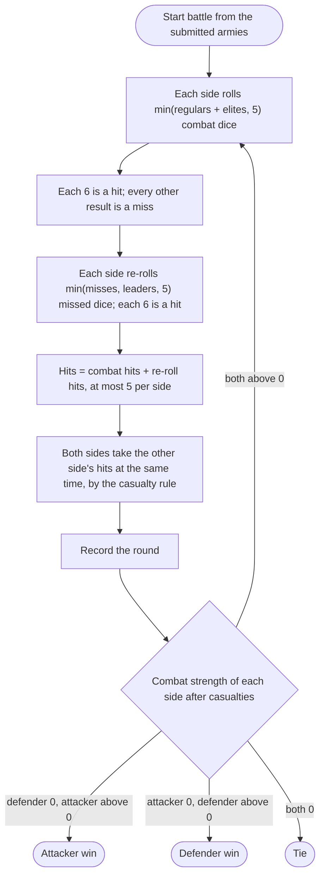

# WOTR Combat Simulator

The rules the combat simulator follows, its input limits, and what it reports. Reviews judge the
simulator's behavior against this doc.

Each section states the rule. Where today's code does something different, a short note labeled
**Current code** says what the code does now; a planned change brings the code in line with the rule.
A Current code note describes behavior being replaced. It is never a rule.

## Purpose and model

The simulator estimates the outcome of a *War of the Ring* field battle. Combat odds depend on how both
armies change from round to round, so they are hard to work out by hand. Instead the simulator runs N
independent battles between the same two armies and reports how often each outcome occurs.

One side attacks and one side defends. Both sides follow the same combat rules; the roles only label
the sides in the results.

## Armies

Each side is made of three kinds of unit:

- **Regulars** and **elites** are combat units. A side's combat strength is regulars + elites.
- **Leaders** give leadership. A side's leadership is its number of leaders and nothing else.

Leaders never take casualties and never roll combat dice. A side whose combat strength reaches 0 is
eliminated, however many leaders it still has.

## Round order

A battle is a sequence of rounds. Each round runs these steps in order:

1. **Combat roll.** Each side rolls combat dice equal to min(regulars + elites, 5).
2. **Hits.** A die hits on a 6 only.
3. **Leader re-roll.** Each side re-rolls some of its missed combat dice: re-rolls =
   min(misses, leaders, 5). A re-rolled die hits on a 6 only.
4. **Total hits.** A side's hits for the round are its combat-roll hits plus its re-roll hits. Because
   a side rolls at most 5 combat dice and re-rolls only dice that missed, a side scores at most 5 hits
   per round.
5. **Casualties.** Both sides take casualties at the same time. Both sides finish rolling before either
   side loses a unit, so a unit lost this round still rolled this round. Each side takes the other
   side's hits, applied one at a time by the casualty rule below.
6. **Record.** The round is recorded: its number and each side's hits.
7. **Repeat** while both sides have combat strength above 0.

The battle ends with one of three outcomes:

- **Attacker win:** the defender has combat strength 0 and the attacker does not.
- **Defender win:** the attacker has combat strength 0 and the defender does not.
- **Tie:** both sides reach combat strength 0 in the same round.

## Casualties

The casualty order is fixed on purpose. In the board game the player who takes the hits chooses the
losses; the fixed order stands in for that choice.

A side takes its hits one at a time. For each hit, with units = regulars + elites:

- **More than 5 units:** remove a regular. If the side has 0 regulars, downgrade an elite to a regular
  instead, which leaves combat strength unchanged.
- **5 or fewer units:** downgrade an elite to a regular if the side has one. Otherwise remove a regular.

Hits beyond what it takes to eliminate a side are discarded. Leaders are never casualties.

## Input bounds

Each side is submitted as three whole numbers: regulars, elites, and leaders. Per side:

- Regulars and elites are each 0 or more, and regulars + elites is at most 10.
- Leaders are 0 to 5 and do not count toward the 10.
- Regulars + elites = 0 is invalid. An army of only leaders is invalid.

A request that breaks any of these is rejected and no battle is run. That covers a side with more than
10 regulars + elites, more than 5 leaders, 0 regulars + elites, or a value that is negative or not a
whole number.

The army form offers 0 to 10 regulars, 0 to 10 elites, and 0 to 5 leaders per side. The form does not
stop a combination the server rejects, such as 10 regulars and 10 elites.

**Current code:** the form offers 0 to 9 regulars, 0 to 9 elites, and 0 to 5 leaders, and the server
checks none of these bounds. A side with 0 regulars + elites today produces a battle of 0 rounds and
non-numeric average hits.

## Number of battles N

A request may ask for N battles. N defaults to 1000 when the request does not give it, and N is at
most 100,000.

A request for N = 100,000 completes within 10 seconds.

**Current code:** each request runs exactly one battle, and N is not accepted.

## Independence of battles

Every battle starts from the submitted armies. Nothing from one battle carries into another: not
casualties, not round counts, not dice. The N results are N independent samples of the same matchup.

**Current code:** the battle changes the parsed army objects in place as casualties are taken. With
one battle per request this goes unnoticed; running a second battle on the same objects would start it
from the first battle's survivors.

## Outcome reporting

The simulator reports the statistics below over all N battles. This section defines what each
statistic means. Field names and the response format are documented in the API spec,
`docs/api/openapi.json`.

**Outcome frequencies.** The number of attacker wins, defender wins, and ties, each as a count and as a
share of N. A tie is a battle in which both sides were eliminated in the same round.

**Rounds per battle.** Over all N battles, ties included: the mean, median, 10th percentile (p10), and
90th percentile (p90) of the number of rounds. Percentiles use the nearest-rank method: sort the N round
counts in ascending order; the p-th percentile is the value at 1-based rank ceil(p / 100 × N). The median
is p50 by the same method. Every percentile is therefore a whole number of rounds.

**Surviving units.** For each side, over the battles that side won: the number of battles that ended
with each (regulars, elites) combination left on that side. Regulars and elites are kept as separate
coordinates, not summed, so (3, 1) and (2, 2) are different results. Ties contribute no survivors.

**Hits per round.** For each side: the share of all rounds, across all N battles, in which that side
scored 0, 1, 2, 3, 4, and 5 hits.

**Current code:** the response describes one battle: its number of rounds, a `survivor` value of
`attack`, `defend`, or `n/a` (the tie case, both sides eliminated), each side's average hits per round,
and both armies as they stand at the end of the battle.

## Departures from the published game

The simulator differs from the published *War of the Ring* rules in these ways. The owner has confirmed
each one as intended.

- **Fight to elimination**. Battles always continue until a side is eliminated. There
  is no retreat and no choice for the attacker to stop attacking between rounds.
- **No combat cards**. Neither side plays combat cards.
- **No sieges or sorties**. Every battle is a field battle; strongholds, sieges, and
  sorties are not modeled.
- **Shadow attacks, Free Peoples defend**. The results view always labels the attacker
  as Shadow and the defender as Free, whatever the actual sides.

### Extension points

Later termination rules, such as a round limit or the attacker retreating, plug in at three places in
`lib/combat-simulator/battle.ts`: the stop check `shouldStop`, the `BattleOptions` argument to
`Battle`, and the outcome list `OUTCOME_KINDS`. None of these rules is modeled today; every battle
still ends only on elimination.

## Not modeled

- **Character and Nazgul leadership.** Companions, Minions, and Nazgul that add leadership are not
  modeled; leadership comes only from the leaders count. Support for them is planned for a later
  release.
