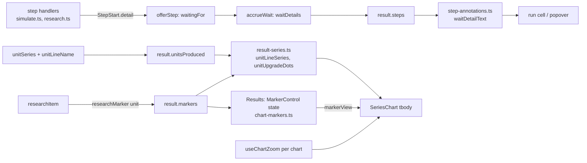

# M11: Technical design

AoE4 workbench: readable results charts and clear step waits. Exit criteria M11.1 to M11.8 in
MILESTONES.md (confirmed by the owner, Q113). M11.8 is owner evidence. This doc designs M11.1 to M11.7.

## Summary

The chart list in Results becomes one `<table>` whose row groups are the charts (M11.4); each chart keeps
its own time window, set by drag-selecting on the plot and cleared by a reset button in a zoom bar (M11.1).
A shared marker control above that table owns which marker kinds are drawn and which kind is labelled, for
every chart at once, and all marker code moves into one module (M11.3). The Units view draws one line per
unit line (summed tiers, key `baseId`, name from a new `UnitSeries.lineName`) with a dot where each
`upgradeTargets` upgrade of that line finished, found through a new `ChartMarker.unit` (M11.2). The engine
records, beside the generic `waitingOn`, a typed `waitingFor` detail and a per-target `waitDetails` list;
the step annotations print them, e.g. `still waiting for Castle Age (King's Palace)` (M11.5). A native
`<dialog>` opened from a button beside the page title explains the page and takes over the step-kind
legend (M11.6). Docs and specs follow (M11.7).

### Starting state (origin/main @ 87f0cd7, after M10)

| area | exists before the first M11 ticket |
|------|------------------------------------|
| Layout | One desktop layout from 1200 px (M10). `WorkbenchColumns` in `workbench-columns.tsx`; Results column content is about 534 px wide at 1200 and 624 px from 1400. `use-split-layout.ts` and the tabs are gone. |
| Results | `results.tsx` `Results` renders, inside `div[data-testid=results-last-good]`: `WarningMessages`, `InfoMessages`, visually hidden `chart-reorder-help` and `chart-order-status`, then one `SeriesChart` per id in `layout.order`. Chart config (title, y label, series fn, header controls) is a `Record<ChartId, …>` inside `Results`. View state (`GatherRatesView`, `UnitsProducedView`) is `useState` in `Results`, not stored. |
| One chart | `line-chart.tsx` `SeriesChart` renders `div.chart[data-testid=<chartId>]` (`data-label-rows`, `data-collapsed`, `data-dragging`) > `ChartHeader` (a `div`: handle, `h3`, caret, controls) + `div[data-testid=chart-body]` (recharts `ResponsiveContainer` height 360, `SeriesLegend`, per-chart `MarkerLegend`, `PinnedLegend`) + a hidden measuring `<svg>`. X axis `domain={['dataMin','dataMax']}`. Hidden series are `useState` in the chart. Marker hover/focus kind is `useState` in the chart. Geometry constants: `Y_AXIS_WIDTH 110`, `CHART_MARGIN_PX 5`, `X_AXIS_HEIGHT 40`, `LABEL_LINE_HEIGHT 14`. |
| Marker code | `MARKER_COLORS`, `MARKER_KIND_LABELS`, `markerLabel` in `chart-rows.ts`; `placeMarkers`, `PlacedMarker`, `ageUpMarkers`, `labelledMarkers`, `activeMarkerKind`, `liveMarkerKind` in `line-chart.tsx`; `MarkerLegend` in `chart-legend.tsx`; `CHART_MARKER_KINDS` in `lib/…/model.ts`. Each chart draws every current marker as a solid `ReferenceLine` (`chart-marker`), and the pinned run's age-ups dashed (`chart-pinned-marker`). |
| Units series | `result-series.ts` `unitSeries(run)`: one series per `unitsProduced` entry, key `unitId` (e.g. `spearman-3`), name `<name> (tier <tier>)`. `unitsProducedSeries(view, run)` (Key surface) picks it or `buildingSeries`. |
| Markers (engine) | `markers.ts` `researchMarker(entry, at)` → `{ kind, label: entry.baseId, at }`; `research.ts` `researchItem` pushes it on completion. `upgradeTargets` (English: 11 upgrades, e.g. `veteran-spearmen` → `spearman`, `elite-knights-or-lancers` → `knight`) is in `data.upgradeTargets`. |
| Chart layout | `chart-layout.ts` (`RESULT_CHART_IDS`, `ChartLayout` v1 in `localStorage` `aoe4-build-order.chart-layout`), `use-chart-layout.ts`, `chart-drag.ts` (`dropIndexAt`), `use-chart-drag.ts` (`DRAG_THRESHOLD_PX = 4`, not exported), `chart-header.tsx` (`ChartControls`, `chartHandleKey`, `ChartHeader`), `collapse-caret.tsx`. |
| Waits (engine) | `StepTiming { step, status, armedAt, startedAt, completedAt, waitSeconds, waitingOn, waitBreakdown }`. Handlers return `StepStart = { started: true } \| { started: false; waitingOn; reserve? }`. `offerStep` stores `waitingOn`; `accrueWait` adds interval seconds to `waitBreakdown[waitingOn]`. `constructing` lives on `Engine`, not `EngineState`. A `produce` never waits on a busy building (it takes the queue over) and a `research` joins the target's queue, so no step waits for a building to be free. |
| Waits (UI) | `step-annotations.ts` `stepRun` builds `blockedBy` as `<reason> <m:ss>` per non-zero breakdown reason in fixed order, then `still waiting on <waitingOn>`; `not reached (<waitingOn>)` for not-reached. Shown in `StepRunCell` (`step-blocked-by`) and the gutter popover (`annotationDetailText`). |
| Legends and hints | `StepKindLegend` (`step-kind-legend`) renders above the text editor (`build-text-editor.tsx`) and above the step table (`step-table.tsx`) while a result is shown. The yellow tint is `.warn` (`--bs-warning-bg-subtle`) on a run cell or gutter line whose step is `waiting`/`not-reached` or waited ≥ 60 s. No page-level help exists. |
| API | `docs/api/openapi.json` schemas `StepTiming`, `ChartMarker`, `UnitSeries` have `additionalProperties: false`; `acceptance/aoe4-simulate-api-contract.spec.ts` validates live responses against them, so a new result field fails acceptance until the schema has it. |
| Tests | Vitest has no DOM: component tests use `renderToStaticMarkup`/`renderToString` plus pure functions. Acceptance exemplars: `aoe4-chart-views.spec.ts` (chart helpers, `readLayout`, `lineEndYs`, `plotPoint`), `aoe4-build-order-step-band.spec.ts` (hover sequences). |

## Modules

| module (path) | owns | public functions or exports | used by |
|---------------|------|-----------------------------|---------|
| `lib/aoe4-build-order/model.ts` | result types | `StepWaitDetail`, `StepWaitEntry`, `BreakdownReason`; `StepTiming.waitingFor`, `StepTiming.waitDetails`; `ChartMarker.unit?`; `UnitSeries.lineName` (C1–C4) | engine, page, specs |
| `lib/aoe4-build-order/wait-detail.ts` (new, browser-safe: type imports from `simulate.ts`, value imports only from `model.ts`, `engine-common.ts`, `landmarks.ts`) | building, keying and wording wait details | `ageWait`, `buildingWait`, `resourceWait`, `villagerWait`, `populationWait`, `waitReasonOf`, `waitTargetKey`, `waitDetailText` (C5, C6) | `simulate.ts`, `research.ts`, `step-annotations.ts` |
| `lib/aoe4-build-order/simulate.ts` | handlers report a detail; `offerStep` stores it; `accrueWait` accrues `waitDetails` | `StepStart` (C7), `EngineState.constructing` (moved from `Engine`), `accrueWait` (signature unchanged) | engine |
| `lib/aoe4-build-order/research.ts` | research handler detail; marker `unit` | `researchHandler` (unchanged signature) | engine |
| `lib/aoe4-build-order/markers.ts` | marker construction | `researchMarker(entry, at, unit?)` (C3) | `research.ts` |
| `lib/aoe4-build-order/unit-lines.ts` (new) | unit line display name | `unitLineName(entries)` (C4) | `simulate.ts` `unitSeries` |
| `components/apps/aoe4-build-order/chart-markers.ts` (new) | every marker rule of the charts: colours, labels, kinds shown, label placement | C8 | `line-chart.tsx`, `chart-legend.tsx`, `results.tsx`, specs |
| `components/apps/aoe4-build-order/chart-zoom.ts` (new, pure) | time window math | C10 | `use-chart-zoom.ts`, `line-chart.tsx`, unit tests |
| `components/apps/aoe4-build-order/use-chart-zoom.ts` (new) | one chart's window state and pointer handling | `useChartZoom` (C11) | `line-chart.tsx` |
| `components/apps/aoe4-build-order/chart-zoom-bar.tsx` (new) | range text, pan buttons, reset | `ChartZoomBar` (C12) | `line-chart.tsx` |
| `components/apps/aoe4-build-order/line-chart.tsx` | one chart as a table row group | `SeriesChart` (C13) | `results.tsx` |
| `components/apps/aoe4-build-order/chart-header.tsx` | a chart's header row | `ChartControls`, `chartHandleKey`, `ChartHeaderRow` (replaces `ChartHeader`) (C14) | `line-chart.tsx` |
| `components/apps/aoe4-build-order/results.tsx` | chart table, shared marker state, per-chart config | `Results` (props unchanged) (C15) | page |
| `components/apps/aoe4-build-order/chart-legend.tsx` | legends | `SeriesLegend`, `PinnedLegend`, `pinnedLegendShown`, `MarkerControl` (replaces `MarkerLegend`) (C9) | `line-chart.tsx`, `results.tsx` |
| `components/apps/aoe4-build-order/result-series.ts` | series selection | `unitLineSeries`, `unitUpgradeDots`, `UpgradeDot`; `unitsProducedSeries` (Units view now lines); `unitSeries` removed (C16) | `results.tsx` |
| `components/apps/aoe4-build-order/chart-rows.ts` | chart rows and series colours | `valueAt` (new), `toggleHidden` (made generic); `MARKER_COLORS`, `MARKER_KIND_LABELS`, `markerLabel` move out to `chart-markers.ts` | charts |
| `components/apps/aoe4-build-order/chart-drag.ts` | drag constants | `DRAG_THRESHOLD_PX` (moved here from `use-chart-drag.ts`, exported) | `use-chart-drag.ts`, `use-chart-zoom.ts` |
| `components/apps/aoe4-build-order/step-annotations.ts` | annotation text | `StepRun.waits`, `StepRun.waitingForText`; `formatWaitBreakdown` and `StepRun.waitBreakdown` removed (C17) | `step-annotation.tsx`, `build-text-editor.tsx` |
| `components/apps/aoe4-build-order/page-help.tsx` (new) + `page-help.module.css` (new) | help button and modal | `PageHelp` (C18) | page |
| `components/apps/aoe4-build-order/step-annotation.tsx` | badges and run cells | `StepKindLegend` (now used only by `PageHelp`) | `page-help.tsx` |

## Contracts

### Engine and API

| id | name | shape or rule |
|----|------|---------------|
| C1 | `StepWaitDetail` (model.ts) | `type StepWaitDetail =`<br>`\| { kind: 'age'; age: 2 \| 3 \| 4; landmark: { baseId: string; name: string } \| null }`<br>`\| { kind: 'building'; buildings: { baseId: string; name: string }[]; instance: number \| null }`<br>`\| { kind: 'villagers'; node: NodeRef; needed: number; available: number }`<br>`\| { kind: 'population'; needed: number; used: number; supply: number }`<br>`\| { kind: 'resources'; short: Partial<Record<ResourceKind, number>> }`. `buildings` has at least one item; `short` has at least one key and every value is a whole number ≥ 1. All counts are whole numbers. |
| C2 | `StepTiming` additions (model.ts) | `waitingFor: StepWaitDetail \| null` and `waitDetails: StepWaitEntry[]`, with `interface StepWaitEntry { detail: StepWaitDetail; seconds: number }` and `type BreakdownReason = 'resources' \| 'villagers' \| 'population' \| 'prerequisite'` (`waitBreakdown` is retyped as `Partial<Record<BreakdownReason, number>>`, same values). `waitingOn` and `waitBreakdown` are unchanged in meaning. Rules in B-W1..B-W9. |
| C3 | `ChartMarker.unit` (model.ts) and `researchMarker(entry, at, unit?: string)` (markers.ts) | `ChartMarker = { kind; label; at; unit?: string }`. `unit` is present exactly when the researched `baseId` is a key of `data.upgradeTargets`; its value is that target unit `baseId` (e.g. `veteran-spearmen` → `spearman`). Present whatever the marker's kind. Absent on age-up markers and every other research. `research.ts` passes `state.data.upgradeTargets.get(entry.baseId)?.value`. |
| C4 | `UnitSeries.lineName` (model.ts), `unitLineName(entries: readonly SnapshotEntry[]): string` (unit-lines.ts) | Every `UnitSeries` carries `lineName`, equal for every entry of one `baseId`. `unitLineName` takes all of the civ data's `type: 'unit'` entries of one `baseId` and returns the longest run of whole words (split on single spaces) that ends every entry's `name`; when that run is empty, the `name` of the lowest-age entry. English samples: `spearman` → `Spearman` (`Hardened/Veteran/Elite Spearman`), `man-at-arms` → `Man-at-Arms`, `longbowman` → `Longbowman`, `knight` → `Knight`, `villager` → `Villager`. |
| C5 | detail builders (wait-detail.ts) | `ageWait(state: EngineState, age: number): StepWaitDetail` — `landmark` is the building under construction (`state.constructing`) whose entry is a landmark (`isLandmark`) of age `state.age`, earliest `completesAt`, ties by `baseId` in code-unit order, and only when `age === state.age + 1`; else `null`. `buildingWait(state, baseIds: readonly string[], instance: number \| null)`. `resourceWait(state, need: Readonly<Resources>)` — `short[k] = Math.ceil(need[k] - state.resources[k] - RESOURCE_TOLERANCE)` for each kind where that is > 0. `villagerWait(node, needed, available)`. `populationWait(state, needed)` — `used = state.population`, `supply = state.supply`. Names come from `state.data.byBaseId.get(baseId)?.[0]?.name`, falling back to the `baseId`. |
| C6 | detail readers (wait-detail.ts) | `waitReasonOf(detail): BreakdownReason` (`age`/`building` → `prerequisite`, others by kind). `waitTargetKey(detail): string` — `resources`, `villagers`, `population`, `age:<age>`, `building:<baseIds joined by ,>#<instance or empty>`. `waitDetailText(detail): string`, exact forms in the table below. |
| C7 | `StepStart` (simulate.ts) | `{ started: true } \| { started: false; waitingOn: StepWait; detail: StepWaitDetail \| null; reserve?: Readonly<Record<ResourceKind, number>> }`. Every `started: false` return names its `detail` (B-W1). |
| C7a | `EngineState.constructing` | `readonly constructing: { baseId: string; completesAt: number }[]` moves from `Engine` to `EngineState`; the `(state as Engine).constructing` casts go. |
| C7b | OpenAPI | `docs/api/openapi.json`: new schemas `StepWaitDetail` (`oneOf` of five objects, each `additionalProperties: false`, discriminated by `kind`) and `StepWaitEntry`; `StepTiming` adds both fields to `properties` and `required`; `ChartMarker` adds optional `unit` (string); `UnitSeries` adds required `lineName` (string). The 200 examples gain the fields. Each lands in the same PR as the engine change that emits it (the contract spec fails otherwise). |

`waitDetailText` forms (C6). `<n>` is a whole number; `<a>` is the article rule: no article when the name
starts with `The `, `an` when it starts with A, E, I, O or U, else `a`.

| detail | text | sample |
|--------|------|--------|
| age, landmark null | `<Age> Age` (`AGE_NAMES[age]`) | `Castle Age` |
| age, landmark set | `<Age> Age (<landmark name>)` | `Castle Age (King's Palace)` |
| building, one item, instance null | `<a> <name>` | `an Archery Range`, `a Blacksmith`, `The White Tower` |
| building, several items | each as above, joined with ` or ` | `a Barracks or The White Tower` |
| building, instance k | `<name> <k>` (one item only; `produce` names one producer) | `Town Center 2` |
| resources | `<n> <kind>` per short kind in `RESOURCE_KINDS` order; two joined with ` and `, three or more as `x, y and z` | `50 gold`, `50 gold and 20 wood`, `30 food, 20 wood and 10 gold` |
| villagers | `<needed − available> more villager(s) at <node>` (`villager` when 1) | `2 more villagers at wood`, `1 more villager at gold#2` |
| population | `<needed> population space (<used>/<supply> used)` | `1 population space (40/40 used)` |

### Charts

| id | name | shape or rule |
|----|------|---------------|
| C8 | `chart-markers.ts` | Moves here unchanged: `MARKER_COLORS`, `MARKER_KIND_LABELS`, `markerLabel` (from `chart-rows.ts`); `placeMarkers`, `PlacedMarker`, `ageUpMarkers`, `labelledMarkers`, `activeMarkerKind` (from `line-chart.tsx`). Changed: `liveMarkerKind(markers, kind)` (the `collapsed` argument goes). New: `interface MarkerView { hidden: ReadonlySet<ChartMarkerKind>; labelKind: ChartMarkerKind \| null }`; `visibleMarkers(markers, hidden): ChartMarker[]` (input order kept); `labelKindOf(markers, hidden, hoverKind, focusKind): ChartMarkerKind \| null` — `activeMarkerKind(visibleMarkers(markers, hidden), hoverKind, focusKind)`. No other module defines a marker colour, label or kind list (`CHART_MARKER_KINDS` stays in model.ts as the engine's order). |
| C9 | `MarkerControl` (chart-legend.tsx) | `MarkerControl({ markers, hidden, active, onToggle(kind), onHover(kind \| null), onFocusKind(kind \| null) })`. Renders `div[data-testid=chart-marker-legend]` with heading `Markers` (`h3 h6`) and one `button[data-testid=chart-marker-legend-item]` per kind present in `markers`, in `CHART_MARKER_KINDS` order, with `data-kind`, `data-active="true"` on the labelled kind, `aria-pressed` = `"true"` while the kind is shown and `"false"` while hidden, accessible name `<MARKER_KIND_LABELS[kind]> markers`, the colour swatch, then the label text. Returns `null` with no markers. Rules B-M*. `MarkerLegend` is deleted. |
| C10 | `chart-zoom.ts` | `interface TimeWindow { from: number; to: number }` (whole seconds, `0 ≤ from < to ≤ end`). `MIN_ZOOM_SECONDS = 30`. `zoomTo(a: number, b: number, end: number): TimeWindow \| null` — `from = round(min(a,b))`, `to = round(max(a,b))`, each clamped to `[0, end]`; `null` when `to − from < MIN_ZOOM_SECONDS` or the result is `[0, end]`. `clampWindow(window: TimeWindow \| null, end: number): TimeWindow \| null` — `to = min(to, end)`; `null` when `window` is null, when `to − from < MIN_ZOOM_SECONDS`, or when it equals `[0, end]`. `panWindow(window, deltaSeconds, end): TimeWindow` — span kept, `from = clamp(round(from + delta), 0, end − span)`. `panStepSeconds(window) = max(1, round((to − from) / 2))`. `timeAtX(x, plot: { left: number; width: number }, shown: TimeWindow): number` — `shown.from + (x − plot.left) / plot.width × (shown.to − shown.from)`, clamped to `shown`. `rowsInWindow(rows, shown): ChartRow[]` — the rows with `shown.from ≤ t ≤ shown.to`, plus the last row before `from` and the first row after `to` when they exist (so lines reach both edges). |
| C11 | `useChartZoom(end: number, plot: PlotBox \| null)` | `PlotBox = { left: number; top: number; width: number; height: number }` in the plot wrapper's own coordinates (null before the chart has a width). Returns `{ window: TimeWindow \| null; shown: TimeWindow; selection: TimeWindow \| null; onPointerDown(event); panBy(direction: 'earlier' \| 'later'); reset() }`, where `shown = clampWindow(window, end) ?? { from: 0, to: end }`. Holds state per chart; nothing is stored. Imports `DRAG_THRESHOLD_PX` from `chart-drag.ts`. |
| C12 | `ChartZoomBar` | `ChartZoomBar({ title, shown, end, onPan(direction), onReset })`, rendered only while the chart is zoomed. `div[data-testid=chart-zoom-bar]` holding, in order: `span[data-testid=chart-zoom-range]` (text with `formatMinSec(shown.from)` and `formatMinSec(shown.to)`), `button[data-testid=chart-zoom-pan-earlier]` (accessible name `Show earlier in <title> chart`), `button[data-testid=chart-zoom-pan-later]` (`Show later in <title> chart`), `button[data-testid=chart-zoom-reset]` (visible text `Reset zoom`, accessible name `Reset <title> chart zoom`). Pan buttons use `aria-disabled="true"` at an edge (never the `disabled` attribute), so focus stays on them. |
| C13 | `SeriesChart` | Props: today's props plus `markerView?: MarkerView` (default nothing hidden, `labelKind` null) and `upgradeDots?: readonly UpgradeDot[]` (default none). Renders a `<tbody>` (not a `div`) with `data-testid=<chartId>`, `data-label-rows`, `data-collapsed`, `data-dragging`, and, only while zoomed, `data-zoom-from` and `data-zoom-to` (whole seconds). The tbody holds `ChartHeaderRow` then one body `<tr data-testid="chart-body-row">` with one `<td colSpan={4}>` that holds `div[data-testid=chart-body]` (same id and `hidden` rule as today) and the measuring `<svg>`. Inside `chart-body`: `ChartZoomBar` (when zoomed), `div[data-testid=chart-plot]` wrapping the `ResponsiveContainer`, `SeriesLegend`, `PinnedLegend`. No marker legend. During a drag-select it draws `ReferenceArea[data-testid=chart-zoom-selection]`. Upgrade dots are `ReferenceDot[data-testid=chart-upgrade-dot]` with `data-series` (line key), `data-label` (marker label), `data-at`, a `<title>` of `markerLabel` form, fill = the line's colour. |
| C14 | `ChartHeaderRow` | `ChartHeaderRow({ title, bodyId, layout, controls })` returns `<tr data-testid="chart-header-row">` with four cells in this order: `<td>` drag handle (or empty without `layout`), `<th scope="rowgroup">` holding the `h3.h5` title, `<td>` collapse caret (or empty), `<td>` `controls` (or empty). Handle and caret keep their test ids, labels, `aria-*` and key handling (`chartHandleKey` unchanged). |
| C15 | chart table (results.tsx) | `Results` renders, inside `results-last-good`: warnings, info, `chart-reorder-help`, `chart-order-status`, then `MarkerControl`, then `table[data-testid=chart-table]` with `aria-label="Results charts"`, a `<colgroup>` of four `<col>`s (handle, title, caret, controls) and one `SeriesChart` tbody per id in `layout.order`. No `thead`, no Bootstrap `.table` class; a module class sets `width: 100%; table-layout: fixed; border-collapse: collapse`. The handle and caret columns have fixed widths; the controls column fits the widest view toggle; the title column takes the rest. Every chart's handle, title, caret and controls cells therefore share x positions whatever is collapsed. |
| C16 | `result-series.ts` | `unitLineSeries(run): ChartSeries[]` — one series per `baseId` in order of first appearance in `run.unitsProduced`; `key` = `baseId`, `name` = that entry's `lineName`, `values[i]` = sum over the `baseId`'s entries of `counts[i]`. `unitsProducedSeries('units', run)` returns it. `interface UpgradeDot { key: string; label: string; at: number }`; `unitUpgradeDots(run): UpgradeDot[]` — one per `run.markers` entry with `unit` whose value is a key of `unitLineSeries(run)`, in marker order, `key = unit`, `label`, `at`. `unitSeries` is deleted. |
| C16a | `valueAt(times, values, at): number` (chart-rows.ts) | Linear interpolation between the samples around `at` (the line recharts draws); `values[i]` when `at === times[i]`; the last value past the last sample. |
| C16b | `toggleHidden<T>(hidden: ReadonlySet<T>, key: T): Set<T>` | Generic; series legend and marker control both use it. |
| C17 | `StepRun` (step-annotations.ts) | Drops `waitBreakdown`; adds `waits: { text: string; seconds: number }[]` (from `timing.waitDetails`, entries with `seconds > 0`, in list order, `text = waitDetailText(detail)`) and `waitingForText: string \| null` (`waitDetailText(timing.waitingFor)` or null). `blockedBy` per B-W10. `formatWaitBreakdown` is deleted. |
| C18 | `PageHelp` | `PageHelp()` renders `button[data-testid=help-open]` (visible text `How this page works`, `aria-haspopup="dialog"`) and `dialog[data-testid=help-modal]` with `aria-labelledby` pointing at its `h2` `How this page works`, a `button[data-testid=help-close]` (accessible name `Close`) first in the dialog, then the sections of B-H6. The page renders `PageHelp` in a heading row with the `h1`, inside `.pageSection`. |

### Test ids

New: `chart-table`, `chart-header-row`, `chart-body-row`, `chart-plot`, `chart-zoom-bar`, `chart-zoom-range`,
`chart-zoom-pan-earlier`, `chart-zoom-pan-later`, `chart-zoom-reset`, `chart-zoom-selection`,
`chart-upgrade-dot`, `help-open`, `help-modal`, `help-close`, `help-warn-tint`. Kept with a new home:
`chart-marker-legend`, `chart-marker-legend-item` (one shared control, not one per chart),
`step-kind-legend` (inside `help-modal` only). Unchanged: the chart ids, `chart-body`, `chart-drag-handle`,
`chart-collapse`, `chart-marker`, `chart-pinned-marker`, `chart-step-band`, `chart-series-legend*`,
`chart-pinned-legend*`, `chart-view-*`, `step-blocked-by`, `build-order-annotation-popover`.

## Criteria map

| criterion | lands in (files) | owning module | contracts it defines | how it is tested (level, harness, fixture) |
|-----------|------------------|---------------|----------------------|--------------------------------------------|
| M11.1 time window | new `chart-zoom.ts`, `use-chart-zoom.ts`, `chart-zoom-bar.tsx`; `line-chart.tsx`; `chart-drag.ts` (+ `use-chart-drag.ts` import); `results.module.css` | `chart-zoom.ts` (math), `use-chart-zoom.ts` (state) | C10, C11, C12, the zoom parts of C13 | Unit: `chart-zoom.test.ts`, table rows per function with first/last samples (B-Z rows: span 29 vs 30, `[0,end]` → null, clamp at both edges, pan at both edges, `rowsInWindow` edge rows, `timeAtX` outside the plot); `ChartZoomBar` markup (`renderToStaticMarkup`: names, `aria-disabled` at each edge). Acceptance: new `acceptance/aoe4-chart-zoom.spec.ts`, default build, viewports `[MIN_SUPPORTED_VIEWPORT, WIDE_VIEWPORT]` for the layout case; cases B-Z1..B-Z14 via `plotPoint` + `page.mouse`, values read in one `evaluate` under `expect.poll` (LESSONS). |
| M11.2 unit lines | engine: `model.ts`, new `unit-lines.ts`, `simulate.ts` (`unitSeries` adds `lineName`), `markers.ts`, `research.ts`, `docs/api/openapi.json`; UI: `result-series.ts`, `chart-rows.ts` (`valueAt`), `line-chart.tsx` (dots), `results.tsx` (passes dots in Units view) | `result-series.ts` (UI), `unit-lines.ts` + `markers.ts` (engine) | C3, C4, C16, C16a, dots in C13 | Unit: `unit-lines.test.ts` loops every English unit `baseId` (rule: non-empty, a word-suffix of every entry name) plus the C4 samples; `markers.test.ts` (unit set iff in `upgradeTargets`, looped over every `upgradeTargets` key); `result-series.test.ts` (sums, order, key, pinned-only line, dots only for drawn lines); `chart-rows.test.ts` `valueAt` rows (on a sample, between, past the end). Acceptance: `aoe4-chart-views.spec.ts` gains unit-line cases; fixture: the `ENG Knight/Longbow (King's Palace)` template at its default duration (the test first asserts the API result has a marker with `unit: 'longbowman'`, e.g. `veteran-longbowmen`, and `longbowman` counts in two tiers), checks one `path[data-series="longbowman"]`, no `unitId` keys, and one `chart-upgrade-dot` per such marker at its `data-at`, lying on the path (one evaluate). `aoe4-simulate-api-contract` covers the schema. |
| M11.3 one marker control | new `chart-markers.ts`; `chart-legend.tsx`; `line-chart.tsx`; `results.tsx`; `chart-rows.ts` (moves out) | `chart-markers.ts` | C8, C9, `markerView` of C13 | Unit: move the existing `placeMarkers`/`labelledMarkers`/`activeMarkerKind` tests to `chart-markers.test.ts`; add `visibleMarkers`, `labelKindOf` rows (hidden hovered kind falls back; age-up hidden gives null); `MarkerControl` markup (`aria-pressed` both states, names). Acceptance: rewrite `aoe4-marker-labels.spec.ts` for one control (B-M1..B-M10); update imports in `aoe4-chart-readability.spec.ts`. Fixture: the knight-longbow template (age-up, unit-tier, blacksmith markers; the spec asserts the kinds are present first). |
| M11.4 chart table | `results.tsx`, `line-chart.tsx`, `chart-header.tsx` (+ `chart-header.module.css`), `results.module.css` | `results.tsx` | C14, C15, tbody part of C13 | Unit: `chart-header.test.ts` (row markup: four cells, `th scope=rowgroup`); `line-chart.test.ts` server render (tbody root, body row colspan 4). Acceptance: `aoe4-chart-layout.spec.ts` keeps every case (selectors still work via chart ids) and adds B-T1/B-T2 (collapse two charts, read every handle, title cell, caret and controls cell `x` in one evaluate: equal per column); `aoe4-results-split.spec.ts` "charts are direct children of the results container" rewritten to "the charts are the row groups of `chart-table`"; `aoe4-split-tab-order` must still pass unchanged. |
| M11.5 specific waits | `model.ts`, new `wait-detail.ts`, `simulate.ts`, `research.ts`, `docs/api/openapi.json`; UI `step-annotations.ts` | `wait-detail.ts` (wording and keys), `simulate.ts` (recording) | C1, C2, C5, C6, C7, C7a, C7b, C17 | Unit: `wait-detail.test.ts` (`waitDetailText` table rows = the C6 sample column, article rule incl. `The …`, one/two/three resources, 1 vs 2 villagers; `waitTargetKey` rows); new `simulate-wait-details.test.ts` with inline `BuildOrder`s via `lib/aoe4-build-order/test-helpers.ts`: building missing (`produce man-at-arms from barracks x1`, no barracks → `still waiting`, `waitingFor` building `barracks`), age (`produce knight from stable x1` at Dark Age → age 3, landmark null), age with landmark (a Castle landmark under construction while a Castle step waits → landmark named), resources (short amounts whole and ≥ 1), villagers (`build … with 3 from stone` with none there), population; plus a loop over every prebuilt build at 1200 s: for every step, per reason, the sum of `waitDetails` seconds of that reason equals `waitBreakdown[reason]` (±1e-6) and no two entries share a `waitTargetKey`. `step-annotations.test.ts`: B-W10 rows. Acceptance: `aoe4-simulate-api-waits.spec.ts` adds the API fields; `aoe4-step-annotations.spec.ts` adds one case with paste `start 6 sheep -> sheep` + `produce knight from stable x1`: the row's `step-blocked-by` reads `still waiting for Castle Age` and the gutter popover holds the same; one with `produce man-at-arms from barracks x1` reads `still waiting for a Barracks`. Existing cases asserting `resources 0:30`-style text are rewritten to the detail forms. |
| M11.6 help modal | new `page-help.tsx`, `page-help.module.css`; `pages/apps/aoe4-build-order.tsx`; `workbench.module.css` (heading row); `build-text-editor.tsx`, `step-table.tsx` (legend removed) | `page-help.tsx` | C18 | Unit: `page-help.test.ts` markup (dialog closed in the server render, `step-kind-legend` with the six labelled kinds, `help-warn-tint`). Acceptance: new `acceptance/aoe4-help-modal.spec.ts` B-H1..B-H9; `aoe4-compact-view`, `aoe4-step-annotations`, `aoe4-results-split`, `aoe4-build-order-knight-longbow-page` drop or rewrite their `step-kind-legend` assertions (legend colours are now checked inside the modal against the run cells' border colours). |
| M11.7 docs and tests | `docs/aoe4-build-order-ui.md`, `docs/aoe4-build-order-format.md`, `docs/aoe4-build-order.md` (every `waitingOn`/`waitBreakdown` sentence), `ARCHITECTURE.md`, `docs/api/openapi.json` (already changed with C7b); factory `CONTEXT.md` Key surfaces under On merge | docs | statements of every B rule | Review: each B rule in this doc has a sentence in the UI or format doc; `grep -n "MarkerLegend\|tier <tier>\|Show .* marker labels\|still waiting on resources\|kind legend renders above"` in `docs/` returns nothing. Acceptance coverage is the specs named in the rows above. |
| M11.8 owner check | none | owner | none | Evidence on PR previews, then production. |

## Layouts

| path | kind | shape |
|------|------|-------|
| `lib/aoe4-build-order/wait-detail.ts` | new | builders and readers of C5, C6 |
| `lib/aoe4-build-order/wait-detail.test.ts`, `lib/aoe4-build-order/simulate-wait-details.test.ts` | new | Vitest tables |
| `lib/aoe4-build-order/unit-lines.ts`, `unit-lines.test.ts` | new | `unitLineName` |
| `components/apps/aoe4-build-order/chart-markers.ts`, `chart-markers.test.ts` | new | C8; tests moved from `line-chart.test.ts` and `chart-rows.test.ts` |
| `components/apps/aoe4-build-order/chart-zoom.ts`, `chart-zoom.test.ts` | new | C10 |
| `components/apps/aoe4-build-order/use-chart-zoom.ts` | new | C11 |
| `components/apps/aoe4-build-order/chart-zoom-bar.tsx` | new | C12 |
| `components/apps/aoe4-build-order/page-help.tsx`, `page-help.module.css`, `page-help.test.ts` | new | C18 |
| `acceptance/aoe4-chart-zoom.spec.ts`, `acceptance/aoe4-help-modal.spec.ts` | new | import shared setup from `acceptance/helpers.ts` (`openPage`, `waitForRun`, `plotPoint`, `readLayout`, `CHART_IDS`, viewports); no local copies of chart helpers |

Sample API values (one object each):

```json
{ "step": 3, "status": "waiting", "armedAt": 0, "startedAt": null, "completedAt": null, "waitSeconds": 0,
  "waitingOn": "prerequisite", "waitBreakdown": { "prerequisite": 1200 },
  "waitingFor": { "kind": "age", "age": 3, "landmark": null },
  "waitDetails": [ { "detail": { "kind": "age", "age": 3, "landmark": null }, "seconds": 1200 } ] }
```

```json
{ "kind": "unit-tier", "label": "veteran-spearmen", "at": 870, "unit": "spearman" }
```

```json
{ "unitId": "spearman-3", "baseId": "spearman", "name": "Veteran Spearman", "lineName": "Spearman", "tier": 3, "counts": [0, 0, 4] }
```

## Behavior rules

### Waits (engine, M11.5)

| operation | case | rule |
|-----------|------|------|
| B-W1 handler detail | `produce`: unit entry above the current age | `ageWait(state, entry.age)`. Checked before the building: when both hold, the age is reported. |
| | `produce`: no targeted instance | `buildingWait(state, [producer], step.instance ?? null)`. |
| | `produce`: unknown unit (cannot pass the schema) | `null`. |
| | `produce`: population | `populationWait(state, targets.length × popcap)`. |
| | `produce`: resources | `resourceWait(state, heldNeed(total, [houseHold]))`, the need it checked. |
| | `build`: entry above the age | `ageWait(state, entry.age)`; unknown building (schema-impossible) → `null`. |
| | `build`: villagers | `villagerWait(step.from, builders, availableAt(state, step.from))`. |
| | `build`: resources | `resourceWait` of the need it checked (plain cost for an explicit `build house`, held cost otherwise). |
| | `research`: every tier above the age | `ageWait(state, lowest age among the tech's technology/upgrade entries)`. |
| | `research`: no producing instance | `buildingWait(state, step.at === undefined ? entry.producedBy : [step.at], null)`, `producedBy` order kept. |
| | `research`: resources | `resourceWait` of the held cost. |
| | `move`: villagers | `villagerWait(step.from, count, available)`. |
| | action without a handler | `null`. `rally` and `pause` never wait. |
| B-W2 order | checks | Unchanged: prerequisite, then villagers or population, then resources; the detail always describes the check that failed. No engine timing changes (A3: every existing timing test passes unchanged). |
| B-W3 `waitingFor` | each offer | `offerStep` sets `timing.waitingFor = outcome.detail` on a failed start and `null` on a start. Repeat offers in one instant overwrite; the last offer of the instant is what the next interval accrues. |
| B-W4 `waitingFor` at the horizon | by status | `waiting`: the last failed offer's detail. `completed`, `in-progress`: `null`. `not-reached` (`trigger`/`earlier-step`): `null`. |
| B-W5 accrue | each interval of `seconds > 0` for an armed, unstarted step whose `waitingOn` is a `BreakdownReason` | `waitBreakdown` as today. If `waitingFor` is not null: find the entry with the same `waitTargetKey`; none → append `{ detail: waitingFor, seconds }`; else add `seconds`. |
| B-W6 repeat target | same key again later (e.g. gold, then a prerequisite, then gold again) | One entry; its seconds add up; its numbers (`short`, `needed`, `available`, `used`, `supply`) stay those of the interval that created it. |
| B-W7 landmark | an `age` entry exists and a later interval's `waitingFor` has a non-null `landmark` | The entry's `detail` becomes that `waitingFor` (so a landmark started mid-wait is named). A later null landmark never clears a named one. |
| B-W8 order of entries | | First-accrued order. A detail never accrued (0 s) has no entry. |
| B-W9 invariant | every step of every run | For each `BreakdownReason` r: Σ `seconds` of entries with `waitReasonOf(detail) = r` equals `waitBreakdown[r]` (float tolerance), since only schema-impossible handler paths give a `null` detail. Keys are unique within one step's list. |
| B-W11 busy building | | Not reported: no step waits on a busy building in this engine (OD2). `StepWaitDetail` has no busy variant; the seam is in Extension points. |
| B-W12 `step-stuck` warning | | Unchanged message and fields. |

### Waits (annotation, M11.5)

| operation | case | rule |
|-----------|------|------|
| B-W10 `blockedBy` | `not-reached` | `not reached (<waitingOn>)` (unchanged). |
| | `completed` / `in-progress` | `<text> <m:ss>` per `waits` entry, joined with `, `; empty when none. E.g. `50 gold 0:30, Castle Age (King's Palace) 1:10`. |
| | `waiting`, `waitingForText` set | the entries as above, then `still waiting for <waitingForText>` (joined with `, `; alone when no entry). |
| | `waiting`, `waitingForText` null | the entries, then `still waiting on <waitingOn>` (today's fallback). |
| | where shown | `step-blocked-by` in the run cell and the popover's `Blocked by:` part (`annotationDetailText` unchanged in form). Stale dimming, alignment and the long-wait/flag rules are unchanged. |

### Time window (M11.1)

`end` is the chart's full game: `max(1, …times, …pinned.times)`, as today. "Zoomed" means `window` is not null.

| operation | case | rule |
|-----------|------|------|
| B-Z1 start select | primary-button pointer down inside the plot box (C11 `PlotBox`, the grid area), Shift not held | Arms a selection; nothing changes until the pointer has moved `DRAG_THRESHOLD_PX` (4 px). Pointer down outside the plot box (axes, label rows, legends, zoom bar), with another button, or on a collapsed chart starts nothing. The pointer is captured, so tooltip hovering pauses until release. |
| B-Z2 selecting | moves | `chart-zoom-selection` spans from the start time to `timeAtX(pointer)` (clamped to `shown`), redrawn on every move; the window does not change yet. |
| B-Z3 release | | `window = zoomTo(start, end time, end)`. When that is `null` (span under 30 s, or the full game) nothing changes. The selection disappears in every case. |
| B-Z4 zoom in a zoomed chart | select inside a window | Same rule; the new window is inside the shown one. Reset still goes to the full game, not to the previous window. |
| B-Z5 cancel | Escape, `pointercancel`, `lostpointercapture` during a selection | Selection removed, window unchanged; the release after Escape does nothing. |
| B-Z6 shown range | zoomed | X axis domain `[from, to]`; rows passed to recharts are `rowsInWindow`; nothing is drawn outside the plot box. The y axis fits those rows (the Buildings view's whole-number axis is computed from them). Ticks keep `m:ss`. `data-zoom-from`/`data-zoom-to` on the chart tbody. |
| B-Z7 markers, band, dots in a window | | A marker, upgrade dot or pinned age-up outside `[from, to]` is not drawn. Marker labels are placed with `placeMarkers` over the window (positions relative to `from`, width `to − from`). The step band is clipped to the window and absent when wholly outside. |
| B-Z8 pan buttons | zoomed | `chart-zoom-pan-earlier` / `-later` move the window by `panStepSeconds` via `panWindow`. At `from = 0` the earlier button has `aria-disabled="true"`, looks disabled and a click does nothing; same for later at `to = end`. Enter and Space activate them (native button). |
| B-Z9 Shift+drag pan (OD1 = B) | zoomed, primary pointer down in the plot box with Shift held | After the 4 px threshold the window moves live by `−(dx / plot.width) × span` seconds from the window at pointer down, through `panWindow`; release keeps it; Escape restores the window at pointer down. Not zoomed: Shift+drag does nothing. Shift released mid-drag does not switch to selecting. |
| B-Z10 reset | click, Enter or Space on `chart-zoom-reset` | `window = null`: full game, the zoom bar goes. Focus moves to that chart's `chart-collapse` caret (the reset button no longer exists). |
| B-Z11 independence | | Each chart has its own window. Zooming one changes no other chart, the step band, markers' visibility or any series' hidden state. |
| B-Z12 survives | collapse/expand, reorder, view toggle, a new run, a pin or unpin | The window is kept, then re-clamped with `clampWindow` against the new `end`; a `null` result (the window now starts at or past `end`, or is under 30 s, or equals the full game) unzooms the chart and clears its state. |
| B-Z13 reload | | Every chart shows the full game; nothing is stored. |
| B-Z14 keyboard | Tab order in a zoomed chart | handle, caret, view toggle (header row), then range text (not focusable), Show earlier, Show later, Reset zoom, then the plot's own stops as today (recharts' accessibility layer), then the series legend. `aoe4-split-tab-order` (handle and caret of the last chart reached) keeps passing. There is no keyboard way to select a range (not required by M11.1); Escape outside a drag does nothing. |
| B-Z15 dimmed results | stale or invalid input | Zoom, pan and reset work while `results-last-good` is dimmed. |

### Unit lines (M11.2)

| operation | case | rule |
|-----------|------|------|
| B-U1 Units view | | One line per `unitLineSeries` entry (C16); legend items and tooltip names use `lineName`; the y label stays `Count`. Every tier of a line is one colour by construction (one series). |
| B-U2 dots | Units view, current run | One `chart-upgrade-dot` per `unitUpgradeDots` entry at `(at, valueAt(times, line values, at))`, radius 4, filled in the line's colour with a white stroke, drawn above the lines. Several upgrades of one line (Veteran then Elite) give several dots. Two upgrades at the same instant draw two dots at one point. |
| B-U3 no target | upgrade of a line the run never produced | No dot (the marker's vertical line still follows the marker control). |
| B-U4 hidden line | series legend hides a line | Its dots hide with it and return with it. |
| B-U5 pinned | | Pinned lines are matched by `baseId` and dashed as today; the pinned run gets no dots. |
| B-U6 Buildings view | | No dots; unchanged. |
| B-U7 marker control | `unit-tier` hidden | Dots stay (they belong to the line); only vertical lines hide. |
| B-U8 window | | Dots outside the window are not drawn (B-Z7). |

### Marker control (M11.3)

| operation | case | rule |
|-----------|------|------|
| B-M1 placement | | One `chart-marker-legend` between the info list and `chart-table`, inside `results-last-good` (it dims with the charts). Listed kinds: those present in the current run's markers, in `CHART_MARKER_KINDS` order. No markers → no control. |
| B-M2 click | an item | Toggles the kind in `hidden` (Results state). Every chart at once stops or resumes drawing that kind's `chart-marker` lines and their labels. Enter and Space do the same (native button). Focus stays on the item. |
| B-M3 visible state | hidden kind | Item `aria-pressed="false"` and drawn at 50% opacity (as a hidden series legend item); shown kind `aria-pressed="true"`, full opacity. |
| B-M4 hover / focus labels | | As M9.7, but for every chart: hovering or focusing an item labels that kind's markers on every chart in place of the age-up labels; hover wins over focus; leave/blur returns to age-up labels. `labelKind = labelKindOf(markers, hidden, hover, focus)`. |
| B-M5 hover a hidden kind | | Nothing to label for it: the labels fall back to age-up (if age-up is shown). |
| B-M6 age-up hidden | no kind hovered | No labels on any chart; `data-label-rows="0"`. |
| B-M7 pinned age-ups | | Dashed pinned age-up lines follow the age-up toggle; when the current run has no age-up (no item), they are always drawn. `pinnedLegendShown` counts only drawn pinned age-ups. |
| B-M8 lifetime | | `hidden` is not stored; it survives new runs, view toggles, collapse, reorder, zoom and pin. A hidden kind missing from a later run stays hidden when it returns. A hovered/focused kind that leaves the run is reset (`liveMarkerKind`). |
| B-M9 scope | | The control changes nothing else: series, step band, upgrade dots, zoom. Collapsed charts draw nothing as today. |
| B-M10 keyboard | | Items are buttons in DOM order after the info toggle and before the first chart's handle. No arrow-key handling. |

### Chart table (M11.4)

| operation | case | rule |
|-----------|------|------|
| B-T1 alignment | any mix of collapsed and expanded charts, at `MIN_SUPPORTED_VIEWPORT` and `WIDE_VIEWPORT` | Every chart's handle, title cell, caret and controls cell have the same left `x` per column (±1 px); a collapsed chart is exactly its header row. |
| B-T2 collapse | | The body row gets `hidden`; `chart-body` keeps its id, `hidden` and `aria-controls` link; header row cells stay usable. |
| B-T3 reorder | drag or arrow keys | Unchanged rules (drop by pointer height among the other row groups' midpoints, 4 px threshold, Escape cancels, focus to the moved handle, `chart-order-status`). `data-dragging` dims the moved group's rows to 60% opacity. |
| B-T4 persistence | | `ChartLayout` v1 and its storage key unchanged; a stored layout from before M11 loads as is. |
| B-T5 width | | The table never makes the Results column scroll sideways; each chart's plot fills the body cell width (`aoe4-results-split` "charts fill the Results width" still holds). |
| B-T6 semantics | | `table` > `colgroup` + one `tbody` per chart; title is `th scope="rowgroup"`. The key results panel stays outside the table. |

### Help modal (M11.6)

| operation | case | rule |
|-----------|------|------|
| B-H1 open | click, Enter or Space on `help-open` | `showModal()`; the page behind is inert; focus moves to `help-close`; the content scrolls inside the dialog (max height about 80% of the viewport) and starts at its top on every open. Opening starts no run and changes no page state. |
| B-H2 close | `help-close`, Escape, or a click on the backdrop (outside the dialog's box) | Closes; focus returns to `help-open`. A click inside the dialog's content does not close it. |
| B-H3 repeat | open twice | Same content; no state kept between opens. |
| B-H4 keyboard | open | Tab and Shift+Tab move among the dialog's focusable elements only (native modal). |
| B-H5 availability | any page state (no result, invalid text, loading) | `help-open` is always enabled; the modal's content is static. |
| B-H6 content | sections, in order | 1 the two columns and the run bar; 2 the editor views (text with gutter annotations, table with run cells); 3 step kinds: `StepKindLegend` (`step-kind-legend`, six labelled kinds in the run cells' colours); 4 what the yellow tint means (`help-warn-tint`, a swatch with the `.warn` background): the step is still waiting, was never reached, or waited 60 s or longer; and what Blocked by lists (B-W10); 5 charts: series legend toggles, dashed = pinned, the marker control (B-M), unit lines and upgrade dots, zoom/pan/reset (B-Z), drag handle and caret; 6 pin and compare; 7 save and links. Wording is left to the ticket. |
| B-H7 absorbed | | `step-kind-legend` no longer renders above the text editor or the step table; it exists only inside `help-modal`. Kept on the page: `chart-pinned-legend` (per chart, a series key), `MarkerControl` (a control), visually hidden `chart-reorder-help` (the handle's description), `copy-saved-link-hint` and every message. |
| B-H8 placement | | Heading row: `h1` then `help-open`, on one line, inside `.pageSection` (so below 1200 px it scrolls sideways with the page, per M10). DOM and Tab order: `help-open` comes before the run bar's controls. |
| B-H9 server render | | The dialog is in the HTML, closed (not shown, no `open` attribute). |

## Data flow



## Extension points

| future direction | seam that keeps it additive |
|------------------|-----------------------------|
| Research occupying its building (later milestone), which makes "waiting for a free Archery Range" real | Add a `{ kind: 'building-busy'; building: { baseId; name }; instance: number \| null }` variant to `StepWaitDetail`, a key and a `waitDetailText` row (`a free <name>`); handlers return it. No consumer switches exhaustively except `waitDetailText` and `waitTargetKey`. |
| Trigger details for `not-reached` steps (e.g. `waiting for wood >= 400`) | `waitingFor` is already nullable for not-reached; a later variant fills it without changing `waitDetails`. |
| Sim accuracy / spread of outcomes (A3 open question) | Details are derived from the same engine state; nothing new depends on time or randomness. |
| Keyboard zoom, a stored zoom, or zoom linked across charts | All window state is in `useChartZoom`; linking or storing lifts `window` to `Results` (like `hidden` kinds) without changing C10. |
| Stored marker visibility | `hidden` is one `Set` in `Results`; persisting it is one more field in a new `ChartLayout` version. |
| More chart views or charts | A new chart id in `RESULT_CHART_IDS` becomes one more tbody; the table and the marker control need no change. |
| Step repeat, rename a saved build, English tech gaps (later) | Untouched by this milestone. |

## Delivery order

1. Engine and API (parallel): waits (C1, C2, C5–C7b) and unit-line data (C3, C4, C7b parts). Each PR carries its OpenAPI schema change and format-doc sentences.
2. Chart table (C14, C15, tbody of C13), first of the chart tickets: every later chart ticket edits the tbody shape.
3. Marker control (C8, C9), then unit lines UI (C16, dots) and zoom (C10–C12) in either order; both touch `line-chart.tsx`, so not in parallel.
4. Wait annotations UI (C17), after step 1. Help modal (C18), any time.
5. Docs (M11.7) last, plus CONTEXT.md Key surfaces On merge: `waitDetailText` in `lib/aoe4-build-order/wait-detail.ts`; `unitLineSeries`, `unitUpgradeDots` in `result-series.ts`; `MarkerControl` and `chart-markers.ts`.

## Defaults

- Upgrades are marked with a dot on the line (B-U2); alternative given up: a vertical line per upgrade, which would duplicate the `unit-tier` marker lines.
- The Units view becomes unit lines; the per-tier view is not kept as a third option; alternative given up: a Units / Tiers / Buildings toggle.
- Line names come from the server (`lineName`, common trailing words of the tier names); alternative given up: the lowest produced tier's name (`Hardened Spearman` for the whole line).
- The marker `unit` link is an optional field on `ChartMarker`; alternative given up: shipping `upgradeTargets` to the page in the catalog.
- Pinned runs get no upgrade dots; alternative given up: dashed-outline dots for the pinned run.
- The `unit-tier` toggle does not hide upgrade dots; alternative given up: tying dots to that toggle.
- Marker visibility and zoom are not stored and reset on reload; alternative given up: storing them with the chart layout.
- The marker control keeps the M9.7 hover/focus labelling and adds click-to-hide; `aria-pressed` means "shown"; the old test ids `chart-marker-legend*` name the one shared control.
- Zoom windows are kept across runs, view toggles and pins, re-clamped to the new end; alternative given up: resetting the zoom on every run.
- A selection under 30 s does nothing; alternative given up: widening it to 30 s around its centre.
- Selection edges round to whole seconds, not to the 5 s samples.
- The y axis fits the rows in the window; alternative given up: keeping the full-game y range while zoomed.
- The zoom bar (range, pan, reset) appears only while zoomed, inside the chart body; after reset focus goes to the chart's caret; alternative given up: an always-present disabled reset in the header.
- Pan buttons step by half the window and use `aria-disabled` at the edges so focus is never lost.
- Chart rows are one `tbody` per chart with a four-column header row, no `thead`, `table-layout: fixed`; the key results panel stays outside the table.
- All marker code moves to `chart-markers.ts`; `CHART_MARKER_KINDS` stays in model.ts.
- Wait details: one entry per reason for resources, villagers and population, one per target for prerequisites; numbers from the first interval; entries in first-accrued order; alternative given up: one entry per distinct amount (long, noisy lists).
- Age is reported before a missing building when both hold; a landmark is named only for the next age.
- The `step-stuck` warning text stays generic; alternative given up: rewording it with the detail.
- The help modal is a native `<dialog>` (no Bootstrap JS), opened from a button beside the page title, before the run bar in Tab order.
- Only `step-kind-legend` is absorbed by the help modal; the per-chart pinned legend and the visually hidden reorder help stay.

## Owner decisions

**OD1. How a zoomed chart pans along game time.** M11.1 asks for panning; a plain drag is already the zoom
gesture.

| option | behavior | for | against |
|--------|----------|-----|---------|
| A | Pan buttons only (B-Z8) | Smallest; fully keyboard usable | No mouse gesture to slide the window |
| B (recommended) | A plus Shift+drag on the plot pans (B-Z9) | Drag always means select, so there is no mode; mouse users get a direct pan; buttons cover keyboard | Shift+drag must be learned (the help modal says it) |
| C | A plus a plain drag pans while zoomed, Shift+drag selects while zoomed | Common in map-like viewers | The same drag means two things depending on state; zooming further in needs Shift |

The doc is written for B. A drops B-Z9; C replaces B-Z1/B-Z9 with the swapped gestures.

**OD2. "Waiting for a free Archery Range".** M11.5's example names a busy building, but in this engine no
step ever waits for one: a `produce` takes the building's queue over and a `research` joins its queue
(Starting state). Reporting a busy building needs a rule change that alters every build's timings.

| option | behavior | for | against |
|--------|----------|-----|---------|
| A (recommended) | Report what the engine models: a missing building (`still waiting for an Archery Range`), an age, resources, villagers, population. The busy case comes with "research occupying its building", already left for a later milestone; the seam is in Extension points | No timing changes; M11.5 stays a reporting change | The criterion's third example is not reproducible this milestone |
| B | Change `produce` (and `research`) to wait for an idle instance, then report it | Matches the example literally | Changes engine rules and every prebuilt build's timings and floors; pulls a deferred item into this milestone |

## Left to tickets

- Help modal wording, the order of sentences inside each B-H6 section, and its CSS.
- The zoom range text wording (it must contain both `m:ss` times), pan button icons, cursor styles over the plot.
- Exact `<col>` widths (handle and caret columns fit their buttons; the controls column fits the widest toggle).
- Dot radius styling beyond B-U2, selection fill colour.
- How `use-chart-zoom.ts` reads the plot box (from the chart width and the geometry constants, or the grid's rect), as long as B-Z1's area is the grid.
- Whether `ChartZoomBar`'s range text uses an en dash or "to".
- Test titles, describe names, and which existing spec file a moved case lands in.
