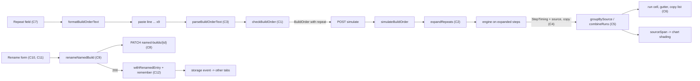

# M12: Technical design

AoE4 build editing: repeat a step, rename a saved build. Exit criteria M12.1 to M12.4 in MILESTONES.md
(confirmed by the owner). M12.4 is owner evidence. This doc designs M12.1 to M12.3.

Status: draft for owner approval (Owner decisions OD1, OD2; Defaults D1 to D17).

## Summary

A `build` or `move` step gains an optional integer `repeat` (JSON) written as a trailing `xN` on its paste line
(`build farm from wood then farm x9`). Validation checks it like any field and caps the expanded step count.
`simulateBuildOrder` expands the order once, at its top, into consecutive copies (`expandRepeats` in a new
`repeat.ts`), and the engine runs the copies as ordinary steps, so a repeat gives exactly the timings of the step
written out N times. Each copy gets its own `StepTiming`, which gains `source` (the submitted step index) and
`copy` (1-based). The page groups copies by `source`: a repeated step's row and text line show one combined
annotation plus a per-copy list (OD1), and hovering shades the span from the first copy's start to the last
copy's end. The step table gets a Repeat number field (M12.1).

Rename is a new `PATCH /api/aoe4-build-order/named-builds/{id}` (`renameNamedBuild`) that takes only `{ name }`,
needs the edit secret and `If-Match` like the update, and writes the next revision with only `buildOrder.name`
changed, so links (`?n=<id>`) keep working and a stale or racing rename is a 412. A Rename button in the save
row opens a name form shared with Save as copy (OD2). The new name goes into this tab's library, the stored My
builds list and, through the storage event, other tabs (M12.2). Each ticket updates the docs and specs of
its surface (M12.3).

### Starting state (origin/main @ d80751b, after M11)

| area | exists before the first M12 ticket |
|------|------------------------------------|
| Step schema | `lib/aoe4-build-order/schema.ts` `stepUnion` is a zod discriminated union on `action`. Each member spreads `common = { trigger?, reaction? }`. `count` is only on `produce` (units, 1..200) and `move` (villagers or `'all'`). `SIM_INPUT_BOUNDS.steps` is 0..200 on the written array. `crossFieldProblems` holds per-step rules and `crossStepProblems` whole-order rules (run in `withCrossChecks` only when every step's fields passed). `OPTIONAL_STEP_FIELDS` lists per action the fields the table hides under More options. z.object strips unknown keys, so today a `repeat` key on any step is silently dropped. |
| Paste format | `lib/aoe4-build-order/parse-text.ts`. `COUNT = /^x(\d+)$/` is read only on `produce`, right after the producer (`produce villager from capital-town-center x3 -> sheep walk 4s`). `walk Ns` is the last token on `produce`, `build`, `move`, `rally`. `formatBuildStep` / `formatBuildOrderText` print the same forms. `NUMBER = /^\d+$/` (leading zeros allowed). |
| Engine | `simulate.ts` `simulateBuildOrder(order, data, inputs, rules)` builds the engine from `order` (`createEngine`, which also calls `runRefs(order)` from `depletion.ts`) and later reads `order` again for final `waitingOn` and `researchNotes(order, data)`. Everything is index-based on `order.steps`: `StepTiming.step` is that index, as are `BuildOrderNote.step` and `step-stuck.step`. The `step-stuck` message reads `step <step+1> (<action>) was still waiting on <reason> at <m:ss>, from <m:ss>.` Callers: `pages/api/aoe4-build-order/simulate.ts` and `lib/aoe4-build-order/test-helpers.ts`. |
| Result shape | `StepTiming { step, status, armedAt, startedAt, completedAt, waitSeconds, waitingOn, waitBreakdown, waitingFor, waitDetails }`; openapi `StepTiming` has `additionalProperties: false` and `acceptance/aoe4-simulate-api-contract.spec.ts` validates live responses, so a new field fails acceptance until the schema has it. openapi `info.version` is 2.6.0. `BuildStep` openapi is a `oneOf` per action that says unknown extra keys are ignored. |
| Annotations | `components/apps/aoe4-build-order/step-annotations.ts`: `buildAnnotations` maps live step `i` to `result.steps[runs[i]]` through `alignSteps` (prefix/suffix match on `formatBuildStep`), and drops all runs when `parsed.order.steps.length !== result.steps.length`. `StepRun.runStep` is the `result.steps` index; the page's `activeStep` is a `runStep`; `results.tsx` shades `stepSpan(result.steps[activeStep])`. `StepRunCell` (`step-annotation.tsx`) and the gutter `AnnotationLine` (`build-text-editor.tsx`, popover text `annotationDetailText(run)`) render one run. |
| Step table | `step-table.tsx` `actionFields` lists number and select fields per action; `NumberControl` + `setNumberField` (empty deletes an optional field, non-digits leave the step unchanged). `step-table-model.ts` `changeAction` keeps only `trigger` and `reaction`. |
| Named builds | `lib/aoe4-build-order/named-builds-routes.ts` `namedBuildReply` handles `GET` and `PUT` (plus `DELETE` outside production) of `/named-builds/{id}`. The name is `buildOrder.name` inside the stored record (`StoredNamedBuild` = saved build + `revision`, `createdAt`, `updatedAt`, `secretHash`). `PUT` replaces the whole record, checks in order id 404, secret form 401, `If-Match` 428, body 400/413, rate-limit slot 429, exists 404, secret 403, revision 412, then `replaceNamed` compare-and-swap (conflict 412). There is no rename-only path. |
| Library UI | `pages/apps/aoe4-build-order.tsx` holds `entries: LibraryEntry[]` (`build-library.ts`), `secrets`, `selected`. `SaveBuild` (`save-build.tsx`, rendered only by `BuildInput` in `build-input.tsx`) has Save a new version (`save-build`, mine + secret) and Save as copy (`save-build-copy`) with its name form (`save-copy-form`, `save-copy-name`, `save-copy-name-error`, `save-copy-submit`, `save-copy-cancel`; `validName` = trimmed 1..100). `Saver = 'copy' \| 'version'`; `saveStatusText` reads `Saved` / `Saved version <n>`. `remember` upserts `MyBuildEntry { id, name, editSecret, revision, updatedAt }` into `localStorage` `aoe4-build-order.my-builds` (`my-builds-storage.ts`, newest `updatedAt` first, max 50). `withLoadedEntry` keeps the listed name for a `mine` entry; the page-local `withRereadMyBuilds` keeps the selected `mine` entry as this tab had it, name included. |
| Acceptance | `acceptance/helpers.ts` has `postNamedBuild`, `putNamedBuild`, `saveBody`, `namedBuildUrl`, `uniqueClient`, `openPage`, `showView`, `waitForRun`, `buildOrderFrom`, `simulateOk`. Exemplars: `aoe4-chart-views.spec.ts`, `aoe4-build-order-step-band.spec.ts`, `blob-fake-test-helpers.ts`. Named-build API specs: `aoe4-named-builds-*.spec.ts`. |

## Modules

| module (path) | owns | public functions or exports | used by |
|---------------|------|-----------------------------|---------|
| `lib/aoe4-build-order/repeat.ts` (new, browser-safe, imports only types and `model.ts` values) | the one place copies of a repeated step are made | `REPEATABLE_ACTIONS`, `repeatCount`, `expandedStepCount`, `expandRepeats`, `StepCopy`, `ExpandedOrder` (C2) | `schema.ts`, `simulate.ts`, `step-table-model.ts` |
| `lib/aoe4-build-order/schema.ts` | `repeat` field check, the repeat cross-field rule, the expanded-count cap | `SIM_INPUT_BOUNDS.repeat`; `BuildStep` gains `repeat?` (C1) | everything that checks a build |
| `lib/aoe4-build-order/parse-text.ts` | the trailing `xN` grammar and its printing (C3) | `parseBuildOrderText`, `formatBuildStep`, `formatBuildOrderText` (signatures unchanged) | `text-to-build.ts`, page, `step-annotations.ts`, `saved-builds.ts`, `build-library.ts`, acceptance `buildOrderFrom` |
| `lib/aoe4-build-order/simulate.ts` (critical path) | expanding at the top of `simulateBuildOrder`; `source`/`copy` on each `StepTiming`; the copy wording of `step-stuck` (C4) | `simulateBuildOrder` (signature unchanged) | simulate route, `test-helpers.ts` |
| `lib/aoe4-build-order/model.ts` | result types | `StepTiming.source`, `StepTiming.copy` (C4) | engine, page, specs |
| `components/apps/aoe4-build-order/step-annotations.ts` | grouping copies by source, the combined run, the per-copy runs, the shaded span (C5) | `groupBySource`, `combineRuns`, `sourceSpan`, `copiesDetailText`; `StepAnnotation.copies` | `step-table.tsx`, `step-annotation.tsx`, `build-text-editor.tsx`, `results.tsx`, page |
| `components/apps/aoe4-build-order/step-annotation.tsx`, `build-text-editor.tsx`, `results.tsx` | rendering the combined run and the copy list; shading | `StepRunCell` gains the copy line and list (C6) | step table, text view |
| `components/apps/aoe4-build-order/step-table.tsx`, `step-table-model.ts` | the Repeat field; carrying `repeat` across an action change | `actionFields` gains `repeat` for build and move; `changeAction` rule; `FIELD_LABELS.repeat` (C7) | page |
| `lib/aoe4-build-order/named-builds-routes.ts` | the rename handler and its check order (C8) | `namedBuildReply` (signature unchanged, gains `PATCH`) | `pages/api/aoe4-build-order/named-builds/[id].ts` |
| `lib/aoe4-build-order/named-builds.ts` | rename request and limits shared by route and client | `RenameNamedBuildRequest` (C8) | routes, client |
| `components/apps/aoe4-build-order/named-build-client.ts` | the rename request | `renameNamedBuild` (C9) | `save-build.tsx` |
| `components/apps/aoe4-build-order/name-form.tsx` (new) | the one name form (input, validation message, submit, cancel, Enter, Escape) used by Save as copy and Rename | `NameForm`, `validBuildName` (C10) | `save-build.tsx` |
| `components/apps/aoe4-build-order/save-build.tsx` | Rename button and flow inside the save panel (shares `saving`, `lock`, link, status) | `SaveBuild` gains `onRenamed`; `Saver` gains `'rename'` (C11) | `build-input.tsx` |
| `components/apps/aoe4-build-order/build-library.ts` | library list updates for a rename | `withRenamedEntry`; `withLoadedEntry` name rule (C12) | page |
| `pages/apps/aoe4-build-order.tsx`, `build-input.tsx` | wiring `onRenamed`; `withRereadMyBuilds` name rule (C12) | `recordRenamed` (page-local) | — |
| `docs/api/openapi.json` | `BuildStep.repeat`, `StepTiming.source`/`copy`, `PATCH` path, `RenameNamedBuildRequest`; `info.version` 2.7.0 | — | contract specs |

## Contracts

### C1. `BuildStep.repeat` (schema.ts)

| item | rule |
|------|------|
| field | `repeat?: number` in `common` (every action), checked by `count('repeat')`: not a number → `syntax` (`repeat must be a number`), else `SIM_INPUT_BOUNDS.repeat` = `bound(1, 200)`, a non-integer or outside 1..200 → `out-of-range`. Absent means once. `repeat: 1` is valid and means once. |
| cross-field rule (tier 2, `crossFieldProblems`) | `repeat` present on an action not in `REPEATABLE_ACTIONS` (`produce`, `research`, `rally`, `pause`) → one `invalid` issue on that step (wording to tickets; it names the action and says only build and move repeat). Runs only when the step's fields passed, like the other cross-field rules. |
| expanded cap (tier 3, in `withCrossChecks` beside `crossStepProblems`) | when every step's fields passed and `expandedStepCount(steps)` > `SIM_INPUT_BOUNDS.steps.max` (200): one `out-of-range` issue with path `['steps']` (label `steps`, no `step`, no `line`), message `steps: <n> steps after repeats, more than 200`. It sorts in the step-count-cap position (rank of `steps`). Not run under `skipWholeOrderRules`. |
| `OPTIONAL_STEP_FIELDS` | `build: [..., 'repeat']`, `move: [..., 'repeat']`. |
| openapi | `repeat` (`integer`, 1..200) in every `BuildStep` branch, described as valid only on build and move (else `invalid`); `BuildStep` description keeps "unknown extra keys are ignored", since `repeat` is now known. |

Callers that produce a `BuildOrder` and what they have:

| caller | has `repeat` from | rule |
|--------|-------------------|------|
| paste text (`parseBuildOrderText`) | trailing `xN` (C3) | — |
| step table (`step-table-model.ts`) | the Repeat field (C7) | — |
| simulate route body, saved/named build bodies | JSON | absent = once; old saved builds have none and are unchanged |
| shipped builds (`data/aoe4-build-order/builds/*.json`, `builds.ts listBuilds`) | none | not rewritten (D15) |
| `checkSaveBuildRequest` round trip (`saved-builds.ts`) | formats then re-parses | `repeat` survives because C3 prints it whenever present |

### C2. `repeat.ts` (new)

```ts
export const REPEATABLE_ACTIONS: readonly BuildStep['action'][] = ['build', 'move'];
export function repeatCount(step: BuildStep): number;            // step.repeat ?? 1
export function expandedStepCount(steps: readonly BuildStep[]): number; // sum of repeatCount
export interface StepCopy { source: number; copy: number }        // copy is 1-based
export interface ExpandedOrder { order: BuildOrder; copies: StepCopy[] } // copies[i] describes order.steps[i]
export function expandRepeats(order: BuildOrder): ExpandedOrder;
```

`expandRepeats` keeps `civ`, `name`, `source`, `start`; replaces each step `s` at index `j` by `repeatCount(s)`
consecutive copies, each `s` without its `repeat` key (trigger and reaction kept, D2), with `copies` entries
`{ source: j, copy: 1..n }`. Pure, never throws on a validated order, never mutates its input. An order with no
`repeat` gives `order.steps` equal (deep) to the input's and `copies[i] = { source: i, copy: 1 }`.

### C3. Paste grammar (parse-text.ts)

| item | rule |
|------|------|
| form | After any action except `produce` has read its own fields (including `walk Ns`), an optional `xN` token (`COUNT`) sets `repeat = N`; then the line must end. So `xN` is the last token: `build farm with 2 from wood then farm walk 3s x9`, `move 1 sheep to berry x3`, `research wheelbarrow x2` (parses; validation then says `invalid`). |
| produce | A `produce` line keeps its `xN` in the count position only; a second `xN` after it, or an `xN` after `-> node` or `walk Ns`, is a `syntax` issue (`unexpected token`). There is no paste form of `repeat` on produce. |
| two-form token | `xN` matches the node and id patterns too. It is a repeat only in the trailing position; in a node or id position it is a node or id (`move 3 sheep to x9` names node `x9`, an `unknown-id` at validation). |
| bad forms | `X9`, `x 9`, `x-1`, `x1.5`, `x9 walk 3s` (walk after repeat) → `syntax`. `x0`, `x201` parse and fail validation as `out-of-range`. `x09` parses as 9 and prints `x9`. |
| printing | `formatAction` appends `x<repeat>` as the last word whenever `repeat` is present, on every action (so an invalid `repeat` on research round-trips for display and alignment). `x1` prints as `x1`. |

### C4. Result: `StepTiming.source`, `StepTiming.copy`; step indexes (model.ts, simulate.ts)

| item | rule |
|------|------|
| shape | `StepTiming` gains required `source: number` (index into the submitted `buildOrder.steps`) and `copy: number` (1-based copy number within that source; 1 for an unrepeated step). Fields are added after `step`. openapi `StepTiming.required` gains both. |
| length and order | `result.steps` has one entry per expanded copy, in expanded order: `result.steps.length === expandedStepCount(buildOrder.steps)`; `result.steps[i].step === i`. For a source with `repeat` n the entries are consecutive with `copy` 1..n. First sample: an order with no `repeat` gives `source === step`, `copy === 1` for every entry. |
| every other `step` field | `BuildOrderNote.step` and `SimWarning` `step-stuck.step` are indexes into `result.steps` (the expanded order), as `StepTiming.step` is. The submitted step is `result.steps[step].source`. |
| `step-stuck` message | unrepeated source: unchanged, `step <source+1> (<action>) was still waiting on <reason> at <m:ss>, from <m:ss>.`. A copy of a repeated source: `step <source+1> (<action>, copy <copy> of <n>) was still waiting on ...`. |
| simulateBuildOrder | first statement expands (`expandRepeats(order)`); every later use of the order in the function and in `createEngine` uses the expanded order. `StepTiming` entries are created with `source` and `copy` from `copies`. No other engine change. |
| equivalence (the test bar) | For any valid order, the result equals the result of the order with each repeated step written out `repeat` times, apart from `source`, `copy` and the `step-stuck` message. Same input gives the same result (A3). |

Callers of `simulateBuildOrder` and `StepTiming` consumers:

| caller or consumer | what it has | rule |
|--------------------|-------------|------|
| `pages/api/aoe4-build-order/simulate.ts` | validated `order.order` | unchanged call |
| `lib/aoe4-build-order/test-helpers.ts` | `buildOrder(steps, start)` | unchanged call; tests that build `StepTiming` literals add `source` and `copy` |
| `step-annotations.ts` | `result.steps` | groups by `source` (C5) |
| `results.tsx` | `activeStep` (a `runStep`) | `sourceSpan` (C5) |
| `acceptance/aoe4-simulate-api-contract.spec.ts`, `openapi-schemas.ts` | live response | schema gains the fields |
| `acceptance/helpers.ts` `Timing` type | — | gains `source`, `copy` if a spec reads them |

### C5. Annotations (step-annotations.ts)

```ts
export function groupBySource(steps: readonly StepTiming[]): StepTiming[][]; // [source] -> copies in copy order
export function combineRuns(copies: readonly StepRun[]): StepRun;            // copies.length >= 1; returns copies[0] when length 1
export function sourceSpan(steps: readonly StepTiming[], runStep: number, end: number): StepSpan | null;
export function copiesDetailText(copies: readonly StepRun[]): string;       // '' when copies.length <= 1
export interface StepAnnotation { kind: StepKind; run: StepRun | null; copies: StepRun[] }
```

| item | rule |
|------|------|
| alignment | `alignedRuns` compares `parsed.order.steps.length` with `groupBySource(result.steps).length` (not `result.steps.length`), and aligns live steps to shown sources with `alignSteps` as today. A step whose `xN` changed formats differently, so it has no run until the next result. |
| per row | live step `i` aligned to source `j`: `copies = groupBySource(result.steps)[j].map(stepRun)`, `run = combineRuns(copies)`. Unaligned: `run: null`, `copies: []`. |
| combined run (n ≥ 2) | `runStep` = copy 1's `step`. `status` = least advanced copy (`not-reached` < `waiting` < `in-progress` < `completed`). `startedAt` = earliest `startedAt` of a started copy, else `null`. `completedAt` = latest `completedAt` when `status` is `completed`, else `null`. `waitSeconds` = sum. `waits` = merged by `text` in first-seen order (copy order), seconds summed. `waitingOn` / `waitingForText` = those of the first copy (copy order) whose status equals the combined status, when that status is `waiting` or `not-reached`; else `null`. `blockedBy` built from the merged waits and that copy, as `blockedByText` does today. `longWait` = `waitSeconds >= LONG_WAIT_SECONDS` (D7). `flagged` = status is `waiting` or `not-reached`. |
| span | `sourceSpan`: the copies with the same `source` as `steps[runStep]`; `from` = min clamped start of the started ones, `to` = max of their `stepSpan(...).to`; `null` when none started. Equal to `stepSpan` for an unrepeated step. `results.tsx` uses it in place of `stepSpan(result.steps[activeStep], ...)`. |
| first and last sample | `x2` gives `copies.length === 2`; `x200` gives 200 (the cap). |

### C6. Rendering a repeated step (OD1, recommended option A)

| element | rule |
|---------|------|
| run cell (`StepRunCell`) | shows the combined run exactly as an unrepeated run (Started, Finished, Waited, Blocked by). When `copies.length >= 2` it adds `step-copies` (`<done> of <n> done`, `done` = completed copies) and a closed-by-default native `<details data-testid="step-copy-list">` whose `<summary>` reads `Each copy`; inside, one `step-copy` per copy (`data-copy` 1-based, `data-status`) with its started, finished, waited and blocked-by. |
| gutter line (`AnnotationLine`) | shows the combined started and finished times. Its popover text is `annotationDetailText(run)` followed, when `copies.length >= 2`, by `copiesDetailText(copies)` (one line per copy: copy number, started, finished, waited or still waiting). |
| tone | `annotationToneClass(run, stale)` on the combined run; stale dimming unchanged. |
| active row | `data-run-step` and `activeStep` use the combined `runStep` (copy 1's index). |

### C7. Step table (step-table.tsx, step-table-model.ts)

| item | rule |
|------|------|
| field | `num('repeat')` last in `actionFields` for `build` and for `move`; testid `step-field-repeat`; `FIELD_LABELS.repeat = 'Repeat'`. Optional: hidden under More options until set (D14). Not offered on other actions. |
| input | `setNumberField` as for any optional number: empty removes `repeat`; non-digits leave the step unchanged; `0` or `201` set the value and the inline issue list shows the `out-of-range` issue. |
| `changeAction` | keeps `repeat` when the new action is in `REPEATABLE_ACTIONS`, drops it otherwise (trigger and reaction carry as today). |

### C8. `PATCH /api/aoe4-build-order/named-builds/{id}` (`renameNamedBuild`)

| item | rule |
|------|------|
| request | headers `Authorization: Bearer <editSecret>`, `If-Match: "<revision>"`; body `RenameNamedBuildRequest = { name: string }` (exported from `named-builds.ts`; flat, one field, checked by hand). Other body keys are ignored. |
| check order (first failing answers) | method (405, `Allow: GET, PUT, PATCH`, plus `DELETE` outside production); id form 404; secret form 401 (`WWW-Authenticate: Bearer`); `If-Match` 428; body 400; rate-limit slot 429; exists 404; secret 403; revision 412; then `replaceNamed` CAS, `conflict` → 412. Storage error → 503 (`storageUnavailable`); stored JSON failing `storedNamedBuildSchema` → 500. Same helpers and log lines as `updateNamedBuild`. |
| 400 | body not a JSON object → the shared not-an-object `syntax` error; `name` missing or not a string → `SimulateError` with one `syntax` issue `name: must be a string`; `name.trim()` empty or longer than `SAVED_NAME_MAX_CHARS` (100) → one `out-of-range` issue starting `name:`. |
| write | `next = { ...stored, buildOrder: { ...stored.buildOrder, name: name.trim() }, revision: stored.revision + 1, updatedAt: now }`. Nothing else changes (`createdAt`, `secretHash`, steps, start, `durationSeconds`). The order is not re-validated against the catalog, so a build the current data no longer accepts can still be renamed. |
| 200 | `UpdateNamedBuildResponse { id, path, revision, updatedAt }` with `ETag: "<revision>"`. A rename to the same name still writes the next revision. |
| cost | one `SAVE_RATE_LIMIT` slot, from the shared write budget. |
| route file | `pages/api/aoe4-build-order/named-builds/[id].ts` passes `PATCH` through unchanged (same `req` fields); its response type is unchanged. |

Callers:

| caller | has | rule |
|--------|-----|------|
| `renameNamedBuild` client (C9) | id and name from the selected `mine` entry, secret from `secrets[id]`, revision from `entry.loaded.revision` | Rename is disabled when any is missing (C11) |
| acceptance API spec | `postNamedBuild` response (`id`, `editSecret`), revision 1 | adds `patchNamedBuild(request, id, body, client, headers)` to `acceptance/helpers.ts` beside `putNamedBuild` |
| smoke script (`npm run smoke:preview`) | — | not changed |

### C9. Client (named-build-client.ts)

`renameNamedBuild(id: string, editSecret: string, revision: number, name: string, signal?: AbortSignal):
Promise<{ ok: true; response: UpdateNamedBuildResponse } | NamedSaveFailure>`: `PATCH`, the same headers as
`updateNamedBuild`, body `{ name }`; 200 with `isUpdateResponse` → ok, else `failureOf(reply)` (412 conflict,
401/403 forbidden, 404 not-found, other → `saveFailureMessage`).

### C10. Name form (name-form.tsx, new)

`validBuildName(name: string): boolean` (trimmed length 1..`SAVED_NAME_MAX_CHARS`; moved from `save-build.tsx`
`validName`). `NameForm` props: `testIdPrefix: 'save-copy' | 'rename'`, `label` (the input's accessible name),
`submitText`, `initialName`, `unchangedName?: string` (submit disabled, no error, while the trimmed name equals
it), `canSubmit: boolean` (outside conditions), `onSubmit(name: string)` (trimmed), `onCancel()`. Test ids:
`<prefix>-form`, `<prefix>-name`, `<prefix>-name-error`, `<prefix>-submit`, `<prefix>-cancel`, so Save as copy keeps
its current ids. The form owns its draft name; it focuses and selects the input when it mounts.

### C11. `SaveBuild` (save-build.tsx)

| item | rule |
|------|------|
| props | gains `onRenamed: (response: UpdateNamedBuildResponse, name: string) => void`. `BuildInput` gains and passes the same prop; the page passes `recordRenamed`. |
| `Saver` | `'copy' \| 'version' \| 'rename'`; `saveStatusText` returns `Renamed` for `'rename'`. |
| Rename button | `data-testid="rename-build"`, text `Rename`, shown exactly when Save a new version is shown (`entry.kind === 'mine'` and `editSecret !== null`). Enabled when no save and no load is in flight (`!busy && !saving`), not `locked`, and `entry.loaded?.revision` is a number. Not tied to `status`, `conversion` or `edited`. |
| row order | Save a new version, Rename, Save as copy, status, link, Copy link. The row still never wraps at 1200 px; the link field shrinks. |
| one form at a time | opening Rename closes the copy form and the reverse; choosing another entry closes either (the form is keyed to `entry.key` as today). |

### C12. Library list (build-library.ts, page)

| item | rule |
|------|------|
| `withRenamedEntry(list, id, name, revision): LibraryEntry[]` | the entry with key `entryKey.named(id)` gets `name`, and `loaded.revision = revision` when `loaded !== null`; position unchanged; other entries untouched; no entry with that key → the list unchanged. |
| `recordRenamed` (page) | `setEntries((list) => withRenamedEntry(list, response.id, name, response.revision))`; when that entry is selected, `replaceBuildQuery` as `recordUpdated` does. |
| `withLoadedEntry` | for a `mine` entry, takes the loaded entry's `name` as well as `loaded` (the server name wins over the listed one). |
| `withRereadMyBuilds` (page) | the selected `mine` entry keeps this tab's `loaded` but takes the re-read entry's `name` when the re-read list has it. |
| storage | `remember({ id, name, editSecret, revision: response.revision, updatedAt: response.updatedAt })` after a rename, so the stored list (and other tabs) get the name. |

## Criteria map

| criterion | lands in (files) | owning module | contracts it defines | how it is tested (level, harness, fixture) |
|-----------|------------------|---------------|----------------------|--------------------------------------------|
| M12.1 format, schema, API accept repeat | `lib/aoe4-build-order/repeat.ts` (new), `schema.ts`, `parse-text.ts`, `docs/aoe4-build-order-format.md`, `docs/api/openapi.json` (`BuildStep.repeat`) | `schema.ts` (field and rules), `parse-text.ts` (grammar), `repeat.ts` (expansion helpers) | C1, C2, C3 | unit: `repeat.test.ts` (table: no repeat, x1, x3 in the middle, two repeated steps, reaction copy keeps trigger); `schema.test.ts` rows for each C1 issue (non-number, 0, 1.5, 201, repeat on each of the four actions, expanded 201 vs 200); `parse-text.test.ts` rows for each C3 form and round trip; acceptance: one row in `aoe4-simulate-api-checks.spec.ts` style for `repeat` on research → 400 `invalid` |
| M12.1 simulator runs copies, each timed | `simulate.ts`, `model.ts`, `docs/aoe4-build-order.md` (Outputs), `docs/aoe4-build-order-format.md` (Outputs, `step-stuck`), `docs/api/openapi.json` (`StepTiming`), `lib/aoe4-build-order/README.md` | `simulate.ts` | C4 | unit: `simulate-repeat.test.ts`: equivalence (order with `build house from wood x3` and `move 1 sheep to wood x2` vs written out; strip `source`/`copy`, compare whole results), `source`/`copy` values, a stuck copy's message, an existing shipped build's result unchanged apart from the two fields; acceptance `aoe4-simulate-api-repeat.spec.ts`: POST a repeated build, assert three consecutive steps with `source` j and `copy` 1..3 and that the contract spec passes |
| M12.1 editor and annotations | `step-table.tsx`, `step-table-model.ts`, `step-annotations.ts`, `step-annotation.tsx`, `build-text-editor.tsx`, `results.tsx`, `docs/aoe4-build-order-ui.md`, `page-help.tsx` (if it lists the text forms) | `step-annotations.ts` (rules), `step-table-model.ts` (field) | C5, C6, C7 | unit: `step-annotations.test.ts` table for `combineRuns` (all completed; one in-progress; last not-reached; waits merged by text) and `sourceSpan`; `step-table-model.test.ts` rows for `changeAction` build→move keeps, build→produce drops, `setNumberField` on repeat; acceptance `aoe4-repeat-step.spec.ts`: type a build ending `build house from wood x3`, wait for the run, assert the row's `step-copies` text and three `step-copy` items, set Repeat to 2 in the table and see the text line end `x2`, hover the row and see one shaded span |
| M12.2 rename in place | `named-builds.ts`, `named-builds-routes.ts`, `pages/api/aoe4-build-order/named-builds/[id].ts`, `named-build-client.ts`, `docs/aoe4-build-order-format.md` (Named builds routes), `docs/api/openapi.json` (`PATCH`, `RenameNamedBuildRequest`), `acceptance/helpers.ts` (`patchNamedBuild`) | `named-builds-routes.ts` | C8, C9 | unit: `named-builds-routes.test.ts` table over the check order (each status with the input that produces it, using the `blob-fake-test-helpers.ts` store fake and the existing route test support), write keeps everything but name/revision/updatedAt, CAS conflict → 412; acceptance `aoe4-named-builds-rename.spec.ts` (API): rename → 200 and GET shows the name at revision 2; stale `If-Match` → 412; wrong secret → 403 |
| M12.2 rename UI, shown everywhere, links work | `name-form.tsx` (new), `save-build.tsx`, `build-input.tsx`, `build-library.ts`, `pages/apps/aoe4-build-order.tsx`, `docs/aoe4-build-order-ui.md`, `ARCHITECTURE.md` (name-form row) | `save-build.tsx` (flow), `build-library.ts` (list rules) | C10, C11, C12 | unit: `build-library.test.ts` rows for `withRenamedEntry` and the `withLoadedEntry` name rule; `save-build.test.ts` `saveStatusText` row for `rename`; acceptance `aoe4-rename-build.spec.ts`: Save as copy, Rename, the select option and status read the new name, reload `?n=<id>` shows the new name and runs; a PUT from the API first then Rename shows the conflict message and disables Rename |
| M12.3 docs and Playwright | the doc files above, each updated by the ticket that changes its surface; `ARCHITECTURE.md` rows for `repeat.ts` and `name-form.tsx` | per ticket | none | the specs named above; `npm run lint:dup` clean (the NameForm extraction removes the copy-form markup from `save-build.tsx`) |

## Layouts

New files:

| path | shape |
|------|-------|
| `lib/aoe4-build-order/repeat.ts`, `repeat.test.ts` | C2 |
| `lib/aoe4-build-order/simulate-repeat.test.ts` | equivalence and `source`/`copy` tests |
| `components/apps/aoe4-build-order/name-form.tsx` | C10 |
| `acceptance/aoe4-simulate-api-repeat.spec.ts`, `acceptance/aoe4-repeat-step.spec.ts`, `acceptance/aoe4-named-builds-rename.spec.ts`, `acceptance/aoe4-rename-build.spec.ts` | Playwright specs |

Sample JSON step and its paste line:

```json
{ "trigger": { "kind": "bank", "resource": "wood", "atLeast": 75 }, "action": "build", "building": "farm", "from": "wood", "then": "farm", "repeat": 9 }
```

`when wood >= 75 build farm from wood then farm x9`

Sample `result.steps` slice for a build whose step 4 is `build house from wood x2`:

```json
[{ "step": 4, "source": 4, "copy": 1, "status": "completed", "...": "..." },
 { "step": 5, "source": 4, "copy": 2, "status": "completed", "...": "..." },
 { "step": 6, "source": 5, "copy": 1, "...": "..." }]
```

Rename request: `PATCH /api/aoe4-build-order/named-builds/AbCdEfGhIjKlMnOpQrStUv` with `If-Match: "3"`, body
`{ "name": "Fast castle v2" }` → 200 `{ "id": "AbCd...", "path": "/apps/aoe4-build-order?n=AbCd...", "revision": 4, "updatedAt": "2026-11-18T10:00:00.000Z" }`.

## Behavior rules

### Repeat: validation and parsing

| operation | case | rule |
|-----------|------|------|
| check | `repeat` absent | step runs once; no issue |
| check | `repeat: 1` | valid, runs once; prints `x1` |
| check | `repeat: "3"`, `true`, `null` | `syntax` on the step |
| check | `repeat: 0`, `201`, `2.5`, `-1` | `out-of-range` on the step |
| check | `repeat` on produce, research, rally or pause | one `invalid` issue on the step (tier 2); on research it is reported even though a repeated research would also duplicate the tech |
| check | repeat on a reaction step | valid; every copy is a reaction |
| check | written steps ≤ 200 but expanded > 200 (`200` steps one of which has `x2`) | one `out-of-range` issue at `steps`; nothing simulated. First accepted sample: expanded 200 |
| check | written steps > 200 | today's step-count issue only (the expanded check needs every step's fields to pass, and the array check fails first) |
| check | a field issue elsewhere in the order | expanded cap not checked (tier 3 rule) |
| paste | `build farm from wood x9` | `repeat: 9` |
| paste | `produce villager from capital-town-center x3` | `count: 3`, no `repeat` (unchanged) |
| paste | `produce villager from capital-town-center x3 x2`, `produce ... -> sheep x2` | `syntax` |
| paste | `build farm x9 from wood`, `build farm from wood x9 then farm`, `build farm from wood x9 walk 3s` | `syntax` (`xN` must be last) |
| paste | `move 3 sheep to x9` | `to: "x9"`, `unknown-id` at validation |
| issue location | an issue on a repeated step | on its submitted step (`steps[j]`, paste `line N`), never on a copy |

### Repeat: simulation

| operation | case | rule |
|-----------|------|------|
| ordering | position of copies | copies of step `j` occupy the expanded positions right after the copies of step `j-1`, copy 1 first; the engine offers them in that order (reactions first, then the cursor, as today) |
| ordering | arming | a non-reaction copy `k+1` arms only after copy `k` started (the existing earlier-step rule) and its own trigger holds again (D2). `when wood >= 75 build farm ... x9`: each farm waits for 75 wood at its own arming |
| conflict | resources, villagers, reserve | each copy waits, reserves and pays as a separate step; a waiting copy holds back later steps exactly as a written-out step would |
| conflict | reaction copies | all copies arm at the run-out instant and are offered in copy order that instant; each takes what is left (`move all` after the first copy moves 0 and completes at once) |
| repeat | same input twice | same result (A3) |
| no target | `move 2 sheep to wood x3` with fewer than 2 villagers at sheep | the copy waits on `villagers` (as written out); later copies `not-reached` with `earlier-step` |
| no target | `build` copy whose building's age is not reached | waits on `prerequisite`, as written out |
| failure | a copy still waiting at the horizon | its own `step-stuck` warning, `step` = its expanded index, message with `copy <k> of <n>` |
| failure | copies not reached | `not-reached`; `waitingOn` `trigger` for the cursor copy, `earlier-step` for later non-reaction copies |
| notes | research after a repeated step | its `BuildOrderNote.step` is its expanded index |
| pause/cancel | — | no simulation state survives a run; an aborted request (page) is the existing auto-run rule, unchanged |

### Repeat: page

| operation | case | rule |
|-----------|------|------|
| annotate | row for a repeated step, all copies done | combined Started (copy 1), Finished (last copy), Waited (sum); `step-copies` `n of n done`; tone normal unless summed wait ≥ 60 s |
| annotate | some copies in progress, rest done | status `in-progress`, Finished reads `ongoing` |
| annotate | last copy waiting or not reached | status of that copy; row flagged (yellow tint) and Blocked by ends with that copy's `still waiting ...` or `not reached (...)` |
| annotate | `xN` changed since the shown run | that row has no run (alignment) until the next result; other rows keep theirs |
| annotate | result stale | dimmed as today |
| hover | repeated row or its text line | shades one span from the first copy's start to the last started copy's end on every chart; nothing when no copy started |
| copy list | keyboard | `<summary>` is focusable in the row's Tab order; Enter or Space toggles it (native `<details>`); the open state is not stored and every list is closed after a reload |
| table field | Repeat on build or move | number field under More options; empty removes; `0` shows the inline `out-of-range` issue; letters are ignored |
| table field | change action build → move | `repeat` kept; build → produce/research/rally/pause: dropped |
| text ↔ table | edit Repeat in the table | the line is reformatted with trailing `xN` (C3) |

### Rename: server (target: stored key `<env>/named-builds/<id>.json`)

| operation | case | rule |
|-----------|------|------|
| rename | nothing at the key (never created, deleted) | 404 after the rate-limit slot (`no named build with that id`) |
| rename | id not 22 base64url chars (two-form name, e.g. a 11-char `?b=` id) | 404 before any other check; nothing read |
| rename | a valid named build | 200, next revision, only `buildOrder.name` changed (trimmed) |
| rename | stored JSON fails `storedNamedBuildSchema` (foreign or legacy shape) | 500 `the stored build could not be read`, nothing written |
| rename | `If-Match` revision ≠ stored revision (stale tab, a version saved elsewhere) | 412, nothing written, logged as a revision mismatch |
| rename | another write lands between read and replace (concurrent PUT, PATCH or DELETE) | `replaceNamed` gives `conflict` → 412; the other write is kept; logged as an etag conflict |
| rename | Blob put response lost after landing | the store's existing read-back rule (`replaced` when the stored JSON is the one sent) |
| rename | same name as stored | 200, next revision written |
| rename | missing/malformed `Authorization` | 401; missing/malformed `If-Match` → 428; both before the body and the slot |
| rename | wrong secret | 403 after the slot |
| rename | over `SAVE_RATE_LIMIT` | 429 with `Retry-After`, nothing read |
| rename | storage unavailable (`VERCEL` without `VERCEL_ENV`, Blob error, weak etag) | 503 as for PUT |
| rename | method `POST` on `{id}`, or `DELETE` in production | 405 with `Allow` listing `GET, PUT, PATCH` (and `DELETE` outside production) |
| links | `?n=<id>` after a rename | opens the build with the new name; the id never changes. `?b=<id>` saved builds are immutable and have no rename |

### Rename: page (Rename button, rename form, library)

| operation | case | rule |
|-----------|------|------|
| open | click Rename | opens the rename form (`rename-form`, `role="group"`, `aria-label="Rename"`) below the save row, input `rename-name` (accessible name `New name`) prefilled with the entry's name, focused and selected; closes the copy form if open |
| input | trimmed empty or over 100 chars | `rename-name-error` `Enter a name of 1 to 100 characters.`, input `aria-invalid="true"` and `aria-describedby` the error, `rename-submit` disabled |
| input | trimmed equal to the current name | `rename-submit` disabled, no error shown |
| keyboard | Enter in the input | submits when `rename-submit` is enabled, else nothing |
| keyboard | Escape anywhere in the form, or `rename-cancel` | closes the form with no request; focus returns to Rename |
| keyboard | Tab order | input, submit, cancel; the form follows the save row in DOM order |
| submit | starts | the form closes; `saving` is true, so Save a new version, Rename and Save as copy are disabled until it answers |
| submit | 200, settled input unchanged | list entry renamed in place (`withRenamedEntry`), stored entry upserted (`remember`), the link shows with status `Renamed`, focus moves to the link (existing rule); Escape on the link returns focus to Rename |
| submit | 200, settled input changed meanwhile (typing, another entry chosen) | list and storage still renamed; no link, no status, no error |
| submit | 200, storage cannot be written | renamed in this tab; `my-builds-unavailable` shown as for other saves |
| submit | 412 | `save-build-error` with the conflict text; `lock` set, so Save a new version and Rename stay disabled until the build is chosen again (which loads the latest name and revision) |
| submit | 401/403, 404, 429, 5xx, network | `save-build-error` with the forbidden, not-found or `saveFailureMessage` text; name unchanged everywhere; Rename stays enabled |
| edited | rename while the text is edited | allowed; the build stays edited (`loaded.text` unchanged, `loaded.revision` advanced), so a later Save a new version sends `If-Match` the renamed revision and the new name |
| repeat | rename twice in a row | the second uses the revision the first returned; no conflict |
| other tab | rename in tab A | tab B's storage event re-reads My builds; B's option label shows the new name even when selected; B's loaded revision is stale, so B's next save or rename is a 412 |
| other browser | build opened as shared | keeps the old label until chosen again (fetch takes the server name) or reloaded |
| choose | choosing or opening one of My builds | the entry takes the server's name (`withLoadedEntry` rule), so a storage write that failed earlier never leaves a stale label |
| run name | `runName`, compare labels | follow the entry's name, so they show the new name on the next render |
| pin | an existing pin | keeps the name it was pinned with (D13) |
| no target | selected entry not `mine`, no secret, or no loaded revision | Rename not shown (not mine / no secret) or disabled (no revision) |
| width | 1200 px with link shown | the save row does not wrap; the link field shrinks |

## Data flow



## Extension points

| future direction | seam that keeps it additive |
|------------------|-----------------------------|
| repeat on more actions (produce, rally) | add the action to `REPEATABLE_ACTIONS` and a paste position; `expandRepeats` and the engine need no change |
| repeat with spacing or variation (`x9 every 30s`, per-copy `then`) | `expandRepeats` is the only place copies are made; `repeat` can widen to a number or an object without touching the engine |
| a different copy display (sub-rows, OD1 option B) | `StepAnnotation.copies` already carries one `StepRun` per copy |
| patch tracking on results and saved builds (backlog) | rename touches only `buildOrder.name`, revision and `updatedAt`; a new stored field passes through the `...stored` spread |
| more editable metadata (description, tags) | `RenameNamedBuildRequest` ignores unknown keys, so a later PATCH field is additive; `NameForm` is reusable |
| manage My builds (delete, rename from a list) | `withRenamedEntry` and `renameNamedBuild` take an id, not the selection |
| spread of outcomes (several seeded runs) | no seam needed; expansion is deterministic |

## Defaults

- D1. `repeat` is accepted on `build` and `move` only; on `produce` (count covers it), `research` (would repeat a tech), `rally` and `pause` (idempotent) it is `invalid`. Given up: repeat on every action.
- D2. Each copy is an exact copy: trigger and reaction included, so a bank or time trigger is checked again per copy. Given up: only copy 1 keeps the trigger.
- D3. Paste `xN` is the last token of a build or move line. Given up: `xN` right after the building (`build farm x9 from wood`).
- D4. `repeat` range 1..200, `x1` valid and printed. Given up: 2..200 with `x1` an error.
- D5. The expanded step count is capped at the existing 200 (S3). Given up: a separate, larger expanded cap.
- D6. One `StepTiming` per copy with required `source` and `copy`, and every result `step` field indexes `result.steps`. Given up: one `StepTiming` per submitted step with nested copies.
- D7. A repeated row's long-wait highlight uses the summed wait it displays. Given up: highlight only when one copy waited 60 s.
- D8. Hovering a repeated row shades one span, first copy start to last copy end. Given up: one band per copy.
- D9. Rename is a new `PATCH` taking only `{ name }`, not re-validated against the catalog. Given up: reuse `PUT` with the whole record (needs the content and fails for builds the current data rejects).
- D10. Rename needs the edit secret and `If-Match`, bumps the revision and costs a save slot, so a racing save or rename is a 412. Given up: last-writer-wins renames without `If-Match`.
- D11. The rename form closes when the request starts, as the copy form does; a failure shows in `save-build-error`. Given up: keeping the form open with the typed name.
- D12. After a rename the save row shows the (unchanged) link with status `Renamed`. Given up: status only, no link.
- D13. A pin keeps the name it was pinned with. Given up: renaming the pin label too.
- D14. Repeat is an optional table field under More options, like walk time. Given up: always visible on build and move rows.
- D15. The shipped builds are not rewritten to use `repeat`, so their results and floors are unchanged. Given up: shortening them with `xN`.
- D16. The server trims the name before storing it. Given up: rejecting padded names.
- D17. Choosing or opening one of My builds shows the server's name (fixes a stale label after a rename whose storage write failed). Given up: keeping the locally stored name.

## Owner decisions

**OD1. How a repeated step's copies show in the build order.** The text view has one line per step, so its
gutter can only show one annotation; the choice is about the step table.
- A (recommended): one row per step in both views. The row shows the combined times (first copy's start, last
  copy's finish, summed wait), `3 of 9 done`, and a closed `Each copy` list with each copy's times; the text
  line's popover lists the copies. Smallest change; table and text read the same.
- B: the table shows one indented, read-only sub-row per copy under the step row, each with its own run cell;
  the text view stays as in A. More visible per copy, but up to 200 extra rows and a second row kind to keep in
  sync with editing and reordering.

**OD2. Where Rename lives.**
- A (recommended): a Rename button in the save row that renames the selected My build, opening a small form like
  Save as copy's. Uses the existing selection, lock and status; one more button in the row.
- B: a My builds manager (a dialog listing every saved build, each with Rename) so a build can be renamed
  without selecting it. More work (a new dialog and list), and a natural home for delete later.

## Left to tickets

- Wording of the new issue messages (except the fixed prefixes and the `step-stuck` copy text above), the
  `step-copies` and per-copy text, and the popover line format.
- Whether `createEngine` takes the `copies` list as a parameter or `simulateBuildOrder` sets `source`/`copy`
  after creation.
- Where the hand check of `RenameNamedBuildRequest` sits (`named-builds.ts` or `named-builds-routes.ts`) and the
  name of the internal rename function.
- CSS of the copy list and the rename form (reusing the copy-form classes is expected).
- How `AnnotationPopover` renders multi-line text.
