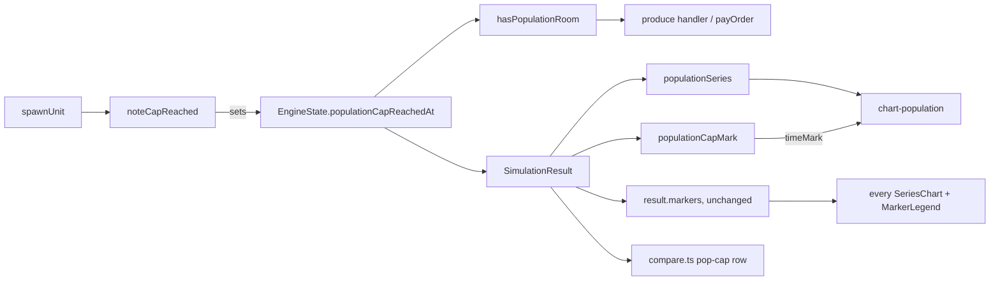

# M13: Technical design

AoE4 population past the 200 cap. Exit criteria M13.1 to M13.4 in MILESTONES.md (confirmed by the owner).
M13.4 is owner evidence. This doc designs M13.1 to M13.3.

Status: revision 1, approved by the owner: OD1 = A, OD2 = B, Defaults D1 to D14 as revised below.

## Summary

Supply and auto-house planning keep stopping at `data.base.maxPopCap` (200). The population limit on
production lifts for the rest of the run at the first instant the spawned population reaches the cap while
supply is at the cap; from then on every unit payment and produce step skips the supply check, and the units
past 200 count as replacing combat losses the simulator does not model (OD1, option A). Before that instant
nothing changes, so a run whose `populationCapReachedAt` is `null` gives exactly the result it gives today
(M13.1). A new Population chart draws `spawnedPopulation` and carries one page-side mark, a vertical line at the
run's existing `populationCapReachedAt` labelled `Population cap`; no other chart, the shared Markers legend, the
marker kinds and the API are unchanged (OD2, option B). The Key results row "Population cap reached" stays
(M13.2). Each ticket updates the docs, OpenAPI descriptions and specs of its own surface; one ticket adds the
Playwright coverage of the chart and its mark (M13.3).

### Evidence for OD1 (probe runs on origin/main @ 7d74800, prebuilt builds, default inputs)

| run | today | option A (this doc) | option B (supply grows past 200) |
|-----|-------|---------------------|----------------------------------|
| ENG 1TC, 1060 s and 1090 s (population 189 and 198, cap never reached) | baseline | identical result | different: one extra house started before 200 (`spent.buildings` 3542 vs 3492 at 1060 s), because `planAutoHouse` projects the population one window ahead and `room` no longer stops it |
| ENG Knight/Longbow, 1200 s (population 185) | baseline | identical | identical |
| ENG 1TC, 3600 s | population stops at 200 at 1094.9 s | population 932 at 3600 s, buildings spent unchanged (3492) | population 932, buildings spent 7242 (about 75 houses past 200 that buy nothing) |
| every prebuilt build, result before `populationCapReachedAt` | baseline | identical | differs for all four (houses bought past 200 ahead of the cap) |

Code facts behind it: `addBuildingInstance` clamps `supply` with `Math.min(..., maxPopCap)`
(`lib/aoe4-build-order/simulate.ts` ~276); `planAutoHouse` caps due houses with
`room = ceil((maxPopCap - supply - allPending) / houseSupply)` (`lib/aoe4-build-order/houses.ts` 56); the only two
production gates are `population + popcap > supply` in the `produce` handler (~412) and in `payOrder` (~616).
`spawnedPopulation` is the only population series in the result, and `compare.ts` reads only
`populationCapReachedAt`; neither needs supply past 200. No chart draws `spawnedPopulation` today.

### Starting state (origin/main @ 7d74800, after M12)

| area | exists before the first M13 ticket |
|------|------------------------------------|
| Supply | `EngineState.supply`, clamped to `maxPopCap` in `addBuildingInstance`. `EngineState.population` is alive villagers and units plus the popcap of paid units still queued. |
| Production gates | `produce` handler: `state.population + targets.length * entry.costs.popcap > state.supply` returns `{ started: false, waitingOn: 'population', detail: populationWait(...) }`. `payOrder`: the same check with one unit's popcap returns without paying (no wait recorded; continuous orders are not steps). No other code compares population with supply. |
| Auto-houses | `planAutoHouse` in `houses.ts`; due houses are capped by `room`, so planning stops once supply plus every building under construction reaches 200. |
| Cap instant | `Engine.populationCapReachedAt` (on the internal `Engine`, not `EngineState`), set by `noteCapReached` in `spawnUnit` and once in `createEngine` after the start population is counted; returned as `SimulationResult.populationCapReachedAt`. |
| Markers (unchanged by M13) | `ChartMarkerKind = 'age-up' \| 'economy' \| 'unit-tier' \| 'blacksmith' \| 'other'`, `CHART_MARKER_KINDS` (`lib/aoe4-build-order/model.ts`). Page side: `MARKER_COLORS`, `MARKER_KIND_LABELS`, `markerLabel` (`label m:ss`) in `components/apps/aoe4-build-order/chart-rows.ts`; `placeMarkers`, `labelledMarkers`, `ageUpMarkers` in `line-chart.tsx`; `MarkerLegend` in `chart-legend.tsx` is per chart and only sets which kind is labelled on hover or focus (no hide toggle). Every `SeriesChart` draws `result.markers` as `ReferenceLine`s with `data-testid="chart-marker"`; a pinned run draws its age-ups only (`chart-pinned-marker`). |
| Charts | Four: `RESULT_CHART_IDS = ['chart-units-produced', 'chart-gather-rates', 'chart-gathered-resources', 'chart-floating-resources']` in `chart-layout.ts`; `results.tsx` holds a `Record<ChartId, { title, yLabel, series, headerControls? }>` and passes `markers={result.markers}` to every chart. No zoom or pan exists; the x domain is the run's times. Stored layout under `aoe4-build-order.chart-layout`; `normalizeChartLayout` appends missing ids at the end. |
| Results text | `compare.ts` row `pop-cap`, label `Population cap reached`, shown in the Key results table only with a pinned run. |
| Prebuilt builds | All four reach 200 before 1300 s (ENG 1TC 1094.9 s, Spear/Longbow 1149.1 s, Council Hall 1158.2 s, Knight/Longbow 1247.0 s); three before the default 1200 s. |

## Modules

| module (path) | owns | public functions or exports | used by |
|---------------|------|-----------------------------|---------|
| `lib/aoe4-build-order/simulate.ts` | the population limit and when it lifts | `hasPopulationRoom` (new), `EngineState.populationCapReachedAt` (moved from `Engine`), `simulateBuildOrder` (unchanged signature) | `produce` handler and `payOrder` (same file) |
| `lib/aoe4-build-order/houses.ts` | auto-house planning | `planAutoHouse` (unchanged) | `simulate.ts` |
| `components/apps/aoe4-build-order/chart-rows.ts` | chart data types and colours | `ChartTimeMark` (new type), `TIME_MARK_COLOR` (new) | `line-chart.tsx`, `result-series.ts` |
| `components/apps/aoe4-build-order/line-chart.tsx` | drawing one chart | `SeriesChart` (prop `timeMark` added), `timeMarkLabelPosition` (new) | `results.tsx` |
| `components/apps/aoe4-build-order/result-series.ts` | what each chart draws from a run | `populationSeries` (new), `populationCapMark` (new) | `results.tsx` |
| `components/apps/aoe4-build-order/chart-layout.ts` | chart ids and the stored layout | `RESULT_CHART_IDS` (id added), `ChartId` | `results.tsx`, `use-chart-layout.ts`, `acceptance/helpers.ts` |
| `components/apps/aoe4-build-order/results.tsx` | which charts render, with title, y label and series | `Results` | page |
| `data/aoe4-build-order/builds/english-spear-longbow-maa-crossbow.json` | that prebuilt build | data | `builds.ts` |

## Contracts

### C1. The population limit (`simulate.ts`)

```ts
/** Whether supply has room for `popcap` more population; always true once the population cap has been reached with supply at the cap. */
export function hasPopulationRoom(state: EngineState, popcap: number): boolean
// true  when state.populationCapReachedAt != null && state.supply >= state.data.base.maxPopCap.value
// else  state.population + popcap <= state.supply
```

`EngineState` gains `populationCapReachedAt: number | null` (the field moves from the internal `Engine`; same
meaning: the instant `spawnedPopulation` first reached `maxPopCap`, `0` when the start already does). `Engine`
no longer declares it. `noteCapReached` takes `EngineState` (no cast).

Callers (grep `population` against `supply` across `lib/`: these two are all):

| caller | `state` | `popcap` | rule |
|--------|---------|----------|------|
| `produce` handler (`simulate.ts`, the check before `canAffordHeld`) | its `state` argument | `targets.length * entry.costs.popcap` | `!hasPopulationRoom(...)` replaces the inline check; the wait it returns is unchanged |
| `payOrder` (`simulate.ts`) | `engine` | `entry.costs.popcap` | `!hasPopulationRoom(...)` replaces the inline check in the early-return condition |

`planAutoHouse` reads `state.population` and `state.supply` and is not a caller; it is unchanged. Test fakes
built with `as unknown as EngineState` (`houses.test.ts`, `wait-detail.test.ts`, `engine-common.test.ts`,
`simulate-busy-buildings.test.ts`, `simulate-triggers.test.ts`) never reach the gate; a fake that does must set
`populationCapReachedAt` (the `!= null` check treats a missing field as not reached).

### C2. Population cap mark (page side: `chart-rows.ts`, `line-chart.tsx`, `result-series.ts`, `results.tsx`)

The mark reads the existing `SimulationResult.populationCapReachedAt`; the result shape, the marker kinds and the
API do not change (D14).

```ts
// chart-rows.ts
/** One page-side vertical line on a chart, not part of result.markers and not in the Markers legend. */
export interface ChartTimeMark { at: number; label: string }
export const TIME_MARK_COLOR = '#a52a2a'

// result-series.ts
export function populationCapMark(run: SimulationResult): ChartTimeMark | null
// null when run.populationCapReachedAt === null, else { at: run.populationCapReachedAt, label: 'Population cap' }

// line-chart.tsx
export function timeMarkLabelPosition(at: number, end: number, plotWidth: number, labelWidth: number): 'insideBottomLeft' | 'insideBottomRight'
// 'insideBottomLeft' (text to the right of the line) when at + (labelWidth * end) / plotWidth <= end, else 'insideBottomRight'
// SeriesChartProps gains: timeMark?: ChartTimeMark | null   (default null: nothing drawn)
```

`SeriesChart` with a non-null `timeMark` draws, after the result markers, one
`<ReferenceLine x={at} stroke={TIME_MARK_COLOR} strokeWidth={2} data-testid="chart-time-mark" data-label={label} data-at={at}>`
whose label is `markerLabel`-style text `${label} ${formatMinSec(at)}` (default build: `Population cap 18:15`), fill
`TIME_MARK_COLOR`, font size as marker labels, at the position `timeMarkLabelPosition` gives with the measured
width (or `estimateLabelWidth` before measuring). The label sits at the plot bottom, so it never enters the
top label rows, `placeMarkers` or `data-label-rows`.

Callers and consumers:

| site | has | rule |
|------|-----|------|
| `results.tsx` chart record | `result` (the current run) | the record type gains `timeMark?: (run: SimulationResult) => ChartTimeMark \| null`; only `chart-population` sets it (`populationCapMark`); `SeriesChart` gets `timeMark={chart.timeMark?.(result) ?? null}`. The pinned run is never passed (D9). |
| the other four `SeriesChart` uses | no `timeMark` | prop omitted, so default `null`; output unchanged |
| `MarkerLegend`, `labelledMarkers`, `activeMarkerKind`, `placeMarkers`, `CHART_MARKER_KINDS`, `MARKER_COLORS`, `MARKER_KIND_LABELS`, `markers.ts`, `simulate.ts` markers | | unchanged; the mark is not a `ChartMarker` |
| `docs/api/openapi.json` | | no enum change; only the C5 description edits |
| acceptance specs that read `chart-marker` (`aoe4-marker-labels.spec.ts` and others) | | unchanged selectors; the mark has its own test id, so no spec that counts `chart-marker` changes because of it |

### C4. Population chart (`chart-layout.ts`, `result-series.ts`, `results.tsx`)

- `RESULT_CHART_IDS = ['chart-units-produced', 'chart-gather-rates', 'chart-gathered-resources', 'chart-floating-resources', 'chart-population']`.
- `export function populationSeries(run: SimulationResult): ChartSeries[]` returns
  `[{ key: 'population', name: 'Population', values: run.spawnedPopulation }]`.
- `results.tsx` `charts['chart-population'] = { title: 'Population', yLabel: 'Population', series: populationSeries, timeMark: populationCapMark }`;
  no `headerControls`, no `offsetLines`. It gets `markers={result.markers}` like every chart.

Consumers of `RESULT_CHART_IDS` / `ChartId`: `normalizeChartLayout` (unchanged; appends the new id to a stored
order), `DEFAULT_CHART_LAYOUT` (gains it last), `results.tsx` `charts` record (exhaustive, so the same ticket
adds the entry), `acceptance/helpers.ts` `CHART_IDS` (re-export; specs that count four charts are updated in
that ticket), `chart-layout.test.ts` (destructures four ids; updated). Specs that loop over `CHART_IDS`
(`aoe4-results-split.spec.ts`, `aoe4-split-tab-order.spec.ts`, `aoe4-build-order-step-band.spec.ts`) pick up the
fifth chart without edits; the C4 ticket runs them and fixes any that assumed four.

### C5. Result fields (no shape change)

`SimulationResult` keeps its fields. Changed meaning, documented in `docs/aoe4-build-order-format.md` Outputs and
`docs/api/openapi.json` descriptions (no schema or enum change): `spawnedPopulation` may exceed the population cap
once it has been reached. `populationCapReachedAt` and `markers` are unchanged. `StepWaitDetail` `population`
(`needed`, `used`, `supply`) is unchanged and can occur only before the limit lifts. No new error code; no
request field or bound changes (`SIM_INPUT_BOUNDS` stays, including `triggerCount` 1..200).

Callers of the simulate API: the page (`simulate-client.ts`), `scripts/smoke-preview.mjs`, saved and named
build routes (store build text only, re-simulate on open). None caps `spawnedPopulation`; no caller changes.

## Criteria map

| criterion | lands in (files) | owning module | contracts it defines | how it is tested (level, harness, fixture) |
|-----------|------------------|---------------|----------------------|--------------------------------------------|
| M13.1 production past 200, same results below | `lib/aoe4-build-order/simulate.ts`; `data/aoe4-build-order/builds/english-spear-longbow-maa-crossbow.json`; tests `simulate-construction.test.ts`, `simulate-series.test.ts`, `simulate-house-gate.test.ts`, `simulate.acceptance.test.ts`, `research.acceptance.test.ts`, `builds.test.ts` | `simulate.ts` | C1, C5 (`spawnedPopulation` meaning) | Unit (vitest). Fixture: `editGameData` with `maxPopCap` 30 (as `simulate-construction.test.ts` does) for the lift rows (population passes 30, supply stays 30, no house past 30). "Same below the cap": ENG 1TC at 1060 s and at 1090 s, each first asserting `populationCapReachedAt` is null, then comparing `digestTimeline` with a digest pinned on the base (1090 s is the row that fails if the lift is keyed on supply alone, D1). The two 1800 s prebuilt digests in `simulate-house-gate.test.ts` are re-pinned. |
| M13.2 cap mark, population chart, results text | `chart-rows.ts`, `line-chart.tsx`, `result-series.ts`, `chart-layout.ts`, `results.tsx` | `result-series.ts` and `line-chart.tsx` (C2), `chart-layout.ts` and `result-series.ts` (C4) | C2, C4 | Unit (vitest, no fixture beyond a `SimulationResult` literal as `compare.test.ts` builds): `populationSeries` and `populationCapMark` (null when not reached; `{ at, label: 'Population cap' }` when reached, including `at` 0) in `result-series.test.ts`; `timeMarkLabelPosition` rows (fits right, flips left at the end, `at` 0) in `line-chart.test.ts`; layout append in `chart-layout.test.ts`. No engine or marker test changes. Acceptance (Playwright): default page (ENG 1TC, 1200 s) shows `chart-population` with one `chart-time-mark` whose `data-at` equals the API's `populationCapReachedAt` and `data-label` is `Population cap`; the other four charts have no `chart-time-mark`; no `chart-marker-legend-item` has a cap kind; duration 600 s shows no `chart-time-mark`; Key results with a pinned run shows the `pop-cap` row. |
| M13.3 docs and tests | `docs/aoe4-build-order.md` (Determinism table row `Trigger.count`, Data sources `maxPopCap`, Model rules "Houses and supply", feature list), `docs/aoe4-build-order-format.md` (Outputs: `spawnedPopulation`, `populationCapReachedAt`), `docs/aoe4-build-order-ui.md` (chart table, default order, the Population chart's cap mark), `docs/api/openapi.json` (descriptions only), `lib/aoe4-build-order/README.md` (event loop, if it states the cap), `data/aoe4-build-order/README.md` (Spear/Longbow and Council Hall notes that say "past the population cap"); new `acceptance/aoe4-population-cap.spec.ts` | each ticket for its own surface | none | Docs: review. Unit tests listed above. Playwright: the new spec. |

Order (three tickets): the C1 simulator ticket (M13.1, engine docs, Spear/Longbow retune, digests) and the
chart ticket (C2 and C4 together, `docs/aoe4-build-order-ui.md`) touch disjoint files and can land in either order. The
Playwright spec lands after the chart ticket; it reads only `populationCapReachedAt`, which exists before C1,
so it does not wait on C1. A ticket that breaks an existing unit test or acceptance spec through its own
contract updates it in the same ticket.

## Layouts

New files:

| path | shape |
|------|-------|
| `acceptance/aoe4-population-cap.spec.ts` | Playwright spec; imports helpers from `acceptance/helpers.ts`; layout reads in one `evaluate` under `toPass` (exemplar `acceptance/aoe4-chart-views.spec.ts`) |

No new data file. Sample mark for the default build:
`populationCapMark(result)` returns `{ at: 1094.9413171060362, label: 'Population cap' }`, drawn as `Population cap 18:15`.
Sample chart layout stored before M13 and after normalizing:
`{"version":1,"order":["chart-gather-rates","chart-units-produced","chart-gathered-resources","chart-floating-resources"],"collapsed":[]}`
normalizes to the same order with `"chart-population"` appended.

## Behavior rules

### Population limit (C1)

| operation | case | rule |
|-----------|------|------|
| limit check | before the cap is reached | `population + popcap <= supply`, exactly as today |
| limit check | `populationCapReachedAt` set and `supply >= maxPopCap` | no limit: the step or payment goes on to its resource, building and busy checks |
| limit check | `populationCapReachedAt` set but `supply < maxPopCap` (only when the start population is already at or past the cap with too little supply) | the supply check still applies; auto-houses (whose `room` is positive) build up to 200, and the limit lifts at the instant supply reaches 200 |
| ordering | the spawn that reaches the cap happens in `applyDueEvents` | `noteCapReached` sets the field during that event, so the second step offer and `startProduction` of the same instant already see the lift; the first offer of that instant does not |
| ordering | paid units in production reach `population` 200 before they spawn | production waits (today's rule) until a spawn brings `spawnedPopulation` to the cap; the run up to `populationCapReachedAt` is identical to today's |
| repeat | later spawns past 200 | `populationCapReachedAt` keeps its first instant; nothing re-arms the limit |
| conflict | a produce step with N targets | one check for all N together (as today); after the lift all N start or none on the other checks |
| no target | supply never reaches 200 (auto-houses off and too few houses) | limit never lifts; production waits on supply as today |
| start | start population (villagers plus units) already at or past the cap | `populationCapReachedAt` is 0 (as today), so the page mark sits at 0; the lift follows the two rows above |
| houses | after the lift | `planAutoHouse` unchanged: `room` is 0 or less at supply 200, so no house is due and no house hold is set |
| villagers | default villager order | still stops at `villagerTarget` (100) alive or paid; produce-step villager orders keep producing past 200 |
| waits | `waitingOn: 'population'` and the `population` wait detail | only before the lift; after it no step waits on population |
| failure | none new | a run past the cap is bounded by `durationSeconds` (≤ 3600) and positive production times (`productionSeconds` throws otherwise), so S3 holds |
| data | `maxPopCap` changed in data (tests use 30 and 11) | every rule reads `data.base.maxPopCap.value`; no literal 200 in code (A1) |
| prebuilt | Spear/Longbow fails the builds bar (36 villagers arrive at depleted gold at 20:16 within 1800 s; gold run-out moves from 1206.9 s to 1204.8 s) | the M13.1 ticket retunes that build file so `builds.test.ts` passes (D7) and updates its README entry and pinned times; other builds pass the bar unchanged in the probe |

### Population cap mark (C2)

| operation | case | rule |
|-----------|------|------|
| draw | current run's `populationCapReachedAt` is null | no `chart-time-mark` |
| draw | reached | exactly one `chart-time-mark` on `chart-population`, `data-at` the instant, `data-label="Population cap"`, solid 2 px line in `#a52a2a` |
| draw | the other four charts | never a mark (prop omitted) |
| label | always | text `Population cap m:ss` at the plot bottom, shown regardless of Markers legend hover or focus; it cannot be hidden (D8) |
| label | `at` near the end so the text would pass the right edge | text flips to the left of the line (`insideBottomRight`) |
| label | `at` 0 | text to the right of the line |
| same instant | an age-up or other marker at the same `at` | both lines drawn; the mark is drawn after the result markers, so it is on top; their labels never collide (top rows vs bottom) |
| pinned | pinned run reached the cap | no mark for it (D9); its time is in the Key results `pop-cap` row |
| pinned | pinned run reached the cap, current did not | no mark |
| collapsed | chart collapsed | body hidden, nothing drawn (existing rule) |
| new run | next result arrives | the mark follows the new result; nothing persists between runs |
| keyboard, invalid input | | the mark is not focusable and has no inputs |

### Population chart (C4)

| operation | case | rule |
|-----------|------|------|
| render | any run | one line `population` named `Population`, y label `Population`, recharts default y domain, x axis game time; legend item toggles it like other charts |
| pinned | a pinned run | dashed `pinned:population` line from the pinned run's `spawnedPopulation`; pinned legend entry as other charts |
| markers | | the run's `result.markers` with the per-chart Markers legend and labels, as every other chart; plus the C2 mark |
| controls | | drag handle `Reorder Population chart`, collapse caret; no view toggle; keyboard as the other charts |
| layout | stored layout missing `chart-population` (every user before M13) | appended last, expanded |
| layout | stored layout already listing it, or collapsed | kept where stored |
| layout | stored layout naming an unknown id | dropped (existing rule) |
| layout | two tabs writing the layout | last write wins (existing rule) |
| default | no stored layout | order Units produced, Gather rates, Gathered resources, Floating resources, Population; all expanded |
| invalid input | | the chart has no inputs |

### Results text

| operation | case | rule |
|-----------|------|------|
| Key results `pop-cap` row | either run reached the cap | row `Population cap reached` with each run's time or `not reached`; earlier is better (unchanged) |
| Key results `pop-cap` row | neither reached | row omitted (unchanged) |

## Data flow



## Extension points

| future direction | seam that keeps it additive |
|------------------|-----------------------------|
| Combat losses or a loss rate (sim accuracy, later) | `hasPopulationRoom` is the one population gate; a loss model changes `population` and `spawnedPopulation` and the gate stays |
| Civilizations with another cap or supply rules (out of scope today) | the cap stays `data.base.maxPopCap`; `CivRules.supplyProvider` is unchanged; a civ hook can be added to `hasPopulationRoom` later without touching callers |
| Other page-side instants on one chart (or the cap on more charts, or a pinned cap line) | `SeriesChart` `timeMark` and the chart record's `timeMark` function: another chart sets the function; a pinned dashed mark is one more prop later. Promoting the cap to a result marker kind (OD2 option A) stays possible: it adds a `ChartMarkerKind` value and drops the `timeMark` entry |
| Overlay import/export (held, Q152) | untouched: no overlay or data shape changes |
| Spread of outcomes | no randomness added; A3 holds |

## Defaults

- D1. The lift needs both the spawned population at the cap and supply at the cap, not supply alone (supply alone changed ENG 1TC at 1090 s, population 198, because paid units in production already filled 200).
- D2. The population chart draws `spawnedPopulation` (spawned units only), not the supply-check population that counts paid queued units; given up: adding a second series or a supply series to the result.
- D3. A new Population chart is added, because no chart draws population today and M13.2 names one; given up: marking the cap only on the existing charts.
- D4. The Population chart goes last in the default order and is appended to stored layouts; given up: placing it first or second.
- D5. No horizontal reference line at 200 on the Population chart; the vertical mark shows the cap; given up: a y = 200 line (the result does not carry the cap value).
- D6. Mark label `Population cap` (drawn `Population cap 18:15`), colour `#a52a2a`, 2 px solid, label at the plot bottom; given up: `Population 200` (needs the cap value in the result) and a top-row label sharing `placeMarkers` rows.
- D7. The Spear/Longbow prebuilt build is retuned in the M13.1 ticket so the builds bar holds; given up: relaxing the bar or listing an exception.
- D8. The mark's label is always shown and the mark cannot be hidden; it is not in the Markers legend; given up: a legend item or hover-only label.
- D9. A pinned run's cap is not marked on the Population chart; its time stays in the Key results row; given up: a dashed pinned cap mark.
- D10. The Key results row keeps key `pop-cap` and label `Population cap reached`; given up: renaming it.
- D11. Villager production past 200 continues for produce-step villager orders (the default order still stops at 100 villagers); given up: limiting units past the cap to military only.
- D12. `SIM_INPUT_BOUNDS` stay, including `triggerCount` 1..200; the doc's "(the population cap)" note on that row becomes "(a request cap)"; given up: raising the villager trigger range.
- D13. The mark goes through a generic optional `timeMark` prop on `SeriesChart` set by the chart record, not a cap-specific prop or a check of the chart id inside `SeriesChart`; given up: hard-coding `chart-population` in the chart component.
- D14. No new result field (no supply series, no lift time separate from `populationCapReachedAt`, no cap value); the page mark reads `populationCapReachedAt`; given up: exposing supply or the cap.

## Owner decisions

None open. Answered: OD1 = A (supply and houses stay at 200; the limit lifts once spawned population and supply
both reach 200). OD2 = B (a page-side mark on the Population chart only; no marker kind, Markers legend or API
change).

## Left to tickets

- Test names, table rows and fixture helpers beyond those named in the Criteria map.
- Exact JSON edit that retunes the Spear/Longbow build (which reaction or timing), within the builds bar, and the wording of its README entry.
- Doc sentence wording, help dialog wording and OpenAPI description wording.
- Whether the time mark's label width is measured with the existing `measureRef` text or estimated only.
- Internal order of the Population chart entry inside the `charts` record in `results.tsx`.

## Revisions

Revision 1 (owner answers: OD1 = A, OD2 = B):

- C2 replaced: the `population-cap` `ChartMarkerKind`, `populationCapMarker`, the `CHART_MARKER_KINDS`,
  `MARKER_COLORS` and `MARKER_KIND_LABELS` entries and the OpenAPI enum value are dropped; C2 is now the
  page-side `ChartTimeMark`, `TIME_MARK_COLOR`, `populationCapMark`, `timeMarkLabelPosition` and the
  `SeriesChart` `timeMark` prop, drawn on the Population chart only. Why: OD2 = B.
- C3 removed (`DEFAULT_LABELLED_KINDS` and the `labelledMarkers` change); the C4 and C5 numbers are kept so
  ticket references stay stable.
- C5: `markers` meaning unchanged; OpenAPI edits are descriptions of `spawnedPopulation` only.
- Defaults D6, D8, D9, D13 rewritten and D5, D14 reworded for the mark; D1 to D4, D7, D10 to D12 unchanged.
- Starting state corrected from the code: marker colours and labels live in `chart-rows.ts`, `labelledMarkers`
  in `line-chart.tsx` (there is no `chart-markers.ts`); the per-chart Markers legend only highlights on hover
  or focus (no hide toggle); charts have no zoom or pan; there is no `page-help.tsx` (no in-page chart list to update). The first version read these from memory rather than
  the files; the rules that depended on them (marker toggle, zoom) are gone with OD2 = B.
- Ticket order: C1 and the chart ticket (C2 + C4) are independent; the Playwright spec follows the chart ticket.

