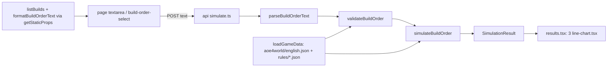

# M2: Technical design

## Summary

A pure, deterministic engine in `lib/aoe4-build-order/` reads a pinned English aoe4world snapshot plus two
hand-entered rules files (`rules/base.json` civ-agnostic, `rules/english.json` civ overlay), runs a
validated `BuildOrder` to a fixed horizon, and returns a column-oriented `SimulationResult` of time series
plus per-step timings. The page posts paste text to `POST /api/aoe4-build-order/simulate` and draws three
SVG charts. **API route: yes.** Reasons: it follows the ARCHITECTURE pattern (lib + thin route) already used
by `/api/fight`; S3 caps are enforced where the simulation runs; the ~190 KB snapshot stays off the client;
reviewers and acceptance tests can curl it; a later spread (many runs) belongs server-side. Cost: OpenAPI
entries plus loosening the fight spec-surface test that pins `paths` to `/api/fight` only.
**Charts: hand-rolled SVG**, no new dependency (`package.json` has none; three line charts do not justify one).

## Modules

| module (path) | owns | public exports | used by |
|---|---|---|---|
| `data/aoe4-build-order/aoe4world/english.json` | snapshot, entries verbatim, filtered to `civs` containing `en` | `{ source, units, buildings, technologies, upgrades }` | data.ts |
| `data/aoe4-build-order/rules/base.json`, `rules/english.json` | hand-entered values (A1), each a `HandValue` | see Contracts | data.ts |
| `data/aoe4-build-order/builds/<slug>.json` | prebuilt `BuildOrder`s | | builds.ts |
| `lib/aoe4-build-order/model.ts` | input and result types | `CivId, ResourceKind, GatherNodeId, Trigger, BuildStep, BuildOrder, SimInputs, SimulationResult, UnitSeries, StepTiming, BuildOrderIssue` | all |
| `lib/aoe4-build-order/data.ts` | load + index snapshot and rules by id/baseId | `loadGameData(civ)`, `GameData` | validate, simulate, route |
| `lib/aoe4-build-order/parse-text.ts` | paste format <-> JSON | `parseBuildOrderText(text)`, `formatBuildOrderText(order)` | route, page (static props) |
| `lib/aoe4-build-order/validate.ts` | shape, bounds, ids, tech support | `validateBuildOrder(input, data)`, `resolveSimInputs(partial, data)`, `SIM_INPUT_BOUNDS` | route, simulate tests |
| `lib/aoe4-build-order/effects.ts` | aoe4world effect interpreter + conditions | `SUPPORTED_EFFECT_PROPERTIES`, `isSupportedTech(entry, data)`, `modifiedValue(base, property, target, state)` | validate, simulate |
| `lib/aoe4-build-order/gather.ts` | trip model | `effectiveGatherRate(node, state, inputs)` | simulate |
| `lib/aoe4-build-order/construction.ts` | builder scaling | `constructionSeconds(baseSeconds, builders, data)` | simulate, houses |
| `lib/aoe4-build-order/houses.ts` | auto-house planner | `planAutoHouse(state, inputs, data)` | simulate |
| `lib/aoe4-build-order/civ-rules.ts` | per-civ code seams, all no-op | `CivRules`, `NO_CIV_RULES`, `civRules(civ)` | simulate |
| `lib/aoe4-build-order/simulate.ts` | event loop, queues, triggers, sampling | `simulateBuildOrder(order, data, inputs, rules?)` | route, tests |
| `lib/aoe4-build-order/builds.ts` | list prebuilt builds | `listBuilds(): BuildOrder[]` | page |
| `lib/aoe4-build-order/api.ts` | route request/response types (like `fight-api.ts`) | `SimulateRequest, SimulateResponse, SimulateError` | route, page, acceptance |
| `pages/api/aoe4-build-order/simulate.ts` | thin handler | default handler | page |
| `pages/apps/aoe4-build-order.tsx`, `components/apps/aoe4-build-order/{build-input,results,line-chart}.tsx` | UI | | |
| `docs/aoe4-build-order.md` | model, sources, grammar, CivRules, outputs | | reviewers |

## Contracts

**Ids.** Build orders and rules reference aoe4world `baseId`s (`villager`, `town-center`, `house`,
`wheelbarrow`, `veteran-longbowmen`); the engine resolves the civ's entry for the current age or tier. Never
names. A building instance is `<baseId>` (step applies to every instance) or `instance: k` (1-based).

```ts
type CivId = 'english'
type ResourceKind = 'food' | 'wood' | 'gold' | 'stone'
type GatherNodeId = 'sheep' | 'berry' | 'deer' | 'boar' | 'farm' | 'wood' | 'gold' | 'stone'
type Trigger = { kind: 'time'; seconds: number } | { kind: 'villagers'; count: number }   // omitted = no condition
type BuildStep = { trigger?: Trigger } & (
  | { action: 'produce'; producer: string; instance?: number; unit: string; count?: number; rally?: GatherNodeId } // no count = continuous; rally required for villager
  | { action: 'pause'; producer: string; instance?: number }
  | { action: 'build'; building: string; builders?: number; from: GatherNodeId; then?: GatherNodeId } // builders default 1, then default from
  | { action: 'research'; tech: string; at?: string }          // technologies and upgrades (veterancy)
  | { action: 'move'; count: number; from: GatherNodeId; to: GatherNodeId })
interface BuildOrder { civ: CivId; name: string; source?: string; steps: BuildStep[] }
interface HandValue<T> { value: T; source: string; unverified: boolean }
interface TripInputs { walkSecondsCamp: number; walkSecondsTownCenter: number; dropOffSeconds: number }
interface SimInputs {
  durationSeconds: number                  // default 1200, 60..3600
  trips: Record<GatherNodeId, TripInputs>  // defaults from rules/base.json
  reassignSeconds: number                  // idle/walk when a villager changes task
  builderWalkSeconds: number
  autoHouses: boolean                      // default true
  houseBuilders: number                    // default 1
  houseBuilderSource: GatherNodeId         // default 'wood'
  influenceCoverage: Record<string, number> // share of gatherers in a building's influence once one exists; { mill: 1 }
}
interface UnitSeries { unitId: string; baseId: string; name: string; tier: number; counts: number[] } // tier = entry age; counts cumulative, produced only
interface StepTiming { step: number; status: 'completed' | 'in-progress' | 'waiting' | 'not-reached';
  armedAt: number | null; startedAt: number | null; completedAt: number | null; waitSeconds: number }
interface SimulationResult { civ: CivId; durationSeconds: number; sampleSeconds: number; times: number[];
  unitsProduced: UnitSeries[]; gatherRates: Record<ResourceKind, number[]>;   // per minute
  floating: Record<ResourceKind, number[]>; steps: StepTiming[]; ages: { age: number; reachedAt: number }[] }
interface BuildOrderIssue { code: 'syntax' | 'unknown-trigger-kind' | 'unknown-id' | 'unsupported-tech'
  | 'out-of-range' | 'invalid'; message: string; step?: number; line?: number }
```

**Engine rules** (docs/aoe4-build-order.md states them; tests check them):
- Ordering: list order; a step arms when its trigger holds and every earlier step has started; then waits
  until affordable and supply allows (A2); `waitSeconds = startedAt - armedAt`. Time = "not before".
  Villager count = villagers alive. Never-armed at horizon = `not-reached`; armed but never started = `waiting`.
- Queue: one queue per building instance; production and research share it. A `produce` on a busy producer
  replaces its order (switch); `pause` clears it. `sampleSeconds` = 5.
- Tier: produced unit = entry for the highest tier whose upgrade is researched, else the lowest-age entry
  for that `baseId`. `upgradeTargets` maps upgrade baseId -> unit baseId (aoe4world `unlocks` is empty);
  target tier = unit entry whose `age` equals the upgrade's `age`.
- Ages: a building whose `classes` match `^age[1-3]_landmark\d$` advances age from its `age` to `age + 1` on
  completion. Entries with `age` above the current age are unavailable.
- Trip model: `cycle = capacity / rate + walk / moveSpeedMultiplier + dropOffSeconds`; rate = capacity / cycle;
  walk uses `walkSecondsCamp` when a building in the node's `dropOffs` exists, else `walkSecondsTownCenter`.
- Construction: `base x numerator / (builders + offset)` from `rules/base.json` `builderScaling` (3, 2).
- Tech support: every effect's `property` in `SUPPORTED_EFFECT_PROPERTIES` (`foodGatherRate, woodGatherRate,
  goldGatherRate, stoneGatherRate, farmGatherRate, berryGatherRate, huntGatherRate, carryCapacity,
  huntCarryCapacity, moveSpeed, productionSpeed`), `effect` in `change|multiply`, `type` = `passive`;
  else `unsupported-tech` naming the tech and property. Upgrades are supported iff in `upgradeTargets`.

**Rules files.** `base.json`: `gatherNodes: Record<GatherNodeId, { resource, rate, capacity (HandValue),
rateProperties[], capacityProperties[], dropOffs[], trip: TripInputs of HandValue }>`, `builderScaling`,
`maxPopCap`, `reassignSeconds`, `builderWalkSeconds`. `english.json`: `startingState { age, resources,
villagers: Record<GatherNodeId, n>, buildings[] }`, `supply: Record<baseId, HandValue<number>>`,
`effects: OverlayEffect[]`, `upgradeTargets: Record<baseId, HandValue<string>>`.
`OverlayEffect` = aoe4world effect `{ property, select, effect, value, type }` + `grantedBy` (`'civ'` or a
building/tech baseId) + `condition?: { age?: number; nearBuilding?: string }` (all fields must hold) +
`source` + `unverified`. Snapshot `source`: `{ repo, commit, committedAt, fetchedAt, patch }`.

**CivRules** (`civ-rules.ts`): optional members `gatherRateModifier, productionModifier, supplyProvider,
villagerProducer, dropOffRule, startingState` are value hooks `(defaultValue, ctx) => value`;
`onBuildingComplete, onAgeAdvance` are event hooks `(state, ctx) => void`. The engine calls
`rules.hook?.(...) ?? default`. `civRules('english')` returns `NO_CIV_RULES` (`{}`).

**Route.** `POST /api/aoe4-build-order/simulate`, `operationId: simulateBuildOrder`. Request
`SimulateRequest { text?: string; buildOrder?: BuildOrder; inputs?: Partial<SimInputs> }`, exactly one of
`text` (max 20,000 chars) or `buildOrder` (max 200 steps). 200 `SimulationResult`; 400
`SimulateError { error: string; issues: BuildOrderIssue[] }` (`error` = first issue's message); 405
`{ error }` with `Allow: POST`; malformed JSON keeps Next's plain-text 400. OpenAPI schema names equal the TS
names above. Every numeric field has a bound in `SIM_INPUT_BOUNDS` (S3).

**Paste format** (one step per line; `#` comments and blank lines ignored; errors carry `line`):

| line prefix | trigger | action syntax |
|---|---|---|
| `@m:ss ` | time | `produce <unit> from <producer>[#k] [xN] [-> <node>]` |
| `at N vils ` | villagers | `pause <producer>[#k]` |
| none | none | `build <building> [with N] from <node> [then <node>]`; `research <tech> [at <building>]`; `move N <node> to <node>` |

**Page test ids:** `build-order-select`, `build-order-text`, `run-simulation`, `simulation-error`,
`chart-units-produced`, `chart-gather-rates`, `chart-floating-resources` (each an `<svg>` with one
`<path data-series="<key>">` per series; unit keys are `unitId`).

## Data flow



## Extension points

| future direction | seam that keeps it additive |
|---|---|
| Other civs | `CivId` union + `aoe4world/<civ>.json` + `rules/<civ>.json`; engine keys on ids only; `CivRules` hooks |
| Event / resource triggers, combinators | new `Trigger.kind`; one `triggerHolds(trigger, state)` switch in simulate.ts; validate rejects unknown kinds |
| Spread result | all variable quantities in `SimInputs`; `simulateBuildOrder` uses no randomness or clock; later `spread` field on `SimulationResult` and `runs`/`seed` on `SimulateRequest` |
| New step kinds (idle, sacred sites, trade) | `BuildStep` tagged on `action`; one handler per action |
| More tech effects (`buildTime`, combat, `influence` type) | grow `SUPPORTED_EFFECT_PROPERTIES` and the interpreter |
| Later English bonuses (Council Hall longbow speed, Network of Castles, Abbey) | `OverlayEffect` rows in `rules/english.json`; no code |
| Depletion, positions, per-trip deposits | `gatherNodes` data + `TripInputs`; rate computed only in `gather.ts` |
| More series (rates by node, idle villagers) | new `SimulationResult` fields beside existing ones |
| Community formats (RTS_Overlay) | a new parser beside `parseBuildOrderText` producing `BuildOrder` |

## Owner decisions

1. **Combat-only techs** (Blacksmith/University: `hitpoints`, `meleeAttack`, ...). CONTEXT says reject. Many
   real builds research them. Options: (a) reject as decided; (b) accept them as cost + queue time only,
   effect ignored. **Recommend (b)**: the effect cannot change an economy sim, and (a) makes those builds unusable.
2. **Income timing.** (a) credit income continuously at the trip-model rate; (b) credit a full load at each
   trip's drop-off. **Recommend (a)**: smooth graphs, simpler; (b) shifts early timings by up to one trip (~15-40 s).
3. **Patch label.** aoe4world files carry no patch number. **Recommend** `source.patch` = the live game
   patch on the commit date (from aoe4world.com or patch notes), with the commit sha and date beside it.
4. **Eco techs with `unknown` effects** (`forestry-1`). **Recommend** rejecting in v1 (the model has no tree
   felling) rather than hand-entering an effect.

## Left to tickets

- Engine internals: event-driven vs fixed tick, provided it is deterministic and a 3600 s run finishes well
  under 1 s; auto-house algorithm, given the owner's time-computed-lead rule and an explicit house step suppressing it.
- Hand-entered values and their sources; gather-node property mappings; walk defaults tuned to the
  calculator cross-check (test tolerance chosen by the engine ticket).
- Snapshot refresh procedure (`data/aoe4-build-order/README.md`); entries kept verbatim.
- Which `SimInputs` the page exposes (at least `durationSeconds`); chart styling, axes, legends.
- Exact error message wording (must name the step or line and the offending id or kind).
- Loosening `acceptance/fight-api-spec-surface.spec.ts` to fight-only paths and schemas (route ticket).
