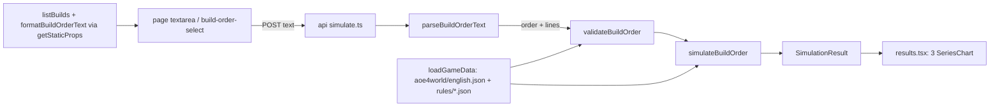

# M2: Technical design

## Summary

A pure, deterministic engine in `lib/aoe4-build-order/` reads a pinned English aoe4world snapshot plus two
hand-entered rules files (`rules/base.json` civ-agnostic, `rules/english.json` civ overlay), runs a
validated `BuildOrder` to a fixed horizon, and returns a column-oriented `SimulationResult` of time series,
per-step timings, and non-fatal notes. The page posts paste text to `POST /api/aoe4-build-order/simulate` and
draws three Recharts line charts. **API route** (lib + thin route, as `/api/fight`): S3 caps enforced where the sim runs,
the ~190 KB snapshot stays off the client, curl-able for review, and a later spread belongs server-side. Cost:
OpenAPI entries and loosening the fight spec-surface test. **Charts: Recharts `3.10.1`** (exact pin, no caret):
the charts are the app's whole output and need m:ss axes, toggleable legends, tooltips, responsive width and a
palette for 8-15 series. 3.10.1 peers on React/React DOM/`react-is` 16-19 and pulls `@reduxjs/toolkit` 2.13,
`react-redux` 9.3 (deduped onto the repo's `@types/react` 19.3). Verified against `main` 0b985f3 (Next 16.4.3,
React 19.3.1, TS 7.0.2, Vitest 5.0.5): `tsc --noEmit` clean with the repo tsconfig, and also with
`skipLibCheck: false`; `next build` succeeds; Vitest SSR via `renderToString`; selectors checked in Chromium under
`next dev` (local Node 22.17, not the pinned 24.x). The ticket that adds `line-chart.tsx` adds `recharts` to
`package.json` `dependencies` and `package-lock.json` (`npm install --save-exact recharts@3.10.1`).

## Modules

| module (path) | owns | public exports | used by |
|---|---|---|---|
| `data/aoe4-build-order/aoe4world/english.json` | snapshot, entries verbatim, filtered to `civs` containing `en` | `{ source, units, buildings, technologies, upgrades }` | data.ts |
| `data/aoe4-build-order/rules/base.json`, `rules/english.json` | hand-entered values (A1), each a `HandValue` | see Contracts | data.ts |
| `data/aoe4-build-order/builds/<slug>.json` | prebuilt `BuildOrder`s | | builds.ts |
| `lib/aoe4-build-order/model.ts` | input and result types | `CivId, ResourceKind, GatherNodeId, Trigger, BuildStep, BuildOrder, BuildStart, HandValue, TripInputs, SimInputs, SimulationResult, UnitSeries, StepTiming, BuildOrderIssue, BuildOrderNote, TechSupport, OverlayEffect, BuildOrderLines` | all |
| `lib/aoe4-build-order/data.ts` | load + index snapshot and rules by id/baseId | `loadGameData(civ)`, `GameData`, `SnapshotEntry`, `SnapshotEffect`, `SnapshotSource`, `BaseRules`, `GatherNodeRules`, `CivData` | validate, simulate, route |
| `lib/aoe4-build-order/parse-text.ts` | paste format <-> JSON | `parseBuildOrderText(text): ParseTextResult`, `ParseTextResult`, `formatBuildOrderText(order)` | route, page (static props) |
| `lib/aoe4-build-order/validate.ts` | shape, bounds, ids, tech classification (rejections as issues) | `validateBuildOrder(input, data, options?: ValidateOptions)`, `ValidateOptions`, `resolveSimInputs(partial, data)`, `SIM_INPUT_BOUNDS` | route, simulate tests |
| `lib/aoe4-build-order/effects.ts` | aoe4world effect interpreter + conditions, tech classification | `SUPPORTED_EFFECT_PROPERTIES`, `IGNORED_EFFECT_PROPERTIES`, `classifyTech(entry, data): TechSupport`, `modifiedValue(base, property, target, state)` | validate, simulate |
| `lib/aoe4-build-order/gather.ts` | trip model | `effectiveGatherRate(node, state, inputs)` | simulate |
| `lib/aoe4-build-order/construction.ts` | builder scaling | `constructionSeconds(baseSeconds, builders, data)` | simulate, houses |
| `lib/aoe4-build-order/houses.ts` | auto-house planner | `planAutoHouse(state, inputs, data, demand): number`, `HouseDemand` (see Auto-houses) | simulate |
| `lib/aoe4-build-order/civ-rules.ts` | per-civ code seams, all no-op | `CivRules`, `NO_CIV_RULES`, `civRules(civ)` | simulate |
| `lib/aoe4-build-order/simulate.ts` | event loop, queues, triggers, sampling | `simulateBuildOrder(order, data, inputs, rules?)`, `SAMPLE_SECONDS`, `triggerHolds`, `EngineState`, `StepHandler`, `stepHandlers`, `addBuildingInstance` (see Production) | route, tests |
| `lib/aoe4-build-order/builds.ts` | list prebuilt builds | `listBuilds(): BuildOrder[]` | page |
| `lib/aoe4-build-order/api.ts` | route request/response types (like `fight-api.ts`) | `SimulateRequest, SimulateResponse, SimulateError` | route, page, acceptance |
| `pages/api/aoe4-build-order/simulate.ts` | thin handler | default handler | page |
| `pages/apps/aoe4-build-order.tsx`, `components/apps/aoe4-build-order/{build-input,results}.tsx` | UI | | |
| `components/apps/aoe4-build-order/chart-rows.ts` | pure chart helpers, no React or Recharts | `ChartSeries`, `toChartRows`, `formatMinSec`, `PALETTE`, `seriesColor`, `toggleHidden` | line-chart.tsx |
| `components/apps/aoe4-build-order/line-chart.tsx` | one Recharts chart, legend toggling | `SeriesChart`; re-exports `ChartSeries`, `toChartRows` | results.tsx |
| `docs/aoe4-build-order.md` | model, sources, grammar, CivRules, outputs | | reviewers |

## Contracts

**Ids.** Build orders and rules reference aoe4world `baseId`s (`villager`, `town-center`, `house`,
`wheelbarrow`, `veteran-longbowmen`); the engine resolves the civ's entry for the current age or tier. Never
names. A building instance is `<baseId>` (step applies to every instance) or `instance: k` (1-based).

```ts
type CivId = 'english'
type ResourceKind = 'food' | 'wood' | 'gold' | 'stone'
type GatherNodeId = 'sheep' | 'berry' | 'deer' | 'boar' | 'farm' | 'wood' | 'gold' | 'stone'
type Trigger = { kind: 'time'; seconds: number } | { kind: 'villagers'; count: number }   // omitted = no condition
type BuildStep = { trigger?: Trigger } & (
  | { action: 'produce'; producer: string; instance?: number; unit: string; count?: number; rally?: GatherNodeId; walkSeconds?: number } // no count = continuous; rally only for villager, sets the producer's rally; walkSeconds only with rally
  | { action: 'rally'; producer: string; instance?: number; to: GatherNodeId; walkSeconds?: number } // villager rally from its start on; no cost
  | { action: 'pause'; producer: string; instance?: number }
  | { action: 'build'; building: string; builders?: number; from: GatherNodeId; then?: GatherNodeId; walkSeconds?: number } // builders default 1, then default from
  | { action: 'research'; tech: string; at?: string }          // technologies and upgrades (veterancy)
  | { action: 'move'; count: number; from: GatherNodeId; to: GatherNodeId; walkSeconds?: number })
interface BuildOrder { civ: CivId; name: string; source?: string; start?: BuildStart; steps: BuildStep[] }
interface BuildStart { villagers?: Partial<Record<GatherNodeId, number>>; rally?: GatherNodeId } // t=0 split (absent = civ split); rally at t=0
interface HandValue<T> { value: T; source: string; unverified: boolean }
interface TripInputs { walkSecondsCamp: number; walkSecondsTownCenter: number; dropOffSeconds: number }
interface SimInputs {
  durationSeconds: number                  // default 1200, 60..3600
  trips: Record<GatherNodeId, TripInputs>  // defaults from rules/base.json
  walkSeconds: number                      // base walk per task switch (move, build legs, rally, auto-house); per-step override
  autoHouses: boolean                      // default true
  houseBuilders: number                    // default 1
  houseBuilderSource: GatherNodeId         // default 'wood'; preferred node, fallback in Auto-houses
  influenceCoverage: Record<string, number> // share of gatherers in a building's influence once one exists; { mill: 1 }
}
interface UnitSeries { unitId: string; baseId: string; name: string; tier: number; counts: number[] } // tier = entry age; counts cumulative, produced only
interface StepTiming { step: number; status: 'completed' | 'in-progress' | 'waiting' | 'not-reached';
  armedAt: number | null; startedAt: number | null; completedAt: number | null; waitSeconds: number }
interface SimulationResult { civ: CivId; durationSeconds: number; sampleSeconds: number; times: number[];
  unitsProduced: UnitSeries[]; gatherRates: Record<ResourceKind, number[]>;   // per minute
  floating: Record<ResourceKind, number[]>; steps: StepTiming[]; ages: { age: number; reachedAt: number }[];
  notes: BuildOrderNote[] }
interface BuildOrderIssue { code: 'syntax' | 'unknown-trigger-kind' | 'unknown-id' | 'unsupported-tech'
  | 'unknown-tech-effect' | 'out-of-range' | 'invalid'; message: string; step?: number; line?: number }
interface BuildOrderNote { code: 'tech-effect-ignored' | 'tech-effect-unmodeled'; message: string; step: number; tech: string; properties: string[] }
interface BuildOrderLines { start?: number; steps: number[] } // paste line numbers, 1-based; steps[i] = line of order.steps[i]; start absent = no start line
type TechSupport = { kind: 'supported' } | { kind: 'effects-ignored'; properties: string[] } | { kind: 'effects-unmodeled' }
  | { kind: 'rejected'; code: 'unsupported-tech' | 'unknown-tech-effect'; property: string }
```

**Line map** (paste only). `parseBuildOrderText` and `validateBuildOrder` share `BuildOrderLines`:
```ts
// parse-text.ts
type ParseTextResult = { ok: true; order: BuildOrder; lines: BuildOrderLines } | { ok: false; issues: BuildOrderIssue[] } // issues all `syntax`, each with `line`
// validate.ts
interface ValidateOptions { lines?: BuildOrderLines }   // later: rules?: CivRules (one options object, not more positional args)
function validateBuildOrder(input: unknown, data: GameData, options?: ValidateOptions)
  : { ok: true; order: BuildOrder } | { ok: false; issues: BuildOrderIssue[] }
function resolveSimInputs(partial: unknown, data: GameData): { ok: true; inputs: SimInputs } | { ok: false; issues: BuildOrderIssue[] }
```
- Both validate.ts result unions stay unnamed (inferred, not exported): the route narrows on `ok`; validate.ts
  exports exactly `validateBuildOrder`, `ValidateOptions`, `resolveSimInputs`, `SIM_INPUT_BOUNDS`.
- Paste `ok: true` order: `civ: 'english'` (the only `CivId`), `name: 'Pasted build order'` (literal), no `source`;
  `start` absent when there is no `start` line. Later civs: a `civ` paste line or a parse option, not a guess.
- Line numbers count every physical line (comments and blanks too); `\r\n` is one break. Text
  `start 6 sheep -> sheep` / `# opener` / `@0:00 produce villager from capital-town-center x3` gives
  `{ start: 1, steps: [3] }`; no `start` line and steps on lines 1..5 gives `{ steps: [1, 2, 3, 4, 5] }`.
  `lines.steps.length === order.steps.length`.
- With `options.lines`, an issue on step i gets `line: lines.steps[i]` (beside `step`); an issue on `start` gets
  `line: lines.start`. Without it (JSON), step issues carry `step` only and `start` issues carry neither. A missing
  entry (`lines.steps[i]` undefined) omits `line`, never throws. `resolveSimInputs` issues (`inputs`) never carry `line`.

**Issue codes** (`BuildOrderIssue.code`; the list above is complete, no code added; JSON and paste share them):

| code | meaning |
|---|---|
| `syntax` | text cannot be parsed, or JSON structure is wrong: bad paste grammar, a step that is not an object, missing or mistyped field, unknown `action` value, wrong-typed `trigger` |
| `unknown-trigger-kind` | the trigger's `kind` is not `time` or `villagers` (an omitted trigger means no condition) (paste: unknown line prefix is `syntax`) |
| `unknown-id` | well-formed id not in the civ data (unit, producer, building, tech, node, civ) |
| `unsupported-tech` / `unknown-tech-effect` | tech rejected per `TechSupport` |
| `out-of-range` | number outside `SIM_INPUT_BOUNDS`, non-integer, or non-finite |
| `invalid` | well-formed, known ids, in range, but a cross-field rule fails (see Rally and start, Producer capability, Repeat research) |

Rule of thumb: shape or spelling = `syntax`; value size = `out-of-range`; field combination = `invalid`.

**Rally and start** (owner, 2026-10-31; validation in `validate.ts`, state in `simulate.ts`):
- Villager producers = the `producedBy` of the civ's `villager` entries (English: `capital-town-center`, `town-center`,
  `kings-palace`). Every spawned villager walks from spawn to its producer instance's rally node (Task-switch walk).
- Rally state, per producer instance: `{ node, walkSeconds? }`. Writers, last writer wins, effective from the step's
  `startedAt`: a `rally` step, and a villager `produce` with `rally` (same scope: `instance` = that instance; none = every
  existing instance of that baseId plus the default for that baseId's later instances). A new instance takes its baseId
  default, else `start.rally`. Villagers already spawned are never re-routed (`move` does that).
- `rally` step: any `Trigger`; arms like any step; no cost or supply, so `startedAt = completedAt = armedAt`,
  `waitSeconds` 0, status `completed`. Its `walkSeconds` applies to the rally walk of every villager it routes; a
  `start.rally` route walks `inputs.walkSeconds`. An instance-scoped rally for an instance not yet built is held for it.
- Same instant: steps start (list order) before villagers spawn, so `@T rally` routes a villager spawning at T; a step
  armed by a spawn (`villagers` trigger) starts at that instant after it, so `at N vils rally` routes villager N+1 on.
- `start.villagers`: when present it replaces the civ split whole (omitted nodes 0); placed at t=0 with no walk, as the
  civ split. The starting count = sum of `civData.startingState.villagers.value` (a civ whose `startingState` hook
  changes it later passes `rules` to `validateBuildOrder`). Both `start` fields optional; `start: {}` is valid.
- Validation, each `invalid` unless noted (issue on the step, the paste `start` line, or no `step`/`line` for JSON `start`):
  `start.villagers` values not summing to the starting count; an unknown node key (`unknown-id`); `walkSeconds` without
  `rally` on `produce`; `rally` on a non-villager `produce`; a `rally` step whose `producer` is a known building that
  produces no villagers; no `start.rally` while a starting building is a villager producer (message names it); a
  `build` of a villager producer with no `start.rally` and no earlier baseId-wide `rally` source for that baseId.
  These make "a villager spawns with no rally in effect" impossible, so the engine needs no runtime rally error.
  A villager `produce` without `rally` is valid (uses the standing rally).

**Producer capability** (`invalid`, in `validate.ts`; the engine may assume both hold and needs no runtime check):
- `produce`: `producer` must be in the union of `producedBy` over every `data.byBaseId.get(unit)` entry (all tiers).
  `produce villager from house` fails; `produce villager from kings-palace` passes. Message names the step or line,
  the producer and the unit.
- `research` with `at`: `at` must be in the union of `producedBy` over the tech's entries. `research wheelbarrow at
  house` fails; `research wheelbarrow at mill` passes (snapshot `wheelbarrow-1` `producedBy: ['mill']`). Without `at` no check (the engine
  uses the tech's `producedBy`). Message names the step or line, the tech and the building.
- Each runs only once the ids resolved (`unknown-id` first, no double issue). An entry above the current age is not
  this rule: the step waits in the engine (Ages).

**Sampling.** `times` = `0, s, 2s, ...` for `s = sampleSeconds`, up to and including `durationSeconds`; when `durationSeconds`
is not a multiple of `s`, the last sample is `durationSeconds` itself (the previous sample is the last multiple below it).
So `times.length = floor(duration/s) + 1` (+1 more if not a multiple). Every per-sample array has this length; t=0 reflects the
state after zero-time steps at t=0 are started.

**Engine rules** (docs/aoe4-build-order.md states them; tests check them):
- Ordering: list order; a step arms when its trigger holds and every earlier step has started; then waits
  until affordable and supply allows (A2); `waitSeconds = startedAt - armedAt`. Time = "not before".
  Villager count = villagers alive. Never-armed at horizon = `not-reached`; armed but never started = `waiting`.
- Queue: one queue per building instance; production and research share it. A `produce` on a busy producer
  replaces its order (switch); `pause` clears it. `sampleSeconds` = 5 (`SAMPLE_SECONDS`, see Production).
- Tier: produced unit = entry for the highest tier whose upgrade is researched, else the lowest-age entry
  for that `baseId`. `upgradeTargets` maps upgrade baseId -> unit baseId (aoe4world `unlocks` is empty);
  target tier = unit entry whose `age` equals the upgrade's `age`.
- Ages: a building whose `classes` match `^age[1-3]_landmark\d$` advances age from its `age` to `age + 1` on
  completion. Entries with `age` above the current age are unavailable.
- Trip model: `cycle = capacity / rate + walk / moveSpeedMultiplier + dropOffSeconds`; rate = capacity / cycle;
  walk uses `walkSecondsCamp` when a building in the node's `dropOffs` exists, else `walkSecondsTownCenter`.
- Task-switch walk: one generic base walk, `SimInputs.walkSeconds` (default `rules/base.json` `walkSeconds`).
  A step's `walkSeconds`, when present, overrides it for every villager movement that step causes. Effective
  walk = `(step.walkSeconds ?? inputs.walkSeconds) / moveSpeedMultiplier`, the same villager `moveSpeed`
  multiplier from `modifiedValue` the trip model uses (Wheelbarrow shortens it), read when the walk starts.
  Paid, idle and gathering nothing: once per villager on `move` (from -> to); on `build`, once to the site and
  once from the site to `then`; every spawned villager, once from spawn to its rally node (step = the rally source); auto-house builders pay
  both legs with `inputs.walkSeconds` (no step to override). The trip model's per-node `walkSecondsCamp`,
  `walkSecondsTownCenter`, `dropOffSeconds` are unchanged: they model the gather cycle, not task switches.
- Income: credited continuously each instant at the trip-model effective rate (no per-trip deposits).
- Construction: `base x numerator / (builders + offset)` from `rules/base.json` `builderScaling` (3, 2).
- `classifyTech`, in order: any effect `property` = `unknown` (`forestry-1`) -> `rejected/unknown-tech-effect`;
  any property in neither set, or a supported one with `effect` not `change|multiply` or `type` not `passive`
  -> `rejected/unsupported-tech`; any property in `IGNORED_EFFECT_PROPERTIES` (combat stats: `hitpoints`,
  `meleeAttack`, `rangedArmor`, ...; ticket enumerates from the snapshot) -> `effects-ignored`; else `supported`.
  `SUPPORTED_EFFECT_PROPERTIES` = `foodGatherRate, woodGatherRate, goldGatherRate, stoneGatherRate,
  farmGatherRate, berryGatherRate, huntGatherRate, carryCapacity, huntCarryCapacity, moveSpeed, productionSpeed`.
  Rejections become issues naming tech and property. `effects-ignored` techs cost resources and queue time,
  apply their supported effects, and get one `tech-effect-ignored` note per research step (reached or not), in
  step order. Upgrades (`type: 'upgrade'`) are supported iff in `upgradeTargets`, else
  `rejected/unsupported-tech` with `property: 'upgradeTargets'`. `buildTime` is in neither set, so it rejects
  (`military-academy`, `lightweight-beams`) rather than silently mis-timing. A technology with empty or absent
  `effects` (`shaft-mining`, ...) is `effects-unmodeled` unless an `OverlayEffect` has `grantedBy` = its baseId
  (then `supported`); it costs and queues like any tech and gets one `tech-effect-unmodeled` note
  (`properties: []`) per research step, worded so the user sees its effect is not simulated. Effects stated
  only in description text beside non-empty `effects` (`crosscut-saw-4` +5 capacity) are not detected; they
  are listed in `data/aoe4-build-order/README.md` Known data gaps.

**Production** (`simulate.ts`). Game facts: AoE4 deducts a unit's or technology's cost when it is queued and
refunds it in full on cancel; a player who switches or pauses lets the item in production finish.

| rule | statement |
|---|---|
| Instance queue | Each instance runs its *paid items* (units, research) FIFO, one at a time. Its *order* (`produce` step's, or the default continuous villager order) pays its next unit only when the instance has no paid item. Before the first ticket: no `simulate.ts`; an English start has one TC with the default order, nothing paid. |
| Payment | Cost paid and `costs.popcap` reserved together (population a little earlier than the game, which holds a queued unit at the cap; A2 holds). Entry (age, tier) is fixed at payment. A `produce` step pays its first unit per targeted instance at step start; every later unit pays as above. |
| `produce` start | Every existing targeted instance's first unit: entry available, total cost affordable, supply allows all; paid at once and appended to each FIFO. No targeted instance exists: waits (blocks later steps) until one does. Later-built instances are not covered. |
| Switch | At start the step's order replaces each targeted instance's order. The item in production and any paid item finish and spawn (no cancel, no refund); the old order's unpaid units are dropped. |
| `pause` | No cost; `startedAt = completedAt = armedAt`, `waitSeconds` 0, `completed`. Clears each existing targeted instance's order; paid items finish. No existing instance: no-op, not held (unlike rally). |
| Priority | At most one step is armed and unstarted (arming needs every earlier step started). While it waits on resources only (entry available, supply allows, instance exists), an order payment is skipped if, for any `ResourceKind` the unit costs, floating would fall below that step's cost of it. Steps start before order payments in one instant, so the step wins ties. A step waiting on supply, age or an unbuilt instance reserves nothing. Auto-house builds are not order payments and ignore it. |
| Completion | Counted `produce`: when its last unit spawns. Continuous, or counted replaced early: when no instance still carries its order (the replacing `produce` or `pause` step's `startedAt`). Paid units of a replaced order still spawn and count. Started, not completed at the horizon: `in-progress`. |
| Sample step | `export const SAMPLE_SECONDS = 5` in `simulate.ts`; `SimulationResult.sampleSeconds` echoes it. Output resolution, not a game number; not a `SimInputs` field. |
| Seam names | `EngineState`, `StepHandler`, `stepHandlers` (keyed by `BuildStep['action']`; an action with no handler stays `waiting`), `addBuildingInstance(state, baseId)` (instance, rally from baseId default else `start.rally`, default villager order on a villager producer). Signatures fixed by the engine ticket; SGS-031/032 only add handlers and call it. |

Follow-ons: `build` (SGS-031) pays at step start (the game deducts at foundation placement); on completion it calls
`addBuildingInstance` then `onBuildingComplete`; an age-up never changes paid items, and an age-blocked step re-checks
at it. `research` (SGS-032) pays at step start and is appended to the instance FIFO; it never replaces the order,
which resumes after it; a unit paid before an upgrade completes keeps the lower tier.

**Research target** (`research` handler, SGS-032). Candidates = `[step.at]` when present, else the tech entry's
`producedBy` in snapshot order. Target = the lowest-numbered existing instance (`instance` 1 first) of the first
candidate baseId that has any instance; no candidate instance: the step waits (blocks later steps, reserves nothing),
as `produce`. Queue length is not consulted. Example: two `town-center`s, `research textiles` -> `capital-town-center`
#1 (first in `producedBy`); `research textiles at town-center` -> `town-center` #1. No `instance` field on `research`
(see Extension points). A tech with empty `producedBy` (`upgrade-king-3`, `upgrade-king-4`) and no `at` never starts.

**Repeat research** (`invalid`, `validate.ts`, SGS-029). Game fact: a technology is researched once per player, and
the game offers no second queue of one already queued. A `research` step whose `tech` equals the `tech` of an earlier
`research` step is `invalid` (issue on the later step; message names the tech and the earlier step or line).
`research wheelbarrow` twice: one issue, on the second step; `wheelbarrow` then `textiles`: none. Runs after ids
resolve, like Producer capability. This makes "already researched or already queued" impossible, so the engine has
no runtime check and never pays twice.

**Auto-houses** (`houses.ts` + `simulate.ts`, SGS-031):
```ts
interface HouseDemand { pendingSupply: number; populationPerSecond: number } // exported from houses.ts
function planAutoHouse(state: EngineState, inputs: SimInputs, data: GameData, demand: HouseDemand): number // houses to start now, >= 0
```
- `pendingSupply` = supply of every building under construction (explicit or auto); `populationPerSecond` = sum of
  `popcap / production seconds` over instances with an order and an available unit entry. `simulate.ts` computes
  both (engine-private) and starts up to the returned count, one after another, in the same instant.
- Builder source, per house: `inputs.houseBuilderSource` when its `gatherers` count is at least `houseBuilders`; else the
  node with the most gatherers (tie: first in `GatherNodeId` order) when it has at least `houseBuilders`; else the house
  waits (only when fewer than `houseBuilders` villagers are gathering anywhere). Builders return to the node they were
  taken from. Example: default English start (6 on `sheep`, 0 on `wood`), default inputs: the first auto-house takes 1
  `sheep` villager and production does not stall at supply 10. A house short of wood still waits (A2).
- Suppression by explicit `build house` steps (owner, 2026-10-31, Owner decisions 4 option (c)): auto-houses are off from t=0
  until the last `build house` step in the list has started, and on from that instant; a never-started one keeps them off to
  the horizon. With no `build house` step: on from t=0.

**Rules files and loader.** Every hand-entered leaf is a `HandValue`. `HandValue`, `TripInputs`,
`OverlayEffect` live in `model.ts`; the snapshot and rules types live in `data.ts`:

```ts
interface SnapshotSource { repo: string; commit: string; committedAt: string; fetchedAt: string; patch: string; patchSource: string }
  // patch = game patch live on committedAt (upstream files carry none); patchSource = the URL stating it
interface SnapshotEffect { property: string; select: { id?: string[]; class?: string[][] }; effect: string; value: number; type: string }
interface SnapshotEntry { id: string; baseId: string; name: string; type: 'unit' | 'building' | 'technology' | 'upgrade';
  civs: string[]; age: number; classes: string[]; producedBy: string[]; costs: { food: number; wood: number; gold: number;
  stone: number; popcap: number; time: number }; effects?: SnapshotEffect[]; description?: string }  // other upstream fields kept, untyped
interface OverlayEffect extends SnapshotEffect { grantedBy: string;   // 'civ' or a building/tech baseId (active once built/researched)
  condition?: { age?: number; nearBuilding?: string; producer?: string }; source: string; unverified: boolean }
interface GatherNodeRules { resource: ResourceKind; rate: HandValue<number>; capacity: HandValue<number>;
  rateProperties: string[]; capacityProperties: string[]; dropOffs: string[];
  trip: { walkSecondsCamp: HandValue<number>; walkSecondsTownCenter: HandValue<number>; dropOffSeconds: HandValue<number> } }
interface BaseRules { gatherNodes: Record<GatherNodeId, GatherNodeRules>; builderScaling: { numerator: HandValue<number>;
  offset: HandValue<number> }; maxPopCap: HandValue<number>; walkSeconds: HandValue<number> }
interface CivData { startingState: { age: HandValue<number>; resources: HandValue<Record<ResourceKind, number>>;
  villagers: HandValue<Record<GatherNodeId, number>>; units: HandValue<Record<string, number>>;
  buildings: HandValue<string[]> };
  supply: Record<string, HandValue<number>>; effects: OverlayEffect[]; upgradeTargets: Record<string, HandValue<string>> }
interface GameData { civ: CivId; source: SnapshotSource; byId: ReadonlyMap<string, SnapshotEntry>;
  byBaseId: ReadonlyMap<string, readonly SnapshotEntry[]>;   // ascending age
  base: BaseRules; civData: CivData; supply: ReadonlyMap<string, HandValue<number>>; upgradeTargets: ReadonlyMap<string, HandValue<string>> }
```
- `base.walkSeconds` default: 5 (owner, 2026-10-30), `unverified: true`, source "owner assumption: about 5-6
  tiles at villager speed 1.12 tiles/s, no measurement". Rally walk (spawn to node) is owner-confirmed.
- `loadGameData` is synchronous (static JSON imports), builds indexes once per civ, returns the same deep-frozen
  instance (A3), throws for a civ with no data or a duplicate `id`. All id lookups go through the `Map`s
  (user ids like `__proto__` find nothing); code never indexes `civData.supply`/`upgradeTargets` directly.
- `OverlayEffect.condition`: all present fields must hold. `age` = exact current age (the farm bonus is four
  rows, ages 1-4). `nearBuilding` = the gatherer's share inside that building's influence (`influenceCoverage`).
  `producer` = the producing building's baseId; holds only when the modified value is a production time at an
  instance of that building, so `modifiedValue`'s `target` for `productionSpeed` carries the producer baseId.
- `productionSpeed` is a speed: time = `costs.time` / product of multipliers (upstream mixes conventions:
  `efficient-production` 2, `imperial-fleet` 0.8; no English tech carries it). King's Palace row:
  `productionSpeed`, `select { id: ['villager'] }`, `multiply 1.1`, `grantedBy: 'kings-palace'`,
  `condition { producer: 'kings-palace' }`; SGS-014 writes it with the farm rows. No `CivRules` hook.

**Starting units.** `startingState.units` maps unit `baseId` to count of non-villager units present at
t=0 (English: `{ scout: 1 }`; the snapshot's `baseId` is `scout` by aoe4world convention, SGS-014
confirms against the snapshot and fails the loader on an unknown id). They count toward population
(English starts 7/10: 6 villagers + 1 scout) but are not produced: they never appear in
`unitsProduced`, so those series start at 0. The `startingState` hook may override the whole object; a build
order's `start.villagers` then replaces its `villagers` (Rally and start). `CivData` is unchanged.
Sheep are not units in v1: resources are infinite and sheep are the `sheep` gather node.

**CivRules** (`civ-rules.ts`): optional members `gatherRateModifier, productionModifier, supplyProvider,
villagerProducer, dropOffRule, startingState` are value hooks `(defaultValue, ctx) => value`;
`onBuildingComplete, onAgeAdvance` are event hooks `(state, ctx) => void`. The engine calls
`rules.hook?.(...) ?? default`. `civRules('english')` returns `NO_CIV_RULES` (`{}`).

**Route.** `POST /api/aoe4-build-order/simulate`, `operationId: simulateBuildOrder`. Flow: `text` ->
`parseBuildOrderText(text)`; `ok: false` -> 400 with its `issues`; else `validateBuildOrder(r.order, data, { lines: r.lines })`.
`buildOrder` -> `validateBuildOrder(buildOrder, data)`. Then `resolveSimInputs(inputs ?? {}, data)`; its bound violations are 400 issues with no `line`. Request
`SimulateRequest { text?: string; buildOrder?: BuildOrder; inputs?: SimInputOverrides }`, exactly one of
`text` (max 20,000 chars) or `buildOrder` (max 200 steps). 200 `SimulationResult`; 400
`SimulateError { error: string; issues: BuildOrderIssue[] }` (`error` = first issue's message); 405
`{ error }` with `Allow: POST`; malformed JSON keeps Next's plain-text 400. OpenAPI schema names equal the TS
names above. Every numeric field has a bound in `SIM_INPUT_BOUNDS` (S3); a violation is an `out-of-range` issue
(non-integer where an integer is required, too, or a non-finite number). Bounds apply to JSON and paste alike:

| field | type | min..max | default |
|---|---|---|---|
| text / steps | | 20,000 chars / 200 steps | |
| `durationSeconds` | int | 60..3600 | 1200 |
| `Trigger.seconds` | int | 0..3600 (= max `durationSeconds`) | |
| `Trigger.count` (villagers) | int | 1..200 (= `maxPopCap`) | |
| `produce.count`, `move.count` | int | 1..200 | continuous (produce) |
| `builders`, `houseBuilders` | int | 1..200 | 1 |
| `instance` | int | 1..200 | every instance |
| `walkSeconds` (`SimInputs`) and per-step `walkSeconds` (`produce`, `build`, `move`, `rally`) | number | 0..60 | `rules/base.json`; step: inherit |
| `start.villagers` values | int | 0..200 | civ split |
| `walkSecondsCamp`, `walkSecondsTownCenter` | number | 0..60 | `rules/base.json` |
| `dropOffSeconds` | number | 0..30 | `rules/base.json` |
| `influenceCoverage` values | number | 0..1 | `{ mill: 1 }` |

**Route request and issues** (`api.ts` exports exactly `SimulateRequest`, `SimulateResponse` (= `SimulationResult`),
`SimulateError`, `SimInputOverrides`, `TripInputOverrides`):
```ts
type TripInputOverrides = Partial<TripInputs>
type SimInputOverrides = Partial<Omit<SimInputs, 'trips'>> & { trips?: Partial<Record<GatherNodeId, TripInputOverrides>> }
```
- Every absent `inputs` field, at any depth, takes its default: `trips` merges per node and then per field,
  `influenceCoverage` per key. `{ trips: { farm: { walkSecondsCamp: 3 } } }` changes only that one value; an
  out-of-range one is reported as `inputs.trips.farm.walkSecondsCamp`.
- OpenAPI request schemas are `SimulateRequest`, `BuildOrder`, `BuildStart`, `BuildStep`, `Trigger`,
  `SimInputOverrides`, `TripInputOverrides` (every property optional in the last two). There is no `SimInputs`
  or `TripInputs` schema: neither appears in a request or a response.
- Body that is not a JSON object (array, string, `null`): 400 with one `syntax` issue, nothing else checked.
  Otherwise two stages always both run and their issues concatenate, order stage first:
  1. order stage: `text` and `buildOrder` both absent or both present (`undefined` = absent, `null` = present) is
     one `syntax` issue naming both keys; `text` not a string is `syntax`; `text.length > 20000` is one
     `out-of-range` issue, not parsed (20,000 is accepted); then parse and `validateBuildOrder` as above.
  2. inputs stage: `resolveSimInputs(inputs ?? {}, data)`, run even when stage 1 failed.
  `error` = `issues[0].message`. Example: an invalid step plus `inputs.durationSeconds: 59` gives two issues, the
  step's first.
- Framework responses before the handler runs (stated in the OpenAPI operation description prose, no
  schema): malformed JSON is Next's plain-text 400; a body over Next's default 1 MB limit is Next's plain-text
  413 (the ticket confirms the status on the installed Next). The default limit stays (no `bodyParser.sizeLimit`): the largest body the caps allow (20,000 chars, at
  most 6 bytes each JSON-escaped, about 120 KB; or 200 steps) is far below it, and S3 is enforced by the
  handler's own caps.

**Paste format** (one step per line; `#` comments and blank lines ignored; errors carry `line`):

| line prefix | trigger | action syntax |
|---|---|---|
| `@m:ss ` | time | `produce <unit> from <producer>[#k] [xN] [-> <node>] [walk Ns]` |
| `at N vils ` | villagers | `pause <producer>[#k]` |
| none | none | `build <building> [with N] from <node> [then <node>] [walk Ns]`; `research <tech> [at <building>]`; `move N <node> to <node> [walk Ns]`; `rally <producer>[#k] -> <node> [walk Ns]` |

Grammar details: `@m:ss` = `@\d+:\d\d`, minutes any number of digits, seconds exactly two digits `00`-`59`
(`@1:61` is a `syntax` issue (seconds over 59); `@75:00` parses then fails the 3600 s bound as `out-of-range`; `@60:00` ok).
Within a `produce` line the suffixes are ordered `[xN]`, `[-> node]`, `[walk Ns]`; any other order is a `syntax` issue.
`walk Ns` is always last on `produce`, `build`, `move` lines: keyword `walk`, a space, an integer, `s` with no space
(`walk 6s`). A `produce` `walkSeconds` without `rally` (paste: without `-> node`) is an `invalid` issue. Paste walk values are integers; JSON may use decimals.
`xN` has no space (`x5`), `#k` follows the producer with no space, `->` is whitespace-delimited. Ids (unit,
producer, building, tech) and node names are lowercase kebab-case `[a-z0-9]+(-[a-z0-9]+)*`, case-sensitive;
uppercase or other characters are a `syntax` issue (not auto-lowercased). Keywords are lowercase. Numbers are
unsigned decimal integers (no sign, no decimals).
`start` line (`BuildStart`): `start [N <node>]... [-> <node>]`, at least one part, e.g. `start 4 sheep 2 wood -> sheep`;
at most one, before every step line, no trigger prefix; a repeated node, a second `start`, or one after a step is
`syntax`. `formatBuildOrderText` emits it first when `start` is present (nodes in `GatherNodeId` order).
`formatBuildOrderText` is total (never throws) and drops `civ`, `name`, `source`. Re-parse equality of `start` and
`steps` is guaranteed only for paste-representable orders (every number a non-negative integer); it rounds nothing:
a decimal prints as `String(n)` (`walk 4.5s`), which re-parses as `syntax`. Every prebuilt build in
`data/aoe4-build-order/builds/` must be paste-representable (the builds ticket tests the round trip).

**Charts** (`chart-rows.ts` pure helpers, `line-chart.tsx` component, Recharts 3.10.1):

```ts
// chart-rows.ts
interface ChartSeries { key: string; name: string; values: number[] }  // values aligned with times
function toChartRows(times: number[], series: ChartSeries[]): Array<{ t: number } & Record<string, number>>
function formatMinSec(seconds: number): string                          // 65 -> '1:05', 3600 -> '60:00'
const PALETTE: readonly string[]                                        // >= 15 distinct colors
function seriesColor(index: number): string                             // PALETTE[index % PALETTE.length]
function toggleHidden(hidden: ReadonlySet<string>, key: string): Set<string> // new set, never mutates
// line-chart.tsx
function SeriesChart(props: { testId: string; title: string; yLabel: string; times: number[]; series: ChartSeries[] })
```
- Renders `<div data-testid={testId}>` with the `title` heading and `ResponsiveContainer` (width 100%, fixed
  height) > `LineChart` (`data = toChartRows(...)`, `XAxis dataKey="t" type="number"` with m:ss ticks, `YAxis`
  labelled `yLabel`, `Tooltip` with m:ss label, `Legend`) and one `<Line dataKey={key} name={name}
  data-series={key} stroke={seriesColor(i)} dot={false} isAnimationActive={false} hide={hidden.has(key)} />` per series.
- Series keys: units = `UnitSeries.unitId` (name = `UnitSeries.name`); gather rates and floating = `ResourceKind`.
- Clicking a legend entry toggles that series' `hide`; state is local `useState<Set<string>>`. 3.x API:
  `Legend onClick: (data: LegendPayload, index, event)`; the key is `data.dataKey` (typed `DataKey<any>`), so
  `onClick={(d) => setHidden(h => toggleHidden(h, String(d.dataKey)))}`.
- Test contract (verified on 3.10.1 in Chromium, 3 series): a drawn series is exactly one
  `path.recharts-line-curve[data-series="<key>"]` inside the wrapper (`data-series` passes through to the path,
  with `name` and `stroke`); a hidden series draws no path and its legend item is `li.recharts-legend-item.inactive`
  (still listed); legend text (`.recharts-legend-item-text`) is the series `name`. `dot={false}` emits no
  `.recharts-line-dot`. Animation off so paths exist as soon as results render.
- SSR: no `next/dynamic` and no `'use client'` needed. `ResponsiveContainer` server-renders only
  `div.recharts-responsive-container` with an empty inner div and draws after measuring; on 3.x even a
  fixed-size `LineChart` server-renders an empty `div.recharts-wrapper` (no `svg`), so no `Line` markup ever
  reaches `renderToString`. A chart in the initial server render hydrates on Next 16 with no console errors or
  warnings (checked); the page renders charts only after the client POST anyway.
- Testing: Vitest runs `*.test.ts` in node (`vitest.config.mts` `include` gains `components/**/*.test.ts`), so
  unit tests cover the `chart-rows.ts` helpers and the page's mapping from `SimulationResult` to `ChartSeries[]`,
  plus an SSR smoke render of the wrapper; series presence and toggling are asserted in Playwright (real layout).
  In jsdom `ResponsiveContainer` measures 0x0 and draws no chart; a jsdom test would need a `ResizeObserver`
  and element-size stub, and is not required.

**Page test ids:** `build-order-select`, `build-order-text`, `run-simulation`, `simulation-error`,
`simulation-notes` (only when `notes` is non-empty), `chart-units-produced`, `chart-gather-rates`,
`chart-floating-resources` (each the `SeriesChart` wrapper `div`; series identified as above).

## Data flow



## Extension points

| future direction | seam that keeps it additive |
|---|---|
| Other civs | `CivId` union + `aoe4world/<civ>.json` + `rules/<civ>.json`; engine keys on ids only; `CivRules` hooks |
| Event / resource triggers, combinators | new `Trigger.kind`; one `triggerHolds(trigger, state)` switch in simulate.ts; validate rejects unknown kinds |
| Spread result | all variable quantities in `SimInputs`; `simulateBuildOrder` uses no randomness or clock; later `spread` field on `SimulationResult` and `runs`/`seed` on `SimulateRequest` |
| New step kinds (idle, sacred sites, trade) | `BuildStep` tagged on `action`; one handler per action |
| Military rally points, more start fields (resources, units) | optional `unit` on the `rally` step; new optional `BuildStart` fields |
| Pick the researching instance | optional `instance?: number` on `research` (as `produce`); absent keeps the Research target rule |
| More tech effects (`buildTime`, `influence` type), combat later | move a property into `SUPPORTED_EFFECT_PROPERTIES` and the interpreter; ignored ones shrink `IGNORED_EFFECT_PROPERTIES` |
| Later English bonuses (Council Hall, Network of Castles, Abbey) | `OverlayEffect` rows in `rules/english.json`; no code |
| Depletion, positions, per-trip deposits | `gatherNodes` data + `TripInputs`; rate and crediting only in `gather.ts` |
| More series or notes (rates by node, idle villagers) | new `SimulationResult` fields; new `BuildOrderNote.code` values |
| Community formats (RTS_Overlay) | a new parser beside `parseBuildOrderText` producing `BuildOrder` |

## Owner decisions

Confirmed by the owner 2026-10-31, as written above:
1. Rally changes are ordered steps (`rally` action), gated like every step; no separate timeline.
2. A villager `produce ... -> node` also sets the producer's standing rally.
3. `start.rally` is required while a starting building produces villagers; leaving it out is `invalid`.

4. Decided (owner, 2026-10-31): (c). Which explicit `build house` steps turn auto-houses off, and when (docs say only "overrides auto-houses"):
   - (a) any `build house` step in the order turns them off for the whole run (static; the SGS-031 draft). A build
     that scripts its first two houses then stalls at supply once production outgrows them.
   - (b) off from the start of the first `build house` step on. Before it the planner may build a house the script
     also builds, so the scripted house is surplus.
   - (c) **Recommended**: off from t=0 until the last `build house` step in the list has started, on from that
     instant (a never-started one keeps them off to the horizon). The script owns houses while it lists them; the
     planner keeps supply ahead afterwards. With no `build house` step: on from t=0. All three agree when the only
     house step is never reached (SGS-031's `@10:00` case).

## Left to tickets

- Engine internals: event-driven vs fixed tick, provided it is deterministic and a 3600 s run finishes well
  under 1 s; auto-house lead and count computation inside `planAutoHouse`, given the owner's time-computed-lead rule,
  the Auto-houses block, and Owner decisions 4.
- Hand-entered values and sources; gather-node property mappings; walk defaults tuned to the calculator
  cross-check (tolerance chosen by the engine ticket). Snapshot refresh procedure (`data/aoe4-build-order/README.md`).
- Which `SimInputs` the page exposes (at least `durationSeconds`); chart height, palette colors, tick spacing
  and other styling; note and error wording
  (must name the step or line and the offending id, kind, or property).
- Loosening `acceptance/fight-api-spec-surface.spec.ts` to fight-only paths and schemas (route ticket).
