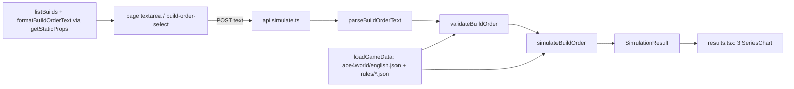

# M2: Technical design

## Summary

A pure, deterministic engine in `lib/aoe4-build-order/` reads a pinned English aoe4world snapshot plus two
hand-entered rules files (`rules/base.json` civ-agnostic, `rules/english.json` civ overlay), runs a
validated `BuildOrder` to a fixed horizon, and returns a column-oriented `SimulationResult` of time series,
per-step timings, and non-fatal notes. The page posts paste text to `POST /api/aoe4-build-order/simulate` and
draws three Recharts line charts. **API route** (lib + thin route, as `/api/fight`): S3 caps enforced where the sim runs,
the ~190 KB snapshot stays off the client, curl-able for review, and a later spread belongs server-side. Cost:
OpenAPI entries and loosening the fight spec-surface test. **Charts: Recharts `3.10.1`** (exact pin, no caret):
the charts are the app's whole output and need m:ss axes, toggleable legends, tooltips, responsive width and a
palette for 8-15 series. 3.10.1 peers on React/React DOM/`react-is` 16-19 and pulls `@reduxjs/toolkit` 2.13,
`react-redux` 9.3 (deduped onto the repo's `@types/react` 19.3). Verified against `main` 0b985f3 (Next 16.4.3,
React 19.3.1, TS 7.0.2, Vitest 5.0.5): `tsc --noEmit` clean with the repo tsconfig, and also with
`skipLibCheck: false`; `next build` succeeds; Vitest SSR via `renderToString`; selectors checked in Chromium under
`next dev` (local Node 22.17, not the pinned 24.x). The ticket that adds `line-chart.tsx` adds `recharts` to
`package.json` `dependencies` and `package-lock.json` (`npm install --save-exact recharts@3.10.1`).

## Modules

| module (path) | owns | public exports | used by |
|---|---|---|---|
| `data/aoe4-build-order/aoe4world/english.json` | snapshot, entries verbatim, filtered to `civs` containing `en` | `{ source, units, buildings, technologies, upgrades }` | data.ts |
| `data/aoe4-build-order/rules/base.json`, `rules/english.json` | hand-entered values (A1), each a `HandValue` | see Contracts | data.ts |
| `data/aoe4-build-order/builds/<slug>.json` | prebuilt `BuildOrder`s | | builds.ts |
| `lib/aoe4-build-order/model.ts` | input and result types | `CivId, ResourceKind, GatherNodeId, Trigger, BuildStep, BuildOrder, HandValue, TripInputs, SimInputs, SimulationResult, UnitSeries, StepTiming, BuildOrderIssue, BuildOrderNote, TechSupport, OverlayEffect` | all |
| `lib/aoe4-build-order/data.ts` | load + index snapshot and rules by id/baseId | `loadGameData(civ)`, `GameData`, `SnapshotEntry`, `SnapshotEffect`, `SnapshotSource`, `BaseRules`, `GatherNodeRules`, `CivData` | validate, simulate, route |
| `lib/aoe4-build-order/parse-text.ts` | paste format <-> JSON | `parseBuildOrderText(text)`, `formatBuildOrderText(order)` | route, page (static props) |
| `lib/aoe4-build-order/validate.ts` | shape, bounds, ids, tech classification (rejections as issues) | `validateBuildOrder(input, data)`, `resolveSimInputs(partial, data)`, `SIM_INPUT_BOUNDS` | route, simulate tests |
| `lib/aoe4-build-order/effects.ts` | aoe4world effect interpreter + conditions, tech classification | `SUPPORTED_EFFECT_PROPERTIES`, `IGNORED_EFFECT_PROPERTIES`, `classifyTech(entry, data): TechSupport`, `modifiedValue(base, property, target, state)` | validate, simulate |
| `lib/aoe4-build-order/gather.ts` | trip model | `effectiveGatherRate(node, state, inputs)` | simulate |
| `lib/aoe4-build-order/construction.ts` | builder scaling | `constructionSeconds(baseSeconds, builders, data)` | simulate, houses |
| `lib/aoe4-build-order/houses.ts` | auto-house planner | `planAutoHouse(state, inputs, data)` | simulate |
| `lib/aoe4-build-order/civ-rules.ts` | per-civ code seams, all no-op | `CivRules`, `NO_CIV_RULES`, `civRules(civ)` | simulate |
| `lib/aoe4-build-order/simulate.ts` | event loop, queues, triggers, sampling | `simulateBuildOrder(order, data, inputs, rules?)` | route, tests |
| `lib/aoe4-build-order/builds.ts` | list prebuilt builds | `listBuilds(): BuildOrder[]` | page |
| `lib/aoe4-build-order/api.ts` | route request/response types (like `fight-api.ts`) | `SimulateRequest, SimulateResponse, SimulateError` | route, page, acceptance |
| `pages/api/aoe4-build-order/simulate.ts` | thin handler | default handler | page |
| `pages/apps/aoe4-build-order.tsx`, `components/apps/aoe4-build-order/{build-input,results}.tsx` | UI | | |
| `components/apps/aoe4-build-order/chart-rows.ts` | pure chart helpers, no React or Recharts | `ChartSeries`, `toChartRows`, `formatMinSec`, `PALETTE`, `seriesColor`, `toggleHidden` | line-chart.tsx |
| `components/apps/aoe4-build-order/line-chart.tsx` | one Recharts chart, legend toggling | `SeriesChart`; re-exports `ChartSeries`, `toChartRows` | results.tsx |
| `docs/aoe4-build-order.md` | model, sources, grammar, CivRules, outputs | | reviewers |

## Contracts

**Ids.** Build orders and rules reference aoe4world `baseId`s (`villager`, `town-center`, `house`,
`wheelbarrow`, `veteran-longbowmen`); the engine resolves the civ's entry for the current age or tier. Never
names. A building instance is `<baseId>` (step applies to every instance) or `instance: k` (1-based).

```ts
type CivId = 'english'
type ResourceKind = 'food' | 'wood' | 'gold' | 'stone'
type GatherNodeId = 'sheep' | 'berry' | 'deer' | 'boar' | 'farm' | 'wood' | 'gold' | 'stone'
type Trigger = { kind: 'time'; seconds: number } | { kind: 'villagers'; count: number }   // omitted = no condition
type BuildStep = { trigger?: Trigger } & (
  | { action: 'produce'; producer: string; instance?: number; unit: string; count?: number; rally?: GatherNodeId; walkSeconds?: number } // no count = continuous; rally required for villager; walkSeconds only with rally
  | { action: 'pause'; producer: string; instance?: number }
  | { action: 'build'; building: string; builders?: number; from: GatherNodeId; then?: GatherNodeId; walkSeconds?: number } // builders default 1, then default from
  | { action: 'research'; tech: string; at?: string }          // technologies and upgrades (veterancy)
  | { action: 'move'; count: number; from: GatherNodeId; to: GatherNodeId; walkSeconds?: number })
interface BuildOrder { civ: CivId; name: string; source?: string; steps: BuildStep[] }
interface HandValue<T> { value: T; source: string; unverified: boolean }
interface TripInputs { walkSecondsCamp: number; walkSecondsTownCenter: number; dropOffSeconds: number }
interface SimInputs {
  durationSeconds: number                  // default 1200, 60..3600
  trips: Record<GatherNodeId, TripInputs>  // defaults from rules/base.json
  walkSeconds: number                      // base walk per task switch (move, build legs, rally, auto-house); per-step override
  autoHouses: boolean                      // default true
  houseBuilders: number                    // default 1
  houseBuilderSource: GatherNodeId         // default 'wood'
  influenceCoverage: Record<string, number> // share of gatherers in a building's influence once one exists; { mill: 1 }
}
interface UnitSeries { unitId: string; baseId: string; name: string; tier: number; counts: number[] } // tier = entry age; counts cumulative, produced only
interface StepTiming { step: number; status: 'completed' | 'in-progress' | 'waiting' | 'not-reached';
  armedAt: number | null; startedAt: number | null; completedAt: number | null; waitSeconds: number }
interface SimulationResult { civ: CivId; durationSeconds: number; sampleSeconds: number; times: number[];
  unitsProduced: UnitSeries[]; gatherRates: Record<ResourceKind, number[]>;   // per minute
  floating: Record<ResourceKind, number[]>; steps: StepTiming[]; ages: { age: number; reachedAt: number }[];
  notes: BuildOrderNote[] }
interface BuildOrderIssue { code: 'syntax' | 'unknown-trigger-kind' | 'unknown-id' | 'unsupported-tech'
  | 'unknown-tech-effect' | 'out-of-range' | 'invalid'; message: string; step?: number; line?: number }
interface BuildOrderNote { code: 'tech-effect-ignored' | 'tech-effect-unmodeled'; message: string; step: number; tech: string; properties: string[] }
type TechSupport = { kind: 'supported' } | { kind: 'effects-ignored'; properties: string[] } | { kind: 'effects-unmodeled' }
  | { kind: 'rejected'; code: 'unsupported-tech' | 'unknown-tech-effect'; property: string }
```

**Issue codes** (`BuildOrderIssue.code`; the list above is complete, no code added; JSON and paste share them):

| code | meaning |
|---|---|
| `syntax` | text cannot be parsed, or JSON structure is wrong: bad paste grammar, a step that is not an object, missing or mistyped field, unknown `action` value, wrong-typed `trigger` |
| `unknown-trigger-kind` | the trigger's `kind` is not `time`/`villagers`/`none` (paste: unknown line prefix is `syntax`) |
| `unknown-id` | well-formed id not in the civ data (unit, producer, building, tech, node, civ) |
| `unsupported-tech` / `unknown-tech-effect` | tech rejected per `TechSupport` |
| `out-of-range` | number outside `SIM_INPUT_BOUNDS`, non-integer, or non-finite |
| `invalid` | well-formed, known ids, in range, but a cross-field rule fails (`walkSeconds` without `rally`; villager `produce` without `rally`) |

Rule of thumb: shape or spelling = `syntax`; value size = `out-of-range`; field combination = `invalid`.
A villager `produce` (unit `baseId` `villager`) without `rally` is `invalid`, reported on that step (`step`, or `line` for paste).

**Sampling.** `times` = `0, s, 2s, ...` for `s = sampleSeconds`, up to and including `durationSeconds`; when `durationSeconds`
is not a multiple of `s`, the last sample is `durationSeconds` itself (the previous sample is the last multiple below it).
So `times.length = floor(duration/s) + 1` (+1 more if not a multiple). Every per-sample array has this length; t=0 reflects the
state after zero-time steps at t=0 are started.

**Engine rules** (docs/aoe4-build-order.md states them; tests check them):
- Ordering: list order; a step arms when its trigger holds and every earlier step has started; then waits
  until affordable and supply allows (A2); `waitSeconds = startedAt - armedAt`. Time = "not before".
  Villager count = villagers alive. Never-armed at horizon = `not-reached`; armed but never started = `waiting`.
- Queue: one queue per building instance; production and research share it. A `produce` on a busy producer
  replaces its order (switch); `pause` clears it. `sampleSeconds` = 5.
- Tier: produced unit = entry for the highest tier whose upgrade is researched, else the lowest-age entry
  for that `baseId`. `upgradeTargets` maps upgrade baseId -> unit baseId (aoe4world `unlocks` is empty);
  target tier = unit entry whose `age` equals the upgrade's `age`.
- Ages: a building whose `classes` match `^age[1-3]_landmark\d$` advances age from its `age` to `age + 1` on
  completion. Entries with `age` above the current age are unavailable.
- Trip model: `cycle = capacity / rate + walk / moveSpeedMultiplier + dropOffSeconds`; rate = capacity / cycle;
  walk uses `walkSecondsCamp` when a building in the node's `dropOffs` exists, else `walkSecondsTownCenter`.
- Task-switch walk: one generic base walk, `SimInputs.walkSeconds` (default `rules/base.json` `walkSeconds`).
  A step's `walkSeconds`, when present, overrides it for every villager movement that step causes. Effective
  walk = `(step.walkSeconds ?? inputs.walkSeconds) / moveSpeedMultiplier`, the same villager `moveSpeed`
  multiplier from `modifiedValue` the trip model uses (Wheelbarrow shortens it), read when the walk starts.
  Paid, idle and gathering nothing: once per villager on `move` (from -> to); on `build`, once to the site and
  once from the site to `then`; on `produce` with `rally`, once from spawn to the node; auto-house builders pay
  both legs with `inputs.walkSeconds` (no step to override). The trip model's per-node `walkSecondsCamp`,
  `walkSecondsTownCenter`, `dropOffSeconds` are unchanged: they model the gather cycle, not task switches.
- Income: credited continuously each instant at the trip-model effective rate (no per-trip deposits).
- Construction: `base x numerator / (builders + offset)` from `rules/base.json` `builderScaling` (3, 2).
- `classifyTech`, in order: any effect `property` = `unknown` (`forestry-1`) -> `rejected/unknown-tech-effect`;
  any property in neither set, or a supported one with `effect` not `change|multiply` or `type` not `passive`
  -> `rejected/unsupported-tech`; any property in `IGNORED_EFFECT_PROPERTIES` (combat stats: `hitpoints`,
  `meleeAttack`, `rangedArmor`, ...; ticket enumerates from the snapshot) -> `effects-ignored`; else `supported`.
  `SUPPORTED_EFFECT_PROPERTIES` = `foodGatherRate, woodGatherRate, goldGatherRate, stoneGatherRate,
  farmGatherRate, berryGatherRate, huntGatherRate, carryCapacity, huntCarryCapacity, moveSpeed, productionSpeed`.
  Rejections become issues naming tech and property. `effects-ignored` techs cost resources and queue time,
  apply their supported effects, and get one `tech-effect-ignored` note per research step (reached or not), in
  step order. Upgrades (`type: 'upgrade'`) are supported iff in `upgradeTargets`, else
  `rejected/unsupported-tech` with `property: 'upgradeTargets'`. `buildTime` is in neither set, so it rejects
  (`military-academy`, `lightweight-beams`) rather than silently mis-timing. A technology with empty or absent
  `effects` (`shaft-mining`, ...) is `effects-unmodeled` unless an `OverlayEffect` has `grantedBy` = its baseId
  (then `supported`); it costs and queues like any tech and gets one `tech-effect-unmodeled` note
  (`properties: []`) per research step, worded so the user sees its effect is not simulated. Effects stated
  only in description text beside non-empty `effects` (`crosscut-saw-4` +5 capacity) are not detected; they
  are listed in `data/aoe4-build-order/README.md` Known data gaps.

**Rules files and loader.** Every hand-entered leaf is a `HandValue`. `HandValue`, `TripInputs`,
`OverlayEffect` live in `model.ts`; the snapshot and rules types live in `data.ts`:

```ts
interface SnapshotSource { repo: string; commit: string; committedAt: string; fetchedAt: string; patch: string; patchSource: string }
  // patch = game patch live on committedAt (upstream files carry none); patchSource = the URL stating it
interface SnapshotEffect { property: string; select: { id?: string[]; class?: string[][] }; effect: string; value: number; type: string }
interface SnapshotEntry { id: string; baseId: string; name: string; type: 'unit' | 'building' | 'technology' | 'upgrade';
  civs: string[]; age: number; classes: string[]; producedBy: string[]; costs: { food: number; wood: number; gold: number;
  stone: number; popcap: number; time: number }; effects?: SnapshotEffect[]; description?: string }  // other upstream fields kept, untyped
interface OverlayEffect extends SnapshotEffect { grantedBy: string;   // 'civ' or a building/tech baseId (active once built/researched)
  condition?: { age?: number; nearBuilding?: string; producer?: string }; source: string; unverified: boolean }
interface GatherNodeRules { resource: ResourceKind; rate: HandValue<number>; capacity: HandValue<number>;
  rateProperties: string[]; capacityProperties: string[]; dropOffs: string[];
  trip: { walkSecondsCamp: HandValue<number>; walkSecondsTownCenter: HandValue<number>; dropOffSeconds: HandValue<number> } }
interface BaseRules { gatherNodes: Record<GatherNodeId, GatherNodeRules>; builderScaling: { numerator: HandValue<number>;
  offset: HandValue<number> }; maxPopCap: HandValue<number>; walkSeconds: HandValue<number> }
interface CivData { startingState: { age: HandValue<number>; resources: HandValue<Record<ResourceKind, number>>;
  villagers: HandValue<Record<GatherNodeId, number>>; units: HandValue<Record<string, number>>;
  buildings: HandValue<string[]> };
  supply: Record<string, HandValue<number>>; effects: OverlayEffect[]; upgradeTargets: Record<string, HandValue<string>> }
interface GameData { civ: CivId; source: SnapshotSource; byId: ReadonlyMap<string, SnapshotEntry>;
  byBaseId: ReadonlyMap<string, readonly SnapshotEntry[]>;   // ascending age
  base: BaseRules; civData: CivData; supply: ReadonlyMap<string, HandValue<number>>; upgradeTargets: ReadonlyMap<string, HandValue<string>> }
```
- `base.walkSeconds` default: 5 (owner, 2026-10-30), `unverified: true`, source "owner assumption: about 5-6
  tiles at villager speed 1.12 tiles/s, no measurement". Rally walk (spawn to node) is owner-confirmed.
- `loadGameData` is synchronous (static JSON imports), builds indexes once per civ, returns the same deep-frozen
  instance (A3), throws for a civ with no data or a duplicate `id`. All id lookups go through the `Map`s
  (user ids like `__proto__` find nothing); code never indexes `civData.supply`/`upgradeTargets` directly.
- `OverlayEffect.condition`: all present fields must hold. `age` = exact current age (the farm bonus is four
  rows, ages 1-4). `nearBuilding` = the gatherer's share inside that building's influence (`influenceCoverage`).
  `producer` = the producing building's baseId; holds only when the modified value is a production time at an
  instance of that building, so `modifiedValue`'s `target` for `productionSpeed` carries the producer baseId.
- `productionSpeed` is a speed: time = `costs.time` / product of multipliers (upstream mixes conventions:
  `efficient-production` 2, `imperial-fleet` 0.8; no English tech carries it). King's Palace row:
  `productionSpeed`, `select { id: ['villager'] }`, `multiply 1.1`, `grantedBy: 'kings-palace'`,
  `condition { producer: 'kings-palace' }`; SGS-014 writes it with the farm rows. No `CivRules` hook.

**Starting units.** `startingState.units` maps unit `baseId` to count of non-villager units present at
t=0 (English: `{ scout: 1 }`; the snapshot's `baseId` is `scout` by aoe4world convention, SGS-014
confirms against the snapshot and fails the loader on an unknown id). They count toward population
(English starts 7/10: 6 villagers + 1 scout) but are not produced: they never appear in
`unitsProduced`, so those series start at 0. The `startingState` hook may override the whole object.
Sheep are not units in v1: resources are infinite and sheep are the `sheep` gather node.

**CivRules** (`civ-rules.ts`): optional members `gatherRateModifier, productionModifier, supplyProvider,
villagerProducer, dropOffRule, startingState` are value hooks `(defaultValue, ctx) => value`;
`onBuildingComplete, onAgeAdvance` are event hooks `(state, ctx) => void`. The engine calls
`rules.hook?.(...) ?? default`. `civRules('english')` returns `NO_CIV_RULES` (`{}`).

**Route.** `POST /api/aoe4-build-order/simulate`, `operationId: simulateBuildOrder`. Request
`SimulateRequest { text?: string; buildOrder?: BuildOrder; inputs?: Partial<SimInputs> }`, exactly one of
`text` (max 20,000 chars) or `buildOrder` (max 200 steps). 200 `SimulationResult`; 400
`SimulateError { error: string; issues: BuildOrderIssue[] }` (`error` = first issue's message); 405
`{ error }` with `Allow: POST`; malformed JSON keeps Next's plain-text 400. OpenAPI schema names equal the TS
names above. Every numeric field has a bound in `SIM_INPUT_BOUNDS` (S3); a violation is an `out-of-range` issue
(non-integer where an integer is required, too, or a non-finite number). Bounds apply to JSON and paste alike:

| field | type | min..max | default |
|---|---|---|---|
| text / steps | | 20,000 chars / 200 steps | |
| `durationSeconds` | int | 60..3600 | 1200 |
| `Trigger.seconds` | int | 0..3600 (= max `durationSeconds`) | |
| `Trigger.count` (villagers) | int | 1..200 (= `maxPopCap`) | |
| `produce.count`, `move.count` | int | 1..200 | continuous (produce) |
| `builders`, `houseBuilders` | int | 1..200 | 1 |
| `instance` | int | 1..200 | every instance |
| `walkSeconds` (`SimInputs`) and per-step `walkSeconds` (`produce`, `build`, `move`) | number | 0..60 | `rules/base.json`; step: inherit |
| `walkSecondsCamp`, `walkSecondsTownCenter` | number | 0..60 | `rules/base.json` |
| `dropOffSeconds` | number | 0..30 | `rules/base.json` |
| `influenceCoverage` values | number | 0..1 | `{ mill: 1 }` |

**Paste format** (one step per line; `#` comments and blank lines ignored; errors carry `line`):

| line prefix | trigger | action syntax |
|---|---|---|
| `@m:ss ` | time | `produce <unit> from <producer>[#k] [xN] [-> <node>] [walk Ns]` |
| `at N vils ` | villagers | `pause <producer>[#k]` |
| none | none | `build <building> [with N] from <node> [then <node>] [walk Ns]`; `research <tech> [at <building>]`; `move N <node> to <node> [walk Ns]` |

Grammar details: `@m:ss` = `@\d+:\d\d`, minutes any number of digits, seconds exactly two digits `00`-`59`
(`@1:61` is a `syntax` issue (seconds over 59); `@75:00` parses then fails the 3600 s bound as `out-of-range`; `@60:00` ok).
Within a `produce` line the suffixes are ordered `[xN]`, `[-> node]`, `[walk Ns]`; any other order is a `syntax` issue.
`walk Ns` is always last on `produce`, `build`, `move` lines: keyword `walk`, a space, an integer, `s` with no space
(`walk 6s`). A `produce` `walkSeconds` without `rally` (paste: without `-> node`) is an `invalid` issue. Paste walk values are integers; JSON may use decimals.
`xN` has no space (`x5`), `#k` follows the producer with no space, `->` is whitespace-delimited. Ids (unit,
producer, building, tech) and node names are lowercase kebab-case `[a-z0-9]+(-[a-z0-9]+)*`, case-sensitive;
uppercase or other characters are a `syntax` issue (not auto-lowercased). Keywords are lowercase. Numbers are
unsigned decimal integers (no sign, no decimals).

**Charts** (`chart-rows.ts` pure helpers, `line-chart.tsx` component, Recharts 3.10.1):

```ts
// chart-rows.ts
interface ChartSeries { key: string; name: string; values: number[] }  // values aligned with times
function toChartRows(times: number[], series: ChartSeries[]): Array<{ t: number } & Record<string, number>>
function formatMinSec(seconds: number): string                          // 65 -> '1:05', 3600 -> '60:00'
const PALETTE: readonly string[]                                        // >= 15 distinct colors
function seriesColor(index: number): string                             // PALETTE[index % PALETTE.length]
function toggleHidden(hidden: ReadonlySet<string>, key: string): Set<string> // new set, never mutates
// line-chart.tsx
function SeriesChart(props: { testId: string; title: string; yLabel: string; times: number[]; series: ChartSeries[] })
```
- Renders `<div data-testid={testId}>` with the `title` heading and `ResponsiveContainer` (width 100%, fixed
  height) > `LineChart` (`data = toChartRows(...)`, `XAxis dataKey="t" type="number"` with m:ss ticks, `YAxis`
  labelled `yLabel`, `Tooltip` with m:ss label, `Legend`) and one `<Line dataKey={key} name={name}
  data-series={key} stroke={seriesColor(i)} dot={false} isAnimationActive={false} hide={hidden.has(key)} />` per series.
- Series keys: units = `UnitSeries.unitId` (name = `UnitSeries.name`); gather rates and floating = `ResourceKind`.
- Clicking a legend entry toggles that series' `hide`; state is local `useState<Set<string>>`. 3.x API:
  `Legend onClick: (data: LegendPayload, index, event)`; the key is `data.dataKey` (typed `DataKey<any>`), so
  `onClick={(d) => setHidden(h => toggleHidden(h, String(d.dataKey)))}`.
- Test contract (verified on 3.10.1 in Chromium, 3 series): a drawn series is exactly one
  `path.recharts-line-curve[data-series="<key>"]` inside the wrapper (`data-series` passes through to the path,
  with `name` and `stroke`); a hidden series draws no path and its legend item is `li.recharts-legend-item.inactive`
  (still listed); legend text (`.recharts-legend-item-text`) is the series `name`. `dot={false}` emits no
  `.recharts-line-dot`. Animation off so paths exist as soon as results render.
- SSR: no `next/dynamic` and no `'use client'` needed. `ResponsiveContainer` server-renders only
  `div.recharts-responsive-container` with an empty inner div and draws after measuring; on 3.x even a
  fixed-size `LineChart` server-renders an empty `div.recharts-wrapper` (no `svg`), so no `Line` markup ever
  reaches `renderToString`. A chart in the initial server render hydrates on Next 16 with no console errors or
  warnings (checked); the page renders charts only after the client POST anyway.
- Testing: Vitest runs `*.test.ts` in node (`vitest.config.mts` `include` gains `components/**/*.test.ts`), so
  unit tests cover the `chart-rows.ts` helpers and the page's mapping from `SimulationResult` to `ChartSeries[]`,
  plus an SSR smoke render of the wrapper; series presence and toggling are asserted in Playwright (real layout).
  In jsdom `ResponsiveContainer` measures 0x0 and draws no chart; a jsdom test would need a `ResizeObserver`
  and element-size stub, and is not required.

**Page test ids:** `build-order-select`, `build-order-text`, `run-simulation`, `simulation-error`,
`simulation-notes` (only when `notes` is non-empty), `chart-units-produced`, `chart-gather-rates`,
`chart-floating-resources` (each the `SeriesChart` wrapper `div`; series identified as above).

## Data flow



## Extension points

| future direction | seam that keeps it additive |
|---|---|
| Other civs | `CivId` union + `aoe4world/<civ>.json` + `rules/<civ>.json`; engine keys on ids only; `CivRules` hooks |
| Event / resource triggers, combinators | new `Trigger.kind`; one `triggerHolds(trigger, state)` switch in simulate.ts; validate rejects unknown kinds |
| Spread result | all variable quantities in `SimInputs`; `simulateBuildOrder` uses no randomness or clock; later `spread` field on `SimulationResult` and `runs`/`seed` on `SimulateRequest` |
| New step kinds (idle, sacred sites, trade) | `BuildStep` tagged on `action`; one handler per action |
| More tech effects (`buildTime`, `influence` type), combat later | move a property into `SUPPORTED_EFFECT_PROPERTIES` and the interpreter; ignored ones shrink `IGNORED_EFFECT_PROPERTIES` |
| Later English bonuses (Council Hall, Network of Castles, Abbey) | `OverlayEffect` rows in `rules/english.json`; no code |
| Depletion, positions, per-trip deposits | `gatherNodes` data + `TripInputs`; rate and crediting only in `gather.ts` |
| More series or notes (rates by node, idle villagers) | new `SimulationResult` fields; new `BuildOrderNote.code` values |
| Community formats (RTS_Overlay) | a new parser beside `parseBuildOrderText` producing `BuildOrder` |

## Left to tickets

- Engine internals: event-driven vs fixed tick, provided it is deterministic and a 3600 s run finishes well
  under 1 s; auto-house algorithm, given the owner's time-computed-lead rule and an explicit house step suppressing it.
- Hand-entered values and sources; gather-node property mappings; walk defaults tuned to the calculator
  cross-check (tolerance chosen by the engine ticket). Snapshot refresh procedure (`data/aoe4-build-order/README.md`).
- Which `SimInputs` the page exposes (at least `durationSeconds`); chart height, palette colors, tick spacing
  and other styling; note and error wording
  (must name the step or line and the offending id, kind, or property).
- Loosening `acceptance/fight-api-spec-surface.spec.ts` to fight-only paths and schemas (route ticket).
