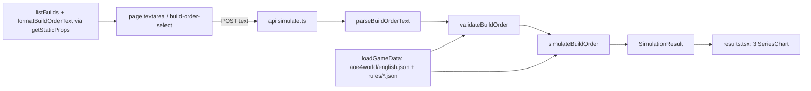

# M2: Technical design

## Summary

A pure, deterministic engine in `lib/aoe4-build-order/` reads a pinned English aoe4world snapshot plus two
hand-entered rules files (`rules/base.json` civ-agnostic, `rules/english.json` civ overlay), runs a
validated `BuildOrder` to a fixed horizon, and returns a column-oriented `SimulationResult` of time series,
per-step timings, and non-fatal notes. The page posts paste text to `POST /api/aoe4-build-order/simulate` and
draws three Recharts line charts. **API route** (lib + thin route, as `/api/fight`): S3 caps enforced where the sim runs,
the ~190 KB snapshot stays off the client, curl-able for review, and a later spread belongs server-side. Cost:
OpenAPI entries and loosening the fight spec-surface test. **Charts: Recharts `2.15.4`** (exact pin, no caret):
the charts are the app's whole output and need m:ss axes, toggleable legends, tooltips, responsive width and a
palette for 8-15 series. 2.15.4 (latest 2.x) peers on React 16-19 and type-checks clean under this repo's TS
4.7.4, `@types/react` 18.0.14 and `skipLibCheck`. 3.10.1 was rejected: its `react-redux` 9 pulls a nested
`@types/react` 19 that breaks JSX children types unless `@types/react` is bumped to >=18.2.25, and its
`@reduxjs/toolkit` d.ts uses `NoInfer` (TS 5.4), passing only because `skipLibCheck` hides it. Checked with
`tsc` 4.7.4 and `react-dom/server` 18.2 (not a full `next build`). The ticket that adds `line-chart.tsx` adds
`recharts` to `package.json` `dependencies` and `package-lock.json` (`npm install --save-exact recharts@2.15.4`).

## Modules

| module (path) | owns | public exports | used by |
|---|---|---|---|
| `data/aoe4-build-order/aoe4world/english.json` | snapshot, entries verbatim, filtered to `civs` containing `en` | `{ source, units, buildings, technologies, upgrades }` | data.ts |
| `data/aoe4-build-order/rules/base.json`, `rules/english.json` | hand-entered values (A1), each a `HandValue` | see Contracts | data.ts |
| `data/aoe4-build-order/builds/<slug>.json` | prebuilt `BuildOrder`s | | builds.ts |
| `lib/aoe4-build-order/model.ts` | input and result types | `CivId, ResourceKind, GatherNodeId, Trigger, BuildStep, BuildOrder, SimInputs, SimulationResult, UnitSeries, StepTiming, BuildOrderIssue, BuildOrderNote, TechSupport` | all |
| `lib/aoe4-build-order/data.ts` | load + index snapshot and rules by id/baseId | `loadGameData(civ)`, `GameData` | validate, simulate, route |
| `lib/aoe4-build-order/parse-text.ts` | paste format <-> JSON | `parseBuildOrderText(text)`, `formatBuildOrderText(order)` | route, page (static props) |
| `lib/aoe4-build-order/validate.ts` | shape, bounds, ids, tech classification (rejections as issues) | `validateBuildOrder(input, data)`, `resolveSimInputs(partial, data)`, `SIM_INPUT_BOUNDS` | route, simulate tests |
| `lib/aoe4-build-order/effects.ts` | aoe4world effect interpreter + conditions, tech classification | `SUPPORTED_EFFECT_PROPERTIES`, `IGNORED_EFFECT_PROPERTIES`, `classifyTech(entry, data): TechSupport`, `modifiedValue(base, property, target, state)` | validate, simulate |
| `lib/aoe4-build-order/gather.ts` | trip model | `effectiveGatherRate(node, state, inputs)` | simulate |
| `lib/aoe4-build-order/construction.ts` | builder scaling | `constructionSeconds(baseSeconds, builders, data)` | simulate, houses |
| `lib/aoe4-build-order/houses.ts` | auto-house planner | `planAutoHouse(state, inputs, data)` | simulate |
| `lib/aoe4-build-order/civ-rules.ts` | per-civ code seams, all no-op | `CivRules`, `NO_CIV_RULES`, `civRules(civ)` | simulate |
| `lib/aoe4-build-order/simulate.ts` | event loop, queues, triggers, sampling | `simulateBuildOrder(order, data, inputs, rules?)` | route, tests |
| `lib/aoe4-build-order/builds.ts` | list prebuilt builds | `listBuilds(): BuildOrder[]` | page |
| `lib/aoe4-build-order/api.ts` | route request/response types (like `fight-api.ts`) | `SimulateRequest, SimulateResponse, SimulateError` | route, page, acceptance |
| `pages/api/aoe4-build-order/simulate.ts` | thin handler | default handler | page |
| `pages/apps/aoe4-build-order.tsx`, `components/apps/aoe4-build-order/{build-input,results}.tsx` | UI | | |
| `components/apps/aoe4-build-order/line-chart.tsx` | one Recharts chart, legend toggling, palette | `SeriesChart`, `ChartSeries`, `toChartRows` | results.tsx |
| `docs/aoe4-build-order.md` | model, sources, grammar, CivRules, outputs | | reviewers |

## Contracts

**Ids.** Build orders and rules reference aoe4world `baseId`s (`villager`, `town-center`, `house`,
`wheelbarrow`, `veteran-longbowmen`); the engine resolves the civ's entry for the current age or tier. Never
names. A building instance is `<baseId>` (step applies to every instance) or `instance: k` (1-based).

```ts
type CivId = 'english'
type ResourceKind = 'food' | 'wood' | 'gold' | 'stone'
type GatherNodeId = 'sheep' | 'berry' | 'deer' | 'boar' | 'farm' | 'wood' | 'gold' | 'stone'
type Trigger = { kind: 'time'; seconds: number } | { kind: 'villagers'; count: number }   // omitted = no condition
type BuildStep = { trigger?: Trigger } & (
  | { action: 'produce'; producer: string; instance?: number; unit: string; count?: number; rally?: GatherNodeId } // no count = continuous; rally required for villager
  | { action: 'pause'; producer: string; instance?: number }
  | { action: 'build'; building: string; builders?: number; from: GatherNodeId; then?: GatherNodeId } // builders default 1, then default from
  | { action: 'research'; tech: string; at?: string }          // technologies and upgrades (veterancy)
  | { action: 'move'; count: number; from: GatherNodeId; to: GatherNodeId })
interface BuildOrder { civ: CivId; name: string; source?: string; steps: BuildStep[] }
interface HandValue<T> { value: T; source: string; unverified: boolean }
interface TripInputs { walkSecondsCamp: number; walkSecondsTownCenter: number; dropOffSeconds: number }
interface SimInputs {
  durationSeconds: number                  // default 1200, 60..3600
  trips: Record<GatherNodeId, TripInputs>  // defaults from rules/base.json
  reassignSeconds: number                  // idle/walk when a villager changes task
  builderWalkSeconds: number
  autoHouses: boolean                      // default true
  houseBuilders: number                    // default 1
  houseBuilderSource: GatherNodeId         // default 'wood'
  influenceCoverage: Record<string, number> // share of gatherers in a building's influence once one exists; { mill: 1 }
}
interface UnitSeries { unitId: string; baseId: string; name: string; tier: number; counts: number[] } // tier = entry age; counts cumulative, produced only
interface StepTiming { step: number; status: 'completed' | 'in-progress' | 'waiting' | 'not-reached';
  armedAt: number | null; startedAt: number | null; completedAt: number | null; waitSeconds: number }
interface SimulationResult { civ: CivId; durationSeconds: number; sampleSeconds: number; times: number[];
  unitsProduced: UnitSeries[]; gatherRates: Record<ResourceKind, number[]>;   // per minute
  floating: Record<ResourceKind, number[]>; steps: StepTiming[]; ages: { age: number; reachedAt: number }[];
  notes: BuildOrderNote[] }
interface BuildOrderIssue { code: 'syntax' | 'unknown-trigger-kind' | 'unknown-id' | 'unsupported-tech'
  | 'unknown-tech-effect' | 'out-of-range' | 'invalid'; message: string; step?: number; line?: number }
interface BuildOrderNote { code: 'tech-effect-ignored'; message: string; step: number; tech: string; properties: string[] }
type TechSupport = { kind: 'supported' } | { kind: 'effects-ignored'; properties: string[] }
  | { kind: 'rejected'; code: 'unsupported-tech' | 'unknown-tech-effect'; property: string }
```

**Engine rules** (docs/aoe4-build-order.md states them; tests check them):
- Ordering: list order; a step arms when its trigger holds and every earlier step has started; then waits
  until affordable and supply allows (A2); `waitSeconds = startedAt - armedAt`. Time = "not before".
  Villager count = villagers alive. Never-armed at horizon = `not-reached`; armed but never started = `waiting`.
- Queue: one queue per building instance; production and research share it. A `produce` on a busy producer
  replaces its order (switch); `pause` clears it. `sampleSeconds` = 5.
- Tier: produced unit = entry for the highest tier whose upgrade is researched, else the lowest-age entry
  for that `baseId`. `upgradeTargets` maps upgrade baseId -> unit baseId (aoe4world `unlocks` is empty);
  target tier = unit entry whose `age` equals the upgrade's `age`.
- Ages: a building whose `classes` match `^age[1-3]_landmark\d$` advances age from its `age` to `age + 1` on
  completion. Entries with `age` above the current age are unavailable.
- Trip model: `cycle = capacity / rate + walk / moveSpeedMultiplier + dropOffSeconds`; rate = capacity / cycle;
  walk uses `walkSecondsCamp` when a building in the node's `dropOffs` exists, else `walkSecondsTownCenter`.
- Income: credited continuously each instant at the trip-model effective rate (no per-trip deposits).
- Construction: `base x numerator / (builders + offset)` from `rules/base.json` `builderScaling` (3, 2).
- `classifyTech`, in order: any effect `property` = `unknown` (`forestry-1`) -> `rejected/unknown-tech-effect`;
  any property in neither set, or a supported one with `effect` not `change|multiply` or `type` not `passive`
  -> `rejected/unsupported-tech`; any property in `IGNORED_EFFECT_PROPERTIES` (combat stats: `hitpoints`,
  `meleeAttack`, `rangedArmor`, ...; ticket enumerates from the snapshot) -> `effects-ignored`; else `supported`.
  `SUPPORTED_EFFECT_PROPERTIES` = `foodGatherRate, woodGatherRate, goldGatherRate, stoneGatherRate,
  farmGatherRate, berryGatherRate, huntGatherRate, carryCapacity, huntCarryCapacity, moveSpeed, productionSpeed`.
  Rejections become issues naming tech and property. `effects-ignored` techs cost resources and queue time,
  apply their supported effects, and get one `tech-effect-ignored` note per research step (reached or not), in
  step order. Upgrades are supported iff in `upgradeTargets`.

**Rules files.** `base.json`: `gatherNodes: Record<GatherNodeId, { resource, rate, capacity (HandValue),
rateProperties[], capacityProperties[], dropOffs[], trip: TripInputs of HandValue }>`, `builderScaling`,
`maxPopCap`, `reassignSeconds`, `builderWalkSeconds`. `english.json`: `startingState { age, resources,
villagers: Record<GatherNodeId, n>, buildings[] }`, `supply: Record<baseId, HandValue<number>>`,
`effects: OverlayEffect[]`, `upgradeTargets: Record<baseId, HandValue<string>>`.
`OverlayEffect` = aoe4world effect `{ property, select, effect, value, type }` + `grantedBy` (`'civ'` or a
building/tech baseId) + `condition?: { age?: number; nearBuilding?: string }` (all fields must hold) +
`source` + `unverified`. Snapshot `source`: `{ repo, commit, committedAt, fetchedAt, patch, patchSource }`:
`patch` = the game patch live on `committedAt` (aoe4world files carry none), `patchSource` = the URL it came from.

**CivRules** (`civ-rules.ts`): optional members `gatherRateModifier, productionModifier, supplyProvider,
villagerProducer, dropOffRule, startingState` are value hooks `(defaultValue, ctx) => value`;
`onBuildingComplete, onAgeAdvance` are event hooks `(state, ctx) => void`. The engine calls
`rules.hook?.(...) ?? default`. `civRules('english')` returns `NO_CIV_RULES` (`{}`).

**Route.** `POST /api/aoe4-build-order/simulate`, `operationId: simulateBuildOrder`. Request
`SimulateRequest { text?: string; buildOrder?: BuildOrder; inputs?: Partial<SimInputs> }`, exactly one of
`text` (max 20,000 chars) or `buildOrder` (max 200 steps). 200 `SimulationResult`; 400
`SimulateError { error: string; issues: BuildOrderIssue[] }` (`error` = first issue's message); 405
`{ error }` with `Allow: POST`; malformed JSON keeps Next's plain-text 400. OpenAPI schema names equal the TS
names above. Every numeric field has a bound in `SIM_INPUT_BOUNDS` (S3); a violation is an `out-of-range` issue
(non-integer where an integer is required, too, or a non-finite number). Bounds apply to JSON and paste alike:

| field | type | min..max | default |
|---|---|---|---|
| text / steps | | 20,000 chars / 200 steps | |
| `durationSeconds` | int | 60..3600 | 1200 |
| `Trigger.seconds` | int | 0..3600 (= max `durationSeconds`) | |
| `Trigger.count` (villagers) | int | 1..200 (= `maxPopCap`) | |
| `produce.count`, `move.count` | int | 1..200 | continuous (produce) |
| `builders`, `houseBuilders` | int | 1..200 | 1 |
| `instance` | int | 1..200 | every instance |
| `reassignSeconds`, `builderWalkSeconds` | number | 0..60 | `rules/base.json` |
| `walkSecondsCamp`, `walkSecondsTownCenter` | number | 0..60 | `rules/base.json` |
| `dropOffSeconds` | number | 0..30 | `rules/base.json` |
| `influenceCoverage` values | number | 0..1 | `{ mill: 1 }` |

**Paste format** (one step per line; `#` comments and blank lines ignored; errors carry `line`):

| line prefix | trigger | action syntax |
|---|---|---|
| `@m:ss ` | time | `produce <unit> from <producer>[#k] [xN] [-> <node>]` |
| `at N vils ` | villagers | `pause <producer>[#k]` |
| none | none | `build <building> [with N] from <node> [then <node>]`; `research <tech> [at <building>]`; `move N <node> to <node>` |

Grammar details: `@m:ss` = `@\d+:\d\d`, minutes any number of digits, seconds exactly two digits `00`-`59`
(`@1:61` is a `syntax` issue (seconds over 59); `@75:00` parses then fails the 3600 s bound as `out-of-range`; `@60:00` ok).
Within a `produce` line the suffixes are ordered `[xN]` then `[-> node]`; the reverse order is a `syntax` issue.
`xN` has no space (`x5`), `#k` follows the producer with no space, `->` is whitespace-delimited. Ids (unit,
producer, building, tech) and node names are lowercase kebab-case `[a-z0-9]+(-[a-z0-9]+)*`, case-sensitive;
uppercase or other characters are a `syntax` issue (not auto-lowercased). Keywords are lowercase. Numbers are
unsigned decimal integers (no sign, no decimals).

**Charts** (`line-chart.tsx`, Recharts 2.15.4):

```ts
interface ChartSeries { key: string; name: string; values: number[] }  // values aligned with times
function toChartRows(times: number[], series: ChartSeries[]): Array<{ t: number } & Record<string, number>> // pure
function SeriesChart(props: { testId: string; title: string; yLabel: string; times: number[]; series: ChartSeries[] })
```
- Renders `<div data-testid={testId}>` wrapping `ResponsiveContainer` (width 100%, fixed height) > `LineChart`
  (`data = toChartRows(...)`, `XAxis dataKey="t" type="number"` with m:ss ticks, `YAxis`, `Tooltip` with m:ss
  label, `Legend`) and one `<Line dataKey={key} name={name} data-series={key} dot={false}
  isAnimationActive={false} hide={hidden.has(key)} />` per series, stroke from a palette of >= 15 colors by index.
- Series keys: units = `UnitSeries.unitId` (name = `UnitSeries.name`); gather rates and floating = `ResourceKind`.
- Clicking a legend entry toggles that series' `hide`; state is local to the chart.
- Test contract (verified on 2.15.4 output): a drawn series is exactly one
  `path.recharts-line-curve[data-series="<key>"]` inside the wrapper; a hidden series draws no path and its
  legend item is `li.recharts-legend-item.inactive`; legend text (`.recharts-legend-item-text`) is the series
  `name`. Animation off so paths exist as soon as results render.
- SSR: no `next/dynamic` needed. Charts render only after the client POST returns, and `ResponsiveContainer`
  server-renders an empty div and draws after measuring with `ResizeObserver`, so hydration matches.
- Testing: Vitest runs `*.test.ts` in node, so unit tests cover `toChartRows` and the page's mapping from
  `SimulationResult` to `ChartSeries[]`; series presence and toggling are asserted in Playwright (real layout).
  In jsdom `ResponsiveContainer` measures 0x0 and draws no chart; a jsdom test would need a `ResizeObserver`
  and element-size stub, and is not required.

**Page test ids:** `build-order-select`, `build-order-text`, `run-simulation`, `simulation-error`,
`simulation-notes` (only when `notes` is non-empty), `chart-units-produced`, `chart-gather-rates`,
`chart-floating-resources` (each the `SeriesChart` wrapper `div`; series identified as above).

## Data flow



## Extension points

| future direction | seam that keeps it additive |
|---|---|
| Other civs | `CivId` union + `aoe4world/<civ>.json` + `rules/<civ>.json`; engine keys on ids only; `CivRules` hooks |
| Event / resource triggers, combinators | new `Trigger.kind`; one `triggerHolds(trigger, state)` switch in simulate.ts; validate rejects unknown kinds |
| Spread result | all variable quantities in `SimInputs`; `simulateBuildOrder` uses no randomness or clock; later `spread` field on `SimulationResult` and `runs`/`seed` on `SimulateRequest` |
| New step kinds (idle, sacred sites, trade) | `BuildStep` tagged on `action`; one handler per action |
| More tech effects (`buildTime`, `influence` type), combat later | move a property into `SUPPORTED_EFFECT_PROPERTIES` and the interpreter; ignored ones shrink `IGNORED_EFFECT_PROPERTIES` |
| Later English bonuses (Council Hall, Network of Castles, Abbey) | `OverlayEffect` rows in `rules/english.json`; no code |
| Depletion, positions, per-trip deposits | `gatherNodes` data + `TripInputs`; rate and crediting only in `gather.ts` |
| More series or notes (rates by node, idle villagers) | new `SimulationResult` fields; new `BuildOrderNote.code` values |
| Community formats (RTS_Overlay) | a new parser beside `parseBuildOrderText` producing `BuildOrder` |

## Left to tickets

- Engine internals: event-driven vs fixed tick, provided it is deterministic and a 3600 s run finishes well
  under 1 s; auto-house algorithm, given the owner's time-computed-lead rule and an explicit house step suppressing it.
- Hand-entered values and sources; gather-node property mappings; walk defaults tuned to the calculator
  cross-check (tolerance chosen by the engine ticket). Snapshot refresh procedure (`data/aoe4-build-order/README.md`).
- Which `SimInputs` the page exposes (at least `durationSeconds`); chart height, palette colors, tick spacing
  and other styling; note and error wording
  (must name the step or line and the offending id, kind, or property).
- Loosening `acceptance/fight-api-spec-surface.spec.ts` to fight-only paths and schemas (route ticket).
