# M3: Technical design

## Summary

The engine gains a stock for each finite gather node: the six starting nodes, plus numbered gold deposits
(`gold#2` to `gold#8`) that a build names. Amounts come from `rules/base.json` and can be overridden through
`SimInputs.nodeAmounts`. When a node runs out, its gatherers go idle, and later arrivals there go idle too. The
result reports each run-out in `depletions` and `warnings`. Two new `Trigger` kinds, `depleted` and `bank`, go
through the existing `triggerHolds` switch and the paste prefix grammar. A step triggered by `depleted` can be a
reaction (`whenever gold runs out ...`), which fires whenever the node runs out and does not hold up the rest of
the build. `move all` moves every villager on a node. Together these let the shipped builds switch gold villagers
to the next deposit.

Every non-fatal result message carries a `severity` (`warning` or `info`), and request issues are the `error`
level. The page shows warnings and keeps info messages collapsed until the user expands them. `StepTiming` gains
`waitingOn` and `waitBreakdown`. The result gains `spent`, `spawnedPopulation` and `populationCapReachedAt`, so the
page can compute compare numbers on the client, plus `markers`: one per age reached and per research completed,
which every chart draws as a labeled vertical line.

The page also gets a step table, a step timeline and a client-side pinned run with chart overlay and key-number
deltas. Two prebuilt builds are added. A first cleanup ticket moves the engine's duplicated cost and walk code into
`engine-common.ts` and the tests' duplicated helpers into `test-helpers.ts`, and adds a duplication check. Unit
combat stats stay unmodeled.

**Starting state (main f078c11, before the first M3 ticket).**

- **Engine.** M2 has shipped. Every node is infinite, there is one node per `GatherNodeId`, and no deposit syntax
  exists. `Trigger` is `time | villagers`, and `move.count` is a number. `StepTiming` has `status, armedAt,
  startedAt, completedAt, waitSeconds`.
- **Result.** `SimulationResult` has `civ, durationSeconds, sampleSeconds, times, unitsProduced, gatherRates,
  floating, steps, ages, notes`. Its only non-fatal output is `notes`, which has no severity.
  - `ages[0]` is `{ age: <start age, 1 for English>, reachedAt: 0 }`, and `completeConstruction` pushes an entry
    when a landmark completes.
- **Page.** It has a prebuilt select, a duration input, a textarea and a run button.
  - It draws three `SeriesChart`s (units produced, gather rates, floating resources) with no reference lines.
  - It shows notes in an always-visible `simulation-notes` alert and request errors in `simulation-error`.
  - Series colors come from `PALETTE` (17 colors) in `chart-rows.ts`. The Y-axis label is drawn `insideLeft`
    (`line-chart.tsx:23`) and can overlap 4-digit ticks. The site sets no dark theme (no `data-bs-theme`).
- **Builds.** One prebuilt build exists (`builds/english-1tc.json`, "ENG 1TC"). It starts rallied to gold, and no
  step moves its gold villagers.
- **Route.** It returns every issue, with no cap.
- **Duplicated code.** `simulate.ts` and `research.ts` each have their own `RESOURCES` list, cost loop,
  affordability check and tolerance (`1e-9` and `Math.sqrt(Number.EPSILON)`). `houses.ts` compares its population
  shortfall with `<= 0` and copies the villager move-speed walk formula. `parse-text.ts` has its own copy of the node
  order. Each test file defines its own `run`, `inputsFor` and `gameData` helpers. No lint step checks for
  duplication: the lint command is `npx tsc --noEmit`, and no ESLint is installed.
- **Older M2 behavior that M3 changes.**
  - A `build` always pays two walk legs.
  - `parse-text.ts` splits on `/[ \t\r]+/`, and `validate.ts:189` uses `steps.forEach`.
  - `effects.ts` and `research.ts` key researched techs by `baseId`.
  - `validate.ts` rejects a second `research` of a tech already researched by an earlier step. The snapshot has no
    multi-entry technology or upgrade, so the multi-tier rule below changes no current result.

## Modules

New modules are marked (new). Every other row is an M2 module, and the column lists only what M3 adds or changes.

| module (path) | owns | public functions or exports (M3 additions) | used by |
|---|---|---|---|
| `lib/aoe4-build-order/engine-common.ts` (new) | the one copy of the engine's shared cost, payment, tolerance and walk code | `RESOURCE_TOLERANCE`, `VILLAGER_ID`, `HOUSE_ID`, `costOf`, `canAfford`, `payCost`, `villagerWalkSeconds`, `markCompleted` | simulate, research, houses, depletion |
| `lib/aoe4-build-order/test-helpers.ts` (new) | shared vitest helpers (imported only by `*.test.ts`) | `ENGLISH`, `at`, `editGameData`, `inputsFor`, `buildOrder`, `run`, `series`, `countAt`, `sampleIndex`, `withHandler` | every engine test |
| `.jscpd.json` (new), `package.json` | duplication check | `jscpd` dev dependency, script `lint:dup` | lint gate |
| `data/aoe4-build-order/rules/base.json` | civ-agnostic hand values | `gatherNodes.<node>.amount` (`HandValue<number>`, on the six finite nodes only); `gatherNodes.farm.createdBy: "farm"` | data.ts |
| `data/aoe4-build-order/builds/english-1tc.json` | first prebuilt build | gains its gold deposit reactions (prebuilt-builds rule) | builds.ts |
| `data/aoe4-build-order/builds/english-spear-longbow-maa-crossbow.json` (new) | M3.7 first prebuilt build | `BuildOrder` | builds.ts |
| `data/aoe4-build-order/builds/english-knight-longbow.json` (new) | M3.7 second prebuilt build | `BuildOrder` | builds.ts |
| `lib/aoe4-build-order/model.ts` | types | `FiniteGatherNodeId`, `GATHER_NODES`, `FINITE_GATHER_NODES`, `RESOURCE_KINDS`, `MAX_DEPOSITS`, `DepositRef`, `NodeRef`, `FiniteNodeRef`, `NODE_REFS`, `FINITE_NODE_REFS`, `nodeKindOf`, `Trigger` (2 new kinds), `BuildStep.reaction`, `move.count: number \| 'all'`, `Severity`, `SEVERITIES`, `BuildOrderNote.severity`, `StepWait`, `StepTiming.waitingOn`, `StepTiming.waitBreakdown`, `SpendCategory`, `NodeDepletion`, `SimWarning`, `SimInputs.nodeAmounts`, `ChartMarkerKind`, `CHART_MARKER_KINDS`, `ChartMarker`, `AGE_NAMES`, new `SimulationResult` fields | all |
| `lib/aoe4-build-order/data.ts` | load and index | `GatherNodeRules.amount?`, `GatherNodeRules.createdBy?` | validate, simulate |
| `lib/aoe4-build-order/depletion.ts` (new) | node stocks keyed by `FiniteNodeRef`: draw-down, run-out time, run-out event, idle accounting, depletion warnings | `NodeStock`, `runRefs(order)`, `createNodeStock(refs, inputs)`, `drawDown(stock, gatherers, rateOf, seconds)`, `nextRunOut(stock, gatherers, rateOf, now)`, `isDepleted(stock, ref)`, `depletionResults(stock): { depletions: NodeDepletion[]; warnings: SimWarning[] }` | simulate |
| `lib/aoe4-build-order/markers.ts` (new) | marker classification | `researchMarkerKind(entry): Exclude<ChartMarkerKind, 'age-up'>`, `researchMarker(entry, at): ChartMarker`, `ageMarker(age, at): ChartMarker`, `compareMarkers(a, b): number` | simulate, research |
| `lib/aoe4-build-order/simulate.ts` | event loop | `assignGatherers(state, ref, count)`, `availableAt(state, ref)`, `EngineState.gatherers` and `EngineState.idle` keyed by `NodeRef`, `EngineState.stock`, `EngineState.markers`, `EngineState.spawnedPopulation`, `EngineState.spent`, `StepStart` (adds `waitingOn`), `triggerHolds` (2 new cases), `triggerWakeAt(trigger, state, income)`; `completeConstruction` pushes `ageMarker`; reaction steps; `step-stuck` warnings | research.ts, tests |
| `lib/aoe4-build-order/research.ts` | research handler, tiers, notes | `researchEntry(baseId, state)` (multi-tier pick); returns `waitingOn`; pays through `payCost`; research completion pushes `researchMarker`; notes worded with ids and carry `severity` | simulate |
| `lib/aoe4-build-order/houses.ts` | auto-house planning | uses `villagerWalkSeconds` and `RESOURCE_TOLERANCE` | simulate |
| `lib/aoe4-build-order/effects.ts` | effect interpreter | `EffectState.researchedIds: ReadonlySet<string>` | simulate, research |
| `lib/aoe4-build-order/parse-text.ts` | paste <-> JSON | `formatBuildStep(step): string`; `when` and `whenever` trigger prefixes; node-ref tokens; `move all`; NBSP rule; pre-`start` rule | route, page |
| `lib/aoe4-build-order/validate.ts` | shape, bounds, ids | `nodeRefIssue(value, finiteOnly)`; new trigger, reaction and `move all` checks; `nodeAmounts` resolution; `SIM_INPUT_BOUNDS.nodeAmount`, `SIM_INPUT_BOUNDS.triggerAtLeast`; sparse-steps rule | route |
| `lib/aoe4-build-order/step-options.ts` (new) | the valid choices for each table dropdown, from `GameData` | `StepOptions`, `stepOptions(data): StepOptions` | page (static props), step-table-model |
| `lib/aoe4-build-order/builds.ts` | prebuilt list | adds both M3.7 builds | page |
| `lib/aoe4-build-order/api.ts` | route types | `SimInputOverrides.nodeAmounts`, `SimulateError.omittedIssues`, `MAX_REPORTED_ISSUES` | route, page, acceptance |
| `pages/api/aoe4-build-order/simulate.ts` | handler | caps issues | page |
| `components/apps/aoe4-build-order/step-table-model.ts` (new) | pure table edits, no React | `defaultStep(action, options)`, `defaultTrigger(kind, options)`, `insertStep`, `deleteStep`, `moveStep`, `replaceStep`, `changeAction`, `selectChoices(value, choices)` | step-table.tsx |
| `components/apps/aoe4-build-order/step-table.tsx` (new) | table editor UI | `StepTable` | page |
| `components/apps/aoe4-build-order/step-timeline.tsx` (new) | per-step timeline UI | `StepTimeline` | results.tsx |
| `components/apps/aoe4-build-order/messages.ts` (new) | pure split of notes and warnings by severity, no React | `ResultMessage`, `resultMessages(result): Record<'warning' \| 'info', ResultMessage[]>` | messages.tsx |
| `components/apps/aoe4-build-order/messages.tsx` (new) | warnings list and collapsible info list | `WarningMessages`, `InfoMessages` | results.tsx |
| `components/apps/aoe4-build-order/compare.ts` (new) | pure key numbers and deltas, no React | `KEY_TIMES`, `KeyNumbers`, `keyNumbers(result)`, `CompareRow`, `compareRows(current, pinned)` | compare-panel.tsx |
| `components/apps/aoe4-build-order/compare-panel.tsx` (new) | pin/unpin buttons and key-number table | `ComparePanel` | page |
| `components/apps/aoe4-build-order/chart-rows.ts` | chart helpers | `PinnedSeries`, `toChartRows(times, series, pinned?)`, `pinnedKey(key)`, `MARKER_COLORS`, `MARKER_KIND_LABELS`, `markerLabel(marker)` | line-chart.tsx |
| `components/apps/aoe4-build-order/line-chart.tsx` | one chart | `SeriesChart` gains `pinned?: PinnedSeries` and `markers?: readonly ChartMarker[]` (one `ReferenceLine` each, plus a marker legend); Y-axis label fix | results.tsx |
| `components/apps/aoe4-build-order/results.tsx` | result view | renders `WarningMessages`, `InfoMessages` (replacing the M2 notes alert), `StepTimeline`, charts with `pinned` and `markers={result.markers}` on all three | page |
| `pages/apps/aoe4-build-order.tsx` | page state | `PageProps.options: StepOptions`; info-list expanded state; `PrebuiltBuild` unchanged | |
| `acceptance/aoe4-build-order.spec.ts` | Playwright | the notes test expands the info list first (Behavior rules: messages) | |
| `docs/aoe4-build-order.md`, `docs/api/openapi.json` | user doc, contract | M3.9 sections and schemas, including deposits, reactions, severity, markers and the "combat stats are not modeled" statement | reviewers |

**Shared code rule.** After the cleanup ticket lands, no engine module defines its own resource list, cost loop,
affordability check, subtract loop, tolerance or villager walk formula. Every M3 ticket that touches `simulate.ts`,
`research.ts`, `houses.ts` or `depletion.ts` uses the `engine-common.ts` exports and `RESOURCE_KINDS`/`GATHER_NODES`
from `model.ts`. Every M3 engine test uses `test-helpers.ts` rather than redefining a helper it exports. The cleanup
ticket is the first engine ticket, and the other engine tickets build on it.

## Contracts

**Shared engine code (`engine-common.ts`).** These are moved from the existing modules, and their behavior is unchanged
except for the one tolerance value.

```ts
const RESOURCE_TOLERANCE = 1e-9   // the one float tolerance: bank checks, node run-out, bank trigger, house shortfall
const VILLAGER_ID = 'villager'
const HOUSE_ID = 'house'
function costOf(entry: SnapshotEntry, units: number): Resources                       // from simulate.ts
function canAfford(bank: Readonly<Resources>, cost: Readonly<Resources>): boolean      // bank[k] + RESOURCE_TOLERANCE >= cost[k] for every RESOURCE_KINDS k
function payCost(state: EngineState, cost: Readonly<Resources>, category: SpendCategory): void  // the one subtract loop; also adds to state.spent[category]
function villagerWalkSeconds(state: EffectState, data: GameData, walkSeconds: number): number   // walkSeconds / villager moveSpeed multiplier
function markCompleted(state: EngineState, step: number): void                         // from simulate.ts
```

`payUnit`, `spend`, the research handler and `startConstruction` all pay through `payCost`. `houses.ts` uses
`shortfall <= RESOURCE_TOLERANCE` and `villagerWalkSeconds`. `research.ts`'s tolerance changes from
`Math.sqrt(Number.EPSILON)` (about 1.5e-8) to `1e-9`. That moves an affordability instant by under 1e-8 resources,
and the ticket reports any existing test that changes.

**Test helpers (`test-helpers.ts`).** They are taken from the existing test files. A test may still define a helper
that is not on this list.

| export | signature |
|---|---|
| `ENGLISH` | `GameData` (`loadGameData('english')`) |
| `at` | `(seconds: number) => Trigger` (a `time` trigger) |
| `editGameData` | `(edit: (parts: { snapshot; base; civData }) => void, from?: GameData) => GameData` (a deep copy, then re-indexed) |
| `inputsFor` | `(game: GameData, overrides?: unknown) => SimInputs` (`resolveSimInputs`; throws on issues) |
| `buildOrder` | `(steps: BuildStep[], start?: BuildStart) => BuildOrder` (start defaults to `{ rally: 'sheep' }`) |
| `run` | `(steps: BuildStep[], options?: { game?; inputs?: unknown; rules?; start? }) => SimulationResult` |
| `series`, `countAt`, `sampleIndex` | `(result, baseId) => number[]`, `(result, baseId, t) => number`, `(result, t) => number` |
| `withHandler` | `(action, handler, fn) => void` (swaps one `stepHandlers` entry for the duration of `fn`) |

**Duplication check.** The check uses `jscpd` as a dev dependency. `.jscpd.json` sets:

- paths: `lib/aoe4-build-order`, `components/apps/aoe4-build-order` and `pages/api/aoe4-build-order`;
- formats: typescript and tsx;
- sizes: `minTokens: 70`, `minLines: 8`;
- exit code: non-zero on any clone.

`npm run lint:dup` runs it, and the cleanup ticket leaves zero clones. The repo lint command becomes
`npx tsc --noEmit && npm run lint:dup`, and the manager updates the profile on merge. A later ticket may add an
`ignore` entry for generated data only, and may not raise the sizes. ESLint with `eslint-plugin-sonarjs` is not
added in M3 (Extension points).

**Types (model.ts).** M2 types not shown here are unchanged.

```ts
type FiniteGatherNodeId = 'sheep' | 'berry' | 'deer' | 'boar' | 'gold' | 'stone'   // farm, wood stay infinite
const GATHER_NODES: readonly GatherNodeId[]          // sheep, berry, deer, boar, farm, wood, gold, stone (replaces simulate.ts GATHER_NODE_ORDER and parse-text.ts's copy)
const FINITE_GATHER_NODES: readonly FiniteGatherNodeId[]   // sheep, berry, deer, boar, gold, stone (first sheep, last stone)
const RESOURCE_KINDS: readonly ResourceKind[]        // food, wood, gold, stone (replaces simulate.ts and research.ts RESOURCES)

const MAX_DEPOSITS = 8
type DepositRef = `gold#${2 | 3 | 4 | 5 | 6 | 7 | 8}`        // first gold#2, last gold#8; deposit 1 is written plain `gold`
type NodeRef = GatherNodeId | DepositRef
type FiniteNodeRef = FiniteGatherNodeId | DepositRef
const NODE_REFS: readonly NodeRef[]                  // GATHER_NODES with gold#2..gold#8 right after gold: sheep, berry, deer, boar, farm, wood, gold, gold#2, ..., gold#8, stone (15; first sheep, last stone)
const FINITE_NODE_REFS: readonly FiniteNodeRef[]     // sheep, berry, deer, boar, gold, gold#2, ..., gold#8, stone (13; first sheep, last stone)
function nodeKindOf(ref: NodeRef): GatherNodeId      // 'gold#3' -> 'gold'; a plain id -> itself

type Trigger =
  | { kind: 'time'; seconds: number }
  | { kind: 'villagers'; count: number }
  | { kind: 'depleted'; node: FiniteNodeRef }                      // paste: when <ref> runs out (or whenever, with reaction)
  | { kind: 'bank'; resource: ResourceKind; atLeast: number }      // paste: when <resource> >= N

// Every BuildStep variant gains `reaction?: true` beside `trigger`. Every node field widens from GatherNodeId to NodeRef:
// produce.rally, rally.to, build.from, build.then, move.from, move.to, BuildStart.rally, BuildStart.villagers keys.
// move.count widens to `number | 'all'`.

type Severity = 'error' | 'warning' | 'info'
const SEVERITIES: readonly Severity[]                // error, warning, info (most severe first)
interface BuildOrderNote { /* M2 fields */ severity: Severity }   // see Severity table

interface SimInputs { /* M2 fields */ nodeAmounts: Record<FiniteNodeRef, number | null> }  // all 13 keys; null = infinite

type StepWait = 'resources' | 'villagers' | 'population' | 'prerequisite' | 'trigger' | 'earlier-step'
interface StepTiming {
  /* M2 fields unchanged */
  waitingOn: StepWait | null                                 // see Step status rules
  waitBreakdown: Partial<Record<'resources' | 'villagers' | 'population' | 'prerequisite', number>>  // seconds armed and not started, by reason
}

type SpendCategory = 'villagers' | 'military' | 'buildings' | 'research'
type ChartMarkerKind = 'age-up' | 'economy' | 'unit-tier' | 'blacksmith' | 'other'
const CHART_MARKER_KINDS: readonly ChartMarkerKind[]  // age-up, economy, unit-tier, blacksmith, other (first age-up, last other)
const AGE_NAMES: Readonly<Record<2 | 3 | 4, string>> // 2 Feudal, 3 Castle, 4 Imperial
interface ChartMarker { kind: ChartMarkerKind; label: string; at: number }   // label: AGE_NAMES[age] or the tech baseId
interface NodeDepletion { node: FiniteNodeRef; amount: number | null; depletedAt: number | null }
type SimWarning =
  | { code: 'node-depleted'; severity: Severity; message: string; node: FiniteNodeRef; at: number; idleVillagers: number }
  | { code: 'idle-arrival'; severity: Severity; message: string; node: FiniteNodeRef; at: number; idleVillagers: number }
  | { code: 'step-stuck'; severity: Severity; message: string; step: number; waitingOn: StepWait; at: number }

interface SimulationResult {
  /* M2 fields unchanged */
  depletions: NodeDepletion[]                       // one per run ref (runRefs), in FINITE_NODE_REFS order
  warnings: SimWarning[]
  spent: Record<SpendCategory, number[]>            // cumulative food+wood+gold+stone paid, one value per sample
  spawnedPopulation: number[]                       // popcap of spawned, living villagers and units per sample (queued units excluded)
  populationCapReachedAt: number | null             // first instant spawnedPopulation >= maxPopCap (200)
  markers: ChartMarker[]                            // ages reached after the start age, and completed research; see Markers
}
```

**Severity.** Each code has exactly one rule:

| code | where | `severity` |
|---|---|---|
| every `BuildOrderIssue` code | 400 `SimulateError.issues` | `error`, implied by the 400. `BuildOrderIssue` gets no field, and the page shows these in `simulation-error` as in M2. |
| `tech-effect-ignored`, `tech-effect-unmodeled` | `notes` | `info` |
| `node-depleted` | `warnings` | `warning` when `idleVillagers > 0`, else `info` |
| `idle-arrival` | `warnings` | `warning` |
| `step-stuck` | `warnings` | `warning` |

No result item has `severity: 'error'` in M3, and a unit test pins that. The `error` value exists so the page and
the API share one scale.

**Data (`rules/base.json`, `data.ts`).** `GatherNodeRules` gains `amount?: HandValue<number>` and
`createdBy?: string`. `amount` is present on exactly the `FINITE_GATHER_NODES` and absent on `farm` and `wood`,
and a data test pins that. Each amount is the player's starting stock of that kind. For gold it is one deposit: every
numbered deposit starts with the same default. Each amount carries a `source` and `unverified: true`. The values
are owner-supplied and used as given:

| node | sheep | berry | deer | boar | gold | stone |
|---|---|---|---|---|---|---|
| `amount.value` | 3000 | 1500 | 1750 | 2000 | 4000 | 1200 |
| `amount.source` | `owner-supplied starting total (2026-11-01): 15 sheep x 200 food` | `owner-supplied starting total (2026-11-01)` | `owner-supplied starting total (2026-11-01): 7 deer x 250 food` | `owner-supplied starting total (2026-11-01)` | `owner-supplied amount per gold deposit (2026-11-01)` | same as boar |

The engine draws down the aggregate and does not model single animals, so the per-animal sizes live only in the
`source` text. `createdBy` is present only on `farm` (`"farm"`): it is the building `baseId` whose construction
creates a slot on that node. It is a structural fact like `dropOffs`, so it is a plain string, not a `HandValue`.

**Node references.** A `NodeRef` is written the same way in JSON and paste: `gold` is deposit 1, `gold#2` is
deposit 2. The `#k` form matches the producer instance form (`town-center#2`), so a `start` line stays unambiguous
(`start 3 gold#2 3 wood -> gold#2`). Only gold has numbered deposits in M3. `nodeRefIssue(value, finiteOnly)`
classifies a node value in every node position, so each position gives the same issue for the same input:

| value | issue |
|---|---|
| `gold`, `gold#2`, `gold#8`, `wood` | valid |
| `gold#1` | `invalid` ("deposit 1 is written gold") |
| `gold#0`, `gold#9` | `out-of-range` (1 < k <= `MAX_DEPOSITS`) |
| `wood#2`, `berry#2`, `stone#2` | `invalid` ("only gold has numbered deposits") |
| `iron`, `iron#2` | `unknown-id` |
| `gold#02`, `gold#`, `gold#x`, `gold#2#3` | `syntax` |
| `farm`, `wood` where `finiteOnly` (`depleted` trigger, `nodeAmounts` key) | `invalid` (that node never runs out) |

In paste, any token matching `<id>(#<chars>)?` in a node position is passed through to `validate.ts` unchanged.
The paste parser reports no issue of its own for a node token.

**Run refs.** `runRefs(order)` returns `FINITE_GATHER_NODES` plus every `DepositRef` the order names anywhere
(start, step node fields, `depleted` triggers), in `FINITE_NODE_REFS` order. An order naming no deposit has exactly
the six finite nodes, first `sheep`, last `stone`. Only run refs have a stock, a `NodeDepletion` entry or warnings.

**Inputs.** `SimInputOverrides.nodeAmounts?: Partial<Record<FiniteNodeRef, number | null>>` merges per key over
the defaults. The default for each finite node is `gatherNodes.<node>.amount.value`, and for each `gold#k` it is
`gatherNodes.gold.amount.value`. `nodeAmounts.gold` sets deposit 1 only. An override for a deposit the order does not
name is accepted and unused. `SIM_INPUT_BOUNDS` gains `nodeAmount: bound(0, 100000)` (integer) and
`triggerAtLeast: bound(0, 100000)` (integer).

| input | produces |
|---|---|
| `nodeAmounts: { berry: 0 }` | valid: berry is empty at t=0 |
| `nodeAmounts: { gold: null }` | valid: deposit 1 is infinite; `gold#2` keeps 4000 |
| `nodeAmounts: { 'gold#2': 2500 }` | valid: deposit 2 starts at 2500 when the order names `gold#2` |
| `nodeAmounts: { farm: 500 }` or `{ wood: 500 }` | `invalid` ("farm never runs out") |
| `nodeAmounts: { 'gold#1': 5 }`, `{ 'wood#2': 5 }` | `invalid` (node-ref table) |
| `nodeAmounts: { 'gold#9': 5 }` | `out-of-range` |
| `nodeAmounts: { iron: 5 }` | `unknown-id` |
| `nodeAmounts: { gold: 1.5 }`, `-1`, `100001`, `Infinity` | `out-of-range` |
| `nodeAmounts: { gold: "5" }`, `nodeAmounts: 5`, `{ 'gold#02': 5 }` | `syntax` |

`trips` and `houseBuilderSource` stay keyed by `GatherNodeId`. Every gold deposit uses `trips.gold`, and any
`mining-camp` is a drop-off for every deposit, since M3 has no positions. A per-deposit walk is the existing
per-step `walkSeconds`. `houseBuilderSource: 'gold'` names deposit 1.

**Triggers and reactions.** In JSON:

| input | issue |
|---|---|
| `{ "kind": "depleted", "node": "berry" }`, `"node": "gold#2"` | valid |
| `{ "kind": "depleted" }` (no `node`), `"node": 3` | `syntax` |
| `{ "kind": "depleted", "node": "wood" }` or `"farm"` | `invalid` (that node never runs out) |
| `"node": "gold#1"`, `"gold#9"`, `"iron"` | as in the node-ref table |
| `{ "kind": "bank", "resource": "wood", "atLeast": 400 }` | valid |
| `{ "kind": "bank", "resource": "wood" }`, `"atLeast": "400"` | `syntax` |
| `{ "kind": "bank", "resource": "sheep", "atLeast": 400 }` | `unknown-id` (not a `ResourceKind`) |
| `"atLeast": 400.5`, `-1`, `100001` | `out-of-range` |
| `{ "kind": "event" }` | `unknown-trigger-kind` (the message lists all four kinds) |
| step with `"reaction": true` and a `depleted` trigger | valid |
| `"reaction": true` with no trigger or any other trigger kind | `invalid` ("only a step triggered by a node running out can be a reaction") |
| `"reaction": false`, `"reaction": "yes"` | `syntax` (the field is `true` or absent) |
| `move` with `"count": "all"` | valid |
| `move` with `"count": "All"`, `"count": "3"` | `syntax` |

The paste prefixes go before the action, like `@m:ss` and `at N vils`. Each token is whitespace-delimited:

| line | result |
|---|---|
| `when berry runs out move 6 berry to farm` | depleted trigger |
| `whenever gold runs out move all gold to gold#2` | depleted trigger, `reaction: true`, `count: 'all'` |
| `when wood >= 400 build lumber-camp from wood` | bank trigger |
| `when farm runs out ...` | parses, then `invalid` |
| `when food runs out ...` | parses, then `unknown-id` (not a node) |
| `when gold#9 runs out ...` | parses, then `out-of-range` |
| `when sheep >= 400 ...` | parses, then `unknown-id` (not a resource) |
| `when wood >= 400000 ...` | parses, then `out-of-range` |
| `when berry ...`, `when berry runs ...`, `when wood > 400 ...`, `when wood >= -5 ...`, `when wood >= 4.5 ...`, `when wood>=400 ...`, `when Wood >= 400 ...` | `syntax` (the message for `>` says only `>=` is supported) |
| `whenever wood >= 400 ...`, `whenever berry ...` | `syntax` ("whenever takes only `<node> runs out`") |
| `move All gold to gold#2`, `move 0 gold to wood` | `syntax`, and `out-of-range` as in M2 |

`formatBuildOrderText` and `formatBuildStep` emit exactly the forms above (`whenever` exactly when `reaction` is
`true`, `move all` exactly when `count` is `'all'`). `formatBuildStep(step)` returns the paste line of one step,
trigger prefix included (no `#` comment, no line break), and `formatBuildOrderText` joins the `start` line with one
`formatBuildStep` per step. Both are total and never throw.

**Step status.** Each status has a fixed set of allowed `waitingOn` values:

| `status` | allowed `waitingOn` |
|---|---|
| `not-reached` | `trigger` (its trigger never held; for a non-reaction step, it is also the first unstarted one), or `earlier-step` (a non-reaction step behind an earlier unstarted non-reaction step; never a reaction) |
| `waiting` | `resources`, `villagers`, `population` or `prerequisite`, the reason at the horizon |
| `in-progress`, `completed` | `null` |

| `StepWait` | produced when the armed step's handler cannot start because |
|---|---|
| `prerequisite` | no target instance exists; the unit, building or tech entry is above the current age; a `research` finds no producing instance |
| `villagers` | `build`: `availableAt(from) < builders`; `move` with a number: `availableAt(from) < count` (never for `move all`) |
| `population` | `produce`: population plus the targets' popcap exceeds supply |
| `resources` | the cost cannot be paid (the only reason that reserves, and only for a non-reaction step) |

`StepStart` becomes `{ started: true } | { started: false; waitingOn: StepWait; reserve?: Resources }`, with
`reserve` only when `waitingOn === 'resources'`.

**Warning messages.** Messages use ids and `m:ss`:

| code | example |
|---|---|
| `node-depleted` | `gold#2 ran out at 18:35; 6 villagers are idle there.` and, with 0, `gold ran out at 9:10; no villagers were left idle.` |
| `idle-arrival` | `3 villagers arrived at depleted berry from 5:10 on and are idle.` |
| `step-stuck` | `step 12 (build kings-palace from wood) was still waiting on resources at 60:00, from 11:40.` |

**Markers.** `researchMarkerKind(entry)` checks these in order, and the first match wins:

| order | kind | matches when | snapshot samples |
|---|---|---|---|
| 1 | `economy` | `entry.classes` includes `economic_upgrade` | `wheelbarrow`, `double-broadax`, `horticulture` |
| 2 | `unit-tier` | `entry.type === 'upgrade'` or `entry.classes` includes `scar_unit_upgrade` | `veteran-longbowmen`, `men-at-arms`, `elite-knights-or-lancers` |
| 3 | `blacksmith` | `entry.producedBy` includes `blacksmith` | `steeled-arrow`, `bloomery`, `military-academy` |
| 4 | `other` | always | `textiles`, `professional-scouts`, `arrow-volley` |

`age-up` is never a research kind; only `ageMarker` produces it. In today's snapshot no tech matches two of rows
1-3, so the order only matters for future data.

- `researchMarker(entry, at)` is `{ kind: researchMarkerKind(entry), label: entry.baseId, at }`.
- `ageMarker(age, at)` is `{ kind: 'age-up', label: AGE_NAMES[age], at }`.
- `compareMarkers` orders by `at`, then by `CHART_MARKER_KINDS` index, then by `label` ascending.

Colors and legend labels (`chart-rows.ts`):

| kind | `MARKER_COLORS` | `MARKER_KIND_LABELS` |
|---|---|---|
| `age-up` | `#b8860b` | `Age-up` |
| `economy` | `#008080` | `Economy` |
| `unit-tier` | `#c43bb0` | `Unit tier` |
| `blacksmith` | `#5f7d8c` | `Blacksmith` |
| `other` | `#6b6bd6` | `Other` |

None of these is in `PALETTE`, and each has a WCAG contrast ratio of at least 3:1 against both `#ffffff` (light
body) and `#212529` (Bootstrap's dark body background). A unit test pins both. Marker lines are dashed
(`strokeDasharray` set, value left to the ticket) and series lines stay solid, so a marker never reads as a series.
`markerLabel(marker)` is `<label> <m:ss>` via `formatMinSec`, for example `Castle 13:24` and
`veteran-longbowmen 14:30`.

**Route.** `MAX_REPORTED_ISSUES = 100`, exported from `api.ts`. `SimulateError` becomes
`{ error, issues, omittedIssues? }`. `issues` holds at most the first 100 issues in their M2 order (the 1st to the
100th), and `omittedIssues` is the count dropped, present only when above 0. 100 issues give no `omittedIssues`, and
101 give `omittedIssues: 1`.

**OpenAPI.** Schema names equal the TypeScript names above. Schemas new in M3:

- node and deposit refs: `FiniteGatherNodeId`, `NodeRef` (enum of the 15 `NODE_REFS`) and `FiniteNodeRef` (enum of
  the 13 `FINITE_NODE_REFS`);
- result messages: `Severity` (enum `error`, `warning`, `info`) and `SimWarning`;
- step timing and markers: `StepWait`, `SpendCategory`, `NodeDepletion`, `ChartMarkerKind` and `ChartMarker`.

`BuildOrderNote` adds `severity` to `required` (`$ref` `Severity`), and its `additionalProperties: false` stays.
`BuildStep` node fields `$ref` `NodeRef`. `move.count` is `oneOf` an integer 1..200 or the const `all`, and every
variant gains `reaction` (const `true`). `SimInputOverrides.nodeAmounts` keys are `FiniteNodeRef`.

**Page props and test ids.** `getStaticProps` returns `{ builds, options: stepOptions(loadGameData('english')) }`.
The browser bundle never imports `data.ts`. M2 test ids are kept. `simulation-notes` now holds every `info` message
and is collapsed by default. New test ids:

| test id | element |
|---|---|
| `step-table` | the table |
| `step-table-unavailable` | notice shown instead of an editable table while the text does not parse |
| `step-row` | one row per step, with `data-step` set to the 0-based index |
| `step-add` | add button |
| `step-delete`, `step-move-up`, `step-move-down` | per-row buttons |
| `step-trigger-kind`, `step-action` | per-row selects |
| `step-field-<field>` | per-row field control; `<field>` is the JSON field name (`producer`, `unit`, `count`, `building`, `from`, `then`, `to`, `tech`, `at`, `builders`, `instance`, `rally`, `walkSeconds`, `reaction`) or a trigger field (`seconds`, `node`, `resource`, `atLeast`) |
| `simulation-warnings` | list of every `warning` message (absent when there is none) |
| `simulation-notes` | container of the `info` messages (absent when there is none) |
| `simulation-notes-toggle` | button inside `simulation-notes`, with `aria-expanded`; collapsed text `Show N info messages` (`Show 1 info message` for one), expanded text `Hide info messages` |
| `simulation-notes-list` | the info list, rendered only while expanded |
| `simulation-message` | one per listed message in either list, with `data-severity` and `data-code` |
| `step-timeline` | timeline |
| `step-timeline-row` | one per step, with `data-step`, `data-status`, `data-flagged="true"` when status is `waiting` or `not-reached`, and `data-reaction="true"` on reaction steps |
| `pin-run`, `unpin-run` | pin buttons |
| `compare-key-numbers` | key-number table (present only with both a pinned and a current result) |
| `compare-row` | one per key number, with `data-key` (`military-600`, `military-900`, `military-1200`, `age-2`, `age-3`, `age-4`, `pop-cap`) |
| `chart-marker` | one per marker inside each chart's SVG, with `data-kind`, `data-label` (the marker `label`) and `data-at` (seconds) |
| `chart-marker-legend` | marker legend under each chart (absent when `markers` is empty) |
| `chart-marker-legend-item` | one per kind present in the chart's markers, in `CHART_MARKER_KINDS` order, with `data-kind`; shows a swatch in `MARKER_COLORS[kind]` and `MARKER_KIND_LABELS[kind]` |

**Result messages (`messages.ts`).** `ResultMessage = { severity: Severity; code: string; message: string }`.
`resultMessages(result)` returns `warning` and `info` lists. Each list holds the `warnings` entries of that severity
in result order, then the `notes` entries of that severity in result order.

**Step options.**

```ts
interface StepOptions {
  actions: readonly BuildStep['action'][]                     // produce, pause, build, research, move, rally
  triggerKinds: readonly ('none' | Trigger['kind'])[]         // none, time, villagers, depleted, bank
  nodes: readonly NodeRef[]                                   // NODE_REFS (first sheep, last stone)
  finiteNodes: readonly FiniteNodeRef[]                       // FINITE_NODE_REFS (first sheep, last stone)
  resources: readonly ResourceKind[]                          // RESOURCE_KINDS
  buildings: readonly string[]                                // every building baseId
  producers: readonly string[]                                // building baseIds named in any unit's producedBy
  villagerProducers: readonly string[]                        // producedBy of the villager entries
  unitsByProducer: Readonly<Record<string, readonly string[]>> // unit baseIds that producer can make
  techs: readonly string[]                                    // technologies and upgrades whose classifyTech is not 'rejected'
  techSites: Readonly<Record<string, readonly string[]>>      // tech baseId -> its producedBy buildings
}
```

Lists of ids are sorted by the lowest age among the id's entries, then by `baseId` ascending. Node and resource
lists keep the constant orders.

**Key numbers (compare.ts).** `KEY_TIMES = [600, 900, 1200]`.

- `keyNumbers(result): KeyNumbers`, where `KeyNumbers` is:
  - `militarySpent: Record<600|900|1200, number|null>`
  - `ageReachedAt: Record<2|3|4, number|null>`
  - `populationCapReachedAt: number|null`
- `compareRows(current, pinned): CompareRow[]`, in the `compare-row` `data-key` order above, where `CompareRow` is
  `{ key: string; label: string; current: number|null; pinned: number|null; delta: number|null }`.

**Overlay (chart-rows.ts).** `PinnedSeries = { times: number[]; series: ChartSeries[] }`. A pinned series' key is
`pinnedKey(key) = 'pinned:' + key` and its name is `<name> (pinned)`. `toChartRows(times, series, pinned?)`
returns one row per time in the sorted union of both `times`. A series has no value (key absent) at a time
outside its own `times`.

**M3.7 builds.** "Archer" means `longbowman`. Both are listed in `builds.ts` after `english-1tc`, in this order:

| file | `name` | shape |
|---|---|---|
| `builds/english-spear-longbow-maa-crossbow.json` | `ENG Spear/Longbow into MAA/Crossbow` | Feudal via `council-hall`; opens `spearman` + `longbowman`; Castle via `kings-palace`; transitions to `man-at-arms` + `crossbowman` |
| `builds/english-knight-longbow.json` | `ENG Knight/Longbow (King's Palace)` | Castle via `kings-palace`; army of `knight` + `longbowman`; the Feudal blacksmith techs (`steeled-arrow`, `fitted-leatherwork`, `bloomery`, `iron-undermesh`) are `research` steps placed after the `build kings-palace` step, so they arm only once the landmark is paid (a `build` step starts when it pays) |

Each `source` is a public build guide URL if the ticket finds a matching one, else `hand-authored for this
simulator`. The owner made a scratch run of the second build (tests do not assert it):

- 12 villagers moved to gold at the switch;
- 3 stables and 2 archery ranges, with farms added over time;
- Castle about 13:24;
- about 23 knights and 54 longbowmen produced by 20:00.

The ticket reports its build's Castle time and both counts at 1200 s next to these.

**Gold deposit reactions in the shipped builds.** Each build names its deposits in order from `gold` up to
`gold#N`. For each deposit that runs out by 3600 s while it has gatherers, the build has one reaction:
`whenever <ref> runs out move all <ref> to <next>`. `<next>` is the next deposit, or any other node for the build's
last deposit. A build whose producers are still rallied to a deposit when it runs out also has
`whenever <ref> runs out rally <producer> -> <next>`. Reactions go at the end of the step list. Each build picks its
own N (at most `MAX_DEPOSITS`).

## Behavior rules

| operation | case | rule |
|---|---|---|
| node stock | start | Each run ref starts at `inputs.nodeAmounts[ref]`, and `null` is infinite. `farm` and `wood` are always infinite. A ref starting at 0 is depleted at t=0. |
| node stock | draw-down | Over each interval `[t, next)` a ref loses `gatherers[ref] × nodeRate(nodeKindOf(ref)) × (next − t)`, the same amount credited to its resource, clamped so `remaining` never goes below 0. Income is credited from a finite ref only while it is not depleted. Deposits draw down independently. |
| node stock | run-out time | For each run ref with `gatherers > 0`, `now + remaining / (gatherers × nodeRate)` is a `nextWake` candidate, so a run-out lands on its exact time and not on a sample. |
| node stock | run-out instant | `remaining <= RESOURCE_TOLERANCE` counts as depleted and is set to 0. Run-outs apply first in `runInstant`, before `offerSteps`, in `FINITE_NODE_REFS` order. Each one sets `depletedAt = now`, moves all `gatherers[ref]` into `idle[ref]`, and records one `node-depleted` warning. |
| node stock | `node-depleted` count | `idleVillagers` is `idle[ref]` at the end of the run-out instant, after every step and reaction that starts at that instant. A reaction that moves them all away leaves 0, which gives `severity: 'info'`. Above 0 it gives `warning`. Every run-out records exactly one, including a ref that starts at 0. |
| node stock | repeat | A ref runs out at most once. It never refills, and nothing in M3 makes a depleted ref gatherable again. Running out of one deposit changes no other deposit. |
| node stock | horizon | A ref still stocked at the horizon has `depletedAt: null`. `NodeDepletion.amount` is the starting amount (`null` when infinite). |
| deposits | no target | A deposit the order does not name has no stock and no `depletions` entry. An override for it is unused. Gold villagers never move to another deposit on their own; only a step does that. |
| arrivals | any arrival at a ref | Every arrival goes through `assignGatherers(state, ref, count)`: spawn walks to the rally ref, `move` arrivals at `to`, `build` builders at `then`, and auto-house builders returning. On a depleted ref it adds to `idle[ref]`, otherwise to `gatherers[ref]`. |
| arrivals | idle arrival | The first arrival at an already depleted ref records an `idle-arrival` warning for that ref, with `at` = that time. `idleVillagers` is the total that arrived idle there by the horizon. There is at most one per ref. Villagers already idle at the run-out instant do not count. |
| idle villagers | counting | Idle villagers are alive: they count in `at N vils` and in population. They gather nothing. `idle[ref] > 0` only when `ref` is depleted, so `gatherers[ref]` and `idle[ref]` are never both above 0. |
| idle villagers | leaving | `availableAt(state, ref) = gatherers[ref] + idle[ref]`. `move` and `build` check and take from `availableAt(from)`, so `when berry runs out move 6 berry to farm` takes the idle berry villagers. No rule moves idle villagers on its own (no fallback node). |
| idle villagers | auto-houses | `houseBuilderSource` (deposit 1 for `gold`) and the fullest-node fallback read `gatherers` only, over `NODE_REFS` order restricted to the run, and never take idle villagers. Builders return to the ref they left. A builder returning to a depleted ref goes idle and counts as an idle arrival. |
| `move all` | start | It takes `availableAt(from)` at the instant it starts (gatherers first, then idle) and walks them to `to` as a numbered `move` does. It never waits on `villagers`. With 0 available it starts and completes at that instant and moves nobody. |
| `move all` | repeat | A second `move all` from the same ref at the same instant finds 0 and is a no-op. |
| `depleted` trigger | holds | It holds from the run-out instant of `node` on. A step armed by it starts at that instant at the earliest, after the run-out moved gatherers to idle. |
| `depleted` trigger | no target | If the ref never runs out (no gatherers, a `null` amount, or a stock left at the horizon), the trigger never holds: the step is `not-reached` with `waitingOn: 'trigger'`. A `null` amount with a `depleted` trigger is not an issue. |
| reaction | ordering | A step with `reaction: true` sits outside the cursor. It does not wait for earlier steps, and later steps do not wait for it. The cursor skips it: a non-reaction step arms when every earlier non-reaction step has started. |
| reaction | arming | It arms at its ref's run-out instant (`armedAt = depletedAt`). At each instant, `offerSteps` offers every armed, unstarted reaction in step order first, then the cursor step. |
| reaction | cannot start | It stays armed and is offered again at every later instant until it starts, with `waitingOn` set as for any step. It never reserves resources. If it is still unstarted at the horizon, its status is `waiting`. |
| reaction | conflict | Several reactions on the same ref arm together and start in step order, each seeing the villagers the earlier ones left. A reaction and the cursor step compete for the same villagers or resources at one instant, and the reaction goes first. |
| reaction | repeat | A reaction fires at most once, because a ref runs out at most once. |
| `bank` trigger | holds | It holds when `resources[resource] + RESOURCE_TOLERANCE >= atLeast`, checked in `offerSteps`, which runs before order payments at the same instant. |
| `bank` trigger | wake | While the cursor step is unarmed with a `bank` trigger and that resource's income is above 0, `now + (atLeast − bank) / income` is a `nextWake` candidate. `triggerWakeAt(trigger, state, income)` returns it (and the `time` trigger's `seconds`); otherwise it returns `null`. |
| any trigger | repeat | Arming is latched as in M2: once armed, a step stays armed even if the bank later drops or a trigger stops holding. A trigger only arms its own step. |
| any trigger | order | A non-reaction step arms only when every earlier non-reaction step has started. A met trigger on a later step waits behind an earlier unstarted step, with `waitingOn: 'earlier-step'`. |
| step status | waitingOn | It is set at every `offerSteps` attempt, from the handler's first failing check in the M2 check order (`prerequisite`, then `villagers` or `population`, then `resources`). It is cleared to `null` on start. At the horizon, unstarted steps get the values in Contracts. |
| step status | waitBreakdown | Each time interval in which a step is armed and not started adds to its current `waitingOn` reason. That step is the cursor step or a reaction. For a started step the values sum to `waitSeconds`. For a `waiting` step they sum to `durationSeconds − armedAt`. Reasons with 0 seconds are absent. `not-reached` steps have `{}`. |
| `step-stuck` | when | Every step whose status at the horizon is `waiting` gets one `step-stuck` warning: `step` = its index, `waitingOn` = its reason, `at` = its `armedAt`. That is the cursor step plus any waiting reactions. `not-reached` steps get none, because the timeline flags them. |
| spend | categories | `spent` counts at payment time, all four resources summed. `villagers` comes from `payUnit` of a villager, `military` from `payUnit` of any other unit, `buildings` from every `startConstruction` (step builds, landmarks, auto-houses), and `research` from the research handler. All of these go through `payCost`. A sample's value is cumulative through that sample's instant, like `floating`. |
| population | series | `spawnedPopulation[i]` is the summed popcap of spawned, living villagers (idle ones included) and units at sample `i`, starting from the start state's villagers and units. Paid units still in a queue are excluded, unlike the engine's `population` used for supply checks. It never decreases (nothing dies). |
| population | cap time | `populationCapReachedAt` is the instant of the spawn that brings `spawnedPopulation` to `>= maxPopCap` (200), else `null`. It is exact (a spawn instant), not a sample time. |
| warnings | ordering | `warnings` are sorted by `at`. At the same `at`, node warnings come first in `FINITE_NODE_REFS` order, with `node-depleted` before `idle-arrival` for the same ref. `step-stuck` comes last, by step index. |
| messages | page lists | `simulation-warnings` lists `resultMessages(result).warning` and `simulation-notes` holds `.info`. Each is absent when its list is empty. Request issues stay in `simulation-error` (always visible), which is shown instead of both. |
| messages | collapse | `simulation-notes` starts collapsed on page load: only the toggle shows, and `simulation-notes-list` is absent. The toggle flips it. The expanded or collapsed choice is page state and persists across later runs, but is not saved across reloads. |
| messages | Playwright | The test "a research of a tech with ignored effects shows a note naming it" first expects `simulation-notes-list` to have count 0. It then clicks `simulation-notes-toggle`, and only then expects `simulation-notes` to contain `fitted-leatherwork`. "a run with no notes shows no notes element" keeps `toHaveCount(0)`: `RALLY_PASTE` leaves its sheep villagers idle, so its `node-depleted` is a `warning` and nothing is `info`. If a later change makes that run produce an `info` message, the test changes its paste, not the expectation. |
| markers | age reached | Each age-up pushes `ageMarker(newAge, now)` in `completeConstruction`, beside `ages.push`. The start age (`ages[0]`) has no marker. First sample `Feudal`, last `Imperial`. |
| markers | research completed | A research completion pushes `researchMarker(entry, now)`, where `entry` is the entry `researchEntry` picked for that step. `at` equals that step's `completedAt`. |
| markers | ordering and ties | `result.markers` is sorted with `compareMarkers`. Markers at the same `at` all appear; none is merged or dropped. |
| markers | repeat | At most one marker per age and per tech: an age is reached once, and validation rejects a second research of a tech. |
| markers | no target | A research or landmark still in progress, waiting or not reached at the horizon has no marker. A run with neither has `markers: []`, and the charts draw no lines and no marker legend. |
| markers | effects | A marker changes nothing in the simulation. Blacksmith and other combat techs keep their M2 behavior: they cost resources and queue time and get the `tech-effect-ignored`/`tech-effect-unmodeled` note, and no unit stat is modeled. |
| chart markers | render | Each `SeriesChart` draws every marker of the current result as a vertical `ReferenceLine` at `x = at`, stroke `MARKER_COLORS[kind]`, dashed, labeled `markerLabel(marker)`. All three charts get the same markers. Markers at the same `at` stack their labels so each is readable; how is left to the ticket. |
| chart markers | legend and toggles | The marker legend is separate from the series legend. Clicking a series legend entry hides that series only; markers have no toggle in M3. |
| chart markers | pinned run | Only the current result's markers are drawn. The pinned run draws none; its age times appear in the compare table. |
| chart markers | x range | A marker's `at` is at most the current run's `durationSeconds`, which lies inside the chart's x domain, so no marker is clipped. |
| chart | Y-axis label | No Y-axis label overlaps a tick label at a 1280 px wide viewport with 4-digit ticks (for example `floating` at 3600 s). The fix is in `line-chart.tsx`. The M3.8 Y-axis fix and the M3.10 markers both edit that file, so the planner orders or merges those tickets so that neither rewrites the other's change. |
| build walk | `then` is the node the building creates | When `gatherNodes[then].createdBy === building` (for example `build farm from berry then farm`), the builders join `then` at completion through `assignGatherers` with no second walk. Every other build pays both legs as in M2. The default `then` stays `from`. |
| research | multi-tier tech | `researchEntry(baseId, state)` picks the highest-age entry with `age <= state.age`. When every entry is above the current age, the step waits with `prerequisite`. On completion the entry's `id` goes into `researchedIds` and its `baseId` into `researched`. `activeEffects` applies effects only from entries in `researchedIds`. `resolveUnitEntry` reads the upgrade tier from the researched entry's age. With one entry per tech (today's snapshot) every result is unchanged. |
| research | notes | Note messages name the tech by `baseId` (`admiralty: its effect is not simulated; ...`), not its display name. Every note has `severity: 'info'`. |
| paste parse | NBSP | U+00A0 and U+202F are whitespace wherever space is. Lines are still split on `\n` only. |
| paste parse | pre-`start` lines | A line that fails to parse does not count as a step for the "`start` must come before every step" rule. Only a successfully parsed step line does. |
| validate | sparse `steps` | Steps are checked with an indexed loop, so a hole at index `i` is a `syntax` issue on step `i`, the same issue as a step that is not an object. |
| route | issue cap | Parse, validate and inputs issues are collected in M2 order, then capped to `MAX_REPORTED_ISSUES`. `error` stays the first issue's message. The page lists the issues it got and adds "N more issues not shown." when `omittedIssues` is present. |
| step table | source of truth | The page holds one `text` state. The table renders `parseBuildOrderText(text)`. A table edit builds the new `BuildOrder` and sets `text = formatBuildOrderText(order)`, keeping the parsed `start`. Typing in the textarea never rewrites the text. |
| step table | text does not parse | The table is replaced by `step-table-unavailable`, which shows the first parse issue's message. Nothing in the table is editable until the text parses again, and the textarea stays editable. |
| step table | add | `step-add` appends `defaultStep('produce', options)` (`produce villager from <villagerProducers[0]>`, no trigger) at the end. |
| step table | delete | The row is removed. Deleting the last row leaves `steps: []` (only the `start` line remains). |
| step table | reorder | Up and down swap with the neighbor. Up on row 0 and down on the last row are disabled, a no-op. |
| step table | change action | The step becomes `defaultStep(newAction, options)` and keeps its `trigger` and `reaction`. Choosing the same action is a no-op. |
| step table | change producer | If the current `unit` is not in `unitsByProducer[producer]`, `unit` becomes that list's first entry. |
| step table | change trigger kind | `none` removes the trigger. Any other kind sets `defaultTrigger(kind, options)`. Leaving `depleted` also removes `reaction`. Choosing the same kind is a no-op. |
| step table | reaction | `step-field-reaction` is a checkbox shown only when the trigger kind is `depleted`. Checked sets `reaction: true`, and unchecked removes the field. |
| step table | value not in options | A pasted id that the options do not list (unknown, or not valid for that producer) is shown as an extra selected choice marked unknown (`selectChoices`), and the table never changes it on its own. Run reports it as M2 does. |
| step table | numbers | A number field accepts unsigned integers only. `move.count` also accepts `all`. An empty optional field (`count`, `builders`, `instance`, `walkSeconds`) omits the field. An empty or non-integer required field (`move.count`, `seconds`, `count`, `atLeast`) leaves the step unchanged. Bounds are checked on run, not in the table. |
| step table | start line | The table shows `start` read-only. Its split and rally are edited in the text. |
| step table | prebuilt select | Choosing a build sets `text` to its paste text, and the table follows. |
| step table | run | Run posts the current `text`, as in M2. Editing while a run is in flight is allowed, and the result shown belongs to the text at the time of the click. |
| timeline | rows | There is one row per `StepTiming`, in step order. Each row shows `formatBuildStep(step)` (text parsed at the run click), `startedAt`/`completedAt` as `m:ss`, `waitSeconds` and the non-zero `waitBreakdown` reasons. A `waiting` or `not-reached` row shows its `waitingOn` and is flagged. A reaction row is marked `data-reaction`. |
| pin | pin | `pin-run` is enabled only while a current result is shown. It copies that result as the pinned run, replacing any earlier pin. |
| pin | unpin | `unpin-run` clears the pin, which removes the overlay and the compare table. |
| pin | later runs | The pin survives later runs, text edits and prebuilt changes. A run that fails (400 or network) clears the current result as in M2 and keeps the pin. The compare table then hides because there is no current result. |
| pin | repeat | Pinning the shown result again replaces the pin with an equal copy, so every delta is 0. |
| compare | values | `militarySpent[t]` is the `spent.military` value at the sample whose time equals `t`, else `null` (when `durationSeconds < t`). `ageReachedAt[a]` is the `ages` entry's `reachedAt`, else `null`. `delta = current − pinned` when both are numbers, else `null`. |
| overlay | charts | All three charts draw the pinned run's series dashed beside the current ones, each toggleable in the legend like any series. Different durations chart over the union of times, with gaps where a run has no sample. |
| prebuilt builds | bar | At default inputs (depletion on), every prebuilt build (ENG 1TC and both M3.7 builds) validates and round-trips through the paste format. At 1200 s and at 3600 s: (1) no step is `waiting`; (2) every non-reaction step has started; (3) a reaction is `not-reached` only with `waitingOn: 'trigger'`; (4) every gold ref whose `depletedAt` is at or before the horizon has a `move all` reaction from that ref with `startedAt === depletedAt`; (5) no warning on a gold ref has `severity: 'warning'`. Warnings on other nodes (for example idle sheep villagers) are allowed. |
| prebuilt builds | how they meet it | The ticket that turns depletion on keeps ENG 1TC passing by adding reactions and steps, never by changing default amounts or inputs. Each M3.7 ticket meets the bar in its own build. `builds.test.ts` asserts every part of the bar for every build in `listBuilds()`. |
| engine | failure or cancel | The engine has no pause or cancel. It runs to `durationSeconds` and reports state as it stands at the horizon. All new checks are in `validate.ts`, so the engine still throws on nothing a validated input can reach. |

## Data flow

```mermaid
flowchart LR
  data["loadGameData('english')"] -->|getStaticProps| opts["stepOptions -> StepOptions"]
  opts --> table["StepTable"]
  text["text state"] -->|parseBuildOrderText| table
  table -->|edit: step-table-model, then formatBuildOrderText| text
  text -->|run: POST text + inputs| route["/api/aoe4-build-order/simulate"]
  route --> parse["parse + validate (nodeRefIssue) + resolveSimInputs (nodeAmounts)"]
  parse -->|issues, capped at 100| err["400 SimulateError -> simulation-error"]
  parse --> sim["simulateBuildOrder (engine-common, depletion.ts stock per run ref, reactions)"]
  sim --> result["SimulationResult + depletions, warnings (severity), notes (severity), spent, spawnedPopulation, markers, waitingOn"]
  result --> msgs["resultMessages -> simulation-warnings, simulation-notes (collapsed)"]
  result --> view["Results: StepTimeline, charts with markers"]
  result -->|pin-run| pinned["pinned result (page state)"]
  pinned --> view
  pinned & result --> cmp["compare.ts keyNumbers/compareRows -> ComparePanel"]
```



## Extension points

| future direction | seam that keeps it additive |
|---|---|
| Numbered stone (or other) deposits | `DepositRef` gains one template union (for example `` `stone#${2 \| ... \| 8}` ``), and `NODE_REFS`/`FINITE_NODE_REFS` insert them after their node. `nodeRefIssue`'s "only gold" check reads one list of deposit-capable kinds. Everything else is keyed by ref. |
| Per-deposit trips, walks or drop-offs (positions) | `nodeRate` takes a ref and today calls `nodeKindOf(ref)`. A later `SimInputs.depositTrips?: Partial<Record<DepositRef, TripInputs>>` is read there first. Drop-off matching per ref is the same one function. |
| More deposits | `MAX_DEPOSITS` and the `DepositRef` union grow together, and the OpenAPI enum follows. |
| More severities or per-code severity changes | `Severity` and `SEVERITIES` are the one scale, and severity is set at each message's creation from the Severity table. A new level is one value, plus one list in `resultMessages` and one component. |
| Result errors (an engine-level `error` message) | `SimWarning` is tagged on `code` and already carries `severity: Severity`, so a new code with `error` is additive. The page would add an error list beside `simulation-warnings`. |
| Severity on request issues | `BuildOrderIssue` can gain an optional `severity` later without changing the 400 contract. |
| ESLint and `eslint-plugin-sonarjs` | Add-on lint with its own script, run in the same lint command beside `lint:dup`. |
| Save and share (URL, localStorage) | The page state is `text`, the duration, the info-list expanded flag and a pinned `SimulationResult`, all serializable. A later URL param holds `text` and `duration` only. |
| Other civilizations | `stepOptions(data)` takes any `GameData`. Per-civ node amounts can come from the `startingState` hook or a later per-civ `amount` overlay that `resolveSimInputs` reads before `base.json`. |
| Automatic fallback node (owner declined for now) | The run-out instant in `depletion.ts` is the one place idle villagers are created. A later optional `GatherNodeRules.fallback` or `SimInputs` field would route them there instead. Reactions already cover the per-build case. |
| More trigger kinds, combinators, reactions on other triggers | One `triggerHolds` case plus one `triggerWakeAt` case, and validation keeps rejecting unknown kinds. Allowing `reaction` on another kind is one validation rule plus its arming instant. |
| Idle villager series, rates by node | New `SimulationResult` series beside `spawnedPopulation`; `EngineState.idle` already holds the counts per ref. |
| Marker toggles, pinned-run markers, more marker kinds | `ChartMarker` is data on the result, so a per-kind toggle is a `hidden` set in `SeriesChart` and pinned markers are one more `markers` prop. A new kind is one `CHART_MARKER_KINDS` value, one row in `researchMarkerKind`, and one color. |
| Combat stats (not modeled) | Blacksmith and unit-tier effects already reach `effects.ts` as ignored properties, and `ChartMarker` already marks when they land. A later combat model reads `researchedIds`; markers need no change. |
| More compare metrics | One more `KeyNumbers` field and one `compare-row` key, computed client-side from the result. |
| Mill coverage per N farms | Unchanged: `influenceCoverage` stays a flat share; `createdBy` gives the farm count a later rule would need. |
| More table-editable `start` fields | `step-table-model` gains `start` edits, and the formatter already emits `start`. |

## Owner decisions

None open.

Folded in (owner, 2026-11-01):

- the starting amounts (Contracts, Data);
- "archer" is `longbowman`, with Feudal via `council-hall` and Castle via `kings-palace` (M3.7 builds);
- table edits drop comments and blank lines (step table rules);
- the `idle-arrival` warning;
- depletion on by default, with `null` meaning infinite;
- military spent is all four resources paid for non-villager units, counted at payment;
- time to 200 pop counts spawned units only (`spawnedPopulation`);
- the second prebuilt build;
- numbered gold deposits at 4000 each, sent to by step;
- shipped builds switch deposits instead of idling;
- severity levels, with info collapsed;
- the issue cap;
- the Y-axis bar;
- the shared engine module and the duplication check (jscpd chosen here; ESLint is an extension);
- a deposit run-out is handled by `whenever` reaction steps;
- a `node-depleted` with no idle villagers is `info`.

## Left to tickets

- Internals of `depletion.ts`, the reaction wiring and the engine wiring, given the rules above. Tests pin each rule
  row.
- Internal helpers in `engine-common.ts` and `test-helpers.ts` beyond the listed exports. Which existing test files
  the cleanup ticket migrates first, provided `lint:dup` reports zero clones when it merges.
- `defaultStep` field values beyond `produce` (for example `build house from wood`) and `defaultTrigger` values
  within bounds (for example `time` 0, `villagers` 1, `depleted` `FINITE_NODE_REFS[0]`, `bank` `food` 100).
- Table layout, the time field's input form (`m:ss` text or seconds), the button icons, and how the start row
  is shown.
- Timeline, message list and compare panel layout, number formatting and the delta sign display; warning, issue,
  toggle and timeline wording beyond the fixed texts above (ids, not display names).
- Pinned series colors and dash style; how the Y-axis fix is done (margin, `width`, or label position), provided the
  Y-axis rule holds.
- All three builds' exact steps (including the second build's Feudal landmark and each build's deposit count N),
  provided each meets M3.7 where it applies and the prebuilt-builds bar.
- Marker dash pattern, label font and position, how same-time labels stack, and the legend's layout, provided the
  test ids and colors above hold.
- M3.8 doc wording, covering every listed backlog item:
  - `design/M2.md`: `rally` in the "walk last" sentence; "`start: {}` is well-formed"; `EffectState` and
    `ModifierTarget` in the effects.ts row; an unmodeled-tech example (`admiralty`) instead of `shaft-mining`.
  - `docs/aoe4-build-order.md`: parse `syntax` issues carry `line` only; the `unitsProduced` order (first spawn,
    then unit id); a counted `produce` does not resume the default villager order; "any other HTTP failure";
    a JSON `start` issue carries neither `step` nor `line`; the parse-fails branch in the diagram; the move-speed
    divisor in the builder walk wording; the `shaft-mining` example.
- How the M3.9 doc and OpenAPI tickets split, provided the schema names equal the TypeScript names above and the
  contract check passes. The doc must state the deposit syntax, reactions, the severity table, the marker
  classification order, and that unit combat stats are not modeled: combat techs cost resources and queue time and
  mark the charts, but change no unit stat.
