# M3: Technical design

## Summary

The engine gains a per-node stock for the six starting nodes (amounts in `rules/base.json`, overridable through
`SimInputs.nodeAmounts`). A node that runs out turns its gatherers idle, and later arrivals there go idle too.
The result reports each run-out in `depletions` and `warnings`. Two new `Trigger` kinds, `depleted` and `bank`,
go through the existing `triggerHolds` switch and the paste prefix grammar. `StepTiming` gains `waitingOn` and
`waitBreakdown`, and the result gains `spent`, `spawnedPopulation` and `populationCapReachedAt` so the page can
compute compare numbers on the client, plus `markers`: one entry per age reached and per research completed, each
classified by kind in the engine, which every chart draws as a labeled vertical line. The page gets a step table (a pure editing model over the parsed `BuildOrder`,
kept in sync through `parseBuildOrderText`/`formatBuildOrderText`), a step timeline, a warnings list, and a
client-side pinned run with chart overlay and key-number deltas. Two prebuilt builds are added. Unit combat stats stay
unmodeled. The M3.8 backlog fixes are local rules listed under Behavior rules.

**Starting state (main f078c11, before the first M3 ticket).** M2 has shipped. Every node is infinite and
`Trigger` is `time | villagers`. `StepTiming` has `status, armedAt, startedAt, completedAt, waitSeconds`.
`SimulationResult` has `civ, durationSeconds, sampleSeconds, times, unitsProduced, gatherRates, floating, steps,
ages, notes`, and its only non-fatal output is `notes`. `ages[0]` is `{ age: <start age, 1 for English>, reachedAt: 0 }`, and an
entry is pushed when a landmark completes (`simulate.ts` `completeConstruction`). The page has a prebuilt select, a duration input, a
textarea and a run button, and draws three `SeriesChart`s (units produced, gather rates, floating resources) plus a
notes list. The charts have no reference lines. Series colors come from `PALETTE` (17 colors) in `chart-rows.ts`.
The site sets no dark theme (no `data-bs-theme`). One prebuilt build exists
(`builds/english-1tc.json`, "ENG 1TC", rallies to gold). The route returns every issue, with no cap. A `build`
always pays two walk legs. `parse-text.ts` splits on `/[ \t\r]+/`. `validate.ts:189` uses `steps.forEach`.
`effects.ts` and `research.ts` key researched techs by `baseId`. `validate.ts` rejects a second `research` of a
tech already researched by an earlier step. The snapshot has no multi-entry
technology or upgrade, so the multi-tier rule below changes no current result.

## Modules

New modules are marked (new). Every other row is an M2 module, and the column lists only what M3 adds or changes.

| module (path) | owns | public functions or exports (M3 additions) | used by |
|---|---|---|---|
| `data/aoe4-build-order/rules/base.json` | civ-agnostic hand values | `gatherNodes.<node>.amount` (`HandValue<number>`, on the six finite nodes only); `gatherNodes.farm.createdBy: "farm"` | data.ts |
| `data/aoe4-build-order/builds/english-spear-longbow-maa-crossbow.json` (new) | M3.7 first prebuilt build | `BuildOrder` | builds.ts |
| `data/aoe4-build-order/builds/english-knight-longbow.json` (new) | M3.7 second prebuilt build | `BuildOrder` | builds.ts |
| `lib/aoe4-build-order/model.ts` | types | `FiniteGatherNodeId`, `GATHER_NODES`, `FINITE_GATHER_NODES`, `RESOURCE_KINDS`, `Trigger` (2 new kinds), `StepWait`, `StepTiming.waitingOn`, `StepTiming.waitBreakdown`, `SpendCategory`, `NodeDepletion`, `SimWarning`, `SimInputs.nodeAmounts`, `ChartMarkerKind`, `CHART_MARKER_KINDS`, `ChartMarker`, `AGE_NAMES`, new `SimulationResult` fields | all |
| `lib/aoe4-build-order/data.ts` | load and index | `GatherNodeRules.amount?`, `GatherNodeRules.createdBy?` | validate, simulate |
| `lib/aoe4-build-order/depletion.ts` (new) | node stocks: draw-down, run-out time, run-out event, idle accounting, warnings | `NodeStock`, `createNodeStock(inputs)`, `drawDown(stock, gatherers, ratePerNode, seconds)`, `nextRunOut(stock, gatherers, ratePerNode, now)`, `isDepleted(stock, node)`, `depletionResults(stock): { depletions: NodeDepletion[]; warnings: SimWarning[] }` | simulate |
| `lib/aoe4-build-order/markers.ts` (new) | marker classification | `researchMarkerKind(entry): Exclude<ChartMarkerKind, 'age-up'>`, `researchMarker(entry, at): ChartMarker`, `ageMarker(age, at): ChartMarker`, `compareMarkers(a, b): number` | simulate, research |
| `lib/aoe4-build-order/simulate.ts` | event loop | `assignGatherers(state, node, count)`, `availableAt(state, node)`, `EngineState.idle`, `EngineState.stock`, `EngineState.markers`, `EngineState.spawnedPopulation`, `StepStart` (adds `waitingOn`), `triggerHolds` (2 new cases), `triggerWakeAt(trigger, state, income)`; `completeConstruction` pushes `ageMarker` | research.ts, tests |
| `lib/aoe4-build-order/research.ts` | research handler, tiers, notes | `researchEntry(baseId, state)` (multi-tier pick); returns `waitingOn`; research completion pushes `researchMarker`; notes worded with ids | simulate |
| `lib/aoe4-build-order/effects.ts` | effect interpreter | `EffectState.researchedIds: ReadonlySet<string>` | simulate, research |
| `lib/aoe4-build-order/parse-text.ts` | paste <-> JSON | `formatBuildStep(step): string`; `when` trigger prefixes; NBSP rule; pre-`start` rule | route, page |
| `lib/aoe4-build-order/validate.ts` | shape, bounds, ids | new trigger checks; `nodeAmounts` resolution; `SIM_INPUT_BOUNDS.nodeAmount`, `SIM_INPUT_BOUNDS.triggerAtLeast`; sparse-steps rule | route |
| `lib/aoe4-build-order/step-options.ts` (new) | the valid choices for each table dropdown, from `GameData` | `StepOptions`, `stepOptions(data): StepOptions` | page (static props), step-table-model |
| `lib/aoe4-build-order/builds.ts` | prebuilt list | adds both M3.7 builds | page |
| `lib/aoe4-build-order/api.ts` | route types | `SimInputOverrides.nodeAmounts`, `SimulateError.omittedIssues`, `MAX_REPORTED_ISSUES` | route, page, acceptance |
| `pages/api/aoe4-build-order/simulate.ts` | handler | caps issues | page |
| `components/apps/aoe4-build-order/step-table-model.ts` (new) | pure table edits, no React | `defaultStep(action, options)`, `defaultTrigger(kind, options)`, `insertStep`, `deleteStep`, `moveStep`, `replaceStep`, `changeAction`, `selectChoices(value, choices)` | step-table.tsx |
| `components/apps/aoe4-build-order/step-table.tsx` (new) | table editor UI | `StepTable` | page |
| `components/apps/aoe4-build-order/step-timeline.tsx` (new) | per-step timeline UI | `StepTimeline` | results.tsx |
| `components/apps/aoe4-build-order/warnings.tsx` (new) | warnings list UI | `Warnings` | results.tsx |
| `components/apps/aoe4-build-order/compare.ts` (new) | pure key numbers and deltas, no React | `KEY_TIMES`, `KeyNumbers`, `keyNumbers(result)`, `CompareRow`, `compareRows(current, pinned)` | compare-panel.tsx |
| `components/apps/aoe4-build-order/compare-panel.tsx` (new) | pin/unpin buttons and key-number table | `ComparePanel` | page |
| `components/apps/aoe4-build-order/chart-rows.ts` | chart helpers | `PinnedSeries`, `toChartRows(times, series, pinned?)`, `pinnedKey(key)`, `MARKER_COLORS`, `MARKER_KIND_LABELS`, `markerLabel(marker)` | line-chart.tsx |
| `components/apps/aoe4-build-order/line-chart.tsx` | one chart | `SeriesChart` gains `pinned?: PinnedSeries` and `markers?: readonly ChartMarker[]` (one `ReferenceLine` each, plus a marker legend); Y-axis label fix | results.tsx |
| `components/apps/aoe4-build-order/results.tsx` | result view | renders `Warnings`, `StepTimeline`, charts with `pinned` and `markers={result.markers}` on all three | page |
| `pages/apps/aoe4-build-order.tsx` | page state | `PageProps.options: StepOptions`; `PrebuiltBuild` unchanged | |
| `docs/aoe4-build-order.md`, `docs/api/openapi.json` | user doc, contract | M3.9 sections and schemas, including markers and the "combat stats are not modeled" statement | reviewers |

## Contracts

**Types (model.ts).** M2 types not shown here are unchanged.

```ts
type FiniteGatherNodeId = 'sheep' | 'berry' | 'deer' | 'boar' | 'gold' | 'stone'   // farm, wood stay infinite
const GATHER_NODES: readonly GatherNodeId[]          // sheep, berry, deer, boar, farm, wood, gold, stone (replaces simulate.ts GATHER_NODE_ORDER and parse-text.ts's copy)
const FINITE_GATHER_NODES: readonly FiniteGatherNodeId[]   // sheep, berry, deer, boar, gold, stone (first sheep, last stone)
const RESOURCE_KINDS: readonly ResourceKind[]        // food, wood, gold, stone

type Trigger =
  | { kind: 'time'; seconds: number }
  | { kind: 'villagers'; count: number }
  | { kind: 'depleted'; node: FiniteGatherNodeId }                 // paste: when <node> runs out
  | { kind: 'bank'; resource: ResourceKind; atLeast: number }      // paste: when <resource> >= N

interface SimInputs { /* M2 fields */ nodeAmounts: Record<FiniteGatherNodeId, number | null> }  // null = infinite

type StepWait = 'resources' | 'villagers' | 'population' | 'prerequisite' | 'trigger' | 'earlier-step'
interface StepTiming {
  /* M2 fields unchanged */
  waitingOn: StepWait | null                                 // see Step status rules
  waitBreakdown: Partial<Record<'resources' | 'villagers' | 'population' | 'prerequisite', number>>  // seconds armed and not started, by reason
}

type SpendCategory = 'villagers' | 'military' | 'buildings' | 'research'
type ChartMarkerKind = 'age-up' | 'economy' | 'unit-tier' | 'blacksmith' | 'other'
const CHART_MARKER_KINDS: readonly ChartMarkerKind[]  // age-up, economy, unit-tier, blacksmith, other (first age-up, last other)
const AGE_NAMES: Readonly<Record<2 | 3 | 4, string>> // 2 Feudal, 3 Castle, 4 Imperial
interface ChartMarker { kind: ChartMarkerKind; label: string; at: number }   // label: AGE_NAMES[age] or the tech baseId
interface NodeDepletion { node: FiniteGatherNodeId; amount: number | null; depletedAt: number | null }
type SimWarning =
  | { code: 'node-depleted'; message: string; node: FiniteGatherNodeId; at: number; idleVillagers: number }
  | { code: 'idle-arrival'; message: string; node: FiniteGatherNodeId; at: number; idleVillagers: number }

interface SimulationResult {
  /* M2 fields unchanged */
  depletions: NodeDepletion[]                       // one per FINITE_GATHER_NODES entry, in that order
  warnings: SimWarning[]
  spent: Record<SpendCategory, number[]>            // cumulative food+wood+gold+stone paid, one value per sample
  spawnedPopulation: number[]                       // popcap of spawned, living villagers and units per sample (queued units excluded)
  populationCapReachedAt: number | null             // first instant spawnedPopulation >= maxPopCap (200)
  markers: ChartMarker[]                            // ages reached after the start age, and completed research; see Markers
}
```

**Data (`rules/base.json`, `data.ts`).** `GatherNodeRules` gains `amount?: HandValue<number>` and
`createdBy?: string`. `amount` is present on exactly the `FINITE_GATHER_NODES` and absent on `farm` and `wood`,
and a data test pins that. Each amount is one aggregate for the player's whole starting area of that kind, and
carries a `source` and `unverified: true`. The values are owner-supplied and used as given:

| node | sheep | berry | deer | boar | gold | stone |
|---|---|---|---|---|---|---|
| `amount.value` | 3000 | 1500 | 1750 | 2000 | 4000 | 1200 |
| `amount.source` | `owner-supplied starting total (2026-11-01): 15 sheep x 200 food` | `owner-supplied starting total (2026-11-01)` | `owner-supplied starting total (2026-11-01): 7 deer x 250 food` | `owner-supplied starting total (2026-11-01)` | same as boar | same as boar |

The engine draws down the aggregate and does not model single animals, so the per-animal sizes live only in the
`source` text. `createdBy` is
present only on `farm` (`"farm"`): it is the building `baseId` whose construction creates a slot on that node.
It is a structural fact like `dropOffs`, so it is a plain string, not a `HandValue`.

**Inputs.** `SimInputOverrides.nodeAmounts?: Partial<Record<FiniteGatherNodeId, number | null>>` merges per key
over the defaults from `gatherNodes.<node>.amount.value`. `SIM_INPUT_BOUNDS` gains
`nodeAmount: bound(0, 100000)` (integer) and `triggerAtLeast: bound(0, 100000)` (integer).

| input | produces |
|---|---|
| `nodeAmounts: { berry: 0 }` | valid: berry is empty at t=0 |
| `nodeAmounts: { gold: null }` | valid: gold is infinite |
| `nodeAmounts: { farm: 500 }` or `{ wood: 500 }` | `invalid` ("farm never runs out") |
| `nodeAmounts: { iron: 5 }` | `unknown-id` |
| `nodeAmounts: { gold: 1.5 }`, `-1`, `100001`, `Infinity` | `out-of-range` |
| `nodeAmounts: { gold: "5" }`, `nodeAmounts: 5` | `syntax` |

**Triggers.** In JSON:

| input | issue |
|---|---|
| `{ "kind": "depleted", "node": "berry" }` | valid |
| `{ "kind": "depleted" }` (no `node`), `"node": 3` | `syntax` |
| `{ "kind": "depleted", "node": "wood" }` or `"farm"` | `invalid` (that node never runs out) |
| `{ "kind": "depleted", "node": "iron" }` | `unknown-id` |
| `{ "kind": "bank", "resource": "wood", "atLeast": 400 }` | valid |
| `{ "kind": "bank", "resource": "wood" }`, `"atLeast": "400"` | `syntax` |
| `{ "kind": "bank", "resource": "sheep", "atLeast": 400 }` | `unknown-id` (not a `ResourceKind`) |
| `"atLeast": 400.5`, `-1`, `100001` | `out-of-range` |
| `{ "kind": "event" }` | `unknown-trigger-kind` (the message lists all four kinds) |

The paste prefixes go before the action, like `@m:ss` and `at N vils`. Each token is whitespace-delimited:

| line | result |
|---|---|
| `when berry runs out move 6 berry to farm` | depleted trigger |
| `when wood >= 400 build lumber-camp from wood` | bank trigger |
| `when farm runs out ...` | parses, then `invalid` |
| `when food runs out ...` | parses, then `unknown-id` (not a node) |
| `when sheep >= 400 ...` | parses, then `unknown-id` (not a resource) |
| `when wood >= 400000 ...` | parses, then `out-of-range` |
| `when berry ...`, `when berry runs ...`, `when wood > 400 ...`, `when wood >= -5 ...`, `when wood >= 4.5 ...`, `when wood>=400 ...`, `when Wood >= 400 ...` | `syntax` (the message for `>` says only `>=` is supported) |

`formatBuildOrderText` and `formatBuildStep` emit exactly the forms above. `formatBuildStep(step)` returns the
paste line of one step, trigger prefix included (no `#`, no line break), and `formatBuildOrderText` joins the
`start` line with one `formatBuildStep` per step. Both are total and never throw.

**Step status.** Each status has a fixed set of allowed `waitingOn` values:

| `status` | allowed `waitingOn` |
|---|---|
| `not-reached` | `trigger` (it is the first unstarted step and its trigger does not hold), or `earlier-step` (an earlier step has not started) |
| `waiting` | `resources`, `villagers`, `population` or `prerequisite`, the reason at the horizon |
| `in-progress`, `completed` | `null` |

| `StepWait` | produced when the armed step's handler cannot start because |
|---|---|
| `prerequisite` | no target instance exists; the unit, building or tech entry is above the current age; a `research` finds no producing instance |
| `villagers` | `build`: `availableAt(from) < builders`; `move`: `availableAt(from) < count` |
| `population` | `produce`: population plus the targets' popcap exceeds supply |
| `resources` | the cost cannot be paid (the only reason that reserves) |

`StepStart` becomes `{ started: true } | { started: false; waitingOn: StepWait; reserve?: Resources }`, with
`reserve` only when `waitingOn === 'resources'`.

**Warnings.** Messages use ids and `m:ss`, for example `berry ran out at 4:35; 6 villagers are idle there.` and
`3 villagers arrived at depleted berry from 5:10 on and are idle.`

**Markers.** `researchMarkerKind(entry)` checks these in order, and the first match wins:

| order | kind | matches when | snapshot samples |
|---|---|---|---|
| 1 | `economy` | `entry.classes` includes `economic_upgrade` | `wheelbarrow`, `double-broadax`, `horticulture` |
| 2 | `unit-tier` | `entry.type === 'upgrade'` or `entry.classes` includes `scar_unit_upgrade` | `veteran-longbowmen`, `men-at-arms`, `elite-knights-or-lancers` |
| 3 | `blacksmith` | `entry.producedBy` includes `blacksmith` | `steeled-arrow`, `bloomery`, `military-academy` |
| 4 | `other` | always | `textiles`, `professional-scouts`, `arrow-volley` |

`age-up` is never a research kind; only `ageMarker` produces it. In today's snapshot no tech matches two of rows
1-3, so the order only matters for future data. `researchMarker(entry, at)` is
`{ kind: researchMarkerKind(entry), label: entry.baseId, at }`. `ageMarker(age, at)` is
`{ kind: 'age-up', label: AGE_NAMES[age], at }`. `compareMarkers` orders by `at`, then `CHART_MARKER_KINDS` index,
then `label` ascending.

Colors and legend labels (`chart-rows.ts`):

| kind | `MARKER_COLORS` | `MARKER_KIND_LABELS` |
|---|---|---|
| `age-up` | `#b8860b` | `Age-up` |
| `economy` | `#008080` | `Economy` |
| `unit-tier` | `#c43bb0` | `Unit tier` |
| `blacksmith` | `#5f7d8c` | `Blacksmith` |
| `other` | `#6b6bd6` | `Other` |

None of these is in `PALETTE`, and each has a WCAG contrast ratio of at least 3:1 against both `#ffffff` (light
body) and `#212529` (Bootstrap's dark body background). A unit test pins both. Marker lines are dashed
(`strokeDasharray` set, value left to the ticket) and series lines stay solid, so a marker never reads as a series.
`markerLabel(marker)` is `<label> <m:ss>` via `formatMinSec`, for example `Castle 13:24` and
`veteran-longbowmen 14:30`.

**Route.** `MAX_REPORTED_ISSUES = 100`, exported from `api.ts`. `SimulateError` becomes
`{ error, issues, omittedIssues? }`. `issues` holds at most the first 100 issues in their M2 order, and
`omittedIssues` is the count dropped, present only when above 0.

**Page props and test ids.** `getStaticProps` returns `{ builds, options: stepOptions(loadGameData('english')) }`.
The browser bundle never imports `data.ts`. M2 test ids are kept. New test ids:

| test id | element |
|---|---|
| `step-table` | the table |
| `step-table-unavailable` | notice shown instead of an editable table while the text does not parse |
| `step-row` | one row per step, with `data-step` set to the 0-based index |
| `step-add` | add button |
| `step-delete`, `step-move-up`, `step-move-down` | per-row buttons |
| `step-trigger-kind`, `step-action` | per-row selects |
| `step-field-<field>` | per-row field control; `<field>` is the JSON field name (`producer`, `unit`, `count`, `building`, `from`, `then`, `to`, `tech`, `at`, `builders`, `instance`, `rally`, `walkSeconds`) or a trigger field (`seconds`, `node`, `resource`, `atLeast`) |
| `simulation-warnings` | warnings list (absent when `warnings` is empty) |
| `step-timeline` | timeline |
| `step-timeline-row` | one per step, with `data-step`, `data-status` and `data-flagged="true"` when status is `waiting` or `not-reached` |
| `pin-run`, `unpin-run` | pin buttons |
| `compare-key-numbers` | key-number table (present only with both a pinned and a current result) |
| `compare-row` | one per key number, with `data-key` (`military-600`, `military-900`, `military-1200`, `age-2`, `age-3`, `age-4`, `pop-cap`) |
| `chart-marker` | one per marker inside each chart's SVG, with `data-kind`, `data-label` (the marker `label`) and `data-at` (seconds) |
| `chart-marker-legend` | marker legend under each chart (absent when `markers` is empty) |
| `chart-marker-legend-item` | one per kind present in the chart's markers, in `CHART_MARKER_KINDS` order, with `data-kind`; shows a swatch in `MARKER_COLORS[kind]` and `MARKER_KIND_LABELS[kind]` |

**Step options.**

```ts
interface StepOptions {
  actions: readonly BuildStep['action'][]                     // produce, pause, build, research, move, rally
  triggerKinds: readonly ('none' | Trigger['kind'])[]         // none, time, villagers, depleted, bank
  nodes: readonly GatherNodeId[]                              // GATHER_NODES
  finiteNodes: readonly FiniteGatherNodeId[]                  // FINITE_GATHER_NODES
  resources: readonly ResourceKind[]                          // RESOURCE_KINDS
  buildings: readonly string[]                                // every building baseId
  producers: readonly string[]                                // building baseIds named in any unit's producedBy
  villagerProducers: readonly string[]                        // producedBy of the villager entries
  unitsByProducer: Readonly<Record<string, readonly string[]>> // unit baseIds that producer can make
  techs: readonly string[]                                    // technologies and upgrades whose classifyTech is not 'rejected'
  techSites: Readonly<Record<string, readonly string[]>>      // tech baseId -> its producedBy buildings
}
```

Lists of ids are sorted by the lowest age among the id's entries, then by `baseId` ascending. Node and resource
lists keep the constant orders.

**Key numbers (compare.ts).** `KEY_TIMES = [600, 900, 1200]`.
`keyNumbers(result): KeyNumbers`, with
`KeyNumbers = { militarySpent: Record<600|900|1200, number|null>; ageReachedAt: Record<2|3|4, number|null>; populationCapReachedAt: number|null }`.
`compareRows(current, pinned): CompareRow[]`, with
`CompareRow = { key: string; label: string; current: number|null; pinned: number|null; delta: number|null }`,
in the `compare-row` `data-key` order above.

**Overlay (chart-rows.ts).** `PinnedSeries = { times: number[]; series: ChartSeries[] }`. A pinned series' key is
`pinnedKey(key) = 'pinned:' + key` and its name is `<name> (pinned)`. `toChartRows(times, series, pinned?)`
returns one row per time in the sorted union of both `times`. A series has no value (key absent) at a time
outside its own `times`.

**M3.7 builds.** "Archer" means `longbowman`. Both are listed in `builds.ts` after `english-1tc`, in this order:

| file | `name` | shape |
|---|---|---|
| `builds/english-spear-longbow-maa-crossbow.json` | `ENG Spear/Longbow into MAA/Crossbow` | Feudal via `council-hall`; opens `spearman` + `longbowman`; Castle via `kings-palace`; transitions to `man-at-arms` + `crossbowman` |
| `builds/english-knight-longbow.json` | `ENG Knight/Longbow (King's Palace)` | Castle via `kings-palace`; army of `knight` + `longbowman`; the Feudal blacksmith techs (`steeled-arrow`, `fitted-leatherwork`, `bloomery`, `iron-undermesh`) are `research` steps placed after the `build kings-palace` step, so they arm only once the landmark is paid (a `build` step starts when it pays) |

Each `source` is a public build guide URL if the ticket finds a matching one, else `hand-authored for this
simulator`. The second build's reference, from a scratch run by the owner (not asserted by tests): 12 villagers
moved to gold at the switch, 3 stables, 2 archery ranges, farms added over time; Castle about 13:24; about 23
knights and 54 longbowmen produced by 20:00. The ticket reports its build's Castle time and both counts at 1200 s
next to these.

## Behavior rules

| operation | case | rule |
|---|---|---|
| node stock | start | Each finite node starts at `inputs.nodeAmounts[node]`, and `null` is infinite. `farm` and `wood` are always infinite. A node starting at 0 is depleted at t=0. |
| node stock | draw-down | Over each interval `[t, next)` a node loses `gatherers[node] × nodeRate(node) × (next − t)`, the same amount credited to its resource, clamped so `remaining` never goes below 0. Income is credited from a finite node only while it is not depleted. |
| node stock | run-out time | For each finite node with `gatherers > 0`, `now + remaining / (gatherers × nodeRate)` is a `nextWake` candidate, so a run-out lands on its exact time and not on a sample. |
| node stock | run-out instant | `remaining <= 1e-9` counts as depleted and is set to 0. Run-outs apply first in `runInstant`, before `offerSteps`, in `FINITE_GATHER_NODES` order. Each one sets `depletedAt = now`, moves all `gatherers[node]` into `idle[node]`, and records a `node-depleted` warning with `idleVillagers` = that count, only when the count is above 0. |
| node stock | repeat | A node runs out at most once. It never refills, and nothing in M3 makes a depleted node gatherable again. |
| node stock | horizon | A node still stocked at the horizon has `depletedAt: null`. `NodeDepletion.amount` is the starting amount (`null` when infinite). |
| arrivals | any arrival at a node | Every arrival goes through `assignGatherers(state, node, count)`: spawn walks to the rally node, `move` arrivals at `to`, `build` builders at `then`, and auto-house builders returning. On a depleted node it adds to `idle[node]`, otherwise to `gatherers[node]`. |
| arrivals | idle arrival | The first arrival at an already depleted node records an `idle-arrival` warning for that node with `at` = that time. `idleVillagers` is the total that arrived idle there by the horizon. There is at most one per node. Villagers already idle at the run-out instant do not count. |
| idle villagers | counting | Idle villagers are alive: they count in `at N vils` and in population. They gather nothing. `idle[node] > 0` only when `node` is depleted, so `gatherers[node]` and `idle[node]` are never both above 0. |
| idle villagers | leaving | `availableAt(state, node) = gatherers[node] + idle[node]`. `move` and `build` check and take from `availableAt(from)`, so `when berry runs out move 6 berry to farm` takes the idle berry villagers. No step or rule moves idle villagers on its own (no fallback node). |
| idle villagers | auto-houses | `houseBuilderSource` and the fullest-node fallback read `gatherers` only and never take idle villagers. A builder returning to a depleted node goes idle and counts as an idle arrival. |
| `depleted` trigger | holds | It holds from the run-out instant of `node` on. A step armed by it starts at that instant, after the run-out moved gatherers to idle. |
| `depleted` trigger | no target | If the node never runs out (no gatherers, or `null` amount), the trigger never holds: the step is `not-reached` with `waitingOn: 'trigger'`. A `null` amount with a `depleted` trigger is not an issue. |
| `bank` trigger | holds | It holds when `resources[resource] + 1e-9 >= atLeast`, checked in `offerSteps`, which runs before order payments at the same instant. |
| `bank` trigger | wake | While the cursor step is unarmed with a `bank` trigger and that resource's income is above 0, `now + (atLeast − bank) / income` is a `nextWake` candidate. `triggerWakeAt(trigger, state, income)` returns it (and the `time` trigger's `seconds`); otherwise it returns `null`. |
| any trigger | repeat | Arming is latched as in M2: once armed, a step stays armed even if the bank later drops or a trigger stops holding. A trigger only arms its own step. |
| any trigger | order | Unchanged: a step arms only when every earlier step has started, so a met trigger on a later step waits behind an earlier unstarted step (`waitingOn: 'earlier-step'`). |
| step status | waitingOn | It is set at every `offerSteps` attempt, from the handler's first failing check in the M2 check order (`prerequisite`, then `villagers` or `population`, then `resources`). It is cleared to `null` on start. At the horizon, unstarted steps get the values in Contracts. |
| step status | waitBreakdown | Each time interval in which the cursor step is armed and not started is added to its current `waitingOn` reason. For a started step the values sum to `waitSeconds`. For a `waiting` step they sum to `durationSeconds − armedAt`. Reasons with 0 seconds are absent. `not-reached` steps have `{}`. |
| spend | categories | `spent` counts at payment time, all four resources summed: `villagers` from `payUnit` of a villager, `military` from `payUnit` of any other unit, `buildings` from every `startConstruction` (step builds, landmarks, auto-houses), `research` from the research handler. A sample's value is cumulative through that sample's instant, like `floating`. |
| population | series | `spawnedPopulation[i]` is the summed popcap of spawned, living villagers (idle ones included) and units at sample `i`, starting from the start state's villagers and units. Paid units still in a queue are excluded, unlike the engine's `population` used for supply checks. It never decreases (nothing dies). |
| population | cap time | `populationCapReachedAt` is the instant of the spawn that brings `spawnedPopulation` to `>= maxPopCap` (200), else `null`. It is exact (a spawn instant), not a sample time. |
| warnings | ordering | `warnings` are sorted by `at`, then `FINITE_GATHER_NODES` order. At the same `at` and node, `node-depleted` comes before `idle-arrival`. |
| markers | age reached | Each age-up pushes `ageMarker(newAge, now)` in `completeConstruction`, beside `ages.push`. The start age (`ages[0]`) has no marker. First sample `Feudal`, last `Imperial`. |
| markers | research completed | A research completion pushes `researchMarker(entry, now)`, where `entry` is the entry `researchEntry` picked for that step. `at` equals that step's `completedAt`. |
| markers | ordering and ties | `result.markers` is sorted with `compareMarkers`. Markers at the same `at` all appear; none is merged or dropped. |
| markers | repeat | At most one marker per age and per tech: an age is reached once, and validation rejects a second research of a tech. |
| markers | no target | A research or landmark still in progress, waiting or not reached at the horizon has no marker. A run with neither has `markers: []`, and the charts draw no lines and no marker legend. |
| markers | effects | A marker changes nothing in the simulation. Blacksmith and other combat techs keep their M2 behavior: they cost resources and queue time and get the `tech-effect-ignored`/`tech-effect-unmodeled` note, and no unit stat is modeled. |
| chart markers | render | Each `SeriesChart` draws every marker of the current result as a vertical `ReferenceLine` at `x = at`, stroke `MARKER_COLORS[kind]`, dashed, labeled `markerLabel(marker)`. All three charts get the same markers. Markers at the same `at` stack their labels so each is readable; how is left to the ticket. |
| chart markers | legend and toggles | The marker legend is separate from the series legend. Clicking a series legend entry hides that series only; markers have no toggle in M3. |
| chart markers | pinned run | Only the current result's markers are drawn. The pinned run draws none; its age times appear in the compare table. |
| chart markers | x range | A marker's `at` is at most the current run's `durationSeconds`, which lies inside the chart's x domain, so no marker is clipped. |
| build walk | `then` is the node the building creates | When `gatherNodes[then].createdBy === building` (for example `build farm from berry then farm`), the builders join `then` at completion through `assignGatherers` with no second walk. Every other build pays both legs as in M2. The default `then` stays `from`. |
| research | multi-tier tech | `researchEntry(baseId, state)` picks the highest-age entry with `age <= state.age`. When every entry is above the current age, the step waits with `prerequisite`. On completion the entry's `id` goes into `researchedIds` and its `baseId` into `researched`. `activeEffects` applies effects only from entries in `researchedIds`. `resolveUnitEntry` reads the upgrade tier from the researched entry's age. With one entry per tech (today's snapshot) every result is unchanged. |
| research | notes | Note messages name the tech by `baseId` (`admiralty: its effect is not simulated; ...`), not its display name. |
| paste parse | NBSP | U+00A0 and U+202F are whitespace wherever space is. Lines are still split on `\n` only. |
| paste parse | pre-`start` lines | A line that fails to parse does not count as a step for the "`start` must come before every step" rule. Only a successfully parsed step line does. |
| validate | sparse `steps` | Steps are checked with an indexed loop, so a hole at index `i` is a `syntax` issue on step `i`, the same issue as a step that is not an object. |
| route | issue cap | Parse, validate and inputs issues are collected in M2 order, then capped to `MAX_REPORTED_ISSUES`. `error` stays the first issue's message. The page lists the issues it got and adds "N more issues not shown." when `omittedIssues` is present. |
| step table | source of truth | The page holds one `text` state. The table renders `parseBuildOrderText(text)`. A table edit builds the new `BuildOrder` and sets `text = formatBuildOrderText(order)`, keeping the parsed `start`. Typing in the textarea never rewrites the text. |
| step table | text does not parse | The table is replaced by `step-table-unavailable`, which shows the first parse issue's message. Nothing in the table is editable until the text parses again, and the textarea stays editable. |
| step table | add | `step-add` appends `defaultStep('produce', options)` (`produce villager from <villagerProducers[0]>`, no trigger) at the end. |
| step table | delete | The row is removed. Deleting the last row leaves `steps: []` (only the `start` line remains). |
| step table | reorder | Up and down swap with the neighbor. Up on row 0 and down on the last row are disabled, a no-op. |
| step table | change action | The step becomes `defaultStep(newAction, options)` and keeps its `trigger`. Choosing the same action is a no-op. |
| step table | change producer | If the current `unit` is not in `unitsByProducer[producer]`, `unit` becomes that list's first entry. |
| step table | change trigger kind | `none` removes the trigger. Any other kind sets `defaultTrigger(kind, options)`. Choosing the same kind is a no-op. |
| step table | value not in options | A pasted id that the options do not list (unknown, or not valid for that producer) is shown as an extra selected choice marked unknown (`selectChoices`), and the table never changes it on its own. Run reports it as M2 does. |
| step table | numbers | A number field accepts unsigned integers only. An empty optional field (`count`, `builders`, `instance`, `walkSeconds`) omits the field. An empty or non-integer required field (`move.count`, `seconds`, `count`, `atLeast`) leaves the step unchanged. Bounds are checked on run, not in the table. |
| step table | start line | The table shows `start` read-only. Its split and rally are edited in the text. |
| step table | prebuilt select | Choosing a build sets `text` to its paste text, and the table follows. |
| step table | run | Run posts the current `text`, as in M2. Editing while a run is in flight is allowed, and the result shown belongs to the text at the time of the click. |
| timeline | rows | There is one row per `StepTiming`, in step order, showing `formatBuildStep(step)` (text parsed at the run click), `startedAt`/`completedAt` as `m:ss`, `waitSeconds`, and the non-zero `waitBreakdown` reasons. A `waiting` or `not-reached` row shows its `waitingOn` and is flagged. |
| pin | pin | `pin-run` is enabled only while a current result is shown. It copies that result as the pinned run, replacing any earlier pin. |
| pin | unpin | `unpin-run` clears the pin, which removes the overlay and the compare table. |
| pin | later runs | The pin survives later runs, text edits and prebuilt changes. A run that fails (400 or network) clears the current result as in M2 and keeps the pin. The compare table then hides because there is no current result. |
| pin | repeat | Pinning the shown result again replaces the pin with an equal copy, so every delta is 0. |
| compare | values | `militarySpent[t]` is the `spent.military` value at the sample whose time equals `t`, else `null` (when `durationSeconds < t`). `ageReachedAt[a]` is the `ages` entry's `reachedAt`, else `null`. `delta = current − pinned` when both are numbers, else `null`. |
| overlay | charts | All three charts draw the pinned run's series dashed beside the current ones, each toggleable in the legend like any series. Different durations chart over the union of times, with gaps where a run has no sample. |
| prebuilt builds | every build | At default inputs (depletion on), every prebuilt build validates, round-trips through the paste format, and has no step `waiting` or `not-reached` at 3600 s (the existing builds.test). Both M3.7 builds also have none at 1200 s. The ticket that turns depletion on keeps ENG 1TC passing by adding steps to the build if needed, never by changing default amounts. Gold is one 4000 aggregate, so a gold-heavy build can run gold out; that yields warnings, which are allowed, but no step may be left waiting. |
| engine | failure or cancel | The engine has no pause or cancel. It runs to `durationSeconds` and reports state as it stands at the horizon. All new checks are in `validate.ts`, so the engine still throws on nothing a validated input can reach. |

## Data flow

```mermaid
flowchart LR
  data["loadGameData('english')"] -->|getStaticProps| opts["stepOptions -> StepOptions"]
  opts --> table["StepTable"]
  text["text state"] -->|parseBuildOrderText| table
  table -->|edit: step-table-model, then formatBuildOrderText| text
  text -->|run: POST text + inputs| route["/api/aoe4-build-order/simulate"]
  route --> parse["parse + validate + resolveSimInputs (nodeAmounts)"]
  parse -->|issues, capped at 100| err["400 SimulateError"]
  parse --> sim["simulateBuildOrder (depletion.ts stock)"]
  sim --> result["SimulationResult + depletions, warnings, spent, spawnedPopulation, markers, waitingOn"]
  result --> view["Results: Warnings, StepTimeline, charts with markers"]
  result -->|pin-run| pinned["pinned result (page state)"]
  pinned --> view
  pinned & result --> cmp["compare.ts keyNumbers/compareRows -> ComparePanel"]
```



## Extension points

| future direction | seam that keeps it additive |
|---|---|
| Result severity levels (backlog) | `BuildOrderNote` and `SimWarning` are both tagged on `code`, so a later `severity` field is additive on both. The page renders each list in its own component (`results.tsx` notes, `warnings.tsx`), so a filter or collapse goes there. Do not add `severity` in M3. |
| Save and share (URL, localStorage) | The page state is `text`, the duration and a pinned `SimulationResult`, and all of it is serializable. A later URL param holds `text` and `duration` only. |
| Other civilizations | `stepOptions(data)` takes any `GameData`. Per-civ node amounts can come from the `startingState` hook or a later per-civ `amount` overlay that `resolveSimInputs` reads before `base.json`. |
| Automatic fallback node (owner declined for now) | The run-out instant in `depletion.ts` is the one place idle villagers are created. A later optional `GatherNodeRules.fallback` or a `SimInputs` field would route them there instead. |
| Numbered deposits (`gold-2`), positions | `FiniteGatherNodeId` and `FINITE_GATHER_NODES` grow, and stocks are keyed by node id only. |
| More trigger kinds, combinators | One `triggerHolds` case plus one `triggerWakeAt` case, and validation keeps rejecting unknown kinds. |
| Idle villager series, rates by node | New `SimulationResult` series beside `spawnedPopulation`; `EngineState.idle` already holds the counts. |
| Marker toggles, pinned-run markers, more marker kinds | `ChartMarker` is data on the result, so a per-kind toggle is a `hidden` set in `SeriesChart` and pinned markers are one more `markers` prop. A new kind is one `CHART_MARKER_KINDS` value, one row in `researchMarkerKind`, and one color. |
| Combat stats (not modeled) | Blacksmith and unit-tier effects already reach `effects.ts` as ignored properties, and `ChartMarker` already marks when they land. A later combat model reads `researchedIds`; markers need no change. |
| More compare metrics | One more `KeyNumbers` field and one `compare-row` key, computed client-side from the result. |
| Mill coverage per N farms | Unchanged: `influenceCoverage` stays a flat share; `createdBy` gives the farm count a later rule would need. |
| More table-editable `start` fields | `step-table-model` gains `start` edits, and the formatter already emits `start`. |

## Owner decisions

None open. Folded in (owner, 2026-11-01): starting amounts (Contracts, Data); "archer" is `longbowman` with Feudal
via `council-hall` and Castle via `kings-palace` (M3.7 builds); table edits drop comments and blank lines (step
table rules); the `idle-arrival` warning; depletion on by default with `null` meaning infinite; military spent is
all four resources paid for non-villager units, counted at payment; time to 200 pop counts spawned units only
(`spawnedPopulation`); the second prebuilt build.

## Left to tickets

- Internals of `depletion.ts` and the engine wiring, given the rules above. Tests pin each rule row.
- `defaultStep` field values beyond `produce` (for example `build house from wood`) and `defaultTrigger` values
  within bounds (for example `time` 0, `villagers` 1, `depleted` `FINITE_GATHER_NODES[0]`, `bank` `food` 100).
- Table layout, the time field's input form (`m:ss` text or seconds), the button icons, and how the start row
  is shown.
- Timeline and compare panel layout, number formatting, and the delta sign display; warning, issue and
  timeline wording (ids, not display names).
- Pinned series colors and dash style; the Y-axis fix (margin or `width`), provided no label overlaps a
  4-digit tick at 1280 px.
- Both M3.7 builds' exact steps (including the second build's Feudal landmark), provided each meets M3.7, its row
  in M3.7 builds, and the prebuilt-builds rule.
- Marker dash pattern, label font and position, how same-time labels stack, and the legend's layout, provided the
  test ids and colors above hold.
- M3.8 doc wording, covering every listed backlog item:
  - `design/M2.md`: `rally` in the "walk last" sentence; "`start: {}` is well-formed"; `EffectState` and
    `ModifierTarget` in the effects.ts row; an unmodeled-tech example (`admiralty`) instead of `shaft-mining`.
  - `docs/aoe4-build-order.md`: parse `syntax` issues carry `line` only; the `unitsProduced` order (first spawn,
    then unit id); a counted `produce` does not resume the default villager order; "any other HTTP failure";
    a JSON `start` issue carries neither `step` nor `line`; the parse-fails branch in the diagram; the move-speed
    divisor in the builder walk wording; the `shaft-mining` example.
- How the M3.9 doc and OpenAPI tickets split, provided the schema names equal the TypeScript names above
  (`FiniteGatherNodeId`, `StepWait`, `SpendCategory`, `NodeDepletion`, `SimWarning`, `ChartMarkerKind`,
  `ChartMarker`) and the contract check passes. The doc must state the marker classification order and that unit
  combat stats are not modeled: combat techs cost resources and queue time and mark the charts, but change no
  unit stat.
