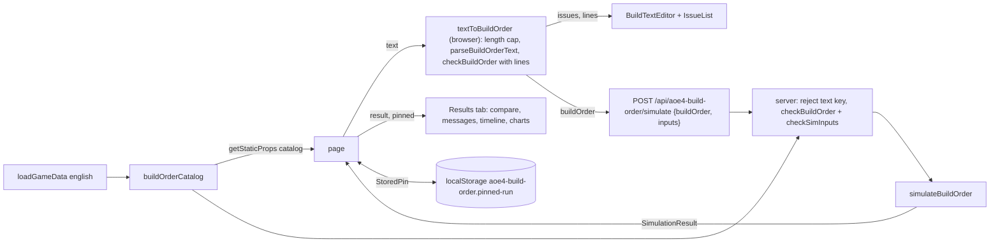

# M4: Technical design

## Summary

One zod schema factory (`lib/aoe4-build-order/schema.ts`) built from a JSON-serializable catalog of the
English data replaces the hand-rolled validator. One shared conversion, `textToBuildOrder`, turns the
paste into a schema-checked build in the browser. The page shows its issues inline against their lines
and posts `buildOrder`. The route takes `{buildOrder, inputs}` only. `text` is removed (a breaking API
change), and the route checks the same schema. The engine gets four changes. A completed unit upgrade converts units already spawned. Two new
warnings report auto-houses held off by the house gate. Auto-house planning counts only pending supply
that lands within the house lead time. The knight + longbow build gets a sheep run-out reaction. The page
becomes a two-tab workbench (Build, Results) with a sticky run bar, a text/table toggle, a line-numbered
editor, polished step table, timeline, compare, legends, a pin kept in `localStorage`, and a card layout
under 768 px.

### Starting state (origin/main d5c2549)

| area | what exists before the first M4 ticket |
|------|-----------------------------------------|
| schema library | none. `package.json` has no zod; `REPO.md` `schemaLibrary` is unset; `tsconfig.json` has `strict: false` (TypeScript 7.0.2, Next 16.4.3) |
| validation | `lib/aoe4-build-order/validate.ts` (533 lines): `SIM_INPUT_BOUNDS`, `INPUT_DEFAULTS`, `STEP_FIELDS`, `OrderChecker`, `validateBuildOrder(order, data, {lines})`, `resolveSimInputs(partial, data)`. Tests: `validate.test.ts` (722 lines), `validate.acceptance.test.ts` (298 lines). Unknown extra keys are ignored |
| route | `pages/api/aoe4-build-order/simulate.ts` accepts exactly one of `text` or `buildOrder`, plus optional `inputs`. Order of checks: method, text length (`SIM_INPUT_BOUNDS.textChars` 20000), parse, validate, inputs. Caps at `MAX_REPORTED_ISSUES` 100 with `omittedIssues`. Error body `{error: issues[0].message, issues}` |
| paste grammar | `lib/aoe4-build-order/parse-text.ts`: `parseBuildOrderText(text)` returns `{ok, order, lines}` or issues, and `formatBuildOrderText(order)`. Tests `parse-text.test.ts`, `parse-text.acceptance.test.ts`. Only the route calls the parser for a request today |
| API tests and types | `lib/aoe4-build-order/api.ts` `SimulateRequest { text?, buildOrder?, inputs? }`. `text:` request bodies: `aoe4-simulate-api.spec.ts` 26, `aoe4-simulate-api-edges.spec.ts` 22, `aoe4-simulate-api-contract.spec.ts` 5. Several of them assert `line` on 400 issues. `aoe4-build-order.spec.ts` asserts `postDataJSON().text`. OpenAPI `info.version` `1.0.0`; `SimulateRequest` is a `oneOf` of `text` and `buildOrder`, and the request examples include a `text` example |
| page | `pages/apps/aoe4-build-order.tsx` posts `{text, inputs: {durationSeconds}}`. One long page: BuildInput (select, duration, 16-row textarea, Run), step table always under it, error list, "Results" h2, ComparePanel, Results (warnings, collapsed info list, timeline, three charts). getStaticProps passes `builds` and `options: StepOptions` |
| unit tiers | `research.ts` `resolveUnitEntry` resolves the tier when a unit is paid; `UnitSeries.counts` is cumulative spawned units of that entry. Knight + longbow at 1800 s: `longbowman-2` 13, `longbowman-3` 53, Veteran Longbowmen completes at 846.86 s |
| houses | `houseGateOpen`: auto-houses off until the order's last `build house` step starts. `planAutoHouse` counts all supply under construction as `pendingSupply`. There is no warning for either |
| knight + longbow build | sheep run out at 997.87 s with 4 villagers idle (`node-depleted`, severity warning). Gold and `gold#2` run-outs idle 0 |
| messages | warnings list (`simulation-warnings`); info list collapsed behind `simulation-notes-toggle` (already shows `node-depleted` with 0 idle at severity info) |
| charts | recharts `Legend` (series) immediately followed by `chart-marker-legend`. Current markers are dashed (`8 2`). The pinned run draws no markers. Labels are placed by `placeMarkers` using a 7 px/char estimate |

## Modules

| module (path) | owns | public functions or exports | used by |
|---------------|------|-----------------------------|---------|
| `lib/aoe4-build-order/schema.ts` (new) | build order and inputs schemas, zod-to-issue mapping, catalog, bounds, defaults, near-match | `BuildOrderCatalog`, `buildOrderCatalog`, `buildOrderShape`, `buildOrderSchema`, `simInputsSchema`, `checkBuildOrder`, `checkSimInputs`, `resolveSimInputs`, `nearestId`, `SIM_INPUT_BOUNDS`, `INPUT_DEFAULTS`, `OPTIONAL_STEP_FIELDS` | route, page, step table, builds test, engine tests |
| `lib/aoe4-build-order/text-to-build.ts` (new) | the one paste-to-build conversion: length cap, parse, schema check with lines | `textToBuildOrder`, `TextToBuildResult` | page (Run, pin restore), acceptance specs that build requests from paste |
| `lib/aoe4-build-order/parse-text.ts` | paste grammar (unchanged) | `parseBuildOrderText`, `formatBuildOrderText` | `text-to-build.ts`, step table, specs. The route no longer imports it |
| `lib/aoe4-build-order/api.ts` | request and response types | `SimulateRequest` (`text` removed, `buildOrder` required), `SimInputOverrides`, `SimulateError` | route, page, specs |
| `lib/aoe4-build-order/validate.ts` | deleted. `resolveSimInputs`, `SIM_INPUT_BOUNDS` and `INPUT_DEFAULTS` move to `schema.ts` with the same names and signatures. `validate.test.ts` and `validate.acceptance.test.ts` are deleted (see C4a) | none | none |
| `lib/aoe4-build-order/data-schema.ts` (new) | shape of the shipped data files, test-time only | `snapshotFileSchema`, `baseRulesFileSchema`, `civRulesFileSchema` | `data.test.ts` |
| `lib/aoe4-build-order/model.ts` | result and warning types; build order types are re-exported from `schema.ts` (decided: inferred from the schema) | `SimWarning` (2 new codes), `BuildOrderIssue.suggestion`, `UnitSeries` (meaning changes) | everyone |
| `lib/aoe4-build-order/research.ts` | unit tier resolution, upgrade conversion | `resolveUnitEntry` (unchanged), `convertUnits(state, upgrade)` (new) | `simulate.ts` |
| `lib/aoe4-build-order/simulate.ts` | spawn ledger by tier, house-gate tracking | `simulateBuildOrder` (unchanged signature) | route, tests |
| `lib/aoe4-build-order/houses.ts` | auto-house plan | `planAutoHouse(state, inputs, data, demand)`, `HouseDemand` (changed) | `simulate.ts` |
| `lib/aoe4-build-order/depletion.ts` | warning sort | `sortWarnings` (ranks the new codes) | `simulate.ts` |
| `lib/aoe4-build-order/step-options.ts` | select choices | `StepOptions` gains `names`; `stepOptions(data)` | catalog, step table |
| `pages/api/aoe4-build-order/simulate.ts` | route | `{buildOrder, inputs}` only (C4); uses `checkBuildOrder`, `checkSimInputs`; rejects `text` | page, API clients |
| `pages/apps/aoe4-build-order.tsx` | page state: text, duration, result, run snapshot, pin, tab, view | `PageProps { builds, catalog }` | n/a |
| `components/apps/aoe4-build-order/workbench-tabs.tsx` (new) | tab bar and two always-mounted panels | `WorkbenchTabs`, `WorkbenchTab = 'build' \| 'results'` | page |
| `components/apps/aoe4-build-order/build-input.tsx` | sticky run bar: build select, duration, Run, editor view toggle | `BuildInput` (props change: `view`, `onViewChange`; textarea leaves) | page |
| `components/apps/aoe4-build-order/build-text-editor.tsx` (new) | auto-sized textarea, line-number gutter, line highlight, inline issue list with suggestions | `BuildTextEditor`, `IssueList` | page |
| `components/apps/aoe4-build-order/text-lines.ts` (new) | pure line math and issue-to-line mapping | `lineCount`, `issueLines` | editor, page |
| `components/apps/aoe4-build-order/step-table.tsx` / `step-table-model.ts` | labels, optional-field disclosure, start row, card layout | `StepTable` (prop `options` becomes `catalog`), `FIELD_LABELS`, `startEdits` helpers | page |
| `components/apps/aoe4-build-order/step-timeline.tsx` / `step-timeline-rows.ts` | "Blocked by", long waits, "ongoing" | `timelineRows`, `TimelineRow` (fields change), `LONG_WAIT_SECONDS` | Results |
| `components/apps/aoe4-build-order/compare.ts` / `compare-panel.tsx` | key numbers with blank reasons, direction, hidden empty rows, pin label | `keyNumbers`, `compareRows`, `KeyValue`, `CompareRow` (changed), `ComparePanel` (props change) | Results tab |
| `components/apps/aoe4-build-order/line-chart.tsx` / `chart-rows.ts` / `chart-legend.tsx` (new) | custom series legend, marker legend, label placement, pinned age-up markers | `SeriesChart` (prop `pinnedMarkers`), `SeriesLegend`, `MarkerLegend`, `placeMarkers` (exported) | Results |
| `components/apps/aoe4-build-order/pin-storage.ts` (new) | `localStorage` read/write of the pin | `PIN_STORAGE_KEY`, `StoredPin`, `readStoredPin`, `writeStoredPin`, `clearStoredPin` | page |
| `data/aoe4-build-order/builds/english-knight-longbow.json` + `data/aoe4-build-order/README.md` | sheep reaction, 1800 s claims | n/a | builds tests, acceptance |
| `docs/aoe4-build-order.md`, `docs/api/openapi.json` | user-facing contract | n/a | contract spec |

## Contracts

### C1. Dependency and compiler (M4.1)

- Add `"zod": "^4.6.7"` to `dependencies`; import from `'zod'` (the v4 API, not `zod/v3` or `zod/mini`). On merge,
  `REPO.md` `schemaLibrary: zod`. zod is a plain library; Next 16.4.3 needs nothing special for it.
- Under the current `strict: false`, `z.infer` makes object and union-typed fields optional. For example, a
  discriminated union field `t` infers as `t?`. Even a correct `const S: z.ZodType<T>` annotation fails to
  compile. A `tsc --noEmit --strictNullChecks` run on d5c2549 reports 177 errors. The largest counts are
  `simulate-depletion.test.ts` 33, `simulate.test.ts` 21, `simulate-triggers.test.ts` 19,
  `acceptance/aoe4-build-order.spec.ts` 16, `research.test.ts` 13, `simulate.ts` 12.
- Decided (owner, 2026-11-02): a precursor ticket sets `"strictNullChecks": true` in `tsconfig.json` and
  fixes all 177 errors before the schema ticket. Done means `tsc --noEmit` passes with zero errors, and the
  suite and lint commands are unchanged. Every other `strict` flag stays off. From the schema ticket on,
  build order types are `z.infer` of the schema (C2) and are declared once, and every schema is annotated
  `z.ZodType<T>` where a `T` exists, so schema drift fails at compile time.

### C2. Catalog and schema (`lib/aoe4-build-order/schema.ts`)

```ts
export interface BuildOrderCatalog extends StepOptions {
  civ: CivId
  // Sum of the civ's starting villager split.
  startVillagerTotal: number
  // The civ's default start, used when the start row is added in the table.
  defaultStart: BuildStart
  // Starting buildings that produce villagers (start.rally is required when non-empty).
  startVillagerProducers: readonly string[]
  // Every tech baseId classifyTech rejects, with the rejection.
  rejectedTechs: Readonly<Record<string, { code: 'unsupported-tech' | 'unknown-tech-effect'; property: string }>>
}
export function buildOrderCatalog(data: GameData): BuildOrderCatalog      // pure, JSON-serializable output
export const buildOrderShape: z.ZodType       // data-free shape: types, enums, bounds, discriminators
export function buildOrderSchema(catalog: BuildOrderCatalog): z.ZodType<BuildOrder>   // shape + id and cross-field checks
export function simInputsSchema(catalog: BuildOrderCatalog): z.ZodType               // the partial `inputs` object
export function checkBuildOrder(value: unknown, catalog: BuildOrderCatalog, lines?: BuildOrderLines):
  { ok: true; order: BuildOrder } | { ok: false; issues: BuildOrderIssue[] }
export function checkSimInputs(value: unknown, catalog: BuildOrderCatalog):
  { ok: true; inputs: SimInputs } | { ok: false; issues: BuildOrderIssue[] }
export function resolveSimInputs(partial: unknown, data: GameData): ReturnType<typeof checkSimInputs>  // same name/signature as today
export function nearestId(value: string, choices: readonly string[]): string | undefined
export const OPTIONAL_STEP_FIELDS: Readonly<Record<BuildStep['action'], readonly string[]>>
export { SIM_INPUT_BOUNDS, INPUT_DEFAULTS }   // values unchanged; textChars (20000) is now read only by textToBuildOrder
```

- `BuildOrder`, `BuildStep`, `Trigger`, `BuildStart` are `z.infer` of `buildOrderShape` parts, re-exported from
  `model.ts` with `export type`. Their inferred types equal today's model.ts declarations. Node fields infer
  `NodeRef` / `FiniteNodeRef`, id fields `string`, and `move.count` `number | 'all'`.
- `StepOptions` gains `names: Readonly<Record<string, string>>` (baseId to the entry's display `name`, for
  every id in `buildings`, `producers`, units and `techs`).
- `OPTIONAL_STEP_FIELDS` (same set as today's `STEP_FIELDS` `opt` entries): produce `instance, count, rally,
  walkSeconds`; rally `instance, walkSeconds`; pause `instance`; build `builders, then, walkSeconds`; research
  `at`; move `walkSeconds`.
- Data files: `data-schema.ts` schemas are annotated `z.ZodType<Snapshot>`, `z.ZodType<BaseRules>` and
  `z.ZodType<CivData>` against the existing `data.ts` types. They run in `data.test.ts` only, never at
  runtime. They hold the per-field shape assertions that `data.test.ts` makes today: non-empty strings,
  the 40-hex `commit`, the `http` `patchSource`, and every `HandValue` having a non-empty `source` and a
  boolean `unverified`. Value assertions (owner-supplied amounts, owner-verified paths) and cross-file
  reference checks stay as tests. `builds.test.ts` checks every shipped build with
  `checkBuildOrder(build, buildOrderCatalog(ENGLISH))`.

### C3. Issue mapping (zod to `BuildOrderIssue`)

`BuildOrderIssue` gains `suggestion?: string`. `code`, `message`, `step` and `line` are unchanged, and the
code enum stays the same seven values. Every message keeps today's text (see the case table in Behavior
rules). The label stays `line N` when `lines` is given and `steps[i]` otherwise. Order-level labels are
`civ`, `steps` and `start`, an inputs label is `inputs.<path>`, and the route's envelope issues (C4) use `request`.

| zod issue | where | `code` | message text after `<label>: ` |
|-----------|-------|--------|------------------------------|
| `custom` with `params.code` | any refinement | `params.code` | the refinement's text (same strings as validate.ts today) |
| `invalid_type` | any field | `syntax` | `<field> must be a <type>` (`missing <field>` when undefined) |
| `too_small` / `too_big` / not integer | bounded number | `out-of-range` | `<field>: <value> is outside <min>..<max>` / `<value> is not an integer` / `<value> is not a finite number` |
| `invalid_union` on `trigger.kind` | trigger | `unknown-trigger-kind` | `unknown trigger kind "<kind>"; the kinds are time, villagers, depleted, bank` |
| `invalid_union` on `action` | step | `syntax` | `unknown action "<action>"` |
| node string failing `nodeRefIssue` | node fields | `syntax` / `unknown-id` / `invalid` / `out-of-range` | the `nodeRefIssue` reason, unchanged |

`suggestion` is set only on `unknown-id` issues for `unit`, `building`, `producer`, `tech`, `at` and node
fields, and on `unknown-trigger-kind`. It is the `nearestId` of the given value among the catalog ids of
that kind.

### C4. API (`POST /api/aoe4-build-order/simulate`), breaking

Decided (owner, 2026-11-02): `text` is removed. The request is structured `{buildOrder, inputs}` only.

| field | before | after |
|-------|--------|-------|
| request `text` | accepted | **removed**. A body with a `text` key (any value, `null` included) gets 400, one `syntax` issue `request: text is no longer accepted; convert the paste to buildOrder and send that`, with no `step` or `line`. It is not ignored, so a client that still sends `text` learns why, rather than getting `missing buildOrder` or a silent success when both are sent |
| request `buildOrder` | one of `text`/`buildOrder` | required. Absent gives `syntax` `request: missing buildOrder`. Present: `checkBuildOrder(body.buildOrder, catalog)` (no `lines`, so issues carry `step`, never `line`) |
| request `inputs` | `resolveSimInputs` | `checkSimInputs` (same bounds, defaults and messages) |
| other top-level keys | ignored | ignored (unchanged) |
| 400 body | `{error, issues, omittedIssues?}` | same; issues may carry `suggestion`; no issue carries `line` |
| 200 `warnings[]` | 3 codes | 5 codes (C6) |
| 200 `unitsProduced` | cumulative, tier fixed when paid | counts by current tier (C5) |

```ts
// lib/aoe4-build-order/api.ts
export interface SimulateRequest { buildOrder: BuildOrder; inputs?: SimInputOverrides }
```

- The route builds the catalog from `loadGameData('english')` once per process. It does not import
  `parse-text.ts` and has no text-length check. The 20000-character cap moves into `textToBuildOrder` (C4a).
  Next's 1 MB body limit and plain-text `Invalid JSON` 400 are unchanged.
- The page posts `{ buildOrder, inputs: { durationSeconds } }`.
- OpenAPI (`docs/api/openapi.json`): `info.version` becomes `2.0.0`. `SimulateRequest` drops the `oneOf`
  and the `text` property, sets `required: ["buildOrder"]` and adds `"not": {"required": ["text"]}`. Its
  description says `text` was removed in 2.0.0 and gives the 400 it produces. The `text` request example
  is deleted. The 400 response description lists `request: missing buildOrder` and the removed-`text`
  issue, and stops promising `line` on issues. `docs/aoe4-build-order.md` Route section: the same changes,
  plus one sentence telling paste users to use the page or `textToBuildOrder`. These doc edits land in the
  API ticket, so the contract check passes on every merge. M4.14 covers only the other M4 changes.

### C4a. Text-to-build conversion (`lib/aoe4-build-order/text-to-build.ts`)

```ts
export type TextToBuildResult =
  | { ok: true; order: BuildOrder; lines: BuildOrderLines }
  | { ok: false; issues: BuildOrderIssue[]; lines?: BuildOrderLines }   // lines set when the text parsed
export function textToBuildOrder(text: string, catalog: BuildOrderCatalog): TextToBuildResult
```

- Pure and browser-safe: it imports only `parse-text.ts`, `schema.ts` and types, and never `data.ts` or `fs`.
  It is the only paste-to-build path. The page's Run and pin restore call it, and acceptance specs call it
  to build request bodies from paste (`textToBuildOrder(paste, buildOrderCatalog(loadGameData('english')))`).
- Tests: `validate.test.ts` and `validate.acceptance.test.ts` are deleted. Every issue case in Behavior
  rules, Validation that can be written as paste is tested once, as text in and issues out, in
  `text-to-build.test.ts`, with its `line`. JSON-only cases are in `schema.test.ts`: wrong types,
  `walkSeconds: 0.5`, unknown keys, a non-object root, and `steps` length 201. Grammar-only cases stay in
  `parse-text.test.ts`. API acceptance specs do not test paste grammar or `line` (see Behavior rules, API
  test rewrite).

### C5. Units by current tier (M4.2)

Decided (owner, 2026-11-02): units move to the upper tier when the upgrade completes. No `unitsByTier`
field is added.

`UnitSeries` keeps its fields (`unitId`, `baseId`, `name`, `tier`, `counts`). Its meaning changes:
`counts[i]` is the number of spawned units of `baseId` whose tier at `times[i]` is this entry's `tier`.
Summed over the series of one `baseId`, the counts are the cumulative units produced. Deaths are not
modelled, so "on the field" and "produced" differ only by tier. Expected on knight + longbow, 1800 s:
`longbowman-2` reads 13 at 845 s and 0 from 850 s; `longbowman-3` reads 13 at 850 s and 66 at 1800 s.

### C6. Warnings (M4.3, M4.5)

```ts
| { code: 'auto-houses-never-start'; severity: 'warning'; message: string; step: number; at: 0 }
| { code: 'auto-houses-held'; severity: 'warning'; message: string; step: number; at: number; seconds: number }
```

| code | `step` | `at` | message |
|------|--------|------|---------|
| `auto-houses-never-start` | index of the order's last `build house` step | `0` | `auto-houses never start: they wait for step <step+1> (build house), a reaction that did not fire by <m:ss duration>, so no auto-house is built.` |
| `auto-houses-held` | same | first instant production was blocked by supply while the gate was closed | `production was held at the supply limit for <m:ss seconds> from <m:ss at> while auto-houses waited for step <step+1> (build house) to start.` |

`sortWarnings` ranks warnings at the same `at` as follows: node warnings `[0, …]`, `step-stuck` `[1, step, 0]`,
`auto-houses-never-start` `[2, step, 0]`, `auto-houses-held` `[2, step, 1]`.

### C7. Auto-house demand (M4.4)

```ts
export interface HouseDemand {
  // Every building under construction: its supply and its expected completion time.
  pending: { supply: number; completesAt: number }[]
  populationPerSecond: number
}
```

`planAutoHouse(state, inputs, data, demand)` keeps its signature.

### C8. Page, editor and tabs (M4.7, M4.8)

| element | test id | notes |
|---------|---------|-------|
| tab bar | `workbench-tabs` | `role="tablist"` |
| tab buttons | `tab-build`, `tab-results` | `role="tab"`, `aria-selected`; order Build, Results |
| panels | `panel-build`, `panel-results` | both stay mounted; the inactive one has the `hidden` attribute |
| run bar | `run-bar` | `position: sticky; top: 0`; holds `build-order-select`, `duration-seconds`, `run-simulation`, view toggle |
| view toggle | `editor-view-text`, `editor-view-table` | buttons with `aria-pressed`; default text |
| textarea | `build-order-text` (kept) | `rows` = `max(8, lineCount(text))`; no inner scroll |
| gutter | `build-order-gutter`; items `build-order-line-number` | `data-line` 1..N; `data-error="true"` on issue lines |
| inline issues | `build-order-issues`; items `build-order-issue` | `role="alert"`; `data-line` (absent when none), `data-code`; text is `message` |
| suggestion | `build-order-issue-suggestion` | inside its issue; text `did you mean <id>?` |
| server or network error | `simulation-error` (kept) | for 400s with no line, and for network or HTTP failures |
| table notice | `step-table-unavailable` (kept) | table view while the text does not parse |
| stale notice | `results-stale` | in `panel-results` |
| pin label | `pinned-label` | `Pinned: <name>, <m:ss duration>` |

```ts
// text-lines.ts
export function lineCount(text: string): number          // '' -> 1, 'a\nb' -> 2, 'a\n' -> 2
export function issueLines(issues: readonly BuildOrderIssue[], lines: BuildOrderLines | undefined): number[]  // sorted, unique, 1-based
// build-text-editor.tsx
export function BuildTextEditor(props: { text: string; onChange(text: string): void; errorLines: readonly number[] }): JSX.Element
export function IssueList(props: { issues: readonly BuildOrderIssue[]; lines?: BuildOrderLines }): JSX.Element | null
// workbench-tabs.tsx
export type WorkbenchTab = 'build' | 'results'
```

`PageProps` becomes `{ builds: PrebuiltBuild[]; catalog: BuildOrderCatalog }`. `catalog` replaces `options`.

### C9. Step table (M4.9, M4.13)

| element | test id | notes |
|---------|---------|-------|
| rows (cards under 768 px) | `step-row` (kept, `data-step`) | same element at all widths; layout by CSS only |
| trigger, action selects | `step-trigger-kind`, `step-action` (kept) | option `value` stays the id; option text is the label |
| fields | `step-field-<field>` (kept) | label text from `FIELD_LABELS` |
| optional disclosure | `step-more` | button with `aria-expanded`; reveals `OPTIONAL_STEP_FIELDS` of the row's action |
| reorder, delete | `step-move-up`, `step-move-down`, `step-delete`, `step-add` (kept) | icon buttons with `aria-label` "Move up", "Move down", "Delete step" |
| start row | `step-start-row` | always the first row |
| start rally | `start-field-rally` | select over `nodes`, with `(none)` |
| start villager pairs | `start-villagers-count`, `start-villagers-node` (each `data-index`), `start-villagers-add`, `start-villagers-delete` | |
| add a start | `start-customize` | shown when the order has no `start`; inserts `catalog.defaultStart` |

`FIELD_LABELS` (in `step-table-model.ts`): `producer` "Building", `instance` "Building #", `unit` "Unit",
`count` "Count", `rally` "Rally to", `walkSeconds` "Walk time (s)", `to` "To", `building` "Building",
`builders` "Builders", `from` "From", `then` "Then", `tech` "Technology", `at` "At", `seconds` "Time (s)",
`trigger-count` "Villagers", `node` "Node", `resource` "Resource", `atLeast` "At least", `reaction`
"Every time". Option text: ids use `catalog.names[id]`, and nodes use `Sheep`, `Gold`, `Gold deposit 2` …
`Gold deposit 8`.

### C10. Timeline (M4.10)

`TimelineRow` drops `waitBreakdown` display and `flagged`'s separate column. It gains `blockedBy: string` and
`longWait: boolean`. `LONG_WAIT_SECONDS = 60`. Columns: Step, Started, Finished, Waited, Blocked by. Row test
ids are kept (`step-timeline`, `step-timeline-row`, `data-step`, `data-status`, `data-flagged`,
`data-reaction`). New: `data-long-wait="true"`. The table sits in `step-timeline-scroll` (`overflow-x: auto`).

### C11. Compare (M4.10, M4.12)

```ts
export type KeyValue = { value: number } | { value: null; reason: 'run-ended' | 'not-reached' }
export interface CompareRow {
  key: string; label: string
  current: KeyValue; pinned: KeyValue
  delta: number | null                       // current - pinned when both have values
  direction: 'better' | 'worse' | 'same' | null
}
export function keyNumbers(result: SimulationResult): KeyNumbers   // KeyNumbers fields become KeyValue
export function compareRows(current: KeyNumbers, pinned: KeyNumbers): CompareRow[]   // rows with both values null are omitted
```

Row keys stay `military-600`, `military-900`, `military-1200`, `age-2`, `age-3`, `age-4`, `pop-cap`, and test ids
stay `compare-key-numbers`, `compare-row`. New ones: `data-direction` on `compare-row`, `compare-empty` when
every row is omitted, `compare-scroll` wrapper.
`ComparePanel` props: `{ current, pinned, pinnedName, alreadyPinned, onPin, onUnpin }`.

### C12. Charts (M4.11, M4.12)

| element | test id | notes |
|---------|---------|-------|
| series legend | `chart-series-legend` | heading "Series"; replaces recharts `Legend` |
| series item | `chart-series-legend-item` | button, `data-series` = key (`pinned:<key>` for pinned), `aria-pressed` = hidden; swatch is a solid horizontal line (dashed for pinned) |
| marker legend | `chart-marker-legend` (kept) | heading "Markers", own row with a top border; swatch is a short vertical line |
| marker item | `chart-marker-legend-item` (kept, `data-kind`) | adds `data-kind="pinned-age-up"` while pinned age-ups are drawn |
| current marker | `chart-marker` (kept, `data-kind`, `data-label`, `data-at`) | solid line |
| pinned age-up marker | `chart-pinned-marker` (`data-label`, `data-at`) | dashed `6 4`, no text label, `<title>` `<age> (pinned) <m:ss>` |

```ts
export function placeMarkers(markers: readonly ChartMarker[], end: number, plotWidth: number): PlacedMarker[]  // exported, pure
export function SeriesChart(props: SeriesChartProps & { pinnedMarkers?: readonly ChartMarker[] }): JSX.Element
```

### C13. Pin storage (M4.12)

```ts
export const PIN_STORAGE_KEY = 'aoe4-build-order.pinned-run'
export interface StoredPin { version: 1; name: string; text: string; durationSeconds: number }
export function readStoredPin(storage: Storage): StoredPin | null   // hand-checked: 4 flat fields
export function writeStoredPin(storage: Storage, pin: StoredPin): void
export function clearStoredPin(storage: Storage): void
```

The stored pin holds the inputs, not the result. On load the page re-runs them (see the pin behavior rules).

## Behavior rules

### Validation (M4.1)

| operation | case | rule |
|-----------|------|------|
| check | ordering | Order of issues: `civ`, `name`, `steps` (count), `start`, then steps by index ascending, and within a step in field order (trigger, then the action's fields in `STEP_FIELDS` order), then cross-field issues of that step, then cross-step issues by the later step's index. Equal keys keep zod's emission order |
| check | field vs cross-field | A step's cross-field checks (producer can produce unit, rally on a non-villager, rally on a producer with no villagers, walkSeconds without rally, research `at` site) run only when that step's fields passed. Cross-step checks (repeat research, build of a villager producer with no rally) run only when every step passed its field checks. Start checks (villager sum, required rally) run only when `start` passed its field checks. This differs from today, which reports everything at once. Specs asserting combined issues are re-specified, not worked around |
| check | repeat | Pure: the same value and catalog give the same issues in the same order, in browser and server |
| check | unknown keys | ignored and dropped from the checked order (today they are ignored). Never an issue |
| check | empty `steps` | valid (`start`-only order), as today |
| check | `steps` length 201 | `out-of-range`, `steps: 201 steps, more than 200`. 200 is valid |
| check | `civ: "french"` | `unknown-id`, `civ: unknown civ "french"` |
| check | `unit: "knigt"` with `producer: "stable"` | `unknown-id`, `line N: unknown unit "knigt" in unit`, `suggestion: "knight"` |
| check | `producer: "stable", unit: "longbowman"` | `invalid`, `<label>: stable cannot produce longbowman` |
| check | `trigger: {kind: "soon"}` | `unknown-trigger-kind`, suggestion `nearestId("soon", kinds)` (none if over the threshold) |
| check | `count: 0` on produce | `out-of-range`, `count: 0 is outside 1..200` |
| check | `walkSeconds: 61` | `out-of-range`, `walkSeconds: 61 is outside 0..60`. `walkSeconds: 0.5` is valid (non-integer allowed) |
| check | `node: "gold#1"` / `"gold#9"` / `"silver"` / `"wood"` in `depleted` | `invalid` (deposit 1 is written gold) / `out-of-range` (outside 2..8) / `unknown-id` / `invalid` (never runs out); texts unchanged |
| check | `tech: "<rejected id>"` | `unsupported-tech` or `unknown-tech-effect` from `catalog.rejectedTechs`, text `technology "<id>" is not supported: property <p>` |
| check | `research <tech> at <site>` where the site does not research it | `invalid`, `<tech> cannot be researched at <site>` |
| check | same tech researched twice | `invalid` on the later step, `<tech> is already researched by <earlier label>` |
| check | `start.villagers` summing to 5 when the civ starts with 6 | `invalid`, `start.villagers sums to 5, the civ starts with 6` |
| check | start building produces villagers, no `start.rally` | `invalid`, `no start.rally while starting building <ids> produces villagers` |
| check inputs | `durationSeconds: 59` / `3601` | `out-of-range`, `inputs.durationSeconds: 59 is outside 60..3600`. 60 and 3600 are valid |
| check inputs | `houseBuilderSource: "gold#2"`, `trips: {"gold#2": …}` | `unknown-id`, `unknown node "gold#2"` (texts unchanged) |
| check inputs | absent field | `INPUT_DEFAULTS` value (duration 1200, autoHouses true, houseBuilders 1, houseBuilderSource wood, influenceCoverage `{mill: 1}`) |
| nearestId | match | Case-insensitive Levenshtein distance against every choice. Returns the choice with the least distance when that distance ≤ `max(1, floor(value.length / 3))`. Ties go to the earliest choice in catalog order. Distance 0 with different case returns the choice (`"Knight"` → `knight`) |
| nearestId | no candidate | `undefined`; the issue has no `suggestion` |
| route | ordering | method (405), body is a JSON object (else one `syntax` issue, nothing else checked; unchanged), then the order part, then `inputs`. Both parts always run; order issues come first (unchanged) |
| route | order part | `text` key present: the single removed-`text` issue (C4), and `buildOrder` is not checked, even when valid. Else `buildOrder` absent: `request: missing buildOrder`. Else `checkBuildOrder`. A `buildOrder: null` is present, so it is checked and fails as a non-object root |
| route | `{text: "…"}` / `{text: null, buildOrder: <valid>}` / `{buildOrder: <valid>, inputs: {durationSeconds: 59}}` with `text` | 400 with issues `[removed-text]` / `[removed-text]` / `[removed-text, inputs.durationSeconds out-of-range]` |
| route | `{}` / `{inputs: {}}` | 400 `syntax`, `request: missing buildOrder` |
| route | repeat | Stateless; the same body gives the same response |
| route | issue cap | first 100 issues, `omittedIssues` = the rest, unchanged |
| route | failure inside the engine | unchanged (500 path as today) |
| textToBuildOrder | ordering | (1) `text.length > SIM_INPUT_BOUNDS.textChars.max` (20000) gives one `out-of-range` issue, `text: <n> characters, more than 20000`, and stops. 20000 is accepted. (2) `parseBuildOrderText`. Parse issues are returned as they are, without `lines`. (3) `checkBuildOrder(order, catalog, lines)`. Issues are returned with `lines` |
| textToBuildOrder | empty text `''` | whatever `parseBuildOrderText('')` returns today, unchanged |
| textToBuildOrder | repeat | Pure: the same text and catalog give the same result |
| API test rewrite | which specs | Every `text:` request body in `aoe4-simulate-api.spec.ts`, `-edges.spec.ts` and `-contract.spec.ts` (53 today) is rewritten. A spec that used `text` only to make a build sends `buildOrder` (a JSON literal or `textToBuildOrder(...).order`) and keeps its assertion. A spec that tested paste grammar or `line` on a 400 is moved to `text-to-build.test.ts`, or deleted when `parse-text.test.ts` already covers it. Specs of the old `text` rules (both or neither, `text: null`, 20000 chars over HTTP) are replaced by the C4 rows above. The contract spec imports `SIM_INPUT_BOUNDS` from `schema.ts`. `aoe4-build-order.spec.ts` asserts `postDataJSON().buildOrder` deep-equals `textToBuildOrder(RALLY_PASTE, …).order` and that it has no `text` key |

### Page run, editor and tabs (M4.7, M4.8)

| operation | case | rule |
|-----------|------|------|
| Run | ordering | (1) `textToBuildOrder(text, catalog)`, which handles the length cap, the parse and the check. (2) On `ok: false`, show the issues in `build-order-issues`, select the Build tab, scroll the first issue line into view, and do not POST. (3) Otherwise POST `{buildOrder: result.order, inputs: {durationSeconds: Number(duration)}}`, keeping `result.lines` for this run. (4) On 200: set the result, snapshot `{text, durationSeconds}` as the run's, select the Results tab, scroll `panel-results` top into view. (5) On 400: show the issues. Server issues never carry `line`. Issues with `step` map to `lines.steps[step]`, and issues whose label is `start` or `start.<field>` map to `lines.start`. Mapped ones go in `build-order-issues` with line highlight; the rest (for example `inputs.durationSeconds`) go in `simulation-error`. Select Build. (6) Network or non-400 failure: `simulation-error`, Build tab |
| Run | duration | not checked in the browser, as today. Empty or non-numeric is sent as 0 and the server rejects it into `simulation-error` |
| Run | repeat while running | Run is disabled while a request is in flight, as today |
| Run | failure leaves | A failed run clears the shown result (as today) and keeps the pin |
| Run | stays on screen | `run-bar` is sticky at the viewport top in both tabs at every width |
| inline issues | when shown | They are computed live from the current text. Parse issues show at once. Check issues appear after the first Run and then track the text live. Clearing all issues hides `build-order-issues` |
| inline issues | many | All issues are listed in check order. Every issue line gets `data-error`. No cap in the browser, since steps are capped at 200 |
| line numbers | range | First gutter number 1, last `lineCount(text)`. `''` shows one line (1). A trailing newline adds a line |
| auto-size | growth | `rows = max(8, lineCount)`; the page scrolls, not the textarea |
| view toggle | switch | Text view shows `BuildTextEditor` only; table view shows `StepTable` only. Both edit the one `text` state. Switching never rewrites the text. The default after load is text. The view survives runs and tab switches, not reloads |
| view toggle | text does not parse | Table view shows `step-table-unavailable` with the first parse issue; the toggle stays usable |
| tabs | default | Build on load. Results is enabled only after a 200 or a restored pin |
| tabs | no target | Selecting Results with neither result nor pin is not possible (tab disabled) |
| info list | content | Every result entry of severity `info` (including `node-depleted` with 0 idle) is in the collapsed `simulation-notes` list. Collapsed on load; its state survives runs (unchanged from M3) |

### Step table (M4.9, M4.13)

| operation | case | rule |
|-----------|------|------|
| optional disclosure | initial | `step-more` starts expanded on a row when any optional field of its action is set, collapsed otherwise. State is per row index and resets when the row count changes |
| optional disclosure | action change | Optional fields of the new action are hidden unless set (none are set after `changeAction`) |
| reorder | first / last row | Move up disabled on step 0, Move down on the last step (unchanged) |
| start row | edit | Edits rebuild `order.start` and set `text = formatBuildOrderText(order)`, the same path as step edits. Bounds and the villager-sum rule are checked on Run, not in the table |
| start row | delete last pair | Leaves `start.villagers` empty, which is written as no villagers clause. An order with neither villagers nor rally drops `start` (civ default) |
| start row | `start-customize` | Inserts `catalog.defaultStart`; repeat clicks are not possible (button hidden once `start` exists) |
| labels | unknown pasted id | Shows `<id> (unknown)` as today; never a display name |
| narrow layout | under 768 px | Each `step-row` renders as a card with stacked labelled fields. At 390 px `document.documentElement.scrollWidth` ≤ 390 on both tabs |

### Timeline (M4.10)

| operation | case | rule |
|-----------|------|------|
| Blocked by | completed or in-progress | the non-zero breakdown reasons as `<reason> <m:ss>` in the order resources, villagers, population, prerequisite; empty when none |
| Blocked by | waiting | breakdown (as above) followed by `still waiting on <waitingOn>` |
| Blocked by | not-reached | `not reached (<waitingOn>)`, where `waitingOn` is `trigger` or `earlier-step` |
| Finished | in-progress | `ongoing` |
| Finished | waiting, not-reached | en dash, as Started is |
| long wait | threshold | `longWait = waitSeconds >= 60`. A row at exactly 60 s (1:00) is highlighted, one at 59.9 s is not. Long-wait rows get class `table-warning`; flagged rows keep their flag |

### Compare and pin (M4.10, M4.12)

| operation | case | rule |
|-----------|------|------|
| key value | military at T | `{value: spent.military at T}` when `T ≤ durationSeconds`, else `{value: null, reason: 'run-ended'}` shown as `run ends at <m:ss duration>` |
| key value | age or pop-cap | `{value}` or `{value: null, reason: 'not-reached'}` shown as `not reached` |
| row | both null | omitted. All seven omitted shows `compare-empty` "Nothing to compare yet" |
| delta | direction | military: higher is better. age-2..4, pop-cap: earlier is better. `delta = 0` gives `same`; a missing value gives `null` and a dash |
| delta | text | military `+120 resources` / `−120 resources`; times `0:35 earlier` / `0:35 later`; zero `same`. Colour: better `text-success`, worse `text-danger` |
| pin name | label | The run's build name: the prebuilt name whose text equals the run text exactly, else `<selected prebuilt name> (edited)`. `pinned-label` shows `Pinned: <name>, <m:ss durationSeconds>` |
| Pin | already pinned | `pin-run` is disabled when a pin exists with `text === run text` and `durationSeconds === run durationSeconds`. A rerun of the same inputs counts as already pinned (A3 determinism) |
| Pin | repeat or replace | Pinning a different run replaces the pin and the stored pin |
| Unpin | effect | clears the pin and calls `clearStoredPin` |
| stale | condition | The shown result is stale when `text !== run text` or `Number(duration) !== run durationSeconds`. Then `results-stale` reads "These results are from an earlier build or duration. Run again to update." and the charts stay. Reverting the edit clears it |
| pin restore | on load | `readStoredPin`. If present: `textToBuildOrder(pin.text, catalog)`. If it is `ok`, POST and on 200 set it as pinned with the stored name. On a parse or check failure, or a 400, `clearStoredPin` and show nothing. On a network or 5xx failure, keep the key and show no pin. No result is shown and Results is enabled only once the pin is restored |
| pin restore | bad storage | Invalid JSON, `version !== 1`, a wrong field type, or a missing field: `clearStoredPin`, no pin. `localStorage` unavailable (throws): behave as no pin and do not persist |
| pin restore | race | A user Run that finishes before the restore POST does not change the restore; both land independently |
| pin | cross-tab | Last write wins. Other open tabs are not synced |
| pinned markers | which | Only the pinned run's `age-up` markers are drawn, dashed, without text labels. The current run's markers are drawn solid with labels |

### Charts (M4.11)

| operation | case | rule |
|-----------|------|------|
| series legend | order | For each current series in result order: its item, then its `pinned:<key>` item if the pinned run has that key. Then pinned-only keys in pinned order |
| series legend | click | Toggles that one key (current and pinned keys toggle separately, as today). Markers never hide |
| marker labels | overlap | `placeMarkers` puts each label in the first row where it does not overlap any placed label, using measured text width (`getComputedTextLength`, or an estimate of at least 8 px per char before first measure). Rows are unbounded; the chart's top margin grows by `rows × 14 px`, so no two label boxes intersect at any width. The knight + longbow markers between 10:00 and 17:00 at 1280 px are the test case |
| marker legend | content | One item per marker kind present, in `CHART_MARKER_KINDS` order, then `pinned-age-up` if any pinned age-up is drawn. No markers and no pinned markers means no marker legend |

### Engine: unit tier conversion (M4.2)

| operation | case | rule |
|-----------|------|------|
| upgrade completes | effect | At the completion instant of an upgrade whose `upgradeTargets` value is unit `B` and whose `age` is tier `T`, with an entry of `B` at age `T`: every spawned unit of `B` at a tier below `T` moves to tier `T` (`convertUnits`). This happens in the completion callback, after `researchedIds` gains the upgrade |
| upgrade completes | no entry at `T` | no conversion and no tier change, as today |
| upgrade completes | no units yet | no-op; later spawns use the new tier |
| upgrade completes | already at a higher tier | a lower upgrade completing after a higher one converts nothing (units are already above `T`) |
| upgrade completes | two upgrades at one instant | applied in completion order; the final tier is the highest researched |
| unit spawns | paid before, spawns after completion | spawns at the highest researched tier (resolved at spawn, not at pay). Cost and production time stay those paid |
| unit pays | tier | `resolveUnitEntry` at payment is unchanged (cost and time come from the tier at payment) |
| series | membership and order | One series per unit entry that held at least one unit at any instant, ordered by that first instant, then `unitId`. A lower-tier series stays listed after it drops to 0 |
| series | sample | `counts[i]` reads the state after every event at `times[i]` (as all series do). Sample times run 0, 5, … to `durationSeconds` |
| side effects | none | `spent`, `spawnedPopulation`, `populationCapReachedAt`, markers and production are unchanged by conversion |

### Engine: house gate warnings (M4.3, M4.5)

| operation | case | rule |
|-----------|------|------|
| `auto-houses-never-start` | emitted when | `inputs.autoHouses` is true, the order's last `build house` step `L` is a reaction, and `steps[L].armedAt === null` at run end. Once per run |
| `auto-houses-never-start` | not emitted | `autoHouses` false; no `build house` step; `L` is not a reaction; `L` fired (even if still waiting: `step-stuck` covers that) |
| `auto-houses-held` | blocked instant | An instant at which, with `autoHouses` true, `houseGateOpen` false and `supply < maxPopCap`, a `produce` step returns `waitingOn: 'population'`, or `payOrder` skips an order because `population + popcap > supply` |
| `auto-houses-held` | accumulation | `seconds` sums every interval (instant to next wake) that begins at a blocked instant. `at` is the first blocked instant. Emitted once at run end when `seconds > 0`. A block only at the final instant (`seconds = 0`) emits nothing |
| `auto-houses-held` | not emitted | `autoHouses` false (blocking at supply is the user's choice); the gate open; supply at `maxPopCap` |
| both | together | Independent: a never-firing reaction house can emit both |
| gate | semantics | `houseGateOpen` is unchanged (owner decision, 2026-11-02). M4.5 is met by `auto-houses-held`, not by changing the gate. The design makes this choice because M4.3 keeps the gate, and the warning changes no timing in any shipped build |
| shipped builds | expectation | If a shipped build emits either warning at default inputs, its README says so with the numbers. The ticket reports the observed values |

### Engine: auto-house planning (M4.4)

| operation | case | rule |
|-----------|------|------|
| planAutoHouse | pending supply | `lead` is unchanged (walk plus house build time with `houseBuilders`). Shortfall headroom = `supply + Σ pending.supply where completesAt ≤ now + lead`. The room cap uses every pending item: `room = ceil((maxPopCap − supply − Σ all pending.supply) / houseSupply)`, so auto-houses never plan past 200 |
| planAutoHouse | completesAt | The completion time the engine would schedule with no further change: for builders still walking, arrival plus construction seconds; once building, the scheduled completion |
| planAutoHouse | item at exactly `now + lead` | counted |
| planAutoHouse | repeat | Pure in its inputs; it is called each instant as today |
| expected | knight + longbow without its three pre-palace explicit houses | `spawnedPopulation` rises between 660 s and 764 s (today flat at 40). The test uses that variant; the shipped build keeps or drops those houses at the M4.6 ticket's choice, and the README matches |

### Build data (M4.6)

| operation | case | rule |
|-----------|------|------|
| knight + longbow | sheep run-out | Add a reaction `whenever sheep runs out move all sheep to <ref>` where `<ref>` is `farm` or `wood` (ticket's choice), placed with the other reactions at the end of the list |
| knight + longbow | check through 1800 s | At `durationSeconds: 1800`: no `idle-arrival` warning, every `depletions` entry with `depletedAt ≤ 1800` has its `node-depleted` `idleVillagers` 0, and no `step-stuck`. README numbers (run-outs, tiers, counts) are restated at 1800 s after M4.2 and M4.4 land |

## Data flow



## Extension points

| future direction | seam that keeps it additive |
|------------------|-----------------------------|
| other civilizations (out of scope now) | `buildOrderCatalog(data)` is per `GameData`. The schema's `civ` is `z.literal(catalog.civ)`. A second civ is a second catalog plus a route switch on `civ`; the schema code does not change |
| deaths or losses later (on-field below produced) | `unitsProduced` is already "units at a tier at a time". A loss event would decrement the same per-tier ledger that `convertUnits` moves |
| more warning codes | `SimWarning` stays a discriminated union, and `sortWarnings` ranks by a per-code rank tuple; add a variant and a rank |
| more key numbers in compare | `compareRows` is a list of `(key, label, KeyValue pair, higherIsBetter)` rows; add a row |
| other stored preferences (view, tab) | `pin-storage.ts` owns one versioned key; another preference is another key with its own `version` |
| other input formats (another paste dialect, an import) | each one is another `<format>ToBuildOrder(input, catalog)` that returns `TextToBuildResult` and ends in `checkBuildOrder`. The route still sees only `buildOrder` |

## Owner decisions

All decided by the owner on 2026-11-02. Nothing is open.

1. **zod types under `strict: false`: option A.** A precursor ticket enables `strictNullChecks` and fixes the
   177 errors, and build order types are inferred from the schema (C1, C2).
2. **API `text`: option C.** `text` is removed from the request. The request is `{buildOrder, inputs}`, and
   a body that sends `text` gets the 400 removed-`text` issue (C4). The paste is converted in the browser
   by the shared `textToBuildOrder` (C4a). The acceptance requests that send `text` are rewritten (Behavior
   rules, API test rewrite), and OpenAPI goes to `2.0.0`.
3. **Veterancy: option A.** Units move to the upper tier when the upgrade completes. `unitsProduced` counts
   units by current tier, and no `unitsByTier` field is added (C5).

## M4.1 ticket order (fixed, because each step depends on the one before)

| # | ticket | contents | why here |
|---|--------|----------|----------|
| 1 | strictNullChecks precursor | C1 decided outcome | zod inference needs it |
| 2 | schema | zod, `schema.ts`, `data-schema.ts`, `text-to-build.ts` and their tests; validate.ts and its tests deleted; route calls `checkBuildOrder`/`checkSimInputs`, and its `text` branch temporarily calls `textToBuildOrder` so the existing specs still pass | one schema before any caller changes |
| 3 | page posts `buildOrder` | page Run and `PageProps.catalog` via `textToBuildOrder`; `aoe4-build-order.spec.ts` request assertion | the page must stop sending `text` before the route rejects it |
| 4 | API: remove `text` (breaking) | route C4 rules, `api.ts` `SimulateRequest`, the 53 spec rewrites, OpenAPI `2.0.0`, docs Route section | its own ticket, so the break and its acceptance rewrite are reviewed together |

Ticket 3 is the first edit of `pages/apps/aoe4-build-order.tsx`, ahead of M4.7, M4.8 and M4.12. Ticket 4
touches no page file, so it can run alongside M4.7 and later tickets once ticket 3 has merged.

## Left to tickets

- Internals of the zod schemas: `superRefine` vs `check`, and how node refs are typed (`z.custom` or a
  string pipe), provided the inferred types match C2.
- Levenshtein implementation (no dependency needed).
- CSS for the tabs, sticky bar, gutter alignment, cards and the line highlight (Bootstrap classes or a
  module CSS file), provided the test ids and the 390 px rule hold.
- Icon glyphs for reorder and delete.
- Exact wording of notices that the rules above do not quote. Trigger kind and action option text,
  for example "At time", "When node runs out".
- How `completesAt` is stored on the engine's constructing list.
- Whether the knight + longbow build keeps its three pre-palace houses once M4.4 lands, and whether the
  sheep reaction goes to `farm` or `wood` (README states the choice).
- Ticket split and waves outside the M4.1 order above. These edits are independent of each other: the engine work (M4.2, M4.3+M4.5,
  M4.4), the step table (M4.9), timeline and compare (M4.10), and the series and marker legends (M4.11).
  These must be serialized, because they edit the same files:
  - `simulate.ts`: M4.2, M4.3/M4.5, M4.4.
  - `pages/apps/aoe4-build-order.tsx`: M4.1 ticket 3, M4.7, M4.8, M4.12.
  - `pages/api/aoe4-build-order/simulate.ts`: M4.1 ticket 2, ticket 4, then M4.2/M4.3 only if they touch it.
  - `line-chart.tsx`: M4.11, then M4.12 pinned markers.
  - `compare-panel.tsx`: M4.10, then M4.12.

  M4.6 lands after M4.2 and M4.4, because its README numbers depend on them. M4.13 and M4.14 come last.
