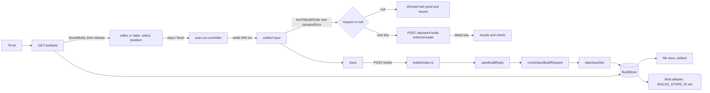

# M6: Technical design

## Summary

The AoE4 build-order page stops using a Run button. A framework-free auto-run controller, wrapped by
a hook on the page, settles the live text and duration after a 500 ms pause and posts to the
existing simulate route whenever the settled input forms a valid request that differs from the
request already shown or already in flight. It aborts superseded requests and drops late responses.
While the input is invalid or the request failed, the last good result stays on screen, dimmed. At
1200 px and wider the editor and the results sit side by side. Below that the existing tabs stay.

A new `builds` API saves a validated `{ buildOrder, durationSeconds }` record under a
content-addressed 11-character id and reads it back. It goes through a `BuildStore` interface.
`next dev`, Vitest and Playwright use a local file store by default. The `@vercel/blob` adapter is
used only when `BUILDS_STORE_ID` is set. Saves are rate-limited per client by a counter kept in the
same store. The route logic lives in Next-free reply functions under `lib/`, so Vitest tests it
against the memory store; the files under `pages/api/` only adapt `req` and `res`.

`npm run smoke:preview -- <url>` checks one deployed preview end to end. It saves a build, reads it
back, opens the build in a browser and deletes it.

### Starting state (origin/main 1e6d6c2, before the first M6 ticket)

Since the first draft (9274372), main gained #104 (pinned legend doc), 9328355 (issue-message docs,
`shortText` labels), #106 (28 stale AoE4 acceptance tests deleted) and #107 (test hygiene). None of
them touch the M6 seams.

| area | exists today |
|------|--------------|
| simulate route | `pages/api/aoe4-build-order/simulate.ts`. It answers POST only, and other methods get 405 with `Allow: POST` and `{ error: 'method X is not allowed; use POST' }`. A non-object body gets 400 with one `syntax` issue `request body: must be a JSON object`. Other 400s return `SimulateError { error, issues, omittedIssues? }`, including the request-level `syntax` issues for `text` and a missing `buildOrder`. It has its own `isPlainObject` and caches the catalog in a module-scope `let`. |
| API types | `lib/aoe4-build-order/api.ts` defines `SimulateRequest`, `SimulateResponse`, `SimulateError` and `MAX_REPORTED_ISSUES = 100`. |
| schema | `lib/aoe4-build-order/schema.ts` defines `SIM_INPUT_BOUNDS` (`textChars` 0..20000, `steps` 0..200, `durationSeconds` 60..3600), `outOfRange(value, key): string \| undefined`, `checkBuildOrder`, `buildOrderSchema(catalog)`, `buildOrderShape` (catalog-free) and `BuildOrder`. `name` has no length cap. |
| text | `textToBuildOrder(text, catalog)` (it checks the 20000-character cap first) and `formatBuildOrderText`. Only orders made of non-negative integers re-parse equal. |
| page | `pages/apps/aoe4-build-order.tsx`. It holds `postSimulation(buildOrder, durationSeconds)` and `errorMessages(response)` as module-private functions; the pin restore effect also calls `postSimulation`. Results come only from the Run button `run-simulation` (`onRun`). Check issues appear only after Run (`checked`). `results-stale` appears after an edit. Two effects scroll to Results or to the issues. A successful run selects the Results tab. `tab-results` is enabled when `result !== null \|\| pin !== null`. The view toggle gets `viewDisabled={shownTab === 'results'}`. `run.name` comes from `pinName(builds, text, selected)`. |
| layout | `WorkbenchTabs` has the tabs `build` and `results`. Both panels stay mounted, and the inactive one is `hidden`. One `@media (min-width: 1200px)` block in `workbench.module.css` holds `.resultsSplit` (2fr/3fr grid), `.timelineColumn` (sticky at `top: var(--run-bar-height)`, `max-height: calc(100vh - ...)`, `overflow-y: auto`) and `.chartsColumn`. Below 1200 px the timeline is not height-capped. The run bar is sticky and becomes static below 768 px. |
| storage | None. There is no `@vercel/blob` dependency, no `process.env` read other than `ACCEPTANCE_PORT`, no `scripts/` directory and no `overrides` in package.json. |
| unit tests | Vitest includes `utils/`, `lib/` and `components/` `**/*.test.ts` only, with no DOM environment. No jsdom, happy-dom or `@testing-library/react` is installed. Component tests use `renderToStaticMarkup`. `pages/` is not included. |
| duplication gate | jscpd covers `lib/aoe4-build-order`, `components/apps/aoe4-build-order` and `pages/api/aoe4-build-order` with `minTokens 70`, `minLines 8`, threshold 0. |
| infra | The private Blob store `aoe4-simulator-builds` is connected to Production and Preview (not Development) with the env prefix `BUILDS_`, so functions see `BUILDS_STORE_ID`. Vercel builds a preview per PR, and previews are behind deployment protection. The vercel CLI is not installed on the owner's machine. `next dev` keeps a client-sent `x-forwarded-for` and adds the socket address only when the header is absent. |
| acceptance | Playwright runs Desktop Chrome (1280x720 by default) against one `next dev` webServer. 15 specs plus `acceptance/helpers.ts` (4 lines) match `runSimulation\|runRejected\|run-simulation\|results-stale`, 78 lines in the specs: inline-issues 19, client-check 16, pin-compare 5, timeline-compare 5, m3-flow 4, m4-flow 4, step-band 4, step-table 4, gathered-resources 3, narrow-layout 3, results-split 3, knight-longbow-page 2, small-screen 2, chart-readability 2, gather-rates-per-villager 2. Three asserts check `results-stale` (m4-flow 1, pin-compare 2). 12 specs click or assert `tab-*` at a viewport of 1200 px or wider, 60 lines: pin-compare 18, small-screen 11, m4-flow 9, inline-issues 4, step-table 4, results-split 3, step-band 3, gather-rates-per-villager 3, m3-flow 2, narrow-layout 1, gathered-resources 1, timeline-compare 1. `helpers.ts` has `openCombatSimulator` (combat page only), `openPage`, `showTab`, `showView`, `runSimulation` and `runRejected`. The contract check `acceptance/aoe4-simulate-api-contract.spec.ts` validates the examples in `docs/api/openapi.json` (2.3.0, which already documents the simulate 400 messages). |

## Modules

| module (path) | owns | public functions or exports | used by |
|---------------|------|-----------------------------|---------|
| `lib/aoe4-build-order/saved-builds.ts` (new; pure TS with no Node-only, React or Next imports, safe in the browser) | the saved-record shape, the id, the key layout, the save checks | `SAVED_BUILD_VERSION`, `savedBuildSchema`, `SavedBuild`, `SaveBuildRequest`, `SaveBuildResponse`, `SAVED_BUILD_ID_PATTERN`, `isSavedBuildId`, `savedBuildId`, `savedBuildKey`, `rateCounterKey`, `storageEnv`, `SAVED_BUILD_MAX_BYTES`, `SAVED_NAME_MAX_CHARS`, `checkSaveBuildRequest`, `savedBuildPath` | build stores, builds replies, page, smoke script (types only) |
| `lib/aoe4-build-order/build-store.ts` (new) | the storage seam and the local stand-ins | `BuildStore`, `PutResult`, `CounterUpdate`, `createMemoryBuildStore`, `createFileBuildStore`, `BUILDS_LOCAL_DIR_DEFAULT`, `buildStoreFromEnv` | builds routes, unit tests |
| `lib/aoe4-build-order/blob-build-store.ts` (new; the only file that imports `@vercel/blob`) | the Blob adapter | `createBlobBuildStore(storeId: string, env: string)` | `buildStoreFromEnv` only |
| `lib/aoe4-build-order/save-rate-limit.ts` (new, pure apart from the store argument) | the fixed-window rule | `SAVE_RATE_LIMIT`, `takeSaveSlot`, `clientKey` | `saveBuildReply`, `builds/index.ts` |
| `lib/aoe4-build-order/api-route.ts` (new; no Next, React, `node:` or game-data import, so it is browser-safe; it imports only types from `api.ts`) | what every AoE4 route shares, and the single source of the plain-object check and the not-an-object 400 | `RouteReply`, `ReplyTarget`, `isPlainObject`, `methodNotAllowed`, `notAnObjectError`, `sendReply` (exactly six) | `simulate.ts`, builds routes, `builds-routes.ts`, `saved-builds.ts` |
| `lib/aoe4-build-order/english-catalog.ts` (new; server-only, the only new file that imports `data.ts`) | the memoized English catalog for routes | `englishCatalog` | `simulate.ts`, `builds/index.ts` |
| `lib/aoe4-build-order/builds-routes.ts` (new; no Next import) | the builds route logic | `saveBuildReply`, `savedBuildReply` | builds routes, unit tests |
| `pages/api/aoe4-build-order/builds/index.ts` (new, thin) | `POST /api/aoe4-build-order/builds` | default handler, `config` | page, smoke script |
| `pages/api/aoe4-build-order/builds/[id].ts` (new, thin) | `GET` and `DELETE /api/aoe4-build-order/builds/{id}` | default handler | page, smoke script |
| `pages/api/aoe4-build-order/simulate.ts` (edit) | the simulate route | uses `api-route.ts` for the 405, the object check and `sendReply`, and `english-catalog.ts` for the catalog; its responses do not change | none |
| `lib/aoe4-build-order/api.ts` (edit) | the shapes the routes share | adds `BuildsError` and re-exports the saved-build types | routes, page |
| `components/apps/aoe4-build-order/simulate-client.ts` (new; no React import) | the browser side of the simulate route | `postSimulation`, `readRejection`, `simulationFailureMessage` | `auto-run.ts`, page (pin restore) |
| `components/apps/aoe4-build-order/auto-run.ts` (new; no React import) | the auto-run state machine, the settled input, the client duration check | `AUTO_RUN_DEBOUNCE_MS`, `AutoRunStatus`, `LiveInput`, `ShownInput`, `AutoRunState`, `AutoRunDeps`, `AutoRunController`, `createAutoRunController`, `durationError`, `requestKey` | `use-auto-run.ts`, unit tests, acceptance helpers (the constant) |
| `components/apps/aoe4-build-order/use-auto-run.ts` (new) | the React wrapper | `useAutoRun` | page |
| `components/apps/aoe4-build-order/use-split-layout.ts` (new) | the split-layout media query | `WORKBENCH_SPLIT_QUERY`, `useSplitLayout()` | page |
| `components/apps/aoe4-build-order/save-build.tsx` (new) | the Save button and the link panel | `SaveBuild` | `BuildInput` |
| `components/apps/aoe4-build-order/save-build-client.ts` (new; no React) | the browser side of the save POST and its messages | `postSavedBuild`, `saveFailureMessage` | `SaveBuild`, unit tests |
| `components/apps/aoe4-build-order/saved-build-loader.ts` (new; no React) | the `?b=` read | `loadSavedBuild(id, signal)`, `savedBuildOption(id, saved)` | page |
| `components/apps/aoe4-build-order/pin-name.ts` (edit) | build names | adds `savedBuildName` beside `pinName` | `SaveBuild` |
| `components/apps/aoe4-build-order/build-input.tsx` `PrebuiltBuild` (edit) | the select option shape | gains `buildName?: string` (see C6, saved name) | page, `pin-name.ts`, `saved-build-loader.ts` |
| `pages/apps/aoe4-build-order.tsx` (edit) | wiring | none; `postSimulation` and `errorMessages` are removed from it | none |
| `components/apps/aoe4-build-order/build-input.tsx` (edit) | the run bar | Run is removed; `auto-run-status`, the duration error and `SaveBuild` are added | page |
| `components/apps/aoe4-build-order/workbench-tabs.tsx` (edit) | tabs or split | adds a `split: boolean` prop | page |
| `components/apps/aoe4-build-order/results.tsx`, `issue-list.tsx` (edit) | dimmed last-good state, issues always shown | `stale` is replaced by `dimmed`, and the `rejected` prop is removed | page |
| `components/apps/aoe4-build-order/workbench.module.css` (edit) | the split and the results internals | the 1200 px block moves to 1800 px (see Layout) | page |
| `scripts/smoke-preview.mjs` (new) and the package.json script `smoke:preview` | the preview smoke | CLI | owner |
| `docs/api/openapi.json`, `docs/aoe4-build-order.md`, `ARCHITECTURE.md`, `.gitignore` (edit) | contract, behavior, layout and the local store dir | none | none |

`pages/api/fight.ts` keeps its own `isPlainObject`; it is outside jscpd's paths and outside M6.

## Contracts

### C1. Saved record and id (`saved-builds.ts`)

```ts
export const SAVED_BUILD_VERSION = 1;
export const savedBuildSchema = z.object({
  version: z.literal(1),
  buildOrder: buildOrderShape,             // catalog-free: a read must succeed after game data changes
  durationSeconds: z.number().int(),       // bounds are checked on save, not on read
});
export type SavedBuild = z.infer<typeof savedBuildSchema>;
export type SaveBuildRequest = Omit<SavedBuild, 'version'>;     // { buildOrder, durationSeconds }
export interface SaveBuildResponse { id: string; path: string }  // GET returns SavedBuild & { id }

export const SAVED_BUILD_ID_PATTERN = /^[A-Za-z0-9_-]{11}$/;
export function isSavedBuildId(value: unknown): value is string;
export function savedBuildId(record: SavedBuild): Promise<string>;
export function storageEnv(vercelEnv: string | undefined): string;  // 'production' | 'preview' | 'development'
export function savedBuildKey(env: string, id: string): string;     // `${env}/builds/${id}.json`
export function rateCounterKey(env: string, clientKey: string): string; // `${env}/rate-limit/${clientKey}.json`
export function savedBuildPath(id: string): string;                 // `/apps/aoe4-build-order?b=${id}`
export const SAVED_BUILD_MAX_BYTES = 65_536;
export const SAVED_NAME_MAX_CHARS = 100;
export function checkSaveBuildRequest(body: unknown, catalog: BuildOrderCatalog):
  | { ok: true; record: SavedBuild; json: string }
  | { ok: false; status: 400; error: SimulateError }
  | { ok: false; status: 413; error: BuildsError };
```

- **Id.** `savedBuildId` takes `json = JSON.stringify(record)`, where `record` is the zod output, so
  keys follow schema order. It computes the SHA-256 with Web Crypto (`crypto.subtle`) and returns
  the first 11 characters of the unpadded base64url digest (66 bits). Equal records get equal ids,
  and a stored id never points at different content.
  - Samples: the first character is any of `A-Z a-z 0-9 - _`, and every id is exactly 11
    characters, e.g. `Zx3_k9-QaB0`.
  - `isSavedBuildId('Zx3_k9-QaB0')` is true. It is false for `'abc'` (10 or fewer characters), for
    12 characters, and for an id containing `.`, `/` or `=`.
- **Env.** `storageEnv` returns `'production'` or `'preview'` when `VERCEL_ENV` has that value, and
  `'development'` in every other case, including unset. Its set is exactly these three, the first
  segment of every key.
- **Keys.** Builds live at `savedBuildKey(env, id)` and rate counters at `rateCounterKey(env,
  clientKey)`. Only a `BuildStore` implementation calls these two functions, with the env it was
  constructed with; callers of the store pass the bare id or client key. Nothing else is written.
  Samples: `savedBuildKey('preview', 'Zx3_k9-QaB0')` is `preview/builds/Zx3_k9-QaB0.json`, and
  `rateCounterKey('development', 'AbCdEfGhIjKlMnOp')` is
  `development/rate-limit/AbCdEfGhIjKlMnOp.json`.

### C2. Storage seam (`build-store.ts`)

```ts
export type PutResult = 'created' | 'exists';
export interface CounterUpdate { windowStart: number; count: number }
export interface BuildStore {
  putBuild(id: string, json: string): Promise<PutResult>;   // never overwrites
  getBuild(id: string): Promise<unknown | null>;            // parsed JSON, or null when absent
  deleteBuild(id: string): Promise<void>;                   // absent is not an error
  bumpCounter(clientKey: string, windowStart: number): Promise<CounterUpdate | 'contended'>;
}
export const BUILDS_LOCAL_DIR_DEFAULT = '.builds-local';
export function createMemoryBuildStore(env?: string): BuildStore;     // env defaults to 'development'
export function createFileBuildStore(dir: string, env: string): BuildStore;
export function buildStoreFromEnv(env?: NodeJS.ProcessEnv): Promise<BuildStore>;
```

- **Arguments.** Every method takes a bare id or a bare client key (from `clientKey`). The store
  composes the full key with `savedBuildKey` or `rateCounterKey` and its own env. Two memory stores
  with different envs share nothing.
- **`bumpCounter` result.** If the stored counter's `windowStart` equals the argument, it returns
  `{windowStart, count: stored + 1}`. Otherwise it stores and returns `{windowStart, count: 1}`.
  The update is atomic per key or reports `'contended'`.
- **`buildStoreFromEnv` selection:**
  1. If `BUILDS_STORE_ID` is non-empty, it uses `createBlobBuildStore(BUILDS_STORE_ID,
     storageEnv(VERCEL_ENV))` through a dynamic `import()`, so `@vercel/blob` never loads locally or
     in the client bundle.
  2. Otherwise it uses `createFileBuildStore(BUILDS_LOCAL_DIR ?? BUILDS_LOCAL_DIR_DEFAULT,
     storageEnv(VERCEL_ENV))`.
  3. Only the call with no argument (which reads `process.env`) is memoized, per module instance; the
     routes call it that way. A call with an explicit `env` (tests) builds a fresh store every time
     and is never memoized. A rejected promise is not memoized, so the next request tries again.
- **File store.** It writes to `<dir>/<key>`. It is file-based because `next dev` can compile the
  two builds routes as separate module instances, so in-memory state would not be shared.
  - `putBuild` writes with the exclusive-create flag (`wx`) and maps `EEXIST` to `'exists'`, which
    is atomic across processes.
  - `bumpCounter` is a synchronous read-modify-write (`readFileSync`, then `mkdirSync` and
    `writeFileSync`, with no `await` between the read and the write). Node runs it to completion, so
    concurrent calls in one process never lose an update, and the file store never returns
    `'contended'`. Across processes it is not atomic, and that is accepted: the store is for
    `next dev`, Vitest and Playwright, which each run one server process, and a lost count there
    only loosens a dev limit. No lock file.
  `.builds-local/` is added to `.gitignore`. Playwright sets `BUILDS_LOCAL_DIR` to a directory
  inside `test-results/` through `webServer.env`, so runs do not leak into the developer's store and
  each run starts with no counters.
- **Blob adapter** (`createBlobBuildStore(storeId, env)`):

  | method | Blob calls | result |
  |--------|------------|--------|
  | every call | passes `storeId`. Credentials come from the function's OIDC token; no token is read or logged. | |
  | `putBuild` | `put(savedBuildKey(env, id), json, {access:'private', addRandomSuffix:false, allowOverwrite:false, contentType:'application/json'})` | `'created'` on success. If `put` throws, it calls `head(key)`: when the blob is there it returns `'exists'`, otherwise it rethrows. This does not depend on the SDK's error class for an existing blob, which could not be verified offline. |
  | `getBuild` | `get(savedBuildKey(env, id), {access:'private'})` | null when not found, otherwise JSON-parses the stream. |
  | `deleteBuild` | `del(savedBuildKey(env, id))` | resolves when absent too |
  | `bumpCounter` | `get(rateCounterKey(env, clientKey), {useCache:false})`, then `put` with `ifMatch: etag`, or `allowOverwrite:false` when the counter is absent | Retries up to 3 times on `BlobPreconditionFailedError` or a create conflict, then returns `'contended'`. |
- **Dependencies.** `@vercel/blob` is pinned to `^2.8.2`. Add `"overrides": { "zod": "$zod" }`, so
  `@vercel/oidc`'s nested zod resolves to the root's direct `zod` spec (`^4.6.7`, the patched
  line). A literal range that differs from the direct dependency fails `npm install` with
  `EOVERRIDE`. Do not run `npm audit fix --force`.

### C3. `POST /api/aoe4-build-order/builds`

- **Request.** `SaveBuildRequest`, a JSON object `{ buildOrder: BuildOrder, durationSeconds: integer }`.
  Both fields are required. `config = { api: { bodyParser: { sizeLimit: '128kb' } } }`.
- **Responses** (the first matching row wins; `saveBuildReply` evaluates them in this order):

  | status | body | produced by |
  |--------|------|-------------|
  | 405 + `Allow: POST` | `BuildsError { error }` from `methodNotAllowed` | any method but POST, e.g. GET |
  | 413 (plain text from Next) | none | a raw body over 128 kb, which never reaches the handler |
  | 400 | `notAnObjectError()` | a body that is not an object (e.g. `[]`), giving one `syntax` issue |
  | 400 | `SimulateError` | `checkBuildOrder` issues, e.g. unit id `knigt` (`unknown-id`) |
  | 400 | `SimulateError` | a missing or invalid `durationSeconds`, e.g. `59` or `61.5`, giving `out-of-range` with `step` unset |
  | 400 | `SimulateError` | a `name` longer than `SAVED_NAME_MAX_CHARS`, e.g. 101 characters, giving `out-of-range` |
  | 413 | `BuildsError` | `JSON.stringify(record)` longer than `SAVED_BUILD_MAX_BYTES` UTF-8 bytes. Only `source` (no length cap) can reach this: a `name` is capped at 100 characters (at most about 300 bytes) by the row above, and 200 ordinary steps come to roughly 20 to 30 KB. E.g. a valid order with a `source` of 30,000 three-byte characters (90,000 bytes, still under the 128 kb body limit); the same order with a short `source` saves. |
  | 400 | `SimulateError` | the order does not survive a paste round trip, part 1: `textToBuildOrder(formatBuildOrderText(order), catalog)` fails, and its issues are returned (capped as above). E.g. a fractional `walkSeconds: 2.5` (which `checkBuildOrder` allows, since `walkSeconds` is not integer-bounded) formats as `walk 2.5s`, which the grammar rejects, giving the `syntax` issue `line <n>: expected walk seconds like 4s, got '2.5s'` plus any issue the partial order adds. The 20000-character cap inside `textToBuildOrder` also fails part 1 (`text: <n> characters, more than 20000`), but no valid order reaches it today: 200 steps of at most about 95 formatted characters each is about 19,000 characters. The cap stays as a guard against a longer formatter or larger bounds; its unit case mocks `formatBuildOrderText` to return 20001 characters once (as the part-2 guard does) and expects 400 with `text: 20001 characters, more than 20000`, no 413. |
  | 400 | `SimulateError` | round trip, part 2 (a guard): the conversion succeeds but its `steps` or `start` differ by value (key order ignored; `name`, `civ`, `source` not compared). One `invalid` issue, `build order: reopening it as text would change the build; use whole numbers for times and counts`. No input reaches this today: every order `checkBuildOrder` accepts either re-parses equal or fails part 1. It catches a future formatter or grammar change that drops or alters a field. |
  | 503 | `BuildsError` `storage is unavailable; try again later` | the store getter rejected (e.g. the Blob module failed to load) |
  | 429 + `Retry-After: <s>` | `BuildsError` `too many saves from this client; try again later` | the client's 31st save in one window, or `'contended'` (then `Retry-After: 1`). The text has no number; `Retry-After` carries it. |
  | 503 | `BuildsError` `storage is unavailable; try again later` | the store threw during the rate check or the put |
  | 201 | `SaveBuildResponse` | `putBuild` returned `'created'` |
  | 200 | `SaveBuildResponse` | `putBuild` returned `'exists'`, a repeat of an earlier save |

- **Shapes.** `BuildsError` is `{ error: string }`. Every 400 uses the existing `SimulateError`
  shape and `MAX_REPORTED_ISSUES` cap, so the page's `IssueList` renders it unchanged.
  `SaveBuildResponse.path` is `savedBuildPath(id)`, a path rather than an absolute URL, so a proxy
  cannot spoof the origin. The client prefixes `window.location.origin`.
- **Validation before cost.** Rows 1 to 9 need no store, so an invalid body never spends a
  rate-limit slot or a Blob operation.
- **Error texts** (the `error` of each `BuildsError`, lower case like the simulate texts): 413
  `saved build: <bytes> bytes, more than 65536`; 429 and 503 as in the table; 404 `no saved build
  with that id`; 500 `the stored build could not be read`. 405 comes from `methodNotAllowed`.
- **OpenAPI names** (`docs/api/openapi.json`, bumped to 2.4.0). Operation ids `saveBuild` (POST),
  `getSavedBuild` (GET) and `deleteSavedBuild` (DELETE), matching the verb-noun style of
  `runFight` and `simulateBuildOrder`. Component schemas `SaveBuildRequest`, `SaveBuildResponse`,
  `SavedBuild`, `BuildsError` and `SavedBuildWithId`. `SavedBuildWithId` is an OpenAPI name only;
  no TypeScript type is added for it. The document stays `openapi: 3.1.0` (JSON Schema 2020-12),
  and the contract specs validate with `ajv/dist/2020` (`strict: false`), so
  `unevaluatedProperties` is supported.

  | schema | shape | closed |
  |--------|-------|--------|
  | `SavedBuild` | `version` (`const: 1`), `buildOrder` (`$ref` `BuildOrder`), `durationSeconds` (integer); all three `required`, each with a `description`; no `additionalProperties` keyword | no (open, so it can be composed) |
  | `SavedBuildWithId` (GET 200 body) | `{ allOf: [ { $ref: '#/components/schemas/SavedBuild' }, { properties: { id: { type: 'string', pattern: '^[A-Za-z0-9_-]{11}$', description } }, required: ['id'] } ], unevaluatedProperties: false }` | yes, through `unevaluatedProperties: false` |
  | `SaveBuildResponse` | `id` (same pattern), `path` (string); both required | yes, `additionalProperties: false` |
  | `BuildsError` | `error` (string), required | yes, `additionalProperties: false` |
  | `SaveBuildRequest` | `buildOrder` (`$ref` `BuildOrder`), `durationSeconds` (integer); both required | request side; not checked for closure |

  The whole-schema `$ref` keeps `SavedBuild` referenced in the surface spec's reference walk (a
  `$ref` into `SavedBuild/properties/...` would not count). The contract check asserts: the live
  GET 200 body validates against `SavedBuildWithId`; that body with one added property, or without
  `id`, fails it; the closed response-side schemas are exactly `SaveBuildResponse`, `BuildsError`
  and `SavedBuildWithId`; `SavedBuild` requires every property and is open.

### C4. `GET` and `DELETE /api/aoe4-build-order/builds/{id}`

`savedBuildReply` evaluates the rows top to bottom; the first match wins.

| method | status | body | produced by |
|--------|--------|------|-------------|
| any other, or DELETE in production | 405 + `Allow: GET` in production, `Allow: GET, DELETE` elsewhere | `BuildsError` from `methodNotAllowed` | e.g. PUT, or DELETE when `env` is `'production'` |
| GET | 404 | `BuildsError` | `!isSavedBuildId(id)` (e.g. `abc`); no store call |
| DELETE | 404 | `BuildsError` | non-production with an invalid id; no store call |
| GET, DELETE | 503 | `BuildsError` | the store getter rejected, or the store threw |
| GET | 404 | `BuildsError` | the build is absent |
| GET | 500 | `BuildsError` | the stored JSON fails `savedBuildSchema`. This cannot happen with C1 writes; it is a guard. |
| GET | 200 | `SavedBuild & { id }`, with `Cache-Control: public, max-age=31536000, immutable` | the build is stored and passes `savedBuildSchema` |
| DELETE | 204 | none | `env !== 'production'` and the id is valid. An absent build also gives 204. |

- Error texts: every 404 (invalid id or absent build, GET or DELETE) is `no saved build with that
  id`, so a caller cannot tell a malformed id from a missing one; 503 is `storage is unavailable;
  try again later`; 500 is `the stored build could not be read`. The GET 200 body is the OpenAPI
  `SavedBuildWithId` (C3, OpenAPI names).
- GET checks only the catalog-free shape. A build saved before a game-data change still loads. The
  page then shows the issues for any id that no longer exists (see the `?b=` rules).
- `id` is `req.query.id`; an array value (impossible for a single dynamic segment) is treated as
  invalid.

### C5. Rate limit (`save-rate-limit.ts`)

```ts
export const SAVE_RATE_LIMIT = Object.freeze({ maxSaves: 30, windowSeconds: 3600 });
export function clientKey(req: { headers: IncomingHttpHeaders; socket: { remoteAddress?: string } }): Promise<string>;
export function takeSaveSlot(store: BuildStore, clientKey: string, nowMs: number):
  Promise<{ ok: true } | { ok: false; retryAfterSeconds: number }>;
```

- **Client key.** It is the first comma-separated entry of `x-forwarded-for`, trimmed, else
  `socket.remoteAddress`, else `'unknown'`. Any non-empty string is accepted, not only an IP. It is
  SHA-256 hashed and truncated to 16 base64url characters, so no raw IP is stored. On Vercel,
  `x-forwarded-for` is set by the edge and is not client-controlled. Under `next dev` a client-sent
  header is kept, which is what the acceptance specs rely on (OD-8).
- **Window.** `windowStart = floor(nowMs / 3_600_000) * 3_600_000`. Saves 1 through 30 in a window
  are allowed, and save 31 is refused. On a refusal, `retryAfterSeconds = max(1,
  ceil((windowStart + 3_600_000 - nowMs) / 1000))`, which runs from 3600 at the start of a window
  down to 1 at its end. `'contended'` returns `{ ok: false, retryAfterSeconds: 1 }`.
- **Fixed numbers.** `SAVE_RATE_LIMIT` reads no environment variable (OD-8 (a)).
- **Why this works on serverless.** Function instances share no memory, and any one can be cold, so
  an in-process counter would reset and split across instances. The counter lives in the store
  every instance already reaches. Compare-and-swap through the Blob `ifMatch` etag keeps
  concurrent increments from being lost. No other service, such as KV or Redis, is added. One key
  per client is overwritten in place, so counters do not pile up per window.

### C6. Page contracts

`simulate-client.ts`:

```ts
export function postSimulation(buildOrder: SimulateRequest['buildOrder'], durationSeconds: number,
  signal?: AbortSignal): Promise<Response>;
export function readRejection(response: Response):
  Promise<{ issues: BuildOrderIssue[]; omittedIssues: number } | null>;
export function simulationFailureMessage(status: number | null): string;
```

- `postSimulation` is today's function moved out of the page, plus `signal`. The pin restore
  imports it and calls it without a signal, otherwise unchanged.
- `readRejection` reads a 400 body. It returns `null` when the body is not JSON or `issues` is not a
  non-empty array; `omittedIssues` is 0 when absent. A `null` makes the run `failed`, not
  `rejected`.
- `simulationFailureMessage(null)` is the network message and `simulationFailureMessage(n)` the
  HTTP-n message, today's two strings ("The simulation could not be run. Please try again." and
  "The simulation could not be run (HTTP n)."). `errorMessages` is deleted; the `N more issues not
  shown` line is now `IssueList`'s job from `omittedIssues`.

`save-build-client.ts` and `saved-build-loader.ts` (no React; neither ever rejects):

```ts
export function postSavedBuild(request: SaveBuildRequest, signal?: AbortSignal):
  Promise<{ ok: true; response: SaveBuildResponse } | { ok: false; message: string }>;
export function saveFailureMessage(status: number | null, retryAfter: string | null, body: unknown): string;

export function loadSavedBuild(id: string, signal: AbortSignal):
  Promise<{ status: 'ok'; saved: SavedBuild } | { status: 'not-found' } | { status: 'failed' }>;
export function savedBuildOption(id: string, saved: SavedBuild): PrebuiltBuild;
```

- `postSavedBuild`: 201 and 200 with a body that is a `SaveBuildResponse` are `ok`. Every other
  outcome (any status, a malformed 2xx body, a network error) is `{ ok: false, message:
  saveFailureMessage(status or null, Retry-After header or null, parsed body or undefined) }`.
- `saveFailureMessage` maps, in order: 400 with a non-empty `issues` array (first issue's message),
  413, 429 (from `retryAfter`: whole seconds below 60, minutes rounded up at 60 or more, or a
  generic "later" when missing, not a whole number, or below 1), 503, and everything else including
  `null`. Wording is left to the ticket.
- `loadSavedBuild`: `!isSavedBuildId(id)` gives `not-found` with no fetch. Otherwise GET C4: 200
  whose JSON passes `savedBuildSchema.safeParse` gives `ok` (the schema drops `id`); 404 gives
  `not-found`; any other status, a body that is not JSON or fails the schema, a network error, or
  an abort gives `failed`.

`pin-name.ts`, the saved name:

```ts
// PrebuiltBuild (build-input.tsx) becomes { name: string; text: string; buildName?: string }
export function savedBuildName(builds: readonly PrebuiltBuild[], text: string, selected: string): string;
```

- `name` is the select label; `buildName` is the `buildOrder.name` a save posts for that option
  and is absent for the prebuilt builds (their label is their name). `savedBuildOption(id, saved)`
  returns `{ name: `${saved.buildOrder.name} (${id})`, text: formatBuildOrderText(saved.buildOrder),
  buildName: saved.buildOrder.name }`. The ` (<id>)` suffix only tells options apart in the select;
  it is never saved.
- `savedBuildName` rules, first match wins:
  1. `builds` empty: `'Custom build'` (as `pinName`).
  2. Some build's `text` equals `text` (the first in `builds` order): its `buildName ?? name`.
  3. Otherwise `base = builds.find(b => b.name === selected)?.buildName ?? selected`, with one
     trailing ` (edited)` removed, and the result is `${base.slice(0, SAVED_NAME_MAX_CHARS - 9)}
     (edited)` (9 is the length of ` (edited)`), so it never exceeds `SAVED_NAME_MAX_CHARS` and
     never stacks a second ` (edited)`.
- Samples (`L` is the loaded option `Fast Castle (Zx3_k9-QaB0)` with `buildName` `Fast Castle`):

  | selected, text | saved name |
  |----------------|------------|
  | prebuilt `English 1 TC`, unchanged | `English 1 TC` |
  | prebuilt `English 1 TC`, edited | `English 1 TC (edited)` |
  | `L`, unchanged | `Fast Castle`, so the save returns 200 with id `Zx3_k9-QaB0` when the stored record came from a page save at the same duration |
  | `L`, edited | `Fast Castle (edited)` |
  | a loaded option whose `buildName` is `Fast Castle (edited)`, edited again | `Fast Castle (edited)` |
  | a loaded option with a 100-character `buildName`, edited | its first 91 characters + ` (edited)`, 100 characters |

- A record saved through the API with a `source` field (the page never sends one) reopens
  without it, since the text format does not carry `source`, so its re-save gets a new id. That is
  correct: the content differs.
- `pinName` is unchanged, so the pin label of a loaded build still shows ` (<id>)`.

`auto-run.ts`:

```ts
export const AUTO_RUN_DEBOUNCE_MS = 500;
export type AutoRunStatus = 'loading' | 'running' | 'current' | 'updating' | 'invalid' | 'rejected' | 'failed';
export interface LiveInput { text: string; duration: string; selected: string }
export interface ShownInput { text: string; durationSeconds: number; selected: string }
export interface AutoRunDeps {
  catalog: BuildOrderCatalog;
  post(request: SimulateRequest, signal: AbortSignal): Promise<Response>;  // the hook passes postSimulation
}
export interface AutoRunState {
  status: AutoRunStatus;
  settled: LiveInput;
  conversion: TextToBuildResult;           // textToBuildOrder(settled.text, catalog)
  durationError: string | null;            // durationError(settled.duration)
  request: SimulateRequest | null;         // null when conversion fails or durationError is set
  result: SimulateResponse | null;
  resultRequestKey: string | null;
  shown: ShownInput | null;                // the input that produced `result`
  serverIssues: BuildOrderIssue[];         // non-empty only while status is 'rejected'
  omittedIssues: number;                   // 0 unless status is 'rejected'
  errorMessage: string | null;             // non-null only while status is 'failed'
}
export interface AutoRunController {
  input(live: LiveInput): void;
  flush(live?: LiveInput): void;
  release(): void;
  retry(): void;
  dispose(): void;
  getState(): AutoRunState;
}
export function createAutoRunController(deps: AutoRunDeps, initial: LiveInput, held: boolean,
  onChange: (state: AutoRunState) => void): AutoRunController;
export function durationError(duration: string): string | null;
export function requestKey(request: SimulateRequest): string;   // JSON.stringify(request)
```

`use-auto-run.ts`:

```ts
export function useAutoRun(args: { text: string; duration: string; selected: string;
  catalog: BuildOrderCatalog; hold: boolean }): AutoRunState & { flush(live?: LiveInput): void; retry(): void };
```

- **Ownership.** The controller owns the debounce timer, the settled input, the conversion, the
  duration check, the request, the in-flight request and every status change. The hook creates the
  controller inside a mount `useEffect` (never during render), with `held = hold` and the current
  `text`, `duration` and `selected`, then copies `getState()` into React state (create never calls
  `onChange`). The effect's cleanup calls `dispose`, so React's development double mount gives one
  disposed and one live controller and sends no duplicate POST that is shown. Before that effect runs
  (prerender and the first client render) the hook returns status `loading`, `settled` equal to the
  args, `conversion`, `durationError` and `request` computed from the args as the controller would,
  `result`, `resultRequestKey`, `shown` and `errorMessage` null, no server issues, and `flush` and
  `retry` that do nothing. After create, the hook calls `input` when `text`, `duration` or
  `selected` changes, calls `release` when `hold` turns false (after `input` with the same render's
  values), and mirrors `onChange` into React state. The page derives nothing about runs on its own.
- **Live versus settled.** The editor, the step table and the view toggle's `viewDisabled` on
  conversion failure read the live text, as today. Issues, `duration-error`, the request, Save and
  `auto-run-status` read only the settled state.
- **Request key.** `requestKey(request)`. `selected` never enters it; it only travels into `shown`
  for the pin name.
- **`run`.** The page builds `run = { text: shown.text, durationSeconds: shown.durationSeconds,
  name: pinName(builds, shown.text, shown.selected) }` when `shown` is non-null.
- **`AutoRunStatus` values:**

  | value | meaning |
  |-------|---------|
  | `loading` | held: `router.isReady` is false or a `?b=` load is in flight |
  | `running` | in flight, with no result yet |
  | `current` | the shown result's key equals the settled request's key |
  | `updating` | in flight, with an older result shown |
  | `invalid` | the settled input is invalid |
  | `rejected` | the server answered 400 with issues for the settled request |
  | `failed` | network error, a non-2xx other than a readable 400, or a 400 that `readRejection` returns `null` for |

- **Client duration check.** `durationError(duration)` is null when `duration.trim()` is non-empty,
  `Number(duration)` is an integer, and `outOfRange(n, 'durationSeconds')` is undefined. Otherwise it
  returns the message (an empty field gets a "required" message; wording is left to tickets).
  Samples: `'60'` and `'3600'` are valid; `''`, `'59'`, `'3601'` and `'61.5'` are not. The message
  shows under the input (`duration-error`), and the input gets `aria-invalid="true"` and
  `aria-describedby`.
- **Test ids.**
  - Kept: `run-bar`, `build-order-select`, `duration-seconds`, `editor-view-*`, `workbench-tabs`,
    `tab-*`, `panel-*`, `build-order-issues*`, `simulation-error`, and the chart ids.
  - Removed: `run-simulation` and `results-stale`.
  - Added:

    | id | element |
    |----|---------|
    | `auto-run-status` | `role="status"` with `data-status=<AutoRunStatus>`, inside the run bar |
    | `results-last-good` | the results wrapper that is dimmed |
    | `duration-error` | the duration error under the input |
    | `simulation-retry` | the retry button, in the build panel under `simulation-error` |
    | `save-build` | the Save button |
    | `saved-build-link` | the read-only link input |
    | `copy-saved-link` | the Copy button |
    | `save-build-error` | the save error |
    | `saved-build-error` | the `?b=` load error |

### C7. Route seam (`api-route.ts`, `builds-routes.ts`)

```ts
// api-route.ts
export interface RouteReply { status: number; headers?: Record<string, string>; body?: unknown }
export interface ReplyTarget {           // structural; NextApiResponse satisfies it
  status(code: number): ReplyTarget; setHeader(name: string, value: string): unknown;
  json(body: unknown): void; end(): void;
}
export function isPlainObject(value: unknown): value is Record<string, unknown>;
export function methodNotAllowed(method: string | undefined, allowed: readonly string[]): RouteReply;
export function notAnObjectError(): SimulateError;
export function sendReply(res: ReplyTarget, reply: RouteReply): void;

// english-catalog.ts (server-only)
export function englishCatalog(): BuildOrderCatalog;

// builds-routes.ts
export function saveBuildReply(
  req: { method: string | undefined; body: unknown; clientKey: string },
  deps: { store: () => Promise<BuildStore>; catalog: BuildOrderCatalog; nowMs: number },
): Promise<RouteReply>;
export function savedBuildReply(
  req: { method: string | undefined; id: unknown },
  deps: { store: () => Promise<BuildStore>; env: string },
): Promise<RouteReply>;
```

- **`methodNotAllowed`** returns `{ status: 405, headers: { Allow: allowed.join(', ') }, body: {
  error: `method ${method} is not allowed; use ${allowed.join(' or ')}` } }`. For `['POST']` this is
  byte-identical to today's simulate 405, so the simulate contract does not change.
- **`notAnObjectError`** returns `{ error: 'request body: must be a JSON object', issues: [{ code:
  'syntax', message: <same> }] }`, today's simulate body.
- **`sendReply`** sets each header, then `json(body)` when `body` is defined, otherwise `end()`
  (the 204).
- **One source, browser-safe.** `isPlainObject` and `notAnObjectError` exist only in
  `api-route.ts`. `saved-builds.ts` imports both from it, which is why `api-route.ts` must stay free
  of `data.ts` and every other server-only import: the page imports `saved-builds.ts`, and the game
  snapshot must stay out of `.next/static`. Order of landing: the record ticket lands first with a
  private copy of both in `saved-builds.ts` (it cannot import a file that does not exist yet); the
  ticket that creates `api-route.ts` deletes that copy and imports the two names. After it, `git
  grep -n "must be a JSON object" -- lib pages ':!*.test.ts'` matches only `api-route.ts`. Check:
  after `npx next build`, a string only the snapshot holds (e.g. `unit_workshop_ram_3_eng`) is in
  `.next/server` and in no file under `.next/static`; this holds on main today.
- **`englishCatalog`** (`english-catalog.ts`) memoizes `buildOrderCatalog(loadGameData('english'))`
  in module scope. Only server code imports it (`simulate.ts`, `builds/index.ts`).
- **Thin routes.** `builds/index.ts` is `sendReply(res, await saveBuildReply({ method, body,
  clientKey: await clientKey(req) }, { store: buildStoreFromEnv, catalog: englishCatalog(), nowMs:
  Date.now() }))`. `builds/[id].ts` passes `id: req.query.id` and `env:
  storageEnv(process.env.VERCEL_ENV)`, read per request. Neither file holds a branch of its own.
- **Store getter.** The reply functions call `deps.store()` only after the store-free checks, and
  map a rejection to 503.

## Behavior rules

### Auto-run (`createAutoRunController`)

| operation | case | rule |
|-----------|------|------|
| create | any | `onChange` is never called during create. The caller reads `getState()` after create returns; for `held` false that state is already the fired one (`running`, `invalid`). |
| create | `held` true | Status `loading`, `settled = initial`, no timer, no POST. |
| create | `held` false | Settle `initial` and fire at once (no 500 ms wait). |
| input | not held | Record `live` and restart a 500 ms trailing timer. Nothing else changes; issues keep showing the previous settled input. A repeat with an equal `live` still restarts the timer; the fire then ends in rule 2, 3 or 4. |
| input | held | Record `live` only. No timer. |
| flush | not held | Cancel the timer, settle `live` (when given) or the last recorded live input, and fire. The page calls `flush({ text: newText, duration, selected: newName })` on a build select change and `flush()` on Enter in the duration field (the form's `onSubmit`, which calls `preventDefault`, so Enter never navigates). Repeated flushes with no change end in rule 2 or 3 and send no POST. |
| flush | held | Record `live` when given. No fire. |
| release | held | Cancel any timer, settle the last recorded live input and fire at once. This one rule covers both the first load (`router.isReady` turns true) and the end of a `?b=` load. |
| release | not held | No-op. |
| fire | ordering | Rules 1 to 5 apply in order, and the first match wins. "Abort the in-flight request" below always means: abort its AbortController, clear `inflightKey` and increase `seq`, so its response (or a body read still pending) is stale. It is a no-op when nothing is in flight. |
| fire | 1. settled input invalid (conversion has issues, or `durationError` is non-null) | Abort the in-flight request and clear `inflightKey`. Status is `invalid`, issues show, and no POST is sent. |
| fire | 2. key equals `inflightKey` | No-op, so the in-flight request continues. |
| fire | 3. key equals `resultRequestKey` (e.g. an edit then an undo inside 500 ms, a comment-only edit, or a select change to a build with equal content) | Abort any in-flight request and send no POST. Set `shown` to the settled input, so the timeline and pin name follow the editor. Status is `current`. |
| fire | 4. key equals `rejectedKey` (the last 400) | Abort any in-flight request, as rule 3 does, and send no POST, because the server is deterministic. Status stays `rejected` with the stored server issues. Since `rejectedKey` is cleared when status leaves `rejected` (see `rejectedKey` lifetime), this matches only while status is `rejected`, when nothing is in flight, e.g. an edit then an undo inside 500 ms, or a repeated flush; the abort is a guard. |
| fire | 5. otherwise | Abort the in-flight request (which increases `seq`; the new request takes that `seq`), set `inflightKey = key`, capture the settled input for `shown`, and call `deps.post` with a new AbortController. Status is `running` (no result yet) or `updating`. |
| response | its `seq` is not the latest | Drop it, changing no state and calling no `onChange`. An AbortError is dropped silently and never shown. The check runs when `deps.post` settles and again after each body read (`response.json()` for a 200, `readRejection` for a 400) resolves, before any state change or `onChange`; a request superseded or disposed during the body read is dropped. |
| response | `AbortError` from the latest request that the controller did not cause | Treated as a network error: status `failed`, so status is never stuck on `running` or `updating`. |
| response | 200, latest | Set `result`, `resultRequestKey = key` and `shown` from the captured input. Clear `inflightKey`, `rejectedKey`, the server issues and the error. Status is `current`. |
| response | 400 that `readRejection` reads, latest | Store the server issues and `omittedIssues`, set `rejectedKey = key`, and clear `inflightKey`. Status is `rejected`. The result is kept, not removed (this replaces today's rule that a 400 removes earlier charts). |
| `rejectedKey` lifetime | any transition | `rejectedKey`, `serverIssues` and `omittedIssues` are set together by a readable 400 and cleared together by every transition whose status is not `rejected` (rules 1, 3 and 5, a 200, a failure, retry). Only rule 4 keeps them. Sample: K1 gets a 400; an edit to K2 fires rule 5 (cleared) and K2 fails; settling K1 again re-POSTs K1 (rule 5), since the server answer is cheap and the issues are not kept. Second sample: K1 rejected, an edit to K2 then an undo to K1 inside 500 ms fires only once, on K1, and rule 4 keeps `rejected` with K1's issues and sends no POST. |
| response | network error, a non-2xx other than 400, or an unreadable 400, latest | `errorMessage = simulationFailureMessage(status or null)`. Clear `inflightKey` so a retry or a different edit resends. `rejectedKey` is not set. Status is `failed`. |
| retry | status is `failed` | Run rule 5 for the current settled key now. Rules 2 and 4 cannot match: `failed` cleared `inflightKey` and `rejectedKey`. |
| retry | any other status | No-op. `simulation-retry` is rendered only when status is `failed`. |
| dispose | any | Abort the in-flight request and clear the timer. Later calls and late responses change nothing and call no `onChange`. |
| no target | settled input is invalid and no result was ever shown | Status is `invalid`. The results panel renders neither `results-last-good` nor a chart; the status shows in the run bar. |

### Page wiring

| case | rule |
|------|------|
| `hold` | `hold = !router.isReady \|\| savedLoadInFlight`. During prerender and before hydration the status is `loading`. |
| first load, no `b` | `hold` turns false once `router.isReady`; the controller fires at once with the default build. |
| first load, `b` present | `savedLoadInFlight` is true from the first effect, so `hold` stays true until the `?b=` rules below finish. |

### What each status shows

`auto-run-status` renders once, in the run bar, so it is visible on both tabs and in split mode.
`IssueList`, `simulation-error` and `simulation-retry` stay in the build panel, under the editor.

| status | `results-last-good` | `auto-run-status` | build panel |
|--------|---------------------|-------------------|-------------|
| `running`, `loading` | not rendered | visible, says it is computing or loading | nothing extra |
| `current` | full opacity | rendered and empty (stays in the DOM for screen readers) | nothing extra |
| `updating` | full opacity, not dimmed | visible, says it is updating | nothing extra |
| `invalid` | dimmed when a result exists: computed `opacity` ≤ 0.5, `aria-describedby` pointing to the status | visible, says the charts show the last valid build (or that there is no valid build yet) | `IssueList` with the settled conversion's issues, with the summary always shown (the `rejected`/`checked` gating is removed); `duration-error` under the duration input when set |
| `rejected` | dimmed when a result exists | as for `invalid` | `IssueList` with `serverIssues` and `omittedIssues` |
| `failed` | dimmed when a result exists | visible, says the run failed | `simulation-error` with `errorMessage`, then `simulation-retry` |

| element | case | rule |
|---------|------|------|
| scroll | any status change | The page never scrolls by itself. Both scroll effects (`resultsShownCount`, `rejection`) are removed. |
| tabs (narrow) | a result arrives | The selected tab does not change. The initial tab is `build`. `tab-results` is enabled exactly when `result !== null \|\| pin !== null`, as today; a status alone never enables it. Exception: after a successful `?b=` GET, the first 200 run from that load sets `tab = 'results'` (if that run ends `invalid`, `rejected` or `failed`, Build stays). |
| pin | any | It acts on `run`, the result on screen, and works while dimmed. `alreadyPinned` is unchanged. |
| table view | live conversion fails | `viewDisabled` as today for that case. |
| timeline | any | `timelineRows` uses `run.text` (the shown result's text), not the editor text. |

### Layout

| case | rule |
|------|------|
| `useSplitLayout()` true (viewport ≥ 1200 px) | `WorkbenchTabs` with `split` renders no tablist. Both panels are visible, build on the left and results on the right, in two columns. Neither panel has `hidden`, and `panel-build` and `panel-results` keep their ids and lose `role="tabpanel"`. The results column scrolls with the page. The run bar stays sticky over both columns. |
| view toggle | `viewDisabled = !split && shownTab === 'results'`, combined with the live-conversion rule above. In split mode the toggle is never disabled by the tab, even when the remembered tab is `results`. |
| results internals | The whole `@media (min-width: 1200px)` block in `workbench.module.css` moves to `@media (min-width: 1800px)`: `.resultsSplit` (timeline beside the charts), the sticky `.timelineColumn` with its `max-height` and `overflow-y`, and `.chartsColumn`. Below 1800 px the timeline stacks above the charts with no height cap and no sticky position, as below 1200 px today. |
| below 1200 px | Tabs as today. At 390 px wide nothing scrolls horizontally (`document.documentElement.scrollWidth <= 390`). |
| server render and first paint | `useSplitLayout` returns false until mounted (static page), then reads `matchMedia(WORKBENCH_SPLIT_QUERY)` and subscribes to `change`. `WORKBENCH_SPLIT_QUERY = '(min-width: 1200px)'`. |
| resize across 1200 px | It switches live. The selected tab is kept for when the layout goes back to tabs. Focus is not moved. |
| keyboard, split | Tab order: run bar (select, duration, view toggle, Save, link, Copy), then the editor and issues, then results. Arrow, Home and End tab handling applies only when tabs are rendered. |

### Save and link (`SaveBuild`)

| case | rule |
|------|------|
| enabled | Only when status is `current`. It is disabled (the `disabled` attribute plus a visible style) when the status is `running`, `updating`, `invalid`, `rejected`, `failed` or `loading`, or while a save is in flight. |
| click | POST, through `postSavedBuild`, `{ buildOrder: {...conversion.order, name: savedBuildName(builds, settled.text, settled.selected)}, durationSeconds: Number(settled.duration) }` to C3. Saving a just-opened, unchanged build gives back its own id (C6, saved name). |
| 200 or 201 | Show `saved-build-link`, a read-only input whose value is `window.location.origin + path`, and `copy-saved-link`. Focus moves to the link input with its text selected. Then `router.replace({ query: { b: id } }, undefined, { shallow: true })`. |
| repeat save, same settled input | Same id, the link is unchanged, and it still counts toward the rate limit. |
| Copy | `navigator.clipboard.writeText(link)`, and the button says it was copied. If the clipboard is refused, select the input text and show a hint to copy it by hand. |
| 429 | `save-build-error` says to try again in `Retry-After` seconds, rounded up to minutes when 60 or more. The button stays enabled. |
| 400, 413, 503, network | `save-build-error` with one message, and for a 400 the first issue. The link panel is hidden. |
| the settled key changes after a save | The link panel and `save-build-error` are hidden. The URL's `b` is removed by a shallow `router.replace` (see OD-5). |
| keyboard | Enter or Space on Save saves. Escape inside the link panel hides it and returns focus to Save. |

### `?b=<id>` load

| case | rule |
|------|------|
| ordering | After `router.isReady` (read inside `useEffect`; `query` is `{}` during prerender): read `b`, which may be the first value of an array. `savedLoadInFlight` is true until the load ends, so `hold` stays true. The select, editor, step table, duration and Save are disabled with `aria-busy` while the load runs, so no edit can race the load. |
| `b` absent or empty | The normal first load. |
| `b` fails `isSavedBuildId` | No fetch. `saved-build-error` says the saved build was not found. `savedLoadInFlight` turns false, so the default build runs. |
| GET 200 | Insert `savedBuildOption(id, saved)` (C6: label `${saved.buildOrder.name} (${id})`, `buildName` the stored name) at the front of `builds` and select it. Set `duration` to `String(saved.durationSeconds)`. Then `savedLoadInFlight` turns false in the same update, and the release fires at once with that input. The tab rule in "tabs (narrow)" applies. |
| GET 200 but the text no longer converts (game data changed) | The text loads as saved, issues show, status is `invalid`, and there is no run. |
| GET 404 | `saved-build-error` says the saved build was not found. The default build loads and runs. `b` stays in the URL until the first settled change. |
| GET other status or network error | `saved-build-error` says it could not be loaded. Same fallback as a 404. |
| `b` changes on the same page (back or forward after a save's replace) | No reload. Only the initial `b` is read. |
| repeat open of the same link | Same option name and content. GET is cacheable as immutable. |
| unmount during the load | The GET is aborted through its signal; no state changes after unmount. |

### Smoke (`npm run smoke:preview -- <url>`)

| step | rule |
|------|------|
| auth | Read `VERCEL_AUTOMATION_BYPASS_SECRET` from the environment. When it is set, send `x-vercel-protection-bypass: <secret>` on every request to the deployment: on each `fetch`, and in the browser through `context.route('**/*')`, which adds the header only to requests whose origin equals the deployment origin (third-party requests go out unchanged). Never print it. When it is unset, try anyway and, if the first response is 401 or 403, exit 2 with "set VERCEL_AUTOMATION_BYPASS_SECRET". |
| 1 save | POST a fixed build: `data/aoe4-build-order/builds/english-1tc.json`, read with `fs` and `JSON.parse` from a path resolved against `import.meta.url`, with `durationSeconds` 1200. The script stays plain `.mjs`; no `tsx` is added. 201 or 200 with a valid id passes. |
| 2 read back | GET it. Its `buildOrder` and `durationSeconds` must deep-equal what was sent. |
| 3 open | Playwright Chromium opens `<url>/apps/aoe4-build-order?b=<id>`. The select must show the `(<id>)` option, `auto-run-status` must reach `current`, and `chart-units-produced` must be visible, all within 30 s. |
| 4 delete | DELETE gives 204, then GET gives 404. |
| usage | A missing `<url>`, or one that `new URL()` rejects or whose protocol is not `http:` or `https:`, prints `usage: npm run smoke:preview -- <url>` and exits 2 before any request. |
| ordering, failure | Steps run in order and stop at the first failure. Delete still runs in a `finally` once step 1 returned an id. Each step prints one line: `PASS <step>` or `FAIL <step>: <reason>`, with the step names `save`, `read back`, `open` and `delete`. `save` passes as `PASS save: <status> <id>` (e.g. `PASS save: 201 Zx3_k9-QaB0`). The only other literal is the production line below. |
| exit codes | 0 when all four steps pass; 1 when a step fails; 2 only for the usage error and the unset-secret 401/403. |
| repeat | Running it again computes the same id, since the content is the same. The previous run deleted that build, so the save gets 201 again, and the run deletes it again. A 200 appears only when the build still exists (after a production run, or a run whose delete failed). It costs one rate-limit slot per run. |
| production URL | The script is for previews. Against production, DELETE gets 405, step 4 prints `FAIL production deployment: delete is disabled`, and the exit code is 1. The saved build stays, since a saved id is meant to be immutable. |

## Data flow



## Extension points

| future direction | seam that keeps it additive |
|------------------|-----------------------------|
| keep comments or the raw text in saved builds | `SAVED_BUILD_VERSION`. A v2 record adds `text?`, `savedBuildSchema` becomes a union on `version`, and v1 ids stay valid because the id hashes the record that was stored. |
| expiry or a listing of saved builds | Keys come from `savedBuildKey`. A new `BuildStore` method can be added beside the others, and routes take the store from `buildStoreFromEnv`. |
| another storage backend (KV, a database) | Implement `BuildStore` and add a branch to `buildStoreFromEnv`. |
| per-user limits or an edge rate rule | `takeSaveSlot` is called at a single point in `saveBuildReply`. A Vercel WAF rule can be added in front without code. |
| more AoE4 routes | `api-route.ts` holds the 405, the object check and `sendReply`, and `english-catalog.ts` the catalog; a new route is a reply function plus a thin page file. |
| other games (CONTEXT out of scope) | `saved-builds.ts` is AoE4-specific by path. A second app adds its own module and route next to it, reusing `BuildStore` with a different key segment. |
| sim inputs beyond duration | `SaveBuildRequest` mirrors `SimulateRequest.inputs`. Adding `inputs?` is a v2 record field, with the same version seam. On the page, `LiveInput` gains a field and `requestKey` covers it with no other change. |

## Owner decisions

Decided by the owner on 2026-11-05: (a) for OD-1 to OD-6. The rules above already follow those
answers. The unchosen options are kept for the record. OD-7 and OD-8 were decided (a) on 2026-11-07; the rules above
follow the chosen options.

- **OD-1. What a saved build stores.**
  - **(a) The parsed order only, so `#` comments and blank lines are lost and the text reopens in
    canonical format.**
  - (b) The raw text as well, which roughly doubles the size, lets the id change on comment edits,
    and needs a round-trip rule for the text.
  - Changes: C1, and the `?b=` 200 row.
- **OD-2. A DELETE route** (needed by the smoke step 4).
  - **(a) Enabled on preview and development only, 405 in production. Previews are already behind
    deployment protection.**
  - (b) No DELETE. The smoke leaves one test build per run in the preview store.
  - (c) DELETE everywhere, behind a secret header.
  - Changes: C4 and smoke step 4.
- **OD-3. How the smoke reaches a protected preview.**
  - **(a) The owner enables "Protection Bypass for Automation" in the Vercel project, which creates
    `VERCEL_AUTOMATION_BYPASS_SECRET`, and exports it in the shell before running. Nothing is
    stored in the repo.**
  - (b) Install the vercel CLI and drive the requests through `vercel curl` (no browser step
    possible, so step 3 would be HTML-only).
  - (c) Turn preview protection off.
- **OD-4. Rate-limit numbers and mechanism.**
  - **(a) A Blob counter (C5) with 30 saves per client per hour. It costs 2 extra Blob operations
    per save.**
  - (b) A Vercel WAF rate-limit rule only, configured in the dashboard, with no code, but untested
    locally and plan-dependent.
  - (c) Both.
  - Changes: C5.
- **OD-5. `b` in the URL after an edit.**
  - **(a) Removed by a shallow replace on the first settled change, so the address bar never
    claims a link for content it no longer shows. A save puts it back.**
  - (b) Kept until the next save.
  - Changes: the Save row "the settled key changes after a save" and the `?b=` 404 row.
- **OD-6. The narrow-screen tab after load.**
  - **(a) Build stays selected, and only a `?b=` load selects Results.**
  - (b) Results is selected on the first result of every page load.
  - Changes: the "tabs (narrow)" row.
- **OD-7. How the auto-run rules are unit-tested** (decided (a), 2026-11-07).
  - (a) No new dependencies. The state machine is the framework-free `createAutoRunController`,
    tested in Vitest with fake timers and a stubbed `post`, one case per auto-run row. The thin
    `useAutoRun` wrapper is covered by acceptance only. **Recommended**: it covers every rule with
    the harness that exists, and the hook holds no branch of its own.
  - (b) Also add `jsdom` and `@testing-library/react` as dev dependencies and test `useAutoRun`
    with `renderHook` in a `// @vitest-environment jsdom` file. It covers the effect wiring (input
    on change, release on hold, dispose on unmount) at unit speed, at the cost of two dev
    dependencies and a second test environment to maintain.
  - Changes: Left to tickets, unit test layout. The controller design is the same under both.
- **OD-8. The save rate limit under Playwright** (decided (a), 2026-11-07).
  - (a) C5 stays fixed. Every acceptance spec that saves sends its own `x-forwarded-for` (the spec
    name plus `randomUUID()`) through `extraHTTPHeaders`, so each spec gets its own 30-save budget
    and the header path of `clientKey` is exercised. One API spec makes 31 POSTs under a fresh
    header to cover 429 and `Retry-After`. The page's 429 wording is tested with `page.route`
    fulfilling a 429. **Recommended**: no production code reads a test knob, and the real limit is
    what the suite tests.
  - (b) An env-tunable limit, e.g. `BUILDS_SAVE_LIMIT`, read by `SAVE_RATE_LIMIT` and set high in
    `playwright.config` `webServer.env`, with the 429 spec lowering it some other way. Simpler
    specs, but production code gains an env read, and the suite no longer runs the shipped number.
  - Changes: C5 "Fixed numbers" and "Client key", and the acceptance layout.

## Left to tickets

- The dimming style, as long as computed `opacity` ≤ 0.5. Status and error wording. Column
  proportions in split mode. The Copy confirmation timing.
- The internals of the file store (sync or async fs, directory creation) and of the controller
  (how `seq`, the timer handle and the AbortController are held), as long as the public shape in
  C6 holds.
- Whether `checkSaveBuildRequest` runs `checkBuildOrder` and the duration check in one pass or two,
  as long as the issue order is order issues first, then duration, then name.
- **Unit test layout** (Vitest; under OD-7 (a)):
  - Tables for `isSavedBuildId`, `storageEnv`, `savedBuildKey`, `rateCounterKey`, `savedBuildId`
    stability (the same record gives the same id, and a changed field gives a different id), and
    every `checkSaveBuildRequest` row of C3. The round-trip guard (part 2), which no real input
    reaches, is tested through `checkSaveBuildRequest` by mocking `./parse-text` with
    `vi.mock(..., importOriginal)` so `formatBuildOrderText` is a `vi.fn` that calls the original,
    and, in that one case, `mockReturnValueOnce` with the formatted text of a different shipped
    build: the result must be the single `invalid` issue (and the loop over every shipped build,
    unmocked, must pass). No test-only export is added.
  - `savedBuildName` for every sample row in C6, in `pin-name.test.ts`. `saveFailureMessage` for
    each of its cases, and `postSavedBuild` and `loadSavedBuild` with a stubbed `fetch`.
  - The file store's `bumpCounter` under ten concurrent calls on one key loses no update (C2).
  - `takeSaveSlot` at the 30/31 boundary and for the first and last `Retry-After` of a window.
  - The memory and file stores under one shared `BuildStore` behavior table, including that two
    envs do not share keys.
  - `saveBuildReply` and `savedBuildReply` against `createMemoryBuildStore`, one case per C3 and
    C4 row, including a store getter that rejects (503). `methodNotAllowed`, `notAnObjectError`
    and `sendReply` with a recording `ReplyTarget`.
  - `createAutoRunController` with fake timers and a stubbed `post`: each row of the auto-run
    table, including a late response being dropped, a response superseded or disposed while its body
    read is pending (a `Response` whose `json` is a manually resolved promise) being dropped, the `rejectedKey` lifetime samples, create calling no
    `onChange`, an unreadable 400 becoming `failed`, and
    `dispose` silencing a pending response. `durationError` for its samples.
  - `readRejection` and `simulationFailureMessage` with constructed `Response` objects.
- **Acceptance (M6.9):**
  - Replace `runSimulation` and `runRejected` in `acceptance/helpers.ts` with `waitForRun(page)`,
    which waits for the simulate POST and for `auto-run-status` `current`, and
    `expectNoRun(page)`, which waits past `AUTO_RUN_DEBOUNCE_MS` and asserts no POST.
  - Rewrite the 15 specs (78 lines) onto these helpers. Replace the three `results-stale` asserts
    with dimmed and status asserts.
  - The 12 specs that use `tab-*` at 1200 px or wider (60 lines) either set a viewport below
    1200 px for those tests or drop the tab step, since split mode renders no tablist.
  - New specs: re-run on edit (one POST per settled edit, an undo sends none, an invalid edit dims
    the charts), the split layout at 1280 and 390, and save then open `?b=` in a new page.
  - Builds specs follow OD-8 (a): a distinct `x-forwarded-for` per spec, one 31-POST API spec for
    429, and `page.route` for the page's 429 message.
  - Add the C3 and C4 paths and examples to the OpenAPI contract check, and bump `info.version` to
    2.4.0.
- The order in which the delivery tickets land, as long as the API and store (M6.4 and M6.6) land
  before Save and `?b=` (M6.5), `api-route.ts` lands with or before the first builds route, and the
  smoke (M6.7) after both.
