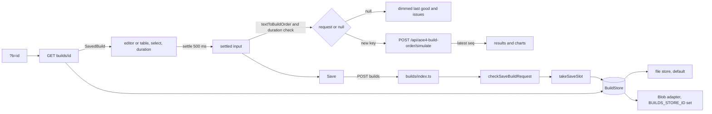

# M6: Technical design

## Summary

The AoE4 build-order page stops using a Run button. A debounced controller on the page posts to the
existing simulate route whenever the settled text and duration form a valid request that differs
from the request already shown or already in flight. It aborts superseded requests and drops late
responses. While the input is invalid or the request failed, the last good result stays on screen,
dimmed. At 1200 px and wider the editor and the results sit side by side. Below that the existing
tabs stay.

A new `builds` API saves a validated `{ buildOrder, durationSeconds }` record under a
content-addressed 11-character id and reads it back. It goes through a `BuildStore` interface.
`next dev`, Vitest and Playwright use a local file store by default. The `@vercel/blob` adapter is
used only when `BUILDS_STORE_ID` is set. Saves are rate-limited per client by a counter kept in the
same store.

`npm run smoke:preview -- <url>` checks one deployed preview end to end. It saves a build, reads it
back, opens the build in a browser and deletes it.

### Starting state (origin/main 9274372, before the first M6 ticket)

| area | exists today |
|------|--------------|
| simulate route | `pages/api/aoe4-build-order/simulate.ts`. It answers POST only, and other methods get 405 with `Allow: POST`. A 400 returns `SimulateError { error, issues, omittedIssues? }`. The catalog is cached in module scope. |
| API types | `lib/aoe4-build-order/api.ts` defines `SimulateRequest`, `SimulateResponse`, `SimulateError` and `MAX_REPORTED_ISSUES = 100`. |
| schema | `lib/aoe4-build-order/schema.ts` defines `SIM_INPUT_BOUNDS` (`textChars` 0..20000, `steps` 0..200, `durationSeconds` 60..3600), `outOfRange`, `checkBuildOrder`, `buildOrderSchema(catalog)`, `buildOrderShape` (catalog-free) and `BuildOrder`. `name` has no length cap. |
| text | `textToBuildOrder` (it checks the 20000-character cap first) and `formatBuildOrderText`. Only orders made of non-negative integers re-parse equal. |
| page | `pages/apps/aoe4-build-order.tsx`. Results come only from the Run button `run-simulation` (`onRun`). Check issues appear only after Run (`checked`). `results-stale` appears after an edit. Two effects scroll to Results or to the issues. A successful run selects the Results tab. |
| layout | `WorkbenchTabs` has the tabs `build` and `results`. Both panels stay mounted, and the inactive one is `hidden`. `.resultsSplit` is a 2fr/3fr grid at 1200 px or wider. The run bar is sticky and becomes static below 768 px. |
| storage | None. There is no `@vercel/blob` dependency, no `process.env` read other than `ACCEPTANCE_PORT`, no `scripts/` directory and no `overrides` in package.json. |
| infra | The private Blob store `aoe4-simulator-builds` is connected to Production and Preview (not Development) with the env prefix `BUILDS_`, so functions see `BUILDS_STORE_ID`. Vercel builds a preview per PR, and previews are behind deployment protection. The vercel CLI is not installed on the owner's machine. |
| tests | 15 acceptance specs click Run through `runSimulation(page)` or `runRejected(page)` in `acceptance/helpers.ts`, and three asserts check `results-stale`. The contract check `acceptance/aoe4-simulate-api-contract.spec.ts` validates the examples in `docs/api/openapi.json` (2.3.0). |

## Modules

| module (path) | owns | public functions or exports | used by |
|---------------|------|-----------------------------|---------|
| `lib/aoe4-build-order/saved-builds.ts` (new; pure TS with no Node-only, React or Next imports, safe in the browser) | the saved-record shape, the id, the key layout, the save checks | `SAVED_BUILD_VERSION`, `savedBuildSchema`, `SavedBuild`, `SaveBuildRequest`, `SaveBuildResponse`, `SAVED_BUILD_ID_PATTERN`, `isSavedBuildId`, `savedBuildId`, `savedBuildKey`, `storageEnv`, `SAVED_BUILD_MAX_BYTES`, `SAVED_NAME_MAX_CHARS`, `checkSaveBuildRequest`, `savedBuildPath` | builds routes, page, smoke script (types only) |
| `lib/aoe4-build-order/build-store.ts` (new) | the storage seam and the local stand-ins | `BuildStore`, `PutResult`, `CounterUpdate`, `createMemoryBuildStore`, `createFileBuildStore`, `BUILDS_LOCAL_DIR_DEFAULT`, `buildStoreFromEnv` | builds routes, unit tests |
| `lib/aoe4-build-order/blob-build-store.ts` (new; the only file that imports `@vercel/blob`) | the Blob adapter | `createBlobBuildStore(storeId: string)` | `buildStoreFromEnv` only |
| `lib/aoe4-build-order/save-rate-limit.ts` (new, pure apart from the store argument) | the fixed-window rule | `SAVE_RATE_LIMIT`, `takeSaveSlot`, `clientKey` | `builds/index.ts` |
| `pages/api/aoe4-build-order/builds/index.ts` (new) | `POST /api/aoe4-build-order/builds` | default handler, `config` | page, smoke script |
| `pages/api/aoe4-build-order/builds/[id].ts` (new) | `GET` and `DELETE /api/aoe4-build-order/builds/{id}` | default handler | page, smoke script |
| `lib/aoe4-build-order/api.ts` (edit) | the shapes the routes share | adds `BuildsError` and re-exports the saved-build types | routes, page |
| `components/apps/aoe4-build-order/use-auto-run.ts` (new) | the auto-run state machine | `useAutoRun`, `AUTO_RUN_DEBOUNCE_MS`, `AutoRunStatus` | page |
| `components/apps/aoe4-build-order/use-split-layout.ts` (new) | the split-layout media query | `WORKBENCH_SPLIT_QUERY`, `useSplitLayout()` | page |
| `components/apps/aoe4-build-order/save-build.tsx` (new) | the Save button and the link panel | `SaveBuild` | `BuildInput` |
| `components/apps/aoe4-build-order/saved-build-loader.ts` (new) | the `?b=` read | `loadSavedBuild(id, signal)`, `savedBuildOption(id, saved)` | page |
| `pages/apps/aoe4-build-order.tsx` (edit) | wiring | none | none |
| `components/apps/aoe4-build-order/build-input.tsx` (edit) | the run bar | Run is removed, the duration error and `SaveBuild` are added | page |
| `components/apps/aoe4-build-order/workbench-tabs.tsx` (edit) | tabs or split | adds a `split: boolean` prop | page |
| `components/apps/aoe4-build-order/results.tsx`, `issue-list.tsx` (edit) | dimmed last-good state, issues always shown | `stale` is replaced by `dimmed`, and the `rejected` prop is removed | page |
| `scripts/smoke-preview.mjs` (new) and the package.json script `smoke:preview` | the preview smoke | CLI | owner |
| `docs/api/openapi.json`, `docs/aoe4-build-order.md`, `ARCHITECTURE.md`, `.gitignore` (edit) | contract, behavior, layout and the local store dir | none | none |

## Contracts

### C1. Saved record and id (`saved-builds.ts`)

```ts
export const SAVED_BUILD_VERSION = 1;
export const savedBuildSchema = z.object({
  version: z.literal(1),
  buildOrder: buildOrderShape,             // catalog-free: a read must succeed after game data changes
  durationSeconds: z.number().int(),       // bounds are checked on save, not on read
});
export type SavedBuild = z.infer<typeof savedBuildSchema>;
export type SaveBuildRequest = Omit<SavedBuild, 'version'>;     // { buildOrder, durationSeconds }
export interface SaveBuildResponse { id: string; path: string }  // GET returns SavedBuild & { id }

export const SAVED_BUILD_ID_PATTERN = /^[A-Za-z0-9_-]{11}$/;
export function isSavedBuildId(value: unknown): value is string;
export function savedBuildId(record: SavedBuild): Promise<string>;
export function storageEnv(vercelEnv: string | undefined): string;  // 'production' | 'preview' | 'development'
export function savedBuildKey(env: string, id: string): string;     // `${env}/builds/${id}.json`
export function savedBuildPath(id: string): string;                 // `/apps/aoe4-build-order?b=${id}`
export const SAVED_BUILD_MAX_BYTES = 65_536;
export const SAVED_NAME_MAX_CHARS = 100;
export function checkSaveBuildRequest(body: unknown, catalog: BuildOrderCatalog):
  | { ok: true; record: SavedBuild; json: string }
  | { ok: false; status: 400; error: SimulateError }
  | { ok: false; status: 413; error: BuildsError };
```

- **Id.** `savedBuildId` takes `json = JSON.stringify(record)`, where `record` is the zod output, so
  keys follow schema order. It computes the SHA-256 with Web Crypto (`crypto.subtle`) and returns
  the first 11 characters of the unpadded base64url digest (66 bits). Equal records get equal ids,
  and a stored id never points at different content.
  - Samples: the first character is any of `A-Z a-z 0-9 - _`, and every id is exactly 11
    characters, e.g. `Zx3_k9-QaB0`.
  - `isSavedBuildId('Zx3_k9-QaB0')` is true. It is false for `'abc'` (10 or fewer characters), for
    12 characters, and for an id containing `.`, `/` or `=`.
- **Env.** `storageEnv` returns `'production'` or `'preview'` when `VERCEL_ENV` has that value, and
  `'development'` in every other case, including unset. Its set is exactly these three, the first
  segment of every key.
- **Keys.** Builds live at `<env>/builds/<id>.json` and rate counters at
  `<env>/rate-limit/<clientKey>.json`. Nothing else is written.

### C2. Storage seam (`build-store.ts`)

```ts
export type PutResult = 'created' | 'exists';
export interface CounterUpdate { windowStart: number; count: number }
export interface BuildStore {
  putBuild(id: string, json: string): Promise<PutResult>;   // never overwrites
  getBuild(id: string): Promise<unknown | null>;            // parsed JSON, or null when absent
  deleteBuild(id: string): Promise<void>;                   // absent is not an error
  bumpCounter(key: string, windowStart: number): Promise<CounterUpdate | 'contended'>;
}
export const BUILDS_LOCAL_DIR_DEFAULT = '.builds-local';
export function createMemoryBuildStore(env?: string): BuildStore;
export function createFileBuildStore(dir: string, env: string): BuildStore;
export function buildStoreFromEnv(env?: NodeJS.ProcessEnv): Promise<BuildStore>;
```

- **`bumpCounter` result.** If the stored counter's `windowStart` equals the argument, it returns
  `{windowStart, count: stored + 1}`. Otherwise it stores and returns `{windowStart, count: 1}`.
  The update is atomic per key or reports `'contended'`.
- **`buildStoreFromEnv` selection:**
  1. If `BUILDS_STORE_ID` is non-empty, it uses `createBlobBuildStore(BUILDS_STORE_ID)` through a
     dynamic `import()`, so `@vercel/blob` never loads locally or in the client bundle.
  2. Otherwise it uses `createFileBuildStore(BUILDS_LOCAL_DIR ?? BUILDS_LOCAL_DIR_DEFAULT,
     storageEnv(VERCEL_ENV))`.
  3. The result is memoized per module instance.
- **File store.** It writes to `<dir>/<key>`. It is file-based because `next dev` can compile the
  two builds routes as separate module instances, so in-memory state would not be shared.
  `.builds-local/` is added to `.gitignore`. Playwright sets `BUILDS_LOCAL_DIR` to a directory
  inside `test-results/` so runs do not leak into the developer's store.
- **Blob adapter** (`createBlobBuildStore`):

  | method | Blob calls | result |
  |--------|------------|--------|
  | every call | passes `storeId`. Credentials come from the function's OIDC token; no token is read or logged. | |
  | `putBuild` | `put(key, json, {access:'private', addRandomSuffix:false, allowOverwrite:false, contentType:'application/json'})` | `'created'` on success. If `put` throws, it calls `head(key)`: when the blob is there it returns `'exists'`, otherwise it rethrows. This does not depend on the SDK's error class for an existing blob, which could not be verified offline. |
  | `getBuild` | `get(key, {access:'private'})` | null when not found, otherwise JSON-parses the stream. |
  | `bumpCounter` | `get(key, {useCache:false})`, then `put` with `ifMatch: etag`, or `allowOverwrite:false` when the counter is absent | Retries up to 3 times on `BlobPreconditionFailedError` or a create conflict, then returns `'contended'`. |
- **Dependencies.** `@vercel/blob` is pinned to `^2.8.2`. Add `"overrides": { "zod": "^4.6.6" }` so
  `@vercel/oidc`'s nested zod resolves to the patched line. Do not run `npm audit fix --force`.

### C3. `POST /api/aoe4-build-order/builds`

- **Request.** `SaveBuildRequest`, a JSON object `{ buildOrder: BuildOrder, durationSeconds: integer }`.
  Both fields are required. `config = { api: { bodyParser: { sizeLimit: '128kb' } } }`.
- **Responses** (the first matching row wins):

  | status | body | produced by |
  |--------|------|-------------|
  | 405 + `Allow: POST` | `BuildsError { error }` | any method but POST, e.g. GET |
  | 413 (plain text from Next) | none | a raw body over 128 kb, which never reaches the handler |
  | 400 | `SimulateError` | a body that is not an object (e.g. `[]`), giving one `syntax` issue |
  | 400 | `SimulateError` | `checkBuildOrder` issues, e.g. unit id `knigt` (`unknown-id`) |
  | 400 | `SimulateError` | a missing or invalid `durationSeconds`, e.g. `59` or `61.5`, giving `out-of-range` with `step` unset |
  | 400 | `SimulateError` | a `name` longer than `SAVED_NAME_MAX_CHARS`, e.g. 101 characters, giving `out-of-range` |
  | 413 | `BuildsError` | `JSON.stringify(record)` longer than `SAVED_BUILD_MAX_BYTES` UTF-8 bytes |
  | 400 | `SimulateError` | the order does not survive a paste round trip. `textToBuildOrder(formatBuildOrderText(order))` failing returns its issues (e.g. formatted text over 20000 characters). A converted `start` or `steps` that differs gives one `invalid` issue, e.g. a fractional `walkSeconds: 2.5`. |
  | 429 + `Retry-After: <s>` | `BuildsError` | the client's 31st save in one window, or `'contended'` (then `Retry-After: 1`) |
  | 201 | `SaveBuildResponse` | `putBuild` returned `'created'` |
  | 200 | `SaveBuildResponse` | `putBuild` returned `'exists'`, a repeat of an earlier save |
  | 503 | `BuildsError` | the store threw during the rate check or the put |

- **Shapes.** `BuildsError` is `{ error: string }`. Every 400 uses the existing `SimulateError`
  shape and `MAX_REPORTED_ISSUES` cap, so the page's `IssueList` renders it unchanged.
  `SaveBuildResponse.path` is `savedBuildPath(id)`, a path rather than an absolute URL, so a proxy
  cannot spoof the origin. The client prefixes `window.location.origin`.

### C4. `GET` and `DELETE /api/aoe4-build-order/builds/{id}`

| method | status | body | produced by |
|--------|--------|------|-------------|
| GET | 200 | `SavedBuild & { id }`, with `Cache-Control: public, max-age=31536000, immutable` | the build is stored and passes `savedBuildSchema` |
| GET | 404 | `BuildsError` | `!isSavedBuildId(id)` (e.g. `abc`), or the build is absent |
| GET | 500 | `BuildsError` | the stored JSON fails `savedBuildSchema`. This cannot happen with C1 writes; it is a guard. |
| GET, DELETE | 503 | `BuildsError` | the store threw |
| DELETE | 204 | none | `storageEnv(VERCEL_ENV) !== 'production'` and the id is valid. An absent build also gives 204. |
| DELETE | 404 | `BuildsError` | non-production with an invalid id |
| any other, or DELETE in production | 405 + `Allow: GET` in production, `Allow: GET, DELETE` elsewhere | `BuildsError` | e.g. PUT, or DELETE on the production deployment |

- GET checks only the catalog-free shape. A build saved before a game-data change still loads. The
  page then shows the issues for any id that no longer exists (see the `?b=` rules).

### C5. Rate limit (`save-rate-limit.ts`)

```ts
export const SAVE_RATE_LIMIT = Object.freeze({ maxSaves: 30, windowSeconds: 3600 });
export function clientKey(req: { headers: IncomingHttpHeaders; socket: { remoteAddress?: string } }): Promise<string>;
export function takeSaveSlot(store: BuildStore, key: string, nowMs: number):
  Promise<{ ok: true } | { ok: false; retryAfterSeconds: number }>;
```

- **Client key.** It is the first comma-separated entry of `x-forwarded-for`, trimmed, else
  `socket.remoteAddress`, else `'unknown'`. It is SHA-256 hashed and truncated to 16 base64url
  characters, so no raw IP is stored. On Vercel, `x-forwarded-for` is set by the edge and is not
  client-controlled.
- **Window.** `windowStart = floor(nowMs / 3_600_000) * 3_600_000`. Saves 1 through 30 in a window
  are allowed, and save 31 is refused. On a refusal, `retryAfterSeconds = max(1,
  ceil((windowStart + 3_600_000 - nowMs) / 1000))`, which runs from 3600 at the start of a window
  down to 1 at its end. `'contended'` returns `{ ok: false, retryAfterSeconds: 1 }`.
- **Why this works on serverless.** Function instances share no memory, and any one can be cold, so
  an in-process counter would reset and split across instances. The counter lives in the store
  every instance already reaches. Compare-and-swap through the Blob `ifMatch` etag keeps
  concurrent increments from being lost. No other service, such as KV or Redis, is added. One key
  per client is overwritten in place, so counters do not pile up per window.

### C6. Page contracts

```ts
export const AUTO_RUN_DEBOUNCE_MS = 500;
export type AutoRunStatus = 'loading' | 'running' | 'current' | 'updating' | 'invalid' | 'rejected' | 'failed';
export function useAutoRun(args: {
  request: SimulateRequest | null;   // null when the settled input is invalid
  hold: boolean;                     // true while a ?b= load is in flight
}): { status: AutoRunStatus; result: SimulateResponse | null; resultRequestKey: string | null;
      serverIssues: BuildOrderIssue[]; omittedIssues: number; errorMessage: string | null;
      flush(): void; retry(): void };
export const WORKBENCH_SPLIT_QUERY = '(min-width: 1200px)';
```

- **`postSimulation`.** It gains an `AbortSignal` parameter.
- **Request key.** `JSON.stringify(request)`.
- **`AutoRunStatus` values:**

  | value | meaning |
  |-------|---------|
  | `loading` | a `?b=` load is in flight |
  | `running` | in flight, with no result yet |
  | `current` | the shown result equals the settled request |
  | `updating` | in flight, with an older result shown |
  | `invalid` | the settled input is invalid |
  | `rejected` | the server answered 400 for the settled request |
  | `failed` | network error or another non-2xx |

- **Settled input.** The text and duration as of the last debounce fire or flush. Issues, the
  request and the Save state all derive from the settled input, never from each keystroke.
- **Client duration check.** `duration` is valid when it is a non-empty string, `Number(duration)`
  is an integer, and `outOfRange(n, 'durationSeconds')` is undefined. Otherwise the error is shown
  under the input (`duration-error`), and the input gets `aria-invalid="true"` and
  `aria-describedby`.
- **Test ids.**
  - Kept: `run-bar`, `build-order-select`, `duration-seconds`, `editor-view-*`, `workbench-tabs`,
    `tab-*`, `panel-*`, `build-order-issues*`, `simulation-error`, and the chart ids.
  - Removed: `run-simulation` and `results-stale`.
  - Added:

    | id | element |
    |----|---------|
    | `auto-run-status` | `role="status"` with `data-status=<AutoRunStatus>` |
    | `results-last-good` | the results wrapper that is dimmed |
    | `duration-error` | the duration error under the input |
    | `simulation-retry` | the retry button |
    | `save-build` | the Save button |
    | `saved-build-link` | the read-only link input |
    | `copy-saved-link` | the Copy button |
    | `save-build-error` | the save error |
    | `saved-build-error` | the `?b=` load error |

## Behavior rules

### Auto-run (`useAutoRun` plus page)

| operation | case | rule |
|-----------|------|------|
| edit | any typing in text, a step-table edit, or a duration keystroke | Restart a 500 ms trailing timer. Nothing else changes, and issues keep showing the previous settled input. |
| edit | build select changed, or Enter in the duration input (form submit) | Settle now: cancel the timer and fire. Enter never submits a page navigation. |
| fire | ordering | Steps 1 to 5 apply in order, and the first match wins. |
| fire | 1. settled input invalid (conversion has issues, or the duration is invalid) | Abort the in-flight request and clear `inflightKey`. Status is `invalid`, issues show, and no POST is sent. |
| fire | 2. key equals `inflightKey` | No-op, so the in-flight request continues. |
| fire | 3. key equals `resultRequestKey` (e.g. an edit then an undo inside 500 ms, or a comment-only edit) | Abort any in-flight request and send no POST. Status is `current`. |
| fire | 4. key equals `rejectedKey` (the last 400) | No POST, because the server is deterministic. Status stays `rejected` with the same server issues. |
| fire | 5. otherwise | Abort the in-flight request, increase `seq`, set `inflightKey = key`, and POST with a new AbortController. Status is `running` (no result yet) or `updating`. |
| response | its `seq` is not the latest | Drop it, changing no state. An AbortError is dropped silently and never shown. |
| response | 200, latest | Set `result`, `resultRequestKey = key` and `run = {text, durationSeconds, name}` from that request's settled input. Clear `inflightKey`, `rejectedKey`, the server issues and the error. Status is `current`. |
| response | 400, latest | Store the server issues and `rejectedKey = key`, and clear `inflightKey`. Status is `rejected`. The result is kept, not removed (this replaces today's rule that a 400 removes earlier charts). |
| response | network error or non-2xx other than 400, latest | `errorMessage` uses today's `errorMessages` wording, without "Run". Clear `inflightKey` so a retry or a different edit resends. Status is `failed`. |
| retry | `simulation-retry` clicked (rendered only when status is `failed`) | Fire step 5 for the current settled key. |
| first load | no `b` query once `router.isReady` | Settle at once and fire with the default build. There is no 500 ms wait. |
| first load | `b` present | `hold` is true and status is `loading`. Nothing fires until the `?b=` rules below finish. |
| unmount | any | Abort the in-flight request and clear the timer. |
| no target | settled input is invalid and no result was ever shown | Status is `invalid`. The results panel shows only `auto-run-status`; no chart is rendered. |

### What each status shows

| status | `results-last-good` | `auto-run-status` | issues and errors |
|--------|---------------------|-------------------|-------------------|
| `running`, `loading` | not rendered | visible, says it is computing or loading | none |
| `current` | full opacity | rendered and empty (stays in the DOM for screen readers) | none |
| `updating` | full opacity, not dimmed | visible, says it is updating | none |
| `invalid` | dimmed: computed `opacity` ≤ 0.5, `aria-describedby` pointing to the status | visible, says the charts show the last valid build | `IssueList` beside the editor, with the summary always shown (the `rejected`/`checked` gating is removed) |
| `rejected` | dimmed | as for `invalid` | `IssueList` with the server issues and `omittedIssues` |
| `failed` | dimmed when a result exists | visible | `simulation-error` with the message and `simulation-retry` |

| element | case | rule |
|---------|------|------|
| scroll | any status change | The page never scrolls by itself. Both scroll effects (`resultsShownCount`, `rejection`) are removed. |
| tabs (narrow) | a result arrives | The selected tab does not change. The initial tab is `build`. `tab-results` is enabled once a result or status exists, as today. Exception: a successful `?b=` load selects `results`. |
| pin | any | It acts on `run`, the result on screen, and works while dimmed. `alreadyPinned` is unchanged. |
| table view | conversion fails | `viewDisabled` as today. |
| timeline | any | `timelineRows` uses `run.text` (the shown result's text), not the editor text. |

### Layout

| case | rule |
|------|------|
| `useSplitLayout()` true (viewport ≥ 1200 px) | `WorkbenchTabs` with `split` renders no tablist. Both panels are visible, build on the left and results on the right, in two columns. Neither panel has `hidden`, and `panel-build` and `panel-results` keep their ids and lose `role="tabpanel"`. The results column scrolls with the page. The run bar stays sticky over both columns. |
| split, results internals | `.resultsSplit` (timeline beside the charts) moves from 1200 px to 1800 px, so the charts in a half-width column are not squeezed. Below 1800 px the timeline stacks above the charts. |
| below 1200 px | Tabs as today. At 390 px wide nothing scrolls horizontally (`document.documentElement.scrollWidth <= 390`). |
| server render and first paint | `useSplitLayout` returns false until mounted (static page), then reads `matchMedia(WORKBENCH_SPLIT_QUERY)` and subscribes to `change`. |
| resize across 1200 px | It switches live. The selected tab is kept for when the layout goes back to tabs. Focus is not moved. |
| keyboard, split | Tab order: run bar (select, duration, view toggle, Save, link, Copy), then the editor and issues, then results. Arrow, Home and End tab handling applies only when tabs are rendered. |

### Save and link (`SaveBuild`)

| case | rule |
|------|------|
| enabled | Only when status is `current`. It is disabled (the `disabled` attribute plus a visible style) when the status is `running`, `updating`, `invalid`, `rejected`, `failed` or `loading`, or while a save is in flight. |
| click | POST `{ buildOrder: {...settledOrder, name: pinName(builds, settledText, selected)}, durationSeconds }` to C3. |
| 200 or 201 | Show `saved-build-link`, a read-only input whose value is `window.location.origin + path`, and `copy-saved-link`. Focus moves to the link input with its text selected. Then `router.replace({ query: { b: id } }, undefined, { shallow: true })`. |
| repeat save, same settled input | Same id, the link is unchanged, and it still counts toward the rate limit. |
| Copy | `navigator.clipboard.writeText(link)`, and the button says it was copied. If the clipboard is refused, select the input text and show a hint to copy it by hand. |
| 429 | `save-build-error` says to try again in `Retry-After` seconds, rounded up to minutes when 60 or more. The button stays enabled. |
| 400, 413, 503, network | `save-build-error` with one message, and for a 400 the first issue. The link panel is hidden. |
| the settled key changes after a save | The link panel and `save-build-error` are hidden. The URL's `b` is removed by a shallow `router.replace` (see OD-5). |
| keyboard | Enter or Space on Save saves. Escape inside the link panel hides it and returns focus to Save. |

### `?b=<id>` load

| case | rule |
|------|------|
| ordering | After `router.isReady` (read inside `useEffect`; `query` is `{}` during prerender): read `b`, which may be the first value of an array. The select, editor, step table, duration and Save are disabled with `aria-busy` while the load runs, so no edit can race the load. |
| `b` absent or empty | The normal first load. |
| `b` fails `isSavedBuildId` | No fetch. `saved-build-error` says the saved build was not found. The default build loads and runs. |
| GET 200 | Insert `savedBuildOption(id, saved) = { name: `${saved.buildOrder.name} (${id})`, text: formatBuildOrderText(saved.buildOrder) }` at the front of `builds` and select it. Set `duration` to `String(saved.durationSeconds)`. Settle and fire at once. Below 1200 px, select the Results tab. |
| GET 200 but the text no longer converts (game data changed) | The text loads as saved, issues show, status is `invalid`, and there is no run. |
| GET 404 | `saved-build-error` says the saved build was not found. The default build loads and runs. `b` stays in the URL until the first edit. |
| GET other status or network error | `saved-build-error` says it could not be loaded. Same fallback as a 404. |
| `b` changes on the same page (back or forward after a save's replace) | No reload. Only the initial `b` is read. |
| repeat open of the same link | Same option name and content. GET is cacheable as immutable. |

### Smoke (`npm run smoke:preview -- <url>`)

| step | rule |
|------|------|
| auth | Read `VERCEL_AUTOMATION_BYPASS_SECRET` from the environment. When it is set, send `x-vercel-protection-bypass: <secret>` on every request (fetch and browser `extraHTTPHeaders`). Never print it. When it is unset, try anyway and, if the first response is 401 or 403, exit 2 with "set VERCEL_AUTOMATION_BYPASS_SECRET". |
| 1 save | POST a fixed build: the first entry of the page's shipped builds, read from the same data the page uses, with `durationSeconds` 1200. 201 or 200 with a valid id passes. |
| 2 read back | GET it. Its `buildOrder` and `durationSeconds` must deep-equal what was sent. |
| 3 open | Playwright Chromium opens `<url>/apps/aoe4-build-order?b=<id>`. The select must show the `(<id>)` option, `auto-run-status` must reach `current`, and `chart-units-produced` must be visible, all within 30 s. |
| 4 delete | DELETE gives 204, then GET gives 404. |
| ordering, failure | Steps run in order and stop at the first failure. Delete still runs in a `finally` once step 1 returned an id. Each step prints one `PASS` or `FAIL` line, and the exit code is 0 only when all pass. |
| repeat | Running it again saves the same id (200), since the content is the same, and deletes it again. It costs one rate-limit slot per run. |
| production URL | The script is for previews. Against production, DELETE gets 405, step 4 prints `FAIL production deployment: delete is disabled`, and the exit code is 1. The saved build stays, since a saved id is meant to be immutable. |

## Data flow



## Extension points

| future direction | seam that keeps it additive |
|------------------|-----------------------------|
| keep comments or the raw text in saved builds | `SAVED_BUILD_VERSION`. A v2 record adds `text?`, `savedBuildSchema` becomes a union on `version`, and v1 ids stay valid because the id hashes the record that was stored. |
| expiry or a listing of saved builds | Keys are `<env>/builds/<id>.json`. A new `BuildStore` method can be added beside the others, and routes take the store from `buildStoreFromEnv`. |
| another storage backend (KV, a database) | Implement `BuildStore` and add a branch to `buildStoreFromEnv`. |
| per-user limits or an edge rate rule | `takeSaveSlot` is called at a single point in the POST handler. A Vercel WAF rule can be added in front without code. |
| other games (CONTEXT out of scope) | `saved-builds.ts` is AoE4-specific by path. A second app adds its own module and route next to it, reusing `BuildStore` with a different key segment. |
| sim inputs beyond duration | `SaveBuildRequest` mirrors `SimulateRequest.inputs`. Adding `inputs?` is a v2 record field, with the same version seam. |

## Owner decisions

Decided by the owner on 2026-11-05: (a) for every decision below. The rules above already follow
those answers. The unchosen options are kept for the record.

- **OD-1. What a saved build stores.**
  - **(a) The parsed order only, so `#` comments and blank lines are lost and the text reopens in
    canonical format.**
  - (b) The raw text as well, which roughly doubles the size, lets the id change on comment edits,
    and needs a round-trip rule for the text.
  - Changes: C1, and the `?b=` 200 row.
- **OD-2. A DELETE route** (needed by the smoke step 4).
  - **(a) Enabled on preview and development only, 405 in production. Previews are already behind
    deployment protection.**
  - (b) No DELETE. The smoke leaves one test build per run in the preview store.
  - (c) DELETE everywhere, behind a secret header.
  - Changes: C4 and smoke step 4.
- **OD-3. How the smoke reaches a protected preview.**
  - **(a) The owner enables "Protection Bypass for Automation" in the Vercel project, which creates
    `VERCEL_AUTOMATION_BYPASS_SECRET`, and exports it in the shell before running. Nothing is
    stored in the repo.**
  - (b) Install the vercel CLI and drive the requests through `vercel curl` (no browser step
    possible, so step 3 would be HTML-only).
  - (c) Turn preview protection off.
- **OD-4. Rate-limit numbers and mechanism.**
  - **(a) A Blob counter (C5) with 30 saves per client per hour. It costs 2 extra Blob operations
    per save.**
  - (b) A Vercel WAF rate-limit rule only, configured in the dashboard, with no code, but untested
    locally and plan-dependent.
  - (c) Both.
  - Changes: C5.
- **OD-5. `b` in the URL after an edit.**
  - **(a) Removed by a shallow replace on the first settled change, so the address bar never
    claims a link for content it no longer shows. A save puts it back.**
  - (b) Kept until the next save.
  - Changes: the Save row "the settled key changes after a save" and the `?b=` 404 row.
- **OD-6. The narrow-screen tab after load.**
  - **(a) Build stays selected, and only a `?b=` load selects Results.**
  - (b) Results is selected on the first result of every page load.
  - Changes: the "tabs (narrow)" row.

## Left to tickets

- The dimming style, as long as computed `opacity` ≤ 0.5. Status and error wording. Column
  proportions in split mode. The Copy confirmation timing.
- The internals of the file store (sync or async fs, directory creation) and of the debounce timer
  (a `setTimeout` ref or a small hook).
- Whether `checkSaveBuildRequest` runs `checkBuildOrder` and the duration check in one pass or two,
  as long as the issue order is order issues first, then duration, then name.
- **Unit test layout:**
  - Vitest tables for `isSavedBuildId`, `storageEnv`, `savedBuildKey`, `savedBuildId` stability
    (the same record gives the same id, and a changed field gives a different id), and every
    `checkSaveBuildRequest` row of C3.
  - `takeSaveSlot` at the 30/31 boundary and for the first and last `Retry-After` of a window.
  - The memory and file stores under one shared `BuildStore` behavior table.
  - The route handlers called with mocked `req` and `res` against `createMemoryBuildStore`.
  - The `useAutoRun` rules with fake timers and a stubbed fetch: each row of the auto-run table,
    including a late response being dropped.
- **Acceptance (M6.9):**
  - Replace `runSimulation` and `runRejected` in `acceptance/helpers.ts` with `waitForRun(page)`,
    which waits for the simulate POST and for `auto-run-status` `current`, and
    `expectNoRun(page)`, which waits past `AUTO_RUN_DEBOUNCE_MS` and asserts no POST.
  - Rewrite the 15 specs onto these helpers. Replace the three `results-stale` asserts with dimmed
    and status asserts.
  - New specs: re-run on edit (one POST per settled edit, an undo sends none, an invalid edit dims
    the charts), the split layout at 1280 and 390, and save then open `?b=` in a new page.
  - Add the C3 and C4 paths and examples to the OpenAPI contract check, and bump `info.version` to
    2.4.0.
- The order in which the delivery tickets land, as long as the API and store (M6.4 and M6.6) land
  before Save and `?b=` (M6.5), and the smoke (M6.7) after both.
