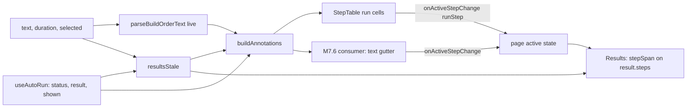

# M7: Technical design

## Summary

One pure module, `step-annotations.ts`, turns the shown result plus the live build into one annotation per
live step. The annotation holds the kind colour from the live step, and the run timing from the shown run's
step that the live step aligns to. Steps align by their canonical text (`formatBuildStep`), first by a common
prefix and then by a common suffix. A live step with no aligned run step gets a kind and no times, so a time
never sits on a step that did not produce it. The step table draws the annotations in a new first cell per
row, and hovering or focusing a row shades that run step on the charts through page-level active-step state.
`resultsStale` dims the charts and the annotations together. The step timeline and its column are deleted,
and the charts take the full Results width. M7.6 adds one more consumer of the same model: the Text tab gutter. M7.8 is separate: it drops the auto-house gate in `simulate.ts` and removes two warning codes. Two layout rules (Build panel scroll, results wrapper) ride with the UI tickets.

### Starting state (origin/main 85979c5, before the first M7 ticket)

| area | exists today |
|------|--------------|
| timeline model | `components/apps/aoe4-build-order/step-timeline-rows.ts` exports `STEP_KINDS`, `StepKind`, `LONG_WAIT_SECONDS = 60`, `formatStepTime`, `formatWaitBreakdown`, `stepKind(step, landmarks)`, `TimelineRow` (with `label`, `reaction`), `StepSpan`, `stepSpan(row: TimelineRow, end)`, and `timelineRows(steps, text, landmarks)`, which re-parses the shown text. Tests are in `step-timeline-rows.test.ts`. `line-chart.tsx` imports `StepSpan` from it. |
| timeline UI | `step-timeline.tsx` (`StepTimeline`) renders `step-timeline-legend`, `step-timeline-scroll` and the `step-timeline` table. Each `step-timeline-row` carries `data-step`, `data-kind`, `data-status`, `data-flagged`, `data-long-wait`, `data-reaction` and `data-active`, and uses `tabIndex=0`, pointer enter/leave and focus/blur. The kind classes (`badge`, `legendRow`, `timeCell`, `kindBorder`, `kindAgeUp` ... `kindOther`) live in `results.module.css`. |
| Results | `results.tsx` takes `result, pinned, text, landmarks, dimmed, infoExpanded, onInfoToggle`. It owns `active: { result, step }` state, builds `rows` with `timelineRows`, and puts the timeline in `.timelineColumn` and the charts in `.chartsColumn` inside `.resultsSplit`. In `workbench.module.css`, the `@media (min-width: 1800px)` grid is 2fr/3fr, and the timeline column is sticky. |
| dimming | The page passes `dimmed={status === 'invalid' \|\| status === 'rejected' \|\| status === 'failed'}` to `Results`, which adds `.dimmed` (opacity 0.5) to `results-last-good`. During the debounce window and while `updating`, nothing dims. |
| step table | `step-table.tsx` (`StepTable`) renders `parseBuildOrderText(text)` for the live text. Each `step-row` `<tr>` has `data-step` = live step index and three cells: trigger, action plus fields, and move/delete buttons. `StartRow` has two cells (the second has `colSpan={2}`). Under 768 px, every `td` in `.table` is `display: block` (a card). Its props are `order, catalog, onChange, openRows, onOpenRowsChange, disabled`. |
| text editor | `build-text-editor.tsx` has an `ol` gutter (`build-order-gutter`, one `build-order-line-number` `li` per line with `data-line` and `data-error`) beside a `wrap="off"` textarea. Both use the same font and `line-height: 1.5`, so the rows align. |
| auto-run | `auto-run.ts` exports `AutoRunStatus`, `LiveInput {text, duration, selected}`, `ShownInput {text, durationSeconds, selected}`, `sameInput` and `createAutoRunController`. `AutoRunState.shown` is the input of the shown `result`. Within the 500 ms debounce, `status` stays `current` while the live text differs from `shown.text`. |
| line mapping | `parseBuildOrderText(text)` returns `lines.steps[i]`, the 1-based line of `order.steps[i]`, both on success and in `partial` on a syntax failure. `checkBuildOrder` keeps the step count and order, so `result.steps[i].step === i` matches the shown text's parsed step `i`. |
| editor view | `EditorView = 'text' \| 'table'`, default `'text'`. 15 acceptance specs type into `build-order-text` on the default view. |
| house gate | `lib/aoe4-build-order/simulate.ts`: `lastHouseStep`, `houseGateOpen` (~665; closed until the order's last `build house` step has started), `startAutoHouses` (returns early while closed), `accrueHeld` (~955), `houseWarnings` (~962). `model.ts` `SimWarning` has `auto-houses-never-start` and `auto-houses-held`; `depletion.ts` orders them; `docs/api/openapi.json` and `docs/aoe4-build-order.md` (Houses and supply, Severity, the `warnings` field) describe them. `data/aoe4-build-order/README.md` (~115) says the knight-longbow build carries `auto-houses-held`. |
| split-layout overflow | `workbench.module.css` `.workbenchSplit > :first-child { overflow-x: auto }` (~42) makes the whole Build panel scroll sideways when the step table is wider than its column. |
| results wrapper | `results.tsx` wraps the charts in `data-testid="results-split"` (`.resultsSplit`); `results-last-good` sets `aria-describedby="auto-run-status"` whenever `dimmed`. |
| specs on the timeline | `aoe4-build-order-step-band`, `-timeline-compare`, `-knight-longbow-page`, `-m3-flow`, `aoe4-narrow-layout` (`step-timeline-scroll` and the stacked-timeline test) and `aoe4-results-split` (sticky timeline column). |

## Modules

| module (path) | owns | public functions or exports | used by |
|---------------|------|-----------------------------|---------|
| `components/apps/aoe4-build-order/step-annotations.ts` (new, replaces `step-timeline-rows.ts`) | Step kind, run-timing text, the alignment from live steps to run steps, the per-step annotation model, chart span | `STEP_KINDS`, `StepKind`, `LONG_WAIT_SECONDS`, `formatStepTime`, `formatWaitBreakdown`, `finishedText`, `stepKind`, `StepSpan`, `stepSpan`, `StepRun`, `StepAnnotation`, `BuildAnnotations`, `AnnotationInput`, `alignSteps`, `buildAnnotations` | page, `step-annotation.tsx`, `step-table.tsx`, `results.tsx`, `line-chart.tsx`, M7.6 consumer |
| `components/apps/aoe4-build-order/auto-run.ts` (edit) | Whether the shown result still describes the live input | `resultsStale` (new) | page |
| `components/apps/aoe4-build-order/step-annotation.tsx` (new) | Shared rendering of one annotation: kind classes, badge, legend, run cell | `KIND_CLASS`, `StepKindBadge`, `StepKindLegend`, `StepRunCell` | `step-table.tsx`, M7.6 consumer |
| `components/apps/aoe4-build-order/step-annotation.module.css` (new) | Kind colours, badge, legend row, run cell, dimmed and warning look of an annotation (moved out of `results.module.css`) | CSS classes | `step-annotation.tsx`, M7.6 consumer |
| `components/apps/aoe4-build-order/step-table.tsx` (edit) | Run cell per row, row hover and focus | `StepTable` (new optional props) | page |
| `components/apps/aoe4-build-order/results.tsx` (edit) | Charts at full width, shading from `activeStep` | `Results` (props change) | page |
| `lib/aoe4-build-order/simulate.ts` (edit) | Auto-house planning without a gate (M7.8) | none new; `houseGateOpen`, `lastHouseStep`, `accrueHeld`, `houseWarnings` and the held fields are deleted | `simulate` |
| `pages/apps/aoe4-build-order.tsx` (edit) | `stale`, `annotations` and `active` state, and wiring | none | |
| `components/apps/aoe4-build-order/step-timeline.tsx` | deleted in M7.5 | | |

## Contracts

```ts
// step-annotations.ts (moved from step-timeline-rows.ts unchanged: STEP_KINDS, StepKind, LONG_WAIT_SECONDS,
// formatStepTime, formatWaitBreakdown, stepKind)
export interface StepSpan { from: number; to: number }
export function stepSpan(timing: StepTiming, end: number): StepSpan | null   // was (row: TimelineRow, end)
export function finishedText(run: StepRun): string        // 'ongoing' for in-progress, else formatStepTime(completedAt)

export interface StepRun {                                // run timing of one aligned run step
    runStep: number                                       // index into result.steps (= StepTiming.step)
    status: StepTiming['status']
    startedAt: number | null
    completedAt: number | null
    waitSeconds: number
    waitBreakdown: { reason: 'resources' | 'villagers' | 'population' | 'prerequisite'; seconds: number }[]
    waitingOn: StepWait | null
    blockedBy: string                                     // same text rule as today's TimelineRow.blockedBy
    longWait: boolean                                     // waitSeconds >= LONG_WAIT_SECONDS
    flagged: boolean                                      // status 'waiting' or 'not-reached'
}
export interface StepAnnotation { kind: StepKind; run: StepRun | null }
export interface BuildAnnotations {
    stale: boolean
    steps: StepAnnotation[]                               // index = live step index; length = liveSteps.length
}
export interface AnnotationInput {
    result: SimulateResponse | null
    shown: ShownInput | null
    live: LiveInput
    liveSteps: readonly BuildStep[]                       // parsed.order.steps, or parsed.partial.order.steps
    landmarks: readonly string[]
    stale: boolean
}
export function alignSteps(shownSteps: readonly BuildStep[], liveSteps: readonly BuildStep[]): (number | null)[]
export function buildAnnotations(input: AnnotationInput): BuildAnnotations | null

// auto-run.ts
export function resultsStale(state: Pick<AutoRunState, 'status' | 'result' | 'shown'>, live: LiveInput): boolean

// step-annotation.tsx
export const KIND_CLASS: Record<StepKind, string>
export function StepKindBadge(props: { kind: StepKind }): JSX.Element | null      // null for 'other'
export function StepKindLegend(): JSX.Element                                      // testid step-kind-legend
export function StepRunCell(props: { annotation: StepAnnotation; stale: boolean }): JSX.Element  // a <td>

// step-table.tsx: new optional props on StepTableProps
annotations?: BuildAnnotations | null                     // default null: no run cell, no legend
activeStep?: number | null                                // a runStep
onActiveStepChange?: (runStep: number | null) => void

// results.tsx: ResultsProps drops `text` and `landmarks`, adds
activeStep: number | null                                 // a runStep of `result`
```

Removed contracts (M7.8): `SimWarning` variants `auto-houses-never-start` and `auto-houses-held` (`model.ts`), their ordering branch in `depletion.ts`, their OpenAPI warning schemas, and their mentions in the OpenAPI `warnings` description. `houseGateOpen`, `lastHouseStep`, `accrueHeld`, `houseWarnings` and the engine fields `heldAt` and `heldSeconds` go with them. No warning code is added. `SimWarning` keeps `node-depleted`, `idle-arrival`, `farm-idle`, `step-stuck`.

Changed contract (DQ7): `results-last-good` sets `aria-describedby="auto-run-status"` only while it is dimmed and the `auto-run-status` text is non-empty. Removed (DQ6): the `results-split` test id and its wrapper `div`.

DOM contract (Playwright uses these names; `step-timeline*` test ids disappear):

| element | test id / attribute | values |
|---------|---------------------|--------|
| legend above the step table and above the Text editor | `step-kind-legend`, items `[data-kind]` (one legend renders at a time: only the active editor view shows it) | the six kinds whose `STEP_KINDS` label is not null, in `STEP_KINDS` order |
| step row `<tr>` | `step-row`, `data-step` (live index, unchanged) | plus, when annotations exist: `data-kind`; when the row has a `run`: `data-run-step`, `data-status`, `data-flagged="true"`, `data-long-wait="true"`; `data-active="true"` while its `runStep` is the active step |
| first cell of a step row | `step-run` (`<td>`), `data-stale="true"` while stale | holds `step-kind-badge` (`data-kind`; absent for `other`), and when `run` is set: `step-started`, `step-finished`, `step-waited`, `step-blocked-by` |
| gutter `li` of a step line | `build-order-line-annotation` | holds `step-started` and `step-finished` (same ids as the run cell, read scoped inside the `li`) |
| first cell of the start row | plain empty `<td>` while annotations exist | |

## Criteria map

| criterion | lands in (files) | owning module | contracts it defines | how it is tested (level, harness, fixture) |
|-----------|------------------|---------------|----------------------|--------------------------------------------|
| M7.1 kind colour and started/finished per row; not-reached and waiting marked | `step-annotations.ts`, `step-annotation.tsx`, `step-annotation.module.css`, `step-table.tsx`, page | `step-annotations.ts` (model), `step-annotation.tsx` (render) | `StepRun`, `StepAnnotation`, `BuildAnnotations`, `AnnotationInput`, `buildAnnotations`, `finishedText`, `KIND_CLASS`, `StepKindBadge`, `StepKindLegend`, `StepRunCell`, `StepTable.annotations`, DOM contract | Unit `step-annotations.test.ts`: one table over a hand-built `StepTiming[]` with every status, plus `stepKind` rows. Unit `step-table` render with `renderToStaticMarkup` and a fixed `BuildAnnotations`. Acceptance `acceptance/aoe4-step-annotations.spec.ts`: after load on Table view, every `step-row` has `data-kind`, `step-started` equals `formatStepTime` of the API's `steps[i].startedAt` (cross-check via `simulateOk` on the same text), the computed `border-left-color` of `step-run` equals the kind colour, and the legend is visible. Reuse the pastes in today's `aoe4-build-order-timeline-compare.spec.ts` (its `runWith` texts at 1200 s), which already yield `not-reached` and long-wait steps. Each test first asserts that the API result holds the status it relies on. |
| M7.2 waited, Blocked by, flagged and long-wait | same as M7.1 | `step-annotations.ts` | `StepRun.waitSeconds/blockedBy/longWait/flagged` | Unit rows: `waitSeconds` 59.9 is not long and 60 is, the Blocked by text for each status. Acceptance (rewritten from `aoe4-build-order-timeline-compare.spec.ts`): `data-long-wait` is set on exactly the rows whose API `waitSeconds >= 60`, a not-reached row reads `not reached (<waitingOn>)` with en dashes, a completed row with no wait has an empty `step-blocked-by`, and a flagged `step-run` cell has a computed background unlike an unflagged one. |
| M7.3 hover or focus shades the span on every chart | `step-table.tsx`, `results.tsx`, page | page (`active` state); `step-annotations.ts` (`stepSpan`) | `stepSpan(timing, end)`, `StepTable.activeStep/onActiveStepChange`, `Results.activeStep` | Acceptance: rewrite `aoe4-build-order-step-band.spec.ts` to drive `step-row` on Table view, keeping every case it has today (no band before hover; exact span on the four charts; to the run end when in progress; pointer off removes it; keyboard focus on a control inside a row shows it and Tab into the next row moves it; a zero-length step draws a line; an age-up band ends at its marker; waiting and not-reached rows draw no band; the active row looks active by computed background; a new run clears it while the pointer stays). Add: hover over an unaligned row while stale draws no band. |
| M7.4 stale dims and never shows another build's times | `auto-run.ts`, `step-annotations.ts`, `step-annotation.tsx`, page | `auto-run.ts` (`resultsStale`); `step-annotations.ts` (`alignSteps`) | `resultsStale`, `alignSteps`, `BuildAnnotations.stale`, `data-stale` | Unit: `resultsStale` table (every status x live equal or different), and an `alignSteps` table (rows under Behavior rules). Acceptance in `aoe4-step-annotations.spec.ts`, holding the simulate response with `page.route(SIMULATE_PATH)` after the first run so `updating` lasts: (1) delete row 0 in the table, so the new row 0 has `data-run-step="1"` and the old row 1's Started, `step-run` computed opacity `0.5`, and `results-last-good` opacity `0.5`; (2) choose another prebuilt build, so no `step-row` has `data-status`; (3) without holding, change one unit to an unknown id in Text and switch to Table: status `invalid`, the changed row has no `step-started`, and the others are dimmed; (4) release, and opacity returns to `1` and `data-stale` is gone. |
| M7.5 timeline removed; charts take the width | `results.tsx`, `workbench.module.css`, `results.module.css`, delete `step-timeline.tsx`, `step-timeline-rows.ts`, `step-timeline-rows.test.ts` | `results.tsx` | `Results.activeStep` (drops `text`, `landmarks`) | Acceptance: rewrite `aoe4-results-split.spec.ts` timeline cases to: at `WIDE_VIEWPORT`, `step-timeline`, `step-timeline-scroll` and `step-timeline-legend` have count 0, and `chart-units-produced` is at least 95% as wide as `results-last-good` (one `page.evaluate`, per the repo lesson). In `aoe4-narrow-layout.spec.ts`, drop `step-timeline-scroll` from `SCROLL_BOXES` and delete the stacked-timeline test. |
| M7.6 compact view | `build-text-editor.tsx`, `workbench.module.css`, `step-annotations.ts` (`annotationsByLine`), page | `build-text-editor.tsx` | `annotationsByLine`, `BuildTextEditor.annotations/lines/activeStep/onActiveStepChange`, `build-order-annotations`, `build-order-line-annotation` | Unit: `annotationsByLine` (blank, comment, start and unparseable lines are null). Acceptance `acceptance/aoe4-compact-view.spec.ts`: colours and times match the table's for the same build, stale dims them, and hover or caret shading works. |
| M7.8 explicit house steps no longer freeze production; rule documented; build 259 case tested | `lib/aoe4-build-order/simulate.ts`, `model.ts`, `depletion.ts`, `depletion.test.ts`, `simulate-house-warnings.test.ts` (rewritten, may be renamed `simulate-house-gate.test.ts`), `docs/api/openapi.json`, `docs/aoe4-build-order.md`, `data/aoe4-build-order/README.md`, `acceptance/aoe4-simulate-api-house-warnings.spec.ts` (rewritten), `acceptance/aoe4-simulate-api-contract.spec.ts`, prebuilt build specs | `simulate.ts` | the Auto-houses behavior rules; removes the two warning contracts | Unit (reduced fixture, no new data file): an explicit early `build house` plus a late one behind a time trigger (`at(600)`, the shape `lateHouse` has today). First assert the fixture is the case: under the old rule the late step is the order's last `build house` and had not started while supply blocked production (check by population at supply and villager count flat). Then assert villager production continues past that point and `warnings` holds no code beginning `auto-houses`. Acceptance: the API spec posts the same order with `autoHouses: true` and asserts the same, and that no `auto-houses-*` code appears. Contract spec drops both variants. See Build 259 fixture below. |
| Build panel scroll (backlog) | `workbench.module.css`, `step-table.tsx` / `step-annotation.module.css` (cell wrapping), new check in `acceptance/aoe4-step-annotations.spec.ts` | `workbench.module.css` | the Build panel layout rule | Acceptance at 1280 px, one `page.evaluate` on Table view after a run: step table `scrollWidth <= clientWidth`, the textarea's right edge (border included) is within the column's right edge, and the Build panel's `scrollWidth <= clientWidth`. |
| M7.7 docs and specs | `docs/aoe4-build-order.md` (Page: the timeline paragraph, the dimming sentences, the Narrow layout paragraph, the step table paragraph), the spec rewrites above | each ticket updates the doc paragraphs its behavior changes | none | The contract check is unchanged (no route change). Specs as listed above. `aoe4-build-order-knight-longbow-page.spec.ts` and `-m3-flow.spec.ts` move their timeline assertions to `step-row` (reaction count via checked `step-field-reaction`; kind via `step-row[data-kind]`). No new 390 px check. Docs also: the Houses and supply paragraph and Severity table (M7.8), and the sentence that a Build panel wider than its column scrolls sideways. |

## Layouts

New files:

- `components/apps/aoe4-build-order/step-annotations.ts` and `step-annotations.test.ts`, created with `git mv` from `step-timeline-rows.*` so history follows.
- `components/apps/aoe4-build-order/step-annotation.tsx` and `step-annotation.module.css`.
- `acceptance/aoe4-step-annotations.spec.ts` and `acceptance/aoe4-compact-view.spec.ts`.

Build 259 fixture: the uncommitted `data/aoe4-build-order/builds/english-1tc-council-hall.json` (worktree `smoke-drop-delete-reread`, plus an uncommitted `builds.ts` import) has 27 steps and no `build house` step, so it is the "no house steps" variant, not the case that froze. It is not added to the repo; the house-gate tests use the reduced fixture above. Adding it would also change `listBuilds()` and the prebuilt-build specs.

Deleted: `step-timeline.tsx` and the `results-split` wrapper in `results.tsx`. In `workbench.module.css`, the `.resultsSplit`, `.timelineColumn` and `.chartsColumn` rules go. The kind and badge classes move from `results.module.css` to `step-annotation.module.css`.

Step row on Table view, after a run (columns left to right):

| `step-run` | trigger | action + fields | move/delete |
|------------|---------|-----------------|-------------|
| kind border, `step-kind-badge`, `step-started` – `step-finished`, `step-waited`, `step-blocked-by` | unchanged | unchanged | unchanged |

Unit-test fixture shape (`step-annotations.test.ts`), one row per case:

```ts
{ name: 'delete first', shown: ['produce villager from town-center', 'build house'], live: ['build house'], expected: [1] }
```

Steps are written as paste lines and parsed with `parseBuildOrderText` in a helper.

## Behavior rules

| operation | case | rule |
|-----------|------|------|
| `resultsStale` | `result === null` | `false` (nothing to dim). |
| | status `invalid`, `rejected` or `failed` | `true`. |
| | `live.text !== shown.text`, or `Number(live.duration) !== shown.durationSeconds` (an empty or non-numeric duration counts as different) | `true`. This covers the debounce window and `updating`. |
| | live equals shown in text and duration (including an edit reverted before it settles, and `updating` for a request whose text was reverted) | `false`. A change to `selected` alone does not make it stale. |
| `resultsStale`, use | charts | `Results.dimmed` = `resultsStale(...)`. This replaces the status-only test, so the charts now also dim between an edit and its result (M7.4: they dim together). |
| `alignSteps` | ordering | Key = `formatBuildStep(step)`. Take `p` = the longest common prefix of keys. Then take `s` = the longest common suffix, capped at `min(shown, live) - p`. Live `i < p` maps to `i`. Live `i >= live - s` maps to `i - live + shown`. Every other live step maps to `null`. |
| | samples | Equal lists `[A,B,C]` give `[0,1,2]`. Live `[]` gives `[]`. Shown `[]` with live `[A]` gives `[null]`. Inserting at the top, `[N,A,B,C]`, gives `[null,0,1,2]`. Deleting the middle, `[A,C]`, gives `[0,2]`. Editing one step, `[A,X,C]`, gives `[0,null,2]`. Swapping the first two, `[B,A,C]`, gives `[null,null,2]`. Duplicates: shown `[V,V,B]` with live `[V,B]` gives `[0,2]`, and shown `[V,V,V]` with live `[V,V]` gives `[0,1]`. |
| | conflict (one run step could match two live steps) | Prefix wins over suffix, and the cap keeps every run step mapped at most once. |
| `buildAnnotations` | `result === null` or `shown === null` | Returns `null`: no run cell, no legend, no `data-kind`. This covers the state before the first result. A pinned run never feeds it. |
| | `live.text === shown.text` | Identity alignment. Every live step gets its `run`. |
| | text differs and `live.selected !== shown.selected` (another prebuilt build was chosen, or a `?b=` build loaded) | Every `run` is `null`, so no step shows the previous build's times. Each step keeps its `kind`. |
| | text differs, same `selected` | `alignSteps(parse(shown.text).steps, liveSteps)`. An unaligned step has `run: null`. |
| | `parse(shown.text)` fails, or its step count differs from `result.steps.length` (cannot happen today) | Every `run` is `null`. |
| | `kind` | Always `stepKind(liveStep, landmarks)`, from the live step, whether or not it aligns. |
| | `stale` | Copied from `input.stale`. |
| | repeat (same inputs) | Pure and deterministic. The page memoizes it on `result`, `shown`, `text`, `duration`, `selected`, the live parse and `landmarks`. |
| Run cell (`StepRunCell`) | `run` set, status `completed` | Started `m:ss`, Finished `m:ss`, Waited `m:ss`, Blocked by = the non-zero breakdown, or empty. |
| | `in-progress` | Finished reads `ongoing`. |
| | `waiting` | Started and Finished are en dashes. Blocked by = the breakdown plus `still waiting on <waitingOn>` (alone when the breakdown is empty). The row is flagged. |
| | `not-reached` | Started and Finished are en dashes. Blocked by reads `not reached (<waitingOn>)`. The row is flagged. |
| | flagged or long wait (`waitSeconds >= 60`; 60 counts, 59.9 does not) | The `step-run` cell gets a warning background (the cell, not the whole row, so dimming it dims the tint). The two are not told apart visually; the attributes tell them apart. |
| | `run === null` | The cell shows the kind border and badge only. It has no time elements, no `data-status` and no warning background. |
| | kind border | A left border on `step-run` in the kind colour, for every kind including `other`. The badge is absent for `other`. Colours are today's `kind*` values. |
| | stale | `step-run` gets `data-stale="true"` and computed opacity `0.5` (the same value as `.dimmed`). Controls in the other cells are never dimmed. The legend is not dimmed. |
| | start row | Gets an empty first `<td>` while annotations exist, and no annotation. |
| | under 768 px | The run cell stacks first in the card like every other `td`. No new narrow check, but the existing narrow table check keeps passing. |
| Legend | shown | Above the step table, and above the Text editor, while `annotations !== null` and the live order has at least one step. Only the active editor view renders it, so `step-kind-legend` stays unique. Not shown on the step-table-unavailable notice. |
| Active step (page) | state | `active: { result: SimulateResponse; step: number } \| null`, moved from `Results` to the page. The effective `activeStep` is `active.step` only while `active.result === result` and some live annotation has `run.runStep === active.step`; otherwise it is `null`. |
| | pointer enters a row with `run` | `onActiveStepChange(run.runStep)`. The row gets `data-active` and Bootstrap `table-active` (computed background changes). |
| | pointer enters a row with `run === null`, or the start row | `onActiveStepChange(null)`. No band. |
| | pointer leaves the row | `null`. The last event wins, as in the timeline today: leaving with focus still inside clears it. |
| | focus enters any control in the row (`onFocus` on the `<tr>`, which bubbles) | Same as pointer enter. Tab from the last control of row i into row i+1 moves it to row i+1's run step. |
| | blur | Clears only when `relatedTarget` is outside the row, so moving focus between controls in one row never flashes `null`. |
| | a new result object lands | `active.result !== result`, so it clears although the pointer or focus stays. |
| | edit makes the active row unaligned (typing in its field) | The derived `activeStep` becomes `null` at once, and the band goes. |
| | Escape, Enter | No annotation behavior; the controls keep their own. |
| | stale but aligned | Shading still works, on the dimmed charts, with the shown run's span. |
| | Build tab hidden or Results tab hidden (tabs layout) | No special case; shading a hidden chart is harmless. |
| `Results` | highlight | `activeStep === null ? null : stepSpan(result.steps[activeStep], result.durationSeconds)`. `stepSpan` keeps today's clamp and in-progress rules. |
| | layout | No timeline at any width. The charts are the only column and take the panel's full width. The message lists stay above them. The `results-split` wrapper and its test id are removed; the charts render directly inside `results-last-good`. |
| | `aria-describedby` | `results-last-good` has `aria-describedby="auto-run-status"` while dimmed and the status text is non-empty, and no attribute otherwise. So it is absent during the debounce (empty status), present while `updating` (`Updating the results.`) and on `invalid`, `rejected` and `failed`. |
| Build panel scroll | layout (split layout) | The step table fits its split-layout column: the trigger, action and fields cells wrap, and the run cell stacks its times, so no row control is clipped at 1280 px. The panel-wide `overflow-x: auto` on `.workbenchSplit > :first-child` is removed, so the Build panel never scrolls sideways and the textarea's right border and focus ring are not clipped. The step table sits in a `step-table-scroll` box with `overflow-x: auto` as a fallback only for a table that still cannot fit (a very long unbreakable value); it is not the primary mechanism and no spec relies on it scrolling. Narrow screens (under 768 px, the card layout) are unchanged and remain out of scope. |
| Auto-houses (M7.8) | rule | With `autoHouses` on, auto-houses plan from the start of the run, whether or not the order has `build house` steps. Planning is the existing `planAutoHouse` with `houseDemand`; only the gate is gone. Explicit `build house` steps start as ordered and add houses on top. A house still under construction counts toward supply for the planner, whichever kind it is, so a surplus house appears only when an explicit step starts after auto-houses already covered the demand. |
| | ordering | Within one instant, steps run first, then `startAutoHouses` (unchanged). An explicit house that starts at the same instant is seen by the planner as under construction. |
| | conflict | Auto-house and explicit house contend for resources and builders as today: an auto-house ignores a waiting step's reservation and never takes a resource below zero. No rule gives either priority beyond that. |
| | repeat | Deterministic: the same order and inputs give the same result. |
| | `autoHouses: false` | No auto-house is ever planned; production blocks at supply until an explicit `build house` step adds more. Unchanged. |
| | no valid target | When no node has enough gatherers (`houseBuilderSource` is `undefined`) or a resource of the cost is short, the auto-house waits as today and supply may block production meanwhile. A `build house` step that never starts or fires no longer affects auto-houses. |
| | warnings | `auto-houses-never-start` and `auto-houses-held` can no longer be emitted and are removed. The `warnings` sort rule loses their tail (node warnings, then `farm-idle`, then `step-stuck` by step). No warning replaces them: a run held at supply for another reason shows no signal beyond the timings. |
| | cancel, failure | None: the rule is part of one synchronous run. |
| | prebuilt builds | `english-1tc` (explicit houses at steps 1 and 7, 0-based as listed in the build) and `english-knight-longbow` (steps 1, 7 and 21 to 23) were gated, so their timings shift: auto-houses now plan earlier and the explicit houses add extra supply. The M7.8 ticket reruns every spec that reads these builds' times (`aoe4-build-order-knight-longbow-build`, `-prebuilt-plans`, `-prebuilt-farms`, the knight-longbow 1800 s and 3600 s idle checks, the `-m3-flow` and `-knight-longbow-page` specs, `builds.test.ts`) and updates pinned numbers. It retunes build data only if a bar breaks (no step waiting or not reached, no idle villager). The `data/aoe4-build-order/README.md` sentence that says auto-houses stay off until the last `build house` step and that the run carries `auto-houses-held` is replaced by the new rule. `english-spear-longbow-maa-crossbow` has no explicit house step; it is unaffected. |
| | docs | `docs/aoe4-build-order.md` "Houses and supply": delete the gate paragraph and the two-warning list; say auto-houses plan from the start and explicit `build house` steps add houses on top. Remove both codes from the sort sentence (~430), the Severity table (~443), and the `warnings` field description (~793 to 808). `docs/api/openapi.json`: remove both warning variants and edit the `warnings` description (~3631). |
| | empty `steps` | Nothing step-related renders in Results, as before. |
| Failure, cancel | `failed` or `rejected` | Stale, so dimmed, with the last good annotations aligned as above. Retry changes nothing until a result lands. |
| | an aborted in-flight request | No effect on annotations: they follow `result` and `shown` only. |
| M7.6 gutter | gutter | A second `ol` (`build-order-annotations`, `aria-hidden`) between the line numbers and the textarea, with one `li` (`build-order-line-annotation`, `data-line`) per text line, the same font and line height. A step line shows the kind colour as a left border, and `step-started`–`step-finished` text. Its `title` holds Waited and Blocked by. It carries the same `data-kind/status/flagged/long-wait/active/stale` attributes and the same warning background and dimming as the run cell. Blank, comment, `start` and unparseable lines get an empty `li`. |
| | mapping | `annotationsByLine(annotations, lines.steps, lineCount)` returns `(StepAnnotation \| null)[]` of length `lineCount`, where index `lines.steps[i] - 1` holds `annotations.steps[i]`. `lines` comes from the live parse, in `partial` when the text has a syntax error, so parsed lines keep their annotations dimmed. |
| | times | A step line's `li` holds `step-started` and `step-finished` elements (the table's ids, read scoped inside `build-order-line-annotation`). |
| | hover and focus | Pointer enter or leave on a gutter `li` acts like a row. While the textarea has focus, the caret's line (from `selectionStart` on `select`, `keyup` and `click`) sets the active step, or `null` on a non-step line. Textarea blur clears it. The last event wins: with the caret on step line X, the pointer entering gutter line Y sets Y's step, and leaving Y sets `null` (it does not return to X) until the next caret event. |
| | none | Before a result (`annotations === null`), the gutter column is not rendered. |

## Data flow



## Extension points

| future direction | seam that keeps it additive |
|------------------|-----------------------------|
| Collapsed table rows later | Collapsed rows would read the same `BuildAnnotations` and call `onActiveStepChange(runStep)`. A new component and a few lines of page wiring. Not built. |
| Annotating against the pinned run (show deltas per step) | `buildAnnotations` takes `result` and `shown` explicitly. A pinned annotation is a second call with the pin's result and text. Not built. |
| A finer alignment (LCS) if prefix/suffix proves too coarse | `alignSteps` is the only place that decides the mapping, and its signature does not change. |
| Narrow screens for the new UI | The run cell is a plain `td` that already stacks in cards. No narrow-specific rules are added now. |

## Owner decisions (resolved 2026-11-10)

1. M7.6 compact view: **A, the Text tab gutter annotations.** Collapsed table rows are not built.
2. The design is approved as written, including the M6.3 change: the charts dim with the annotations during the debounce and while updating.
3. Planning questions: M7.8 house rule **A, drop the gate** (auto-houses always plan; explicit steps add on top; the two warnings are removed). Build panel scroll **A, fit the column**, with a table scroll box only as fallback. The legend also shows above the Text editor, the gutter reuses `step-started` and `step-finished`, last event wins between caret and gutter pointer, the `results-split` wrapper goes, and `aria-describedby` follows a non-empty status.

## Left to tickets

- Visible wording in the run cell (for example `0:20 → 1:05`, `waited 0:15`), the badge text spacing, the gutter `title` wording.
- Widths, padding and font size of the run cell and the gutter column. Whether the times sit on one line or two.
- How `onBlur` checks `relatedTarget`, and whether `annotationsByLine` uses an array or a map internally.
- Whether the active-step derivation is an inline expression or a small helper in the page.
- The order in which spec rewrites land, as long as each ticket leaves the suite green.
