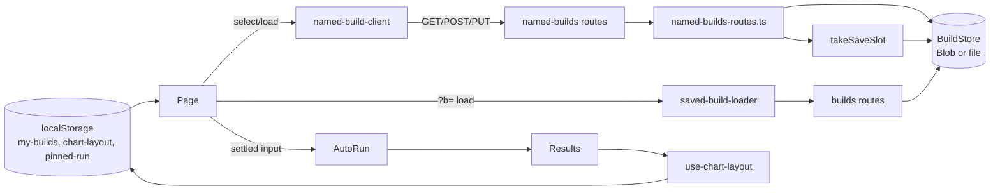

# M8: Technical design

AoE4 workbench: iterate on builds, tidy results, and pay down debt. Exit criteria M8.1 to M8.9 in
MILESTONES.md (owner-confirmed, Q36). Save model: **B, editable named builds stored on the server**
(owner, Q37).

## Summary

The server gains a second build class next to the immutable `?b=` content links: a **named build** with a
random id, a latest-version read and an update that needs an edit secret. Only the creating browser holds
the secret, in a "my builds" list kept in localStorage. The page's select becomes a library with three
groups (My builds, Opened links, Templates). It shows `<name> (edited)` on divergence and confirms before
discarding edits. Save writes a new version of your own build, and Save as copy starts a named copy from
any entry. The results column gets per-chart collapse and reorder that persist per browser, columns that
scroll separately in the split layout, a one-key pinned legend and step-table polish. The debt items fix
the builds routes (fail closed, id failure 500, refused saves write no counter), the query handling and
the tests that cannot fail.

### Starting state (main @ b3da879, M7 done)

| area | exists before the first M8 ticket |
|------|-----------------------------------|
| Save | `POST /api/aoe4-build-order/builds` (`saveBuild`) stores an immutable content-addressed build. The id is an 11-char base64url SHA-256 (`savedBuildId`). The UI's single "Save build" button (`save-build`) makes a `?b=<id>` link named by `savedBuildName` (`<name> (edited)` when diverged). |
| Read | `GET .../builds/{id}` (`getSavedBuild`) replies `Cache-Control: public, max-age=31536000, immutable`. `DELETE` (`deleteSavedBuild`) is allowed outside production only. |
| Store | `BuildStore` with `putBuild`, `getBuild`, `deleteBuild` and `bumpCounter(clientKey, windowStart)`; memory, file and Blob stores. `nextCounter` is private to `build-store.ts`, and the Blob store repeats the counter step. `storeFor` maps an unset `VERCEL_ENV` to `development` even on Vercel. |
| Rate limit | `takeSaveSlot` increments the counter, then compares, so a refused save still writes it. `savedBuildId` runs inside the store try, so a crypto failure becomes 503. |
| Page | `pages/apps/aoe4-build-order.tsx`. The select is labelled "Prebuilt build" and its options are the four shipped builds plus an opened `?b=` build. `selected` is the option name. Re-choosing a build or reloading drops edits silently. `initialB` is written during render. `router.replace` with `query: {}` or `{b}` drops other query keys. |
| Results | `Results` renders four `SeriesChart`s in a fixed order. The legend lists `<name> (pinned)` for every pinned series, and the hide toggle is per line (`key` and `pinned:<key>`). |
| Layout | The split layout (`>= 1200px`, `workbench-split`) is a two-column grid with the page scrolling as a whole. "Results" is an `h2` with no class, chart titles are `h3.h5`, and there is no build column heading. |
| Step table | The run cell shows unlabelled started, finished and waited times; a waiting step shows `0:00` waited. Badges wrap, selects are capped at 7.5rem, and the kind border is hidden under 768px. |
| Tests | Vitest has no `css` option. Acceptance `CHART_IDS` lives in `acceptance/helpers.ts`, four specs define their own `holdSimulate`, and `recordingTarget` is defined twice. |
| Contract | `docs/api/openapi.json` `info.version` 2.4.0. |

## Modules

| module (path) | owns | public functions or exports | used by |
|---------------|------|-----------------------------|---------|
| `lib/aoe4-build-order/named-builds.ts` (new, browser-safe) | named-build ids, edit secrets, stored and public shapes, header parsing, keys, paths | see C1 | named-builds-routes, stores, client |
| `lib/aoe4-build-order/named-builds-routes.ts` (new) | create, read, update and delete logic for named builds as plain reply functions | `createNamedBuildReply`, `namedBuildReply` | `pages/api/aoe4-build-order/named-builds/*` |
| `pages/api/aoe4-build-order/named-builds/index.ts`, `[id].ts` (new) | thin adapters (req to args, `sendReply`) | default handlers, `config` | HTTP |
| `lib/aoe4-build-order/build-store.ts` | `BuildStore` (gains named methods and a counter limit), shared `nextCounter`, fail-closed env | C2 | routes, rate limit, Blob store |
| `lib/aoe4-build-order/blob-build-store.ts` | Blob implementation of the C2 additions | `createBlobBuildStore` | `buildStoreFromEnv` |
| `lib/aoe4-build-order/saved-builds.ts` | gains `deploymentEnv` | C2 | stores, `[id]` routes |
| `lib/aoe4-build-order/save-rate-limit.ts` | refuse without writing | `takeSaveSlot` (signature unchanged) | both save routes |
| `lib/aoe4-build-order/builds-routes.ts` | id failure becomes 500; shares reply helpers | `saveBuildReply`, `savedBuildReply`, `errorReply`, `storageUnavailable`, `idFailure` | builds routes, named-builds-routes |
| `lib/aoe4-build-order/api-route.ts` | typed replies, one issue cap | `RouteReply<Body>`, `ReplyTarget<Body>`, `sendReply`, `issuesError` | all AoE4 routes, saved-builds |
| `lib/aoe4-build-order/route-test-support.ts` (new, test-only) | `recordingTarget` | `recordingTarget` | api-route.test, builds-routes.test, named-builds-routes.test |
| `components/apps/aoe4-build-order/named-build-client.ts` (new) | fetch wrappers for the named routes | C4 | page, save-build |
| `components/apps/aoe4-build-order/build-fetch.ts` (new) | the one GET-and-validate and the one send-JSON path for the builds routes | `loadJson`, `sendJson` (C4a) | `saved-build-loader.ts`, `named-build-client.ts`, `save-build-client.ts` (until `postSavedBuild` is deleted) |
| `components/apps/aoe4-build-order/save-build-client.ts` | failure messages for every save; `postSavedBuild`, `isSaveBuildResponse` and `readJson` are deleted (C4a) | `saveFailureMessage` | `named-build-client.ts` |
| `components/apps/aoe4-build-order/browser-storage.ts` (new) | the guarded `window.localStorage` getter, moved unchanged from the page | `browserStorage(): Storage \| null` | page (pin, my builds), `use-chart-layout.ts` |
| `components/apps/aoe4-build-order/my-builds-storage.ts` (new) | the per-browser list of own builds and their secrets | C5 | page |
| `components/apps/aoe4-build-order/build-library.ts` (new, pure) | select entries, keys, groups, labels, the edited marker, copy names, run names | C6 | page, build-input, save-build, pin-name |
| `components/apps/aoe4-build-order/build-query.ts` (new, pure) | reading `n` / `b` once and writing them back while keeping other keys | C7 | page |
| `components/apps/aoe4-build-order/use-discard-guard.ts` (new) | `beforeunload` while edited | `useDiscardGuard(edited: boolean)` | page |
| `components/apps/aoe4-build-order/save-build.tsx` | rewritten: Save, Save as copy, name form, link panel | `SaveBuild` (C8 props) | build-input |
| `components/apps/aoe4-build-order/chart-layout.ts` (new) | chart order and collapsed state, normalisation, storage | C9 | use-chart-layout |
| `components/apps/aoe4-build-order/use-chart-layout.ts` (new) | hydration-safe state for C9 | `useChartLayout()` | results |
| `components/apps/aoe4-build-order/results.tsx`, `line-chart.tsx` | render in layout order; header controls; collapsed body | C9 props | page |
| `components/apps/aoe4-build-order/chart-rows.ts`, `chart-legend.tsx` | one legend item per series, pinned key, both-line hide | C10 | line-chart |
| `components/apps/aoe4-build-order/workbench-tabs.tsx`, `workbench.module.css`, `use-run-bar-height.ts` (new) | separately scrolling columns and column headings | C11 | page |
| `components/apps/aoe4-build-order/step-annotation.tsx`, `step-annotation.module.css`, `step-table.module.css`, `build-text-editor.tsx` | M8.5 polish | C12 | step-table, editor |

## Contracts

### C1. Named builds (`lib/aoe4-build-order/named-builds.ts`)

| name | exact shape or value |
|------|----------------------|
| `NAMED_BUILD_VERSION` | `1` |
| `NAMED_BUILD_ID_BYTES` | `16` (an id is 22 base64url chars; first sample `AAAAAAAAAAAAAAAAAAAAAA`, all-`0xff` bytes give `_____________________w`, 21 `_` then `w`, because the 2 leftover bits pad to `110000`; property: every id matches `NAMED_BUILD_ID_PATTERN` and decodes back to 16 bytes) |
| `NAMED_BUILD_ID_PATTERN` | `/^[A-Za-z0-9_-]{22}$/` (disjoint from `SAVED_BUILD_ID_PATTERN`, which has 11 chars) |
| `isNamedBuildId(value: unknown): value is string` | pattern test |
| `EDIT_SECRET_BYTES` | `32` (43 base64url chars) |
| `EDIT_SECRET_PATTERN` | `/^[A-Za-z0-9_-]{43}$/` |
| `newNamedBuildId(random?: RandomBytes): string` | base64url of `random(16)`; default `random` is `crypto.getRandomValues`. Throws if `random` throws. |
| `newEditSecret(random?: RandomBytes): string` | base64url of `random(32)` |
| `type RandomBytes = (count: number) => Uint8Array` | injection seam for the 500 test |
| `editSecretHash(secret: string): Promise<string>` | `base64UrlSha256(secret)` (43 chars) |
| `sameSecretHash(a: string, b: string): boolean` | constant-time over equal-length strings; `false` when the lengths differ |
| `storedNamedBuildSchema` | `savedBuildSchema.extend({ revision: z.number().int().min(1), createdAt: z.string().datetime(), updatedAt: z.string().datetime(), secretHash: z.string().regex(/^[A-Za-z0-9_-]{43}$/) })` (`version` stays `z.literal(1)`; both timestamps accept only the `Z` form, see C5) |
| `type StoredNamedBuild` | `z.infer<typeof storedNamedBuildSchema>` |
| `type NamedBuild` | `Omit<StoredNamedBuild, 'secretHash'> & { id: string }` (the GET body; never has `secretHash`) |
| `interface CreateNamedBuildResponse` | `{ id: string; path: string; editSecret: string; revision: 1; updatedAt: string }` |
| `interface UpdateNamedBuildResponse` | `{ id: string; path: string; revision: number; updatedAt: string }` |
| request body (create and update) | `SaveBuildRequest` (`{ buildOrder, durationSeconds }`), validated by the existing `checkSaveBuildRequest`. The name is `buildOrder.name` (max `SAVED_NAME_MAX_CHARS` 100), so an update may rename. |
| `namedBuildKey(env, id)` | `` `${env}/named-builds/${id}.json` `` |
| `namedBuildPath(id)` | `` `/apps/aoe4-build-order?n=${id}` `` |
| `parseEditSecret(authorization: string \| undefined): string \| null` | `Bearer <secret>` with exactly one space and a secret matching `EDIT_SECRET_PATTERN`, else `null` |
| `parseIfMatchRevision(ifMatch: string \| undefined): number \| null` | a strong ETag `"<n>"` with `n` matching `/^[1-9][0-9]{0,15}$/` and `<= Number.MAX_SAFE_INTEGER`, else `null`. First valid sample `"1"`, last `"9007199254740991"`. `W/"1"`, `*`, `"0"`, `1` and lists are `null`. |
| `revisionEtag(revision: number): string` | `` `"${revision}"` `` |
| `NAMED_BUILD_CACHE_CONTROL` | `'no-store'` (latest-version reads are never cached by the CDN or the browser) |

**Routes.** `pages/api/aoe4-build-order/named-builds/index.ts` and `[id].ts`, both `config.api.bodyParser.sizeLimit: '128kb'`.

| method and path | operationId | auth | success |
|-----------------|-------------|------|---------|
| `POST /api/aoe4-build-order/named-builds` | `createNamedBuild` | none | `201` `CreateNamedBuildResponse`, header `ETag: "1"` |
| `GET /api/aoe4-build-order/named-builds/{id}` | `getNamedBuild` | none | `200` `NamedBuild`, headers `Cache-Control: no-store`, `ETag: "<revision>"` |
| `PUT /api/aoe4-build-order/named-builds/{id}` | `updateNamedBuild` | `Authorization: Bearer <editSecret>`, `If-Match: "<revision>"` | `200` `UpdateNamedBuildResponse`, header `ETag: "<revision>"` |
| `DELETE /api/aoe4-build-order/named-builds/{id}` | `deleteNamedBuild` | none; outside production only (as `deleteSavedBuild`) | `204` |

**Response order** (the first match wins). All error bodies are `BuildsError` (`{ error }`, closed), except the 400 bodies, which are `SimulateError` (as in C3 of M6).

| # | POST create: input | reply |
|---|--------------------|-------|
| 1 | method not POST | 405, `Allow: POST` |
| 2 | body over 128kb | 413 (Next) |
| 3 to 9 | the M6 C3 rows 3 to 9 (not an object, `checkBuildOrder` issues, duration, name over 100, bytes over 65536, round trip) | 400 / 413 as in M6 |
| 10 | `newNamedBuildId` or `newEditSecret` or `editSecretHash` throws | 500 `the build id could not be created`; log `builds: id generation failed` |
| 11 | store getter rejects (includes C2 fail-closed) | 503 `storage is unavailable; try again later` |
| 12 | `takeSaveSlot` refuses | 429 `too many saves from this client; try again later`, `Retry-After` |
| 13 | `createNamed` throws | 503 |
| 14 | `createNamed` returns `'exists'` (a 128-bit collision) | 500 `the build id could not be created`; log `builds: named id collision`. No retry. |
| 15 | created | 201 |

| # | PUT update: input | reply |
|---|-------------------|-------|
| 1 | method not GET or PUT (or DELETE outside production) | 405, `Allow: GET, PUT` in production, `GET, PUT, DELETE` elsewhere |
| 2 | `{id}` fails `isNamedBuildId` | 404 `no named build with that id` (no store call) |
| 3 | `parseEditSecret(Authorization)` is null | 401 `an edit secret is required`, header `WWW-Authenticate: Bearer` |
| 4 | `parseIfMatchRevision(If-Match)` is null | 428 `If-Match with the current revision is required` |
| 5 | body over 128kb | 413 (Next; it runs before the handler, so it can precede rows 3 and 4) |
| 6 to 12 | M6 C3 rows 3 to 9 on the body | 400 / 413 |
| 13 | store getter rejects | 503 |
| 14 | `takeSaveSlot` refuses | 429 with `Retry-After` (before the secret check, so guessing secrets is rate-limited) |
| 15 | `getNamed` throws | 503 |
| 16 | absent | 404 `no named build with that id` |
| 17 | stored value fails `storedNamedBuildSchema` | 500 `the stored build could not be read`; log `builds: stored build failed its schema` |
| 18 | `!sameSecretHash(editSecretHash(secret), stored.secretHash)` | 403 `the edit secret does not match` |
| 19 | `If-Match` revision differs from `stored.revision` | 412 `the build has changed since that revision` |
| 20 | `replaceNamed` returns `'conflict'` (a concurrent write between read and write) | 412 same text |
| 21 | `replaceNamed` throws | 503 |
| 22 | replaced: stored `revision + 1`, `updatedAt = new Date(nowMs).toISOString()`, `createdAt` and `secretHash` kept | 200 |

| # | GET / DELETE: input | reply |
|---|---------------------|-------|
| 1 | method | 405 as in the PUT row 1 |
| 2 | invalid id | 404 (no store call) |
| 3 | getter rejects, or a store call throws | 503 |
| 4 | GET absent | 404 `no named build with that id` |
| 5 | GET schema fail | 500 `the stored build could not be read` |
| 6 | GET found | 200 `NamedBuild` (all stored fields but `secretHash`, plus `id`) |
| 7 | DELETE (outside production) | 204, also when absent |

**Route functions** (`named-builds-routes.ts`):

```ts
createNamedBuildReply(
  req: { method: string | undefined; body: unknown; clientKey: string },
  deps: { store: StoreGetter; catalog: BuildOrderCatalog; nowMs: number; random?: RandomBytes },
): Promise<RouteReply<CreateNamedBuildResponse | BuildsError | SimulateError>>
namedBuildReply(
  req: { method: string | undefined; id: unknown; body: unknown; authorization: string | undefined; ifMatch: string | undefined; clientKey: string },
  deps: { store: StoreGetter; catalog: BuildOrderCatalog; env: string | null; nowMs: number },
): Promise<RouteReply<NamedBuild | UpdateNamedBuildResponse | BuildsError | SimulateError>>
```

**OpenAPI** (`docs/api/openapi.json`): `info.version` goes from `2.4.0` to `2.5.0`. Add the two paths above with the four operationIds. Add the schemas `CreateNamedBuildResponse` (closed), `UpdateNamedBuildResponse` (closed) and `NamedBuild` (`allOf` `SavedBuild` plus `id`, `revision`, `createdAt`, `updatedAt`, `unevaluatedProperties: false`). Reuse `SaveBuildRequest` and `BuildsError`. Add `components.securitySchemes.editSecret` (`http`, `bearer`), used by `updateNamedBuild`. Document the headers `ETag`, `Cache-Control` (`const: "no-store"`), `If-Match` (required on PUT) and `WWW-Authenticate`. Also add the new `500` response to `saveBuild` (C3 below).

### C2. Store, environment and counter (`build-store.ts`, `saved-builds.ts`, `save-rate-limit.ts`)

```ts
export type CounterResult = CounterUpdate | 'contended' | 'refused';
export type ReplaceResult = 'replaced' | 'conflict';
export interface StoredWithEtag { value: unknown; etag: string }
export interface BuildStore {
  putBuild(id: string, json: string): Promise<PutResult>;            // unchanged
  getBuild(id: string): Promise<unknown | null>;                     // unchanged
  deleteBuild(id: string): Promise<void>;                            // unchanged
  bumpCounter(clientKey: string, windowStart: number, limit: number): Promise<CounterResult>; // changed
  createNamed(id: string, json: string): Promise<PutResult>;         // never overwrites
  getNamed(id: string): Promise<StoredWithEtag | null>;              // always a fresh (uncached) read
  replaceNamed(id: string, json: string, etag: string): Promise<ReplaceResult>; // compare-and-swap; absent -> 'conflict'
  deleteNamed(id: string): Promise<void>;                            // absent is not an error
}
export function nextCounter(stored: unknown, windowStart: number, limit: number): CounterUpdate | 'refused';
```

- `nextCounter`: same window and `count >= limit` gives `'refused'`; same window and `count < limit` gives `count + 1`; a new window or an unreadable value gives `1`. It is the only counter step, used by the memory, file and Blob stores. A `'refused'` result writes nothing.
- The etag is opaque. The Blob store uses the blob etag. The memory and file stores use any value that changes on every write (e.g. a SHA-256 of the JSON).
- `deploymentEnv(env: { VERCEL?: string; VERCEL_ENV?: string }): string | null` in `saved-builds.ts`. A non-empty `VERCEL` with an empty or unset `VERCEL_ENV` gives `null`; otherwise `storageEnv(env.VERCEL_ENV)`. Samples: `{}` gives `development`; `{VERCEL:'1', VERCEL_ENV:'preview'}` gives `preview`; `{VERCEL:'1'}` gives `null`; `{VERCEL:'1', VERCEL_ENV:''}` gives `null`.
- `storeFor` rejects with `Error('VERCEL is set but VERCEL_ENV is not')` when `deploymentEnv` is `null`. Every builds route then answers 503 through its existing getter path.
- `savedBuildReply` and `namedBuildReply` take `deps.env: string | null`. `null` disallows DELETE (`Allow: GET` or `GET, PUT`). The `[id]` routes pass `deploymentEnv(process.env)`.
- `takeSaveSlot(store, clientKey, nowMs)` keeps its signature. It calls `bumpCounter(clientKey, windowStart, SAVE_RATE_LIMIT.maxSaves)`: `'refused'` gives `retryAfterSeconds = max(1, ceil((windowStart + 3600000 - nowMs)/1000))` and `'contended'` gives 1. Counts in one window run from 1 (the first save) to 30 (the last allowed). The 31st request is refused, and the stored count stays 30.
- `SAVE_RATE_LIMIT` (30 per 3600 s per client key) is **one budget shared** by `saveBuild`, `createNamedBuild` and `updateNamedBuild` (one counter key per client; see Owner decision 2).

### C3. Existing builds routes and shared route code

- `saveBuildReply` order becomes: M6 rows 1 to 9, then **id generation** (`deps.makeId ?? savedBuildId`; a throw gives 500 `the build id could not be created`, log `builds: id generation failed`), then getter 503, slot 429, put 503 and 201 / 200. `deps` gains `makeId?: (record: SavedBuild) => Promise<string>`.
- `builds-routes.ts` exports `errorReply(status, error, headers?)`, `storageUnavailable(cause)` and `idFailure(cause)` (500 plus log). `named-builds-routes.ts` imports them and does not copy them.
- `api-route.ts`:

```ts
export interface RouteReply<Body = unknown> { status: number; headers?: Record<string, string>; body?: Body }
export interface ReplyTarget<Body = unknown> { status(code: number): ReplyTarget<Body>; setHeader(name: string, value: string): unknown; json(body: Body): void; end(): void }
export function sendReply<Body>(res: ReplyTarget<Body>, reply: RouteReply<Body>): void
export function issuesError(all: readonly BuildOrderIssue[]): SimulateError // caps at MAX_REPORTED_ISSUES; omittedIssues only when > 0; all.length >= 1
```

  `pages/api/aoe4-build-order/simulate.ts` and `saved-builds.ts` `badRequest` both call `issuesError`. Every route passes a `NextApiResponse<...>` whose body type is its reply union, so a wrong body fails `tsc`.
- `lib/aoe4-build-order/route-test-support.ts` exports `recordingTarget()` (moved from the two tests, unchanged behaviour).

### C4. Named-build client (`named-build-client.ts`)

```ts
export type NamedSaveFailure = { ok: false; kind: 'conflict' | 'forbidden' | 'not-found' | 'other'; message: string };
createNamedBuild(request: SaveBuildRequest, signal?: AbortSignal): Promise<{ ok: true; response: CreateNamedBuildResponse } | NamedSaveFailure>
updateNamedBuild(id: string, editSecret: string, revision: number, request: SaveBuildRequest, signal?: AbortSignal): Promise<{ ok: true; response: UpdateNamedBuildResponse } | NamedSaveFailure>
loadNamedBuild(id: string, signal: AbortSignal): Promise<{ status: 'ok'; build: NamedBuild } | { status: 'not-found' } | { status: 'failed' }>
```

`kind` is 412 to `conflict`, 401 or 403 to `forbidden`, 404 to `not-found`, anything else to `other`. `message` comes from `saveFailureMessage` for 400, 413, 429 and 503, and from ticket wording for the others. `loadNamedBuild` validates the body against the `NamedBuild` shape (`storedNamedBuildSchema.omit({secretHash}).extend({id})`). A 404 or an invalid id gives `not-found`; a network error, abort, other status or bad body gives `failed`.

### C4a. Shared fetch code (`build-fetch.ts`) and the snapshot client

`loadSavedBuild` and `loadNamedBuild` have the same fetch, status and parse steps, and `createNamedBuild`,
`updateNamedBuild` and `postSavedBuild` have the same send-and-read steps. jscpd runs at threshold 0, so each
step exists once, in `build-fetch.ts`:

```ts
export type LoadJsonResult<T> = { status: 'ok'; value: T } | { status: 'not-found' } | { status: 'failed' };
export function loadJson<T>(path: string, schema: z.ZodType<T>, signal: AbortSignal): Promise<LoadJsonResult<T>>;
export interface JsonReply { status: number | null; retryAfter: string | null; body: unknown }
export function sendJson(path: string, init: { method: 'POST' | 'PUT'; headers?: Record<string, string>; body: unknown }, signal?: AbortSignal): Promise<JsonReply>;
```

| function | input | result |
|----------|-------|--------|
| `loadJson` | GET `path` with `Accept: application/json` and `signal` | 200 and `schema.safeParse` succeeds: `ok`. 404: `not-found`. Any other status, a body that fails the schema or is not JSON, a network error or an abort: `failed`. Never throws. |
| `sendJson` | `method`, `Content-Type: application/json`, `Accept: application/json`, then `init.headers` (they may add `Authorization` and `If-Match`), `JSON.stringify(init.body)` | A response: `{ status, retryAfter: Retry-After header or null, body }`, where `body` is `undefined` when the response is not JSON. A network error or abort: `{ status: null, retryAfter: null, body: undefined }`. Never throws. |

- `loadSavedBuild(id, signal)` keeps its signature and `LoadResult`. It checks `isSavedBuildId`, then maps
  `loadJson('/api/aoe4-build-order/builds/' + id, savedBuildSchema, signal)` (`value` becomes `saved`).
- `loadNamedBuild` checks `isNamedBuildId`, then maps `loadJson('/api/aoe4-build-order/named-builds/' + id, namedBuildBodySchema, signal)`
  (`value` becomes `build`). `namedBuildBodySchema` (`storedNamedBuildSchema.omit({ secretHash: true }).extend({ id: z.string().regex(NAMED_BUILD_ID_PATTERN) })`)
  is a module-local constant of `named-build-client.ts`; C1 does not change.
- `createNamedBuild` and `updateNamedBuild` call `sendJson`. Success is 201 (create) or 200 (update) with a body
  that passes a module-local check of the C1 response shape; anything else maps through the C4 `kind` table, with
  `message = saveFailureMessage(reply.status, reply.retryAfter, reply.body)` for 400, 413, 429, 503 and a `null`
  status.
- The ticket that adds `build-fetch.ts` also rewrites `postSavedBuild` on `sendJson` and deletes `readJson` from
  `save-build-client.ts`, so no copy exists at any merge. The Save panel rewrite (C8) then deletes `postSavedBuild`
  and `isSaveBuildResponse` and their `describe('postSavedBuild')` cases in `save-build-client.test.ts`; nothing in
  the UI creates `?b=` links after it (Owner decision 1). `saveFailureMessage` and its tests stay. A later snapshot
  button is a three-line `sendJson` call, so no unused client code is kept for it. The route, `SaveBuildResponse`
  and the smoke script are unchanged.
- `build-fetch.test.ts` holds the status table for both functions (a fetch stub that rejects only when
  `signal.aborted`, as in the M8.7 loader fix). `saved-build-loader.test.ts` and `named-build-client.test.ts` keep one case per outcome of their
  own mapping, not the whole table.

### C5. My builds (`my-builds-storage.ts`)

| name | shape |
|------|-------|
| `MY_BUILDS_STORAGE_KEY` | `'aoe4-build-order.my-builds'` |
| `MY_BUILDS_MAX` | `50` |
| `storedMyBuildsSchema` | zod: `{ version: z.literal(1), builds: z.array(z.object({ id: NAMED_BUILD_ID_PATTERN, name: z.string().min(1).max(100), editSecret: EDIT_SECRET_PATTERN, revision: z.number().int().min(1), updatedAt: z.string().datetime() })) }` |
| `type MyBuildEntry` | element type of `builds` |
| `readMyBuilds(storage: Storage): MyBuildEntry[]` | Parses and validates. Drops invalid entries one by one and drops duplicate ids, keeping the newer `updatedAt`. Sorts newest `updatedAt` first, by instant (`Date.parse`), not by string compare. Sample: `2026-11-10T18:00:00.500Z` sorts before `2026-11-10T18:00:00Z`, though the string compare orders them the other way. `updatedAt` is `z.string().datetime()` with no options, so only the `Z` form is accepted. Zod 4 rejects any offset such as `+00:00`, so an element with one is invalid and is dropped. The server writes only `toISOString()`, which always ends in `Z`. A whole-value parse failure removes the key and returns `[]`. Never throws. |
| `upsertMyBuild(storage: Storage, entry: MyBuildEntry): { builds: MyBuildEntry[]; persisted: boolean }` | Replaces by id or inserts, sorts, keeps the first `MY_BUILDS_MAX`, and writes. `persisted: false` when `setItem` throws. |
| `myBuildsAvailable(storage: Storage \| null): boolean` | `false` for `null`, or when a probe `setItem` / `removeItem` throws |

Sample value: `{"version":1,"builds":[{"id":"Qm9vdHN0cmFwSWQxMjM0NQ","name":"ENG 1TC (copy)","editSecret":"<43 chars>","revision":3,"updatedAt":"2026-11-10T18:00:00.000Z"}]}`. The list runs from `builds[0]` (newest save) to `builds[49]` (oldest kept).

### C6. Build library (`build-library.ts`, pure)

```ts
export type LibraryEntryKind = 'template' | 'mine' | 'shared' | 'link';
export interface LoadedVersion { text: string; duration: string | null; revision: number | null }
export interface LibraryEntry { key: string; kind: LibraryEntryKind; name: string; id: string | null; loaded: LoadedVersion | null }
export const LIBRARY_GROUPS: readonly { kind: readonly LibraryEntryKind[]; label: string }[] // [{['mine'],'My builds'}, {['shared','link'],'Opened links'}, {['template'],'Templates'}]
export const entryKey: { template(name: string): string; named(id: string): string; link(id: string): string } // 'template:<name>', 'named:<id>', 'link:<id>'
export function templateEntries(builds: readonly { name: string; text: string }[]): LibraryEntry[]  // loaded {text, duration:null, revision:null}
export function mineEntries(stored: readonly MyBuildEntry[]): LibraryEntry[]                          // loaded null until fetched
export function linkEntry(id: string, saved: SavedBuild): LibraryEntry                                 // page ticket (SGS-124)
export function namedEntry(kind: 'mine' | 'shared', build: NamedBuild): LibraryEntry                   // page ticket (SGS-124)
export function savedMineEntry(id: string, name: string, input: { text: string; duration: string }, revision: number): LibraryEntry // Save panel rewrite (SGS-125)
export function entryLabel(entry: LibraryEntry, edited: boolean): string
export function isEdited(entry: LibraryEntry | undefined, live: { text: string; duration: string }): boolean
export function copyName(base: string): string
export function runName(entries: readonly LibraryEntry[], text: string, selectedKey: string): string
```

- `PrebuiltBuild` in `build-input.tsx` is replaced by `LibraryEntry`. `savedBuildOption` (and its test) is deleted from `saved-build-loader.ts` and replaced by `linkEntry`.
- Entry builders. Each fills every `LibraryEntry` field; no caller builds an entry literal.

  | builder | key | kind | name | id | loaded | used by |
  |---------|-----|------|------|----|--------|---------|
  | `templateEntries(builds)`, one per build | `entryKey.template(build.name)` | `template` | `build.name` | `null` | `{ text: build.text, duration: null, revision: null }` | page start (the bundled templates) |
  | `mineEntries(stored)`, one per element | `entryKey.named(entry.id)` | `mine` | `entry.name` | `entry.id` | `null` until the entry is fetched | page start and the `storage` re-read |
  | `linkEntry(id, saved)` | `entryKey.link(id)` | `link` | `saved.buildOrder.name` | `id` | `{ text: formatBuildOrderText(saved.buildOrder), duration: String(saved.durationSeconds), revision: null }` | the initial `?b=` load |
  | `namedEntry(kind, build)` | `entryKey.named(build.id)` | `kind` | `build.buildOrder.name` | `build.id` | `{ text: formatBuildOrderText(build.buildOrder), duration: String(build.durationSeconds), revision: build.revision }` | every `loadNamedBuild` result: the initial `?n=` load and choosing a `mine` or `shared` entry. When a `mine` entry with that key is already in the list, the page keeps its stored `name` and replaces only `loaded`. |
  | `savedMineEntry(id, name, input, revision)` | `entryKey.named(id)` | `mine` | `name` | `id` | `{ text: input.text, duration: input.duration, revision }` | the Save panel rewrite: `onCreated` (revision 1, `input` = the settled input that was saved). `onUpdated` replaces the selected entry's `loaded` with the same shape and the new revision, keeping its key, kind and `name`. |

  `savedMineEntry` takes the settled text as is, not `formatBuildOrderText` of the saved order, so `isEdited` is `false` right after a save even when the formatter would reflow the text. `namedEntry` is not used after a save for that reason. Samples: `linkEntry('abcdefghijk', saved)` gives key `link:abcdefghijk`; `namedEntry('shared', build)` with id `AAAAAAAAAAAAAAAAAAAAAA` gives key `named:AAAAAAAAAAAAAAAAAAAAAA`.
- `entryLabel`: `template` and `mine` show `name`, `shared` shows `` `${name} (shared)` ``, and `link` shows `` `${name} (${id})` `` (unchanged from M6). Then `` ` (edited)` `` is appended when `edited`.
- `isEdited` is `false` when the entry is undefined or `loaded` is `null`. Otherwise it is `text !== loaded.text || (loaded.duration !== null && duration !== loaded.duration)`. Templates carry no duration, so for them only the text counts.
- `copyName(base)`: strip a trailing ` (edited)`, then return `` `${base.slice(0, 93)} (copy)` ``. Samples: `ENG 1TC` gives `ENG 1TC (copy)`; a 100-char name gives its first 93 chars plus ` (copy)` (100 chars).
- `runName` replaces `pinName`. It returns the name of the first entry whose `loaded.text === text`, preferring the selected one. Otherwise it returns the selected entry's `name` plus ` (edited)`, or `Custom build` when no entry is selected. `savedBuildName` is deleted together with the snapshot save (Owner decision 1).
- `selected` (page state and `LiveInput.selected`) is an entry **key**, not a name. Auto-run treats it as opaque, as before.
- Between the page ticket and the Save panel rewrite, the snapshot `SaveBuild` still needs a name. The page ticket
  moves `pinName` to `runName` in `build-library.ts` and keeps `savedBuildName` in `pin-name.ts`, retyped to
  `savedBuildName(entries: readonly LibraryEntry[], text: string, selectedKey: string): string`. Same rule as today:
  the first entry with `loaded?.text === text` gives its `name`; otherwise, when `selectedKey` is an entry, that
  entry's `name` with one trailing ` (edited)` stripped, cut to its first 91 chars
  (`SAVED_NAME_MAX_CHARS - ' (edited)'.length` = 100 - 9, the code on main), plus ` (edited)`; otherwise
  (`selectedKey` is no entry, or `entries` is empty) exactly `Custom build`, with no suffix (as `runName` and
  today's empty-list case). Every result has at most 100 chars. Samples: an unedited template `ENG 1TC` gives
  `ENG 1TC`; the same template edited gives `ENG 1TC (edited)`; a 100-char name edited gives its first 91 chars
  plus ` (edited)` (100 chars). The 93 of `copyName` is `100 - ' (copy)'.length` and does not apply here.
  The Save panel rewrite deletes `pin-name.ts` and `pin-name.test.ts`.
- **Interim snapshot save (page ticket SGS-124 to Save panel rewrite SGS-125).** The page's `recordSave` replaces the
  URL with `nextBuildQuery(router.query, { kind: 'link', id: response.id })`. It changes neither `selected` nor
  `entries` (no `link` entry is added), so the select and the edited marker stay as they were, and a reload of that
  URL opens the snapshot as an Opened link. The Save panel rewrite deletes `recordSave` with the snapshot Save; after
  it, no save writes `b`, and `b` is written only by choosing a `link` entry or by a successful initial `?b=` load.
  `onCreated` and `onUpdated` replace the URL with `nextBuildQuery(router.query, selectedEntry)` (`n=<id>`, `b` dropped).

### C7. Query (`build-query.ts`)

```ts
export const NAMED_BUILD_QUERY_KEY = 'n';
export const SAVED_BUILD_QUERY_KEY = 'b';
export type InitialBuildQuery = { kind: 'named'; id: string } | { kind: 'link'; id: string } | { kind: 'none' };
export function initialBuildQuery(query: ParsedUrlQuery): InitialBuildQuery  // first value of n if non-empty, else of b, else none; no pattern check (the server 404s)
export function nextBuildQuery(query: ParsedUrlQuery, entry: { kind: LibraryEntryKind; id: string | null }): ParsedUrlQuery
```

`nextBuildQuery` copies every key except `n` and `b`, then sets `n` for `mine` / `shared`, sets `b` for `link`, and sets neither for `template`. Sample: `{x:'1', b:'abc'}` with a mine entry `Q...` gives `{x:'1', n:'Q...'}`. The page stores the initial query in state from an effect that runs once `router.isReady` (no ref writes during render).

### C8. Save panel (`save-build.tsx`)

```ts
interface SaveBuildProps {
  status: AutoRunStatus; settled: LiveInput; conversion: TextToBuildResult; busy: boolean;
  entry: LibraryEntry | undefined;   // the selected entry
  editSecret: string | null;         // set only for a 'mine' entry with a known secret
  edited: boolean;
  onCreated(response: CreateNamedBuildResponse, input: LiveInput, name: string): void;
  onUpdated(response: UpdateNamedBuildResponse, input: LiveInput): void;
}
```

Test ids: `save-build` (Save a new version; rendered only for a `mine` entry with a secret), `save-build-copy`, `save-copy-form`, `save-copy-name`, `save-copy-name-error`, `save-copy-submit`, `save-copy-cancel`, `saved-build-link`, `copy-saved-link`, `save-build-error`, `my-builds-unavailable`. `copy-saved-link-hint` is kept from M6.

Visible text (exact; specs assert it, docs quote it). Failure messages in `save-build-error` are C4's (`saveFailureMessage` and the `named-build-client` texts), not repeated here.

| element | text |
|---------|------|
| `save-build` | `Save a new version` |
| `save-build-copy` | `Save as copy` |
| `save-copy-name` | no visible label; `aria-label="Name of the copy"` |
| `save-copy-submit` | `Save copy` |
| `save-copy-cancel` | `Cancel` |
| `save-copy-name-error` | `Enter a name of 1 to 100 characters.` |
| `my-builds-unavailable` | `This browser could not store the edit key, so you can edit this build only until you close the page.` |
| `saved-build-link` | unchanged from M6: `aria-label="Link to this saved build"` |
| `copy-saved-link` | unchanged from M6: `Copy link`, then `Copied` |
| `copy-saved-link-hint` | unchanged from M6: `Could not copy. Select the link and copy it by hand.` |

No text in `components`, `docs` or `acceptance` says `Save build` after the rewrite.

### C9. Chart layout (`chart-layout.ts`, `use-chart-layout.ts`)

```ts
export const RESULT_CHART_IDS = ['chart-units-produced', 'chart-gather-rates', 'chart-gathered-resources', 'chart-floating-resources'] as const;
export type ChartId = (typeof RESULT_CHART_IDS)[number];
export const CHART_LAYOUT_STORAGE_KEY = 'aoe4-build-order.chart-layout';
export interface ChartLayout { version: 1; order: ChartId[]; collapsed: ChartId[] }
export const DEFAULT_CHART_LAYOUT: ChartLayout; // order = RESULT_CHART_IDS, collapsed = []
export const storedChartLayoutSchema; // zod: { version: literal(1), order: array(string), collapsed: array(string) }
export function normalizeChartLayout(value: unknown): ChartLayout // unknown ids dropped, duplicates dropped (first kept), missing ids appended in RESULT_CHART_IDS order; invalid -> DEFAULT
export function readChartLayout(storage: Storage | null): ChartLayout   // never throws
export function writeChartLayout(storage: Storage | null, layout: ChartLayout): void // never throws
export function moveChart(layout: ChartLayout, id: ChartId, direction: 'up' | 'down'): ChartLayout // no-op at the ends
export function toggleChartCollapsed(layout: ChartLayout, id: ChartId): ChartLayout
export function useChartLayout(): { layout: ChartLayout; move(id: ChartId, direction: 'up' | 'down'): void; toggle(id: ChartId): void }
```

`acceptance/helpers.ts` re-exports `CHART_IDS = RESULT_CHART_IDS`. `SeriesChart` gains `layout?: { collapsed: boolean; first: boolean; last: boolean; onToggle(): void; onMove(direction: 'up' | 'down'): void }`. The chart container (`data-testid=<chart id>`) gets `data-collapsed="true" | "false"`. The new ids are `chart-collapse` (`aria-expanded`, `aria-controls` = the body id), `chart-move-up`, `chart-move-down` and `chart-body`.

### C10. Legend (`chart-rows.ts`, `chart-legend.tsx`)

- `LegendItem` becomes `{ key: string; name: string; color: string; lines: 'current' | 'pinned' | 'both' }` (the `pinned` field is removed). `legendItems(series, pinned?)` returns one item per series key: the current keys in order, then the pinned-only keys. `key` is never `pinned:<key>`, and `name` never has ` (pinned)`.
- A new `PinnedLineKey` renders `data-testid="chart-pinned-key"` once per chart legend, only when a pinned run is shown. It holds two swatches: solid labelled "current run" and dashed labelled "pinned run".
- The hidden set holds series keys only. A hidden key hides both the `key` line and the `pinnedKey(key)` line.

### C11. Split layout

- In the split view, `WorkbenchTabs` wraps each side in `data-testid="build-column"` and `data-testid="results-column"`.
- `use-run-bar-height.ts` exports `useRunBarHeight(ref: RefObject<HTMLElement>): void`. It writes the space the run bar takes (its border-box height plus its bottom margin) in px to the CSS custom property `--aoe4-run-bar-height` on the page section, using a ResizeObserver.
- `.workbenchSplit` gets `height: calc(100dvh - var(--aoe4-run-bar-height, 0px))`. Each column gets `overflow-y: auto; min-height: 0; overscroll-behavior: contain`.
- Headings: the build side starts with `<h2 class="h4" data-testid="build-order-heading">Build order</h2>`. Results uses `<h2 class="h4 border-bottom" data-testid="results-heading">Results</h2>`. Chart titles stay `h3.h5`, and the legend headings stay `h4.h6`.
- **Run bar ref.** `BuildInput` gains the prop `runBarRef: RefObject<HTMLFormElement | null>`, set as `ref` on its
  `<form data-testid="run-bar">`. The page creates it with `useRef<HTMLFormElement>(null)`, passes it, and calls
  `useRunBarHeight(runBarRef)`. Under React 19 `useRef(null)` gives a nullable `RefObject`, so the hook's
  parameter is typed `RefObject<HTMLElement | null>` (same behaviour as the signature above; a null `current` is a
  no-op).
- **Which element carries the property.** The hook writes `--aoe4-run-bar-height` with `style.setProperty` on
  `runBarRef.current.closest('section')`, the page's `<section class="container ...">` that holds the run bar and
  `WorkbenchTabs`. The custom property inherits, so `.workbenchSplit` reads it. The value is
  `` `${Math.ceil(form.getBoundingClientRect().height + (parseFloat(getComputedStyle(form).marginBottom) || 0))}px` ``.
  This is the border box plus the run bar's bottom margin. The form keeps its `mb-3` (16px at every width), so, for
  example, a bar 60px tall writes `76px`. The margin is static, so the ResizeObserver needs no margin trigger. So when the
  workbench sits directly under the stuck bar, its top is the bar's border-box bottom plus 16px, and its bottom is
  the viewport bottom.
- **`saved-build-error` between the bar and the workbench.** The alert is not measured and the split height does
  not change for it. It is ordinary page content above the workbench, like the page `h1`. When the page is scrolled
  so the workbench sits under the stuck bar, the alert has scrolled under the bar (`z-index: 10`, opaque
  background). So the split-scroll rule holds whether or not the alert is shown. The spec asserts it with the alert
  absent. It writes once on mount and again on each ResizeObserver callback for the form. Cleanup disconnects the
  observer and calls `removeProperty`. No section or no `ResizeObserver`: nothing is written, and the CSS fallback
  `0px` applies. The hook runs in every view; only `.workbenchSplit` uses the value.
- **Build heading placement.** The page renders the `h2` (with `id="build-order-heading"`) as the first child of
  the `build` node it passes to `WorkbenchTabs`, above the editor, the step table or `step-table-unavailable`. So it
  shows in the text and table views, inside `panel-build` in the tabs view, and inside `build-column` in the split
  view. The results `h2` is likewise the first child of the `results` node. The editor's visible
  `<label htmlFor="build-order-text">Build order</label>` is deleted. `BuildTextEditor` gains the required prop
  `labelledBy: string`, set as `aria-labelledby` on the textarea, and the page passes `'build-order-heading'`. The
  textarea's accessible name stays "Build order", and the text shows once. `StepKindLegend` stays where it is,
  under the heading.

### C12. Step table and editor polish

- `StepTimes` gains `labelled: boolean`. With `true` (the step-table run cell), the cell reads `Started <time>` and `Finished <time | ongoing>`. The labels sit outside the `step-started` / `step-finished` spans, so the test-id text stays the bare value. The text gutter passes `false`.
- `step-waited`: the label `Waited` sits outside the value span `data-testid="step-waited"`. For status `waiting` or `not-reached`, the label is omitted and the value reads `still waiting`.
- The rule lives once, in `step-annotations.ts` beside `finishedText`: `waitedText(run: Pick<StepRun, 'status' | 'waitSeconds'>): string` returns `'still waiting'` for `waiting` and `not-reached`, else `formatMinSec(run.waitSeconds)`. The run cell's `step-waited` value uses it.
- The text gutter's `title` (`build-text-editor.tsx`, `AnnotationLine`) follows the same rule. For `waiting` and `not-reached` it reads `Still waiting. Blocked by: <blockedBy or nothing>`; for every other status it stays `Waited <m:ss>. Blocked by: ...`. No tooltip shows `Waited 0:00` for a step that has not started. Samples: a `completed` step that waited 75 s gives `Waited 1:15. Blocked by: nothing`; a `waiting` step blocked by food gives `Still waiting. Blocked by: <its blockedBy text>`.
- `.badge` in `step-annotation.module.css` gets `white-space: nowrap`. The table may scroll sideways inside `step-table-scroll` instead of wrapping.
- The 7.5rem cap on the step-table selects is removed. At 1280px a select with "Capital Town Center" selected shows the whole label.
- The kind border shows under 768px through a `tbody > tr > td.kindBorder` rule. The doc claim stays.
- `BuildTextEditor` sets the textarea's `scrollLeft = 0` whenever `text` changes from anything other than its own input event.

## Criteria map

| criterion | lands in (files) | owning module | contracts it defines | how it is tested |
|-----------|------------------|---------------|----------------------|------------------|
| M8.1 server | `lib/aoe4-build-order/named-builds.ts`, `named-builds-routes.ts`, `build-store.ts`, `blob-build-store.ts`, `pages/api/aoe4-build-order/named-builds/index.ts`, `[id].ts`, `docs/api/openapi.json`, `ARCHITECTURE.md` | named-builds / named-builds-routes | C1, the C2 named methods | Unit: `named-builds.test.ts` (patterns, parsers, hash, schema) and `named-builds-routes.test.ts` (every row of the three order tables, with `createMemoryBuildStore` and an injected `random`). Store tests in `build-store.test.ts` and `blob-build-store.test.ts` (mocked `@vercel/blob`: `ifMatch`, a precondition failure gives `conflict`, `useCache: false`). Acceptance: `aoe4-named-builds-api.spec.ts` (create, read, update, 401, 403, 412, 428, 404, `no-store`, no `secretHash`) and `aoe4-named-builds-api-contract.spec.ts` (ajv against the openapi schemas), each with its own `x-forwarded-for` (OD-8a of M6). |
| M8.1 client | `named-build-client.ts`, `my-builds-storage.ts`, `build-library.ts`, `build-query.ts`, `use-discard-guard.ts`, `save-build.tsx`, `build-input.tsx`, `pin-name.ts` (deleted or emptied into `runName`), `pages/apps/aoe4-build-order.tsx` | build-library (entries, labels, edited); the page (wiring) | C4 to C8 | Unit: each pure module has a `.test.ts` (Storage stub that throws for the fallback cases; `fetch` stub with `signal` checks). Acceptance: `aoe4-my-builds.spec.ts` (edited marker, confirm on switch with accept and dismiss, beforeunload on reload, Save as copy from a template, Save a new version, reopen from My builds after reload, `?n=` open by another context without a secret is read-only, 412 from a second tab). `aoe4-save-open.spec.ts` is updated for the `?b=` open path and query-key retention. |
| M8.1 shared client code (C4a) | `build-fetch.ts`, `build-fetch.test.ts`, `saved-build-loader.ts`, `saved-build-loader.test.ts`, `save-build-client.ts`, `save-build-client.test.ts` | build-fetch | `loadJson`, `sendJson`, `LoadJsonResult`, `JsonReply` | Unit: `build-fetch.test.ts` status table; `npm run lint:dup` passes with `named-build-client.ts` present. The named-client ticket adds it; the Save panel ticket deletes `postSavedBuild`. |
| M8.2 | `browser-storage.ts` (new; the page imports it), `chart-layout.ts`, `use-chart-layout.ts`, `results.tsx`, `line-chart.tsx`, `results.module.css`, `acceptance/helpers.ts` | chart-layout | C9 | Unit: `chart-layout.test.ts` (normalise samples, move at the ends, toggle, storage that throws). Acceptance: `aoe4-chart-layout.spec.ts` (collapse and move by mouse and keyboard, persistence across a reload, storage blocked by `addInitScript` that throws, hover band and pinned lines on expanded charts after a reorder). |
| M8.3 | `workbench-tabs.tsx`, `workbench.module.css`, `use-run-bar-height.ts`, `build-input.tsx` (`runBarRef`), `build-text-editor.tsx` (`labelledBy`, label removed), `pages/apps/aoe4-build-order.tsx` | workbench-tabs | C11 | Acceptance: `aoe4-split-scroll.spec.ts` at `SPLIT_VIEWPORT` and `WIDE_VIEWPORT` (read every rect in one `page.evaluate`; LESSONS). The `aoe4-split-layout` and `aoe4-small-screen` specs keep passing. |
| M8.4 | `chart-rows.ts`, `chart-legend.tsx`, `line-chart.tsx` | chart-rows | C10 | Unit: `chart-rows.test.ts` (one item per key, `lines` values, pinned-only), and a `line-chart.test.ts` render that shows both lines hidden. Acceptance: the `aoe4-build-order-pin-compare.spec.ts` legend assertions are updated. |
| M8.5 | `step-annotations.ts` (`waitedText`), `step-annotation.tsx`, `step-annotation.module.css`, `step-table.module.css`, `build-text-editor.tsx` | step-annotation | C12 | Unit: `step-annotation.test.ts` (labels, `still waiting`) with the vitest `css` setting from M8.7, and `step-annotations.test.ts` (`waitedText` rows for all four statuses). Acceptance: `aoe4-step-annotations.spec.ts` (no badge wraps at 1280, select label fits, border at 390, `scrollLeft === 0` after choosing a build). |
| M8.6 | `builds-routes.ts`, `build-store.ts`, `blob-build-store.ts`, `save-rate-limit.ts`, `saved-builds.ts`, `api-route.ts`, `pages/api/aoe4-build-order/*.ts`, `playwright.config.ts`, `build-query.ts`, page, `data/aoe4-build-order/builds/README.md` | builds-routes / build-store | C2, C3, C7 | Unit: `builds-routes.test.ts` (`makeId` throws gives 500 and no store call; refused leaves the counter at 30), `save-rate-limit.test.ts`, `build-store.test.ts` (`deploymentEnv` samples, `storeFor` rejects), `tsc` for `sendReply`. Acceptance: `aoe4-save-open.spec.ts` (`?b=x&utm=1` keeps `utm`). Playwright `webServer.env` sets `BUILDS_STORE_ID: ''`, `VERCEL_ENV: ''` and `VERCEL: ''`; the ticket checks in `node_modules/next/dist/docs/` that blank values beat `.env.local`. |
| M8.7 | `auto-run.test.ts`, `build-store.test.ts`, `saved-build-loader.test.ts`, `step-annotations.test.ts`, `step-annotation.test.ts`, `vitest.config.mts`, `acceptance/aoe4-auto-run.spec.ts`, `aoe4-step-annotations.spec.ts`, `simulate-house-gate.test.ts`, `acceptance/helpers.ts`, `builds-routes.test.ts`, `acceptance/aoe4-builds-api.spec.ts` | (tests) | `holdNextSimulate` in helpers (below) | Each fixed test is shown to fail against a deliberately broken copy of its target. The ticket report names the mutation used. |
| M8.8 | `api-route.ts`, `simulate.ts`, `saved-builds.ts`, `build-store.ts`, `blob-build-store.ts`, `auto-run.ts`, `use-auto-run.ts`, `route-test-support.ts`, `ARCHITECTURE.md`, `docs/aoe4-build-order.md`, acceptance imports, `design/M6.md` | api-route / build-store / auto-run | `issuesError`, `nextCounter`, `settledFields` (exported), `recordingTarget` | `npm run lint:dup` (jscpd, threshold 0) plus the existing unit tests. Docs are reviewed. |
| M8.9 | `docs/aoe4-build-order.md`, the specs listed for M8.1 to M8.3 | docs | none | Review against the behaviour rules below; `npm run acceptance`. |

**M8.7 detail.**

| backlog item | fix |
|--------------|-----|
| auto-run equal input | assert the onChange history length is unchanged (`auto-run.test.ts` near 200) |
| blob import | fresh `import('./build-store')` after `vi.resetModules()`; `rejects.toThrow('blob import failed')` |
| loader abort | the fetch stub rejects only when `signal.aborted` |
| identity branch | case: same text, different `selected` keeps its own timing |
| CSS tones | `vitest.config.mts` `test.css: { include: [/\.module\.css$/], modules: { classNameStrategy: 'non-scoped' } }`, so a missing key is `undefined` |
| acceptance | `duration-error` `toBeVisible()`; open-rows asserts that the two builds differ; the aria-describedby assertion can fail; same-build dimming changes a real input; layout waits for `step-started` |
| house gate | replace the always-true assertion at `simulate-house-gate.test.ts:63` |
| helpers | `export async function holdNextSimulate(page: Page, durationSeconds?: number): Promise<() => void>` in `acceptance/helpers.ts` is a thin call to `export async function holdRequests(page: Page, path: string, method: string, matches?: (request: Request) => boolean): Promise<() => void>`, also in `acceptance/helpers.ts`: it holds every matching request until `release()` is called, requests after release pass at once, and non-matching requests go to `route.fallback()`. SGS-125 holds the named-build create with `holdRequests(page, NAMED_BUILDS_PATH, 'POST')` and so depends on SGS-118; SGS-125 adds the `NAMED_BUILDS_PATH` constant. The four local `holdSimulate` and the contract-spec copy are deleted. `CHART_IDS` is used instead of hand-listed ids. |
| SGS-103 gaps | the GET 500 and getter-reject 503 tests assert `console.error`; the no-client check inspects error messages, not `JSON.stringify`; the live spec uses `toEqual` |

## Layouts

New files:

```
lib/aoe4-build-order/named-builds.ts, named-builds.test.ts
lib/aoe4-build-order/named-builds-routes.ts, named-builds-routes.test.ts
lib/aoe4-build-order/route-test-support.ts
pages/api/aoe4-build-order/named-builds/index.ts
pages/api/aoe4-build-order/named-builds/[id].ts
components/apps/aoe4-build-order/named-build-client.ts, .test.ts
components/apps/aoe4-build-order/build-fetch.ts, .test.ts
components/apps/aoe4-build-order/browser-storage.ts
components/apps/aoe4-build-order/my-builds-storage.ts, .test.ts
components/apps/aoe4-build-order/build-library.ts, .test.ts
components/apps/aoe4-build-order/build-query.ts, .test.ts
components/apps/aoe4-build-order/use-discard-guard.ts
components/apps/aoe4-build-order/chart-layout.ts, .test.ts
components/apps/aoe4-build-order/use-chart-layout.ts
components/apps/aoe4-build-order/use-run-bar-height.ts
acceptance/aoe4-named-builds-api.spec.ts
acceptance/aoe4-named-builds-api-contract.spec.ts
acceptance/aoe4-my-builds.spec.ts
acceptance/aoe4-chart-layout.spec.ts
acceptance/aoe4-split-scroll.spec.ts
```

Stored named build (`<env>/named-builds/<id>.json`, file store under `BUILDS_LOCAL_DIR`):

```json
{"version":1,"buildOrder":{"name":"ENG 1TC (copy)","civilization":"english","start":{},"steps":[]},"durationSeconds":1200,
 "revision":2,"createdAt":"2026-11-10T18:00:00.000Z","updatedAt":"2026-11-10T18:05:00.000Z","secretHash":"<43 base64url chars>"}
```

(`buildOrder` is the full `SavedBuild.buildOrder`. `GET` returns this object without `secretHash` and with `"id"`.)

Chart layout (`aoe4-build-order.chart-layout`): `{"version":1,"order":["chart-gather-rates","chart-units-produced","chart-gathered-resources","chart-floating-resources"],"collapsed":["chart-floating-resources"]}`.

My builds: the C5 sample. The rate counter shape is unchanged: `{"windowStart":1762797600000,"count":30}`.

## Behavior rules

### Named builds server

| operation | case | rule |
|-----------|------|------|
| create | ordering | C1 POST table. Ids and the secret are made before any store call, and the slot is taken before `createNamed`. |
| create | repeat (same body twice) | Two different builds with two ids and two secrets. Named builds are not content-addressed. |
| create | refused (429) | No counter write and no build write. |
| update | ordering | C1 PUT table. The slot is taken before the read and the secret check, so 403, 404 and 412 cost a slot. |
| update | conflict | `If-Match` must equal the stored revision. A concurrent writer that wins the CAS makes the loser get 412. Nothing is overwritten without the latest revision. |
| update | repeat (same body, same `If-Match`) | The first gives 200 (revision n+1); the second gives 412. |
| update | same content as stored | Still a new revision (no content compare). The client never sends it: Save is disabled when not edited. |
| update | no target (absent id) | 404 after the slot. |
| read | latest | Always a fresh store read; `Cache-Control: no-store`. A read after an update returns the new revision. |
| read | `?b=` content links | Unchanged: immutable, the 11-char id, `getSavedBuild`. Named and content ids never collide (22 vs 11 chars). |
| delete | production | 405. There is no server delete in production in M8 (Owner decision 4). |
| failure | store outage | 503; nothing is written. A failure after the counter write and before the build write leaves the counter incremented (as today). |
| failure | `VERCEL` set, `VERCEL_ENV` unset | Every builds and named-builds route answers 503 (getter rejects) and logs. DELETE is 405. |
| secrets | handling | The secret appears only in the 201 body and the `Authorization` header. It is never logged, never stored (only its hash) and never in a URL. |

### Library, select and edits (M8.1)

| operation | case | rule |
|-----------|------|------|
| first paint | entries | Templates only (SSR). After hydration an effect adds `mine` entries from `readMyBuilds`. Selected is the first template, unless the initial query loads a build. |
| select | groups | `<optgroup>` in `LIBRARY_GROUPS` order: My builds (newest save first), Opened links (in open order), Templates (shipped order). An empty group is not rendered. The label element reads "Build" (not "Prebuilt build"). |
| select | edited marker | While `isEdited(selected entry, live)`, the selected option's text is `entryLabel(entry, true)` and the select has `data-edited="true"` (otherwise `"false"`). The marker follows the live text, not the settled input. |
| choose another entry | not edited | Switches at once. |
| choose another entry | edited | `window.confirm` (injected as `confirmDiscard(label: string): boolean` for tests). Cancel keeps the text and the select value (the controlled select re-renders to the old key) and returns focus to the select. OK switches. |
| choose template / link | load | Text = `loaded.text`. Duration: `link` sets it; `template` keeps the current duration. `autoRun.flush` runs with the new key. |
| choose mine / shared | load | Always fetches the latest (`loadNamedBuild`). While loading, the select, editor and Save controls are disabled with `aria-busy="true"` and auto-run is held. `ok` sets the text, duration and `loaded` (with revision), then flushes. `not-found` keeps the old text and key and shows the `saved-build-error` alert; the entry stays. `failed` does the same with the failed text. |
| choose | same entry | The select fires no change; no-op. |
| reload / close tab | edited | `useDiscardGuard(true)` registers `beforeunload` (`preventDefault` plus `returnValue = ''`), so the browser asks. Not edited: no listener. In-app navigation through `next/link` is not guarded (out of M8). |
| initial query | `n` | Load as `shared`, or as `mine` when its id is in My builds (then the secret is known). Error handling is the M6 `?b=` path: hold, `aria-busy`, a fallback to the default template with `saved-build-error` on 404 or failure. |
| initial query | `n` and `b` | `n` wins. `b` is dropped from the URL on the first `nextBuildQuery`. |
| initial query | `b` | M6 behaviour; the entry kind is `link` (`linkEntry`). |
| initial query | `n` or `b` fails (`not-found` or `failed`) | The default template stays selected, `saved-build-error` shows the M6 text (`That saved build was not found. Showing the default build.` / `That saved build could not be loaded. Showing the default build.`) for both keys, and the URL is left as typed (no replace), so a reload retries. The next successful choose replaces it through `nextBuildQuery`, which drops `n` and `b`. This is the one case where the URL does not name the selected entry. (M6 cleared it on the first settled divergence; `urlBaseline` is deleted, so it no longer does.) |
| URL | after a successful choose or initial load, and after a Save as copy or Save a new version | `router.replace({pathname, query: nextBuildQuery(router.query, entry)}, undefined, {shallow: true})`. The URL follows the selected entry, not the edited state. This supersedes M6 OD-5a (removing `b` on divergence; see Owner decision 5). Other keys are kept. A cancelled confirm, a failed choose and a failed initial load replace nothing. |
| URL | interim snapshot save (SGS-124 until SGS-125) | `b=<new id>` through `nextBuildQuery(router.query, { kind: 'link', id })`; `selected` and `entries` are unchanged (C6, interim snapshot save). Deleted with the snapshot Save. |
| Save as copy | entry | `save-build-copy` is shown for every entry and enabled when `status === 'current'`, `conversion.ok`, not busy and not saving. Click opens `save-copy-form` with `save-copy-name` prefilled `copyName(entry.name)`, focused and selected. |
| Save as copy | invalid name | Trimmed length 0 or over 100: `save-copy-submit` is disabled and `save-copy-name-error` is shown under the input (`aria-invalid`, `aria-describedby`). |
| Save as copy | input changes while the form is open | `save-copy-submit` is enabled only when the Save-as-copy conditions hold (`status === 'current'`, `conversion.ok`, not busy, not saving) **and** the name is valid. While the user types, an unsettled or invalid build disables it, and the name and form stay as they are. Submit sends the settled input of that moment. The form closes when the selected entry key changes, because its prefill came from the old entry. |
| Save as copy | form after submit | The form closes on submit and stays closed after any outcome, including a failure. The typed name is not kept. A failure shows its message in `save-build-error` (row below). |
| Save as copy | keyboard | Enter in the input submits when valid. Escape closes the form and focuses `save-build-copy`. Tab order: name, submit, cancel. |
| Save as copy | success (201), settled input unchanged | `upsertMyBuild` runs with the secret. A `mine` entry `savedMineEntry(response.id, name, input, 1)` is added, then selected. The URL gets `n`. The form closes and the link panel shows `saved-build-link` (origin plus `namedBuildPath`) focused and selected. |
| Save as copy | success (201), settled input changed while in flight (text, duration or `selected` differs from the input captured at submit; compared with `sameInput` against the settled input read through a ref) | The secret is kept: `upsertMyBuild` runs and the page adds `secrets[id]` and `savedMineEntry(response.id, name, input, 1)` first in My builds (replacing an entry with that key). Nothing else: `selected`, the text, the duration and the URL are unchanged, no flush runs, and the link panel does not show. The form is already closed (it closes on submit). The user's edits are never replaced by a late answer. |
| Save as copy | storage unavailable or `persisted: false` | The save still succeeds and the entry stays editable for this page session (the page keeps the secret in memory). `my-builds-unavailable` is shown in the save panel from the success until the next settled change or the next save; with an unchanged input this is the time the link panel shows. A late create (row above) shows it too, so the user learns the copy will not survive a reload. |
| Save (new version) | shown | Only for a `mine` entry with a secret. Enabled when the Save-as-copy conditions hold **and** `edited`. |
| Save (new version) | success (200) | The entry's `loaded` becomes the settled input with the new revision, and the marker clears. `upsertMyBuild` runs with the new revision and `updatedAt`. The link panel shows. |
| Save (new version) | success (200), settled input changed while in flight | `upsertMyBuild` runs and the entry with key `entryKey.named(response.id)` gets `loaded` = the saved input with the new revision (the server's latest), so the marker compares the live text with what was saved. The text and `selected` are unchanged; the URL is replaced only when that entry is still selected; the link panel does not show. Same storage-warning rule as Save as copy. |
| Save / copy | in flight | Both buttons are disabled. A repeat click is ignored. Unmount aborts. |
| Save | 412 `conflict` | `save-build-error` says the build changed elsewhere, nothing is overwritten and Save stays disabled until the entry is re-chosen. Save as copy stays available. |
| Save | 401 / 403 `forbidden` | `save-build-error`; Save as copy is available. The stored secret is kept (no silent removal). |
| Save | 404 | `save-build-error`; Save as copy is available. |
| Save / copy | 400 / 413 / 429 / 503 / network | The `saveFailureMessage` text in `save-build-error`; nothing changes locally. |
| Save / copy | failure after the settled input changed while in flight (same `sameInput` test as the late success rows) | No message is shown, as in M6, and nothing changes locally. One exception: a late 412 `conflict` still locks Save a new version for the entry the request was for, when that entry is still selected, because its revision is stale. Re-choosing the entry clears the lock. If another entry was chosen meanwhile, that choose already re-fetches, so there is nothing to lock. |
| link panel | visibility | Shown after a 200 or 201 while the settled input equals the saved input (the M6 rule). Escape in the panel focuses the button that saved. |
| run names | pin, compare | `runName(entries, shownText, shown.selected)`. |
| cross-tab | another tab writes My builds | A `storage` event for `MY_BUILDS_STORAGE_KEY` re-reads the list. The `mine` entries are replaced, except the selected entry, which is kept with its current `loaded`. |
| snapshot save | `?b=` creation from the UI | Removed by the Save panel rewrite (Owner decision 1), with `recordSave`, `savedBuildName` and `pin-name.ts`. `linkEntry` and `namedEntry` stay (the loads use them). The `saveBuild` route stays. |

### Charts (M8.2)

| operation | case | rule |
|-----------|------|------|
| render | first paint | `DEFAULT_CHART_LAYOUT` (SSR and hydration match). An effect then applies `readChartLayout(browserStorage())`. |
| collapse | toggle | `chart-collapse` (`aria-expanded`) hides `chart-body` (series legend, plot, marker legend and the header controls such as Per villager). The title row and all three buttons stay. The series hide set, Per villager and the hover state survive collapse and reorder. |
| collapse | hover band, pins | A collapsed chart draws nothing. Expanded charts draw the step band and pinned lines as before. |
| move | up / down | Swaps with the neighbour. `chart-move-up` is disabled on the first chart, and `chart-move-down` on the last. Focus stays on the pressed button in the moved chart. If that button is now disabled, focus moves to the chart's other move button. |
| move | keyboard | Native buttons: Tab reaches collapse, then up, then down in each header; Enter and Space activate. There are no extra shortcuts. |
| persist | each change | `writeChartLayout` right away. Storage unavailable or throwing: in-memory only, no error shown. |
| persist | stored value bad | `normalizeChartLayout`. A non-JSON value or wrong version gives the default; unknown ids are dropped and missing ids appended. |
| tests | ids | Specs locate charts by `data-testid` from `CHART_IDS`, never by position. |

### Layout, legend and step table (M8.3 to M8.5)

| operation | case | rule |
|-----------|------|------|
| split scroll | at 1280x800 with the run bar stuck | Scroll the page with `window.scrollTo(0, scrollY + split.top - (bar.bottom + barMarginBottom))`, where `bar` is the run bar's border-box rect and `barMarginBottom` is its computed `margin-bottom` (16px). The bar then sits at top 0. The `workbench-split` top equals `bar.bottom + barMarginBottom` (±1px), and its bottom is at most `innerHeight` (+1px). Read every rect in one `page.evaluate` after the scroll. The rule holds with `saved-build-error` shown or absent (C11), and the spec uses the absent case. Each column scrolls itself; scrolling a column leaves `window.scrollY` unchanged (`overscroll-behavior: contain`). |
| split scroll | hover | Hovering any step row that is visible in the build column shades the band on every expanded chart visible in the results column. |
| split scroll | below 1200px | Tabs view, unchanged; the page scrolls. |
| run bar height | run bar grows or shrinks (it wraps, the save link panel or `duration-error` shows) | The ResizeObserver rewrites `--aoe4-run-bar-height` on the section, so the split height follows without a reload. Repeat callbacks with the same height write the same value. Unmount removes the property. |
| run bar height | tested | `aoe4-split-scroll.spec.ts` reads, in the same `page.evaluate`, the run bar's rect, its computed `margin-bottom` and `getComputedStyle(workbench-split).getPropertyValue('--aoe4-run-bar-height')`. It checks that the property equals `rect.height + margin-bottom` (±1px) before and after a change that wraps the run bar. |
| headings | accessible name | The textarea's accessible name is "Build order" through `aria-labelledby="build-order-heading"`; "Build order" is shown once per view. |
| headings | sizes | The two `h2` (`build-order-heading`, `results-heading`) have equal computed font sizes in both views. All chart `h3` are equal. |
| legend | no pin | One item per series, solid swatch, no `chart-pinned-key`. |
| legend | pin | `chart-pinned-key` once per chart. Items are one per key with no ` (pinned)`. The swatch is solid for `current` / `both` and dashed for `pinned`-only. |
| legend | toggle | `aria-pressed` per key. Hiding hides both lines. A pinned-only key hides its dashed line. |
| run cell | times | `Started`, `Finished` and `Waited` labels (C12). `waiting` and `not-reached` show `still waiting` with no time. |
| text gutter | tooltip | Same rule through `waitedText`: `waiting` and `not-reached` titles read `Still waiting. Blocked by: ...`, never `Waited 0:00`. |
| editor | programmatic fill | Choosing an entry, a load or a table edit sets `scrollLeft` to 0. Typing keeps the caret scroll. |

### Debt (M8.6, M8.8)

| operation | case | rule |
|-----------|------|------|
| `saveBuild` | id throws | 500 `the build id could not be created`; no getter call, no counter write. |
| `saveBuild` | over the limit | 429; the counter stays at 30. |
| rate limit | contended | 429 with `Retry-After: 1`; nothing written by the loser. |
| `?b=` / `?n=` load | other keys | Kept on every replace (C7). |

## Data flow



## Extension points

| future direction | seam that keeps it additive |
|------------------|-----------------------------|
| Per-version history links | Each update already has a `revision`. A later change writes `<env>/named-builds/<id>/v/<revision>.json` beside the latest and adds `GET .../named-builds/{id}/versions/{revision}` (immutable cache), with no change to C1 shapes. The immutable `?b=` snapshot route also stays available. |
| Export / import of my builds | `storedMyBuildsSchema` is versioned. Import is `upsertMyBuild` per entry; export is the stored value. |
| Share edit rights | The secret is a bearer token. A later "edit link" can carry it in the URL fragment and call `upsertMyBuild`; the server needs no change. |
| Rename without editing text | PUT already accepts a new `buildOrder.name`. Only UI is needed. |
| Creator delete in production | Route method table row 1 (`Allow`) plus `deleteNamed`. Adding auth to DELETE is one branch. |
| Draft autosave instead of confirm | `confirmDiscard` and `useDiscardGuard` are the only discard points. |
| More charts | Add an id to `RESULT_CHART_IDS`; `normalizeChartLayout` appends it to stored layouts. |
| Other civilizations | Library entries carry their build order; nothing in C6 assumes English. |

## Owner decisions

1. **Remove the snapshot "Save build" from the UI?** Today it creates immutable `?b=` links. With named builds, two kinds of saved link confuse (M8 research, option B risks). Options:
   - (a) The UI only creates named builds. `POST /builds` and every `?b=` link keep working, and the smoke script keeps using the route.
   - (b) Keep a "Share snapshot" button beside Save and Save as copy.

   **Recommend (a).** Snapshot links come back additively with per-version history.
2. **Write budget.** Options:
   - (a) One shared 30 per hour per client for all writes (snapshot saves, named creates, named updates).
   - (b) A separate counter for named writes at 60 per hour.

   **Recommend (a).** Each save is a deliberate click, it keeps one counter, and it keeps abuse limits identical.
3. **My-builds cap.** Options:
   - (a) Keep the newest 50 by last save. The 51st save evicts the oldest entry, and its build becomes read-only from this browser (the link still works).
   - (b) No cap, bounded only by the localStorage quota.

   **Recommend (a).** Note that eviction loses the edit secret.
4. **Delete in production.** Options:
   - (a) No server delete in M8. Builds are orphaned like `?b=` builds.
   - (b) The creator can delete with the edit secret, plus a "Remove" control.

   **Recommend (a).** It is not in the M8 criteria, and the seam is above.
5. **URL while editing.** Options:
   - (a) The URL follows the selected entry (`n` / `b`) whether or not it is edited. This supersedes M6 OD-5a.
   - (b) Keep OD-5a: drop `b` / `n` once the text diverges.

   **Recommend (a).** A named link means "this build, latest version", and the discard guard covers the reload.

## Left to tickets

- All message, label and button wording, except the server error strings, the labels fixed above and the C8 visible text table.
- Icons or glyphs for the move and collapse buttons, and their accessible names (they must include the chart title).
- Visual styling of the optgroups, the pinned key, the run-cell labels and the save form.
- The internal structure of the page hooks: whether library state lives in a `useBuildLibrary` hook or in the page, provided the C6 functions are used.
- How the memory and file stores compute their etag.
- The test names, and the order of cases within a spec.
