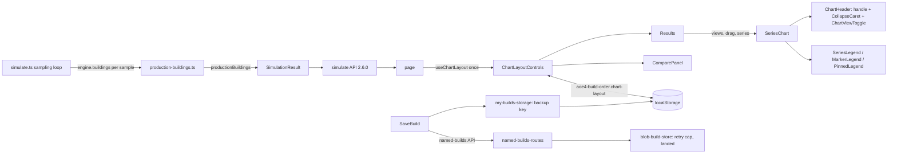

# M9: Technical design

AoE4 workbench: version saves work in production, and the results column is easier to use. Exit criteria
M9.1 to M9.13 in MILESTONES.md, approved by the owner (Q55, Q56). M9.1 is ticket SGS-127. M9.2 is owner
evidence. This doc designs M9.3 to M9.13 and builds on the contracts in `design/M8.md` (C1 to C12). M8
names are reused unchanged unless a contract below changes them.

## Summary

The save controls become one compact row with a "Saved" live region. The run bar gets a height cap, and the
split page stops scroll-anchoring when the bar shrinks. One page-level chart-layout hook drives three
controls: a drag handle (pointer drag, plus ArrowUp/ArrowDown on the focused handle), a shared caret
used by every chart, and the new collapsible key-results panel. Collapse state persists in the existing
`ChartLayout` key. The charts get the following changes:

- Pinned lines and markers leave the tooltip and share one "dashed = pinned build" legend entry.
- The Gather rates chart and the Units produced chart each get a two-view toggle. The Units produced chart's second view reads a new simulator series, `SimulationResult.productionBuildings`; the OpenAPI version goes to 2.6.0.
- Marker legend items become buttons. Hovering or focusing one labels that kind's markers.

The editor gets a compact mode, set by a container query, below 48rem of editor width. The Blob store
caps SDK retries and confirms whether a failed write landed before reporting conflict. The my-builds list
backs up an unreadable value instead of deleting it. Two other changes finish the milestone: the test
helpers are deduplicated behind a second, stricter jscpd config, and `tsconfig.json` turns on `strict`.

### Starting state (main @ cdc51b1, M8 done; SGS-127 open)

| area | exists before the first M9 ticket |
|------|-----------------------------------|
| Save panel | `components/apps/aoe4-build-order/save-build.tsx` (334 lines) returns a fragment inside the run-bar form. The form is `run-bar`, `d-flex flex-wrap`. The order is: `save-build` (only for a "mine" entry with a secret), `save-build-copy`, the copy form (`save-copy-form`, `flex: 1 1 100%`), the link panel (`saved-build-link`, `copy-saved-link`, `copy-saved-link-hint`, `flex: 1 1 100%`), then `my-builds-unavailable` (status) and `save-build-error` (alert). The link panel shows while `saved` is set and the settled input equals the saved input. There is no "Saved" text. |
| Run bar | `.runBar` is sticky at `top: 0` from 768px up and static below that. `useRunBarHeight` writes `--aoe4-run-bar-height` on the section. At 1280x720, with the copy form, link and storage warning open, it covers about 52% of the viewport. |
| Split scroll | At 1280x800, scrolled to the end with `duration-error` shown (`scrollY` 244), clearing the error drops `scrollY` to 151. This is Chrome scroll anchoring. No `overflow-anchor` is set anywhere. |
| Chart layout | `chart-layout.ts` holds `ChartLayout{version:1, order, collapsed: ChartId[]}` under `aoe4-build-order.chart-layout`. `useChartLayout` is called inside `Results`. Its `move` and `toggle` compute from the layout captured at render time. `ChartHeader` (in `line-chart.tsx`) renders the text buttons Collapse/Expand, Up and Down (`chart-collapse`, `chart-move-up`, `chart-move-down`). |
| Key results | `ComparePanel` (`compare-panel.tsx`) has no heading and cannot collapse. It renders `pin-run`, `unpin-run`, `pinned-label` and `CompareTable`. The page renders it above `Results`. |
| Pinned display | The tooltip lists `<name> (pinned)` entries. `SeriesLegend` contains `PinnedLineKey` (`chart-pinned-key`). `MarkerLegend` adds a `chart-marker-legend-item` with `data-kind="pinned-age-up"`, "Age-up (pinned)". |
| Chart views | Gather rates has a "Per villager" checkbox (`gather-rates-per-villager`, `perVillagerSeries`). Units produced has one view. `SimulationResult` has `gatherers` but no building series. `simulate.ts` keeps `engine.buildings: Map<baseId, completed count>`. |
| Marker labels | `SeriesChart` labels only age-up markers: `labelled = ageUpMarkers(markers)`, with `placeMarkers` stacking. The legend items are non-focusable `li` elements. |
| Editor | `.gutter` is `min-width: 3rem`, `.annotations` is `width: 17ch` showing started and finished times, and the textarea is `white-space: pre`. At 390px the text column is about 130px of about 366px. At 1280x800 (split, column about 562px) it is about 290px. Library build lines reach 59 characters; the 90th percentile is 46. |
| Blob store | `blob-build-store.ts`: `@vercel/blob` 2.9.0 retries each request up to `VERCEL_BLOB_RETRIES` times (default 10, read per request from `process.env`). `bumpCounter` makes up to 3 CAS attempts. `replaceNamed` maps `BlobPreconditionFailedError` and `BlobNotFoundError` to `'conflict'`; the not-found mapping is unverified. A landed write whose response was lost and retried gets 412 and reports `'conflict'`. SGS-127 changes `read` (identity encoding, a weak etag throws). |
| My builds | `readMyBuilds` calls `removeItem(MY_BUILDS_STORAGE_KEY)` when the whole value fails to parse, which deletes every edit secret. Entries that fail per element are dropped silently and are lost on the next `upsertMyBuild`. |
| Tests | Three component tests each define `fakeStorage` and `throwingStorage`. `saved-build-loader.test.ts` repeats `stubFetch` and the JSON reply from `fetch-test-helpers.ts`. `.jscpd.json` scans `lib/aoe4-build-order`, `components/apps/aoe4-build-order` and `pages/api/aoe4-build-order`, with minTokens 70, minLines 8 and threshold 0. It does not scan `acceptance/`. Adding `acceptance/` finds 8 clones. A 5-line rule over test files finds 19. |
| Types | `tsconfig.json` has `strict: false` and `strictNullChecks: true`. `tsc --strict` reports 3 errors (TS7053): `lib/combat-simulator/simulate.test.ts` lines 61 and 198, and `acceptance/fight-api-contract.spec.ts` line 144. |
| Contract | `docs/api/openapi.json` `info.version` 2.5.0. |

## Modules

| module (path) | owns | public functions or exports | used by |
|---------------|------|-----------------------------|---------|
| `components/apps/aoe4-build-order/save-build.tsx` | save buttons, copy form, link panel, save status | `SaveBuild` (props unchanged from M8 C8) | `build-input.tsx` |
| `components/apps/aoe4-build-order/workbench.module.css` | run bar, save row, split and editor layout, compact editor mode | classes `.savePanel`, `.saveRow`, `.saveStatus` (new); `.runBar` cap; `.editor` container | save-build, build-input, page, build-text-editor |
| `components/apps/aoe4-build-order/chart-layout.ts` | persisted order and collapse model (pure) | C2 | use-chart-layout, results, compare-panel |
| `components/apps/aoe4-build-order/use-chart-layout.ts` | React state plus storage for C2 | `useChartLayout(): ChartLayoutControls` | page (only caller) |
| `components/apps/aoe4-build-order/chart-drag.ts` (new) | pure drop-index math | `dropIndexAt` | use-chart-drag |
| `components/apps/aoe4-build-order/use-chart-drag.ts` (new) | pointer drag state over the chart sections | `useChartDrag` | results |
| `components/apps/aoe4-build-order/collapse-caret.tsx` (new) | the caret button | `CollapseCaret` | chart-header, compare-panel |
| `components/apps/aoe4-build-order/chart-header.tsx` (new, moved out of `line-chart.tsx`) | chart title row: handle, caret, header controls | `ChartHeader`, `ChartControls` | line-chart |
| `components/apps/aoe4-build-order/chart-view-toggle.tsx` (new) | two-view segmented control | `ChartViewToggle` | results |
| `components/apps/aoe4-build-order/line-chart.tsx` | `SeriesChart`, marker placement, tooltip, active marker kind | `SeriesChart`, `placeMarkers`, `ageUpMarkers`, `labelledMarkers` (new) | results |
| `components/apps/aoe4-build-order/chart-legend.tsx` | series legend, marker legend, pinned legend entry | `SeriesLegend`, `MarkerLegend`, `PinnedLegend` (new); `PinnedLineKey` removed | line-chart |
| `components/apps/aoe4-build-order/result-series.ts` | `SimulationResult` to `ChartSeries[]` | `unitSeries`, `resourceSeries`, `buildingSeries` (new); `perVillagerSeries` removed | results |
| `components/apps/aoe4-build-order/compare-panel.tsx` | key-results panel with heading and collapse | `ComparePanel` (C6 props) | page |
| `components/apps/aoe4-build-order/results.tsx` | chart list, views, reorder focus | `Results` (C5 props) | page |
| `pages/apps/aoe4-build-order.tsx` | owns the one `useChartLayout()` call | page | Next |
| `components/apps/aoe4-build-order/build-text-editor.tsx` plus `step-annotation.module.css` | editor gutter and compact annotations | `BuildTextEditor` (props unchanged) | page |
| `lib/aoe4-build-order/production-buildings.ts` (new) | which buildings count as production, and their sampled series | C9 | simulate |
| `lib/aoe4-build-order/simulate.ts` (critical path) | samples completed building counts per sample time | `simulateBuildOrder` (result gains `productionBuildings`) | API, page |
| `lib/aoe4-build-order/model.ts` | result types | `BuildingSeries` (new), `SimulationResult.productionBuildings` | everything |
| `lib/aoe4-build-order/blob-build-store.ts` | Blob I/O, retry cap, landed-write check | `createBlobBuildStore` (BuildStore unchanged) | build-store |
| `lib/aoe4-build-order/blob-build-store.live.test.ts` (new) | opt-in check against a real Blob store | none (test) | owner run |
| `components/apps/aoe4-build-order/my-builds-storage.ts` | my-builds read, upsert, backup | C11 | save-build, library |
| `components/apps/aoe4-build-order/storage-test-helpers.ts` (new) | shared fake `Storage` | C12 | component tests |
| `components/apps/aoe4-build-order/fetch-test-helpers.ts` | shared fetch stubs | `stubFetch`, `lastCall`, `reply` (unchanged) | component tests incl. `saved-build-loader.test.ts` |
| `.jscpd.json`, `.jscpd.tests.json` (new), `package.json` `lint:dup` | duplication gates | C13 | CI gate |
| `tsconfig.json` | strict typing | `strict: true` | tsc, Next build |

## Contracts

### C1 Save panel (M9.3)

- DOM (inside `run-bar`, replacing the M8 fragment): `<div data-testid="save-panel" class="savePanel">`.
  - First child: the row `<div data-testid="save-row" class="saveRow">`, holding, in this order:
    1. `save-build` (when shown)
    2. `save-build-copy`
    3. `<p data-testid="save-status" role="status" aria-live="polite" aria-atomic="true">`. This element is always rendered.
    4. `saved-build-link` (when `linkVisible`)
    5. `copy-saved-link` (when `linkVisible`)
  - Below the row, in this order: `save-copy-form`, `copy-saved-link-hint`, `my-builds-unavailable`, `save-build-error`. All M8 test ids are kept.
- `.savePanel` is `flex: 1 1 100%` (its own run-bar row, under select, duration and Text/Table).
- `.saveRow` is `display:flex; flex-wrap: wrap; align-items: end; gap`. From 1200px up it is `flex-wrap: nowrap`.
- The link input inside the row is `flex: 1 1 12rem; min-width: 8rem`.
- `save-status` text: starts with `Saved`. After an update (200) it is `Saved version <revision>`, with `revision` from the 200 body. After a create (201, via Save as copy or the first save) it is `Saved`. Otherwise it is empty.

### C2 Chart layout model (M9.4)

```ts
// chart-layout.ts
export const RESULT_CHART_IDS = [...]                 // unchanged, 4 ids
export type ChartId = (typeof RESULT_CHART_IDS)[number]
export const KEY_RESULTS_PANEL_ID = 'key-results' as const
export type LayoutPanelId = ChartId | typeof KEY_RESULTS_PANEL_ID
export interface ChartLayout { version: 1; order: ChartId[]; collapsed: LayoutPanelId[] }
export function moveChart(layout: ChartLayout, id: ChartId, direction: 'up' | 'down'): ChartLayout   // unchanged
export function moveChartTo(layout: ChartLayout, id: ChartId, toIndex: number): ChartLayout          // new
export function toggleChartCollapsed(layout: ChartLayout, id: LayoutPanelId): ChartLayout            // widened
// use-chart-layout.ts
export interface ChartLayoutControls {
  layout: ChartLayout
  move(id: ChartId, direction: 'up' | 'down'): void
  moveTo(id: ChartId, toIndex: number): void
  toggle(id: LayoutPanelId): void
}
export function useChartLayout(): ChartLayoutControls
```

- Storage key `CHART_LAYOUT_STORAGE_KEY` and `version: 1` are unchanged. `normalizeChartLayout` keeps `collapsed` ids in `[...RESULT_CHART_IDS, 'key-results']` and drops other ids. An M8 value reads unchanged.
- `toIndex` is the final 0-based index of `id` in `order`. It is clamped to `0..order.length-1`; the first sample is 0 and the last is 3.

### C3 Chart header controls (M9.4)

```ts
// chart-header.tsx
export interface ChartControls {
  collapsed: boolean
  dragging: boolean
  onToggle(): void
  onMoveKey(direction: 'up' | 'down'): void
  onHandlePointerDown(event: React.PointerEvent<HTMLButtonElement>): void
}
// collapse-caret.tsx
export function CollapseCaret(props: { expanded: boolean; name: string; controlsId: string; onToggle(): void; testId: string }): JSX.Element
// use-chart-drag.ts
export function useChartDrag(order: readonly ChartId[], onDrop: (id: ChartId, toIndex: number) => void): {
  dragging: ChartId | null
  start(id: ChartId, event: React.PointerEvent<HTMLButtonElement>): void
  sectionRef(id: ChartId): (element: HTMLElement | null) => void
}
// chart-drag.ts
export function dropIndexAt(otherMidpoints: readonly number[], pointerY: number): number
```

- Handle: `<button type="button" data-testid="chart-drag-handle" aria-label="Reorder <title> chart" aria-keyshortcuts="ArrowUp ArrowDown" aria-describedby="chart-reorder-help">`. The glyph is a grip icon. `chart-reorder-help` is one visually hidden element per Results, with text telling the user to drag, or to use the up and down arrows.
- Caret: `CollapseCaret` renders `<button type="button" data-testid={testId} aria-expanded={expanded} aria-controls={controlsId} aria-label={(expanded ? 'Collapse ' : 'Expand ') + name}>`. Its glyph is a caret that points down when expanded and right when collapsed. Charts pass `testId="chart-collapse"` and `name="<title> chart"`.
- Chart section: `data-testid=<chartId>` (unchanged) and `data-dragging="true"` while dragged. The body stays `chart-body` with `data-collapsed`.
- Order announcements: `<p data-testid="chart-order-status" role="status" class="visually-hidden">`, one per Results. After any move (keyboard or drop) its text names the chart and its new 1-based position of 4. The first position is 1 and the last is 4.
- Removed: `chart-move-up` and `chart-move-down`.

### C4 Key-results panel (M9.4)

- `ComparePanel` gains the props `collapsed: boolean` and `onToggleCollapsed(): void`.
- DOM: `<section data-testid="compare-panel">`.
  - A header row: `<h3 class="h5" data-testid="compare-heading">Key results</h3>`, then `CollapseCaret testId="compare-collapse" name="key results" controlsId="compare-body"`, then `pin-run` and `unpin-run`.
  - `<div id="compare-body" data-testid="compare-body" data-collapsed>`, holding `pinned-label` and `CompareTable`.
- Collapsed: the body's children are not rendered. The header row, including the pin buttons, stays.

### C5 Results props (M9.4, M9.6)

`Results` gains `chartLayout: ChartLayoutControls` and stops calling `useChartLayout`. The page calls
`useChartLayout()` once and passes `chartLayout` to `Results`, and `layout.collapsed.includes('key-results')`
and `() => toggle('key-results')` to `ComparePanel`.

### C6 Pinned display (M9.5)

- Each pinned `Line` is excluded from the tooltip, so the tooltip lists only current-run series.
- `PinnedLegend` renders `<p data-testid="chart-pinned-legend">`, which holds a swatch `<span data-testid="chart-pinned-legend-swatch" data-line-style="dashed">` followed by the text "dashed = pinned build".
- `SeriesChart` renders it after `SeriesLegend` and `MarkerLegend` when the chart draws at least one pinned line or pinned marker.
- Removed: `PinnedLineKey`, `chart-pinned-key`, `chart-pinned-key-swatch`, the `MarkerLegend` `pinnedAgeUps` prop, and its `data-kind="pinned-age-up"` item.
- Pinned lines keep the name `<name> (pinned)` (still used as the recharts line name), their dashed style and their colour rule.

### C7 Chart views (M9.6)

```ts
// chart-view-toggle.tsx
export interface ChartView<V extends string> { value: V; label: string }
export function ChartViewToggle<V extends string>(props: { name: string; views: readonly ChartView<V>[]; value: V; onChange(value: V): void }): JSX.Element
export type GatherRatesView = 'rate' | 'villagers'
export type UnitsProducedView = 'units' | 'buildings'
// result-series.ts
export function buildingSeries(result: SimulationResult): ChartSeries[]   // key = baseId, name, values = counts
```

- DOM: `<div role="group" data-testid="chart-view-toggle" aria-label="<name> view" class="btn-group btn-group-sm">`, holding one `<button type="button" data-testid="chart-view-option" data-view={value} aria-pressed>` per view.
- Gather rates views:

  | value | label | series | y label |
  |-------|-------|--------|---------|
  | `rate` | Rate | `resourceSeries(run.gatherRates)` | Per minute |
  | `villagers` | Villagers | `resourceSeries(run.gatherers)` | Villagers |

- Units produced views:

  | value | label | series | y label |
  |-------|-------|--------|---------|
  | `units` | Units | `unitSeries(run)` | Count |
  | `buildings` | Buildings | `buildingSeries(run)` | Buildings |

- `rate` and `units` are the defaults. The view lives in `Results` state and is not persisted.
- Removed: `gather-rates-per-villager` and `perVillagerSeries`.

### C8 Marker labels (M9.7)

```ts
// line-chart.tsx
export function labelledMarkers(markers: readonly ChartMarker[], active: ChartMarkerKind | null): ChartMarker[]
// active === null -> ageUpMarkers(markers); else markers.filter(m => m.kind === active)
// chart-legend.tsx
MarkerLegend props: { markers: readonly ChartMarker[]; active: ChartMarkerKind | null;
  onHover(kind: ChartMarkerKind | null): void; onFocusKind(kind: ChartMarkerKind | null): void }
```

- Each legend item is `<li class="list-inline-item">`, holding a `<button type="button" data-testid="chart-marker-legend-item" data-kind={kind} data-active={kind === active ? 'true' : undefined} aria-label="Show <Kind label> marker labels">`. Inside the button are the swatch and the `MARKER_KIND_LABELS[kind]` text.
- `SeriesChart` state is `hoverKind` and `focusKind`, and `active = hoverKind ?? focusKind`.

### C9 Production building series (M9.6, simulator)

```ts
// model.ts
export interface BuildingSeries { baseId: string; name: string; counts: number[] }
// SimulationResult gains (after unitsProduced):
productionBuildings: BuildingSeries[]
// production-buildings.ts
export function productionBuildingIds(data: GameData): ReadonlySet<string>
export function productionBuildingSeries(data: GameData, samples: readonly ReadonlyMap<string, number>[]): BuildingSeries[]
```

- A building is a production building when its baseId appears in `producedBy` of any snapshot entry with `type === 'unit'` in the civ's `GameData` (A1: from data only). Today that includes the town center (villagers, scouts) and unit-producing landmarks.
- `samples[i]` is the completed-instance count per baseId (`engine.buildings`) at `times[i]`, taken where the sampling loop records `gatherers`.
- `counts.length === times.length`. `counts[0]` is at t=0 and includes starting buildings. The last entry is at `durationSeconds`.
- `name` is the `name` of `data.byBaseId.get(baseId)[0]`.
- OpenAPI goes 2.5.0 to 2.6.0. `docs/api/openapi.json` gains the `BuildingSeries` schema and the required `productionBuildings` on the simulate response. `acceptance/openapi-schemas.ts` follows.

### C10 Blob seam (M9.10)

```ts
// blob-build-store.ts (module-private unless noted)
export const BLOB_SDK_RETRIES = 1
const landed = async (key: string, json: string): Promise<boolean>   // fresh read; true iff value re-serialized === json
```

- `createBlobBuildStore` sets `process.env.VERCEL_BLOB_RETRIES = String(BLOB_SDK_RETRIES)` when it is unset. An explicit env value wins, which leaves the owner an override.
- Every write calls `landed` when its `put` throws: `create` (named and saved builds), `bumpCounter` and `replaceNamed`. See the Behavior rules.
- `BuildStore`, `PutResult`, `ReplaceResult` and every route status are unchanged.
- The live check is in `lib/aoe4-build-order/blob-build-store.live.test.ts`, run by `npm run test:blob-live`.
  - The script is `BLOB_LIVE=1 vitest run lib/aoe4-build-order/blob-build-store.live.test.ts`.
  - It runs only when `BLOB_LIVE=1` and `BUILDS_STORE_ID` are set. It is `describe.skipIf`, so `npm test` skips it.
  - Keys are under `live-check/<random>`, deleted afterwards.
  - It records which error class `put(key, json, {allowOverwrite: true, ifMatch: '"0"'})` raises on a missing key.
  - It asserts that `createBlobBuildStore(...).replaceNamed(id, json, '"0"')` on a missing id returns `'conflict'` and creates no blob.

### C11 My-builds storage (M9.10)

```ts
export const MY_BUILDS_BACKUP_KEY = 'aoe4-build-order.my-builds.backup'
export function readMyBuilds(storage: Storage): MyBuildEntry[]   // never removes or writes any key
export function upsertMyBuild(storage: Storage, entry: MyBuildEntry): { builds: MyBuildEntry[]; persisted: boolean }   // unchanged signature
```

- A stored value is intact when it parses, matches the stored shape, and every element passes `myBuildEntrySchema`.

### C12 Shared test helpers (M9.11)

```ts
// components/apps/aoe4-build-order/storage-test-helpers.ts
export function fakeStorage(entries?: Record<string, string>): Storage & { keys(): string[] }
export const throwingStorage: Storage   // every method throws
```

- `fetch-test-helpers.ts` keeps `stubFetch`, `lastCall` and `reply`. `saved-build-loader.test.ts` uses them in place of its local `stubFetch` and `json`.
- `ARCHITECTURE.md` lists both component helper files next to `lib/aoe4-build-order/test-helpers.ts` and `acceptance/helpers.ts`.

### C13 Duplication gates (M9.11, M9.9)

- `.jscpd.json` adds `"acceptance"` to `path`. The rest is unchanged: minTokens 70, minLines 8, threshold 0.
- `.jscpd.tests.json` (new) uses the same `path` list, `"minLines": 5`, `"minTokens": 70` and `"threshold": 0`. A `pattern` limits it to:
  - test files (`*.test.ts`, `*.test.tsx`, `*.spec.ts`);
  - test helpers (`*test-helpers.ts`, `route-test-support.ts`, `acceptance/helpers.ts`).
- `package.json`: `"lint:dup": "jscpd && jscpd --config .jscpd.tests.json"`.

### C14 Editor compact mode (M9.8)

- `.editor` is `container-type: inline-size; container-name: build-editor`.
- `@container build-editor (max-width: 47.99rem)` sets compact mode:
  - the editor font (gutter, annotations, textarea, through one custom property `--editor-font-size`) is 0.875rem;
  - `.annotations` width is at most 8ch;
  - `step-finished` inside `build-order-annotations` has `display: none`.
- Wider than that, the M8 layout is unchanged. The step table keeps its started, finished and waited times in both modes.
- `TYPICAL_LINE_CHARS = 48`, used in the acceptance test only. It is above the 46-character 90th percentile of the four library builds.

## Criteria map

| criterion | lands in (files) | owning module | contracts it defines | how it is tested (level, harness, fixture) |
|-----------|------------------|---------------|----------------------|--------------------------------------------|
| M9.1 | SGS-127 | blob-build-store | (SGS-127) | SGS-127 |
| M9.2 | none (owner evidence) | none | none | Owner, on the preview then production |
| M9.3 | `save-build.tsx`, `workbench.module.css`, `docs/aoe4-build-order.md` | save-build | C1 | Vitest (`save-build.test.tsx`): status text after a 201 and after a 200 with `revision: 2`, empty after a settled change and after a failure. Playwright `acceptance/aoe4-save-status.spec.ts` with the named-builds route stub from `acceptance/helpers.ts`. At 1280x800 and 390x844, `save-status` reads `Saved…` after Save as copy and `Saved version 2` after Save a new version. At 1280x800, the tops of `save-build`, `save-build-copy`, `saved-build-link` and `copy-saved-link` agree within 2px, read in one `page.evaluate`. |
| M9.4 | `chart-layout.ts`, `use-chart-layout.ts`, `chart-drag.ts`, `use-chart-drag.ts`, `collapse-caret.tsx`, `chart-header.tsx`, `line-chart.tsx`, `results.tsx`, `compare-panel.tsx`, the page, docs | chart-layout (model), results (drag) | C2, C3, C4, C5 | Vitest: `moveChartTo` first, last, same-index and clamp cases; `normalizeChartLayout` keeps `key-results` and drops unknown ids; two `toggle` calls in one act both apply; `dropIndexAt` at y above all (0) and below all (3); the handle's ArrowUp/ArrowDown calls `onMoveKey` and Home/End do nothing. Playwright `acceptance/aoe4-chart-layout.spec.ts` (rewritten): mouse drag of the first chart's handle below the third chart gives order [2,3,1,4]; ArrowDown on the focused handle moves the chart and the handle keeps focus; the caret toggles `aria-expanded` and `data-collapsed`; the key-results caret hides `compare-body`; a reload keeps order and both collapsed states. |
| M9.5 | `line-chart.tsx`, `chart-legend.tsx`, `chart-rows.ts` (doc comment), docs | chart-legend | C6 | Vitest (`line-chart.test.ts`): `chart-pinned-legend` renders only with a pinned line or marker; `chart-pinned-key` and `pinned-age-up` are absent. Playwright `acceptance/aoe4-build-order-pin-compare.spec.ts` (extended): hover over a chart with a pinned run shows tooltip items with no `(pinned)` names; one `chart-pinned-legend` per chart with a pinned run. |
| M9.6 | `model.ts`, `production-buildings.ts`, `simulate.ts`, `openapi.json`, `acceptance/openapi-schemas.ts`, `result-series.ts`, `chart-view-toggle.tsx`, `results.tsx`, docs | production-buildings (C9), results (C7) | C7, C9 | Vitest: `productionBuildingIds` on the English fixture contains `town-center` and `barracks` but not `house`; the `simulate.test.ts` counts start at 1 town center at t=0 and step up when a barracks completes (fixture `lib/aoe4-build-order/test-helpers.ts` order); the series are sorted (Behavior rules); `buildingSeries` maps the fields. Playwright: `acceptance/aoe4-simulate-api-contract.spec.ts` validates `productionBuildings` against the 2.6.0 schema; `acceptance/aoe4-chart-views.spec.ts` (replaces `aoe4-gather-rates-per-villager.spec.ts`) switches each toggle and checks `aria-pressed`, the y label and the legend names. |
| M9.7 | `line-chart.tsx`, `chart-legend.tsx`, docs | line-chart | C8 | Vitest: `labelledMarkers` with null, with `'economy'`, and with a kind that has no markers (empty). Playwright `acceptance/aoe4-marker-labels.spec.ts`: hover over the Economy legend item gives one reference-line label per economy marker in the chart, with label rects that do not overlap; mouse leave restores the age-up labels; Tab to an item does the same as hover, and blur restores them. |
| M9.8 | `build-text-editor.tsx`, `workbench.module.css`, `step-annotation.module.css`, docs | build-text-editor | C14 | Playwright `acceptance/aoe4-editor-width.spec.ts`, default page build after its run. At 390x844, `textarea.clientWidth >= 0.5 * build-order editor width`. At 1280x800, `textarea.clientWidth - paddingX >=` the width of a probe span of 48 `0`s in the textarea's computed font. Both are read in one evaluate. |
| M9.9 | docs, `ARCHITECTURE.md`, `acceptance/aoe4-split-tab-order.spec.ts`, `.jscpd.json` | each feature ticket owns its docs and spec; this row owns the Tab-order spec and the final doc pass | C13 (acceptance path) | The Tab-order spec at 1280x800 after Save as copy (link shown): Tab from `build-order-select` reaches, in strictly increasing order, `duration-seconds`, `editor-view-text`, `save-build`, `save-build-copy`, `saved-build-link`, `copy-saved-link`, then an element inside `build-column`, then one inside `results-column`. `npm run lint:dup` passes with `acceptance` scanned. |
| M9.10 | `blob-build-store.ts`, `blob-build-store.live.test.ts`, `package.json` (`test:blob-live`), `my-builds-storage.ts`; `design/M8.md` text | blob-build-store (C10), my-builds-storage (C11) | C10, C11 | Vitest `blob-build-store.test.ts` with `vi.mock('@vercel/blob')`: `put` throws 412, then a read shows our JSON, gives `'replaced'`; 412 with other JSON gives `'conflict'`; a network error when not landed rethrows; the counter landed gives the update with no further attempt; the env cap is set only when unset. The live test is run by the owner (see Owner decisions). `my-builds-storage.test.ts`: garbage value read gives `[]` and the key is untouched; an upsert over garbage writes the backup, then the list; the backup is not overwritten when present; a throwing backup write gives `persisted: false` and the original value kept. The M8.md text fixes are a factory-state edit by the manager or designer, not a code ticket. They are: C3 `end(chunk?: string): void`; link panel Escape: "focuses the button that saved if enabled, else `save-build-copy`". |
| M9.11 | `storage-test-helpers.ts`, `pin-storage.test.ts`, `chart-layout.test.ts`, `my-builds-storage.test.ts`, `saved-build-loader.test.ts`, lib route tests, `.jscpd.tests.json`, `package.json`, `ARCHITECTURE.md` | storage-test-helpers | C12, C13 | `npm run lint:dup` passes; `npm test` passes. A probe copy of the old `fakeStorage` into a test fails `lint:dup` (reviewer probe, not committed). |
| M9.12 | `workbench.module.css` (`.runBar`, `.workbenchSplit`), the page section if needed | workbench layout | none (CSS rules below) | Playwright `acceptance/aoe4-split-scroll.spec.ts` (extended). (a) At 1280x800, with `duration-error` shown and the page scrolled to the end by `mouse.wheel`, clear the error and wait 2 animation frames: `scrollY` is unchanged ±1 and the `run-bar` top is 0. (b) At 1280x720, with the copy form, link and storage warning (storage throwing via init script) open, `run-bar` height ≤ 0.4 × 720, read in one evaluate. |
| M9.13 | `tsconfig.json`, `lib/combat-simulator/simulate.test.ts`, `acceptance/fight-api-contract.spec.ts` | tsconfig | none | `npx tsc --noEmit` passes; `next build` passes. The test edits are typing only; the asserted values are unchanged. |

### Ticket order constraints

| before | after | why |
|--------|-------|-----|
| SGS-127 | M9.10 store ticket | both edit `blob-build-store.ts` `read` and `replaceNamed` |
| M9.11 (both gates) | every M9 ticket adding a spec or test | new tests are written against the stricter gate |
| M9.4 model (C2, C5, C4) | M9.4 drag (C3), M9.6 views | both edit `results.tsx` |
| M9.4 drag (moves `ChartHeader` to `chart-header.tsx`) | M9.5, M9.7 | all three edit `line-chart.tsx`; serial, not parallel |
| M9.6 simulator (C9) | M9.6 views (C7) | the view reads `productionBuildings` |
| M9.3 | M9.12 run-bar cap, M9.9 Tab order | the cap and Tab order are measured on the C1 layout |

## Layouts

New files:

| path | shape |
|------|-------|
| `components/apps/aoe4-build-order/chart-drag.ts` | one pure export, `dropIndexAt` |
| `components/apps/aoe4-build-order/use-chart-drag.ts` | hook (C3) |
| `components/apps/aoe4-build-order/collapse-caret.tsx` | component (C3) |
| `components/apps/aoe4-build-order/chart-header.tsx` | `ChartHeader` and `ChartControls`, moved from `line-chart.tsx` |
| `components/apps/aoe4-build-order/chart-view-toggle.tsx` | component plus the view types (C7) |
| `components/apps/aoe4-build-order/storage-test-helpers.ts` | C12 |
| `lib/aoe4-build-order/production-buildings.ts` | C9 |
| `lib/aoe4-build-order/blob-build-store.live.test.ts` | C10 |
| `.jscpd.tests.json` | C13 |
| `acceptance/aoe4-save-status.spec.ts`, `aoe4-chart-views.spec.ts`, `aoe4-marker-labels.spec.ts`, `aoe4-editor-width.spec.ts`, `aoe4-split-tab-order.spec.ts` | Playwright specs |

Removed: `acceptance/aoe4-gather-rates-per-villager.spec.ts`, replaced by `aoe4-chart-views.spec.ts`.

Data samples:

- `SimulationResult.productionBuildings`, English 1TC, 600s, sampled every `SAMPLE_SECONDS`:
  - first: `{ baseId: "town-center", name: "Town Center", counts: [1, 1, …, 1] }`
  - then: `{ baseId: "barracks", name: "Barracks", counts: [0, …, 0, 1, …, 1] }`
- The `ChartLayout` value in localStorage (`aoe4-build-order.chart-layout`): `{"version":1,"order":["chart-gather-rates","chart-units-produced","chart-gathered-resources","chart-floating-resources"],"collapsed":["key-results","chart-floating-resources"]}`
- `aoe4-build-order.my-builds.backup` holds the raw string that was stored under `aoe4-build-order.my-builds` when it was not intact, written verbatim.
- `.jscpd.tests.json`: `{ "path": ["lib/aoe4-build-order","components/apps/aoe4-build-order","pages/api/aoe4-build-order","acceptance"], "pattern": "<test and helper globs>", "format": ["typescript","tsx"], "minTokens": 70, "minLines": 5, "threshold": 0, "gitignore": true }`

## Behavior rules

### Save status and save row (M9.3)

| operation | case | rule |
|-----------|------|------|
| save status | create succeeds (201: first save or Save as copy) | `save-status` text becomes `Saved`. This happens in the same render that shows the link panel. Focus moves to `saved-build-link` as in M8. |
| save status | update succeeds (200) | The text becomes `Saved version <revision>`, using the response revision. |
| save status | repeat: another save while the status is shown | The text is replaced by the new save's text. The region is `aria-atomic`, so it re-announces. |
| save status | a save is in flight | The text is emptied when the request starts. |
| save status | save fails (any error reply, network error or abort) | The text stays empty. The error shows in `save-build-error` as in M8. |
| save status | the settled input changes, the link is hidden by Escape, or the build select changes | The text is emptied. Its visibility follows the M8 link-panel rule (shown while `saved` is set and the settled input equals the saved input). There is no timer. |
| save status | storage unavailable (`persisted: false`) | The status still shows. `my-builds-unavailable` shows below the row as in M8. |
| save row | 1200px and up | The buttons, status, link input and Copy link stay on one row, with no wrap. The link input shrinks to `min-width: 8rem`. |
| save row | below 1200px | The row wraps in DOM order, so `save-status` stays right after the buttons. At 390x844 the status is on the buttons' line or the line directly below them. |
| save row | no link yet | Only the buttons and the empty status are in the row. |
| copy form | open | It is on its own row below the save row. Keyboard behaviour is from M8: Enter submits when valid, Escape closes and focuses `save-build-copy`. |

### Run bar and scroll (M9.12)

| operation | case | rule |
|-----------|------|------|
| run bar | 768px and up | `.runBar` gets `max-height: 40dvh; overflow-y: auto`. The bar never covers more than 40% of the viewport. When its content is taller, the bar scrolls inside. A control that gets focus inside it is scrolled into view by the browser. |
| run bar | below 768px | Static, as in M8. No cap. |
| scroll anchoring | the run bar shrinks or grows (error cleared or shown, link shown or hidden) | The window `scrollY` does not change, ±1px, once layout settles (2 animation frames). The bar stays stuck at top 0. The column scroll positions are unchanged. |

### Chart layout, drag and caret (M9.4)

| operation | case | rule |
|-----------|------|------|
| `moveChartTo` | ordering | Remove `id` from `order`, then insert it at the clamped `toIndex`. `collapsed` is copied unchanged. |
| `moveChartTo` | same index | Returns an equal copy. The hook still writes, which is harmless. |
| `moveChartTo` | no target (`id` not in `order`) | Returns an equal copy. |
| `toggle` | repeat | Two toggles of the same id restore the original state. |
| `toggle`, `move`, `moveTo` | conflict: two calls in one render | Both apply in call order. The hook uses functional `setState` and writes the resulting layout to storage. |
| `useChartLayout` | storage unavailable or throwing | The layout works in memory and nothing persists, as in M8. |
| `useChartLayout` | first render | `DEFAULT_CHART_LAYOUT` until the mount effect reads storage. A write never happens before that read. |
| handle, keyboard | ArrowUp or ArrowDown on the focused handle | Calls `move(id, direction)` and `preventDefault` (no page scroll). The handle of the moved chart keeps focus after the re-render. `chart-order-status` announces the new position. |
| handle, keyboard | ArrowUp on the first chart or ArrowDown on the last | No change, no announcement, `preventDefault` still called. |
| handle, keyboard | Enter, Space, Home, End, other keys | Nothing (no pick-up mode). Tab moves on normally. |
| handle, pointer | pointerdown with the primary button | Pointer capture starts. The drag starts once the pointer has moved 4px; before that, release does nothing. Other buttons and non-primary touches are ignored. |
| handle, pointer | dragging | The section gets `data-dragging="true"`. The target index is `dropIndexAt(midpoints of the other 3 sections, pointerY)`, which counts the other sections whose vertical midpoint is above the pointer. `order` does not change until the drop. The results column does not auto-scroll. |
| handle, pointer | drop (pointerup) | `moveTo(id, target)`. If target equals the start index, no change and no announcement. Otherwise `chart-order-status` announces the new position and focus goes to the moved chart's handle. |
| handle, pointer | Escape while dragging, `pointercancel`, or `lostpointercapture` | The drag is cancelled with no change. `data-dragging` is removed. |
| handle | collapsed chart | Drags and moves like an expanded one. |
| caret (charts and key results) | click, Enter or Space | Toggles the panel. `aria-expanded` and `aria-label` flip and the caret keeps focus. The collapsed body's children are not rendered. |
| key results | collapsed | The heading, caret, `pin-run` and `unpin-run` stay visible and work. `pinned-label` and the table are hidden. Pinning while collapsed still updates the charts. |
| key results | no run yet (`current === null`) | Collapsing works. The body shows `compare-empty` when expanded, as today. |

### Pinned display (M9.5)

| operation | case | rule |
|-----------|------|------|
| tooltip | hover over a chart with a pinned run | Only current-run series are listed. The time label is unchanged. |
| tooltip | a current series is hidden from the legend | It is not listed (unchanged rule). |
| pinned legend | the chart draws at least one pinned line or pinned marker | One `chart-pinned-legend` after the marker legend. |
| pinned legend | no pinned run, or a pinned run with nothing drawn in this chart or view | Not rendered. |
| pinned legend | interaction | None. It is not a button and not focusable. |
| series legend toggle | hiding a series | Its pinned line hides too (the M8 `isLineHidden` rule, unchanged). |

### Chart views (M9.6)

| operation | case | rule |
|-----------|------|------|
| view toggle | click, or Enter/Space on an option | That view is selected: `aria-pressed="true"` on it and `false` on the other. Series, y label and legend change in the same render. Clicking the selected option does nothing. |
| view toggle | chart collapsed | The toggle is in the header and still works. The new view shows on expand. |
| view toggle | reload | The view resets to the default (not persisted). |
| villagers view | pinned run | Pinned lines come from `pinned.gatherers` with the M8 pinned rules. |
| buildings view | pinned run | Pinned lines come from `pinned.productionBuildings`, matched by `baseId`. A building only in the pinned run gets only a dashed line, as units do today. |
| `productionBuildingSeries` | ordering | Series are sorted by the first sample index with `count > 0`, ascending. Ties go to `baseId` ascending, by code-unit comparison. Deterministic (A3). |
| `productionBuildingSeries` | no target: a production building never completed in the run | No series. |
| `productionBuildingSeries` | under construction | Not counted. Only completed instances count (the `engine.buildings` semantics). A building completing at time t is counted at a sample at t, because the sample is taken after the instant's events, like `gatherers`. |
| `productionBuildingSeries` | duration not a multiple of `SAMPLE_SECONDS` | The last count is at `durationSeconds`, as for every series. |
| `productionBuildingIds` | a civ rule overrides `villagerProducer` | Not consulted. No civ uses it today; see Extension points. |
| simulate API | old clients | The field is additive (minor version bump). Request shapes are unchanged. |

### Marker labels (M9.7)

| operation | case | rule |
|-----------|------|------|
| legend item | mouseenter | `hoverKind = kind`. Labels show for every marker of that kind (current run only), with `placeMarkers` stacking and measured widths as for age-ups. Age-up labels are hidden unless the kind is `age-up`. |
| legend item | mouseleave | `hoverKind = null`. The labels fall back to `focusKind`, or to age-ups if no item has focus. |
| legend item | focus (Tab) or blur | `focusKind = kind` or `focusKind = null`. Hover wins while both are set. |
| legend item | click or Enter | Nothing beyond focus. There is no sticky selection. |
| legend item | Escape | Nothing. |
| legend | kinds listed | Only kinds with at least one current-run marker in this chart (unchanged), so an item always has a target. |
| pinned markers | any active kind | Never labelled. Still drawn dashed. |
| `data-active` | rendering | Set on the item whose kind is `active`. |
| chart collapsed | while hovered or focused | The legend unmounts. Its state is reset to null. |

### Editor compact mode (M9.8)

| operation | case | rule |
|-----------|------|------|
| compact mode | editor inline size below 48rem | The C14 rules apply. The gutter, annotations and textarea share `--editor-font-size` and line height, so the rows stay aligned. |
| compact mode | 48rem and wider | The M8 layout applies (started and finished times, 1rem font). |
| finish time | compact | Hidden in the gutter only. The step table and the table view still show it. |
| active-step highlight and stale tone | compact | Unchanged. |

### Blob store (M9.10)

| operation | case | rule |
|-----------|------|------|
| `landed(key, json)` | read returns a value | `JSON.stringify(value) === json`. Our writes are `JSON.stringify` of plain data, so the round trip is exact. The named builds include `updatedAt` in milliseconds, and the counters include `windowStart`. |
| `landed` | read returns null or throws | `false`. A throw is not propagated. The original error decides the outcome. |
| `replaceNamed` | `put` throws `BlobPreconditionFailedError` or `BlobNotFoundError` | If `landed`, return `'replaced'`. Otherwise return `'conflict'`, which the route turns into 412. |
| `replaceNamed` | `put` throws anything else (network, 5xx after the retry cap) | If `landed`, return `'replaced'`. Otherwise rethrow, which the route turns into 503 (M8 rule). |
| `replaceNamed` | ifMatch on a missing key | Maps to `'conflict'`. The error class is whatever the live check records. If it is neither class above, the ticket adds it to the conflict mapping. The comment "unverified" is replaced by the recorded result and its date. |
| `create` (saved and named) | `put` throws | If `landed`, return `'created'`. Else if `exists(key)`, return `'exists'`. Else rethrow. |
| `bumpCounter` | `put` throws | If `landed`, return `update` with no further attempt. Else, on 412 or (when `current === null`) if the key exists, try the next attempt. Else rethrow. After 3 attempts: `'contended'` (unchanged). |
| SDK retries | any Blob call | At most `1 + BLOB_SDK_RETRIES` HTTP attempts per SDK call. The worst case for `bumpCounter` is 3 × (read 2 + put 2 + landed read 2). |
| SDK retries | `VERCEL_BLOB_RETRIES` already set | It is left as set. |
| deterministic double | another writer wrote byte-identical JSON | It is treated as ours. This is harmless because the content is the same. |

### My builds (M9.10)

| operation | case | rule |
|-----------|------|------|
| `readMyBuilds` | missing key | `[]`. |
| `readMyBuilds` | whole value unparseable or wrong shape | `[]`. No key is removed or written. |
| `readMyBuilds` | some elements invalid | The valid ones, deduped and newest first (unchanged). No write. |
| `upsertMyBuild` | stored value intact or missing | Writes the list (M8 rule). |
| `upsertMyBuild` | stored value not intact, backup key absent | First `setItem(MY_BUILDS_BACKUP_KEY, raw)`, then write the list. |
| `upsertMyBuild` | stored value not intact, backup key present | The backup is kept (the first unreadable value wins), then the list is written. |
| `upsertMyBuild` | the backup write throws | The list is not written. Returns `{ builds, persisted: false }`, so the UI shows `my-builds-unavailable` (M8). The original value stays. |
| `myBuildsAvailable` | any | Unchanged. |

### Tab order (M9.9)

| operation | case | rule |
|-----------|------|------|
| Tab in the split layout | 1200px and up | DOM order: run bar (select, duration, Text/Table, save row in C1 order), then the build column, then the results column (key-results caret and pin buttons, then each chart's handle, caret, view toggle and legend items). No positive `tabindex`. |

## Data flow



## Extension points

| future direction | seam that keeps it additive |
|------------------|-----------------------------|
| More collapsible panels (step table, warnings) | Add an id to `LayoutPanelId` and its normalize list. The storage version stays 1. |
| More chart views (spent by category, idle villagers) | Add a `ChartView` entry and a series function in `result-series.ts`. `ChartViewToggle` is generic. |
| Other civilizations (PROJECT.md out of scope) | `productionBuildingIds(data)` is data-driven. A civ rule can later pass `CivRules.villagerProducer` into it, through an optional second parameter, without changing the result shape. |
| All-buildings or under-construction series | `BuildingSeries` is generic. A second field (e.g. `buildings`) can use the same sampler with a different id set. |
| Click-to-pin marker labels | `labelledMarkers(markers, active)` takes the kind. A sticky selection is one more state feeding `active`. |
| Recovering a corrupt my-builds list | `MY_BUILDS_BACKUP_KEY` holds the raw value. A later UI can offer it. |
| Other conditional writes | `landed(key, json)` applies to any `put` in the Blob store. |
| Chart reorder across columns or auto-scroll | `useChartDrag` owns pointer math. `dropIndexAt` is pure, so auto-scroll can be added in the hook alone. |

## Owner decisions

1. **What counts as a production building (M9.6).**
   - A (recommended): any building that produces a unit in the data. This includes the town center and unit-producing landmarks (council hall, for example).
   - B: military buildings only. This excludes buildings that produce villagers, which needs a hand list and breaks A1.
2. **Editor compact mode (M9.8).**
   - A (recommended): a container query below 48rem of editor width hides the finish time in the gutter, narrows the annotations, and sets the editor font to 0.875rem. This is the only option that meets the 1280x800 bound: at 1rem, a 48-character line plus the gutter does not fit in the 562px split column.
   - B: a "Times" toggle that hides the annotation column, with no font change. The 1280 bound is then met only when toggled.
3. **Save status lifetime (M9.3).**
   - A (recommended): shown while the link panel is shown, with no timer. It is deterministic and testable.
   - B: it clears after 5 seconds.
4. **Blob SDK retry cap (M9.10).**
   - A (recommended): `BLOB_SDK_RETRIES = 1`, set in code when the env var is unset. This keeps one retry for transient 5xx on reads.
   - B: 0, set in the Vercel project env. Any transient Blob error then becomes 503.
5. **Who runs the live Blob check (M9.10).** It needs store credentials that the agents do not have.
   - A (recommended): the owner runs `vercel env pull` and then `npm run test:blob-live` once, on the M9.10 PR branch, and pastes the output into the PR. The ticket ships the test and the missing-key mapping, conditional on that output.
   - B: grant the agents a preview-only Blob token.
6. **Key results panel when collapsed (M9.4).**
   - A (recommended): the pin and unpin buttons stay visible in the header.
   - B: collapse hides everything except the heading and caret.

## Left to tickets

- The caret and grip glyph source (inline SVG or a Unicode character), their sizes, and the drop-indicator styling during a drag.
- The wording of `chart-reorder-help`, `chart-order-status`, and the accessible names beyond the fixed prefixes above.
- The internals of collecting samples in `simulate.ts` (per-sample `Map` copy or change log), as long as C9 and A3 hold.
- How pinned lines are kept out of the tooltip (`tooltipType="none"` on the pinned `Line`, or a filter).
- How marker label widths are measured for non-age-up kinds (the same `measureRef` mechanism, keyed by marker).
- The `overflow-anchor: none` placement (section, `.workbenchSplit` or the columns) that meets the scroll rule.
- The exact jscpd `pattern` glob syntax for C13's file set, and how each acceptance clone is folded: into `acceptance/helpers.ts`, or a local function where only one spec uses it.
- Splitting the M8 `line-chart.test.ts` cases between `line-chart.test.ts` and a new `chart-header.test.tsx`.
