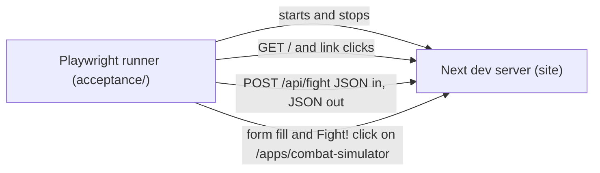

# SGS-002: Add a Playwright acceptance harness runnable by one npm script

- **Type**: Task
- **Component**: site
- **Milestone / criteria**: M1 / M1.3
- **Priority**: high
- **Risk**: standard
- **LOC estimate**: ~130 (config ~30, three spec files ~90, package.json and .gitignore ~10; no production code changes)
- **Depends on**: none
- **Source**: M1.3 via Outline C in plans/M1-20261028.md, amended by the manager: no StarCraft click-through specs (app frozen, CONTEXT.md Out of scope); PR #12 closed, so there is no Jest dependency.

## Context

The repo has no test runner (`package.json` has only `dev`; REPO.md `commands.acceptance` is empty). Later tickets
(SGS-003 input validation, SGS-005 Monte Carlo response) need a harness to add boundary cases to. This ticket
adds the harness and a thin smoke layer over the surfaces that exist today, with minimal shape assertions so
later tickets extend the specs instead of rewriting them.

## Scope

Add `@playwright/test` as a devDependency (update `package-lock.json`) and:

1. `playwright.config.ts` at the repo root. `testDir` is a new `acceptance/` directory. `webServer` starts the
   Next app (Next 12; `next dev` is acceptable, since there is no `start` script and `next build` is not needed to
   serve). Use a fixed non-default port via `baseURL` so it does not collide with a developer's `npm run dev`
   on 3000. Chromium only. Set a `webServer.timeout` generous enough for the first dev compile of a page.
2. npm scripts in `package.json`:
   - `acceptance`: runs `playwright test` (one command, starts and stops the server itself).
   - `acceptance:setup`: `playwright install chromium`. (H-1 will map this to REPO.md `commands.acceptanceSetup`.)
3. Specs, all `.ts` (tsconfig `include` only covers ts/tsx, and `npx tsc --noEmit` is the lint gate, so the specs
   and config must typecheck under it):
   - `acceptance/landing.spec.ts`: `/` renders; the "Combat Simulator" link navigates to `/apps/combat-simulator`
     and the "Starcraft Helper" link to `/apps/starcraft-helper`, each resolving with a 200 and showing its page
     `<h1>`. Check link resolution only, with no interaction on the StarCraft page (frozen; invariant S2).
   - `acceptance/fight-api.spec.ts`: `POST /api/fight` through Playwright's `request` fixture with a valid body
     (keys `attack-regs`, `attack-elts`, `attack-ldrs`, `defend-regs`, `defend-elts`, `defend-ldrs`) returns 200
     and JSON. Assert only that the body is an object with a `survivor` string and numeric `rounds`; do not
     assert the full `BattleStats` shape (SGS-005 changes it).
   - `acceptance/combat-simulator.spec.ts`: on `/apps/combat-simulator`, set the six selects by `name`
     attribute (the `<label htmlFor>` values have no matching ids in `army.js`, so label locators will not
     work), click "Fight!", and assert the "Army Results" and "Fighting Stats" headings render. Do not assert
     numbers or table contents beyond what is stable. Choose input values that give a non-zero start for both
     sides (a side with 0 units yields 0 rounds and NaN today).
   - Put selector helpers (fill a army by name, post a fight) in a single small shared module under
     `acceptance/` only if two or more specs use them, so SGS-003 and SGS-005 add cases by calling helpers.
4. `.gitignore`: add Playwright output directories (`test-results`, `playwright-report`).

**Out of scope:** any StarCraft Helper spec or interaction (frozen); changes to `pages/**`, `components/**`,
`utils/**` (including adding `data-testid` attributes; select by role, text, or `name`); validation or
boundary cases (SGS-003); frequency or Monte Carlo assertions (SGS-005); Jest or unit tests; CI workflow files;
editing REPO.md (H-1 is a manager action after merge); `golang/`; tsconfig changes unless `tsc --noEmit` fails
because of the new files.

## Diagrams

## Acceptance criteria

- [ ] After `npm ci` and the setup script, a single `npm run acceptance` starts the app, runs all specs, stops the server, and exits 0 on a clean checkout, with no dev server already running.
- [ ] `npm run acceptance:setup` installs the Chromium browser needed by the specs.
- [ ] The landing spec fails if either app link is removed from `pages/index.js` or points to a route that does not return 200.
- [ ] The API spec fails if `POST /api/fight` with a valid body stops returning 200 JSON, or if the body lacks a `survivor` string or numeric `rounds`.
- [ ] The simulator spec fails if clicking "Fight!" with valid inputs no longer renders the "Army Results" and "Fighting Stats" sections.
- [ ] No spec visits or interacts with `/apps/starcraft-helper` beyond the landing-page link resolving.
- [ ] Specs assert no more of the response/DOM shape than listed above, so adding input fields or changing `BattleStats` fields other than `survivor` and `rounds` does not break them.
- [ ] `npx tsc --noEmit` passes with the new `.ts` files, and `npx next build` still succeeds.
- [ ] `git status` after a run shows no untracked Playwright output (ignored via `.gitignore`).
- [ ] No files under `pages/`, `components/`, `utils/`, or `styles/` change.
- [ ] No INVARIANTS.md regressions

## Open questions

- Can the factory host or CI download Playwright's Chromium (network, disk, and system libraries on WSL2)? The ticket cannot verify this; the implementer must run the harness and report the outcome. If browsers cannot be installed, this is a blocker, not a pass.
- Directory name `acceptance/` is proposed; the plan allowed `e2e/`. Owner may prefer the other (it must match REPO.md `acceptanceHarness` in H-1).
