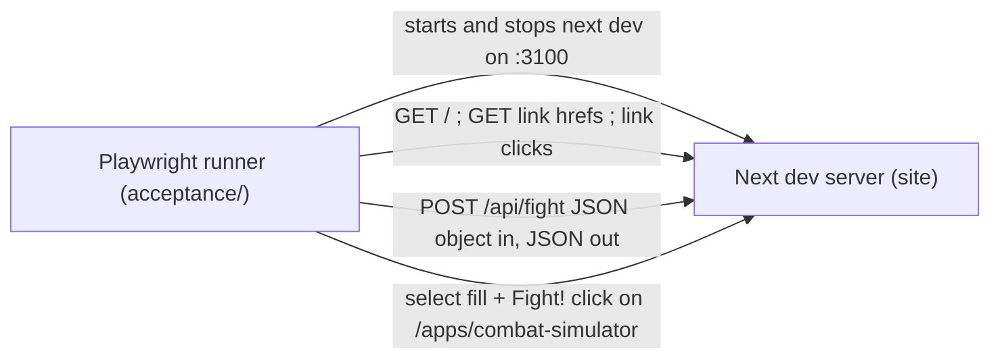

# SGS-002: Add a Playwright acceptance harness runnable by one npm script

- **Type**: Task
- **Component**: site
- **Milestone / criteria**: M1 / M1.3
- **Priority**: high
- **Risk**: standard
- **LOC estimate**: ~140 (config ~30, three spec files ~95, shared helper ~10, package.json and .gitignore ~10; no production code changes)
- **Depends on**: none
- **Source**: M1.3 via Outline C in plans/M1-20261028.md, amended by the manager: no StarCraft click-through specs (app frozen, CONTEXT.md Out of scope); PR #12 closed, so there is no Jest dependency. Re-specced once (respec 1) from reports/SGS-002-spec-gate.md.

## Context

The repo has no test runner (`package.json` has only `dev`; REPO.md `commands.acceptance` is empty). Later tickets
(SGS-003 input validation, SGS-005 Monte Carlo response, SGS-006 contract check) need a harness to add cases to.
This ticket adds the harness and a thin smoke layer over the surfaces that exist today, with minimal shape
assertions so later tickets extend the specs instead of rewriting them. `ARCHITECTURE.md` on main names
`acceptance/` as the home for end-to-end tests that drive the running site over HTTP and through the browser.

Facts the specs rely on (origin/main d54af2e):

- `pages/index.js` links with `next/link`: `<a>Combat Simulator</a>` to `/apps/combat-simulator` and
  `<a>Starcraft Helper</a>` to `/apps/starcraft-helper` (emoji sit outside the anchors). Clicking is client-side
  navigation, so there is no document response whose status a click could assert.
- `pages/apps/combat-simulator.js` renders `<h1>Combat Simulator</h1>`, an `<h2>Results</h2>`, and a submit
  `<input value="Fight!">`. `submitFight` calls `e.preventDefault()` and POSTs `JSON.stringify(Object.fromEntries(FormData))`
  (all values strings) to `/api/fight`. Before React hydrates, the click does a native GET submit instead.
- `components/apps/combat-simulator/army.js`: selects named `<attack|defend>-regs|elts|ldrs`, no `id`s (so
  `<label htmlFor>` locators do not work); regs/elts options 0-9, leaders 0-5.
- `components/apps/combat-simulator/results.js`: `<h4>` "Army Results" and "Fighting Stats".
- `pages/api/fight.ts`: `parseFightForm` reads the six keys with `parseInt` (strings and numbers both parse);
  `getStats()` returns `survivor` (string) and `rounds` (number). A side with 0 regulars and 0 elites gives
  `rounds` 0 and NaN averages (serialised as `null`).
- `pages/apps/starcraft-helper.js` renders `<h1>Starcraft Helper</h1>`.
- Node v22.17 on the host. Playwright browsers are not installed (`~/.cache/ms-playwright` absent).

## Scope

Add `@playwright/test` as a devDependency (update `package-lock.json`, keeping `lockfileVersion` 2) and:

1. `playwright.config.ts` at the repo root (respec 1):
   - `testDir: 'acceptance'`. Chromium project only.
   - Port pinned to **3100** (not 3000, so it does not collide with a developer's `npm run dev`). `use.baseURL`
     is `http://localhost:3100`; `webServer.command` is `next dev -p 3100` (or `npx next dev -p 3100`);
     `webServer.url` (or `port`) points at the same port.
   - `webServer.reuseExistingServer: false`, so the run always starts and stops its own server.
   - `webServer.timeout` generous enough for the first `next dev` compile (Next 12; there is no `start` script
     and `next build` is not needed to serve).
2. npm scripts in `package.json`:
   - `acceptance`: `playwright test` (one command; starts and stops the server itself).
   - `acceptance:setup`: `playwright install chromium`. (H-1 will map this to REPO.md `commands.acceptanceSetup`.)
3. Shared module `acceptance/helpers.ts` (respec 1), used by both the API and simulator specs:
   - A default valid armies constant, keyed by the six field names, with values as **strings** (matching what
     the form posts): `attack-regs: "3"`, `attack-elts: "1"`, `attack-ldrs: "1"`, `defend-regs: "3"`,
     `defend-elts: "1"`, `defend-ldrs: "1"`. Every side has at least one regular or elite; all values are inside
     the form's option ranges (regs/elts <= 9, leaders <= 5) and inside the project caps (regulars + elites <= 10,
     leaders <= 5), so later validation tickets keep it valid.
   - A helper that fills the six selects on the simulator page by `name` attribute from an armies object.
   - A helper that posts an armies object to `/api/fight` via the `request` fixture.
   SGS-003 and SGS-005 add cases by calling these with other armies.
4. Specs, all `.ts` (tsconfig `include` covers `**/*.ts`, and `npx tsc --noEmit` and `next build` both typecheck
   them):
   - `acceptance/landing.spec.ts` (respec 1): `page.goto('/')`. For each of the two links, located by exact link
     name ("Combat Simulator", "Starcraft Helper"):
     1. assert its `href` attribute equals the route (`/apps/combat-simulator`, `/apps/starcraft-helper`);
     2. assert `request.get(href)` returns status 200;
     3. go back to `/` if needed, click the link, assert `page` URL ends with the route, and assert the page's
        `<h1>` has exact text "Combat Simulator" / "Starcraft Helper".
     No interaction with any control on `/apps/starcraft-helper` (frozen; invariant S2 is what is checked).
   - `acceptance/fight-api.spec.ts` (respec 1): `POST /api/fight` with the default armies passed as Playwright's
     `data:` **object** (not a pre-stringified body), so Playwright serialises it and sets
     `Content-Type: application/json`. Assert status 200, a JSON body that is an object, `typeof survivor ===
     'string'`, and `typeof rounds === 'number'`. Do not assert the rest of `BattleStats` (SGS-005 changes it).
   - `acceptance/combat-simulator.spec.ts` (respec 1):
     1. `page.goto('/apps/combat-simulator')`, then wait for hydration with `page.waitForLoadState('networkidle')`
        before touching the form. If `networkidle` does not settle under `next dev`, use another signal that
        proves React has attached handlers, and say which in the PR description; do not use fixed sleeps.
     2. Fill the selects with the default armies via the shared helper.
     3. Start `page.waitForResponse` for a POST to `/api/fight` **before** clicking "Fight!" (the submit input,
        located by role button with name "Fight!"); click; assert that response's status is 200.
     4. Assert headings "Army Results" and "Fighting Stats" are visible, matched with `exact: true` (a loose
        "Results" match would also hit the page's `<h2>Results</h2>`). Assert no numbers or table contents.
5. `.gitignore`: add Playwright output directories (`test-results/`, `playwright-report/`, and
   `blob-report/` / `playwright/.cache/` if the installed version creates them).
6. Environment (respec 1): browsers are not installed on the factory host. The implementer runs
   `npm ci`, `npm run acceptance:setup`, then `npm run acceptance`, and records the outcome in the PR
   description. If Chromium fails to launch for missing system libraries, try `npx playwright install-deps
   chromium`; if that needs sudo or otherwise fails, stop and report a **blocker** with the error output. A run
   that never launched a browser is not a pass.

**Out of scope:** any StarCraft Helper interaction (frozen); changes to `pages/**`, `components/**`,
`utils/**`, `styles/**` (including adding `data-testid` attributes; select by role, text, or `name`); validation
or boundary cases (SGS-003); frequency or Monte Carlo assertions (SGS-005); the OpenAPI contract check (SGS-006);
Jest or unit tests; CI workflow files; editing REPO.md (H-1 is a manager action after merge); `golang/`; tsconfig
changes unless `tsc --noEmit` fails because of the new files.

## Diagrams

## Acceptance criteria

- [x] After `npm ci` and `npm run acceptance:setup`, a single `npm run acceptance` starts its own server on port 3100, runs all specs, stops the server, and exits 0 on a clean checkout. (respec 1)
- [x] With another process already listening on port 3100, `npm run acceptance` fails rather than reusing it (`reuseExistingServer: false`). (respec 1)
- [x] `npm run acceptance:setup` installs the Chromium browser needed by the specs; if it or the browser launch cannot succeed on the host, the implementer reports a blocker with the error, not a pass. (respec 1)
- [x] The landing spec fails if either app link is removed from `pages/index.js`, if its `href` changes from the route, if `GET` of the route does not return 200, or if clicking it does not land on that route with the expected exact `<h1>`. (respec 1)
- [x] The API spec posts the default armies (each side >= 1 regular or elite, values as strings) as a JSON object and fails if `POST /api/fight` stops returning 200 JSON, or if the body lacks a `survivor` string or numeric `rounds`. (respec 1)
- [x] The simulator spec waits for hydration before filling, waits for the `/api/fight` response around the "Fight!" click and asserts it is 200, and fails if the exact headings "Army Results" and "Fighting Stats" do not render. (respec 1)
- [x] No spec interacts with controls on `/apps/starcraft-helper`; loading it via the landing link (and a `GET` of its route) and reading its `<h1>` is allowed. (respec 1)
- [x] The default armies and the fill/post helpers live in `acceptance/helpers.ts` and are used by both the API and simulator specs. (respec 1)
- [x] Specs assert no more of the response/DOM shape than listed above, so adding input fields or changing `BattleStats` fields other than `survivor` and `rounds` does not break them.
- [x] `npx tsc --noEmit` passes with the new `.ts` files, and `npx next build` still succeeds.
- [x] `git status` after a run shows no untracked Playwright output (ignored via `.gitignore`).
- [x] No files under `pages/`, `components/`, `utils/`, or `styles/` change.
- [x] No INVARIANTS.md regressions

## Open questions

None. (The directory question is settled by `ARCHITECTURE.md`: `acceptance/`. Whether the host can install and
launch Chromium is environmental; scope item 6 says what to do and that a failure is a blocker.)

## Re-spec 2026-10-28

**Underspecified (reports/SGS-002-spec-gate.md):**
1. Landing spec: "resolving with a 200" was unobservable because `next/link` clicks are client-side; and the
   old AC 6 ("no visit beyond the link resolving") contradicted reading the StarCraft `<h1>`.
2. API spec: valid body values and their encoding were unstated; a zero-unit side yields `rounds` 0 and NaN.
3. Simulator spec: hydration race under `next dev` (pre-hydration click does a native submit) and a loose
   "Results" heading match were unaddressed.
4. Notes: port was not pinned, `reuseExistingServer` unspecified, browser install not yet possible on the host.

**What changed:**
- Landing spec now asserts `href`, `request.get(href)` 200, then click + URL + exact `<h1>`. AC 6 reworded to
  allow loading the StarCraft page via the link and reading its `<h1>`, forbidding interaction with its controls.
- Default armies fixed: each side 3 regulars, 1 elite, 1 leader, as strings, sent as a `data:` object. Lives in
  `acceptance/helpers.ts` with fill and post helpers, now mandatory rather than conditional.
- Simulator spec: `networkidle` hydration wait after `goto`, `waitForResponse` started before the click with a
  200 assertion, `exact: true` heading matches.
- Config: port pinned to 3100, `reuseExistingServer: false`; new AC for the occupied-port case.
- Environment: implementer runs setup, tries `install-deps`, and reports a blocker on failure (scope item 6, AC 3).
- Lockfile stays at version 2. Directory open question deleted (`ARCHITECTURE.md` names `acceptance/`).
- LOC estimate ~130 -> ~140 for the now-mandatory helper module.

**Existing branch work:** none. Branch `sgs-002-playwright-acceptance-harness` has not been created.

## Manager note - 2026-10-28

SGS-007 merged first (Vitest is on `main` at 3934ff8). Before review, rebase this branch onto `main`, regenerate
the lockfile with `npm install --lockfile-version 2`, and confirm the top-level `name` is still
`"WOTR_Combat_Simulator"`.

## Manager note - 2026-10-29 (gates)

Review approved 78048f7. Acceptance-test gate skipped: this ticket is the harness, and its own specs (6/6, plus 30/30 under `--repeat-each=5` in review) are its acceptance evidence; REPO.md has no `acceptanceHarness` until this merges.
