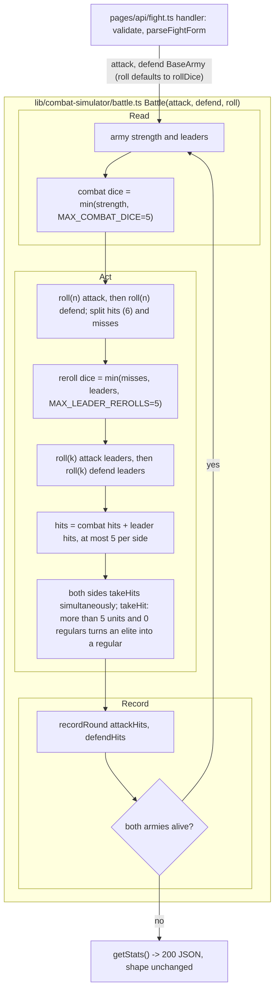

# SGS-004: Move WOTR battle logic to lib/combat-simulator and apply the combat dice and leadership-reroll caps

- **Type**: Task
- **Component**: wotr-combat-simulator
- **Milestone / criteria**: M1 / M1.9
- **Priority**: high
- **Risk**: high
  <!-- strongModelTriggers: touches W1 (dice, leader, casualty logic), changes the per-round combat loop in Battle(), estimated over 150 lines of business logic once the moved code is counted. -->
- **LOC estimate**: ~215 (respec 1) (business logic only, tests excluded. Moved with no behavior change: ~190 lines, which are `rollDice`, `calculateCombatRollResults`, `Battle`, `BattleResult`, `BattleStats` from `pages/api/fight.ts`, plus `Army`/`BaseArmy` from `pages/api/models/army.ts`. New or changed: ~25 lines, which are two cap constants, the dice-roller parameter, two `Math.min` edits, the `takeHit` downgrade branch, the re-export file, and the `fight.ts` import and call. Under the ~400 line split threshold, so no split. See the commit-order note in Scope.)
- **Depends on**: SGS-001 (the merged `docs/combat-simulator.md` must state the 5-die cap, the reroll cap, and the 0-regulars elite-downgrade rule; see Preconditions), SGS-003 (also edits `pages/api/fight.ts`, so the two are serialized; it brings in the SGS-002 harness transitively), SGS-007 (unit test runner) (respec 1)
- **Source**: M1.9; CONTEXT.md Decisions ("WOTR rules", "WOTR caps", "WOTR casualties", "Testing", "`/api/models/army`"); ARCHITECTURE.md on `main` (d54af2e): "Where files go" and "Existing code that predates this layout"; `docs/combat-simulator.md` (SGS-001) for rule wording; spec gate `reports/SGS-004-spec-gate.md`.

## Context

`Battle()` in `pages/api/fight.ts` rolls `attack.getCombatStrength()` dice (regulars + elites) with no upper bound. It rerolls `min(misses, leaders)` leader dice with no cap. `BaseArmy.takeHit()` in `pages/api/models/army.ts` pushes `regulars` below 0 when an army of more than 5 units has no regulars. The published rules cap combat at 5 dice and leader rerolls at 5, and the owner set the elite-downgrade casualty rule. So W1 fails for large armies today.

None of this logic can be tested deterministically from where it lives: it sits under `pages/api/` and calls `Math.random` directly. ARCHITECTURE.md puts app logic in `lib/<app>/` as plain TypeScript. This ticket moves the logic there, adds an injectable dice roller, applies the caps, and unit-tests the round logic. (respec 1)

## Preconditions (respec 1)

- `docs/combat-simulator.md` is on `main`, merged by SGS-001, and states all of these as rules:
  - combat dice = min(regulars + elites, 5);
  - leader rerolls = min(misses, leaders, 5);
  - with more than 5 units and 0 regulars, a hit turns an elite into a regular.
- This ticket cites those rules and does not edit the doc. If the merged doc is missing any of them or states a different value, stop and bounce to `needs_spec`. Do not resolve the conflict in code.
- SGS-003 is merged, so `handler` already validates input and `acceptance/` (from SGS-002) exists with `fight-api.spec.ts`.
- SGS-007 is merged, so `npm test` runs `.ts` unit tests.

## Scope

Locate code by name. SGS-003 shifts line numbers in `pages/api/fight.ts`.

### 1. New `lib/combat-simulator/army.ts` (respec 1)

- Move `Army` and `BaseArmy` here from `pages/api/models/army.ts`, unchanged except for the `takeHit` edit below.
- `BaseArmy.takeHit()`, the `getCombatStrength() > 5` branch:
  - if `regulars > 0`, decrement `regulars` (unchanged);
  - otherwise turn one elite into a regular (`elites--`, `regulars++`).
  - The `<= 5` branches are unchanged.
  - Rule source: the casualty section of `docs/combat-simulator.md`.
- `getCombatStrength()` and `isArmyAlive()` are unchanged. They still use the real army size, which also drives the `> 5` casualty branch. The dice cap is not applied here.

### 2. New `lib/combat-simulator/battle.ts` (respec 1)

- Move `rollDice`, `CombatRollOps`, `CombatRollResults`, `calculateCombatRollResults`, `BattleResult`, `BattleStats`, and `Battle` here from `pages/api/fight.ts`. Keep their bodies as they are apart from the changes listed here. Export what `fight.ts` and the tests need: `Battle`, `BattleResult`, `BattleStats`, `rollDice`, the roller type, and the two constants.
- No import from `next`, `react`, `pages/`, or `components/`. The only import is `./army`.
- **Dice seam.**
  - Add an exported type for the roller, matching `rollDice`'s current signature: `(numDice: number) => number[]`, returning faces 1-6.
  - `Battle` takes the two armies and an optional roller that defaults to `rollDice`. For example: `Battle(attack: BaseArmy, defend: BaseArmy, roll: DiceRoller = rollDice): BattleResult`.
  - Every die in `Battle` is rolled through `roll`.
  - Keep the per-round call order the code has today: attack combat, defend combat, attack leader, defend leader. The unit tests rely on this order.
  - `FormParseResult` stays in `fight.ts`.
- **Caps.**
  - Add `MAX_COMBAT_DICE = 5` and `MAX_LEADER_REROLLS = 5` as named constants. Keep them separate from `takeHit`'s `> 5` army-size threshold: the values match, but the meanings differ.
  - Combat roll for each side: `roll(Math.min(<side>.getCombatStrength(), MAX_COMBAT_DICE))`.
  - Leader roll for each side: `roll(Math.min(<side>CombatResult.misses.length, <side>.leaders, MAX_LEADER_REROLLS))`.
- The hit threshold (`> 5`, so a hit on 6 only), simultaneous `takeHits`, `recordRound`, `getStats()`, and both `console.log` calls are unchanged. SGS-005 removes the logs.

### 3. `pages/api/fight.ts` (respec 1)

- Shrinks to `FormParseResult`, `parseFightForm`, SGS-003's validation, and `handler`.
- `handler` calls `Battle(form.attackArmy, form.defendArmy)` from `lib/combat-simulator/battle` and returns `getStats()` as JSON, exactly as today.
- Imports `BaseArmy` from `lib/combat-simulator/army`.
- Request handling, status codes, error bodies, and the response shape are unchanged. SGS-005 changes the shape.

### 4. `pages/api/models/army.ts` stays as a re-export (respec 1)

- Replace its body with type and value re-exports from `lib/combat-simulator/army`: `export type { Army }` and `export { BaseArmy }`. `isolatedModules` is on, so the type needs `export type`.
- Why this option:
  - The file stays at the same path with no default export, so the `/api/models/army` route behaves the same as on `main`.
  - Only one copy of `BaseArmy` exists. Leaving the old file in place would keep a second copy without the downgrade fix.
- Nothing in the app imports from this path after the change.

### 5. Unit tests (respec 1)

- Add unit tests for `lib/combat-simulator/`, written in `.ts`. Use SGS-007's runner, test-file location, and naming. Every acceptance criterion marked "unit" below has a test.
- Tests inject a scripted roller that records each `numDice` it receives and returns chosen faces. No test depends on `Math.random`.
- Tests call `Battle` and `BaseArmy` directly. Do not add a separate per-round export just for tests: the recorded roller calls and `BattleResult.attackHitsPerRound` / `defendHitsPerRound` expose each round.

### 6. `ARCHITECTURE.md`, "Existing code that predates this layout" (respec 1)

- Rewrite the WOTR bullet to match the new layout:
  - the WOTR logic and model now live in `lib/combat-simulator/`;
  - `pages/api/fight.ts` is the route handler;
  - `pages/api/models/army.ts` re-exports the model;
  - it is still served as `/api/models/army`, which is not part of the API.
- Keep the wording factory-free, per shipped-artifact hygiene.

### Commit order (respec 1)

Use two commits so a reviewer can check the move separately from the behavior change:

1. A pure move, with no behavior change. This covers items 1-4 without the caps or the `takeHit` edit, plus the roller parameter defaulting to `rollDice`. Review it with `git diff --color-moved`.
2. The caps, the downgrade rule, the tests, and the ARCHITECTURE.md bullet.

**Out of scope:**
- Any edit to `docs/combat-simulator.md` (SGS-001 owns it).
- Any other change to the casualty order (it is intentional and stands in for the player's choice).
- The hit threshold.
- The N-battle loop, response-shape changes, and removing the `console.log` calls (SGS-005).
- Input validation and the 10-unit cap (SGS-003).
- Character and Nazgul leadership.
- `docs/api/openapi.json` (SGS-006). The request and response are unchanged, so no spec update is needed.
- Seeded or reproducible randomness in production (the seam exists for tests; the default roller stays `Math.random`).
- Moving or removing the `/api/models/army` route.
- `golang/`.

## Diagrams

Changes the per-round control loop in `Battle()`. The phases are read, act, and record. The caps and the injected roller are marked, and the handler-to-lib boundary is shown. (respec 1)

## Acceptance criteria

Rule values and wording come from `docs/combat-simulator.md` as merged by SGS-001. "Unit" means a test in the SGS-007 runner that injects a scripted roller. The first face in a list is the first die of that call.

Combat dice cap (unit):
- [ ] (respec 1) Attack 10 regulars / 0 leaders vs defend 10 regulars / 0 leaders, with a roller that returns all 1s on round 1. Round 1's first two roller calls (attack combat, defend combat) each receive `numDice` 5. This fails on today's code, which passes 10.
- [ ] (respec 1) Attack 3 regulars + 2 elites vs defend 1 regular: the first call receives 5. Attack 3 regulars vs defend 1 regular: the first call receives 3. This shows armies of 5 or fewer units are unchanged.

Leader rerolls (unit):
- [ ] (respec 1) With combat faces scripted to give the attacker m misses on round 1, the attack leader call (third call of the round) receives min(m, leaders) for each of these cases:
  - m = 5, leaders = 5: receives 5;
  - m = 5, leaders = 2: receives 2;
  - m = 3, leaders = 5: receives 3;
  - m = 0, leaders = 5: receives 0.
- [ ] (respec 1) The `MAX_LEADER_REROLLS` bound is checked by the reviewer reading the diff, with no automated test. Once combat dice are capped at 5, misses are at most 5, so the reroll cap cannot change any outcome. It is defensive, and the named constant makes it reviewable.

Hits per round (unit):
- [ ] (respec 1) Attack 10 regulars / 5 leaders vs defend 10 regulars / 5 leaders, with a roller that always returns 6s. Round 1's `attackHitsPerRound[0]` and `defendHitsPerRound[0]` each equal 5, and every entry of both arrays is at most 5. This fails today, where round 1 records 10.
- [ ] (respec 1) Same armies, with combat dice all 1s and leader dice all 6s on round 1. Round 1 records 5 hits per side, all of them from leader rerolls, and no entry exceeds 5.

Casualties (unit, directly on `BaseArmy`):
- [ ] (respec 1) 0 regulars / 7 elites taking one hit at a time passes through these states (regulars/elites): 1/6, then 0/6, then 1/5, then 0/5, then 1/4. The first step fails today, where it gives -1/7.
- [ ] (respec 1) 6 regulars / 0 elites taking one hit becomes 5/0. 0 regulars / 3 elites taking one hit becomes 1/2. 2 regulars / 0 elites taking one hit becomes 1/0. Together these show the rest of the casualty order is unchanged.
- [ ] (respec 1) For every starting army with regulars + elites from 1 to 10, applying `takeHit` until `isArmyAlive()` is false gives these results:
  - `regulars` and `elites` are never negative after any hit;
  - the army ends at 0/0;
  - `leaders` never changes.

Layout and behavior preserved (respec 1):
- [ ] `lib/combat-simulator/*.ts` imports nothing from `next`, `react`, `pages/`, or `components/`. A grep in review is enough.
- [ ] HTTP check using the SGS-002 harness, which is on `main` through SGS-003. `npm run acceptance` passes with no spec files changed. That includes `acceptance/fight-api.spec.ts` and SGS-003's specs, which assert that a valid `POST /api/fight` returns 200 with the `BattleStats` keys (`attack`, `defend`, `rounds`, `averageAttackHitsPerRound`, `averageDefendHitsPerRound`, `survivor`), and the 400 and 405 cases.
- [ ] `GET /api/models/army` under `npm run dev` returns the same status code on this branch as on its base commit. The reviewer records both codes in the review report.
- [ ] Clicking Fight! on `/apps/combat-simulator` with 10/0/5 vs 0/10/5 still renders the "Army Results" table.
- [ ] `npm test`, `npx tsc --noEmit`, and `npx next build` pass.
- [ ] The first commit is a pure move. `git diff --color-moved` shows no logic change apart from the roller parameter and the import paths.
- [ ] No INVARIANTS.md regressions:
  - W1: the caps and the downgrade rule match the doc, and the hit threshold and round order are unchanged;
  - W2: `Battle` still runs on the armies the handler builds for this request;
  - S3: not affected.

## Open questions

Resolved by the owner (2026-10-28):
1. Combat roll uses min(regulars + elites, 5) dice. Leader rerolls = min(misses, leaders, 5).
2. Confirmed: a side scores at most 5 hits per round.
3. Leadership comes from `leaders` only. Character and Nazgul leadership is a later milestone.
4. Casualty order with more than 5 units and 0 regulars: a hit turns an elite into a regular. In scope.
5. (respec 1) Testing: the logic moves to `lib/combat-simulator/` and is unit-tested with the SGS-007 runner through an injectable dice roller. The statistical HTTP criteria are dropped.
6. (respec 1) `/api/models/army` stays where it is, documented as not part of the API.
7. (respec 1) The doc's downgrade rule comes from SGS-001. This ticket cites it and does not edit the doc.

Still open (non-blocking, with defaults stated):
- (respec 1) Test-file location and naming follow SGS-007. If SGS-007 sets no convention, put the test files next to the code as `lib/combat-simulator/<module>.test.ts`.

## Re-spec 2026-10-28

Re-spec 1, from `reports/SGS-004-spec-gate.md` and the owner's testing decision (CONTEXT.md Decisions, "Testing").

**What was underspecified**
- Gaps 1 and 2: the HTTP statistical criteria could not tell a correct cap from no cap, because `getStats()` averages over rounds. Criterion 4's expectation of about 0.83 was wrong. The reroll cap had no observable effect and depended on a seam that did not exist.
- Gap 3: the elite-downgrade criterion had no concrete input or observable.
- Gap 4: where the tests live, and the harness dependency, were unstated.
- Gap 5: SGS-001 and SGS-004 could disagree on whether the doc states the downgrade rule.

**What changed**
- Scope now moves the battle logic and the army model into `lib/combat-simulator/` (`army.ts`, `battle.ts`). It adds an injectable dice roller to `Battle` and names the constants `MAX_COMBAT_DICE` and `MAX_LEADER_REROLLS`. `pages/api/fight.ts` becomes a thin handler. `pages/api/models/army.ts` becomes a re-export, so the route behaves the same and only one copy of the model exists. The ARCHITECTURE.md bullet about pre-layout WOTR code is updated. A two-commit order is set (pure move, then behavior).
- All criteria were rewritten as deterministic unit tests: the dice count, leader rerolls, hits per round, the exact 7-elite downgrade trace, unchanged casualty branches, and an exhaustive no-negative-counts check over every army size. The reroll cap of 5 is a review-only check. HTTP is reduced to the existing harness specs passing unchanged, plus a status-code comparison for `/api/models/army` and a UI smoke check.
- Depends on now adds SGS-007. The harness comes in transitively through SGS-003, which depends on SGS-002.
- The Preconditions section makes SGS-001's merged doc the source for all three rules. If they are missing, the ticket bounces and does not edit the doc.
- LOC re-estimated at ~215, most of it moved code. It stays under the split threshold, so this remains one ticket.

**Existing branch work that still stands**
- None. Branch `sgs-004-wotr-combat-caps` has not been created.

## Manager notes - 2026-10-28 (from spec-gate pass 2, non-blocking)

- The scripted test roller throws once its script is exhausted, so a test that would loop forever fails fast.
- Drop the unused `Results` import from `pages/api/fight.ts` while thinning the handler.
- Test location is settled by SGS-007: `lib/combat-simulator/<module>.test.ts`, run by `npm test`.
