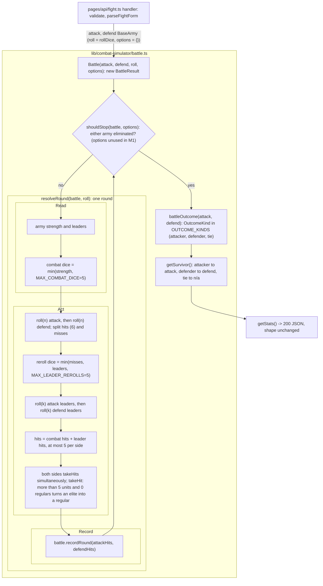

# SGS-004: Move WOTR battle logic to lib/combat-simulator, split it into a round step and a loop, and apply the combat dice and leadership-reroll caps

- **Type**: Task
- **Component**: wotr-combat-simulator
- **Milestone / criteria**: M1 / M1.9
- **Priority**: high
- **Risk**: high
  <!-- strongModelTriggers: touches W1 (dice, leader, casualty logic), changes the per-round combat loop in Battle(), estimated over 150 lines of business logic once the moved code is counted. -->
- **LOC estimate**: ~245 (respec 2) (business logic only; tests and docs excluded. Moved with no behavior change: ~190 lines, which are `rollDice`, `calculateCombatRollResults`, `Battle`, `BattleResult`, `BattleStats` from `pages/api/fight.ts`, plus `Army`/`BaseArmy` from `pages/api/models/army.ts`. New or changed: ~55 lines. ~25 of those are from respec 1: two cap constants, the dice-roller parameter, two `Math.min` edits, the `takeHit` downgrade branch, the re-export file, and the `fight.ts` import and call. ~30 are from respec 2: the `resolveRound` extraction, `shouldStop`, `BattleOptions`, `OUTCOME_KINDS`/`OutcomeKind`, `battleOutcome`, and the `getSurvivor` derivation. Under the ~400 line split threshold, so no split. See the commit-order note in Scope.)
- **Depends on**: SGS-001 (the merged `docs/combat-simulator.md` must state the 5-die cap, the reroll cap, and the 0-regulars elite-downgrade rule; see Preconditions), SGS-003 (also edits `pages/api/fight.ts`, so the two are serialized; it brings in the SGS-002 harness transitively), SGS-007 (unit test runner) (respec 1)
- **Source**: M1.9; CONTEXT.md Decisions ("WOTR rules", "WOTR caps", "WOTR casualties", "Testing", "`/api/models/army`", "WOTR extensibility" (respec 2)); ARCHITECTURE.md on `main` (d54af2e): "Where files go" and "Existing code that predates this layout"; `docs/combat-simulator.md` on `main` (8532a0b) for rule wording; spec gate `reports/SGS-004-spec-gate.md`.

## Context

`Battle()` in `pages/api/fight.ts` rolls `attack.getCombatStrength()` dice (regulars + elites) with no upper bound. It rerolls `min(misses, leaders)` leader dice with no cap. `BaseArmy.takeHit()` in `pages/api/models/army.ts` pushes `regulars` below 0 when an army of more than 5 units has no regulars. The published rules cap combat at 5 dice and leader rerolls at 5, and the owner set the elite-downgrade casualty rule. So W1 fails for large armies today.

None of this logic can be tested deterministically from where it lives: it sits under `pages/api/` and calls `Math.random` directly. ARCHITECTURE.md puts app logic in `lib/<app>/` as plain TypeScript. This ticket moves the logic there, adds an injectable dice roller, applies the caps, and unit-tests the round logic. (respec 1)

The owner wants later termination rules (max rounds, attacker retreat) to plug in without reworking the battle loop, but does not want them built now. So this ticket also splits `Battle` into a per-round step and a loop with one named stop check, adds an empty options argument, and puts the outcome kinds in one exported list. (respec 2)

## Preconditions (respec 1)

- `docs/combat-simulator.md` is on `main`, merged by SGS-001, and states all of these as rules:
  - combat dice = min(regulars + elites, 5);
  - leader rerolls = min(misses, leaders, 5);
  - with more than 5 units and 0 regulars, a hit turns an elite into a regular.
- Verified on `main` at 8532a0b (respec 2): "Round order" steps 1 and 3 and the "Casualties" section state all three.
- This ticket cites those rules and does not edit the rule text. Its only doc edits are the ones in Scope item 7 (respec 2). If the merged doc is missing any rule or states a different value, stop and bounce to `needs_spec`. Do not resolve the conflict in code.
- SGS-003 is merged, so `handler` already validates input and `acceptance/` (from SGS-002) exists with `fight-api.spec.ts`.
- SGS-007 is merged, so `npm test` runs `.ts` unit tests. `vitest.config.ts` includes `lib/**/*.test.ts`.

## Scope

Locate code by name. SGS-003 shifts line numbers in `pages/api/fight.ts`.

### 1. New `lib/combat-simulator/army.ts` (respec 1)

- Move `Army` and `BaseArmy` here from `pages/api/models/army.ts`, unchanged except for the `takeHit` edit below.
- `BaseArmy.takeHit()`, the `getCombatStrength() > 5` branch:
  - if `regulars > 0`, decrement `regulars` (unchanged);
  - otherwise turn one elite into a regular (`elites--`, `regulars++`).
  - The `<= 5` branches are unchanged.
  - Rule source: the casualty section of `docs/combat-simulator.md`.
- `getCombatStrength()` and `isArmyAlive()` are unchanged. They still use the real army size, which also drives the `> 5` casualty branch. The dice cap is not applied here.

### 2. New `lib/combat-simulator/battle.ts` (respec 1, respec 2)

- Move `rollDice`, `CombatRollOps`, `CombatRollResults`, `calculateCombatRollResults`, `BattleResult`, `BattleStats`, and `Battle` here from `pages/api/fight.ts`. Keep their bodies as they are apart from the changes listed here.
- (respec 2) Export what `fight.ts`, the tests, and SGS-005/SGS-006 need: `Battle`, `BattleResult`, `BattleStats`, `rollDice`, `DiceRoller`, `MAX_COMBAT_DICE`, `MAX_LEADER_REROLLS`, `resolveRound`, `shouldStop`, `BattleOptions`, `OUTCOME_KINDS`, `OutcomeKind`, and `battleOutcome`.
- No import from `next`, `react`, `pages/`, or `components/`. The only import is `./army`.
- **Dice seam.**
  - Add an exported type `DiceRoller` matching `rollDice`'s current signature: `(numDice: number) => number[]`, returning faces 1-6.
  - Every die in a battle is rolled through the injected roller.
  - Keep the per-round call order the code has today: attack combat, defend combat, attack leader, defend leader. The unit tests rely on this order.
  - `FormParseResult` stays in `fight.ts`.
- **Round step and loop (respec 2).** The pinned shape uses `BattleResult` as the state object, because it already holds both armies, which are mutated in place, plus the round record. A later max-rounds rule needs `rounds`, which lives there too.
  - `export function resolveRound(battle: BattleResult, roll: DiceRoller): void`
    - Runs exactly one round on `battle.attackArmy` and `battle.defendArmy`, in today's order: combat rolls, leader rerolls, hits, simultaneous `takeHits`, then `battle.recordRound(attackHits, defendHits)`.
    - Its body is today's `while` body. The per-round `console.log` moves with it unchanged.
    - It does not check whether either army is alive. The loop does that.
  - `export type BattleOptions = {}`
    - Empty in M1.
    - One short comment: later termination rules (for example a round limit) are added as fields here.
  - `export function shouldStop(battle: BattleResult, options: BattleOptions): boolean`
    - Returns true when either army is eliminated (`!isArmyAlive()`), otherwise false.
    - Reads no field of `options` in M1. It takes the argument so a later rule needs no signature change.
  - `export function Battle(attack: BaseArmy, defend: BaseArmy, roll: DiceRoller = rollDice, options: BattleOptions = {}): BattleResult`
    - Creates the `BattleResult`.
    - Then `while (!shouldStop(battleResult, options)) resolveRound(battleResult, roll);`.
    - Then the existing "Final result" `console.log`, and returns. The loop condition is equivalent to today's `attack.isArmyAlive() && defend.isArmyAlive()`.
- **Outcome kinds (respec 2).**
  - `export const OUTCOME_KINDS = ['attacker', 'defender', 'tie'] as const;`
  - `export type OutcomeKind = typeof OUTCOME_KINDS[number];`
  - `export function battleOutcome(attack: BaseArmy, defend: BaseArmy): OutcomeKind`
    - attacker alive and defender eliminated: `'attacker'`;
    - defender alive and attacker eliminated: `'defender'`;
    - both eliminated: `'tie'`;
    - both alive: throws an `Error`, because an unfinished battle has no outcome. M1's only stop check is elimination, so a finished `Battle` never reaches this branch. A later rule that ends a battle with both sides standing adds a kind for it.
  - `BattleResult.getSurvivor()` keeps its name and its return values. Its body becomes a lookup on `battleOutcome(this.attackArmy, this.defendArmy)` through a `Record<OutcomeKind, string>`: `attacker` maps to `"attack"`, `defender` to `"defend"`, and `tie` to `"n/a"`.
    - This is equivalent for every finished battle, because at least one side is eliminated. The only difference is `getSurvivor()` or `getStats()` on a battle where both sides are alive, which now throws instead of returning `"attack"`. No caller does that.
    - `getStats()`, `BattleStats`, and the `survivor` field are otherwise unchanged. SGS-005 replaces the response.
- **Caps.**
  - Add `MAX_COMBAT_DICE = 5` and `MAX_LEADER_REROLLS = 5` as named constants. Keep them separate from `takeHit`'s `> 5` army-size threshold: the values match, but the meanings differ.
  - In `resolveRound`, the combat roll for each side is `roll(Math.min(<side>.getCombatStrength(), MAX_COMBAT_DICE))`.
  - In `resolveRound`, the leader roll for each side is `roll(Math.min(<side>CombatResult.misses.length, <side>.leaders, MAX_LEADER_REROLLS))`.
- The hit threshold (`> 5`, so a hit on 6 only), simultaneous `takeHits`, `recordRound`, `getStats()`, and both `console.log` calls are unchanged. SGS-005 removes the logs.

### 3. `pages/api/fight.ts` (respec 1)

- Shrinks to `FormParseResult`, `parseFightForm`, SGS-003's validation, and `handler`. Drop the unused `Results` import.
- `handler` calls `Battle(form.attackArmy, form.defendArmy)` from `lib/combat-simulator/battle`, passing neither roller nor options, and returns `getStats()` as JSON, exactly as today.
- Imports `BaseArmy` from `lib/combat-simulator/army`.
- Request handling, status codes, error bodies, and the response shape are unchanged. SGS-005 changes the shape.

### 4. `pages/api/models/army.ts` stays as a re-export (respec 1)

- Replace its body with type and value re-exports from `lib/combat-simulator/army`: `export type { Army }` and `export { BaseArmy }`. `isolatedModules` is on, so the type needs `export type`.
- Why this option:
  - The file stays at the same path with no default export, so the `/api/models/army` route behaves the same as on `main`.
  - Only one copy of `BaseArmy` exists. Leaving the old file in place would keep a second copy without the downgrade fix.
- Nothing in the app imports from this path after the change.

### 5. Unit tests (respec 1, respec 2)

- Add `lib/combat-simulator/army.test.ts` and `lib/combat-simulator/battle.test.ts`, run by `npm test`. Every acceptance criterion marked "unit" below has a test.
- Tests inject a scripted roller that records each `numDice` it receives and returns chosen faces. The roller throws once its script runs out, so a test that would loop forever fails fast. No test depends on `Math.random`.
- (respec 2) Tests call `BaseArmy`, `resolveRound`, `shouldStop`, `battleOutcome`, and `Battle` directly. Single-round criteria may use `resolveRound` on a hand-built `BattleResult`. Whole-battle criteria use `Battle`.

### 6. `ARCHITECTURE.md`, "Existing code that predates this layout" (respec 1)

- Rewrite the WOTR bullet to match the new layout:
  - the WOTR logic and model now live in `lib/combat-simulator/`;
  - `pages/api/fight.ts` is the route handler;
  - `pages/api/models/army.ts` re-exports the model;
  - it is still served as `/api/models/army`, which is not part of the API.
- Keep the wording factory-free, per shipped-artifact hygiene.

### 7. `docs/combat-simulator.md` (respec 2)

- Add a `### Extension points` subsection at the end of "Departures from the published game", which is where "Fight to elimination" is stated. In two to four sentences, it says that later termination rules, such as a round limit or attacker retreat, plug in at three places, and that none of them is modeled today:
  - the stop check `shouldStop` in `lib/combat-simulator/battle.ts`;
  - the `BattleOptions` argument to `Battle`;
  - the outcome list `OUTCOME_KINDS`.
- Remove the two **Current code** notes this ticket makes false:
  - the note under "Round order" about no 5-die cap and no 5-reroll cap;
  - the note under "Casualties" about negative regulars.
  The doc's own convention is that a planned change brings the code in line with the rule, so these notes go once the code matches. Leave every other Current code note and all rule text unchanged.
- Keep the wording factory-free, per shipped-artifact hygiene.

### Commit order (respec 2)

Use three commits so a reviewer can check each kind of change on its own:

1. A pure move, with no behavior change. This covers items 1-4 without the caps or the `takeHit` edit, plus the roller parameter defaulting to `rollDice`. Review it with `git diff --color-moved`.
2. A behavior-preserving restructure: `resolveRound`, `shouldStop`, `BattleOptions`, `OUTCOME_KINDS`/`OutcomeKind`, `battleOutcome`, and the `getSurvivor` derivation. `npm run acceptance` passes on this commit with no spec changes.
3. The caps, the downgrade rule, the tests, the ARCHITECTURE.md bullet, and the doc edits.

**Out of scope:**
- Any edit to the rule text of `docs/combat-simulator.md`. The only doc edits are the ones in item 7. (respec 2)
- Implementing any termination rule other than elimination: max rounds, attacker retreat, or a round limit. Also adding any field to `BattleOptions`, or any outcome kind beyond attacker, defender, and tie. (respec 2)
- Changing `getStats()`, `BattleStats`, the `survivor` values, or the response shape (SGS-005).
- Any other change to the casualty order (it is intentional and stands in for the player's choice).
- The hit threshold.
- The N-battle loop and removing the `console.log` calls (SGS-005).
- Input validation and the 10-unit cap (SGS-003).
- Character and Nazgul leadership.
- `docs/api/openapi.json` (SGS-006). The request and response are unchanged, so no spec update is needed.
- Seeded or reproducible randomness in production (the seam exists for tests; the default roller stays `Math.random`).
- Moving or removing the `/api/models/army` route.
- `golang/`.

## Diagrams

This ticket changes the per-round control loop in `Battle()`. The diagram shows the loop calling `shouldStop` and `resolveRound`, and `resolveRound` grouped into read, act, and record phases. It marks the caps, the injected roller, the empty options, and the handler-to-lib boundary. (respec 2)

## Acceptance criteria

Rule values and wording come from `docs/combat-simulator.md` as merged by SGS-001. "Unit" means a test in the Vitest runner that injects a scripted roller. The first face in a list is the first die of that call.

Combat dice cap (unit):
- [x] (respec 1) Attack 10 regulars / 0 leaders vs defend 10 regulars / 0 leaders, with a roller that returns all 1s on round 1. Round 1's first two roller calls (attack combat, defend combat) each receive `numDice` 5. This fails on today's code, which passes 10.
- [x] (respec 1) Attack 3 regulars + 2 elites vs defend 1 regular: the first call receives 5. Attack 3 regulars vs defend 1 regular: the first call receives 3. This shows armies of 5 or fewer units are unchanged.

Leader rerolls (unit):
- [x] (respec 1) With combat faces scripted to give the attacker m misses on round 1, the attack leader call (third call of the round) receives min(m, leaders) for each of these cases:
  - m = 5, leaders = 5: receives 5;
  - m = 5, leaders = 2: receives 2;
  - m = 3, leaders = 5: receives 3;
  - m = 0, leaders = 5: receives 0.
- [x] (respec 1) The `MAX_LEADER_REROLLS` bound is checked by the reviewer reading the diff, with no automated test. Once combat dice are capped at 5, misses are at most 5, so the reroll cap cannot change any outcome. It is defensive, and the named constant makes it reviewable.

Hits per round (unit):
- [x] (respec 1) Attack 10 regulars / 5 leaders vs defend 10 regulars / 5 leaders, with a roller that always returns 6s. Round 1's `attackHitsPerRound[0]` and `defendHitsPerRound[0]` each equal 5, and every entry of both arrays is at most 5. This fails today, where round 1 records 10.
- [x] (respec 1) Same armies, with combat dice all 1s and leader dice all 6s on round 1. Round 1 records 5 hits per side, all of them from leader rerolls, and no entry exceeds 5.

Round step, stop check, and outcome (unit) (respec 2):
- [x] (respec 2) `resolveRound` runs exactly one round. Setup: a `BattleResult` over attack 3 regulars / 0 elites / 0 leaders and defend 2 regulars / 0 elites / 0 leaders, and a roller scripted with attack combat [6, 6, 1], then defend combat [6, 1], then empty leader rolls. After one call:
  - the roller received exactly four calls, with `numDice` 3, 2, 0, 0 in that order;
  - `battle.rounds` is 1;
  - `attackHitsPerRound` is [2] and `defendHitsPerRound` is [1];
  - the attack army is 2/0 (regulars/elites) and the defend army is 0/0;
  - no fifth roller call happens, even though the defender is now eliminated.
- [x] (respec 2) `resolveRound` applies casualties simultaneously. Setup: attack 1 regular vs defend 1 regular, 0 leaders each, with combat faces [6] and [6]. After one call both armies are 0/0 and both sides record 1 hit. A version that applied the attacker's hits before the defender rolled would record 0 defend hits.
- [x] (respec 2) `shouldStop(battle, {})` returns false when both armies have regulars + elites above 0. It returns true when exactly one army is at 0, for each side, and true when both are at 0.
- [x] (respec 2) `battleOutcome` returns:
  - `'attacker'` for attack 1/0 vs defend 0/0;
  - `'defender'` for attack 0/0 vs defend 1/0;
  - `'tie'` for attack 0/0 vs defend 0/0;
  - and throws for attack 1/0 vs defend 1/0.
  Every value it returns is a member of `OUTCOME_KINDS`.
- [x] (respec 2) `Battle` loops `resolveRound` until `shouldStop` is true. Attack 1 regular vs defend 1 regular, 0 leaders each, scripted so round 1 is [1] and [1] and round 2 is [6] and [1]: `Battle(attack, defend, roller)` returns `rounds` 2, the roller receives exactly 8 calls, and `getStats().survivor` is `"attack"`. With round 1 scripted [6] and [6], `rounds` is 1 and `survivor` is `"n/a"`. With round 1 scripted [1] and [6], `survivor` is `"defend"`.
- [x] (respec 2) `Battle(attack, defend)` and `Battle(attack, defend, roller)` both compile and run with no options argument. `BattleOptions` is exported and has no fields (`npx tsc --noEmit`).

Casualties (unit, directly on `BaseArmy`):
- [x] (respec 1) 0 regulars / 7 elites taking one hit at a time passes through these states (regulars/elites): 1/6, then 0/6, then 1/5, then 0/5, then 1/4. The first step fails today, where it gives -1/7.
- [x] (respec 1) 6 regulars / 0 elites taking one hit becomes 5/0. 0 regulars / 3 elites taking one hit becomes 1/2. 2 regulars / 0 elites taking one hit becomes 1/0. Together these show the rest of the casualty order is unchanged.
- [x] (respec 1) For every starting army with regulars + elites from 1 to 10, applying `takeHit` until `isArmyAlive()` is false gives these results:
  - `regulars` and `elites` are never negative after any hit;
  - the army ends at 0/0;
  - `leaders` never changes.

Docs (respec 2):
- [x] (respec 2) `docs/combat-simulator.md` has an "Extension points" subsection that names `shouldStop`, `BattleOptions`, and `OUTCOME_KINDS` and says no extra termination rule is modeled. The two Current code notes for the dice/reroll caps and for negative regulars are gone. A diff of the doc shows no other change. A reviewer checks this by reading the diff.

Layout and behavior preserved (respec 1):
- [x] `lib/combat-simulator/*.ts` imports nothing from `next`, `react`, `pages/`, or `components/`. A grep in review is enough.
- [x] HTTP check using the SGS-002 harness, which is on `main` through SGS-003. `npm run acceptance` passes with no spec files changed, on the final commit and on commit 2 (respec 2). That includes `acceptance/fight-api.spec.ts` and SGS-003's specs, which assert that a valid `POST /api/fight` returns 200 with the `BattleStats` keys (`attack`, `defend`, `rounds`, `averageAttackHitsPerRound`, `averageDefendHitsPerRound`, `survivor`), and the 400 and 405 cases.
- [x] `GET /api/models/army` under `npm run dev` returns the same status code on this branch as on its base commit. The reviewer records both codes in the review report.
- [x] Clicking Fight! on `/apps/combat-simulator` with 10/0/5 vs 0/10/5 still renders the "Army Results" table.
- [x] `npm test`, `npx tsc --noEmit`, and `npx next build` pass.
- [x] (respec 2) The first commit is a pure move. `git diff --color-moved` shows no logic change apart from the roller parameter and the import paths. The second commit changes no dice counts, casualty logic, or response values.
- [x] No INVARIANTS.md regressions:
  - W1: the caps and the downgrade rule match the doc, and the hit threshold and round order are unchanged;
  - W2: `Battle` still runs on the armies the handler builds for this request;
  - S3: not affected. The stop check still ends every battle on elimination. (respec 2)

## Open questions

Resolved by the owner (2026-10-28):
1. Combat roll uses min(regulars + elites, 5) dice. Leader rerolls = min(misses, leaders, 5).
2. Confirmed: a side scores at most 5 hits per round.
3. Leadership comes from `leaders` only. Character and Nazgul leadership is a later milestone.
4. Casualty order with more than 5 units and 0 regulars: a hit turns an elite into a regular. In scope.
5. (respec 1) Testing: the logic moves to `lib/combat-simulator/` and is unit-tested with the SGS-007 runner through an injectable dice roller. The statistical HTTP criteria are dropped.
6. (respec 1) `/api/models/army` stays where it is, documented as not part of the API.
7. (respec 1) The doc's downgrade rule comes from SGS-001. This ticket cites it and does not edit the rule text.
8. (respec 2) WOTR extensibility: leave seams (round step plus loop with a stop check, an empty `BattleOptions`, `OUTCOME_KINDS`) for later termination rules without building them.
9. (respec 1, settled by SGS-007) Test files are `lib/combat-simulator/<module>.test.ts`, run by `npm test`.

Still open (non-blocking, with defaults stated):
- (respec 2) Item 7 removes the two Current code notes this ticket makes false. The owner's instruction named only the Extension points subsection. Default: remove them, because otherwise the merged doc would describe the old behavior as current. If the owner prefers a separate doc-sync change, drop that bullet and its criterion.

## Re-spec 2026-10-28

Re-spec 1, from `reports/SGS-004-spec-gate.md` and the owner's testing decision (CONTEXT.md Decisions, "Testing").

**What was underspecified**
- Gaps 1 and 2: the HTTP statistical criteria could not tell a correct cap from no cap, because `getStats()` averages over rounds. Criterion 4's expectation of about 0.83 was wrong. The reroll cap had no observable effect and depended on a seam that did not exist.
- Gap 3: the elite-downgrade criterion had no concrete input or observable.
- Gap 4: where the tests live, and the harness dependency, were unstated.
- Gap 5: SGS-001 and SGS-004 could disagree on whether the doc states the downgrade rule.

**What changed**
- Scope now moves the battle logic and the army model into `lib/combat-simulator/` (`army.ts`, `battle.ts`). It adds an injectable dice roller to `Battle` and names the constants `MAX_COMBAT_DICE` and `MAX_LEADER_REROLLS`. `pages/api/fight.ts` becomes a thin handler. `pages/api/models/army.ts` becomes a re-export, so the route behaves the same and only one copy of the model exists. The ARCHITECTURE.md bullet about pre-layout WOTR code is updated. A two-commit order is set (pure move, then behavior).
- All criteria were rewritten as deterministic unit tests: the dice count, leader rerolls, hits per round, the exact 7-elite downgrade trace, unchanged casualty branches, and an exhaustive no-negative-counts check over every army size. The reroll cap of 5 is a review-only check. HTTP is reduced to the existing harness specs passing unchanged, plus a status-code comparison for `/api/models/army` and a UI smoke check.
- Depends on now adds SGS-007. The harness comes in transitively through SGS-003, which depends on SGS-002.
- The Preconditions section makes SGS-001's merged doc the source for all three rules. If they are missing, the ticket bounces and does not edit the doc.
- LOC re-estimated at ~215, most of it moved code. It stays under the split threshold, so this remains one ticket.

**Existing branch work that still stands**
- None. Branch `sgs-004-wotr-combat-caps` has not been created.

## Manager notes - 2026-10-28 (from spec-gate pass 2, non-blocking)

- The scripted test roller throws once its script is exhausted, so a test that would loop forever fails fast.
- Drop the unused `Results` import from `pages/api/fight.ts` while thinning the handler.
- Test location is settled by SGS-007: `lib/combat-simulator/<module>.test.ts`, run by `npm test`.

## Re-spec 2026-10-28 (2)

Re-spec 2, from an owner design change (CONTEXT.md Decisions, "WOTR extensibility"). Nothing in the code was wrong. The spec had no seams for later termination rules.

**What was underspecified**
- `Battle` was one monolithic loop. A later max-rounds or retreat rule would have had to rewrite it, and nothing named where the stop decision lives.
- Outcome kinds existed only as the string literals `"attack"`, `"defend"`, and `"n/a"` inside `getSurvivor`. SGS-005 and SGS-006 had no shared source to derive from.
- The ticket banned a per-round export, so a single round could only be tested through the whole battle.

**What changed**
- Scope item 2 pins five new exports in `lib/combat-simulator/battle.ts`:
  - `resolveRound(battle: BattleResult, roll: DiceRoller): void`, which runs one round in today's order and records it;
  - `shouldStop(battle: BattleResult, options: BattleOptions): boolean`, which today returns "either army is eliminated";
  - `Battle(attack, defend, roll = rollDice, options: BattleOptions = {})`, which loops the two;
  - `export type BattleOptions = {}`, with a comment saying where round limits go;
  - `OUTCOME_KINDS` / `OutcomeKind` / `battleOutcome(attack, defend)`, which throws when both sides are alive.
- `BattleResult` is the state object, not `(attack, defend)`. It already carries both mutated armies and the round count a later round limit needs.
- `getSurvivor()` now derives from `battleOutcome` through a `Record<OutcomeKind, string>`. Its values are unchanged; this was a clean change.
- The old "Do not add a separate per-round export just for tests" line is removed. Six new unit criteria cover `resolveRound` (single round, simultaneous casualties), `shouldStop`, `battleOutcome`, the `Battle` loop with survivor values, and the optional options argument.
- New Scope item 7: an "Extension points" subsection in `docs/combat-simulator.md`, plus removal of the two Current code notes this ticket makes false (flagged under Open questions). Preconditions and out-of-scope now allow these doc edits and nothing else.
- The commit order grows to three: move, behavior-preserving restructure, then behavior.
- The diagram now shows the `shouldStop` / `resolveRound` loop and the `battleOutcome` classification.
- LOC rises from ~215 to ~245. That is still one ticket. Dependencies are unchanged.

**Existing branch work that still stands**
- None. Branch `sgs-004-wotr-combat-caps` has not been created.

## Manager note - 2026-10-29 (spec gate 3, non-blocking)

- Resolved: the owner accepts removing the stale "Current code" notes from `docs/combat-simulator.md` in this ticket (ARCHITECTURE.md: rule changes update the design doc in the same PR).
- The commit-1 "pure move" may also carry the `Battle` parameter-list change.
- `getStats()`, `BattleStats`, and `getSurvivor()` stay; SGS-005 is told to keep them.
