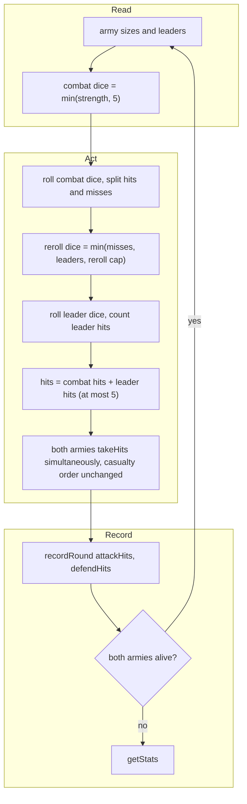

# SGS-004: Cap WOTR combat dice at 5 and leader rerolls per the published rule

- **Type**: Task
- **Component**: wotr-combat-simulator
- **Milestone / criteria**: M1 / M1.9
- **Priority**: high
- **Risk**: high
  <!-- strongModelTriggers: touches W1 and changes the per-round combat loop in Battle(). -->
- **LOC estimate**: ~10 (`Battle()` in `pages/api/fight.ts`: two `rollDice` arguments and one reroll count; business logic only)
- **Depends on**: SGS-003 (both edit `pages/api/fight.ts`; serialize), SGS-001 (design doc `docs/combat-simulator.md`, not on `main` yet; the caps are defined by it; SGS-003 already depends on it)
- **Source**: M1.9; CONTEXT.md Decisions ("WOTR rules": 5-die cap and leadership-reroll cap are genuine rules; casualty order intentional); `docs/combat-simulator.md` (SGS-001) for the rule wording.

## Context

`Battle()` in `pages/api/fight.ts` rolls `attack.getCombatStrength()` dice (regulars + elites) with no upper bound, and rerolls `min(misses, leaders)` leader dice with no cap. The published game limits combat to 5 dice and caps leadership rerolls. Judged against W1, the simulator must match the design doc, so large armies currently overstate hits.

## Scope

In `pages/api/fight.ts`, `Battle()` (lines ~139-158 on `main`, shifted by SGS-003):

- Combat roll: replace `rollDice(attack.getCombatStrength())` and `rollDice(defend.getCombatStrength())` with a roll of `min(getCombatStrength(), <dice cap from doc>)` dice. The cap is 5 per CONTEXT.md Decisions; take the value and wording from the doc.
- Leader reroll: replace `Math.min(<side>CombatResult.misses.length, <side>.leaders)` with the same expression additionally bounded by the doc's reroll cap (at most 5 per the owner decision).
- Do not change `BaseArmy.getCombatStrength()` in `pages/api/models/army.ts`: it also drives `isArmyAlive()` and `takeHit()`'s ">5 units" casualty branch, which must keep using the real army size.
- Hit threshold (`> 5`, i.e. hit on 6 only), simultaneous hit application, and `console.log` are untouched.

Observation for the implementer and reviewer: because misses come from at most 5 dice, `min(misses, leaders)` is already at most 5 once the dice cap is in. So the reroll cap of 5 adds no extra behavior unless the doc states a different cap or a different rule (see Open questions). A round's hits (combat hits plus leader hits) can therefore never exceed 5 per side, since rerolls only replace misses.

**Out of scope:** Casualty order in `takeHit()` (intentional, stands in for player choice); the N-battle loop and any response-shape change (SGS-005); input validation and 10-unit army cap (SGS-003); hit threshold; leadership from characters/Nazgul; removing the debug `console.log`; any edit to `docs/combat-simulator.md` beyond what its owner-confirmed content already states.

## Diagrams

Changes the per-round control loop in `Battle()`; read, act, record phases with the added caps marked.

## Acceptance criteria

Rule wording and constants cited from `docs/combat-simulator.md`; if the doc differs from the owner decision below, the doc governs and the discrepancy is raised, not resolved here. Tests run `/api/fight` over HTTP (the harness from M1.3, or curl until it lands). The response exposes `rounds`, `averageAttackHitsPerRound`, `averageDefendHitsPerRound`; total hits for a side is average times `rounds`.

- [ ] With a 10-unit attacker and 10-unit defender and 0 leaders, repeated across many requests, `averageAttackHitsPerRound` and `averageDefendHitsPerRound` never exceed 5 (combat-dice cap per the doc). Before the change this fails: 10 dice can score up to 10 hits.
- [ ] With 10 units and leaders (up to the input maximum), the same averages still never exceed 5 for any request, and the mean hits per round over many requests is higher than the same army with 0 leaders, so rerolls still work.
- [ ] A one-round battle (e.g. 10 regulars with 0 leaders vs 1 regular, run until a request ends in `rounds` of 1) reports `averageAttackHitsPerRound` of at most 5, an integer.
- [ ] Armies of 5 or fewer units are unaffected: the mean hits per round for 5 regulars vs 5 regulars with 0 leaders stays at the 1/6-per-die expectation (about 0.83 per round, checked within a stated tolerance over many requests).
- [ ] Leader rerolls never exceed the doc's cap, the side's leaders, or that round's misses (assertable in a unit-level seam if one exists; otherwise covered by the bound in the first two criteria).
- [ ] Casualty behavior unchanged: an army of more than 5 units still loses a regular per hit (covers `takeHit()` still using the real army size).
- [ ] `npx tsc --noEmit` and `npx next build` pass.
- [ ] No INVARIANTS.md regressions (W1: the caps now match the doc; W2 and S3 not affected).

## Open questions

1. The doc `docs/combat-simulator.md` does not exist on `main` yet. Its final text must state: the combat-dice cap value (owner decision: 5), the leadership-reroll cap value and wording (owner decision: at most 5, bounded by misses and leaders), and whether leader rerolls can ever exceed `min(misses, leaders)`. If the doc and the owner's decision differ, owner settles before implementation.
2. The task framing suggested "5 combat hits plus capped leader hits per round". Under the stated rule, rerolls only replace missed dice, so total hits per side per round are at most 5. Owner confirms this reading (criteria above assume it).
3. Does the doc define the leadership value as the army's `leaders` count only, or does it include other sources (e.g. characters, Nazgul)? The ticket assumes `leaders` only; anything else is a separate ticket.
4. The response does not expose per-round hits (`attackHitsPerRound` stays inside `BattleResult`), so the cap is observable only through averages and `rounds`. Owner or SGS-005 decides whether a test seam (exported `Battle`/round function) is wanted; this ticket does not change the response shape.
