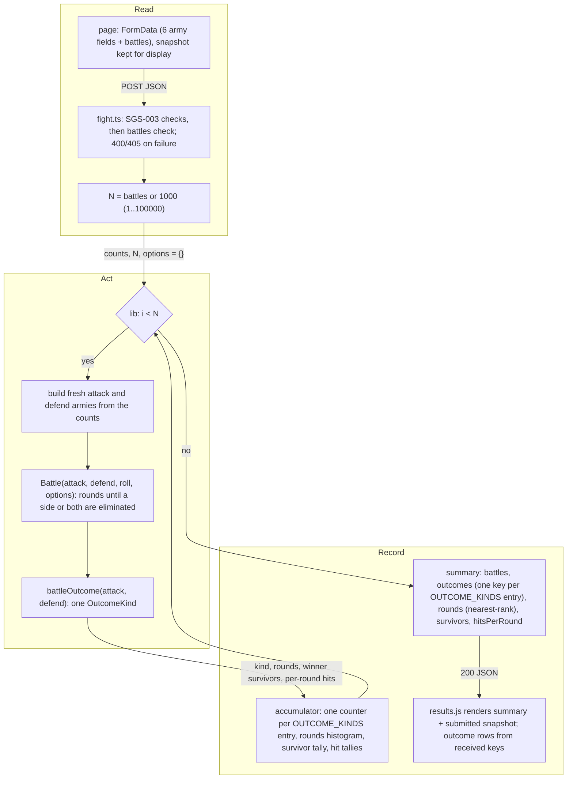

# SGS-005: Run N independent battles and report outcome frequencies

- **Type**: Task
- **Component**: wotr-combat-simulator
- **Milestone / criteria**: M1 / M1.6
- **Priority**: high
- **Risk**: high
  <!-- strongModelTriggers: touches W2 and S3; wraps the battle loop in a new outer loop; sets the public /api/fight request and response shape; >150 lines. -->
- **LOC estimate**: ~275 (respec 2) (`lib/combat-simulator/` N-battle loop, accumulator over `OUTCOME_KINDS`, `BattleOptions` pass-through and nearest-rank percentiles ~125; `pages/api/fight.ts` `battles` parsing and wiring ~30; `components/apps/combat-simulator/results.js` new view with outcome rows iterated from the response ~95; `pages/apps/combat-simulator.js` `battles` input and submitted-army snapshot ~25; business logic only, unit and acceptance specs excluded)
- **Depends on**: SGS-001 (`docs/combat-simulator.md`, merged to `main` at 8532a0b), SGS-002 (Playwright harness under `acceptance/`), SGS-004 (moves the model and battle into `lib/combat-simulator/army.ts` and `battle.ts`, `Battle(attack, defend, roll = rollDice, options: BattleOptions = {})` with an injectable roller, exports `OUTCOME_KINDS`, `OutcomeKind`, `battleOutcome` and `BattleOptions`, applies the 5-hit cap; SGS-004 depends on SGS-003, whose field-parsing rule, `{ error }` shape, 405 and caps this ticket reuses), SGS-007 (Vitest unit test runner, `npm test`, merged to `main` at 3934ff8)
- **Source**: M1.6; plan M1-20261028 outline E; CONTEXT.md Decisions ("WOTR N", "WOTR outcomes", "`/api/fight` response carries results only", "JSON field names ... set by the Monte Carlo ticket", "Testing", "WOTR time budget", "WOTR survivor shares", Out of scope "WOTR extensibility"); `docs/combat-simulator.md` (SGS-001) outcome-reporting section for the statistics' meaning; spec gate `reports/SGS-005-spec-gate.md`.

## Context

`/api/fight` runs exactly one battle and returns that battle's `BattleStats`, so the app gives a sample,
not odds. This ticket makes it run N independent battles and report how often each outcome occurs
(W2: results are estimates from N independent battles; S3: N is capped server-side). It also sets the
response's JSON field names, which the design doc does not name and SGS-006's OpenAPI spec copies.

## Scope

All paths are in the code repo. Base `main` is 8532a0b (respec 2); SGS-003/004 will have changed `pages/api/fight.ts`
and created `lib/combat-simulator/` by the time this starts, so locate code by name.

### 1. Response shape (pinned here) (respec 1, respec 2)

A 200 body has exactly these keys at every level, with one deliberate exception (respec 2): `outcomes` is an
object keyed by outcome kind. In this version its keys are exactly `attacker`, `defender`, `tie`, always all
three (a kind that never occurred has `count` 0), in `OUTCOME_KINDS` order. Clients must tolerate additional
outcome keys, each with the same `{count, frequency}` shape, in later versions (later termination rules such
as max rounds or retreat may add kinds). Every other object has a closed key set.

```
{
  "battles": <integer N actually run>,
  "outcomes": {
    "attacker": { "count": <int>, "frequency": <number> },
    "defender": { "count": <int>, "frequency": <number> },
    "tie":      { "count": <int>, "frequency": <number> }
  },
  "rounds": { "mean": <number>, "median": <int>, "p10": <int>, "p90": <int> },
  "survivors": {
    "attacker": [ { "regulars": <int>, "elites": <int>, "count": <int>, "frequency": <number> }, ... ],
    "defender": [ ...same element shape... ]
  },
  "hitsPerRound": {
    "attacker": [ <share of rounds with 0 hits>, <1 hit>, <2>, <3>, <4>, <5> ],
    "defender": [ ...6 numbers... ]
  }
}
```

Definitions:

- **outcomes** (respec 2): each battle is classified by SGS-004's `battleOutcome(attack, defend)` into one
  `OutcomeKind`: `attacker` = only the attacker has regulars + elites left, `defender` = only the defender,
  `tie` = both eliminated in the same round. One entry per kind in `OUTCOME_KINDS`. `frequency` =
  `count / battles`, unrounded. Counts over all kinds sum to `battles`.
- **rounds**: over all N battles (every outcome), the number of rounds each battle lasted.
  `mean` = total rounds / N, unrounded. `median`, `p10`, `p90` use the **nearest-rank** method: sort
  the N round counts ascending; the p-th percentile is the value at 1-based rank `ceil(p * N / 100)` for
  p = 50, 10, 90. Compute the rank with integer `p` (`Math.ceil((p * N) / 100)`), not `0.1 * N`, to avoid
  float error. This is the method `docs/combat-simulator.md` fixes (SGS-001), so all three are whole rounds
  (`median` is the lower middle value for even N), and for N = 1 all three equal that battle's rounds.
- **survivors**: for each side, the distribution of that side's surviving (regulars, elites) at the end of
  the battles it won, regulars and elites kept separate. Leaders are not part of the combination. One
  element per combination that occurred (count >= 1); a side that never won has `[]`; ties contribute
  nothing (and so would any later outcome kind other than `attacker` or `defender`). `frequency` =
  `count / outcomes.<side>.count` (share of that side's wins), unrounded; decided by the owner (respec 2),
  so each non-empty side's frequencies sum to 1. Elements
  are sorted by `count` descending, then `regulars` descending, then `elites` descending, so output is
  deterministic.
- **hitsPerRound**: for each side, a fixed-length array of 6 numbers; index k is the share of all rounds,
  pooled across all N battles, in which that side scored exactly k hits (combat plus leader hits). The
  denominator is the total rounds across all battles. A hit count outside 0-5 cannot occur after SGS-004's
  cap; the accumulator throws if it sees one rather than clamping.

### 2. `lib/combat-simulator/simulate.ts`: N-battle loop and aggregation (respec 1)

Layout after SGS-004 (respec 1): `lib/combat-simulator/army.ts` holds `Army`/`BaseArmy` (with the
elite-downgrade fix); `lib/combat-simulator/battle.ts` holds `rollDice`, `calculateCombatRollResults`,
`BattleResult`, `BattleStats` and `Battle(attack, defend, roll = rollDice, options: BattleOptions = {})`,
whose injectable roller is called per round in the order attack combat, defend combat, attack leader, defend
leader; constants `MAX_COMBAT_DICE = 5`, `MAX_LEADER_REROLLS = 5`. (respec 2) It also exports
`OUTCOME_KINDS = ['attacker', 'defender', 'tie'] as const`, `type OutcomeKind`, `battleOutcome(attack, defend):
OutcomeKind` and `type BattleOptions = {}` (empty in this version; a seam for later termination rules).
`pages/api/models/army.ts` is a re-export of the lib model.

Add `lib/combat-simulator/simulate.ts` (plain TypeScript, no React or Next imports, per ARCHITECTURE.md):

- A function that takes the validated attack and defend counts (regulars, elites, leaders), N, a
  roller with the same signature `Battle` takes (default `rollDice`), and (respec 2) a `BattleOptions`
  (default `{}`), runs N battles, and returns the section 1 object. It passes the same options object
  unchanged to every `Battle` call and does not read or interpret it.
- W2: every iteration constructs fresh `BaseArmy` instances from the input counts and calls
  `Battle(attack, defend, roll, options)`. Never reuse or clone an army object that a previous battle mutated.
  (respec 2) The outcome is `battleOutcome(attack, defend)` on that battle's armies after it ends; the loop
  does not re-derive it from army strengths. Survivors are read from the winning army when the outcome is
  `attacker` or `defender`; per-round hits from its
  `BattleResult` (`attackHitsPerRound`, `defendHitsPerRound`), which is then discarded.
- An accumulator, separable from the loop so it can be unit-tested with synthetic per-battle results:
  it records one battle's outcome, rounds, the winner's surviving (regulars, elites), and that battle's
  per-round hit counts, and produces the section 1 object. Keep running counters and histograms
  (outcome counts, a rounds histogram or an `Int32Array` of N round counts, a survivor-combination tally,
  two 6-slot hit-count tallies). Do not store N per-battle result objects or per-round hit arrays beyond
  the battle in progress; O(N) integers for rounds is fine.
- (respec 2) Outcome tallies and the `outcomes` object are built by iterating the outcome kind list, not by
  hard-coded `attacker` / `defender` / `tie` branches or literals: the accumulator takes the kind list as a
  parameter defaulting to `OUTCOME_KINDS`, initialises one counter per kind, increments the counter for the
  recorded kind (throwing on a kind not in the list), and emits one `{count, frequency}` entry per kind in
  list order. Adding a kind to `OUTCOME_KINDS` later adds a key to `outcomes` with no other change to
  aggregation. Survivor recording stays keyed on the two sides (`attacker`, `defender`).
- No `console.log` (or other logging) per round or per battle anywhere on this path. Remove any that
  survive in `lib/combat-simulator/battle.ts`.
- Keep the inner loop allocation-light. If timing (criterion below) fails because of the repeated
  `concat` in `rollDice` / `calculateCombatRollResults` (`battle.ts`), they may be rewritten without changing dice, threshold, reroll or casualty semantics
  (W1); otherwise leave them.

### 3. `pages/api/fight.ts`, `handler` (respec 1)

- Request field `battles`: optional. Absent (key missing or value `undefined`) means 1000. Otherwise
  parsed with SGS-003's field rule (a JSON number with `Number.isSafeInteger(v) && v >= 0`, or a string
  matching `/^[0-9]+$/` converted with `Number`), then range-checked 1 to 100,000. Anything else returns
  400 `{ error }` whose `error` contains `battles`: for example `""`, `"1e3"`, `"1.5"`, `1.5`, `" 5"`,
  `"+5"`, `"abc"`, `null`, `true`, `0`, `-1`, `100001`. (A JSON number `1e3` is the number 1000 after
  parsing and is valid.)
- Order: SGS-003's checks (method, body shape, the six army fields, per-side rules) run first and
  unchanged; the `battles` check runs after them and before any battle. The 405, `Allow: POST`,
  `{ error }` shape and zero-fighter rule stay as SGS-003 defines them.
- The handler stays thin: validate, call the section 2 function with the validated counts and N (no
  options argument, so `BattleOptions` defaults to `{}`; the request has no option fields in this version)
  (respec 2), return
  its object with 200. The response carries no army objects. Drop the unused `Results` import and the
  `BattleStats` interface / `getStats()` path if nothing else uses them.

### 4. `pages/apps/combat-simulator.js` (respec 1)

- Add a number input `name="battles"` inside `#fight-form`, labelled "Battles", default value 1000,
  `min=1`, `max=100000`, `step=1`, not `required` (so an emptied field posts `""` and the server's 400 is
  shown through SGS-003's `role="alert"` element).
- At submit, snapshot the six army values and `battles` from the `FormData` being posted and pass the
  snapshot to `Results` along with the response. Editing the form after a fight does not change the
  displayed armies until the next submit.

### 5. `components/apps/combat-simulator/results.js` (respec 1)

Render from the snapshot and the section 1 response only:

- "Army Results" heading (keep the exact text; SGS-002/003 specs locate it): the submitted attack and
  defend regulars/elites/leaders from the snapshot, plus the number of battles from `battles` in the
  response.
- "Fighting Stats" heading (keep the exact text): one row per key of the response's `outcomes`, in the
  order received, with count and percent; rounds mean, median, p10, p90. (respec 2) Rows come from iterating
  `Object.entries(outcomes)`, not three hard-coded rows. A small label map gives display text for the known
  kinds (`attacker`, `defender`, `tie`); an unknown kind is shown with its raw key as the label. No other
  handling of unknown kinds.
- "Surviving Units" heading: one table per side listing regulars, elites, count, percent of that side's
  wins; a side with no wins shows a "no wins" row.
- "Hits per Round" heading: rows 0-5 with attacker and defender percent.
- Percent display is rounded to one decimal place in the view only; the response stays unrounded.

### 6. Tests (respec 1)

- **Unit** (Vitest via `npm test`, SGS-007): `lib/combat-simulator/simulate.test.ts`, deterministic
  tests of the accumulator and of the loop with a scripted roller (a stub returning fixed dice in
  `Battle`'s call order), covering the unit criteria below.
- **Acceptance** (SGS-002 harness, `acceptance/`, reusing `acceptance/helpers.ts`): HTTP and UI specs for
  the acceptance criteria below.
- Update every existing harness spec that asserts the old single-battle shape (SGS-002's smoke check for
  a `survivor` string and numeric `rounds`; SGS-003's success cases asserting `BattleStats` keys and
  finite averages; any SGS-004 HTTP spec using the averages) to the new shape, keeping each spec's intent
  (for example, "200 with finite averages" becomes "200 with the section 1 keys and finite numbers").
  Do not delete a spec without a replacement.

### 7. Key surfaces for the manager (respec 1)

CONTEXT.md Key surfaces is a manager edit. Copy these after merge:

- `POST /api/fight` request: the six army fields plus `battles` (optional; JSON safe integer or digit-only
  string; 1 to 100,000; default 1000).
- `POST /api/fight` 200 response: `battles`; `outcomes.<kind>.{count,frequency}`, keyed by outcome kind,
  currently always `attacker`, `defender`, `tie`; clients must tolerate additional kinds in later versions (respec 2);
  `rounds.{mean,median,p10,p90}`; `survivors.{attacker,defender}[].{regulars,elites,count,frequency}`;
  `hitsPerRound.{attacker,defender}` (6 numbers, index = hits 0-5). Errors as SGS-003 (`{ error }`, 400/405).

**Out of scope:** any change to dice, leader, casualty or round rules (W1; SGS-004 and the doc); army
field validation, caps, 405 and the error shape (SGS-003); moving logic SGS-004 already moved, moving the
route to `pages/api/combat-simulator/` (changes the URL);
`docs/api/openapi.json`, exported contract types and the contract check (SGS-006; the file does not exist
yet, so ARCHITECTURE.md's "update it in the same change" is satisfied by SGS-006); editing
`docs/combat-simulator.md` (SGS-001; if its meaning disagrees with CONTEXT.md Decisions, raise it, do not
resolve it); editing CONTEXT.md (manager); statistics beyond section 1; charts or graph libraries;
streaming or progress; seeded randomness in the public API (injectable dice is for tests only);
(respec 2) any termination rule other than elimination (max rounds, retreat), any field in `BattleOptions`,
any request field that sets options, and any new outcome kind: this ticket only threads the seams through;
StarCraft helper; AoE4; `golang/`.

## Diagrams

One component, but the change wraps the battle loop in a new outer loop (core control loop) and spans the
page, the route and `lib/`. Read, act, record (respec 2: options pass-through, `battleOutcome`
classification, `outcomes` built over `OUTCOME_KINDS`, view iterates received keys):



## Acceptance criteria

Unit (`npm test`, deterministic; no `Math.random`):

- [ ] (respec 2) Accumulator: for synthetic battles with known outcomes, `outcomes` counts equal the
      inputs, has exactly the keys of `OUTCOME_KINDS` in that order (a kind with no battles has count 0),
      counts over all kinds sum to N, and frequencies sum to 1 within 1e-9.
- [ ] (respec 2) Outcome kind list: constructing the accumulator with an extended kind list (for example
      `[...OUTCOME_KINDS, 'extra']`) and recording battles of every kind yields an `outcomes` object with
      one `{count, frequency}` entry per listed kind, including `extra`, with correct counts; recording a
      kind not in the list throws. A version with hard-coded `attacker` / `defender` / `tie` tallies fails.
- [ ] (respec 1) Percentiles: round counts 1..10 (N = 10) give median 5, p10 1, p90 9, mean 5.5; N = 1
      gives all three equal to that value; N = 30 with round counts 1..30 gives p10 3, median 15, p90 27
      (catches `0.1 * N` float error).
- [ ] (respec 1) Survivors: synthetic wins with known (regulars, elites) give one element per combination
      with the right counts, per-side counts summing to `outcomes.<side>.count`, frequencies summing to 1
      within 1e-9 for a side with wins, `[]` for a side with none, ties adding nothing, and the pinned sort order.
- [ ] (respec 1) Hits per round: synthetic battles with known per-round hits give 6-element arrays whose
      entries equal the expected pooled shares and sum to 1 within 1e-9 per side; a hit count of 6 throws.
- [ ] (respec 1) Loop independence (W2): with a scripted roller, running the loop for N >= 2 produces the
      same per-battle results as calling `Battle` once per battle on fresh `BaseArmy` instances from the
      input counts with the same script; a version that reuses the first battle's `BaseArmy` objects fails
      this test (its second battle would start depleted).
- [ ] (respec 1) The loop with a scripted roller and N battles returns `battles` = N and
      `outcomes` counts summing to N.
- [ ] (respec 2) The loop classifies with `battleOutcome`: scripted rollers producing an attacker win, a
      defender win and a tie each put the battle under the matching key. The simulate function accepts a
      `BattleOptions` argument (default `{}`) and passes it unchanged to every `Battle` call; checked by the
      reviewer reading the diff (the options type is empty, so no behavior depends on it yet).

HTTP (SGS-002 harness):

- [ ] (respec 1) A valid request with no `battles` key returns 200 with `battles` 1000 and outcome counts
      summing to 1000.
- [ ] (respec 1) `battles` 1, `"1"`, 100000 and `"100000"` return 200 with `battles` equal to that value.
- [ ] (respec 1) Each of `0`, `-1`, `100001`, `1.5`, `"1.5"`, `"abc"`, `""`, `"1e3"`, `" 5"`, `"+5"`,
      `null`, `true` as `battles` returns 400 with a JSON `error` containing `battles` and no `outcomes` or
      `rounds` key.
- [ ] (respec 1) Precedence: an invalid army field together with `battles: 0` returns 400 naming the army
      field; a PUT with `battles: 0` returns 405.
- [ ] (respec 2) The 200 body's key sets equal section 1 exactly at every level (top level, `outcomes` =
      `attacker`, `defender`, `tie` in this version, each entry, `rounds`, `survivors` and each element,
      `hitsPerRound`); each `hitsPerRound` array has length 6; every number is finite.
- [ ] (respec 2) For any 200 body: counts over every key of `outcomes` sum to `battles`; frequencies sum to 1 within 1e-9;
      each side's survivor counts sum to its win count; each `hitsPerRound` array sums to 1 within 1e-9;
      `p10 <= median <= p90` and `rounds.p10 >= 1`.
- [ ] (respec 1) One-sided: attack 0 regulars / 10 elites / 5 leaders vs defend 1/0/0, N = 1000, gives
      `outcomes.attacker.frequency` > 0.99; the mirrored request gives `outcomes.defender.frequency` > 0.99.
- [ ] (respec 1) No carry-over (W2): 5/0/0 vs 5/0/0 with N = 1000 gives attacker and defender frequencies
      each between 0.3 and 0.7 and `rounds.p10 >= 1` (reused, depleted armies would make every battle after
      the first a 0-round win for one side).
- [ ] (respec 1) The response contains no army objects (no `attack`/`defend` keys), only section 1.
- [ ] (respec 1) Time budget (S3): after one warm-up request, each of 0/10/0 vs 0/10/0 (all elites, no
      leaders: the most rounds per battle) and 0/10/5 vs 0/10/5 (most dice per round) at `battles` 100000
      returns 200 within 10 seconds, enforced by a 10 000 ms request timeout in the spec. If either exceeds
      10 s, the implementer stops and reports the measured time; the 100,000 cap is not lowered.
- [ ] A request with N = 1000 produces no per-round or per-battle server log output (checked on the dev
      server output during the run).

UI (`/apps/combat-simulator`, SGS-002 harness):

- [ ] (respec 1) The form has a `battles` input with value 1000 by default; submitting valid armies posts
      `battles` and renders "Army Results", "Fighting Stats", "Surviving Units" and "Hits per Round" with the
      response's numbers.
- [ ] (respec 2) Outcome rows follow the response: with `/api/fight` intercepted (Playwright `page.route`) to
      return a valid body whose `outcomes` has an extra key `extra` besides the three known kinds, "Fighting
      Stats" shows four outcome rows, labels for the three known kinds and the raw key `extra` for the fourth,
      each with its count and percent, and the page shows no error.
- [ ] (respec 1) "Army Results" shows the submitted army values from the form; changing a select after the
      fight does not change them until the next submit.
- [ ] (respec 1) Clearing the `battles` input and clicking Fight! shows the `role="alert"` element with the
      server's `error` text (containing `battles`) and no "Army Results" heading.

General:

- [ ] Existing harness specs that asserted the single-battle shape are updated to the new shape and pass;
      `npm run acceptance` and `npm test` pass.
- [ ] `npx tsc --noEmit` and `npx next build` pass; the page is loaded under `npm run dev` and in the built
      app (`npx next start`).
- [ ] `git diff` shows no change to dice, threshold, reroll or casualty semantics, `docs/`, or `golang/`.
- [ ] The PR description records the measured times for both time-budget matchups at N = 100,000 and for
      the default N, locally; the Vercel preview time is informational if available.
- [ ] (respec 1) The response contains exactly the statistics in CONTEXT.md Decisions ("WOTR outcomes") and
      the doc's outcome-reporting section, under the section 1 names, each computed over all N battles.
- [ ] No INVARIANTS.md regressions (W1 unchanged; W2 and S3 satisfied).

## Open questions

Resolved by the owner (2026-10-28):
1. Time budget: N = 100,000 completes within 10 seconds; if over, report and stop, do not lower the cap.
2. Statistics: attacker / defender / tie; rounds mean, median, p10, p90; winning side's (regulars, elites)
   distribution kept separate; each side's hit-count distribution 0-5 as shares of all rounds.
3. The mutual-elimination outcome is named "tie".
4. The response carries results only, not the submitted armies; the page shows its own form values.
5. This ticket sets the JSON field names (section 1).
6. If `docs/combat-simulator.md` still tags the outcome section "proposal, owner to confirm", the
   confirmation in CONTEXT.md Decisions stands; the tag is not a reason to bounce.
7. (respec 2) Survivor `frequency` denominator is that side's win count (`count / outcomes.<side>.count`),
   so each non-empty side's frequencies sum to 1 (CONTEXT.md Decisions, "WOTR survivor shares").
8. (respec 2) Extensibility: leave seams for later termination rules without building them. `Battle` takes an
   options argument (empty now) that simulate threads through; `outcomes` is keyed by kind from
   `OUTCOME_KINDS` and clients tolerate additional kinds (CONTEXT.md Out of scope, "WOTR extensibility").

Matches SGS-001 (re-specced): nearest-rank percentiles at rank `ceil(p/100 * N)`, all whole rounds; survivor
counts per (regulars, elites) combination for each winning side separately, ties contribute none.

Pinned by this ticket (encoding only, within the owner's decisions): hits-per-round shares pooled over all
rounds of all battles; survivor element sort order.

Pinned by this ticket (respec 2, within the owner's decisions): `outcomes` keys appear in `OUTCOME_KINDS`
order; the view labels unknown kinds with the raw key.

Open: none.

## Re-spec 2026-10-28

Re-spec 1, from `reports/SGS-005-spec-gate.md` and the owner decisions recorded in CONTEXT.md Decisions today.

**What was underspecified**
- The statistics, bucketing and field names were delegated to a design doc that does not exist and will not
  name fields; SGS-006 needs exact names.
- "No other statistics" excluded hits per round.
- Scope and the W2 criterion disagreed on whether the response carries the submitted armies.
- `battles` parsing did not follow SGS-003's rule; `1e3` and `null` were missing; validation, 405 and the
  error shape were misattributed to SGS-004.
- The resolved 10-second budget was still described as "no budget, no pass/fail"; no matchup was named.
- No test plan: no harness dependency, no unit tests, and CONTEXT.md Key surfaces was not addressed.

**What changed**
- Section 1 pins the response JSON names and definitions, including the nearest-rank percentile method,
  the survivor array encoding `{regulars, elites, count, frequency}`, and fixed 6-element `hitsPerRound` arrays.
- The N-battle loop and accumulator move to `lib/combat-simulator/` with injectable dice; the handler is thin.
- `battles` uses SGS-003's parser, range 1-100,000, absent means 1000, checked after SGS-003's checks.
- The response carries no armies; the page snapshots its own form values.
- Time budget is a pass/fail harness spec on two named worst-case matchups.
- Added unit criteria (sums, percentiles, survivors, hit shares, W2) and HTTP/UI criteria; existing
  single-battle specs are updated rather than deleted.
- Depends on now lists SGS-001, SGS-002, SGS-004, SGS-007.
- Aligned to SGS-004's final lib layout: `simulate.ts` builds fresh `BaseArmy` per battle and calls
  `Battle(attack, defend, roll)`; tests in `lib/combat-simulator/simulate.test.ts` with a scripted roller;
  moving `pages/api/models/army.ts` dropped from Out of scope (SGS-004 handles it).
- Section 7 lists the Key surfaces lines for the manager.

**Existing branch work that still stands**
- None. Branch `sgs-005-n-battle-outcome-frequencies` has not been created.

## Manager notes - 2026-10-28 (from spec-gate pass 2, non-blocking)

- Loop-independence test: use a stateless scripted roller and compare the N=2 summary with the N=1 summary doubled.
- "No server log output": verify with a grep for `console.` in `lib/combat-simulator/` and `pages/api/fight.ts`.
- UI spec compares displayed percentages to `(100*frequency).toFixed(1)`.
- Use the roller type SGS-004 exports; read army counts from the parsed request before the loop.
- Set `test.setTimeout` explicitly in the time-budget spec.
- Survivor `frequency` denominator: default (that side's wins) stands unless the owner overrides it.
  (Superseded by re-spec 2: decided by the owner.)

## Re-spec 2026-10-28 (2)

Re-spec 2, from owner design decisions recorded in CONTEXT.md ("WOTR extensibility" under Out of scope,
"WOTR survivor shares" under Decisions). Base `main` now 8532a0b (SGS-001 doc and SGS-007 Vitest merged).

**What was underspecified**
- No seam for later termination rules: the loop and accumulator would hard-code three outcome branches, and
  the response promised a closed `outcomes` key set that a later outcome kind would break.
- Survivor `frequency` denominator was an open owner-confirm item.

**What changed**
- Section 1: `outcomes` is keyed by outcome kind, the three current keys always present, in `OUTCOME_KINDS`
  order; clients must tolerate additional keys. Survivor denominator stated as decided. `rounds` already
  covered all N battles regardless of outcome; wording unchanged.
- Section 2: consumes SGS-004's `OUTCOME_KINDS`, `OutcomeKind`, `battleOutcome`, `BattleOptions`; classifies
  each battle with `battleOutcome`; the accumulator takes a kind list (default `OUTCOME_KINDS`) and builds
  `outcomes` by iterating it; the simulate function takes and passes through `BattleOptions`.
- Section 3: handler calls simulate without options (defaults to `{}`).
- Section 5: outcome rows iterate the received keys with labels for known kinds and the raw key otherwise.
- Section 7 Key surfaces line updated; Out of scope adds termination rules, option fields and new kinds.
- Criteria: accumulator criterion revised to `OUTCOME_KINDS` keys; new unit criterion for an extended kind
  list; new loop criterion for `battleOutcome` classification and options pass-through (review-checked);
  HTTP key-set and sum criteria revised; new UI criterion with an intercepted response carrying an extra key.
- Diagram: options edge, `battleOutcome` node, accumulator per kind, view iterating keys.
- LOC ~265 to ~275. Dependencies unchanged.
- Design doc: not edited (out of scope). Its outcome-reporting section defers field names to the OpenAPI
  spec, so the "tolerate additional keys" statement belongs in SGS-006's spec; the doc's "one of three
  outcomes" remains true for this version.

**Existing branch work that still stands**
- None. Branch `sgs-005-n-battle-outcome-frequencies` has not been created.

## Manager note - 2026-10-29 (spec gate 2, non-blocking)

- Keep `getStats()`, `BattleStats`, and `getSurvivor()`; SGS-004's tests use them.
- Parse `battles` with the same field parser SGS-003 adds to `pages/api/fight.ts`; extract it to a local helper if it is inline.
- Outcome labels: `attacker` → "Attacker wins", `defender` → "Defender wins", `tie` → "Tie"; unknown kinds show the raw key.
- Update SGS-002's API acceptance spec, which still asserts the single-battle response.
- Use a stateless roller in the independence test.
