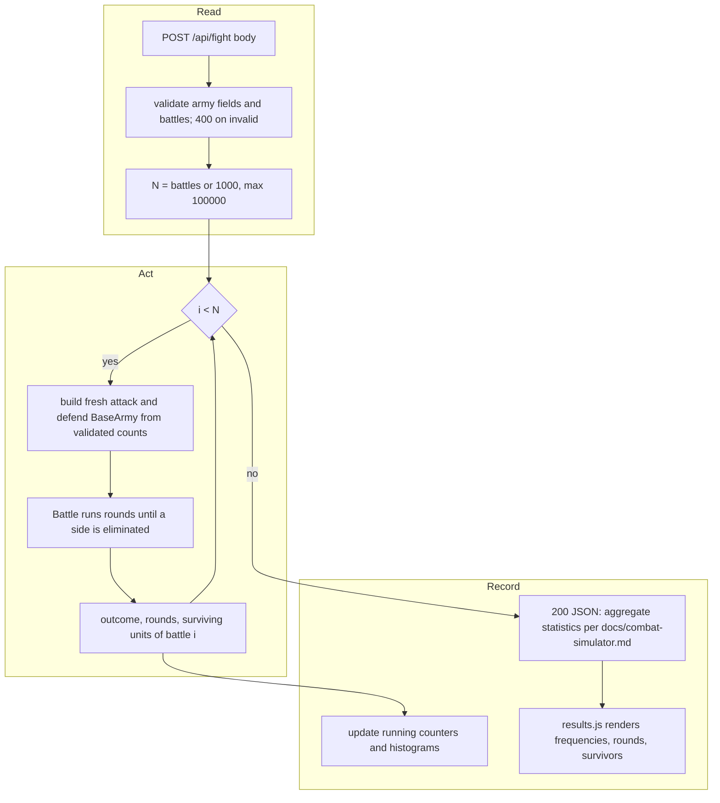

# SGS-005: Run N independent battles and report outcome frequencies

- **Type**: Task
- **Component**: wotr-combat-simulator
- **Milestone / criteria**: M1 / M1.6
- **Priority**: high
- **Risk**: high
  <!-- strongModelTriggers: touches W2 and S3; changes the public /api/fight request and response shape; >150 lines. -->
- **LOC estimate**: ~220 (fight.ts: battle loop, aggregation, N parsing ~110; results.js frequencies view ~80; combat-simulator.js and army.js N input ~30; business logic only)
- **Depends on**: SGS-004 (which depends on SGS-003; all three edit `pages/api/fight.ts`). Also needs SGS-001 merged: `docs/combat-simulator.md` does not exist on `main` yet.
- **Source**: M1.6; plan M1-20261028 outline E; CONTEXT.md Decisions (N default 1000, max 100,000; outcome frequencies include round counts and surviving units); `docs/combat-simulator.md` (SGS-001) for the statistics.

## Context

`/api/fight` runs exactly one battle and returns that single battle's `BattleStats`, so the app gives a
sample, not odds. This ticket makes it run N independent battles and report how often each outcome
occurs (W2: results are estimates from N independent battles; S3: bounded time, N is capped server-side).

## Scope

All paths are in the code repo. Line numbers are as of `main` at 533e579 and will have shifted after
SGS-003/004; locate by name.

1. `pages/api/fight.ts`
   - `Battle(form)` currently mutates `form.attackArmy` and `form.defendArmy` in place (`takeHits`).
     Looping it as-is would carry one battle's state into the next (W2). Build fresh `BaseArmy`
     instances from the validated request counts for every battle (for example, run `Battle` on a
     freshly constructed `FormParseResult` each iteration). Do not clone a mutated army.
   - Add request field `battles` (N): optional; only an absent field means 1000 (the page always posts it, so an empty string is invalid). Must be an integer from 1
     to 100,000; anything else (non-numeric, fractional, zero, negative, over 100,000) returns 400 with a
     readable error, using the error shape SGS-004 defines. Cap enforced here in the handler, not only in
     the UI (S3).
   - Aggregate across the N battles exactly the statistics `docs/combat-simulator.md` specifies for
     outcome reporting. The decision recorded in CONTEXT.md is that these cover who wins
     (attacker / defender / mutual elimination, which today's code reports as `n/a` via `getSurvivor()`),
     round counts, and surviving units. The ticket does not choose the stat set, the bucketing, or the
     response field names: the implementer takes them from the doc. If the doc is silent or still
     "owner to confirm" on any of them when this ticket starts, stop and bounce to `needs_spec`.
   - Replace the response with the aggregate shape from the doc. Keep SGS-004's validation and
     405 behavior and the zero-unit rule unchanged.
   - Remove both `console.log` calls in `Battle` (the per-round dump and `"Final result"`). N battles
     must not emit per-round or per-battle log lines. Drop the unused `Results` import only if that hunk
     is touched.
   - Per-battle bookkeeping (`BattleResult` per-round hit arrays) must not make memory grow with N
     beyond what the doc's statistics need. Keep running counters/histograms rather than N stored
     `BattleResult` objects.
2. `components/apps/combat-simulator/results.js` (only consumer of the response) renders the new
   response: outcome frequencies (counts and percent), round-count statistics, and surviving-unit
   statistics as the doc defines them, plus the submitted armies. Today the "Army Results" table prints
   `attack`/`defend` from the response, which are post-battle mutated armies; with N battles it must show
   the submitted armies, so the response must carry them or the page must use its own form values.
3. `pages/apps/combat-simulator.js` and `components/apps/combat-simulator/army.js` (or a field in the
   form in the page): add a number-of-battles input named `battles`, default 1000, `min=1`, `max=100000`,
   so `FormData` posts it with the other fields. The page shows SGS-004's 400 error for an invalid N
   the same way it shows other field errors.
4. Runtime: measure, in the PR, the wall-clock time of `POST /api/fight` at N=100,000 with the largest
   legal armies (10 units per side per the decision, with the max leaders the doc allows) and at the
   default N, under `npm run dev` and, if available, the Vercel preview. Record numbers in the PR
   description. The doc and CONTEXT.md name no time budget, so this ticket cannot declare pass/fail on
   time; see Open questions. Keep the inner loop allocation-light (the existing `rollDice` and
   `calculateCombatRollResults` build arrays with repeated `concat`); change them only if measurement
   shows it is needed, and then without altering dice or leader semantics (W1).

**Out of scope:** any change to dice, leader, casualty, or round rules (W1; those belong to their own
tickets against the doc); input caps on the army fields (SGS-004); documenting the contract and exporting
shared types (M1.7, outline F); moving `pages/api/models/army.ts`; charts or graph libraries; streaming or
chunked progress; seeded or reproducible randomness; StarCraft helper and AoE4 code; `golang/`.

## Diagrams

Crosses components? No: one component, but the request/response shape change spans browser form, API,
and results view. The control-loop rule applies because the battle loop is wrapped in a new outer loop.

## Acceptance criteria

- [ ] A request with no `battles` runs exactly 1000 battles; the response reports N = 1000 (field name per the doc).
- [ ] `battles` of 1 and 100000 are accepted; 0, -1, 100001, 1.5, `abc`, and an empty string each return 400 with a readable error and run no battles.
- [ ] The outcome counts (attacker wins, defender wins, mutual eliminations) sum to N, and the frequencies sum to 1 within rounding.
- [ ] One-sided matchups move the expected way: for a large attacking army (the largest army the SGS-004 caps allow) against a 1-regular defender, attacker frequency is above 0.99 over 1000 battles; the mirrored request gives defender frequency above 0.99.
- [ ] The response contains every statistic `docs/combat-simulator.md` lists for round counts and surviving units, and no others; each is computed over the N battles (not the last battle only).
- [ ] Independence (W2): a symmetric request run with the same N twice gives different per-run results (the runs are random), and, by test or code inspection, every battle constructs its armies from the request values; the response's reported starting armies equal the submitted armies, not a mutated state.
- [ ] No `console.log` runs per round or per battle: a request with N=1000 produces no per-round server log output.
- [ ] The results view on `/apps/combat-simulator` shows the outcome frequencies, round-count statistics, and surviving-unit statistics from the response after clicking "Fight!", shows the submitted armies, and shows the 400 message for an invalid N. Verified by loading the page under `npm run dev` and in a built app (`npx next build`).
- [ ] API and view land in the same PR; the page never receives a response shape it cannot render.
- [ ] The PR description records measured time for N=100,000 with maximum legal armies and for the default N, and states whether it was measured locally or on the Vercel preview.
- [ ] `npx tsc --noEmit` and `npx next build` pass.
- [ ] No INVARIANTS.md regressions (W1 unchanged, W2 and S3 satisfied)

## Open questions

1. **Time budget for N = 100,000 on a Vercel serverless function.** Neither the doc (not yet merged), CONTEXT.md, nor the plan sets one, and the repo has no `vercel.json` or function `maxDuration` config. The platform timeout depends on the owner's Vercel plan, which is not recorded. Owner decides one of: accept the measured runtime as is, set a lower effective cap, or add a function duration setting. Until answered, implementers must not invent a timeout or a lower cap. The measured numbers (Scope item 4) are the input to this decision.
2. **Statistic set and field names.** Not decided here. They come from `docs/combat-simulator.md` (SGS-001), which the owner is still to confirm per CONTEXT.md. If still unconfirmed when this ticket is picked up, it goes to `needs_spec`.
3. **Mutual elimination label.** Today `getSurvivor()` returns `"n/a"` when both sides die. The doc should name this outcome; the results view should use that name, not `n/a`.
