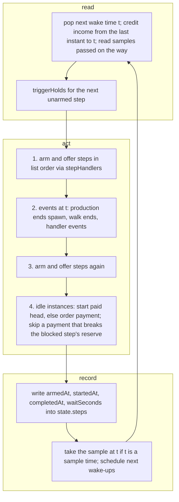

# SGS-030: Simulate a build order: event loop, triggers, queues, villager rally and sampling

- **Type**: Task
- **Component**: aoe4-build-order
- **Milestone / criteria**: M2 / M2.3 (A2, A3, core v1 list: ordering, queues, rally, start, sampling; `build`, `move`, ages and houses are SGS-031, `research` and veterancy are SGS-032)
- **Priority**: high
- **Risk**: high
  <!-- strongModelTriggers: changes what a simulation computes (the run loop), the order of operations a result depends on (A3), enforces A2, fixes the seam signatures SGS-031/032 build on, and an estimated ~400 lines of business logic (over 150). Adjacent invariants: A1, A2, A3. -->
- **LOC estimate**: ~400 business logic (`simulate.ts` ~360: state, event queue, trigger test, step arming and handler seam, instance FIFO and order payments, priority reservation, rally state, income, sampling; `civ-rules.ts` ~40); tests on top. If it lands over 400, split `civ-rules.ts` plus its hook call sites into a sibling ticket; do not trim the rally or Production rules.
- **Depends on**: SGS-027, SGS-028, SGS-029 (and transitively SGS-025, SGS-026)
- **On merge**: none
- **Source**: design/M2.md "Engine rules", "Production", "Sampling", "Rally and start", "Producer capability", "CivRules", "Starting units", Modules row `simulate.ts`, Contracts (`SimInputs`, `StepTiming`, `SimulationResult`); reports/M2-plan-2.md outline F and Spec gaps T2; reports/M2-designer-wave2.md, reports/M2-designer-wave3.md; docs/aoe4-build-order.md "Model rules"

## Context

This is the simulator itself: the pure, deterministic loop that turns a validated `BuildOrder`, `GameData` and resolved `SimInputs` into a `SimulationResult`. It is the core control loop (A2: resources never negative, waits reported; A3: same input, same result), so ordering rules must be exact. It handles `produce`, `pause` and `rally`; `build`, `move` and `research` are left to SGS-031 and SGS-032 through a handler seam whose signatures this ticket fixes.

## Scope

New files in `lib/aoe4-build-order/` (on origin/main 68e004a there is no `simulate.ts` or `civ-rules.ts`). Reuse, do not redefine: from `model.ts` (SGS-026) `BuildOrder`, `BuildStart`, `BuildStep`, `Trigger`, `GatherNodeId`, `ResourceKind`, `SimInputs`, `SimulationResult`, `StepTiming`, `UnitSeries`; from `effects.ts` (SGS-027) `EffectState`, `ModifierTarget`, `modifiedValue`; from `gather.ts` (SGS-027) `effectiveGatherRate(node, state, inputs)`; from `data.ts` `GameData`, `SnapshotEntry`, `CivData`, and in tests `loadGameData`, `buildGameData(civ, snapshot, base, civData)` (test `GameData` copies: pass `structuredClone`d inputs, `buildGameData` freezes what it is given). Use SGS-028/029 only in tests: `parseBuildOrderText(text)` (`{ ok, order, lines }`), `validateBuildOrder(input, data, options?)`, `resolveSimInputs(partial, data)` (`resolveSimInputs({}, data)` gives the defaults). Read each merged ticket's final names before coding.

### Seam signatures (fixed here; SGS-031/032 only add handlers and call `addBuildingInstance`)

```ts
// civ-rules.ts
export interface CivRuleContext { data: GameData; inputs: SimInputs; time: number }
export interface CivRules {
  gatherRateModifier?(ratePerSecond: number, ctx: CivRuleContext & { node: GatherNodeId }): number
  productionModifier?(seconds: number, ctx: CivRuleContext & { entry: SnapshotEntry; producer: string }): number
  supplyProvider?(supply: number, ctx: CivRuleContext & { baseId: string }): number
  villagerProducer?(isProducer: boolean, ctx: CivRuleContext & { baseId: string }): boolean
  dropOffRule?(hasDropOff: boolean, ctx: CivRuleContext & { node: GatherNodeId }): boolean
  startingState?(start: CivData['startingState'], ctx: CivRuleContext): CivData['startingState']
  onBuildingComplete?(state: EngineState, ctx: CivRuleContext & { baseId: string; instance: number }): void
  onAgeAdvance?(state: EngineState, ctx: CivRuleContext & { age: number }): void
}
export const NO_CIV_RULES: CivRules            // Object.freeze({})
export function civRules(civ: CivId): CivRules // 'english' -> NO_CIV_RULES

// simulate.ts
export const SAMPLE_SECONDS = 5
export interface RallySource { node: GatherNodeId; walkSeconds?: number }
export interface PaidItem { entry: SnapshotEntry; complete(state: EngineState, at: BuildingInstance): void }
export interface ProductionOrder {
  step: number | null       // index into order.steps; null = the default continuous villager order
  unit: string              // unit baseId
  remaining: number | null  // unpaid units left; null = continuous
}
export interface BuildingInstance {
  baseId: string
  instance: number                // 1-based, creation order within the baseId
  rally: RallySource | undefined  // villager producers only
  order: ProductionOrder | null
  paid: PaidItem[]                // FIFO; paid[0] is in production while busyUntil is set
  busyUntil: number | null
}
export interface EngineState extends EffectState {
  readonly data: GameData
  readonly inputs: SimInputs
  readonly rules: CivRules
  readonly order: BuildOrder
  time: number
  age: number
  readonly resources: Record<ResourceKind, number>        // floating
  readonly buildings: Map<string, number>                  // completed instances per baseId
  readonly researched: Set<string>
  readonly coverage: Readonly<Record<string, number>>      // inputs.influenceCoverage
  readonly instances: Map<string, BuildingInstance[]>      // baseId -> instances; instance k at index k - 1
  readonly rallyDefaults: Map<string, RallySource>         // baseId-wide default for later instances
  readonly heldRallies: Map<string, Map<number, RallySource>> // baseId -> instance k not yet built -> rally
  readonly gatherers: Record<GatherNodeId, number>         // villagers gathering at each node
  walking: number                                          // villagers alive and walking, gathering nothing
  population: number                                       // alive villagers and units + popcap reserved by paid items
  supply: number                                           // capped at data.base.maxPopCap.value
  readonly steps: StepTiming[]                             // result timings, written in place
  schedule(time: number, apply: (state: EngineState) => void): void // runs in (time, insertion) order
}
export type StepStart =
  | { started: true }
  | { started: false; reserve?: Readonly<Record<ResourceKind, number>> } // reserve only when blocked on resources alone
export type StepHandler<A extends BuildStep['action'] = BuildStep['action']> =
  (step: Extract<BuildStep, { action: A }>, index: number, state: EngineState) => StepStart
export const stepHandlers: { [A in BuildStep['action']]?: StepHandler<A> } // produce, pause, rally registered here
export function addBuildingInstance(state: EngineState, baseId: string): BuildingInstance
export function triggerHolds(trigger: Trigger | undefined, state: EngineState): boolean
export function simulateBuildOrder(order: BuildOrder, data: GameData, inputs: SimInputs,
  rules: CivRules = civRules(order.civ)): SimulationResult
```

`civ-rules.ts` imports `EngineState` as a type only (`import type`), so there is no runtime cycle. The concrete state object may carry private fields beyond `EngineState` (spawn records for `unitsProduced`, the event heap, unit counts); only the listed fields are the seam. `stepHandlers` is a plain (not frozen) record so a test can add a handler and remove it in `finally`; production code never writes to it at runtime.

### 1. `civ-rules.ts`

Exactly the exports above. The engine calls each value hook as `rules.hook?.(default, ctx) ?? default` at its seam, with `ctx.time = state.time`:
- `gatherRateModifier`: on each `effectiveGatherRate(node, state, inputsView)` result (per villager, per second).
- `productionModifier`: on the production seconds of a paid item when it starts production.
- `supplyProvider`: on a new instance's supply, default `data.supply.get(baseId)?.value ?? 0` (Map lookup only).
- `villagerProducer`: on whether a baseId is a villager producer, default "in the `producedBy` of the civ's `villager` entries" (`data.byBaseId.get('villager')`).
- `dropOffRule`: on whether node `node` has a drop-off, default "a baseId in `data.base.gatherNodes[node].dropOffs` has count >= 1 in `state.buildings`". When the hook's result differs from the default, the engine passes `effectiveGatherRate` an `inputs` view whose `trips[node]` walk field gather.ts would read is replaced by the other one (`walkSecondsTownCenter := walkSecondsCamp` when the hook says a drop-off exists, `walkSecondsCamp := walkSecondsTownCenter` when it says none); otherwise the real `inputs`. `gather.ts` is not changed.
- `startingState`: once at init on `data.civData.startingState`, `time` 0.
The two event hooks are declared only; SGS-031 calls them (no building completes or age advances here).

### 2. `simulate.ts`

Never reads `Math.random`, `Date` or `performance`. Event-driven with a priority queue ordered by time, then insertion sequence (the `schedule` order). Wake-ups: scheduled events (production ends, walk ends, handler events), the next unarmed step's time trigger, the horizon, every sample time, and the earliest time the blocked step or a blocked order payment becomes affordable at the current income (recomputed after every instant because income changes). A 3600 s run must stay well under 1 s. At most one named floating-point tolerance constant is allowed for "resources suffice" comparisons; it is not a game number.

**Initial state.** `start = rules.startingState?.(civData.startingState, ctx) ?? civData.startingState`. `age`, `resources` (a copy of `start.resources.value`), `researched` empty. Each `start.buildings.value` entry, in order, through `addBuildingInstance`. `start.units.value` counts toward `population` and never appears in `unitsProduced`. Villagers from `order.start.villagers` when present (replaces the civ split whole, omitted nodes 0), else `start.villagers.value`, placed in `gatherers` at t=0 with no walk; they count toward `population`. `rallyDefaults` and `heldRallies` empty; `order.start.rally` is the fallback rally (`{ node }`, no `walkSeconds`).

**`addBuildingInstance(state, baseId)`**: appends instance `k = existing count + 1` to `state.instances`, increments `state.buildings`, adds its supply (`supplyProvider`) to `state.supply` capped at `data.base.maxPopCap.value`. If the baseId is a villager producer: rally = `heldRallies` entry for k (removed once used), else `rallyDefaults.get(baseId)`, else the `start.rally` fallback; order = `{ step: null, unit: 'villager', remaining: null }` (the default continuous villager order, docs "optimal villagers"). Otherwise rally undefined, order null. Returns the instance. Validation guarantees a rally exists for every villager producer; the engine reports no rally error and makes no runtime check of producer capability or `start` sums.

**`triggerHolds(trigger, state)`**: the single switch on `Trigger.kind`; `time` holds when `state.time >= seconds`; `villagers` when `sum(gatherers) + walking >= count` (walking villagers count; paid, unspawned ones do not); `undefined` holds.

**Steps and ordering** (design "Engine rules", "Production" Priority). List order; a step arms (`armedAt = state.time`) when its trigger holds and every earlier step has started, so at most one step is armed and unstarted. The armed step is offered to `stepHandlers[step.action]` at every instant until it returns `started: true`; the loop then sets `startedAt = state.time` and `waitSeconds = startedAt - armedAt`. `completedAt` and the final status are written into `state.steps[index]` by the handler or its events. At the horizon: never armed = `not-reached`, armed and unstarted = `waiting`, started and not completed = `in-progress`, else `completed`. **A step whose action has no handler stays armed (`waiting`) forever and blocks every later step** (Spec gaps T2); validation accepts these steps, so until SGS-031/032 merge a `build`, `move` or `research` step reports `waiting` and later steps `not-reached`.

**One instant at time t**, after crediting income up to t at the rates in effect since the previous instant:
1. Arm and offer steps in list order, repeating until the armed step does not start.
2. Apply every event due at t in (time, insertion) order: production ends (spawns), walk ends, handler events.
3. Repeat 1 (a spawn may arm a `villagers` trigger).
4. Order payments and production starts: for each instance (baseIds in first-creation order, then k), when `busyUntil` is null and `paid` is non-empty, start `paid[0]`; when `paid` is empty and it has an order with `remaining !== 0`, try to pay its next unit (below) and start it.
So `@T rally` routes a villager spawning at T, `at N vils rally` routes villager N+1 on, and a step wins a tie with an order payment. Every sample at time `<= t` not yet taken is read after the instant at t (samples between instants are read after crediting income up to the sample time).

**Production** (design "Production" table, each rule implemented as stated):
- *Instance queue*: each instance runs its paid items FIFO, one at a time. An item starts production when it reaches the head of an idle instance; its duration is `entry.costs.time / modifiedValue(1, 'productionSpeed', { baseId: entry.baseId, classes: entry.classes, producer: instance.baseId }, state)` through `productionModifier`, read at that moment; `busyUntil` = end; at the end the engine removes it, calls `item.complete(state, instance)`, clears `busyUntil` and the next item starts at once.
- *Unit entry*: the lowest-age `data.byBaseId.get(unit)` entry (SGS-032 adds tier choice). An entry with `age > state.age` is unavailable: no payment, the order or step waits (ages stay fixed at the starting age here; SGS-031 adds age-ups and re-checks). The entry is fixed at payment.
- *Payment*: the unit's `costs.food/wood/gold/stone` are subtracted and `costs.popcap` added to `population` together; it needs every resource `>=` its cost (A2) and `population + popcap <= supply`. A paid unit's `complete` spawns it.
- *Order payment*: an instance's order pays its next unit only when the instance has no paid item; `remaining` decreases by 1 (stays null when continuous). *Priority*: while the armed unstarted step is blocked on resources only (its handler returned `reserve`), an order payment is skipped if, for any `ResourceKind` the unit costs, floating would fall below `reserve[kind]`. A step blocked on supply, age or a missing instance returns no `reserve` and reserves nothing.
- *`produce` handler*: targets = instance `step.instance` of `step.producer` when given, else every existing instance of that baseId (instances built later are not covered). No target exists: not started, no reserve (blocks later steps until one exists). Entry unavailable or `population + n x popcap > supply` (n = target count): not started, no reserve. Total cost `n x cost` unaffordable: not started, `reserve` = that total. Else start: on each target, the old order is replaced (a previous step whose order no target instance carries any more gets `completedAt = t`, status `completed`); the target's paid items, including the one in production, are kept and finish (no cancel, no refund); the new order is `{ step: index, unit, remaining: count === undefined ? null : count - 1 }`; its first unit is paid at once and appended to that target's FIFO. A villager `produce` with `rally` also writes the rally (below) at `startedAt`.
- *Completion*: an instance carries a step's order from the step's start until its order is replaced (by a later `produce` or `pause`) or, for a counted order, until that order's last (count-th) unit spawns on it. The step's `completedAt` is the time the last instance stops carrying it: a counted `produce` at its last spawn, a continuous or early-replaced one at the replacing step's `startedAt`. Paid units of a replaced order still spawn and count. Started and still carried at the horizon: `in-progress`.
- *`pause` handler*: always starts; `startedAt = completedAt = armedAt`, `waitSeconds` 0, `completed`. Clears the order of each existing targeted instance (`instance` given: that one if it exists; else every existing instance of the baseId), applying the Completion rule to the replaced orders; paid items finish. No existing targeted instance: no-op, not held (unlike rally).

**Rally state** (design "Rally and start"). Writers: a `rally` step and a villager `produce` with `rally`, as `{ node: to | rally, walkSeconds }`; last writer wins, effective from the writer's `startedAt`. Scope: `instance` given = that instance's `rally` if it exists, else held in `heldRallies` for it; none = every existing instance of that baseId plus `rallyDefaults` for later ones. The `rally` handler always starts: `startedAt = completedAt = armedAt`, `waitSeconds` 0, `completed`, and still waits its turn in list order.

**Spawn and walk.** A villager's `complete` makes it alive (population already reserved) and walking from spawn to its instance's rally node in effect at spawn, gathering nothing, for `(source.walkSeconds ?? inputs.walkSeconds) / moveSpeedMultiplier` (`moveSpeedMultiplier = modifiedValue(1, 'moveSpeed', villager target, state)` read when the walk starts; the `start.rally` fallback has no `walkSeconds`); `walking` +1 until a scheduled walk end moves it to `gatherers[node]`. Spawned villagers are never re-routed here. A non-villager unit's `complete` only counts it alive and in `unitsProduced`.

**Income.** Credited continuously: per node `gatherers[node] x rate`, `rate = gatherRateModifier?.(effectiveGatherRate(node, state, inputsView), ctx) ?? effectiveGatherRate(...)`, added to `data.base.gatherNodes[node].resource`; no per-trip deposits; rates are constant between instants.

**Output.** `sampleSeconds = SAMPLE_SECONDS`; `times` per design Sampling (0, 5, ..., and `durationSeconds` last even if not a multiple). `gatherRates[resource][i]` = sum over nodes of `gatherers[node] x rate x 60` at the sample (walking villagers excluded). `floating[resource][i]` = resources at the sample. `unitsProduced`: one `UnitSeries` per entry that spawned at least once (`unitId` = entry `id`, `baseId`, `name`, `tier` = entry `age`), ordered by first spawn then `unitId`, `counts` cumulative spawns at each sample (starting units excluded). `steps[i]` for every step. `ages = [{ age: starting age, reachedAt: 0 }]`. `notes = []`. `civ`, `durationSeconds` from the inputs. Every per-sample array has `times.length` entries.

### 3. Docs

`docs/aoe4-build-order.md` (after SGS-025's edits):
- "Queues": paid items run FIFO per instance; an order pays its next unit only when the instance has no paid item; cost and population are taken together at payment; a `produce` step pays its first unit per existing targeted instance at its start, waits while no targeted instance exists, and does not cover instances built later; a switch or pause lets the unit in production and every paid unit finish (no cancel, no refund) and drops the old order's unpaid units; `pause` costs nothing, completes when armed and is a no-op for an instance that does not exist; every villager producer instance starts with a continuous villager order that a `produce` or `pause` step replaces.
- "Ordering and triggers": the priority rule (one armed unstarted step at a time; while it waits on resources only, an order payment that would drop a resource it costs below the step's cost of it is skipped; a step waiting on supply, age or a missing instance reserves nothing; steps start before order payments at one instant).
- The step-life section (state diagram and status table, l.380-403 on 68e004a): `produce` completion (counted: last spawn; continuous or replaced early: when no instance carries its order) and the extra wait causes (no targeted instance, unavailable entry).
- Do not edit "Houses and supply" (auto-houses are SGS-031) or describe SGS-031/032 behavior. Grep `docs/` and `data/aoe4-build-order/README.md` for `simulateBuildOrder`, `CivRules`, `optimal villagers`, `switch`, `pause`, `sampleSeconds` and fix anything these rules contradict (on 68e004a no hit contradicts them; the "Queues" paragraph l.131-133 is extended, not contradicted).

**Out of scope:** `build`, `move`, landmark age-ups, `ages` beyond the initial entry, auto-houses, `houses.ts`, `autoHouses`/`houseBuilders`/`houseBuilderSource` inputs (ignored here), `research`, tier choice by `upgradeTargets`, notes (SGS-031/032); calling `onBuildingComplete`/`onAgeAdvance`; parsing and validation (SGS-028/029); the route and page; any runtime check of producer capability, `start` sums or rally presence (validation guarantees them); changes to `gather.ts`, `effects.ts`, `model.ts`.

## Diagrams

Changes a core control loop. One instant of the loop, grouped read, act, record:



Instance queue states (new state machine):

```mermaid
stateDiagram-v2
  [*] --> Idle: addBuildingInstance (villager producer gets the default order)
  Idle --> Producing: paid head starts, or order pays its next unit (affordable, supply, entry available, reserve respected)
  Producing --> Producing: head ends, item completes, next paid item starts
  Producing --> Idle: head ends and no paid item left (order pays next at the same instant if it can)
  Idle --> Producing: produce step starts, replaces the order and pays its first unit
  Idle --> Idle: pause clears the order
  Producing --> Producing: produce step replaces the order and appends its first paid unit; pause clears the order; paid items keep running (no cancel, no refund)
```



## Acceptance criteria

- [x] A2: with a test `GameData` (starting buildings `capital-town-center` and `barracks`, starting food 0, gold 100) and one step `produce man-at-arms from barracks x1`, every `floating` value is `>= 0` at every sample, the step's `startedAt > armedAt` and `waitSeconds > 0`, and `startedAt` equals `90 / (6 x r)` (r = `effectiveGatherRate('sheep', ...)` for that state; hand-computed) within the tolerance. (respec 1)
- [x] Priority (respec 1): in that run the default villager order pays nothing before the step starts (food passes 50 first), and its first villager is paid at `startedAt + 50 / (6 x r)` (villager series first count at that time + 20 s); in a run with food 200 and gold 0 (the step is short of gold only; its food reserve is 90), the villager order keeps paying at t=0 and t=20 because food stays at or above 90 after each payment.
- [x] A3: two runs on the same `(order, data, inputs)` are deeply equal, including a run with a mid-game `rally` step and one with a `start.villagers` split; the inputs and the frozen `GameData` are not mutated; `git grep -nE "Math\.random|Date\.now|new Date|performance\.now" -- lib/aoe4-build-order/simulate.ts lib/aoe4-build-order/civ-rules.ts` finds nothing (the files do not exist on 68e004a).
- [x] Default English start (`start: { rally: 'sheep' }`, no steps, `resolveSimInputs({}, data)`): villager `counts` is 0 at t=15, 1 at t=20, 2 at t=40, 3 at t=60 and still 3 at t=120 (50 food paid at 0, 20 and 40; supply 10 with 7 starting population blocks the 4th; no houses here); `gatherRates.food` is `6 x r x 60` at t=20 (new villager walking) and `7 x r x 60` at t=25; `floating.food` at t=0 is 150; the scout is in population and in no `unitsProduced` series. (respec 1)
- [x] Triggers: `@0:30` step has `armedAt` 30; `at 8 vils` arms at the spawn that makes 8 villagers alive; a step behind an unstarted earlier step has `armedAt` null and is `not-reached` when the earlier one never starts, and the earlier one is `waiting` when armed but unaffordable at the horizon.
- [x] Same instant: `@0:20 rally capital-town-center -> wood` routes the villager spawning at t=20 to `wood` (wood income from t=25); `at 7 vils rally capital-town-center -> wood` routes villager 8 and not the 7th; villagers spawned before a rally change keep their node.
- [x] Rally scope: with `instance: 1` only that instance changes; with no `instance` every existing instance and the baseId default change; a `rally` for `instance: 2` of a not-yet-built producer changes nothing now and sits in `heldRallies`; `addBuildingInstance(state, 'town-center')` called from a test handler picks up held, then default, then `start.rally`; a villager `produce ... rally` sets the standing rally; a `rally` step has `startedAt = completedAt = armedAt`, `waitSeconds` 0, `completed`; a rally source's `walkSeconds` changes the walk of the villagers it routes as `(walkSeconds ?? inputs.walkSeconds) / moveSpeedMultiplier`, checked with a `moveSpeed` test `GameData`.
- [x] Switch (respec 1): `@0:10 produce scout from capital-town-center x1` on the default start keeps the villager in production (it spawns at 20; no refund: `floating.food` at t=10 equals the hand-computed `150 + income(0..10) - 65`), the scout is produced 20..43 and spawns at 43, the step is `completed` at 43, and no villager is paid after t=10 (the default order was replaced).
- [x] Pause (respec 1): `@0:10 pause capital-town-center` has `startedAt = completedAt = armedAt` = 10, the villager in production still spawns at 20, no villager spawns after; `pause capital-town-center#2` with one instance is a no-op and `completed`; a later `town-center` instance from `addBuildingInstance` still gets the default order.
- [x] Completion (respec 1): counted `produce villager from capital-town-center x2` is `completed` at its 2nd spawn; continuous `produce villager from capital-town-center` is `in-progress` at the horizon, and `completed` at the `startedAt` of a later `pause` on the same producer, while its paid villager still spawns after that.
- [x] Produce waits (respec 1): `produce villager from capital-town-center#2` with one instance is `waiting` and blocks later steps; with a test `GameData` holding a starting `barracks`, `produce spearman from barracks` (lowest entry age 2 > age 1) is `waiting` and does not hold back the villager order (no reserve).
- [x] Seam: a `build`, `move` and `research` step each report `waiting` and block later steps; a test that sets `stepHandlers.build` (removed in `finally`) makes the same loop start it, with no loop change.
- [x] Sampling: `sampleSeconds` is `SAMPLE_SECONDS` (5); `times` is 0, 5, ..., `durationSeconds`; for `durationSeconds` 62 the last two samples are 60 and 62; every per-sample array has `times.length` entries; t=0 reflects the instant at 0 already applied (default start: `floating.food[0]` is 150, the villager paid at 0; a `@0:00 rally capital-town-center -> wood` step has `startedAt` 0 and routes the villager spawning at 20 to `wood`).
- [x] Hooks: a test `CivRules` for each value hook (`gatherRateModifier`, `productionModifier`, `supplyProvider`, `villagerProducer`, `dropOffRule`, `startingState`) changes the output; `NO_CIV_RULES` and `civRules('english')` give the default result and `Object.isFrozen(NO_CIV_RULES)` is true.
- [x] Exports match the Seam signatures block: `git grep -nE "^export " -- lib/aoe4-build-order/simulate.ts lib/aoe4-build-order/civ-rules.ts` lists exactly the names in it (finds nothing on 68e004a); `npx tsc --noEmit` passes. (respec 1)
- [x] A 3600 s run of the default start plus 20 steps finishes in under 1 s (timed in a test with a generous bound).
- [x] A1: no numeric literal in the two files other than `0`, `1`, `60` (per minute), `SAMPLE_SECONDS = 5` and at most one named tolerance constant; changing a value in a test `GameData` (villager `costs.time`, sheep rate) changes the output. (respec 1)
- [x] `docs/aoe4-build-order.md` states the FIFO paid-item queue, payment of cost and population together, the switch and pause rule (unit in production finishes, no refund), the priority rule and the `produce` completion rule; `git grep -niE "no refund|not refunded" -- docs/aoe4-build-order.md` finds at least one line (none on 68e004a). (respec 1)
- [x] `npm test` and `npx tsc --noEmit` pass; no INVARIANTS.md regressions.

## Open questions

None.

## Re-spec 2026-10-31

- Underspecified: switch/pause semantics, cost timing, starvation priority, `produce` completion and the `sampleSeconds` home were open, and the seam types SGS-031/032 build on had no signatures.
- Changed: folded in design/M2.md "Production" (paid FIFO per instance, cost and population at payment, first unit paid at step start, switch/pause let the item in production finish with no refund, pause zero-cost and not held, produce with no targeted instance waits, reserve only when blocked on resources alone, completion rules), `SAMPLE_SECONDS` in `simulate.ts`, and fixed signatures for `EngineState`, `StepHandler`, `stepHandlers`, `addBuildingInstance` and `CivRules`; Switch, Pause, Completion, Priority, Default start and docs criteria rewritten; names checked against re-specced SGS-028/029.
- Existing branch work: none (status draft, no branch).
