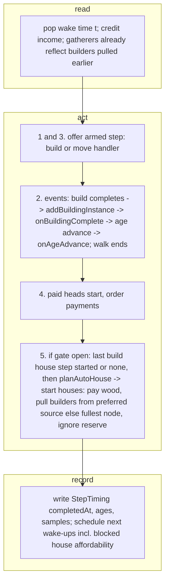

# SGS-031: Simulate construction: build and move steps, landmark age-ups and auto-houses

- **Type**: Task
- **Component**: aoe4-build-order
- **Milestone / criteria**: M2 / M2.3 (builder scaling in the loop, houses and population cap, ages; A2, A3)
- **Priority**: high
- **Risk**: high
  <!-- strongModelTriggers: changes what a simulation computes (construction timing, supply, ages, income dips), edits the core run loop and its order of operations (A3), enforces A2 for build costs, and an estimated ~300 lines of business logic (over 150). Adjacent invariants: A1, A2, A3. -->
- **LOC estimate**: ~315 business logic (`simulate.ts` ~255: `build` and `move` handlers, builder bookkeeping, age advance, hook calls, auto-house step 5 with its suppression gate, builder-source fallback and wake-up; `houses.ts` ~60: `planAutoHouse`); tests on top. If it lands over 400, split the auto-house planner (`houses.ts` plus loop step 5) into a sibling that depends on this ticket.
- **Depends on**: SGS-030 (engine core and the seam signatures; transitively SGS-026, SGS-027, SGS-028, SGS-029)
- **On merge**: none
- **Source**: design/M2.md "Engine rules" (Ages, Construction, Task-switch walk), "Production" (Follow-ons, Priority, Payment), "Auto-houses" block, Owner decisions 4, "Left to tickets" (auto-house algorithm), Modules rows `houses.ts` and `simulate.ts`, CivRules; reports/M2-plan-2.md outline G; reports/M2-designer-wave3.md ("SGS-031 must"); reports/M2-designer-wave5.md (decisions 3-5); docs/aoe4-build-order.md "Ages and landmarks", "Construction", "Houses and supply"

## Context

SGS-030 left `build` and `move` steps `waiting` forever and the population cap fixed at the starting buildings' supply. This ticket registers those two handlers on the SGS-030 seam, raises supply and creates instances when a building completes, advances the age on a landmark, and builds houses automatically so that supply never blocks production. It edits the core control loop (A2 for build costs, A3 for the new ordering), so every ordering rule below is exact.

## Scope

On origin/main 68e004a `simulate.ts`, `civ-rules.ts` and `houses.ts` do not exist; this ticket is written against SGS-030's final Seam signatures block (read the merged names before coding). Adopt, do not redefine: `EngineState`, `StepHandler`, `StepStart`, `stepHandlers`, `addBuildingInstance`, `BuildingInstance`, `PaidItem`, `triggerHolds`, `SAMPLE_SECONDS`, `CivRules`/`CivRuleContext`. From SGS-027 `constructionSeconds(baseSeconds, builders, data)` (`construction.ts`) and `modifiedValue`; from SGS-026 `BuildStep`, `SimInputs`, `GatherNodeId`. Edit `lib/aoe4-build-order/simulate.ts`, add `lib/aoe4-build-order/houses.ts`, edit `docs/aoe4-build-order.md`. SGS-032 adds the `research` handler in the same file: touch only the `build` and `move` entries of `stepHandlers` and the loop's new step 5, so the two rebase cleanly.

### 1. `build` handler

`stepHandlers.build(step, index, state)`. Entry = the lowest-age `data.byBaseId.get(step.building)` entry (as units). `builders = step.builders ?? 1`, `then = step.then ?? step.from`.

- *Blocked, in this order* (each returns `{ started: false }`): the entry's `age > state.age`; `state.gatherers[step.from] < builders` (builders are taken from villagers gathering at `from`, not from walking ones). Neither reserves anything. Otherwise, costs `food/wood/gold/stone` not all `<=` floating: `{ started: false, reserve: <the entry's costs> }` (blocked on resources alone). So an age-blocked step is re-offered at every instant, including the instant of an age-up (loop step 3 after the age-advance event).
- *Start* (the game deducts at foundation placement): subtract the cost at once (A2); move `builders` from `gatherers[from]` to `walking`; builders stay in `walking` (alive, gathering nothing) through the walk to the site, the construction and the walk back, so `at N vils` counts them. Walk `w = (step.walkSeconds ?? inputs.walkSeconds) / moveSpeedMultiplier`, with `moveSpeedMultiplier` read at the start as SGS-030 does for spawn walks. Construction time `constructionSeconds(entry.costs.time, builders, data)` begins when the builders arrive. Schedule one event at `startedAt + w + construction`.
- *Completion event*, in this order: (1) `addBuildingInstance(state, entry.baseId)` (adds supply capped at `maxPopCap`, creates the instance, gives a villager producer its rally and default order); (2) `rules.onBuildingComplete?.(state, { ...ctx, baseId, instance })` with `instance` from the returned object; (3) if the entry's `classes` contain a class matching `^age[1-3]_landmark\d$` and `entry.age === state.age`: `state.age += 1`, push `{ age: state.age, reachedAt: time }` onto `ages`, then `rules.onAgeAdvance?.(state, { ...ctx, age: state.age })`; (4) the step's `completedAt = time`; (5) schedule the builders' return: walk `w2 = (step.walkSeconds ?? inputs.walkSeconds) / moveSpeedMultiplier` read at that moment, then `walking -= builders`, `gatherers[then] += builders`. The step is `completed` at the building's completion, not at the builders' return. A landmark whose `age` differs from the current age (a second landmark of an age already passed) does not move the age.
- An age-up changes no paid item (entries are fixed at payment) and no running production time; it only makes entries of the new age available to steps and order payments, which the loop re-checks at that same instant (steps in step 3, order payments in step 4).
- A building under construction counts for nothing until completion: `state.buildings`, supply and drop-offs change at the completion event only.

### 2. `move` handler

`stepHandlers.move(step, index, state)`: `state.gatherers[step.from] < step.count` returns `{ started: false }` (no reserve; waits). Else start: move `count` from `gatherers[from]` to `walking`, schedule the walk end `(step.walkSeconds ?? inputs.walkSeconds) / moveSpeedMultiplier` later (read at start), where `walking -= count` and `gatherers[to] += count`, and `completedAt` = that time. No cost. The two nodes are not compared (`from === to` is a plain walk).

### 3. Auto-houses (`houses.ts` and loop step 5)

Add a fifth phase to the SGS-030 instant, after the order payments and production starts of phase 4: **5. auto-houses**. It runs only when `inputs.autoHouses` is true, `data.byBaseId.get('house')` exists, and the suppression gate is open. `'house'` is a baseId, not a game number.

- *Suppression gate* (respec 1): let `last` be the highest index in `order.steps` of a `build` step whose `building` is `house`. With no such step the gate is open from t=0. Otherwise it is closed from t=0 until step `last` has started and open from that instant on: a `last` started in phase 3 of an instant opens the gate in phase 5 of the same instant, and the house it started counts in `pendingSupply`. A `last` that never starts keeps the gate closed to the horizon. Earlier `build house` steps starting does not open it. The gate is a check on `last`'s start, not a precomputed time (its start depends on resources and builders).

`planAutoHouse(state: EngineState, inputs: SimInputs, data: GameData, demand: HouseDemand): number` (exported from `houses.ts`, with `interface HouseDemand { pendingSupply: number; populationPerSecond: number }`) returns how many houses to start now:

- `houseSupply = rules.supplyProvider?.(default, ctx) ?? default` for baseId `house` (default `data.supply.get('house')?.value ?? 0`); `0` returns 0.
- `lead = inputs.walkSeconds / moveSpeedMultiplier + constructionSeconds(houseEntry.costs.time, inputs.houseBuilders, data)`: the first leg and the build, the time from deciding to supply arriving.
- `projected = state.population + demand.populationPerSecond x lead`; `headroom = state.supply + demand.pendingSupply`; `shortfall = projected - headroom`. The engine's one tolerance constant applies to `shortfall > 0`; no new constant.
- Result `ceil(shortfall / houseSupply)`, but at most `ceil((maxPopCap - headroom) / houseSupply)` and never negative: planning stops once supply plus pending supply reaches `data.base.maxPopCap.value`.

The caller computes `demand` in `simulate.ts`: `pendingSupply` = supply (via the same `supplyProvider` default and hook as `addBuildingInstance`) of every build under construction (explicit or auto); `populationPerSecond` = sum over instances whose `order` has `remaining !== 0` and whose unit entry is available at `state.age` of `entry.costs.popcap / production seconds` (the same `productionSpeed` and `productionModifier` value the engine uses when an item starts). Then it starts up to that many houses one after another. Each house picks its builder source from the gatherer counts at that moment (after earlier houses in the same instant pulled theirs) (respec 1): `inputs.houseBuilderSource` when `gatherers[houseBuilderSource] >= houseBuilders`; else the node with the most gatherers, ties going to the first in `GatherNodeId` order (`sheep, berry, deer, boar, farm, wood, gold, stone`), when it has at least `houseBuilders`; else no source. A house starts only with a source and wood (the house entry's cost) in floating; the first one that cannot start ends the loop for this instant (the house waits; supply may block production meanwhile). A house waits on builders only when no node has `houseBuilders` gatherers. Auto-house builds are not order payments: **they ignore a waiting step's `reserve`** (they still never take a resource below 0). An auto-house is a `build` with no step: builders walk `inputs.walkSeconds / moveSpeedMultiplier` each leg, return to the node they were taken from (respec 1), and no `StepTiming` is written. Wake-ups: while an auto-house is blocked only on wood, include the time it becomes affordable at the current income among the engine's wake-up times. A house blocked on builders needs no extra wake-up: gatherer counts change only at events that are already wake-ups.

### 4. Docs (`docs/aoe4-build-order.md`, after SGS-025 and SGS-030's edits)

- "Houses and supply": rewrite to the rules above. Replace "build houses back to back, or more builders are used" (l.181 on 68e004a) with concurrent houses of `houseBuilders` builders each; "An explicit `build house` step overrides auto-houses" (l.181-182) becomes (respec 1) "auto-houses are off until the last `build house` step in the order has started, and on from then; if that step never starts they stay off; with no `build house` step they are on from the start"; "default 1 builder taken from `wood`" (l.180) becomes (respec 1) `houseBuilderSource` is the preferred node: when it has fewer than `houseBuilders` villagers gathering, builders come from the node with the most gatherers (ties: the first in node order), they return to the node they came from, and a house waits only when no node has enough gatherers or wood is short. Also state the lead computation, pending supply, the `maxPopCap` stop, that auto-houses ignore a waiting step's resource reservation, and `autoHouses: false` blocks at supply.
- "Ages and landmarks": add that the age only advances when the landmark's `age` equals the current age, that entries of the new age are usable at the same instant, that an age-up never changes paid items, and the order on completion: instance added, `onBuildingComplete`, age advance, `onAgeAdvance`.
- "Construction": add a `build` rules paragraph (cost paid at the start; builders come from villagers gathering at `from` and the step waits when there are fewer; they count as villagers for `at N vils`; construction starts on arrival; supply, instance and drop-off appear at completion; `completedAt` is the completion; builders return to `then`, default `from`; waits: age, builders, resources) and a `move` paragraph (waits for `count` villagers at `from`; no cost; `completedAt` is the arrival).
- The step-life section (state table, l.380-403 on 68e004a): add the `build` and `move` wait causes.
- "CivRules seams": one sentence that `onBuildingComplete` and `onAgeAdvance` are called as above. Fix l.22 (builders gather nothing while walking and building: still true) only if it becomes wrong. Grep `docs/` and `data/aoe4-build-order/README.md` for `auto-house|autoHouses|houseBuilders|landmark|back to back` and fix anything contradicted (on 68e004a only l.181 does).

**Out of scope:** `research`, tier choice and veterancy (SGS-032); notes; changing `gather.ts`, `effects.ts`, `construction.ts`, `model.ts`, SGS-030's seam signatures; parsing and validation (a `build`/`move` on a node with no villagers is not a validation issue; it waits); changing a started order's units on age-up; builders for `farm` placement beyond the generic `build`; the route and page.

## Diagrams

Changes a core control loop and adds a state machine. The instant gains phase 5 and two handler event chains:

A `build` or `move` step's builders or movers:

```mermaid
stateDiagram-v2
  [*] --> Gathering
  Gathering --> WalkingToSite: build starts (cost paid, builders leave gatherers[from], count as walking)
  WalkingToSite --> Constructing: arrive after walk
  Constructing --> WalkingBack: building completes (instance, supply, age; step completed)
  WalkingBack --> Gathering: arrive at then (default from)
  Gathering --> Moving: move starts (leave gatherers[from])
  Moving --> Gathering: arrive, join gatherers[to] (step completed)
```

## Acceptance criteria

All tests use `GameData` copies built with `buildGameData` from `structuredClone`d inputs. `w` = 5 (the base `walkSeconds`), `rw`, `rs`, `rb` and `rg` are `effectiveGatherRate` for wood, sheep, berry and gold in the test state.

- [ ] Build timing and cost: with `start: { villagers: { sheep: 4, wood: 2 }, rally: 'sheep' }`, wood 200, `autoHouses: false`, `@0:00 build house with 2 from wood then wood` starts at 0 (`floating.wood[0]` is 150), `completedAt` = `w + 15 x 3 / 4` = 16.25, and `walkSeconds 3s` on the step gives `3 + 11.25`. For 1, 2, 4 builders `completedAt - startedAt` = `w + 15 x 3 / (n + 2)`. In a `GameData` with a `moveSpeed` civ effect multiplying by 2 the walk is `w / 2`. The step is `completed` at the completion, not at the builders' return.
- [ ] Builder income dip and return: in that run `gatherRates.wood` is 0 at t=15 and t=20 and `2 x rw x 60` at t=25 (return at 21.25); with `from sheep then wood` the sheep rate drops by two villagers while building and `wood` rises after the return, not before.
- [ ] Builders count as alive: with `start.villagers` {wood: 6} and a build pulling 2 builders, a following `at 7 vils` step arms at the first villager spawn (not delayed by the builders being off the node).
- [ ] Supply and instances: in the run above (no auto-houses) the villager `counts` at t=120 is 6 (the house's +10 supply lets payments continue past the 3rd villager) and 3 without the house step; supply never exceeds `maxPopCap` (a `GameData` with `maxPopCap` 30 and an extra house still yields at most 23 villagers produced).
- [ ] New producer: `build town-center with 3 from wood` (test data with enough wood and stone) completes at `startedAt + w + 165 x 3 / 5`; from then the second instance runs the default villager order, rallied by a held `rally town-center#2 -> wood` if given, else the baseId default, else `start.rally`; `produce ... from town-center` (no `instance`) written before the build does not cover it. A `lumber-camp` build switches `wood` to `walkSecondsCamp` from its completion instant and not before (test data with different walks).
- [ ] Hooks: a test `CivRules` records `onBuildingComplete` once per completed build with `ctx.baseId` and `ctx.instance` equal to the new instance number, and when it runs `state.buildings.get(baseId)` already includes it and `state.instances.get(baseId)` contains it; for a landmark it records `onAgeAdvance` with `ctx.age` = `state.age` = the new age, after `onBuildingComplete`. Order: instance, building hook, age, age hook.
- [ ] Ages: with a starting `barracks`, starting food/gold raised, `@0:00 build abbey-of-kings with 4 from sheep` completes at `w + 190 x 3 / 6` = 100; `ages` is `[{1, 0}, {2, 100}]`; a later `build council-hall` (age 1) finishing at age 2 leaves `ages` at those two entries; `build kings-palace` (age 2 entry) at age 1 is `waiting` and starts at 100; building it advances to age 3.
- [ ] Age-blocked re-check and paid items: `produce spearman from barracks` (lowest entry age 2) after the abbey build is `waiting` with `armedAt` 0, starts at exactly 100 (`waitSeconds` 100) and in the meantime the default villager order keeps paying (no reserve); a `man-at-arms` paid at 90 spawns at 90 + 14.65 and appears in a `tier: 1` series (the age-up changed nothing already paid).
- [ ] A2 and reserve: a `build` blocked on resources alone returns a reserve and a blocked on age or builders does not: with a `GameData` where villagers cost wood 50, 100 wood and `build barracks` (150 wood) armed, the villager order pays nothing until the barracks starts; with `build kings-palace` at age 1 instead (age-blocked) the order keeps paying; every `floating` value is `>= 0` throughout.
- [ ] Builders unavailable: `build house with 3 from wood` with 2 wood villagers and `start.rally: 'wood'` waits and starts at 25 (the villager spawned at 20 arrives at 20 + w), reserving nothing; `move 7 sheep to wood` with 6 sheep villagers and rally `sheep` starts at 25.
- [ ] Move: `@0:10 move 2 sheep to wood` with 6 sheep: `startedAt` 10, `completedAt` 15, `gatherRates.food` at t=10 reflects 4 sheep villagers, `gatherRates.wood` is 0 at t=10 and `2 x rw x 60` at t=15; `walk 3s` completes at 13. Spawned villagers are not re-routed.
- [ ] Auto-houses never block: test data with starting buildings `capital-town-center` and `town-center`, food 5000, wood 200, `start: { villagers: { wood: 6 }, rally: 'wood' }`, default inputs: total villager `counts` at t=200 is 20 (hand-computed: payments of 2 per 20 s from 0 to 180, one house started at 100 completing at 120); with `autoHouses: false` it is 13 (supply 20 minus 7 starting); with an explicit `@10:00 build house with 1 from wood` step (never reached at 200 s, so the gate stays closed to the horizon) it is 13 too; wood gatherers dip to 5 during 100..125 (`gatherRates.wood` at t=105 is `5 x rw x 60`).
- [ ] (respec 1) Suppression gate opens at the last house step: in that two-producer scenario with `@0:00 build house with 1 from wood` and `@0:30 build house with 1 from wood` (supply 30 at 20, 40 at 50), the planner is on from 30 and starts one auto-house at 300 (population 39 after that instant's payments, projected 41 > 40), completing at 320, so total villager `counts` at t=400 is 40 (payments of 2 per 20 s from 0 to 380, no supply stall); with `autoHouses: false` it is 33 (supply 40 minus 7). With the second step at `@5:00` instead, the planner stays off between the two steps: `counts` is 23 at t=240 and still 23 at t=300 (supply 30 reached at 220), and resumes after the `@5:00` house completes at 320.
- [ ] (respec 1) Auto-house inputs: `houseBuilders: 2` with `houseBuilderSource: 'gold'` and a start with at least 2 gold villagers pulls two gold villagers for the house's lead, returns them to `gold` (rates observable) and the build takes `15 x 3 / 4`; `planAutoHouse` returns 0 when the house supply is 0 (a `supplyProvider` hook returning 0 or no `supply` entry) with no infinite loop; with `maxPopCap` 30 the planner starts no more than 2 houses.
- [ ] (respec 1) Builder-source fallback: the default English start (6 on `sheep`, 0 on `wood`, wood 200, food 200, scout, `capital-town-center`), `start.rally: 'sheep'`, default inputs (`houseBuilderSource: 'wood'`): the first auto-house starts at 40 (population 10 after that instant's payment) with 1 `sheep` villager, completes at 60, and the builder returns to `sheep` at 65; `gatherRates.wood` is 0 at every sample to t=120; `gatherRates.food` is `7 x rs x 60` at t=60 (6 + 2 spawned - 1 builder) and `9 x rs x 60` at t=65; villager `counts` at t=120 is 6 (payments every 20 s from 0 to 100, no stall) against 3 with `autoHouses: false`; same result with `houseBuilderSource: 'gold'`. Tie: `start: { villagers: { berry: 3, gold: 3 }, rally: 'stone' }` takes the builder from `berry` at 40 (berry 3, gold 3, stone 1; `berry` comes first in `GatherNodeId` order): `gatherRates.food` at t=45 is `2 x rb x 60`, gold unchanged at `3 x rg x 60`, and the builder returns to `berry`.
- [ ] (respec 1) No node has enough gatherers: the default English start with `houseBuilders: 11` (more villagers than supply 10 allows): the house waits with no error and no infinite loop, villager `counts` at t=120 is 3, `floating.wood` stays 200 (no house paid), and the run finishes.
- [ ] Reservation ignored: with a test handler on `research` (restored in `finally`) returning `{ started: false, reserve: { wood: <more than ever available>, food: 0, gold: 0, stone: 0 } }` forever, the auto-house still starts and pays wood while villager payments that cost wood stay blocked; floating wood never goes below 0.
- [ ] A3 and A1: two runs of each scenario above are deeply equal and do not mutate inputs or the frozen `GameData`; `git grep -nE "Math\.random|Date\.now|new Date|performance\.now" -- lib/aoe4-build-order/simulate.ts lib/aoe4-build-order/civ-rules.ts lib/aoe4-build-order/houses.ts` finds nothing (the files do not exist on 68e004a; SGS-030 adds the first two); no numeric literal in `houses.ts` and in the new `simulate.ts` code other than `0`, `1`, `60`; changing `builderScaling`, the `house` cost/time, or `supply.house` in a test `GameData` changes the output.
- [ ] Exports: `git grep -nE "^export " -- lib/aoe4-build-order/houses.ts` lists exactly `planAutoHouse` and `HouseDemand` (the file does not exist on 68e004a); `simulate.ts` gains no export beyond SGS-030's list; `npx tsc --noEmit` passes.
- [ ] Performance: a 3600 s run of the two-producer scenario with auto-houses plus 20 steps (builds and moves among them) finishes in under 1 s (generous bound in a test).
- [ ] Docs (respec 1): `git grep -n "back to back" -- docs/aoe4-build-order.md` finds nothing (one line, l.181, on 68e004a); `git grep -niE "overrides auto-houses" -- docs/aoe4-build-order.md` finds nothing (one line, l.182, on 68e004a); `git grep -nE "taken from .wood." -- docs/aoe4-build-order.md` finds nothing (one line, l.180, on 68e004a); the doc states the lead rule, that auto-houses are off until the last `build house` step has started (off to the end if it never starts, on from the start with none), the `maxPopCap` stop, the builder-source fallback and return to the origin node, that a house waits only when no node has enough gatherers or wood is short, the age-advance condition and the hook order.
- [ ] `npm test` and `npx tsc --noEmit` pass; SGS-030's tests unchanged and green; no INVARIANTS.md regressions.

## Open questions

None.

## Re-spec 2026-10-31

- Underspecified: the `planAutoHouse` signature was unconfirmed, explicit-house suppression was a guessed whole-run rule, and a source node with too few gatherers stalled production at supply 10.
- Changed: `planAutoHouse(..., demand: HouseDemand)` confirmed; suppression is now the owner's option (c) gate on the last `build house` step's start; builders fall back to the fullest node and return to their origin; new criteria for the gate (two houses then outgrowing them, `@5:00` stall), the fallback (default English start, tie) and the no-node wait; docs bullet and grep criteria updated; three open questions removed.
- Still stands: no branch work exists yet (draft); the handlers, age advance, hooks, `planAutoHouse` math and every unchanged criterion's hand numbers hold.
