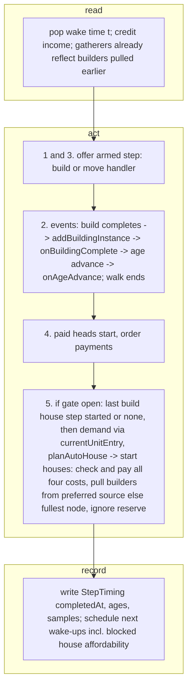

# SGS-031: Simulate construction: build and move steps, landmark age-ups and auto-houses

- **Type**: Task
- **Component**: aoe4-build-order
- **Milestone / criteria**: M2 / M2.3 (builder scaling in the loop, houses and population cap, ages; A2, A3)
- **Priority**: high
- **Risk**: high
  <!-- strongModelTriggers: changes what a simulation computes (construction timing, supply, ages, income dips), edits the core run loop and its order of operations (A3), enforces A2 for build costs, and an estimated ~300 lines of business logic (over 150). Adjacent invariants: A1, A2, A3. -->
- **LOC estimate**: ~320 business logic (`simulate.ts` ~260: `build` and `move` handlers, builder bookkeeping, age advance, hook calls, auto-house step 5 with its suppression gate, builder-source fallback, four-resource cost check and wake-up, `currentUnitEntry`; `houses.ts` ~60: `planAutoHouse`); tests on top. If it lands over 400, split the auto-house planner (`houses.ts` plus loop step 5) into a sibling that depends on this ticket.
- **Depends on**: SGS-030 (engine core and the seam signatures; transitively SGS-026, SGS-027, SGS-028, SGS-029)
- **On merge**: none
- **Source**: design/M2.md "Engine rules" (Ages, Construction, Task-switch walk), "Production" (Follow-ons, Priority, Payment), "Auto-houses" block, Owner decisions 4, "Left to tickets" (auto-house algorithm), Modules rows `houses.ts` and `simulate.ts`, CivRules; reports/M2-plan-2.md outline G; reports/M2-designer-wave3.md ("SGS-031 must"); reports/M2-designer-wave5.md (decisions 3-5); docs/aoe4-build-order.md "Ages and landmarks", "Construction", "Houses and supply"

## Context

SGS-030 left `build` and `move` steps `waiting` forever and the population cap fixed at the starting buildings' supply. This ticket registers those two handlers on the SGS-030 seam, raises supply and creates instances when a building completes, advances the age on a landmark, and builds houses automatically so that supply never blocks production. It edits the core control loop (A2 for build costs, A3 for the new ordering), so every ordering rule below is exact.

## Scope

On origin/main 68e004a `simulate.ts`, `civ-rules.ts` and `houses.ts` do not exist; this ticket is written against SGS-030's final Seam signatures block (read the merged names before coding). Adopt, do not redefine: `EngineState`, `StepHandler`, `StepStart`, `stepHandlers`, `addBuildingInstance`, `BuildingInstance`, `PaidItem`, `triggerHolds`, `SAMPLE_SECONDS`, `CivRules`/`CivRuleContext`. From SGS-027 `constructionSeconds(baseSeconds, builders, data)` (`construction.ts`) and `modifiedValue`; from SGS-026 `BuildStep`, `SimInputs`, `GatherNodeId`. Edit `lib/aoe4-build-order/simulate.ts`, add `lib/aoe4-build-order/houses.ts`, edit SGS-030's Seam test (section 5), edit `docs/aoe4-build-order.md`. SGS-032 adds the `research` handler in the same file: touch only the `build` and `move` entries of `stepHandlers`, the loop's new step 5 and the demand computation with its `currentUnitEntry` helper, so the two rebase cleanly. Hook calls use `ctx = { data: state.data, inputs: state.inputs, time: state.time }` (SGS-030's `CivRuleContext`) (respec 2).

### 1. `build` handler

`stepHandlers.build(step, index, state)`. Entry = the lowest-age `data.byBaseId.get(step.building)` entry (as units). `builders = step.builders ?? 1`, `then = step.then ?? step.from`.

- *Blocked, in this order* (each returns `{ started: false }`): the entry's `age > state.age`; `state.gatherers[step.from] < builders` (builders are taken from villagers gathering at `from`, not from walking ones). Neither reserves anything. Otherwise, costs `food/wood/gold/stone` not all `<=` floating: `{ started: false, reserve: <the entry's costs> }` (blocked on resources alone). So an age-blocked step is re-offered at every instant, including the instant of an age-up (loop step 3 after the age-advance event).
- *Start* (the game deducts at foundation placement): subtract the cost at once (A2); move `builders` from `gatherers[from]` to `walking`; builders stay in `walking` (alive, gathering nothing) through the walk to the site, the construction and the walk back, so `at N vils` counts them. Walk `w = (step.walkSeconds ?? inputs.walkSeconds) / moveSpeedMultiplier`, with `moveSpeedMultiplier` read at the start as SGS-030 does for spawn walks. Construction time `constructionSeconds(entry.costs.time, builders, data)` begins when the builders arrive. Schedule one event at `startedAt + w + construction`.
- *Completion event*, in this order: (1) `addBuildingInstance(state, entry.baseId)` (adds supply capped at `maxPopCap`, creates the instance, gives a villager producer its rally and default order); (2) `rules.onBuildingComplete?.(state, { ...ctx, baseId, instance })` with `instance` from the returned object; (3) if the entry's `classes` contain a class matching `^age[1-3]_landmark\d$` and `entry.age === state.age`: `state.age += 1`, push `{ age: state.age, reachedAt: time }` onto `ages`, then `rules.onAgeAdvance?.(state, { ...ctx, age: state.age })`. The class pattern is a rule on class names, not a game number; (4) the step's `completedAt = time`; (5) schedule the builders' return: walk `w2 = (step.walkSeconds ?? inputs.walkSeconds) / moveSpeedMultiplier` read at that moment, then `walking -= builders`, `gatherers[then] += builders`. The step is `completed` at the building's completion, not at the builders' return. A landmark whose `age` differs from the current age (a second landmark of an age already passed) does not move the age.
- An age-up changes no paid item (entries are fixed at payment) and no running production time; it only makes entries of the new age available to steps and order payments, which the loop re-checks at that same instant (steps in step 3, order payments in step 4).
- A building under construction counts for nothing until completion: `state.buildings`, supply and drop-offs change at the completion event only.

### 2. `move` handler

`stepHandlers.move(step, index, state)`: `state.gatherers[step.from] < step.count` returns `{ started: false }` (no reserve; waits). Else start: move `count` from `gatherers[from]` to `walking`, schedule the walk end `(step.walkSeconds ?? inputs.walkSeconds) / moveSpeedMultiplier` later (read at start), where `walking -= count` and `gatherers[to] += count`, and `completedAt` = that time. No cost. The two nodes are not compared (`from === to` is a plain walk).

### 3. Auto-houses (`houses.ts` and loop step 5)

Add a fifth phase to the SGS-030 instant, after the order payments and production starts of phase 4: **5. auto-houses**. It runs only when `inputs.autoHouses` is true, `data.byBaseId.get('house')` exists, and the suppression gate is open. `'house'` is a baseId, not a game number.

- *Suppression gate* (respec 1): let `last` be the highest index in `order.steps` of a `build` step whose `building` is `house`. With no such step the gate is open from t=0. Otherwise it is closed from t=0 until step `last` has started and open from that instant on: a `last` started in phase 3 of an instant opens the gate in phase 5 of the same instant, and the house it started counts in `pendingSupply`. A `last` that never starts keeps the gate closed to the horizon. Earlier `build house` steps starting does not open it. The gate is a check on `last`'s start, not a precomputed time (its start depends on resources and builders).

`planAutoHouse(state: EngineState, inputs: SimInputs, data: GameData, demand: HouseDemand): number` (exported from `houses.ts`, with `interface HouseDemand { pendingSupply: number; populationPerSecond: number }`) returns how many houses to start now:

- `houseSupply = rules.supplyProvider?.(default, ctx) ?? default` for baseId `house` (default `data.supply.get('house')?.value ?? 0`); `0` returns 0.
- `lead = inputs.walkSeconds / moveSpeedMultiplier + constructionSeconds(houseEntry.costs.time, inputs.houseBuilders, data)`: the first leg and the build, the time from deciding to supply arriving.
- `projected = state.population + demand.populationPerSecond x lead`; `headroom = state.supply + demand.pendingSupply`; `shortfall = projected - headroom`. The engine's one tolerance constant applies to `shortfall > 0`; no new constant.
- Result `ceil(shortfall / houseSupply)`, but at most `ceil((maxPopCap - headroom) / houseSupply)` and never negative: planning stops once supply plus pending supply reaches `data.base.maxPopCap.value`.

The caller computes `demand` in `simulate.ts`: `pendingSupply` = supply (via the same `supplyProvider` default and hook as `addBuildingInstance`) of every build under construction (explicit or auto); `populationPerSecond` = sum over instances whose `order` has `remaining !== 0` of `entry.costs.popcap / production seconds` (the same `productionSpeed` and `productionModifier` value the engine uses when an item starts), where `entry = currentUnitEntry(order.unit, state)`. No availability check is needed: an order exists only after its unit was payable, and ages only rise.

*Unit entry for demand* (respec 2): add one non-exported function in `simulate.ts`, `currentUnitEntry(unit: string, state: EngineState): SnapshotEntry | undefined`, returning the lowest-age entry `state.data.byBaseId.get(unit)?.[0]` (`data.ts` sorts each baseId's entries by ascending `age`). The demand computation is its only caller here; SGS-030's two lookups (order payment, `produce` handler) are not touched. It deliberately does not call `resolveUnitEntry`: that function is SGS-032's, not in SGS-030's contract this ticket depends on. Demand is re-read at every instant, so once tier choice exists the current resolution is the right estimate; whichever of SGS-031/SGS-032 merges second makes `currentUnitEntry` return `resolveUnitEntry(unit, state)` (or replaces its one call with it). Keep the name `currentUnitEntry`.

With `demand`, the caller starts up to `planAutoHouse`'s count of houses one after another. Each house picks its builder source from the gatherer counts at that moment (after earlier houses in the same instant pulled theirs) (respec 1): `inputs.houseBuilderSource` when `gatherers[houseBuilderSource] >= houseBuilders`; else the node with the most gatherers, ties going to the first in `GatherNodeId` order (`sheep, berry, deer, boar, farm, wood, gold, stone`), when it has at least `houseBuilders`; else no source. A house starts only with a source and every resource of the house entry's cost (`food`, `wood`, `gold`, `stone`) `<=` floating (respec 2); at the start all four are subtracted at once, as the `build` handler does (A2). The first house that cannot start ends the loop for this instant (the house waits; supply may block production meanwhile). A house waits on builders only when no node has `houseBuilders` gatherers, and on resources when any of the four is short. Auto-house builds are not order payments: **they ignore a waiting step's `reserve`** (they still never take a resource below 0). An auto-house is a `build` with no step: builders walk `inputs.walkSeconds / moveSpeedMultiplier` each leg, return to the node they were taken from (respec 1), and no `StepTiming` is written. Wake-ups (respec 2): while an auto-house has a builder source but is blocked on resources, include among the engine's wake-up times the time its whole cost becomes affordable at the current income (the latest of the per-resource times, so the binding resource decides; no wake-up when a short resource has no income). A house blocked on builders needs no extra wake-up: gatherer counts change only at events that are already wake-ups.

### 4. Docs (`docs/aoe4-build-order.md`, after SGS-025 and SGS-030's edits)

- "Houses and supply": rewrite to the rules above. Replace "build houses back to back, or more builders are used" (l.181 on 68e004a) with concurrent houses of `houseBuilders` builders each; "An explicit `build house` step overrides auto-houses" (l.181-182) becomes (respec 1) "auto-houses are off until the last `build house` step in the order has started, and on from then; if that step never starts they stay off; with no `build house` step they are on from the start"; "default 1 builder taken from `wood`" (l.180) becomes (respec 1) `houseBuilderSource` is the preferred node: when it has fewer than `houseBuilders` villagers gathering, builders come from the node with the most gatherers (ties: the first in node order), they return to the node they came from, and a house waits only when no node has enough gatherers or a resource of the house cost is short (respec 2). Also state the lead computation, pending supply, the `maxPopCap` stop, that auto-houses ignore a waiting step's resource reservation, and `autoHouses: false` blocks at supply.
- "Ages and landmarks": add that the age only advances when the landmark's `age` equals the current age, that entries of the new age are usable at the same instant, that an age-up never changes paid items, and the order on completion: instance added, `onBuildingComplete`, age advance, `onAgeAdvance`.
- "Construction": add a `build` rules paragraph (cost paid at the start; builders come from villagers gathering at `from` and the step waits when there are fewer; they count as villagers for `at N vils`; construction starts on arrival; supply, instance and drop-off appear at completion; `completedAt` is the completion; builders return to `then`, default `from`; waits: age, builders, resources) and a `move` paragraph (waits for `count` villagers at `from`; no cost; `completedAt` is the arrival).
- The step-life section (state table, l.380-403 on 68e004a): add the `build` and `move` wait causes.
- "CivRules seams": one sentence that `onBuildingComplete` and `onAgeAdvance` are called as above. Fix l.22 (builders gather nothing while walking and building: still true) only if it becomes wrong. Grep `docs/` and `data/aoe4-build-order/README.md` for `auto-house|autoHouses|houseBuilders|landmark|back to back` and fix anything contradicted (on 68e004a only l.181 does).

### 5. Tests already on main: the Seam test and the supply-bound pins (respec 2, respec 3, respec 4, respec 5)

SGS-030's Seam test (its "Seam" criterion, in `lib/aoe4-build-order/simulate.test.ts` or wherever SGS-030 placed it) has a test `leaves build and move waiting and blocking` that asserts a `build` and a `move` step each report `waiting` and block later steps, and a test that sets `stepHandlers.build` and removes it in `finally` makes the loop start that step. Both parts become false or harmful once `build` and `move` are registered. Edit that test in place as below. The only other edits allowed to any test already on origin/main are the `autoHouses: false` pins listed after it: the eight SGS-030 pins, the SGS-032 pin, and the general rule (respec 3, respec 4):

- No-handler half (respec 5): remove the `build` and `move` cases (the test `leaves build and move waiting and blocking`). The no-handler test `leaves an action with no registered handler waiting and blocking` (it deletes `stepHandlers.research` through its local `handlers` alias and restores it in `finally`; SGS-032 put it there when it registered `research`) stays as it is on origin/main: an action with no registered handler reports `waiting` and the step after it is `not-reached`.
- Test-handler half: keep it on `stepHandlers.build`, but save the registered handler before overriding it and put that same handler back in `finally` (`delete` only when none was registered). Removing it would leave later tests in the file without the real `build` handler.
- Supply-bound pins (respec 3): `INPUT_DEFAULTS.autoHouses` is `true` (`validate.ts`, design/M2.md SimInputs "default true"), so with this ticket's step 5 the default start no longer stops at supply 10. Eight SGS-030 tests assert that stop. In each, add `autoHouses: false` to the `SimInputs` of the run the test reads (for example `inputs: { ...inputs, autoHouses: false }` or `inputsFor(game, { autoHouses: false })`; for a run shared by a `describe` block, at that shared call), and change nothing else: no assertion, expected number, step list, start, game data or helper changes. The eight, by file > describe > test:
  - `lib/aoe4-build-order/simulate.test.ts` > `default English start` > `pays villagers at 0, 20 and 40 until supply 10 blocks the fourth`
  - `lib/aoe4-build-order/simulate.test.ts` > `same instant` > `routes the villager after the one that met a villagers trigger`
  - `lib/aoe4-build-order/simulate.test.ts` > `rally scope` > `walks (walkSeconds ?? inputs.walkSeconds) / moveSpeedMultiplier`
  - `lib/aoe4-build-order/simulate.test.ts` > `produce waits` > `waits while the population would pass supply, without a reserve`
  - `lib/aoe4-build-order/simulate.test.ts` > `civ rules` > `supplyProvider changes the supply a building gives` (respec 5): its `def` is the describe-level `const def = run([])`, which `defaults to the english rules, which are the empty frozen set` compares with `toEqual` and `productionModifier changes the production time` also reads, so it cannot be pinned at its definition. The allowed form is one substitution of the run argument in this test's `expect(` line: `expect(countAt(def, 'villager', 80)).toBe(3)` becomes `expect(countAt(run([], { inputs: inputsFor(data, { autoHouses: false }) }), 'villager', 80)).toBe(3)` (or the same run in a local const in this test); the expected number 3 and everything else stay unchanged.
  - `lib/aoe4-build-order/simulate.acceptance.test.ts` > `hand-computed timeline with a wood-only start` > `banks wood from six gatherers and spends food only at payments`
  - `lib/aoe4-build-order/simulate.acceptance.test.ts` > `hand-computed timeline with a wood-only start` > `stops paying villagers when supply is reached` (shares the describe-level `run` with the previous test; one pin covers both)
  - `lib/aoe4-build-order/simulate.acceptance.test.ts` > `invariants over generated build orders` > `never goes negative, orders step times, keeps counts cumulative and supply bounded` (its `villagersAndScouts + MAA <= 3` bound stays as written and holds under `autoHouses: false`)

- SGS-032 pin (respec 4): `lib/aoe4-build-order/research.test.ts` > `technology effects apply from completion` shares two default-input runs, `const result = run([wheelbarrow], { game })` and `const plain = run([], { game })`. With auto-houses on, two of its tests fail: `leaves gather rates unchanged before completion and applies the tech after it` (the sheep-gatherer count from `plain` is 10, not 9) and `changes neither population nor units produced` (paying the wheelbarrow's 50 wood shifts when auto-houses start, so `unitsProduced` differs). Add `inputs: inputsFor(game, { autoHouses: false })` to those two shared calls only (`run([wheelbarrow], { game, inputs: inputsFor(game, { autoHouses: false }) })` and `run([], { game, inputs: inputsFor(game, { autoHouses: false }) })`), and change nothing else in that file: not the describe's `simInputs`, not the `run([], { game })` in `research shares the queue with production` (it passes as is), no assertion, expected number, step list or helper.
- General rule (respec 4): any other test already on origin/main that fails only because `INPUT_DEFAULTS.autoHouses` is `true` may be pinned the same way: `autoHouses: false` added to the `SimInputs` of the run it reads (at the shared call for a describe-level run), nothing else changed in that test. "Only because" means the test passes with that pin and no other edit. The implementer lists each such pin in its report by file > describe > test with the failure it fixed. A failing test on main that the pin does not fix, or that would need any other edit (an assertion, expected number, step list, start, game data or helper), is needs_spec, not a pin.

  The auto-houses-on behavior these runs no longer cover is asserted by this ticket's own criteria (builder-source fallback: 6 villagers at t=120 with default inputs against 3 with `autoHouses: false`).

**Out of scope:** `research`, tier choice and veterancy (SGS-032); notes; changing `gather.ts`, `effects.ts`, `construction.ts`, `model.ts`, SGS-030's seam signatures, SGS-030's two unit-entry lookups, or any test already on origin/main other than the Seam test (and its handler helper), the eight SGS-030 `autoHouses: false` pins, the SGS-032 pin in `research.test.ts` and pins under the general rule, all as Scope section 5 says (respec 3, respec 4); `resolveUnitEntry`; parsing and validation (a `build`/`move` on a node with no villagers is not a validation issue; it waits); changing a started order's units on age-up; builders for `farm` placement beyond the generic `build`; the route and page.

## Diagrams

Changes a core control loop and adds a state machine. The instant gains phase 5 and two handler event chains:

A `build` or `move` step's builders or movers:

```mermaid
stateDiagram-v2
  [*] --> Gathering
  Gathering --> WalkingToSite: build starts (cost paid, builders leave gatherers[from], count as walking)
  WalkingToSite --> Constructing: arrive after walk
  Constructing --> WalkingBack: building completes (instance, supply, age; step completed)
  WalkingBack --> Gathering: arrive at then (default from)
  Gathering --> Moving: move starts (leave gatherers[from])
  Moving --> Gathering: arrive, join gatherers[to] (step completed)
```

## Acceptance criteria

All tests use `GameData` copies built with `buildGameData` from `structuredClone`d inputs. `w` = 5 (the base `walkSeconds`), `rw`, `rs`, `rb` and `rg` are `effectiveGatherRate` for wood, sheep, berry and gold in the test state.

- [x] Build timing and cost: with `start: { villagers: { sheep: 4, wood: 2 }, rally: 'sheep' }`, wood 200, `autoHouses: false`, `@0:00 build house with 2 from wood then wood` starts at 0 (`floating.wood[0]` is 150), `completedAt` = `w + 15 x 3 / 4` = 16.25, and `walkSeconds 3s` on the step gives `3 + 11.25`. For 1, 2, 4 builders `completedAt - startedAt` = `w + 15 x 3 / (n + 2)`. In a `GameData` with a `moveSpeed` civ effect multiplying by 2 the walk is `w / 2`. The step is `completed` at the completion, not at the builders' return.
- [x] Builder income dip and return: in that run `gatherRates.wood` is 0 at t=15 and t=20 and `2 x rw x 60` at t=25 (return at 21.25); with `from sheep then wood` the sheep rate drops by two villagers while building and `wood` rises after the return, not before.
- [x] Builders count as alive: with `start.villagers` {wood: 6} and a build pulling 2 builders, a following `at 7 vils` step arms at the first villager spawn (not delayed by the builders being off the node).
- [x] Supply and instances: in the run above (no auto-houses) the villager `counts` at t=120 is 6 (the house's +10 supply lets payments continue past the 3rd villager) and 3 without the house step; supply never exceeds `maxPopCap` (a `GameData` with `maxPopCap` 30 and an extra house still yields at most 23 villagers produced).
- [x] New producer: `build town-center with 3 from wood` (test data with enough wood and stone) completes at `startedAt + w + 165 x 3 / 5`; from then the second instance runs the default villager order, rallied by a held `rally town-center#2 -> wood` if given, else the baseId default, else `start.rally`; `produce ... from town-center` (no `instance`) written before the build does not cover it. A `lumber-camp` build switches `wood` to `walkSecondsCamp` from its completion instant and not before (test data with different walks).
- [x] Hooks: a test `CivRules` records `onBuildingComplete` once per completed build with `ctx.baseId` and `ctx.instance` equal to the new instance number, and when it runs `state.buildings.get(baseId)` already includes it and `state.instances.get(baseId)` contains it; for a landmark it records `onAgeAdvance` with `ctx.age` = `state.age` = the new age, after `onBuildingComplete`. Order: instance, building hook, age, age hook.
- [x] (respec 2) Ages. Test data for this and the next criterion: a test `civData` with starting buildings `capital-town-center`, `barracks`, `house`, `house` (supply 30), resources food 2000, wood 200, gold 1000, stone 0; `start: { villagers: { sheep: 6 }, rally: 'sheep' }`; `autoHouses: false`. Run 1, steps `@0:00 build abbey-of-kings with 4 from sheep` then `build council-hall with 1 from sheep`: the abbey starts at 0 and completes at `w + 190 x 3 / 6` = 100, the council hall (age 1 entry) starts at 0 and completes at `w + 190 x 3 / 3` = 195; `ages` is `[{1, 0}, {2, 100}]` at the end (the council hall finished at age 2 and did not move the age). Run 2, steps `@0:00 build abbey-of-kings with 4 from sheep` then `build kings-palace with 2 from sheep`: the kings-palace step (only an age 2 entry) has `armedAt` 0, `startedAt` 100, `waitSeconds` 100, completes at `100 + w + 220 x 3 / 4` = 270, and `ages` is `[{1, 0}, {2, 100}, {3, 270}]`.
- [x] (respec 2) Age-blocked re-check and paid items. Same test data as Ages; steps, in order: (0) `@0:00 build abbey-of-kings with 4 from sheep`; (1) `produce man-at-arms from barracks` (continuous; `man-at-arms-1` is age 1, 90 food 20 gold, 14.65 s); (2) `produce spearman from barracks` (lowest entry `spearman-2`, age 2). Steps 0 and 1 start at 0; step 2 has `armedAt` 0 and is age-blocked, so it reserves nothing: the man-at-arms order pays at 0, 14.65, ..., 87.9 (`6 x 14.65`, seven payments) and the villager order pays every 20 s from 0. At 100 the abbey completes, the age becomes 2 in phase 2, and step 2 starts in phase 3 of the same instant: `startedAt` 100, `waitSeconds` 100; step 1 gets `completedAt` 100 (its order replaced). The man-at-arms paid at 87.9, in production at the age-up, still spawns at `7 x 14.65` = 102.55 in the `man-at-arms-1` series (`tier` 1), whose final count is 7, and no `man-at-arms-2` series exists; the spearman paid at 100 queues behind it and spawns at 102.55 + 15 = 117.55 in a `spearman-2` series (`tier` 2). Comparisons use `toBeCloseTo`.
- [x] A2 and reserve: a `build` blocked on resources alone returns a reserve and a blocked on age or builders does not: with a `GameData` where villagers cost wood 50 (test snapshot copy), `start: { villagers: { wood: 6 }, rally: 'wood' }`, 100 wood and `build barracks` (150 wood) armed, the villager order pays nothing until the barracks starts; with `build kings-palace` at age 1 instead (age-blocked) the order keeps paying; every `floating` value is `>= 0` throughout.
- [x] Builders unavailable: `build house with 3 from wood` with 2 wood villagers and `start.rally: 'wood'` waits and starts at 25 (the villager spawned at 20 arrives at 20 + w), reserving nothing; `move 7 sheep to wood` with 6 sheep villagers and rally `sheep` starts at 25.
- [x] Move: `@0:10 move 2 sheep to wood` with 6 sheep: `startedAt` 10, `completedAt` 15, `gatherRates.food` at t=10 reflects 4 sheep villagers, `gatherRates.wood` is 0 at t=10 and `2 x rw x 60` at t=15; `walk 3s` completes at 13. Spawned villagers are not re-routed.
- [x] Auto-houses never block: test data with starting buildings `capital-town-center` and `town-center`, food 5000, wood 200, `start: { villagers: { wood: 6 }, rally: 'wood' }`, default inputs: total villager `counts` at t=200 is 20 (hand-computed: payments of 2 per 20 s from 0 to 180, one house started at 100 completing at 120); with `autoHouses: false` it is 13 (supply 20 minus 7 starting); with an explicit `@10:00 build house with 1 from wood` step (never reached at 200 s, so the gate stays closed to the horizon) it is 13 too; (respec 2) wood gatherers are one fewer during 100..125 than with `autoHouses: false`: `gatherRates.wood` at t=105 is `15 x rw x 60` (6 + 10 spawned by 100, all arrived by 105, - 1 builder) against `16 x rw x 60`, and equal again at t=125.
- [x] (respec 1) Suppression gate opens at the last house step: in that two-producer scenario with `@0:00 build house with 1 from wood` and `@0:30 build house with 1 from wood` (supply 30 at 20, 40 at 50), the planner is on from 30 and starts one auto-house at 300 (population 39 after that instant's payments, projected 41 > 40), completing at 320, so total villager `counts` at t=400 is 40 (payments of 2 per 20 s from 0 to 380, no supply stall); with `autoHouses: false` it is 33 (supply 40 minus 7). With the second step at `@5:00` instead, the planner stays off between the two steps: `counts` is 23 at t=240 and still 23 at t=300 (supply 30 reached at 220), and resumes after the `@5:00` house completes at 320.
- [x] (respec 1) Auto-house inputs: `houseBuilders: 2` with `houseBuilderSource: 'gold'` and a start with at least 2 gold villagers pulls two gold villagers for the house's lead, returns them to `gold` (rates observable) and the build takes `15 x 3 / 4`; `planAutoHouse` returns 0 when the house supply is 0 (a `supplyProvider` hook returning 0 or no `supply` entry) with no infinite loop; with `maxPopCap` 30 the planner starts no more than 2 houses.
- [x] (respec 1) Builder-source fallback: the default English start (6 on `sheep`, 0 on `wood`, wood 200, food 200, scout, `capital-town-center`), `start.rally: 'sheep'`, default inputs (`houseBuilderSource: 'wood'`): the first auto-house starts at 40 (population 10 after that instant's payment) with 1 `sheep` villager, completes at 60, and the builder returns to `sheep` at 65; `gatherRates.wood` is 0 at every sample to t=120; `gatherRates.food` is `7 x rs x 60` at t=60 (6 + 2 spawned - 1 builder) and `9 x rs x 60` at t=65; villager `counts` at t=120 is 6 (payments every 20 s from 0 to 100, no stall) against 3 with `autoHouses: false`; same result with `houseBuilderSource: 'gold'`. Tie: `start: { villagers: { berry: 3, gold: 3 }, rally: 'stone' }` takes the builder from `berry` at 40 (berry 3, gold 3, stone 1; `berry` comes first in `GatherNodeId` order): `gatherRates.food` at t=45 is `2 x rb x 60`, gold unchanged at `3 x rg x 60`, and the builder returns to `berry`.
- [x] (respec 2) House cost uses all four resources: in the builder-source fallback scenario with a test snapshot copy whose `house` entry costs 50 wood and 10 stone, and start stone 0 (the English default), no auto-house ever starts (stone has no income), villager `counts` at t=120 is 3, `floating.wood` stays 200 and the run finishes; with start stone 10 the first auto-house starts at 40 as before, and at t=45 `floating.stone` is 0 and `floating.wood` is 150.
- [x] (respec 1) No node has enough gatherers: the default English start with `houseBuilders: 11` (more villagers than supply 10 allows): the house waits with no error and no infinite loop, villager `counts` at t=120 is 3, `floating.wood` stays 200 (no house paid), and the run finishes.
- [x] Reservation ignored: with a test handler on `research` (the previous value saved and put back in `finally`) returning `{ started: false, reserve: { wood: <more than ever available>, food: 0, gold: 0, stone: 0 } }` forever, in a `GameData` where the villager costs wood 50 (test snapshot copy), the auto-house still starts and pays wood while villager payments that cost wood stay blocked; floating wood never goes below 0.
- [x] A3 and A1: two runs of each scenario above are deeply equal and do not mutate inputs or the frozen `GameData`; `git grep -nE "Math\.random|Date\.now|new Date|performance\.now" -- lib/aoe4-build-order/simulate.ts lib/aoe4-build-order/civ-rules.ts lib/aoe4-build-order/houses.ts` finds nothing (the files do not exist on 68e004a; SGS-030 adds the first two); no numeric literal in `houses.ts` and in the new `simulate.ts` code other than `0`, `1`, `60` (respec 2: the class pattern `^age[1-3]_landmark\d$` is exempt, it is a rule on class names, not a game number); changing `builderScaling`, the `house` cost/time, or `supply.house` in a test `GameData` changes the output.
- [x] Exports: `git grep -nE "^export " -- lib/aoe4-build-order/houses.ts` lists exactly `planAutoHouse` and `HouseDemand` (the file does not exist on 68e004a); `simulate.ts` gains no export beyond SGS-030's list; `npx tsc --noEmit` passes.
- [x] (respec 2) Demand lookup: `git grep -n "currentUnitEntry" -- lib/aoe4-build-order/simulate.ts` finds exactly two lines, the non-exported definition and its one call in the demand computation (finds nothing on 68e004a; after SGS-032 merges it may also find that ticket's edit); reading the demand code shows no other `byBaseId.get` of a produced unit. Demand counts every producing instance: the two-producer scenario ("Auto-houses never block") plus a starting `barracks`, gold 1000 and a step `produce man-at-arms from barracks` (continuous; population 10 after the instant at 0, rate `2/20 + 1/14.65` per s, lead 20) starts its first auto-house at `3 x 14.65` = 43.95 (population 17 after that instant's payments, projected 17 + 3.37 > 20), so `gatherRates.wood` at t=45 is `9 x rw x 60` (6 + 4 spawned by 40 - 1 builder). Mutation: making the demand computation count only villager orders moves that start to 60 (population 20, projected 22 > 20), `gatherRates.wood` at t=45 becomes `10 x rw x 60` and this assertion fails.
- [x] Performance: a 3600 s run of the two-producer scenario with auto-houses plus 20 steps (builds and moves among them) finishes in under 1 s (generous bound in a test).
- [x] Docs (respec 2): `git grep -n "back to back" -- docs/aoe4-build-order.md` finds nothing (one line, l.181, on 68e004a); `git grep -niE "overrides auto-houses" -- docs/aoe4-build-order.md` finds nothing (one line, l.182, on 68e004a); `git grep -nE "taken from .wood." -- docs/aoe4-build-order.md` finds nothing (one line, l.180, on 68e004a); the doc states the lead rule, that auto-houses are off until the last `build house` step has started (off to the end if it never starts, on from the start with none), the `maxPopCap` stop, the builder-source fallback and return to the origin node, that a house waits only when no node has enough gatherers or a resource of the house cost is short, the age-advance condition and the hook order.
- [x] (respec 4, respec 5) `npm test` and `npx tsc --noEmit` pass with `INPUT_DEFAULTS.autoHouses` still `true` in `validate.ts`. Every test already on origin/main is green, and unchanged except these three kinds of edit (Scope section 5): (a) SGS-030's Seam test (and its handler helper), edited as Scope section 5 says: it no longer has `build` or `move` cases, still asserts that an action with no registered handler is `waiting` and blocks the next step, and its test handler on `stepHandlers.build` puts the real handler back in `finally` (after the test, `stepHandlers.build` is the registered `build` handler); (b) the eight SGS-030 tests listed by name in Scope section 5, whose only edit is `autoHouses: false` added to the inputs of the run they read, and the generated-invariants test keeps its `villagersAndScouts + MAA <= 3` bound; (c) in `lib/aoe4-build-order/research.test.ts` > `technology effects apply from completion`, the two shared calls `run([wheelbarrow], { game })` and `run([], { game })` gain `inputs: inputsFor(game, { autoHouses: false })`, plus any pin under the general rule, each listed in the implementer's report. Diff check: `git diff origin/main -- lib/aoe4-build-order/simulate.test.ts lib/aoe4-build-order/simulate.acceptance.test.ts lib/aoe4-build-order/research.test.ts` shows, outside the Seam test and its helper, only added or changed lines that add `autoHouses: false`, with no expected number, step list, start, game data or helper changed; the only changed `expect(` line is the supplyProvider substitution of the run argument (`countAt(def, 'villager', 80)` -> `countAt(run([], { inputs: inputsFor(data, { autoHouses: false }) }), 'villager', 80)`, expected number 3 unchanged) (respec 5); in `research.test.ts` exactly two lines change (l.316-317 on ce342db); `git diff --stat origin/main -- '*.test.ts' '*.test.tsx'` lists no other existing test file beyond the general-rule pins in the report (new files `houses.test.ts` and `simulate-construction.test.ts` are this ticket's own). No INVARIANTS.md regressions.

## Open questions

None.

## Re-spec 2026-10-31

- Underspecified: the `planAutoHouse` signature was unconfirmed, explicit-house suppression was a guessed whole-run rule, and a source node with too few gatherers stalled production at supply 10.
- Changed: `planAutoHouse(..., demand: HouseDemand)` confirmed; suppression is now the owner's option (c) gate on the last `build house` step's start; builders fall back to the fullest node and return to their origin; new criteria for the gate (two houses then outgrowing them, `@5:00` stall), the fallback (default English start, tie) and the no-node wait; docs bullet and grep criteria updated; three open questions removed.
- Still stands: no branch work exists yet (draft); the handlers, age advance, hooks, `planAutoHouse` math and every unchanged criterion's hand numbers hold.

## Re-spec 2026-10-31 (2)

- Underspecified: the ticket said SGS-030's tests stay unchanged although its Seam test asserts `build` and `move` wait; the age-blocked scenario's hand numbers could not hold in one step list; the auto-house checked wood only; the demand's produced-unit lookup had no rule relative to SGS-032's `resolveUnitEntry`.
- Changed: new Scope section 5 edits the SGS-030 Seam test in place (drop `build`/`move`, keep `research`, restore the real `build` handler); Ages split into two runs and the age-blocked scenario rewritten as an exact three-step list on shared test data (payments at 14.65 multiples, start at 100, spawn 102.55 and 117.55); auto-houses check and pay all four costs with a binding-resource wake-up and a new criterion; demand uses a named non-exported `currentUnitEntry` (lowest-age, not `resolveUnitEntry`) with a grep and mutation criterion; `ctx` defined; the landmark regex exempted from the literal rule; test data named in the reserve criteria; the "Auto-houses never block" wood-rate figure corrected (it ignored the spawned wood villagers).
- Still stands: no branch work exists; the handlers, age advance, hook order, gate, builder fallback, `planAutoHouse` math and every other criterion's hand numbers are unchanged.

## Re-spec 2026-11-01 (3)

- Underspecified: the final criterion kept SGS-030's tests unchanged except the Seam test, but auto-houses on by default (design/M2.md SimInputs "default true", kept) lift the supply-10 stop that eight SGS-030 tests assert (5 in `simulate.test.ts`, 3 in `simulate.acceptance.test.ts`); the implementer showed all eight pass with `autoHouses: false`.
- Changed: Scope section 5 now also lists the eight tests by name and allows only adding `autoHouses: false` to their run inputs; the Out of scope line and the final criterion (now respec 3) allow exactly those pins and nothing else, with a diff check, and keep the generated-invariants `<= 3` bound. No other criterion changed.
- Still stands: branch `sgs-031-aoe4-build-move-ages` @ 1d514ee in full (handlers, age advance, auto-houses phase, `houses.ts`, the new test files, the Seam edit, docs); the rework adds only the eight pins.

## Re-spec 2026-11-01 (4)

- Underspecified: re-spec 3 allowed `autoHouses: false` pins only on eight named SGS-030 tests; once SGS-032 merged (ce342db), two tests in `research.test.ts` > `technology effects apply from completion` failed for the same reason (default auto-houses change the shared `result`/`plain` runs), and no rule covered the next such test.
- Changed: Scope section 5, Out of scope and the final criterion (now respec 4) allow exactly three kinds of edit to tests on main: the Seam test and its helper, the eight SGS-030 pins, and the pin on the two shared runs in `research.test.ts`; plus a general rule that a test failing only because auto-houses default on may be pinned the same way if listed in the report, and anything else is needs_spec. The diff check now covers `research.test.ts`; clause (a) now says "an action with no registered handler" instead of "a `research` step", since SGS-032 registered `research` and replaced that case on main. Auto-houses stay on by default; no other criterion changed.
- Still stands: branch `sgs-031-aoe4-build-move-ages` @ 13ec441 in full (rebase onto ce342db, conflict resolutions, `currentUnitEntry` -> `resolveUnitEntry` rewire, the eight pins); the rework adds only the two-line pin in `research.test.ts` (verified: 652/652 tests pass with it).

## Re-spec 2026-11-01 (5)

- Underspecified: the final criterion's diff check forbade any changed `expect(` line, but the supplyProvider pin must change one (its `def` is a describe-level run shared with a `toEqual` test); the Scope intro and the Seam bullet still described a `research` step reporting `waiting`, stale since SGS-032 registered `research` on ce342db.
- Changed: wording only. The diff check now forbids changed expected numbers, step lists, starts, game data or helpers and names the one allowed `expect(` substitution (expected number 3 unchanged), also stated at the supplyProvider pin; the Scope intro and Seam bullet now say the `build`/`move` test is removed and `leaves an action with no registered handler waiting and blocking` stays as on main, matching clause (a). The allowed-edit set is unchanged.
- Still stands: branch `sgs-031-aoe4-build-move-ages` @ 13ec441 in full; the remaining work is still only the two-line pin in `research.test.ts`.
