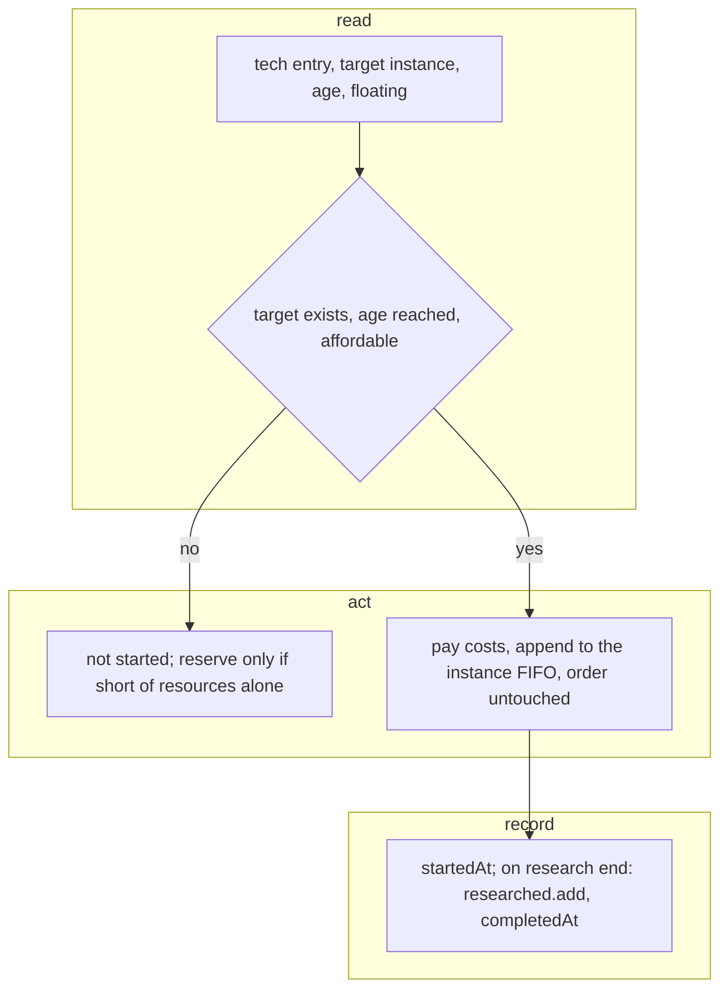

# SGS-032: Research technologies and veterancy upgrades in the engine queue

- **Type**: Task
- **Component**: aoe4-build-order
- **Milestone / criteria**: M2 / M2.3 (techs; an upgrade delays production and changes the produced tier)
- **Priority**: high
- **Risk**: high
  <!-- strongModelTriggers: changes what a simulation computes (tier of every produced unit, income after a tech) and the order of operations a result depends on (research shares the instance FIFO with production, A3); edits the core loop file simulate.ts; adjacent invariants A1, A2, A3. -->
- **LOC estimate**: ~165 business logic (`research.ts` new: handler ~60, tier resolution ~30, notes ~30; `simulate.ts` call sites ~20 in place, including the auto-house demand lookup when SGS-031 is merged); tests on top.
- **Depends on**: SGS-030 (and transitively SGS-027, SGS-029). Sibling SGS-031 (`build`, `move`, ages, auto-houses) is ticketed in parallel; the handlers are disjoint. Both add entries to the `stepHandlers` literal and both edit SGS-030's seam test, and SGS-031 adds a third produced-unit lookup (auto-house demand); Scope section 2 gives the rule for each in either merge order. (respec 2)
- **On merge**: none
- **Source**: design/M2.md "Engine rules" (Queue, Tier, `classifyTech`), "Production" (Follow-ons: `research` pays at step start, appended to the FIFO, never replaces the order); reports/M2-plan-2.md outline H; reports/M2-designer-wave3.md (SGS-032 must); design/M2.md "Research target" and "Repeat research" (reports/M2-designer-wave5.md); docs/aoe4-build-order.md "Queues", "Tiers", tech classification, "Outputs"

## Context

A `research` step is the only way a technology or veterancy upgrade takes effect. It must cost resources (A2), occupy its building's queue for its research time, delay the production behind it, and from completion change gather rates (techs) or the tier of units paid afterwards (upgrades). This extends the SGS-030 loop through the handler seam it fixed; it does not change the loop.

## Scope

Names are SGS-030's Seam signatures, used unchanged: `EngineState`, `StepHandler`, `StepStart`, `stepHandlers`, `BuildingInstance`, `PaidItem`, `ProductionOrder`. From earlier tickets: `classifyTech` (`effects.ts`, on origin/main 68e004a), `modifiedValue`, `data.upgradeTargets` (`Map<upgradeBaseId, HandValue<unitBaseId>>`), `BuildOrderNote` and `TechSupport` (`model.ts`). Validation (SGS-029) already guarantees the tech exists, is not `rejected`, that `at` is in the union of the tech entries' `producedBy`, and that no `research` step repeats the `tech` of an earlier one (design "Repeat research", `invalid`); the engine re-checks none of it. In particular the engine has no "already researched or already queued" check and never pays for a tech twice (respec 1).

### 1. New `lib/aoe4-build-order/research.ts`

Imports `EngineState`, `StepHandler`, `BuildingInstance`, `PaidItem` from `./simulate` as types only (`import type`), so there is no runtime cycle.

- `researchHandler: StepHandler<'research'>`. Tech entry = lowest-age `data.byBaseId.get(step.tech)` entry. Target (design "Research target", respec 1): candidates = `[step.at]` if given, else the entry's `producedBy` in snapshot order; target = the lowest-numbered existing instance (`instance` 1 first) of the first candidate baseId that has any instance. Queue length (`paid`, `order`) is not consulted. No `instance` field on `research`. Returns:
  - no candidate instance exists: `{ started: false }` (no reserve), blocks later steps, like `produce`. This includes a tech with empty `producedBy` and no `at` (`upgrade-king-3`, `upgrade-king-4`): it never starts;
  - `entry.age > state.age`: `{ started: false }` (no reserve);
  - costs (`food/wood/gold/stone`) not all `<=` the floating resources: `{ started: false, reserve: <the tech's costs> }`;
  - else pay: subtract the costs from `state.resources` (`popcap` is 0 for techs; do not touch `population`), append `{ entry, complete }` to the target's `paid` (FIFO, behind any unit already paid), return `{ started: true }`. The target's `order` is left untouched: it pays its next unit only when `paid` is empty again, so it resumes after the research.
  - `complete(state, at)`: add `entry.baseId` to `state.researched`, set `state.steps[index].completedAt = state.time` and status `completed`. Nothing else: no population change, nothing in `unitsProduced`.
  - Tests observe the target through the seam, since the result has no per-instance output (respec 2): the test saves `stepHandlers.research`, replaces it with a wrapper that snapshots every `state.instances` entry's `paid.length`, calls `researchHandler`, and on `started: true` records the `(baseId, instance)` whose `paid` grew; `finally` restores the saved value.
- The engine's existing item start gives the duration `entry.costs.time / modifiedValue(1, 'productionSpeed', { baseId: entry.baseId, classes: entry.classes, producer: instance.baseId }, state)`; no engine change is needed for it. Effects take hold from `complete` through the existing `modifiedValue` reads (the next instant recomputes income; walks already started keep their duration; units already in production keep theirs).
- `resolveUnitEntry(baseId: string, state: EffectState): SnapshotEntry | undefined`: the entries for `baseId` (`data.byBaseId`, ascending age); among `state.researched` baseIds `u` with `data.upgradeTargets.get(u)?.value === baseId`, take the largest upgrade entry `age` (`data.byBaseId.get(u)`) and return the unit entry whose `age` equals it; no researched upgrade, or no unit entry at that age: the lowest-age entry. Availability (`entry.age > state.age`) stays SGS-030's check, applied to the returned entry. A unit's entry is fixed when paid, so a unit paid before the upgrade completes keeps the lower tier.
- `researchNotes(order: BuildOrder, data: GameData): BuildOrderNote[]`: for each `research` step in step order, reached or not, `classifyTech(entry, data)`: `effects-ignored` gives one `{ code: 'tech-effect-ignored', step: index, tech: step.tech, properties, message }`; `effects-unmodeled` gives one `{ code: 'tech-effect-unmodeled', ..., properties: [] }` with a message saying the effect is not simulated; `supported` gives none; `rejected` gives none and does not throw (validation rejects such steps, so it is unreachable in a validated order) (respec 2). Messages name the tech and, for ignored, the properties. A pure function of `(order, data)`, so it never depends on the run (A3).

### 2. `simulate.ts` (edits in place; no other loop change)

- Register `research: researchHandler` in the `stepHandlers` literal (SGS-031 adds its own entries).
- Every produced-unit entry lookup goes through `resolveUnitEntry(unit, state)` (respec 2). The sites:
  1. order payment (SGS-030);
  2. the `produce` handler's first payment (SGS-030);
  3. the auto-house demand: the unit entry used for `populationPerSecond` (availability at `state.age`, `costs.popcap`, production seconds) in the `HouseDemand` that `simulate.ts` passes to `planAutoHouse` (SGS-031). It uses `resolveUnitEntry(order.unit, state)`: demand is read per instant, and the entry the next payment will take is the current resolution, so this is the right estimate. If SGS-031 is merged before this ticket, this ticket changes that lookup in place. If this ticket merges first, SGS-031 calls `resolveUnitEntry` (imported from `./research`) there on rebase. SGS-031 keeps the lookup's location and name stable, so either side can find it.
- SGS-030's seam test (respec 2). SGS-031 edits it to drop `build` and `move` and keep `research` as the handler-less example. Registering `research` makes that assertion false, so this ticket edits the test in place. It removes the assertion that a plain `research` step waits for lack of a handler and replaces it with an equivalent check: the test saves `stepHandlers.research`, deletes it, asserts that a `research` step reports `waiting` and the step after it `not-reached`, and restores the saved handler in `finally`. No assertion is left that any real action has no handler. If this ticket merges before SGS-031, it removes only the `research` part and leaves the `build`/`move` parts, which SGS-031 then drops on rebase, keeping this delete-and-restore check. The handler-injection half of the test (a handler added and removed in `finally`) is unchanged by this ticket.
- Any other test that overrides `stepHandlers.research` (SGS-031's "Reservation ignored" test installs a test handler on `research`) must restore the saved value in `finally`, not `delete` it; otherwise the real handler is gone for later tests. If such a test deletes, this ticket changes it to save and restore.
- `SimulationResult.notes` = `researchNotes(order, data)` instead of `[]`. (respec 2: SGS-031 adds no notes.)

### 3. Docs (`docs/aoe4-build-order.md`)

- "Queues", Research target (respec 2): a `research` step goes to `at` if given, else to the first building in the tech's `producedBy` (snapshot order) that has an instance, and within that building to its lowest-numbered instance (instance 1 first); queue length is not consulted, `research` has no `instance` field, and a tech with no producing building and no `at` never starts. Example: `research textiles` with a capital town center and two town centers goes to the capital town center; `research textiles at town-center` goes to town center 1.
- "Queues": research pays at step start, is appended to the instance FIFO behind paid units, never replaces the instance's order, which resumes (pays its next unit) when the research ends; it waits while no target instance exists or the tech's age is not reached, and reserves resources only when short of resources alone.
- "Tiers": the tier is chosen when a unit is paid; a unit paid before an upgrade completes keeps the lower tier; an upgrade with no unit entry at its age does not change the tier.
- Step life: `research` completes when its research time ends.
- "Outputs" `notes` bullet already describes the notes; check it still matches (one per research step, reached or not, step order).
- Grep `docs/` and `data/aoe4-build-order/README.md` for `research`, `tier`, `upgradeTargets`, `veteran` and fix anything contradicted (on 68e004a the "Tiers" paragraph l.135-139 is extended, not contradicted).

**Out of scope:** `build`, `move`, ages, houses (SGS-031); parsing and validation of `research` (SGS-028/029); changes to `effects.ts`, `gather.ts`, `model.ts`, `data.ts`; cancelling or refunding research; new `CivRules` hooks; the route and page (SGS-033).

## Diagrams

Changes a core control loop's queue. State of one instance's queue with research (transitions this ticket adds):

```mermaid
stateDiagram-v2
  Idle --> Researching: research starts on an idle instance (cost paid at step start)
  Producing --> Producing: research starts, paid behind the unit in production; the order stays set
  Researching --> Idle: research ends, tech or upgrade added to researched
  Idle --> Producing: order pays its next unit at the same instant, tier read now
```

Read, act, record for one `research` step offer:

## Acceptance criteria

- [x] (respec 2) Upgrade delays production and changes the tier: test `GameData` (cloned, starting age 3, starting `barracks`, enough food, wood and gold: spearman also costs wood), `produce spearman from barracks` (continuous) then `@0:05 research veteran-spearmen`. Spearman 1 (entry `spearman-2`) is paid at its step start and spawns at its end; the research starts when it ends and takes 60 s (`veteran-spearmen-3`); the next spearman is paid when the research ends and is `spearman-3`, so with the same inputs but no research step the second spearman spawns 60 s earlier and is `spearman-2`. `unitsProduced` has separate series for `spearman-2` and `spearman-3` with `tier` 2 and 3. The `produce` order is still the instance's order after the research.
- [x] Tier fixed at payment: test `GameData` with two starting `barracks` and spearman `costs.time` 100. Steps: `produce spearman from barracks#2 x1` (paid at 0), `research veteran-spearmen at barracks#1` (starts at 0, completes at 60), `@1:10 produce spearman from barracks#1 x1` (paid at 70). The unit paid at 0 spawns at 100 as `spearman-2` although the upgrade completed at 60; the unit paid at 70 is `spearman-3`. A `produce` step without the `@1:10` trigger would pay at 0 and so also be `spearman-2` (tier is read at payment, not at spawn). `resolveUnitEntry` unit test: no upgrade researched gives the lowest-age entry; `veteran-spearmen` researched gives the age-3 entry; an `upgradeTargets` row pointing at a unit with no entry at the upgrade's age gives the lowest-age entry.
- [x] (respec 2) Research target: test `GameData` at starting age 2 with a starting `capital-town-center` (instance 1) and two starting `town-center`s (instances 1 and 2), enough food and gold (`textiles-2` costs 50 food, 100 gold, 20 s), and the `BuildOrder` has `start.rally` set (the town centers are villager producers with default villager orders). The target is read with the wrapper on `stepHandlers.research` described in Scope section 1. `research textiles` (producedBy `capital-town-center`, `kings-palace`, `town-center`) records `capital-town-center` #1. Separate run: steps `pause town-center` with `instance: 2` then `@0:30 research textiles at town-center`; at 0:30 `town-center` #2 has an empty `paid` and no order, while #1's default order keeps it producing; the wrapper records `town-center` #1, not #2 (queue length not consulted). With `capital-town-center` removed from the starting buildings, `research textiles` records `town-center` #1 (`kings-palace` has no instance, so the next candidate is used). These runs also yield a `tech-effect-ignored` note (`textiles` carries `hitpoints`); do not assert empty notes there.
- [x] (respec 2) A2: a `research` step short of resources only is `waiting` with `startedAt` equal to the time the missing resource reaches the cost (hand-computed), floating never below 0, and the order payments respect its reserve (a unit costing a resource the tech also costs is not paid below the tech's cost of it). A research step with no target instance (`research wheelbarrow at mill` with no `mill`), an unreached age (`research veteran-spearmen` at age 2 with a starting `barracks`, so it waits on age and not on the target; respec 2), or a tech with empty `producedBy` and no `at` (`research upgrade-king-3` at age 3, respec 1) is `waiting` at the horizon, reserves nothing (a later-affordable order payment is not held back by its cost), and blocks later steps.
- [x] Techs apply from completion: `research wheelbarrow at mill` (test `GameData` with a starting `mill`) costs 50 wood and 150 gold at its start, `gatherRates` at samples before its completion (90 s) equal those without the step, and at samples after it equal `gatherers x effectiveGatherRate(...) x 60` computed with `wheelbarrow` researched; `completedAt` equals `startedAt + 90 / productionSpeed multiplier` (the `mill` is idle, so the research starts in production at once). It does not change `population` or `unitsProduced`.
- [x] Research shares the queue: while a tech is researched at the `capital-town-center` (`research` with `at` given, a test tech produced there), the default villager order pays nothing until it ends, then resumes; a villager paid before the research starts still spawns on time.
- [x] Notes: `research bloomery` (blacksmith tech, `meleeAttack`) yields exactly one `tech-effect-ignored` note with `step` = its index, `tech` `bloomery` and `properties: ['meleeAttack']`, the tech still costs and queues; `research shaft-mining` yields one `tech-effect-unmodeled` note with `properties: []`; a research step that is `not-reached` at the horizon still yields its note; notes are in step order; `research wheelbarrow` and `research veteran-spearmen` yield none. Two runs on equal inputs have deeply equal notes (A3).
- [x] (respec 2) Reuse: `git grep -nE "classifyTech" -- lib/aoe4-build-order/research.ts` finds at least one call. The only produced-unit entry lookup is inside `resolveUnitEntry`: `git grep -nE "byBaseId\.get\(([A-Za-z_.]*\.)?unit\)" -- lib/aoe4-build-order/simulate.ts lib/aoe4-build-order/houses.ts` finds nothing (neither file exists on 68e004a; after SGS-030 it finds its lookups, which this ticket replaces); `git grep -c "resolveUnitEntry(" -- lib/aoe4-build-order/simulate.ts` is 2 without SGS-031's auto-house demand and 3 with it; reading the call sites confirms each of the three sites in Scope section 2 calls it.
- [x] Mutation: replacing `resolveUnitEntry`'s upgrade lookup with `entries[0]` makes the delay-and-tier test fail; making `complete` skip `state.researched.add` makes the wheelbarrow test fail. (Both code paths are new in this ticket; confirm each fails when applied.)
- [x] A1: no numeric literal in `research.ts` other than `0` and `1`; changing a research `costs.time` or a cost in a test `GameData` changes the output.
- [x] `docs/aoe4-build-order.md` states that research is paid at step start, joins the FIFO and the order resumes after it, and that a unit's tier is fixed when paid: `git grep -niE "resumes|fixed when paid" -- docs/aoe4-build-order.md` finds at least one line (none on 68e004a).
- [x] (respec 2) `docs/aoe4-build-order.md` states the Research target rule: `git grep -niE "lowest-numbered" -- docs/aoe4-build-order.md` finds at least one line (none on 68e004a), and that passage names `at`, `producedBy` order, and that queue length is not consulted.
- [x] (respec 2) Seam test: with `research` registered, the edited seam test deletes `stepHandlers.research`, sees the `research` step `waiting` and the next step `not-reached`, and restores it in `finally`; no test leaves `stepHandlers.research` deleted or replaced (`git grep -n "stepHandlers.research" -- lib/` lists every override; each restores the saved value in `finally`).
- [x] `npm test` and `npx tsc --noEmit` pass, the edited seam test included; no INVARIANTS.md regressions. (respec 2)

## Open questions

None.

## Re-spec 2026-10-31

- Underspecified: which instance takes a `research` when several exist, and what a repeated `research` does; both were Open questions.
- Changed: Scope states the design's Research target rule (candidates `[at]` else `producedBy` in snapshot order, lowest-numbered instance of the first candidate with one, queue length ignored, empty `producedBy` without `at` never starts) and that repeats are a SGS-029 validation issue, so the engine has no repeat check and no pay-again path; added the Research target criterion and the `upgrade-king-3` waiting case; Open questions removed.
- Branch work: none expected yet; any existing `research.ts` handler with the lowest-numbered-instance target still stands; drop any engine repeat check or pay-again test.

## Re-spec 2026-10-31 (2)

- Underspecified: the SGS-030 seam test breaks once `research` is registered; the auto-house `populationPerSecond` lookup from SGS-031 was a third produced-unit lookup with no owner; the Research target rule had no docs bullet; tests had no way to see which instance took a research.
- Changed: Scope 2 now says to replace the seam test's handler-less `research` assertion with a delete-and-restore check, to route the auto-house demand lookup through `resolveUnitEntry` (whichever of SGS-031/032 merges second edits it), and that overrides of `stepHandlers.research` restore the saved value. The Reuse grep now matches the rule (no `byBaseId.get(...unit)` in `simulate.ts`/`houses.ts`; 2 or 3 `resolveUnitEntry` calls). Added a docs bullet plus a `lowest-numbered` criterion, the wrapper method for observing the target, the starting `barracks` and wood in the test data, and `rejected` gives no note.
- Branch work: none exists yet; the handler, `resolveUnitEntry`, `researchNotes` and every unchanged criterion's hand numbers still stand.
