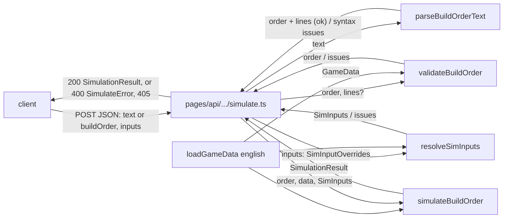

# SGS-033: Add POST /api/aoe4-build-order/simulate with its OpenAPI spec

- **Type**: Task
- **Component**: aoe4-build-order
- **Milestone / criteria**: M2 / M2.7 (and M2.4 over HTTP)
- **Priority**: high
- **Risk**: high
  <!-- strongModelTriggers: new public API request/response and OpenAPI contract; enforces the S3 caps (text and step limits) at the route. Adjacent invariants: S3, A3. -->
- **LOC estimate**: ~100 business logic (`api.ts` ~45 types, `simulate.ts` route ~60); OpenAPI JSON (~600-900 lines of schema), contract spec, HTTP specs and the spec-surface loosening on top
- **Depends on**: SGS-028 (`parseBuildOrderText`), SGS-029 (`validateBuildOrder`, `resolveSimInputs`, `SIM_INPUT_BOUNDS`), SGS-030 (`simulateBuildOrder`); transitively SGS-026 (types), SGS-014 (`loadGameData`)
- **On merge**: CONTEXT.md Key surfaces: add `POST /api/aoe4-build-order/simulate` (`operationId: simulateBuildOrder`)
- **Source**: design/M2.md "Route", "Line map", "Producer capability", "Left to tickets" (spec-surface loosening); reports/M2-plan-2.md outline I and Spec gaps T3; reports/M2-designer-wave2.md (answer 3); design/M2.md "Route request and issues" and reports/M2-designer-wave4.md (respec 1)

## Context

The page (and anyone with curl) reaches the engine only through this route. It is a thin handler like `pages/api/fight.ts`: all rules live in `lib/aoe4-build-order/`, the route chooses the input path, maps results to HTTP, and enforces the S3 text-length cap. `docs/api/openapi.json` is the authoritative contract and must stay true to the code (M2.7).

## Scope

Names come from the dependency tickets and design/M2.md; read SGS-026/028/029/030 as merged and do not redefine their exports. On origin/main 68e004a none of `api.ts`, `parse-text.ts`, `validate.ts`, `simulate.ts` or `pages/api/aoe4-build-order/` exist.

1. **`lib/aoe4-build-order/api.ts`** (new, like `lib/combat-simulator/fight-api.ts`, with the same one-line "openapi.json is the contract; keep the two in step" header) (respec 1). Exports exactly five types, as design/M2.md "Route request and issues" gives them:
   - `TripInputOverrides = Partial<TripInputs>`;
   - `SimInputOverrides = Partial<Omit<SimInputs, 'trips'>> & { trips?: Partial<Record<GatherNodeId, TripInputOverrides>> }`;
   - `SimulateRequest { text?: string; buildOrder?: BuildOrder; inputs?: SimInputOverrides }`;
   - `SimulateResponse` (alias of `SimulationResult`);
   - `SimulateError { error: string; issues: BuildOrderIssue[] }`.
   Types only. `resolveSimInputs` (SGS-029) accepts a `SimInputOverrides`-shaped value and merges `trips` per node, then per field, `influenceCoverage` per key; the route passes `inputs` through untouched.
2. **`pages/api/aoe4-build-order/simulate.ts`** (new, thin): default `handler(req, res)`.
   - Method not `POST`: `Allow: POST`, 405 `{ error: 'method <M> is not allowed; use POST' }` (same wording as `/api/fight`).
   - Body must be a non-array JSON object (an array, string, number or `null` fails), else 400 with exactly one `syntax` issue (no `step`/`line`) and nothing else checked: the inputs stage is skipped (respec 1). Otherwise exactly one of `text` and `buildOrder` present (a key with value `undefined` is absent; `null` counts as present and fails its type check): neither or both is one `syntax` issue naming both keys. `text` must be a string (`syntax`); `buildOrder` shape is `validateBuildOrder`'s job.
   - `text` longer than `SIM_INPUT_BOUNDS.textChars` (compare `text.length`) is one `out-of-range` issue naming `text` and the limit, without parsing. Otherwise `parseBuildOrderText(text)`; `ok: false` returns its issues; else `validateBuildOrder(r.order, data, { lines: r.lines })`.
   - `buildOrder`: `validateBuildOrder(buildOrder, data)` (no `lines`; JSON issues carry `step` but never `line`). The 200-step cap is `validateBuildOrder`'s (`steps` bound); the route adds no second check.
   - Then `resolveSimInputs(inputs ?? {}, data)`; its issues carry no `step`/`line`. For an object body both stages always run (when the order stage failed, inputs are still resolved) and issues concatenate, order issues first, so `issues` lists everything, as the doc says.
   - Any issue: 400 `SimulateError` with `issues` and `error = issues[0].message`. Otherwise 200 with `simulateBuildOrder(order, data, inputs)` (the `rules` argument is left at its default; there is no `rules` parameter on the request or in `validateBuildOrder` in v1, Spec gaps T3).
   - `data = loadGameData('english')` (the only `CivId`; a `civ` other than `english` in `buildOrder` is `unknown-id` from validation). No `try/catch` around the engine: validated input must not throw, and an unexpected throw is Next's 500.
   - Malformed JSON keeps Next's plain-text 400 (`Invalid JSON`), documented in the spec as the `/api/fight` 400 does. A body above Next's default 1 MB body limit is Next's plain-text 413, also before the handler runs; no `config.api.bodyParser.sizeLimit` is set (respec 1). The largest body the caps allow is about 120 KB, so the handler's own caps enforce S3. After `npm ci` in the worktree, confirm the 413 status on the installed Next (`^16.4.3` in `package.json` on main) and record it in the PR; if it differs, document the observed status instead and say so in the PR.
3. **`docs/api/openapi.json`**: add path `/api/aoe4-build-order/simulate`, `post`, `operationId: simulateBuildOrder`, responses `200`, `400`, `405` (with `Allow` header, `schema: { type: string, const: POST }`), request body with an `example` (a paste-free JSON order with `start` and a `rally` step) and 200/400 examples copied from real responses. Components schemas named exactly as the TS types: `SimulateRequest`, `SimulateError`, `SimulationResult` (the 200 body; `SimulateResponse` is an alias and gets no schema of its own), `BuildOrder`, `BuildStart`, `BuildStep` (one object variant per `action`, including `rally`; a `oneOf` on the `action` const), `Trigger`, `GatherNodeId`, `ResourceKind`, `CivId`, `SimInputOverrides`, `TripInputOverrides` (every property optional in both; `trips` is an object keyed by `GatherNodeId` whose values are `TripInputOverrides`) (respec 1), `UnitSeries`, `StepTiming`, `BuildOrderIssue`, `BuildOrderNote`. Bounds from `SIM_INPUT_BOUNDS` appear as `minimum`/`maximum`/`maxLength`/`maxItems` (`text` 20000 chars, `steps` 200, plus every row of the bounds table). Request-side schemas (`SimulateRequest`, `BuildOrder`, `BuildStart`, `BuildStep`, `Trigger`, `SimInputOverrides`, `TripInputOverrides`) allow additional properties because validation ignores unknown ones; response-side schemas set `additionalProperties: false` and require every property the TS type does not mark optional. Every property has a `description`. No inline `type: object` under `paths`. There is no `SimInputs` or `TripInputs` schema (neither appears in a request or a response) (respec 1). Describe in the operation prose: the `issues` ordering rule (order stage first, inputs stage second, a non-object body gives one `syntax` issue only), that a paste issue has `line` and a JSON one has `step` (and `start` JSON issues and `inputs` issues neither), that absent `inputs` fields at any depth take their defaults, and the two framework responses with no schema: malformed JSON is Next's plain-text 400, a body over 1 MB is Next's plain-text 413 (respec 1). The `info` block stays as is.
4. **Loosen `acceptance/fight-api-spec-surface.spec.ts`** (today l.24 asserts `Object.keys(spec.paths)` equals `['/api/fight']`; l.28-41 pin the schema names; l.59-64 require `required` to list every property of every object schema; l.69 allows only `FightOutcomes` open). Change to: `paths` contains `/api/fight` and `/api/aoe4-build-order/simulate`; the pinned-name test, the every-property-required test and the open-schema test apply to the fight schemas only (the nine pinned `Fight*` names plus `ArmyCount`), not the AoE4 ones; the "no inline object under paths" test still walks all paths. No fight assertion is weakened.
5. **New `acceptance/aoe4-simulate-api-contract.spec.ts`**: ajv 2020 against `docs/api/openapi.json` response and request schemas, same pattern as `acceptance/fight-api-contract.spec.ts` (`Ajv2020({ strict: false })`, `ajv.addSchema(spec, 'openapi.json')`, `getSchema('openapi.json#/components/schemas/<Name>')`, a warm-up request in `beforeAll` for `next dev`'s first compile). Covers: a real 200 body validates as `SimulationResult` and a mutation (extra property, missing `times`) does not; a real 400 validates as `SimulateError`; the request examples in the spec validate as `SimulateRequest` and return 200; the 400 examples equal real responses; a request body the schemas call valid and one they call invalid agree with the server (a `Trigger` with unknown `kind` is schema-valid only if the spec says so; pin the rule in the spec text and assert it).
6. **New `acceptance/aoe4-simulate-api.spec.ts`** (HTTP cases, `request.post`, a small `postSimulate` helper beside the spec or in `acceptance/helpers.ts`; see Acceptance criteria).
7. **Docs** (respec 1): `docs/aoe4-build-order.md` "Route" (l.343-357 on main) states the contract; re-read it against the route as built and fix every sentence that disagrees. Known fixes: l.347-348 "optional `inputs`, a partial `SimInputs` whose missing fields take their defaults" becomes `inputs`, a `SimInputOverrides` whose absent fields take their defaults at any depth (`trips` per node, then per field; `influenceCoverage` per key); add the 400 `issues` ordering (order issues first, then inputs issues; a non-object body gives one `syntax` issue), the `null`-counts-as-present "exactly one" rule, and the 413 beside the malformed-JSON 400 bullet (l.354). Sentences that use `SimInputs` as the engine's resolved type (l.53, l.154, l.333) stay. `ARCHITECTURE.md` needs no change (it points each route to `pages/api/<app>/<action>.ts`). Grep for the names changed: `git grep -n "aoe4-build-order/simulate" -- docs ARCHITECTURE.md`.

**Out of scope:** the page and `chart` components; the engine, parser, validator and their unit tests; any `rules` request parameter or `ValidateOptions.rules` (T3); a `spread`/`runs`/`seed` field; rate limiting; changing Next's body-size or malformed-JSON behavior; the `/api/fight` route and its other specs; build, move and research behavior (SGS-031/032 land separately; until they merge such steps return 200 with `waiting` timing, and the manager orders the page after them).

## Diagrams

Crosses components (route, parser, validator, engine, data loader), and the route is the single place that sequences them:

Not a change to a core control loop or state machine (the engine is SGS-030); the route only calls it.

## Acceptance criteria

- [x] (respec 1) `api.ts` exports `SimulateRequest`, `SimulateResponse`, `SimulateError`, `SimInputOverrides`, `TripInputOverrides`, nothing else, with `SimulateRequest.inputs` typed `SimInputOverrides`; the route file imports types from it and has no business logic besides body-shape checks, the `textChars` check, sequencing and mapping to HTTP (`wc -l` of the handler under ~100 lines).
- [x] Text path: a paste order with a `start` line and a `rally` step returns 200 and a `SimulationResult` with `civ: 'english'` and `steps.length` equal to the number of step lines. The equivalent JSON `buildOrder` (same `start`, same `rally` step) returns 200 and `unitsProduced`, `steps`, `times` deep-equal to the paste response (A3), and two identical requests return identical bodies.
- [x] Omitting `inputs` and sending `inputs: {}` give the same body; `inputs: { durationSeconds: 300 }` gives a result whose `durationSeconds` is 300 and whose last `times` entry is 300. (respec 1) `inputs: { trips: { farm: { walkSecondsCamp: 3 } } }` returns 200 (the other farm fields and other nodes keep defaults, so the request is not rejected for missing fields), and `inputs: { trips: { farm: { walkSecondsCamp: 999 } } }` returns 400 with one `out-of-range` issue whose message names `inputs.trips.farm.walkSecondsCamp`.
- [x] Each issue code reached over HTTP returns 400 with `issues[0].code` as stated and `error === issues[0].message`: `syntax` (neither `text` nor `buildOrder`; both; `text: null` with `buildOrder` (both present); body is an array; a non-object step; a paste line that does not parse, with `line`), `unknown-trigger-kind` (`{"kind":"resource"}`), `unknown-id` (`produce villager from no-such-building`), `unsupported-tech` (`military-academy`), `unknown-tech-effect` (`forestry`), `out-of-range` (`inputs.durationSeconds` 59; 201 steps; `text` of 20,001 characters; 20,000 characters is not rejected for length), `invalid`.
- [x] Every `invalid` rule returns 400 over HTTP with a message naming the step or line and the offending id: `start.villagers` summing to 5; `walkSeconds` on a `produce` without `rally`; `rally` on a `produce` of `scout`; a `rally` step on `house`; no `start.rally` while English starts with `capital-town-center` (message names it); a `build` of `town-center` with no `start.rally` and no earlier rally source; `produce villager from house`; `research wheelbarrow at house`. Each has a passing neighbour that returns 200 (`start.villagers` summing to 6 with `start.rally`; `produce villager from kings-palace`; `research wheelbarrow at mill`).
- [x] Issue location over HTTP: a paste issue carries `line` (and `step`); the same fault sent as JSON carries `step` and no `line`; a JSON `start` issue carries neither; an `inputs` issue carries neither.
- [x] Order and inputs issues are both reported: an invalid step and `inputs.durationSeconds: 59` in one request give 400 with both issues, the order issue first and `error` equal to its message.
- [x] (respec 1) A non-object body (`[]`, `"x"`, `null`) returns 400 with exactly one issue, `syntax`, carrying no `step` or `line`; no inputs issue is added (the inputs stage is skipped).
- [ ] Non-POST methods (GET, PUT, DELETE) return 405 `{ error }` with header `Allow: POST`; a malformed JSON body returns 400 with a non-JSON plain-text body (`Invalid JSON`), matching what the spec says. (respec 1) A body over 1 MB returns Next's plain-text 413 (status confirmed on the installed Next and recorded in the PR), and the OpenAPI operation prose names both framework responses.
- [x] `docs/api/openapi.json` parses with `jq`, lists the new path with `operationId: simulateBuildOrder` and responses `200`, `400`, `405`; `jq '[.paths[][]|select(.operationId)]|length' docs/api/openapi.json` prints 1 on main today and 2 after; the schema names listed in Scope item 3 exist and `SimulateResponse`, `SimInputs`, `TripInputs` do not (respec 1).
- [x] Contract spec (Scope 5) passes: real 200 and 400 bodies validate against the documented schemas, and a body with an added response property or a missing required one fails validation; every example in the new path validates against its schema and equals a real response where it is a response.
- [ ] Spec-surface spec is loosened as in Scope 4 and passes; `git grep -n "toEqual(\['/api/fight'\])" -- acceptance` finds 1 line on main today and 0 after; every other existing fight spec passes unchanged.
- [ ] Mutation check: changing the route to skip the `textChars` check, or to pass `lines` on the JSON path, or to drop the `inputs` stage, makes at least one named HTTP spec fail (run each mutation once in a throwaway worktree and record which spec failed in the PR).
- [x] (respec 1) `docs/aoe4-build-order.md` "Route" and the OpenAPI prose agree with the handler; `git grep -n "partial \`SimInputs\`" -- docs` finds 1 line on main today and 0 after; the Route section names `SimInputOverrides`, the issues ordering and the 413; no stale sentence (`git grep -n "aoe4-build-order/simulate" -- docs ARCHITECTURE.md` lists only places that were re-read).
- [x] `npx tsc --noEmit`, `npm test`, `npm run acceptance` and `npx next build` pass.
- [x] No INVARIANTS.md regressions (S3: text, steps and every numeric input are capped before the engine runs; A3: no clock or randomness in the route; S1: nothing imported from `lib/combat-simulator/` or other apps)

## Re-spec 2026-10-31

- Underspecified: oversized-body behavior, the `inputs.trips` granularity and the non-object-body path were left to designer defaults; design/M2.md "Route request and issues" now settles them.
- Changed: `api.ts` exports five names (adds `SimInputOverrides`, `TripInputOverrides`); OpenAPI schemas use those instead of `SimInputs`/`TripInputs`; non-object body is one `syntax` issue with the inputs stage skipped; 413 documented and confirmed on the installed Next; docs re-read fixes the "partial `SimInputs`" sentence; Open questions closed (engine completeness moved to Out of scope).
- Branch work: none started on this ticket; nothing to keep or discard.
