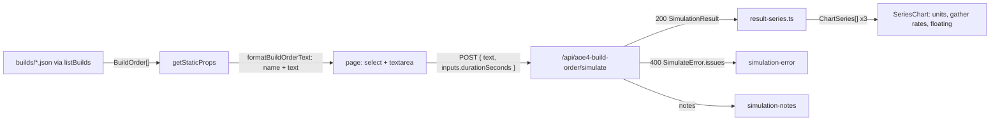

# SGS-034: Build the AoE4 build order page with a prebuilt build, landing link and acceptance tests

- **Type**: Task
- **Component**: aoe4-build-order
- **Milestone / criteria**: M2 / M2.5, M2.6 (page half), M2.8
- **Priority**: high
- **Risk**: high
  <!-- strongModelTriggers: estimated ~250-300 lines of business logic across the page, two components, `builds.ts` and the result-to-series mapping (over 150); the page is the first consumer of the route contract (`api.ts`). Adjacent invariants: S1, S2, S3, A3. -->
- **LOC estimate**: ~270 business logic (`pages/apps/aoe4-build-order.tsx` ~80, `build-input.tsx` ~60, `results.tsx` ~50, `result-series.ts` ~40, `builds.ts` ~20, `pages/index.js` 4, build JSON excluded as data); unit tests and Playwright specs on top
- **Depends on**: SGS-028 (`parseBuildOrderText`, `formatBuildOrderText`), SGS-031 (`build`, `move`, ages), SGS-032 (`research`), SGS-033 (route and `api.ts` types); transitively SGS-026, SGS-029, SGS-030. SGS-015 (`SeriesChart`, `ChartSeries`) is already on main.
- **On merge**: CONTEXT.md Key surfaces: Routes add `/apps/aoe4-build-order`; CONTEXT.md Component model row `aoe4-build-order`: replace the "TODO: proposed" paths with the real ones; INVARIANTS.md AoE4 Paths line: drop "(proposed)" (manager edits, HA-1 in reports/M2-plan-2.md)
- **Source**: MILESTONES.md M2.5, M2.6, M2.8; design/M2.md "Charts", "Page test ids", "Paste format", Data flow, "Left to tickets" (exposed `SimInputs`); reports/M2-plan-2.md outline J and Spec gaps T2, T4; reports/M2-designer-wave2.md (every prebuilt build is paste-representable; this ticket tests the round trip)

## Context

The engine and route exist; nothing reaches a user. This ticket adds the page `/apps/aoe4-build-order` titled "AoE4 Build Order Simulator", at least one prebuilt English build (the owner's aoe4guides build), the landing link, and the Playwright proof that a pasted or selected build runs and draws units produced, gather rates and floating resources. It consumes the route and the chart component; it adds no rules.

## Scope

On origin/main 68e004a none of the page, `builds.ts`, `result-series.ts`, `data/aoe4-build-order/builds/` or any AoE4 route exists; `components/apps/aoe4-build-order/{chart-rows.ts,line-chart.tsx}` exist (SGS-015). Adopt the dependency tickets' names unchanged: `parseBuildOrderText`, `formatBuildOrderText` (`parse-text.ts`); `validateBuildOrder`, `resolveSimInputs` (`validate.ts`); `simulateBuildOrder` (`simulate.ts`); `loadGameData` (`data.ts`); `SimulateRequest`, `SimulateResponse`, `SimulateError` (`api.ts`, final in SGS-033); `SimulationResult`, `UnitSeries`, `BuildOrder`, `BuildOrderIssue`, `BuildOrderNote`, `ResourceKind` (`model.ts`); `SeriesChart`, `ChartSeries` (SGS-015). Read the merged files before coding. Do not depend on details SGS-031 and SGS-032 have not settled (exact timings, tier choice, auto-house behavior): no test below asserts a time, a count or a tier, only structure and step statuses.

1. **`lib/aoe4-build-order/builds.ts`** (new): `listBuilds(): BuildOrder[]` returns the prebuilt orders from `data/aoe4-build-order/builds/*.json` by static `import` (like `data.ts`; no `fs`, so it bundles). Order of the array is the order of the import list. A new build is one JSON file plus one import line; the unit test (item 8) fails if a file is not listed. (respec 1) A JSON import types `civ` as `string`, so `satisfies BuildOrder` does not compile: cast each import once with `as unknown as BuildOrder`, the same pattern `data.ts` uses for its snapshot and rules files. No other cast and no `any`; the civ, round-trip and validation checks in item 8 are what make the cast safe.
2. **`data/aoe4-build-order/builds/<slug>.json`** (new, at least one): a `BuildOrder` (`civ: 'english'`, `name`, `source` = `https://aoe4guides.com/builds/reinDv5vkVX6KUny571E`, `start`, `steps`). Every number is a non-negative integer (paste-representable: `walkSeconds` has no decimals). `start.rally` is present (validation requires it while English starts with `capital-town-center`). Ids are aoe4world `baseId`s from `data/aoe4-build-order/aoe4world/english.json`, never display names. **Transcription steps (T4):**
   1. Open the URL in a browser (the page is client-rendered; `curl` returns only the app shell). Record its title, civilization, and every step in order as shown (time or villager count, text, resource/villager counts). If the civilization is not English, stop and report it as a blocker: other civs are out of scope.
   2. Set `start` from the guide's opening: the starting villager split if it differs from the civ default (`start.villagers`) and `start.rally` for the first node new villagers go to.
   3. Map each guide step to a v1 action: villager and unit queueing to `produce` (villagers carry `-> <node>` when the guide changes where new villagers go; later rally changes are `rally` steps); constructions to `build` (`from` = the node whose villagers build, `then` = where they go next, `with N` for several builders); age-ups to `build` of the age's landmark; technologies and veterancy to `research` (`at` when more than one building could research it); moving villagers between resources to `move`. Triggers: `@m:ss` where the guide gives a time, `at N vils` where it gives a villager count, none to follow the previous step.
   4. Leave out any guide step the v1 grammar cannot express: sacred sites, relics, trade, fishing, scouting and military movement, Council Hall or Abbey effects, resource depletion, and any technology `validateBuildOrder` rejects (`unsupported-tech`, `unknown-tech-effect`). Do not substitute a different action to approximate one. List every omitted step (guide wording and reason) in the PR description and in a "Prebuilt builds" section added to `data/aoe4-build-order/README.md` (one bullet per build: slug, source URL, omitted steps), so the omissions outlive the PR.
   5. (respec 1) Remove every step that does not complete: simulate the transcribed build at `durationSeconds` 3600 (the unit test in item 8 does this). Remove every step whose status is `waiting` or `not-reached`, whatever the cause, together with any later step that only makes sense after it (for example a `research` at a building whose `build` was removed). Re-run and repeat until every remaining step is `completed` or `in-progress`. Add each removed step to the omission list of step 4 (guide wording and reason). Use the reason "engine does not complete it" when the engine has no handler for the action or cannot satisfy it, "unaffordable in the model" when it waits on resources, population or a prerequisite the transcribed build never reaches, and "depends on a removed step" for the dependents. Report each "engine does not complete it" case in the PR description as an out-of-scope finding (action, step text, observed status); do not change the engine. Never keep a step that does not complete, and never weaken test (d) to keep one.
3. **`components/apps/aoe4-build-order/result-series.ts`** (new, pure, no React): `unitSeries(result: SimulationResult): ChartSeries[]` (key = `unitId`, name = `` `${name} (tier ${tier})` ``, values = `counts`, in `unitsProduced` order), `resourceSeries(byResource: Record<ResourceKind, number[]>): ChartSeries[]` (one series per `ResourceKind` in the order `food, wood, gold, stone`, key = the `ResourceKind`, name = capitalized kind), used for `gatherRates` and `floating`.
4. **`components/apps/aoe4-build-order/build-input.tsx`** (new): the select `data-testid="build-order-select"` (one option per prebuilt build, label = `order.name`; choosing one replaces the text with that build's text), the textarea `build-order-text`, a number input `duration-seconds` (respec 1: a page-local test id, not part of the design "Page test ids" contract; only this ticket's Playwright spec uses it) (default 1200, `min`/`max` not imported from `validate.ts`: that file pulls in the game-data snapshot, so out-of-range values are rejected by the route and shown as an error), and the button `run-simulation`. The page exposes `durationSeconds` only. (respec 1) The input is controlled with its raw string value; Run sends `inputs.durationSeconds = Number(value)` with no client-side check, so an emptied input (and any non-numeric entry, which a number input reports as `''`) sends `0`, the route returns 400 with an issue naming `inputs.durationSeconds`, and the page shows it in `simulation-error` like any other 400. (respec 1) The select holds the name of the last chosen build (initially the first) and does not follow manual textarea edits: editing the text leaves the select unchanged, and choosing a different option replaces the text with that build's text.
5. **`components/apps/aoe4-build-order/results.tsx`** (new): given a `SimulationResult`, renders three `SeriesChart`s with `testId` `chart-units-produced` (title "Units produced", `unitSeries`, y label "Units"), `chart-gather-rates` (title "Gather rates", `resourceSeries(gatherRates)`, y label "Per minute"), `chart-floating-resources` (title "Floating resources", `resourceSeries(floating)`, y label "Resources"), all with `times={result.times}`; and, only when `notes` is non-empty, `data-testid="simulation-notes"` listing each note's `message`.
6. **`pages/apps/aoe4-build-order.tsx`** (new): inside `Layout` (S2), `<Head><title>` and `<h1>` both "AoE4 Build Order Simulator" (the landing spec asserts the `h1` equals the link text). `getStaticProps` maps `listBuilds()` to `{ name, text: formatBuildOrderText(order) }` (the lib imports stay in `getStaticProps` so they are not in the client bundle). State: text (seeded from the first build), duration, `result | null`, `issues`. Run: `fetch('/api/aoe4-build-order/simulate', POST, { text, inputs: { durationSeconds } })` typed with `SimulateRequest`. On 200 show `Results`. On 400 with a JSON `SimulateError` show `data-testid="simulation-error"` listing every issue's `message` (they name the line or step), clear the previous result. On any other failure show `simulation-error` with "The simulation could not be run (HTTP <status>)." like the combat page's `errorMessage`. Disable `run-simulation` while a request is in flight; a failed run never leaves stale charts beside the error. Style with Bootstrap utility classes and `cn`, matching `pages/apps/combat-simulator.js`. No `any`-typed escape from `SimulateResponse`.
7. **`pages/index.js`**: add an `<li>` linking `/apps/aoe4-build-order` with the text "AoE4 Build Order Simulator" (S2).
8. **Unit tests** (Vitest, `*.test.ts`):
   - `lib/aoe4-build-order/builds.test.ts`: (a) `listBuilds().length` equals the number of `*.json` files in `data/aoe4-build-order/builds/` (read with `fs`); (b) for every build: `civ === 'english'`, `source` is set, `start.rally` is set, and for `parseBuildOrderText(formatBuildOrderText(build))` the result is `ok: true` and its `order.start` and `order.steps` deep-equal the build's (the design "wave2" rule); (c) `validateBuildOrder(build, loadGameData('english'))` is `ok`; (d) `simulateBuildOrder` with `resolveSimInputs({ durationSeconds: 3600 }, data)` leaves every step with status `completed` or `in-progress` (none `waiting`, none `not-reached`); (e) the owner's build has `source` equal to the URL above.
   - `components/apps/aoe4-build-order/result-series.test.ts`: `unitSeries` and `resourceSeries` on a small hand-made `SimulationResult` (two unit entries of one baseId at two tiers): keys, names including the tier, values equal to the inputs and aligned with `times`, resource order, no mutation of the input.
9. **Playwright** `acceptance/aoe4-build-order.spec.ts` (new) and `acceptance/landing.spec.ts` (add `{ name: 'AoE4 Build Order Simulator', route: '/apps/aoe4-build-order' }` to `links`). Pattern copied from `acceptance/combat-simulator.spec.ts`: `page.goto`, `await page.waitForLoadState('networkidle')` (the page hydrates before the click works), then start `page.waitForResponse((r) => r.url().endsWith('/api/aoe4-build-order/simulate') && r.request().method() === 'POST')` before clicking `run-simulation` and `await` it before asserting. A small `runSimulation(page)` helper in the spec file returns the response. No `waitForTimeout`. Cases:
   - The page serves `h1` and title "AoE4 Build Order Simulator"; the select lists every prebuilt build; choosing one sets the textarea to `formatBuildOrderText(build)` (import the lib function and the JSON in the spec).
   - Prebuilt run (M2.5/M2.6): run with the default selection; response 200; the three charts visible; each contains at least one `path.recharts-line-curve[data-series]`; every `unitId` in the response's `unitsProduced` has a `path[data-series="<unitId>"]` in `chart-units-produced`; each of `food, wood, gold, stone` has a path in `chart-gather-rates` and `chart-floating-resources`; no `simulation-error`.
   - Pasted run (M2.8): fill the textarea with a paste that has a `start` line and a `rally` step (for example `start 6 sheep -> sheep` / `produce villager from capital-town-center x3 -> sheep` / `at 8 vils rally capital-town-center -> wood`), run, 200, the three charts each with at least one series path; and the request body's `text` is that paste.
   - Duration: set `duration-seconds` to 300, run; `postDataJSON().inputs.durationSeconds` is 300 and the response's `durationSeconds` is 300.
   - Invalid paste: a paste whose second line is not valid (for example `at 8 vils fly capital-town-center`); response 400; `simulation-error` is visible and its text contains `2` as a line number and the offending token (`fly`); no chart is visible. A following valid run hides the error and shows the charts.
   - Out-of-range duration (59) shows `simulation-error` naming `durationSeconds`. (respec 1) Clearing `duration-seconds` and running posts `inputs.durationSeconds` 0, gets 400, and shows `simulation-error` naming `durationSeconds`.
   - Legend toggle: in `chart-gather-rates`, click the legend item whose text is "Food": `li.recharts-legend-item.inactive` count in that chart becomes 1 and `path[data-series="food"]` count becomes 0 while `wood` is still drawn; clicking again restores both.
   - Notes: a paste `start -> sheep` / `research fitted-leatherwork at blacksmith` returns 200 and shows `simulation-notes` containing `fitted-leatherwork`; the prebuilt-run case or a paste with no `research` step shows no `simulation-notes` element.
10. **Docs**: `docs/aoe4-build-order.md`: add a short "Page" subsection under "Outputs" (replace the sentence "The charting component and its test selectors are documented with that component and its tests." only if the new text covers it): route `/apps/aoe4-build-order`, controls (prebuilt select, paste textarea, `durationSeconds` input, run), the three charts and their series keys, the notes list shown only when `notes` is non-empty, error display of every issue message, and that prebuilt builds live in `data/aoe4-build-order/builds/` as paste-representable `BuildOrder` JSON with a `source`. `data/aoe4-build-order/README.md`: the "Prebuilt builds" section of item 2, and (respec 1) a row in the opening file table: `builds/<slug>.json` | user-authored prebuilt `BuildOrder`s (paste-representable, each with a `source`); not game data and not patch-labeled. Reword the opening sentence if needed so it no longer reads as covering `builds/` (for example "Every game number ... comes from `aoe4world/` and `rules/`"), since builds hold no game numbers. Grep for stale text first: `git grep -n -i "prebuilt\|build-order-select\|not yet\|no page" -- docs data/aoe4-build-order/README.md ARCHITECTURE.md` (nothing on main states the page does not exist; fix anything that does).

**Out of scope:** other civs and their builds; more than the one required prebuilt build; exposing `SimInputs` beyond `durationSeconds`; saving, sharing or importing community build formats; a results table of `steps` timings; changes to the route, `api.ts`, engine, parser, validator, `chart-rows.ts` or `line-chart.tsx`; asserting simulated numbers (timings, counts, tiers) in any test; `pages/api/**`.

## Diagrams

Crosses components (static props, page, route, charts); the page only calls the route:

Not a change to a core control loop or state machine.

## Acceptance criteria

- [x] `/apps/aoe4-build-order` renders inside `Layout` with `h1` and `<title>` "AoE4 Build Order Simulator"; `pages/index.js` links to it with that exact text; `acceptance/landing.spec.ts` covers it and passes (`git grep -n "aoe4-build-order" -- pages/index.js acceptance/landing.spec.ts` finds 0 lines on main today and at least 2 after).
- [ ] `data/aoe4-build-order/builds/` holds at least one JSON build today absent (`git ls-files data/aoe4-build-order/builds | wc -l` prints 0 on main today, at least 1 after); the owner's build has `source` `https://aoe4guides.com/builds/reinDv5vkVX6KUny571E` and is transcribed per Scope item 2; every omitted guide step, and every step removed under Scope item 2 step 5 with its reason, is listed in the PR description and in `data/aoe4-build-order/README.md` "Prebuilt builds"; each "engine does not complete it" removal is reported in the PR as an out-of-scope finding. (respec 1)
- [ ] `builds.test.ts` passes: every build round-trips through `parseBuildOrderText(formatBuildOrderText(build))` with equal `start` and `steps`, validates, and simulates at 3600 s with every step `completed` or `in-progress`; `listBuilds()` length equals the file count. Mutation check, run once in a throwaway worktree and recorded in the PR: setting one prebuilt step's `walkSeconds` to `4.5` makes the round-trip test fail, and renaming a build's unit id to `nonexistent-unit` makes the validation test fail.
- [x] `result-series.test.ts` passes and fails if a series key, a tier in the name, the resource order or the value alignment changes.
- [x] Selecting the prebuilt build and running it posts to `/api/aoe4-build-order/simulate`, returns 200, and shows `chart-units-produced`, `chart-gather-rates` and `chart-floating-resources`, each with at least one `path.recharts-line-curve[data-series]` (M2.6); every `unitId` in the response and each of the four resources has its series path.
- [x] Pasting a build order with a `start` line and a `rally` step and running it returns 200 and draws the three charts (M2.8).
- [x] An invalid paste shows `simulation-error` with the line number and the offending token and no chart; a following valid run clears it. A `durationSeconds` of 59, and an emptied `duration-seconds` input (sent as 0), each show an error naming `durationSeconds` (respec 1). A non-JSON failure shows the HTTP-status message.
- [x] Clicking a legend item hides that series (`li.recharts-legend-item.inactive`, no `path[data-series]` for it); clicking again restores it.
- [x] A `research` of a tech with ignored effects shows `simulation-notes` naming the tech; with no notes the element is absent.
- [x] Every Playwright case waits for `networkidle` before the click and for the POST response before asserting; `git grep -n "waitForTimeout" -- acceptance/aoe4-build-order.spec.ts` finds nothing.
- [x] The page and its components import nothing from `lib/combat-simulator/` or other apps (S1), and nothing from `validate.ts`, `data.ts` or `simulate.ts` (the snapshot stays off the client): `git grep -nE "from '.*lib/aoe4-build-order/(validate|data|simulate)'" -- components/apps/aoe4-build-order pages/apps/aoe4-build-order.tsx` finds nothing.
- [x] `docs/aoe4-build-order.md` has the "Page" subsection and `data/aoe4-build-order/README.md` the "Prebuilt builds" section and a `builds/<slug>.json` row in its file table marked as user-authored, not game data, not patch-labeled (respec 1); no sentence in `docs/` or `ARCHITECTURE.md` contradicts them.
- [x] `npx tsc --noEmit`, `npm test`, `npm run acceptance` and `npx next build` pass (Node: `export PATH=$HOME/.nvm/versions/node/v24.22.2/bin:$PATH`, then `npm ci`).
- [x] No INVARIANTS.md regressions (S2: linked and in `Layout`; S3: the only client input that reaches the engine is `durationSeconds`, bounded by the route; A3: the page adds no randomness or clock to results)

## Open questions

None. (If the aoe4guides build is not for the English civilization, the implementer stops and reports a blocker; see Scope item 2, step 1.)

## Re-spec 2026-10-31

- Underspecified: step 5 kept steps that wait for in-model reasons while test (d) forbids any; `duration-seconds` was an unlisted test id; the data README file table had no `builds/` row; empty-duration behavior, select-vs-textarea behavior and the JSON import cast were left to guess.
- Changed: step 5 removes every non-completing step with a stated reason and reports engine gaps as findings; `duration-seconds` marked page-local; README table row and sentence fix added to item 10; item 1 fixes the cast to `as unknown as BuildOrder`; item 4 fixes `Number(value)` with route-side rejection and a select that does not follow edits; a cleared-duration Playwright case added.
- No branch work exists yet for this ticket; nothing to keep or discard.
