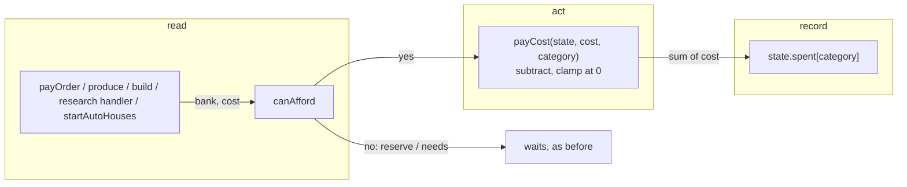

# SGS-035: Move the AoE4 engine's shared cost, payment and walk code into engine-common.ts, share the test helpers, and add a duplication check

- **Type**: Task
- **Component**: aoe4-build-order
- **Milestone / criteria**: M3 / M3.13; backlog (reports/M3-backlog-chosen.md): tolerance unification, spend/payUnit/research loop, `GATHER_NODE_ORDER` copy in simulate.ts, `LANDMARK_CLASS` `new RegExp`, houses move-speed copy and `shortfall <= 0`, untested `currentUnitEntry` -> `resolveUnitEntry` rewire
- **Priority**: high
- **Risk**: high
  <!-- REPO.md criticalPaths `lib/**` applies (non-test engine code changes). The plan table says medium on its own scale; the template tier is high. Adjacent invariants: A2, A3, A1. -->
- **Invariants**: A2 (resources never go negative: `payCost` keeps the clamp, `canAfford` keeps the margin), A3 (determinism: no clock or random in the new module), A1 (no game number in code: `VILLAGER_ID`, `HOUSE_ID` are ids, `RESOURCE_TOLERANCE` is a float margin, not a game value)
- **LOC estimate**: ~120 business logic touched, net about +60 (new `engine-common.ts` ~45; `simulate.ts` ~-40 removed and ~30 rewired; `research.ts` ~-15; `houses.ts` ~-5; `model.ts` ~+8; `package.json`/`.jscpd.json` config). Test migration (6 files, 32 local helper definitions in them) is excluded.
- **Depends on**: none (first M3 engine ticket; SGS-037 and SGS-043 build on it)
- **On merge**: REPO.md `commands.lint`: `npx tsc --noEmit && npm run lint:dup`
- **Source**: design/M3.md Modules (`engine-common.ts`, `test-helpers.ts`, `.jscpd.json`), Shared code rule, Contracts "Shared engine code", "Test helpers", "Duplication check"; plans/M3-20261101.md outline A and owner answers 1-3; reports/M3-backlog-chosen.md

## Context

`simulate.ts`, `research.ts` and `houses.ts` each carry their own resource list, cost loop, affordability check, subtract loop, float tolerance (`1e-9` vs `Math.sqrt(Number.EPSILON)`), ids and villager walk formula, and the tests repeat their fixtures. A dry run of `jscpd@4` on main with the design's settings finds 6 clones, all in tests. Later M3 tickets add more engine code on top, so this one moves the shared code to one place first and makes the duplication check part of lint. Behavior is unchanged except one tolerance value.

## Scope

Names follow design/M3.md exactly. Base: origin/main f078c11.

1. **`lib/aoe4-build-order/model.ts`**: add `GATHER_NODES: readonly GatherNodeId[]` in the order `sheep, berry, deer, boar, farm, wood, gold, stone` (the order `simulate.ts:23` has today; keep the exhaustiveness check `satisfies Record<GatherNodeId, 0>` so a new node id cannot be missed), `RESOURCE_KINDS: readonly ResourceKind[]` (`food, wood, gold, stone`) and `type SpendCategory = 'villagers' | 'military' | 'buildings' | 'research'`.
2. **`lib/aoe4-build-order/engine-common.ts`** (new, no React/Next imports, no clock or random): exports `RESOURCE_TOLERANCE = 1e-9`, `VILLAGER_ID = 'villager'`, `HOUSE_ID = 'house'`, `costOf(entry, units)`, `canAfford(bank, cost)` (`bank[k] + RESOURCE_TOLERANCE >= cost[k]` for every `RESOURCE_KINDS` k), `payCost(state, cost, category)` (the one subtract loop, `Math.max(0, resources[k] - cost[k])`, then adds the sum of the four cost values to `state.spent[category]`), `villagerWalkSeconds(state: EffectState, walkSeconds)` (`walkSeconds / modifiedValue(1, 'moveSpeed', villager target)`, reading `state.data`; no separate `data` parameter), `markCompleted(state, step)`. Bodies are moved from `simulate.ts` (`costOf` :121, `affordable` :129, `spend` :294, `villagerWalk` :300, `markCompleted` :201) with one change: `payCost` takes the category. Type imports of `EngineState` come from `simulate.ts` (type-only, so no import cycle at runtime).
3. **`lib/aoe4-build-order/simulate.ts`**: delete its `RESOURCE_TOLERANCE`, `RESOURCES`, `VILLAGER`, `HOUSE`, `GATHER_NODE_ORDER`, `costOf`, `affordable`, `spend`, `villagerWalk`, `markCompleted` and use the `engine-common.ts` / `model.ts` exports. Add `readonly spent: Record<SpendCategory, number>` to `EngineState` (all zero in `createEngine`). Payments go through `payCost`: `payUnit` with `'villagers'` when `entry.baseId === VILLAGER_ID`, else `'military'`; `startConstruction` with `'buildings'` (step builds, landmarks and auto-houses); `orderNeed`, `affordableAt` and the sample loop read `RESOURCE_KINDS`. (respec 2) The three `villagerWalk` call sites (`simulate.ts` :321, :339, :365) become `villagerWalkSeconds(state, x ?? state.inputs.walkSeconds)`: main's `villagerWalk` takes `number | undefined` and falls back to `state.inputs.walkSeconds`, but `villagerWalkSeconds(state: EffectState, walkSeconds: number)` cannot read `inputs`, so the fallback moves to the callers. `spawnUnit`'s inline move-speed division is villager-only: leave it as is. Replace `new RegExp('^age[1-3]_landmark\\d$')` with a regex literal. Drop the `currentUnitEntry` wrapper (:463) and call `resolveUnitEntry` in `houseDemand`. Do not add exports to `simulate.ts` (the source-shape test pins 12).
4. **`lib/aoe4-build-order/research.ts`**: delete its `RESOURCES` and `RESOURCE_TOLERANCE` (`Math.sqrt(Number.EPSILON)`, about 1.5e-8; becomes `1e-9`); the research handler builds its cost with `costOf`, tests it with `canAfford`, pays with `payCost(..., 'research')`; `researchItem.complete` calls `markCompleted`.
5. **`lib/aoe4-build-order/houses.ts`**: delete `HOUSE` and `VILLAGER` copies (use `HOUSE_ID`, `VILLAGER_ID`), compute `lead` with `villagerWalkSeconds`, and compare `shortfall <= RESOURCE_TOLERANCE`.
6. **`lib/aoe4-build-order/test-helpers.ts`** (new; imported only by `*.test.ts`; not matched by `vitest.config.mts` `include`): the exports in design/M3.md "Test helpers" (`ENGLISH`, `at`, `editGameData`, `inputsFor`, `buildOrder`, `run`, `series`, `countAt`, `sampleIndex`, `withHandler`) taken from the existing copies (`simulate.test.ts:16-97` is the fullest). (respec 2) The file's comments must not contain the string `test-helpers` (the Acceptance grep for non-test importers would list it). Internal extras are allowed where a flagged clone needs them (for example the `stateOf` and trip-inputs helpers repeated in `gather.test.ts` and `effects-gather.acceptance.test.ts`).
7. **Test migration** of the files jscpd flags today (6 clones): `simulate.acceptance.test.ts` / `simulate.test.ts` (`withHandler`), `simulate-construction.test.ts` / `simulate.test.ts` (two clones), `research.test.ts` / `simulate.test.ts`, `effects-gather.acceptance.test.ts` / `gather.test.ts` (two clones). Each of these files imports from `test-helpers.ts` instead of redefining a helper it exports. Other test files may migrate too; none is required beyond a zero-clone result.
8. **New tests**, as in Acceptance criteria: `engine-common.test.ts`, the spend totals, the `resolveUnitEntry` auto-house test, the two tolerance tests. Update the source-shape tests the moves change: `simulate.test.ts` "has no numeric literal beyond 0, 1, 60, the sample step and one tolerance" now allows no tolerance literal in `simulate.ts` (literals `1e-9` move out) and also scans `engine-common.ts` (one tolerance literal, nothing else beyond 0, 1).
9. **Duplication check**: `jscpd` pinned to the exact version `4.3.0` in `devDependencies` (lockfile updated); `.jscpd.json` at the repo root with `path` = `lib/aoe4-build-order`, `components/apps/aoe4-build-order`, `pages/api/aoe4-build-order`, `format` = `typescript`, `tsx`, `minTokens: 70`, `minLines: 8`, `threshold: 0` (verified: with `threshold: 0`, jscpd 4.3.0 exits 1 on today's 6 clones and 0 on a clone-free path), `gitignore: true`; `package.json` script `"lint:dup": "jscpd"`. Colocated `*.test.ts` files are inside the paths; `acceptance/` is not (owner answer 3). Sizes may not be raised later.
10. **`formatMinSec` move** (design/M3.md "Time format"): create `lib/aoe4-build-order/format-time.ts` (no imports) holding `formatMinSec(seconds: number): string`, body unchanged, moved from `components/apps/aoe4-build-order/chart-rows.ts:15`. `chart-rows.ts` does not re-export it. Update importers: `line-chart.tsx:3`, and `chart-rows.test.ts:2` (its `formatMinSec` describe block moves to a new `format-time.test.ts`). `parse-text.ts:301` builds `@m:ss` inline; it uses `formatMinSec` instead (same output for integer seconds).
11. **Docs**: `ARCHITECTURE.md` Rules gets one line: the AoE4 duplication check (`npm run lint:dup`, config `.jscpd.json`) and that `lib/aoe4-build-order/test-helpers.ts` holds the shared test helpers. No change to `docs/aoe4-build-order.md` (grepped: it states no tolerance, ids or spend code; the builder-walk wording is SGS-053's).

**Out of scope:** `parse-text.ts`'s own `GATHER_NODE_ORDER` (SGS-040 replaces it); `validate.ts`'s `VILLAGER` constant (not an engine module in the design's Shared code rule); ESLint or sonarjs; any response, request or OpenAPI change (`spent` stays an engine field, SGS-043 samples it into the result); the zero build time plus zero walk stall (a known limit, unreachable with validated input; no rule, the backlog item is dropped); `depletion.ts`.

## Diagrams

This changes how every payment is made in the core event loop, without changing its order. The pay path after the change, read, act, record:

## Acceptance criteria

- [ ] `npm run lint:dup` exits 0 and reports 0 clones. Check: on main with `.jscpd.json` it reports 6 clones and exits 1 (all in the six test files named in Scope item 7).
- [ ] `lint:dup` can fail: pasting a 10-line block of `simulate.ts` into a second file under `lib/aoe4-build-order/` makes it exit non-zero; the PR states this was run and reverted.
- [ ] `package.json` lists `jscpd` as the exact string `4.3.0` in `devDependencies`, has script `lint:dup`, and `npx tsc --noEmit` passes.
- [ ] `git grep -nE "^const (RESOURCES|RESOURCE_TOLERANCE|VILLAGER|HOUSE|GATHER_NODE_ORDER)\b" -- lib/aoe4-build-order/simulate.ts lib/aoe4-build-order/research.ts lib/aoe4-build-order/houses.ts` finds 9 lines on main and 0 after.
- [ ] `git grep -nE "new RegExp|currentUnitEntry|function (spend|affordable|villagerWalk)\b" -- lib/aoe4-build-order/simulate.ts` finds 6 lines on main and 0 after.
- [ ] `git grep -n "Math.max(0, .*resources" -- lib/aoe4-build-order ':!*.test.ts'` finds 3 lines on main (payUnit, spend, research) and 1 after (`engine-common.ts`).
- [ ] `git grep -l "test-helpers" -- lib components pages ':!*.test.ts'` lists no file, and none of the six Scope-7 test files defines a local `inputsFor`, `gameData`, `run`, `series`, `countAt`, `withHandler` or `at` that `test-helpers.ts` exports.
- [ ] `engine-common.test.ts`: `canAfford` is true at `bank = cost - 5e-10` and false at `cost - 2e-9`; `payCost` never leaves a resource below 0 and adds the four-resource sum to `spent[category]`; `villagerWalkSeconds(state, walkSeconds)` divides by the villager move-speed multiplier (once with and once without a researched move-speed tech); `markCompleted` sets `completedAt` and `status`. Changing `RESOURCE_TOLERANCE` to `1e-8` fails the first test.
- [ ] Spend totals: a build with villagers, one non-villager unit, one `build house`, an auto-house and one `research`, observed by a late step handler through `withHandler`, shows `state.spent` of exactly (villager cost read from game data, summed over its four resources, not a hardcoded 50) x villagers paid for `villagers` (respec 2), the unit's four-resource cost for `military`, the sum of the paid building costs for `buildings` and the tech cost for `research`. Sending `startConstruction` to `'research'` fails it.
- [ ] Research tolerance is the shared one: a research whose cost exceeds the bank by 5e-9 (between 1e-9 and 1.5e-8) is `waiting` with a `reserve`; before the change it started. Restoring `Math.sqrt(Number.EPSILON)` in `research.ts` fails this test.
- [ ] House tolerance: `planAutoHouse` with a projected shortfall of 1e-10 returns 0 (`populationPerSecond` set so `population + pps x lead - headroom` is 1e-10); on main it returns 1. Restoring `shortfall <= 0` fails it.
- [ ] Tier changes auto-house demand: with `editGameData` giving `spearman-3` a shorter build time than `spearman-2`, a barracks producing spearmen continuously and `veteran-spearmen` researched, the number of `spearman-3` produced by t = 400 differs from the same run with `houseDemand` reading the lowest-age entry (prototype on main with `engine.data.byBaseId.get(order.unit)?.[0]` in place of `currentUnitEntry`: 73 spearman-3 vs 108 with the real lookup, wood floating 48020 vs 47100). The test pins the real value; the mutation fails it.
- [ ] Behavior is unchanged: `npm test` and the AoE4 Playwright specs (`npm run acceptance`) pass. Any expected value that changes is listed in the PR with its before and after; only the research affordability instant (tolerance 1.5e-8 to 1e-9, under 1e-8 resources) may move one.
- [ ] (respec 1) `formatMinSec` moved: `git grep -n "export function formatMinSec" -- components lib` finds 1 line, in `lib/aoe4-build-order/format-time.ts` (on main: 1 line, in `chart-rows.ts`); `git grep -n "formatMinSec" -- components/apps/aoe4-build-order/chart-rows.ts` finds 0; `line-chart.tsx` and `parse-text.ts` import it from `lib/aoe4-build-order/format-time`; `format-time.test.ts` keeps the rows `0 -> 0:00`, `5 -> 0:05`, `65 -> 1:05`, `3600 -> 60:00`; `npx tsc --noEmit` passes.
- [ ] `ARCHITECTURE.md` mentions `npm run lint:dup`, `.jscpd.json` and `test-helpers.ts`.
- [ ] No INVARIANTS.md regressions

## Open questions

None.
