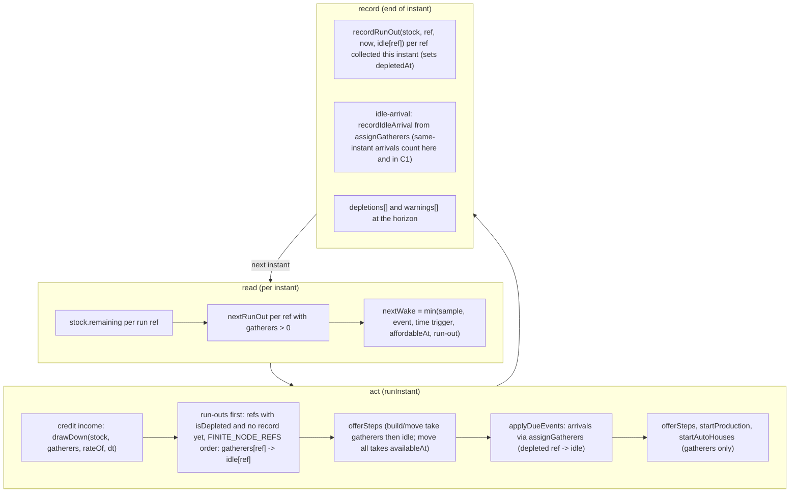

# SGS-038: Run nodes dry in the engine: idle villagers, numbered deposits, `move all` and node amounts

- **Type**: Task
- **Component**: aoe4-build-order
- **Milestone / criteria**: M3 / M3.1 (run-out time reported), M3.2, M3.11 (`gold#2`..`gold#8`, move to a deposit), M3.8 (`build` `then` = created node, no second walk)
- **Priority**: high
- **Risk**: high
  <!-- strongModelTriggers: changes what a run computes and the order of operations a result depends on; changes the public request schema (BuildStep node fields, move.count, SimInputOverrides.nodeAmounts); critical path lib/**; well over 250 lines of business logic. -->
- **Invariants**: A1 (the `createdBy` and `amount` facts live in `rules/base.json`, none in code), A2 (a run-out moves nobody into a negative stock; payments still check before spending), A3 (run-out times are a pure function of the order, data and inputs), S3 (`nodeAmount` is a bounded input, enforced in `validate.ts`)
- **LOC estimate**: ~390 (`simulate.ts` ~200: stock per run ref, run-out wakes and instant with the pending-record list, `assignGatherers`/`availableAt`, take-from-idle, `move all`, `createdBy` arrival, house-builder reads; `validate.ts` ~110: `nodeRefIssue`, node-ref table in every node position, `nodeAmounts` table, `move` count `all`; `houses.ts` ~10; `data.ts`, `api.ts`, `model.ts` widening ~40; `base.json` 1 line; tests and `openapi.json` excluded). Split candidate if the diff passes ~450: validation and inputs (`nodeRefIssue`, `nodeAmounts`, `move all` shape, OpenAPI) first, engine second.
- **Depends on**: SGS-037 (node refs, warnings contract, `depletion.ts`), SGS-035 (`engine-common.ts`, `test-helpers.ts`)
- **On merge**: none
- **Source**: `design/M3.md` (Contracts: Node references, Inputs; Behavior rules: node stock, deposits, arrivals, idle villagers, `move all`, build walk); `plans/M3-20261101.md` outline D and design questions 5 and 6

## Context

Today every node is infinite and `EngineState.gatherers` is keyed by the eight `GatherNodeId`s, so a node never runs out and a build can name no second gold deposit. This ticket makes the engine honor a stock per run ref: when a ref runs dry its gatherers go idle, later arrivals go idle, and the run-out is reported. No default amount ships here: `rules/base.json` gets no `amount`, so every node stays infinite and ENG 1TC is untouched except for the `createdBy` walk fix, until SGS-039 turns depletion on. Depletion is reachable only through `nodeAmounts` overrides (and `editGameData`) between this ticket and SGS-039.

## Scope

Names below follow `design/M3.md` and SGS-037/SGS-035. Line numbers refer to `main` f078c11 and shift after SGS-035.

**`lib/aoe4-build-order/model.ts`**
- Widen every `BuildStep` node field from `GatherNodeId` to `NodeRef`: `produce.rally`, `rally.to`, `build.from`, `build.then`, `move.from`, `move.to`, and `BuildStart.rally`, `BuildStart.villagers` keys (`Partial<Record<NodeRef, number>>`).
- `move.count: number | 'all'`.
- `SimInputs.nodeAmounts: Record<FiniteNodeRef, number | null>` (all 13 keys).
- Does not add `Trigger` kinds, `reaction`, `waitingOn` or `waitBreakdown` (SGS-039, SGS-042).

**`lib/aoe4-build-order/data.ts` and `data/aoe4-build-order/rules/base.json`**
- `GatherNodeRules.amount?: HandValue<number>` and `createdBy?: string`.
- `base.json`: `gatherNodes.farm.createdBy: "farm"`, and nothing else. No `amount` anywhere (the six values land with SGS-039).

**`lib/aoe4-build-order/simulate.ts`**
- `EngineState.gatherers` and new `EngineState.idle`: `Record<NodeRef, number>` over `NODE_REFS` (`createEngine` seeds all 15 at 0, then `order.start.villagers`). New `EngineState.stock`: a `NodeStock` from `createNodeStock(runRefs(order), inputs)`.
- `assignGatherers(state, ref, count)`: the one arrival path (if `isDepleted(stock, ref)`: add to `idle[ref]` and call SGS-037's `recordIdleArrival(stock, ref, now, count)`; else add to `gatherers[ref]`). It replaces the five direct `gatherers[...] +=/-=` mutations (spawn walk at `spawnUnit`, `startConstruction`, `completeConstruction`, `move` start and arrival). Exported, as it is a contract.
- `availableAt(state, ref) = gatherers[ref] + idle[ref]`. `build` and numbered `move` check `availableAt(from)` and remove gatherers first, then idle ones (the design's fixed order; unobservable), in one internal helper.
- `move` with `count: 'all'`: takes `availableAt(from)` at its start, never waits on `villagers`, completes at the start instant when that is 0 and moves nobody.
- `build` with `gatherNodes[then].createdBy === step.building` (the `then` default stays `from`): builders join `then` at completion through `assignGatherers` with no second walk. Every other `build` keeps both legs. Auto-houses always keep both legs and return to `from`.
- Run-out machinery in the main loop, using SGS-037's `drawDown`, `nextRunOut`, `isDepleted`, `recordRunOut`, `recordIdleArrival`, `depletionResults`: `nextWake` adds each run ref's `nextRunOut` as a candidate (so a run-out lands on its exact time, not on a sample); the income credit loop becomes `drawDown`, crediting a finite ref only while it is not depleted; `incomePerSecond` and `nodeRate` take a `NodeRef` and call `nodeKindOf(ref)` for rates, trips and `dropOffs`. (respec 2) Run-out detection: the engine never sets `depletedAt` itself (only `recordRunOut` does). It keeps the run refs that are pending a record: `isDepleted(stock, ref)` is true and `recordRunOut` has not yet been called for `ref`. First thing in `runInstant`, before `offerSteps`, it collects the run refs in `FINITE_NODE_REFS` order where `isDepleted` is true and that are not yet recorded, and moves each one's `gatherers[ref]` into `idle[ref]`. This one check covers every path to depletion: a ref drawn to 0 in the `drawDown` credit step, a ref `drawDown` clamped to 0 from within `RESOURCE_TOLERANCE`, and a ref whose amount is 0 from the start (collected at t=0).
- `node-depleted` (respec 2): at the end of the same instant (after both `offerSteps`, `applyDueEvents`, `startProduction` and `startAutoHouses`) the engine calls `recordRunOut(stock, ref, now, idle[ref])` for each ref collected at the start of that instant, in `FINITE_NODE_REFS` order. SGS-037's function sets `depletedAt`, the count and the severity (`warning` above 0, else `info`). Once recorded, a ref is never collected again. A ref starting at 0 is recorded at the end of the t=0 instant.
- `idle-arrival`: only through `assignGatherers` calling `recordIdleArrival` (the first call sets `at`, each call adds its count; `severity: 'warning'`). Villagers made idle by the run-out itself are never passed to it. Warning message text (with `m:ss` from `format-time.ts` `formatMinSec`) is SGS-037's; this ticket adds no time formatting.
- Arrival at the run-out instant (respec 2): run-outs apply before `applyDueEvents`, so an arrival due at the run-out instant lands on a depleted ref. It goes through `assignGatherers` like any arrival: it adds to `idle[ref]` and calls `recordIdleArrival`. It is therefore counted twice, by design: in that ref's `node-depleted` `idleVillagers` (which is `idle[ref]` at the end of the instant, design Behavior rules "node-depleted count") and in its `idle-arrival` (every arrival at a depleted ref, design "idle arrival"). "Villagers already idle at the run-out instant do not count" means only the villagers the run-out itself moved from `gatherers` to `idle`. No code path excludes same-instant arrivals from either count.
- Auto-houses (respec 2): `houseBuilderSource` (deposit 1 for `gold`) and the fullest-node fallback read `gatherers` only and never take idle villagers. The fallback candidates are `NODE_REFS` minus every `DepositRef` (`gold#2`..`gold#8`) the order does not name, so `farm` and `wood` stay candidates (this is not `runRefs(order)`, which holds finite refs only). It picks the most `gatherers` with ties going to the first candidate in `NODE_REFS` order, the same first-wins `reduce` with `>` that main runs over all eight `GATHER_NODE_ORDER` nodes (`simulate.ts:499`). M2 runs pick the same node as before. A builder returning to a depleted ref is an idle arrival.
- `SimulationResult.depletions` filled from `depletionResults(stock)` (one per run ref, `FINITE_NODE_REFS` order, `amount` = starting amount or `null`, `depletedAt` or `null` at the horizon) and `warnings` filled from the same call. SGS-037's sort stays the only sort.
- `aliveVillagers` counts idle villagers (they are alive; `at N vils` and population include them).

**`lib/aoe4-build-order/houses.ts`**: reads of `gatherers` keyed by `GatherNodeId` (if any remain after SGS-035) move to `NodeRef`; no behavior change.

**`lib/aoe4-build-order/validate.ts`**
- `nodeRefIssue(value: unknown, finiteOnly: boolean): NodeRefProblem | null` (`null` = valid; `NodeRefProblem = { code: 'syntax' | 'unknown-id' | 'out-of-range' | 'invalid'; reason: string }`) per the design's node-ref table. `reason` quotes the value; the caller's issue message is `` `${reason} in ${path}` `` (the M2 form), plus `step`/`line` as for any issue. (respec 2) `path` is the bare field name for a step field, as main prints it (`validate.ts:271`, `` `unknown ${field.kind} "${id}" in ${field.name}` ``, so `unknown node "iron" in from`; the step index travels on the issue's `step`), and `start.rally` or `start.villagers` for the start (`validate.ts:202`, `226`), so the M2 message assertions in `validate.test.ts` still pass. A non-string is `syntax` (`node must be a string`). It replaces `isKnownId(data, 'node', ...)` in every step node field, `start.rally` and `start.villagers` keys, so each position gives the same issue for the same input. Exported (contract).
- `move.count` accepts the string `all` (`FieldSpec` kind for `count` allows it on `move` only); `"All"` and `"3"` are `syntax`; `produce.count` stays number-only. `all` skips the `count` bound.
- `SIM_INPUT_BOUNDS.nodeAmount: bound(0, 100000)` (integer). `resolveSimInputs` reads `nodeAmounts` per the design's input table, defaults each finite node to `gatherNodes.<node>.amount?.value ?? null` and each `gold#k` to `gatherNodes.gold.amount?.value ?? null`, and returns all 13 keys. Issues carry the path `inputs.nodeAmounts.<key>`.
- `houseBuilderSource` and `trips` keys stay `GatherNodeId`, keep their M2 check (they do not use `nodeRefIssue`), and give `unknown-id` with the M2 message (`unknown node "gold#2"`) for any `#` form. `houseBuilderSource: 'gold'` names deposit 1.

**`lib/aoe4-build-order/api.ts`**: `SimInputOverrides.nodeAmounts?: Partial<Record<FiniteNodeRef, number | null>>`.

**`docs/api/openapi.json`** (same diff; `acceptance/aoe4-simulate-api-contract.spec.ts` validates with `additionalProperties: false`): `BuildStep` node fields `$ref` `NodeRef` (SGS-037 added the schema); `move.count` `oneOf` integer 1..200 or const `all`; `SimInputOverrides.nodeAmounts` an object with `propertyNames` `$ref` `FiniteNodeRef` (SGS-037 defines it as a `oneOf` of refs) and `integer 0..100000 | null` values (the M2 `propertyNames` form `trips` uses); response `depletions` and `warnings` already exist from SGS-037.

**`docs/aoe4-build-order.md`** (every statement this ticket makes untrue):
- Purpose line 25 "Resources are infinite: a resource node never runs out" and "Out: ... resource depletion" (line 323): finite nodes run out through `nodeAmounts`; defaults stay infinite until SGS-039, so say that amounts default to infinite today and where the starting amounts come from.
- Bounds table: `nodeAmounts` values (int 0..100000, `null` infinite), `move.count` also `all`.
- Task-switch walk bullets (lines 216-217): `build` pays two legs except when `then` is the node the building creates (farm); numbered deposits and idle villagers.
- `build` and `move` paragraphs (lines 254-258): they take idle villagers too; `move all`; waits.
- Houses and supply (lines 270-278): builders read gatherers only, never idle ones; a builder returning to a depleted node goes idle.
- Build order input (lines 364-372): node refs (`gold#2`..`gold#8`, deposit 1 is plain `gold`), `move.count: all`. Paste syntax for these is SGS-040's; here state JSON only.
- Extension points table row "Depletion, positions, per-trip deposits".
- Add a short "Depletion" section: stock, run-out instant, idle accounting, `depletions` and `warnings` (`node-depleted`, `idle-arrival`) with their severities.

**Tests** (use `test-helpers.ts`; drive depletion with `nodeAmounts` and `editGameData`; no new local `run`/`inputsFor`): see criteria. New files `simulate-depletion.test.ts`, additions to `validate.test.ts`.

**Out of scope:** `Trigger` kinds `depleted`/`bank` and `reaction` (SGS-039); `waitingOn`/`waitBreakdown`/`step-stuck` (SGS-042); paste grammar for `gold#2`, `move all` (SGS-040); `base.json` `amount` values and ENG 1TC reactions (SGS-039); severity lists on the page (SGS-045); `trips`/`houseBuilderSource` keyed by deposit; automatic fallback node for idle villagers; `spent` and population series (SGS-043); `markers`.

## Diagrams

Changes the engine's core loop (`runInstant` and the wake/credit step), so the path is grouped into read, act, record:

## Acceptance criteria

- [ ] With `nodeAmounts: { berry: 600 }` and 3 villagers gathering berry, `depletions` has a berry entry with `amount: 600` and `depletedAt` equal to `600 / (3 * berry gather rate)` within `RESOURCE_TOLERANCE`, not rounded to a 5 s sample, and the berry villagers are idle from then on (gather rate for food from berry drops to 0 at the next sample, `floating.food` stops rising from berry).
- [ ] A ref's stock never goes below 0: total food credited from berry over the run equals 600 when it runs out (to `RESOURCE_TOLERANCE`).
- [ ] `remaining <= RESOURCE_TOLERANCE` counts as depleted; `nodeAmounts: { berry: 0 }` is depleted at t=0 with `depletedAt: 0`, one `node-depleted` warning, and any villager sent there is idle.
- [ ] Infinite stays infinite: with no `nodeAmounts`, `depletions` has the six finite refs with `amount: null`, `depletedAt: null`, no warnings, and the existing simulate, houses, research and builds tests pass unchanged (any whose numbers move is listed in the PR body with the reason).
- [ ] (respec 2) Per-deposit defaults: with `editGameData` setting `gatherNodes.gold.amount` to a value (for example 3000), an order naming `gold#2`, and `nodeAmounts: { gold: null }`, `depletions` has `gold` with `amount: null` and `gold#2` with `amount: 3000` (the override reaches deposit 1 only; dropping the per-key default for `gold#k` makes this fail). `nodeAmounts: { 'gold#2': 2500 }` gives deposit 2 a stock of 2500. Deposits draw down independently: deposit 1 running out leaves `gold#2`'s gatherers, income and `depletedAt` unchanged. `depletions` has `gold#2` only when the order names it; an override for an unnamed deposit is accepted and unused.
- [ ] The engine records run-outs through `recordRunOut` and idle arrivals through `recordIdleArrival` (no warning is built in `simulate.ts`) (respec 1). A `node-depleted` warning has `idleVillagers` read at the end of the run-out instant: a `move all` step with a `time` trigger equal to the run-out instant that moves everyone away gives `idleVillagers: 0` and `severity: 'info'`; with villagers still there it is `severity: 'warning'` and the count.
- [ ] `idle-arrival`: a `move 3 sheep to berry` that lands on a depleted berry records one `idle-arrival` (`severity: 'warning'`, `at` = the arrival time, `idleVillagers` 3); a second arrival there adds to the count and records no second warning; villagers the run-out itself made idle are not counted (berry's 3 gatherers at its run-out do not appear in any `idle-arrival`).
- [ ] (respec 2) Run-out detection covers every path: with `nodeAmounts: { berry: 0 }` and berry villagers at the start, they are moved to `idle` at t=0 and berry's `node-depleted` has `at: 0`; a ref drawn to 0 by `drawDown` mid-run is recorded once at that instant; `recordRunOut` is called once per ref (no second `node-depleted` for the same ref over a 3600 s run).
- [ ] (respec 2) Arrival at the run-out instant counts in both warnings: with `nodeAmounts: { berry: 0 }`, no villagers on berry and 2 on sheep, a first step `move 2 sheep to berry` with `walkSeconds: 0` arrives at t=0 (its event is due in the t=0 instant, after the run-out). `node-depleted` for berry has `at: 0`, `idleVillagers: 2`, `severity: 'warning'`, and `idle-arrival` for berry has `at: 0`, `idleVillagers: 2`.
- [ ] Spawned villagers walking to a depleted rally ref, `build` `then` a depleted ref, and an auto-house builder returning to a depleted ref all arrive idle through `assignGatherers`. Idle villagers count in `at N vils` and in population and gather nothing. `git grep -nE "gatherers\[[^]]+\] *(\+=|-=)" lib/aoe4-build-order/simulate.ts` finds 5 lines on `main` and at most 2 after (the arrival add and the take-from removal).
- [ ] `move 6 berry to farm` after berry ran out takes the idle berry villagers (availableAt counts idle); `build ... from berry` takes gatherers before idle ones. `gatherers[ref]` and `idle[ref]` are never both above 0 (asserted in a test across a run with moves).
- [ ] `move all gold to gold#2` takes everyone available at its start instant (gatherers first, then idle), walks them as a numbered move does, never waits on `villagers`; with 0 available it starts and completes at that instant and moves nobody; a second `move all` from the same ref at the same instant is a no-op.
- [ ] (respec 2) Auto-house builders never come from idle villagers: with `houseBuilderSource: 'gold'` and only idle villagers on gold, the fallback picks the node with the most `gatherers` among `NODE_REFS` minus unnamed deposits, ties to the first in `NODE_REFS` order; a builder that returns to a depleted ref goes idle and records an `idle-arrival`. A test where `farm` is the fullest node (more start villagers on `farm` than on any other node, none on gold) has the first auto-house take its builders from `farm` (farm `gatherers` drop by `houseBuilders` when it starts); restricting the candidates to `runRefs(order)` makes it fail. A tie between `sheep` and `farm` picks `sheep`.
- [ ] `build farm from berry then farm` (farm `createdBy: "farm"`): builders join `farm` at completion with no second walk (the arrival time is completion time, not completion plus a walk); `build mill from sheep then berry` and an explicit `then` equal to `from` still pay both legs; auto-houses still pay both legs. The ENG 1TC farm builds shift earlier by one walk each; the builds test still passes and the PR body lists the changed ENG 1TC numbers.
- [ ] A run-out is a wake: with no sample or event at the run-out time, the simulation still applies it at the exact time (test with `durationSeconds` and an amount whose run-out falls between samples). The same inputs give an equal result twice (A3).
- [ ] `warnings` for a run have `node-depleted` before `idle-arrival` for the same ref and are in SGS-037's sort order; this ticket adds no second sort.
- [ ] `nodeRefIssue` returns, for each row of the design's node-ref table, the listed code: `gold`, `gold#2`, `gold#8`, `wood` valid; `gold#1`, `wood#2`, `berry#2`, `stone#2` `invalid`; `gold#0`, `gold#9` `out-of-range`; `iron`, `iron#2` `unknown-id`; `gold#02`, `gold#`, `gold#x`, `gold#2#3` `syntax`; `farm`/`wood` with `finiteOnly` `invalid`. Each of the same values in `produce.rally`, `rally.to`, `build.from`, `build.then`, `move.from`, `move.to`, `start.rally` and a `start.villagers` key yields the same code, and the issue message is `${reason} in ${path}` with the value quoted (respec 1), where `path` is the field name for step fields (`unknown node "iron" in from`, with the step on `issue.step`) and `start.rally` / `start.villagers` for the start (respec 2); the existing M2 message assertions in `validate.test.ts` pass unchanged.
- [ ] `resolveSimInputs`: each row of the design's `nodeAmounts` table gives the listed result (`{ berry: 0 }` valid, `{ gold: null }` valid, `{ farm: 500 }` and `{ wood: 500 }` `invalid`, `{ 'gold#9': 5 }` `out-of-range`, `{ iron: 5 }` `unknown-id`, `1.5`, `-1`, `100001`, `Infinity` `out-of-range`, `"5"`, `nodeAmounts: 5`, `{ 'gold#02': 5 }` `syntax`), the returned `inputs.nodeAmounts` has all 13 keys, and issues name `inputs.nodeAmounts.<key>`.
- [ ] `move` with `"count": "all"` validates; `"All"` and `"3"` are `syntax`; `produce` with `"count": "all"` is `syntax`.
- [ ] `houseBuilderSource: 'gold#2'` and `trips: { 'gold#2': ... }` are `unknown-id` with the M2 message `unknown node "gold#2"` (respec 1).
- [ ] `docs/api/openapi.json` carries the changed `BuildStep` node fields, `move.count` and `SimInputOverrides.nodeAmounts`, and `acceptance/aoe4-simulate-api-contract.spec.ts` passes with a request using `gold#2`, `move all` and `nodeAmounts`.
- [ ] `docs/aoe4-build-order.md` no longer says nodes never run out or that `build` always pays two legs; `git grep -n "never runs out" docs/aoe4-build-order.md` finds 1 line on `main` and 0 after.
- [ ] `npx tsc --noEmit` and `npm run lint:dup` (zero clones) pass; no helper, tolerance or resource list is redefined outside `engine-common.ts`/`model.ts`.
- [ ] No INVARIANTS.md regressions

## Open questions

None.

## Re-spec 2026-11-01

- Underspecified: the auto-house fallback candidates ("run refs" collided with `runRefs(order)`), how the engine detects a run-out without setting `depletedAt` itself, and whether an arrival at the run-out instant counts in both `node-depleted` and `idle-arrival`.
- Changed: fallback candidates are `NODE_REFS` minus unnamed deposits with first-wins ties plus a farm-fullest test; the engine collects refs with `isDepleted` and no record yet at the start of `runInstant` and calls `recordRunOut` at its end; same-instant arrivals count in both warnings (design rules applied literally) with a `walkSeconds: 0` test; the `gold: null` criterion now uses `editGameData`; the issue path is the bare field name for step fields.
- Branch work: none exists yet; SGS-037 and SGS-035 contracts are unchanged.
