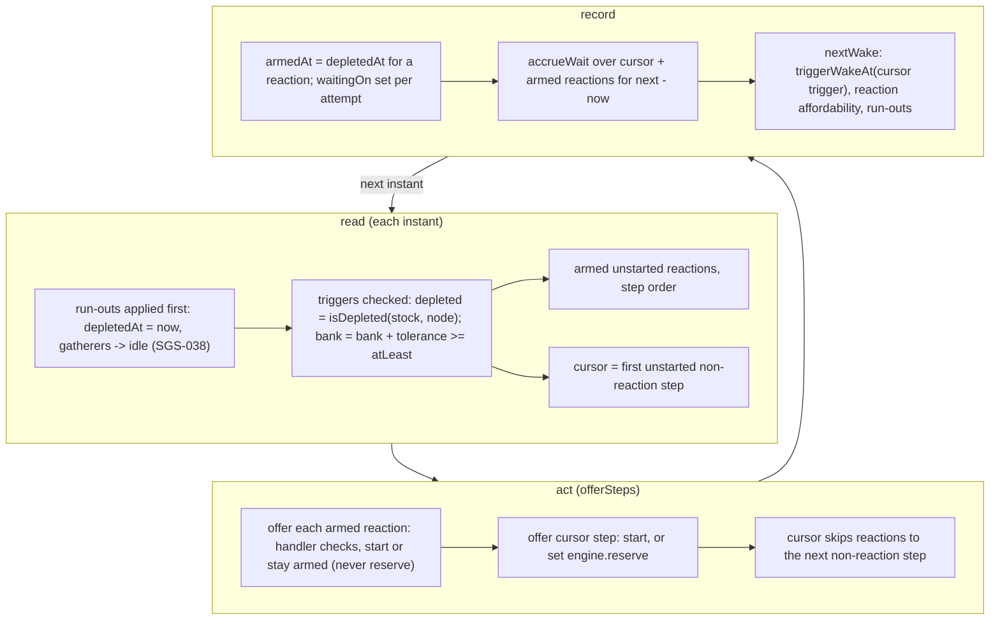

# SGS-039: Add depleted and bank triggers and reaction steps, and turn depletion on by default

- **Type**: Task
- **Component**: aoe4-build-order
- **Milestone / criteria**: M3 / M3.1 (default amounts in `base.json`, with source and `unverified`), M3.3 (JSON side: `depleted` and `bank` triggers, clear errors), M3.7 (the prebuilt bar test, parts 1-3 at both horizons and 4-5 at 1200 s; the reaction half is SGS-040)
- **Priority**: high
- **Risk**: high
  <!-- strongModelTriggers: changes what every default run computes (six nodes become finite at default inputs) and the order of operations in offerSteps (reactions before the cursor step); widens the public request schema (Trigger union, BuildStep.reaction) that current callers use; adds a bound that enforces S3 (triggerAtLeast); REPO.md criticalPaths lib/** applies. About 210 lines of business logic, under the 250 trigger. The plan rated this high too. Risk stays high without the ENG 1TC data change. -->
- **Invariants**: A1 (the six amounts live in `rules/base.json` with a source, none in code), A2 (a reaction never reserves resources and still checks affordability before spending; the bank trigger reads the bank, never changes it), A3 (the bank wake and run-out starts are pure arithmetic on event times, no clock), S3 (`SIM_INPUT_BOUNDS.triggerAtLeast` is enforced in `validate.ts`)
- **LOC estimate**: ~210 business logic (`simulate.ts` ~110: `triggerHolds` 2 cases, `triggerWakeAt`, reaction offer and arming in `offerSteps`, cursor skips reactions, reaction wake on resources, horizon `waitingOn` for reactions, accrual list; `validate.ts` ~75: trigger shape and kind table, `triggerAtLeast` bound, reaction rule; `model.ts` ~12; `depletion.ts` `runRefs` ~5; `base.json` 6 values; tests, docs and `openapi.json` excluded)
- **Depends on**: SGS-038 (stock, `assignGatherers`, `availableAt`, `move all`, `nodeRefIssue`, `BuildStep` node widening), SGS-042 (`waitingOn`, `waitBreakdown`, `step-stuck`, the wait-time helper); transitively SGS-037 and SGS-035
- **On merge**: none
- **Source**: manager decision in `reports/SGS-040-ticket-1.md` ("Moved from SGS-039") and re-spec answers; `design/M3.md` (Contracts: Types, Data, Triggers and reactions, Gold deposit reactions in the shipped builds, OpenAPI; Behavior rules: reaction, `depleted` trigger, `bank` trigger, any trigger, step status, prebuilt builds); `plans/M3-20261101.md` outline E and owner answers 4, 5 and 10

## Context

After SGS-038 the engine can run a node dry, but nothing ships a finite amount and no step can react to a run-out, so gold villagers would idle. This ticket adds the two trigger kinds and the reaction step that the design uses to switch deposits, puts the owner-supplied starting amounts in `rules/base.json` so depletion is on by default, and states the prebuilt bar in a test. The paste grammar and the one ENG 1TC gold reaction are SGS-040; ENG 1TC gets no reaction here, so it keeps re-parsing from its own paste text and the page keeps working if this merges alone.

## Scope

Names follow `design/M3.md`, SGS-038 and SGS-042. Line numbers refer to `main` f078c11 and shift after SGS-035, 037, 038 and 042.

**`lib/aoe4-build-order/model.ts`**
- `Trigger` gains `{ kind: 'depleted'; node: FiniteNodeRef }` and `{ kind: 'bank'; resource: ResourceKind; atLeast: number }` (today `model.ts:9` has the two-kind union).
- Every `BuildStep` variant gains `reaction?: true` beside `trigger` (the shared `{ trigger?: Trigger }` part at `model.ts:11`).

**`lib/aoe4-build-order/simulate.ts`**
- `triggerHolds` (`:165`, exported) gets two cases. `depleted`: `isDepleted(state.stock, trigger.node)` (SGS-037), so it holds from the run-out instant on and never for a `null` amount, a ref with no gatherers, or a ref still stocked at the horizon. `bank`: `state.resources[trigger.resource] + RESOURCE_TOLERANCE >= trigger.atLeast` (the `engine-common.ts` tolerance; no literal).
- `triggerWakeAt(trigger: Trigger | undefined, state, income)` (new, exported, in the design's contract list): returns `null` for an `undefined` trigger (a step with no trigger is armed by order alone, so `nextWake` passes the cursor step's `trigger` without a guard); otherwise returns the `time` trigger's `seconds`; for `bank` with `income[resource] > 0` and the bank below `atLeast`, `state.time + (atLeast - bank) / income[resource]`; otherwise `null` (`depleted` needs none: run-outs are already `nextWake` candidates through SGS-038's `nextRunOut`). `nextWake` (`:575-578`) calls it for the cursor step while that step is unarmed, replacing the inline `trigger?.kind === 'time'` test. `income` is the `Resources` record `incomePerSecond` returns.
- `offerSteps` (`:375`): at each call it first offers every armed, unstarted reaction in step order, then the cursor step.
  - A reaction arms when its trigger holds, with no wait on the cursor or earlier steps; because run-outs apply first in `runInstant`, `armedAt` equals the node's `depletedAt`. Arming is latched.
  - The cursor is the first unstarted non-reaction step. After a non-reaction step starts, the cursor skips over reactions, so a non-reaction step arms when every earlier non-reaction step has started. A later reaction never delays it.
  - A reaction that cannot start stays armed and is offered again at every later instant, with `waitingOn` set from the handler's first failing check (SGS-042's contract). It never sets `engine.reserve`, so it never holds back an order payment or a house. It starts at most once.
  - A reaction waiting on resources wakes at its exact affordability instant (decided; not the next sample or event): its `reserve` hint goes into a wake-only list read by `nextWake` through `affordableAt`, separate from `engine.reserve` and from `engine.needs` (which `startProduction` clears at `:447`).
  - Several reactions on one ref arm together and start in step order, each seeing the villagers the earlier ones left (`availableAt` is re-read per reaction). A reaction and the cursor step that compete for the same villagers or resources at one instant: the reaction goes first.
- Wait accounting: the one call to SGS-042's `accrueWait(engine, stepIndexes, seconds)`, the only writer of `waitBreakdown`, now passes the cursor step when armed plus every armed unstarted reaction. No second accrual code.
- Horizon pass (SGS-042's `waitingOn` rules): an unarmed reaction is `not-reached` with `waitingOn: 'trigger'` whether or not the cursor is before it; a non-reaction step behind an unstarted non-reaction step keeps `earlier-step`, and the "first unstarted non-reaction step" gets `trigger`. A reaction is never `earlier-step`. A waiting reaction at the horizon gets a `step-stuck` warning exactly like a waiting cursor step (SGS-042's loop covers every `waiting` step). SGS-042's tests for the horizon `waitingOn` rule and `step-stuck` are edited in place in this diff: where a test name or comment says "cursor step" it now means the first unstarted non-reaction step, and the reaction cases (unarmed reaction `trigger` before and after the cursor, waiting reaction `step-stuck`) are added to those same tests, not to a parallel copy.

**`lib/aoe4-build-order/depletion.ts`**: `runRefs` also reads the `node` of every `depleted` trigger (SGS-037 left this for this ticket), so a `depleted` trigger on `gold#3` creates its stock even when no other field names it.

**`lib/aoe4-build-order/validate.ts`**
- `SIM_INPUT_BOUNDS.triggerAtLeast: bound(0, 100000)` (integer).
- `triggerShape` (`:127`): `depleted` needs a string `node` and `bank` a string `resource` and a number `atLeast`, else `syntax` (`{ kind: 'depleted' }`, `"node": 3`, `{ kind: 'bank', resource: 'wood' }`, `"atLeast": "400"`).
- `checkTrigger` (`:251`) becomes a per-kind table. Today it treats every kind that is not `time` as `villagers` (`:257`). `time` and `villagers` keep their issues. `depleted` runs SGS-038's `nodeRefIssue(node, true)` (`nodeRefIssue(value: unknown, finiteOnly): NodeRefProblem | null`, `null` = valid; `NodeRefProblem` is `{ code, reason }`) and reports the problem's `code` with the message `${reason} in ${path}`, `path` being the trigger's path (`gold#1` `invalid`, `gold#9` `out-of-range`, `iron` `unknown-id`, `wood` and `farm` `invalid`). `bank`: `resource` not in `RESOURCE_KINDS` is `unknown-id`; `atLeast` outside `triggerAtLeast` (`400.5`, `-1`, `100001`) is `out-of-range`. Any other kind is `unknown-trigger-kind` and the message lists all four kinds.
- `reaction` is checked in `stepShape`: present and not `true` (`false`, `"yes"`) is `syntax`. `reaction: true` with no trigger, or a `time`, `villagers` or `bank` trigger, is `invalid` ("only a step triggered by a node running out can be a reaction"); with an unknown trigger kind only the `unknown-trigger-kind` issue is reported. A `depleted` step may be any action. Reactions are otherwise validated like any step, in list order: a `rally` reaction counts as an earlier rally source for a later `build` of a villager producer, and a `research` reaction counts toward the duplicate-research rule, although a reaction may never fire.

**`data/aoe4-build-order/rules/base.json`**: `amount` as a `HandValue<number>` (SGS-038 added the optional field and no values) on exactly the six finite nodes, each `unverified: true`: sheep 3000 (`owner-supplied starting total (2026-11-01): 15 sheep x 200 food`), berry 1500 (`owner-supplied starting total (2026-11-01)`), deer 1750 (`owner-supplied starting total (2026-11-01): 7 deer x 250 food`), boar 2000 (`owner-supplied starting total (2026-11-01)`), gold 4000 (`owner-supplied amount per gold deposit (2026-11-01)`), stone 1200 (`owner-supplied starting total (2026-11-01)`). None on `farm` or `wood`. A data test pins that `amount` is present on exactly `FINITE_GATHER_NODES`. Existing hand-value tests (`data.test.ts` "hand-entered values", `data.acceptance.test.ts`) take the new leaves: only their `>=` counts rise.

**`lib/aoe4-build-order/builds.test.ts`**: replace "completes or is still running every step at 3600 s" with the bar for every build in `listBuilds()`, default inputs. Parts 1-3 are checked at 1200 s and at 3600 s; parts 4 and 5 at 1200 s only:
1. no step is `waiting`;
2. every non-reaction step has `startedAt !== null`;
3. a reaction that is `not-reached` has `waitingOn: 'trigger'`;
4. every gold ref (`nodeKindOf(ref) === 'gold'`) whose `depletedAt` is at or before the horizon has a `move` reaction with `count: 'all'` and `from` that ref whose `startedAt === depletedAt`;
5. no `node-depleted` or `idle-arrival` warning on a gold ref has `severity: 'warning'`.
ENG 1TC has no reaction until SGS-040, so its gold run-out at 3600 s is SGS-040's: it extends parts 4 and 5 to 3600 s by editing this test in place. ENG 1TC gold does not run out by 1200 s, so parts 4 and 5 hold there. The "round-trips through the paste format" test stays (ENG 1TC has no `depleted` step yet, so it still passes); SGS-040 extends it to the new grammar. The `validates` test stays.

**`data/aoe4-build-order/README.md`** (made untrue by this ticket; no other ticket owns these lines, and SGS-050 and SGS-051 add their build entries under the rewritten paragraph):
- "Prebuilt builds" (`:36-40`): the sentence "So is any step that does not complete or keep running by 3600 s in the simulation, with its reason" is the old bar. Restate it as the bar `builds.test.ts` checks after this ticket, at default inputs with depletion on: at 1200 s and 3600 s no step is `waiting`, every non-reaction step has started, and a reaction not reached is only waiting for its trigger; at 1200 s every gold deposit that has run out has a `move all` reaction from it that starts at the run-out instant, and no gold warning is a `warning`. A guide step that would break the bar is left out and listed under its build with its reason, as today. Say "waiting" and "not reached" the way `docs/aoe4-build-order.md` does. No ticket ids in the file. SGS-040 changes "at 1200 s" for the gold parts to "at 1200 s and 3600 s" when it extends the test.
- "Known data gaps" (`:70-71`): "They are the `sheep` gather node with unlimited food, so sheep food is never depleted and herding is not modeled" becomes: the starting sheep are the `sheep` gather node with a finite starting total from `rules/base.json` (owner-supplied, unverified), which runs out like any finite node; herding is still not modeled.
- The ENG 1TC entry (`:42-53`) stays: no step is removed, and "No step was removed for not completing" stays true.

**Tests that rely on infinite nodes**: with six nodes finite at default inputs, existing tests whose numbers depend on a node outlasting its amount (for example 6 sheep villagers over a long horizon) may move. Each is fixed by pinning the nodes it needs infinite with `nodeAmounts` overrides (`null`), not by changing expected numbers, so it keeps testing what it tested. If three or more files need the same override, add one internal export to `test-helpers.ts` instead of repeating it (`lint:dup` stays at zero). List every test that moved in the PR body with the reason.

**`simulate.test.ts` source-shape test** (`:713-733`): the exact export-name list gains `triggerWakeAt`, and the "no numeric literal beyond 0, 1, 60, the sample step and one tolerance" check still passes (this ticket adds no literal to `simulate.ts`).

**`docs/api/openapi.json`** (same diff; request schemas are checked by `acceptance/aoe4-simulate-api-contract.spec.ts`):
- `Trigger` gains two `oneOf` variants. `depleted`: `kind` const, `node` `$ref` `FiniteNodeRef`. `bank`: `kind` const, `resource` `$ref` `ResourceKind` (the schema is unreferenced today: `grep -c '#/components/schemas/ResourceKind'` finds 0), `atLeast` integer 0..100000. Each has a description. The `Trigger` description (`:1241`) and the `BuildOrderIssue.code` description (`:1695`) stop saying "neither time nor villagers" and "other than time or villagers".
- Each of the six `BuildStep` variants gains `reaction` (const `true`, described, with the rule that only a `depleted` trigger allows it). Schema validity cannot express that rule, so the server stays authoritative and the description says so.
- `acceptance/aoe4-simulate-api-contract.spec.ts`: add `triggerAtLeast: () => [trigger('bank').properties.atLeast]` to the bounds `locations` map (`:157-174`); change the `Trigger` description regex (`:263-266`) to the new wording; add tests that a `depleted`, a `bank` and a reaction request are schema-valid and answered 200, that `reaction: true` with a `time` trigger is schema-valid and answered 400 `invalid`, and that `{ kind: 'resource' }` is still schema-invalid and `unknown-trigger-kind`.

**`docs/aoe4-build-order.md`** (every statement this ticket makes untrue; D has already rewritten the node-run-out sentences it owns, so re-read before editing):
- Line 25 "Resources are infinite" and line 323 "Out: ... resource depletion": the six finite nodes now start at the `base.json` amounts by default (owner-supplied, unverified), `null` overrides keep a node infinite, `farm` and `wood` never run out.
- Bounds table (`:44-56`): add `Trigger.atLeast` int 0..100000.
- "Ordering and triggers" (`:139-148`) and "Priority" (`:150`): add the two kinds, say a reaction does not wait for earlier steps and does not delay later ones, reactions are offered before the cursor step at an instant, and rewrite "At most one step is armed and not started at a time. While it waits on resources only, it reserves" to "At most one non-reaction step ... ; a reaction never reserves."
- JSON input (`:369-370`): the four trigger forms, `reaction`, and the sentence naming only two kinds. Paste prefixes stay out; SGS-040 documents them.
- Issue codes (`:429`): `unknown-trigger-kind` is any kind other than the four; add the reaction rule to the `invalid` list and fix the count word ("The six `invalid` rules" at `:435`).
- Step states (`:529-545`): the diagram's `Unarmed --> Armed` label and the "Unarmed (trigger not met, or an earlier step not started)" row hold for non-reaction steps; say a reaction is `not-reached` only while its node has not run out, and the "A step waits while..." paragraph gets the reaction case.
- Prebuilt builds (`:576-578`): state the bar (the five parts and their horizons). The sentence "re-parses from its own paste text" stays and remains true.
- Extension points row at `:611`: two more kinds exist; a new kind is one `triggerHolds` case and one `triggerWakeAt` case.

**Out of scope:** the paste grammar and `formatBuildStep` (SGS-040); the paste round-trip extension (SGS-040); the ENG 1TC gold reaction and any `english-1tc.json` change (SGS-040); the page, step table and timeline; `nodeAmounts`, `nodeRefIssue` and `move all` internals (SGS-038); `waitingOn` and `step-stuck` internals (SGS-042); the two new prebuilt builds (SGS-050, SGS-051); changing any default amount, `start` or input of ENG 1TC; an automatic fallback node for idle villagers; reactions on any other trigger kind; the `docs/aoe4-build-order.md` M3 sections owned by SGS-054 (this ticket updates only the sections above).

## Diagrams

Changes the engine's core loop (`offerSteps`, the cursor and `nextWake`), so the instant is shown in read, act, record phases:

## Acceptance criteria

- [ ] `depleted` trigger: with `nodeAmounts: { berry: 600 }` and 3 berry villagers, a step `{ trigger: { kind: 'depleted', node: 'berry' } }` arms with `armedAt` equal to the berry `depletedAt` (not a sample time) and starts at that instant. A `depleted` trigger on a ref that never runs out (a `null` amount, a ref with no gatherers, or a stock left at the horizon) leaves the step `not-reached` with `waitingOn: 'trigger'` and is not an issue. A `depleted` trigger on `gold#3` creates its stock when no other field names `gold#3` (`depletions` has `gold#3`).
- [ ] `bank` trigger: `{ kind: 'bank', resource: 'wood', atLeast: 400 }` on the cursor step arms at the exact instant `bank + income * dt` reaches 400 (within `RESOURCE_TOLERANCE`), not at the next sample or event; with income 0 for that resource it never arms and the step is `not-reached` with `waitingOn: 'trigger'`; `atLeast: 0` holds at once. It is checked in `offerSteps`, before order payments at the same instant, so a continuous villager order cannot spend the bank below `atLeast` first. A `bank` trigger on a step behind an unstarted step arms only after that step starts (`waitingOn: 'earlier-step'` until then).
- [ ] (respec 3) `triggerWakeAt` returns the `time` trigger's seconds, the bank crossing instant, and `null` for an `undefined` trigger, for `depleted`, for a held `bank`, and for a `bank` whose resource has no income. Its own unit test covers each; `nextWake` has no inline `kind === 'time'` test: `git grep -nF "trigger?.kind === 'time'" -- lib/aoe4-build-order/simulate.ts` finds 1 line on `main` and 0 after.
- [ ] Reaction ordering: a reaction placed first in the list with a trigger that never holds does not delay the next step (a non-reaction step behind it arms at once); a reaction placed before a non-reaction step that is waiting on resources starts when its own trigger holds, without waiting for that step; a later reaction never delays an earlier cursor step. Several reactions on one ref start in step order at the run-out instant, each seeing the villagers the earlier ones left (`move all` then `move 2` from the same ref: the second finds 0 and waits on `villagers`).
- [ ] Reaction and cursor compete: at one instant a reaction `build` and the cursor `build` both need the last 100 wood, and the reaction starts first. A reaction waiting on resources never holds back a producer's order (`engine.reserve` stays unset for it: the order pays its next unit in the same run it would without the reaction) and starts at the exact affordability instant, not the next sample.
- [ ] Reaction status: an unarmed reaction is `not-reached` with `waitingOn: 'trigger'`, including when an earlier non-reaction step is also unstarted; a non-reaction step behind an unstarted non-reaction step is `earlier-step`, never a reaction; an armed reaction that cannot start is `waiting` with its reason (`villagers` for `move 6 berry to farm` with 3 villagers) and `waitBreakdown` summing to `durationSeconds - armedAt`; it has exactly one `step-stuck` warning at the horizon; a reaction that starts has `waitBreakdown` summing to `waitSeconds`. Exactly one accrual implementation exists: `git grep -nE "waitBreakdown\[[^]]+\] *(\+=|=)" -- lib/aoe4-build-order ':!*.test.ts'` finds the same single site SGS-042 left.
- [ ] A reaction starts at most once: a ref that ran out and has villagers arriving later does not re-fire it, and those arrivals follow SGS-038's `idle-arrival` rules.
- [ ] `node-depleted` interplay: `whenever`-style JSON reaction `move all` from the ref at its run-out gives `idleVillagers: 0` and `severity: 'info'` on that warning; without the reaction the same run gives `severity: 'warning'` and the count.
- [ ] Validation, trigger table: each row of the design's "Triggers and reactions" JSON table gives its listed code: `depleted` `berry` and `gold#2` valid; `{ kind: 'depleted' }` and `"node": 3` `syntax`; `wood` and `farm` `invalid`; `gold#1` `invalid`, `gold#9` `out-of-range`, `iron` `unknown-id`; `bank` `wood` 400 valid; missing `atLeast` and `"400"` `syntax`; `resource: 'sheep'` `unknown-id`; `400.5`, `-1`, `100001` `out-of-range`; `{ kind: 'event' }` `unknown-trigger-kind` with a message naming all four kinds; `reaction: true` with a `depleted` trigger valid on every action; `reaction: true` with no trigger, `time`, `villagers` or `bank` `invalid`; `reaction: false` and `"yes"` `syntax`. `git grep -nF "trigger.kind !== 'time' && trigger.kind !== 'villagers'" -- lib/aoe4-build-order/validate.ts` finds 1 line on `main` and 0 after.
- [ ] Default amounts: `jq '[.gatherNodes[] | select(has("amount"))] | length' data/aoe4-build-order/rules/base.json` prints 0 on `main` and 6 after; the six values and sources are exactly those in Scope, every one has `unverified: true`, and `farm` and `wood` have none (data test). `git grep -nE "\b(3000|1500|1750|2000|4000)\b" -- lib/aoe4-build-order ':!*.test.ts'` finds nothing on `main` and after (no amount in code; 1200 is left out because it is the `durationSeconds` default).
- [ ] (respec 3) Depletion is on by default: with no `nodeAmounts`, `inputsFor(ENGLISH)` gives sheep 3000, berry 1500, deer 1750, boar 2000, gold 4000, stone 1200. With an order that names `gold#2` (for example a `depleted` trigger on `gold#2`), that run's `gold#2` stock starts at 4000, and `nodeAmounts: { gold: null }` keeps deposit 1 infinite while `gold#2` still starts at 4000. A run of ENG 1TC to 3600 s reports `depletions` with `sheep` and `gold` run out (`depletedAt` not null) and no `gold#2` entry, because ENG 1TC does not name `gold#2` until SGS-040 adds its reaction; `warnings` are sorted per SGS-037.
- [ ] Prebuilt bar (`builds.test.ts`): for every build in `listBuilds()`, parts 1 to 3 hold at 1200 s and at 3600 s and parts 4 and 5 hold at 1200 s. Mutation: making `triggerHolds` return false for `depleted` fails the `depleted` trigger test above.
- [ ] (respec 3) ENG 1TC is unchanged: all 24 of its steps keep their `startedAt` values at default inputs. Basis (measured on `main` with a throwaway instrumented copy, recorded in SGS-040): the last non-reaction step starts at 508 s, sheep (3000) runs out near 760 to 770 s and gold deposit 1 (4000) near 3305 s, so no node runs out before every step has started and no start time can move. Any step that moves is listed in the PR body with the reason. `english-1tc.json` is not in the diff.
- [ ] Existing tests: the full unit suite passes. Every test that moved because a default node is now finite is fixed with a `nodeAmounts` override rather than new expected numbers, and the PR body lists each one.
- [ ] `docs/api/openapi.json`: `jq '.components.schemas.Trigger.oneOf | length'` prints 2 on `main` and 4 after; `jq '[.components.schemas.BuildStep.oneOf[] | select(.properties.reaction)] | length'` prints 0 on `main` and 6 after; `ResourceKind` is referenced (`grep -c '#/components/schemas/ResourceKind' docs/api/openapi.json` prints 0 on `main`, at least 1 after); `triggerAtLeast` has its bounds-location entry; `acceptance/aoe4-simulate-api-contract.spec.ts` passes with the new tests in Scope.
- [ ] `docs/aoe4-build-order.md` no longer says `Resources are infinite`, no longer says the triggers are only `time` or `villagers`, and no longer says "At most one step is armed" (`git grep -nE "Resources are infinite|At most one step is armed|is not .time. or .villagers." -- docs/aoe4-build-order.md` finds 3 lines on `main` and 0 after).
- [ ] (respec 3) `data/aoe4-build-order/README.md` states the new bar and the finite sheep node: `git grep -n "never depleted" -- data/aoe4-build-order/README.md` finds 1 line on `main` and 0 after; `git grep -n "keep running by 3600 s" -- data/aoe4-build-order/README.md` finds 1 line on `main` and 0 after; the "Prebuilt builds" paragraph names both horizons and the five parts as in Scope.
- [ ] Determinism: two runs of the same order, data and inputs give equal results, including `warnings` and every `waitBreakdown`.
- [ ] `simulate.test.ts` source-shape test lists `triggerWakeAt` and still forbids numeric literals; `npx tsc --noEmit` and `npm run lint:dup` pass; no resource list, tolerance or cost loop is added outside `engine-common.ts` and `model.ts`.
- [ ] `npm run acceptance` passes.
- [ ] No INVARIANTS.md regressions

## Open questions

None.

## Re-spec 2026-11-01

- Underspecified: the ENG 1TC reaction tied this ticket to SGS-040 for the page and acceptance spec, and five design questions were open.
- Changed: the ENG 1TC reaction and the 3600 s halves of bar parts 4-5 moved to SGS-040; `accrueWait(engine, stepIndexes, seconds)` fixed as the only `waitBreakdown` writer; exact-instant reaction wake and list-order reaction validation decided; `nodeRefIssue(value, finiteOnly)` returns `NodeRefProblem | null` with message `${reason} in ${path}`.
- Stands: all engine, validation, `base.json`, OpenAPI and docs scope, and the plain `acceptance` pass.

## Re-spec 2026-11-01 (3)

- Underspecified: the default-depletion criterion expected a `gold#2` entry that ENG 1TC cannot produce before SGS-040; `data/aoe4-build-order/README.md` went stale with no owner; `triggerWakeAt` on an `undefined` trigger, the basis for ENG 1TC's unchanged start times, and how SGS-042's horizon tests change were unstated.
- Changed: criterion reworded (no `gold#2` entry for ENG 1TC; `gold#k` 4000 tested with an order that names `gold#2`); README added to Scope with two grep criteria; `triggerWakeAt` takes `Trigger | undefined` and returns `null` for it; the 508 s / 760 s / 3305 s basis is in the ENG 1TC criterion; SGS-042's horizon and `step-stuck` tests are edited in place.
- Stands: all engine, validation, `base.json`, OpenAPI and `docs/aoe4-build-order.md` scope; any branch work on them stands, plus the README edit.
