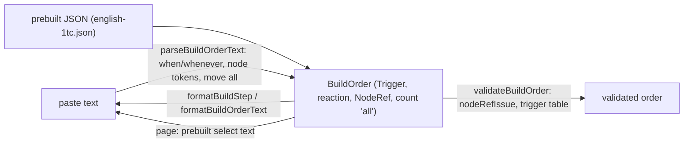

# SGS-040: Add paste grammar for deposits, move all, when/whenever triggers and formatBuildStep, and give ENG 1TC its gold reaction

- **Type**: Task
- **Component**: aoe4-build-order
- **Milestone / criteria**: M3 / M3.3 (paste side: `depleted` and `bank` triggers, clear errors), M3.11 (paste `gold#N`, `move all`; the shipped build switches deposits through reactions), M3.4 prerequisite (`formatBuildStep`), M3.7 (the prebuilt bar parts 4 and 5 at 3600 s, and the paste round-trip)
- **Priority**: high
- **Risk**: standard
  <!-- (re-rated 2026-11-01, symbol-scoped criticalPaths) Not a criticalPaths symbol (parse-text.ts). The paste grammar is a new contract design/M3.md names, ~80 lines of business logic, adjacent to A1/A3. -->
- **Invariants**: A1 (no number is written into code: the deposit limit and the node lists come from `model.ts`; the ENG 1TC step is data), A3 (parsing and formatting are pure; the paste text of a build always maps to the same order)
- **LOC estimate**: ~80 business logic (`parse-text.ts`: node token and `node()` ~10, `move all` ~8, `parseTrigger` `when`/`whenever` ~35, `parseAction` reaction flag ~5, `formatTrigger` / `formatAction` / `formatBuildStep` / `formatStart` ~22; one JSON step in `english-1tc.json`; tests, docs and acceptance excluded)
- **Depends on**: SGS-039 (`Trigger` kinds `depleted` and `bank`, `BuildStep.reaction`, `triggerHolds`, the five-part bar in `builds.test.ts`); transitively SGS-038 (`NodeRef` step fields, `move.count: number | 'all'`, `nodeRefIssue`), SGS-037 (`NODE_REFS`, `FiniteNodeRef`, `nodeKindOf`), SGS-035 (`GATHER_NODES`, `test-helpers.ts`)
- **On merge**: none
- **Source**: `design/M3.md` (Contracts: Triggers and reactions paste table, `formatBuildStep`, Node references, Gold deposit reactions in the shipped builds; Behavior rules: prebuilt builds bar and "how they meet it"); `plans/M3-20261101.md` outline F and owner answers 4 and 8; manager decision moving the ENG 1TC reaction from SGS-039 to this ticket

## Context

After SGS-038 and SGS-039 the engine and the JSON schema know deposits (`gold#2`..`gold#8`), `move all`, the `depleted` and `bank` triggers and reaction steps, but the paste format still rejects all of them: `parse-text.ts` `node()` uses the plain `ID` regex (so `gold#2` is a `syntax` issue), `move` takes only a number, and `parseTrigger` knows only `@m:ss` and `at N vils`. `formatBuildOrderText` silently drops a `depleted` trigger (`formatTrigger` `default: return undefined`), which breaks any build that has one. The page builds the prebuilt select text with `formatBuildOrderText`, so the ENG 1TC gold reaction cannot ship until the grammar can print and re-parse it. This ticket adds the grammar, `formatBuildStep` (the step table and timeline need it), the ENG 1TC deposit reaction, and the paste round-trip test, in one diff so that `main` never has a prebuilt text that does not parse.

## Scope

Names follow `design/M3.md` and the written tickets SGS-035, 037, 038, 039. Line numbers refer to `main` f078c11 and shift after SGS-035 to 039 and SGS-036 (which also edits `parse-text.ts`: NBSP and `sawStep`; rebase only, no shared lines with the grammar below).

**`lib/aoe4-build-order/parse-text.ts`**
- Node token: add `NODE_TOKEN = /^[a-z0-9]+(?:-[a-z0-9]+)*(?:#\S*)?$/` (anchored, one quantified group, so matching stays linear; the same `#`-after-an-id shape as `INSTANCE_REF`, but with any non-space characters after `#`). `Tokens.node()` (`:78`) takes `NODE_TOKEN` instead of `ID` and returns the token as `NodeRef`. The grammar reports no issue of its own for a node token: `gold#1`, `gold#9`, `gold#02`, `gold#`, `gold#x`, `gold#2#3`, `wood#2` all parse and `nodeRefIssue` (SGS-038) classifies them. `node()` is used in every node position that exists today (`start` villagers keys and rally, `produce -> node`, `build from` and `then`, `move from` and `to`, `rally to`), so one change covers all.
- `move` (`parseMove`, `:129`): the count is a number or the word `all`. `all` sets `count: 'all'` (typed `number | 'all'` by SGS-038). `All`, `ALL` and other spellings fall to the number pattern and are `syntax`. `move 0 gold to wood` still parses (validation reports `out-of-range`).
- `parseTrigger` (`:182`) gains two prefixes, tested before the existing ones by their first token:
  - `when <node> runs out` gives `{ kind: 'depleted', node }`. `when <resource> >= <N>` gives `{ kind: 'bank', resource, atLeast: N }`. `<node>` and `<resource>` are read with `NODE_TOKEN` and `ID`; whether they are valid is validation's job (`when farm runs out` parses then `invalid`; `when food runs out` parses then `unknown-id`; `when gold#9 runs out` parses then `out-of-range`; `when sheep >= 400` parses then `unknown-id`; `when wood >= 400000` parses then `out-of-range`). After the id the next token must be `runs` (then `out`) or `>=`; anything else is `syntax`: `when berry` and `when berry runs` name what they expected; `when wood > 400` says only `>=` is supported; `when wood>=400` (no spaces) and `when Wood >= 400` fail the id pattern; `when wood >= -5` and `>= 4.5` fail the unsigned-integer pattern.
  - `whenever <node> runs out` gives the same `depleted` trigger and sets `reaction: true` on the step. `whenever wood >= 400 ...` and `whenever berry ...` are `syntax` with the message "whenever takes only `<node> runs out`".
  - `parseTrigger` returns the trigger and the reaction flag, `parseAction` writes `reaction: true` onto the step beside `trigger`. A `start` line with either prefix keeps the existing "'start' takes no trigger" syntax issue.
- `formatTrigger` takes the step (it needs `reaction`): `time` and `villagers` as today; `depleted` prints `whenever <node> runs out` when `reaction === true`, else `when <node> runs out`; `bank` prints `when <resource> >= <atLeast>`. `reaction` is printed only on a `depleted` trigger (the only form the grammar can write); any other combination (a `reaction: true` step whose trigger is not `depleted`, or has none), and an unknown trigger kind, prints without `reaction` and never throws. Such a step is invalid, so the round trip is promised for valid orders only.
- `formatAction`, `move`: `count === 'all'` prints `all`, a number prints `String(n)` as today.
- `formatBuildStep(step: BuildStep): string` (new, exported; the design's contract): `words(formatTrigger(step), formatAction(step))`, no `#` comment, no line break. Total and never throws. `formatBuildOrderText` joins the `start` line and one `formatBuildStep` per step; its loop body becomes the call.
- `formatStart` orders villager nodes by `NODE_REFS` (SGS-037), replacing the local `GATHER_NODE_ORDER` (`:12`, `:290`), which is deleted. Deposits therefore print right after `gold`, in `start 3 gold 2 gold#2 ...` order.
- Header comment of the file stays true ("Grammar only"); no other comment needed.

**`data/aoe4-build-order/builds/english-1tc.json`** (moved here from SGS-039): append one step at the end of `steps`: `{ "trigger": { "kind": "depleted", "node": "gold" }, "reaction": true, "action": "move", "count": "all", "from": "gold", "to": "gold#2" }`. Basis (measured by SGS-039 on `main` with a throwaway instrumented copy): ENG 1TC gathers about 1403 gold by 1200 s and 4364 by 3600 s with 2 gold villagers from about 80 s on, so deposit 1 (4000) runs out near 3305 s and `gold#2` does not run out by 3600 s; one deposit switch is the whole set (N = 2). ENG 1TC rallies to wood from 140 s on, so no rally reaction is needed. Sheep (3000) runs out near 760 to 770 s, after the last non-reaction step starts (508 s); idle sheep villagers are allowed by the bar. Amounts, `start` and inputs are not touched, and the 24 earlier steps are not touched.

**`lib/aoe4-build-order/builds.test.ts`**
- Extend the existing round-trip test (`builds.test.ts`) to every build in `listBuilds()` (owner answer 4), plus the `whenever gold runs out move all gold to gold#2` line assertion: `parseBuildOrderText(formatBuildOrderText(build))` is `ok`, and `start` and `steps` equal the build's (`toStrictEqual`). With the ENG 1TC reaction this is non-vacuous: the text of that build must contain the line `whenever gold runs out move all gold to gold#2`.
- Bar parts 4 and 5 at 3600 s. SGS-039's bar test asserts parts 1 to 3 at 1200 s and 3600 s and parts 4 and 5 at 1200 s only (ENG 1TC's gold deposit has not run out then, and it has no reaction until this ticket). This ticket extends parts 4 and 5 to 3600 s for every build, so the bar is complete: (4) every gold ref whose `depletedAt` is at or before the horizon has a `move` reaction with `count: 'all'` and that `from`, whose `startedAt === depletedAt`; (5) no `node-depleted` or `idle-arrival` warning on a gold ref has `severity: 'warning'`. For ENG 1TC at 3600 s part 4 is non-vacuous (gold `depletedAt` not null, reaction `startedAt === depletedAt`). Edit SGS-039's test in place; add no second copy of the five parts.

**`lib/aoe4-build-order/parse-text.test.ts`** (and `parse-text.acceptance.test.ts` where it lists every action/trigger form): cases for every row of the design's paste table (see criteria), a `representable` order extended with a `depleted` reaction, a `depleted` non-reaction, a `bank` trigger, `move all`, and `gold#2` in a start villagers key, a `produce -> gold#3` rally and a `build ... then gold#2`; `formatBuildStep` unit tests. Use `test-helpers.ts` where it exports a helper that the file defines locally today; add none locally that it exports (`lint:dup` stays at zero).

**`acceptance/aoe4-simulate-api.spec.ts`** and **`acceptance/aoe4-build-order.spec.ts`** (Playwright; the first already posts `text`): see criteria. The existing spec "runs the default prebuilt build and draws every unit and resource series" runs the ENG 1TC text, which now contains the `whenever` line; it stays green and is the guard that the text parses.

**Existing tests the new ENG 1TC step moves** (added by the SGS-038 re-spec 3 audit): `acceptance/aoe4-simulate-api-timelines.spec.ts` "researches that wait on resources start at the pinned instants ..." appends seven steps after `...english1tc.steps` and reads them as `body.steps[24]`, `[25]` and `[26]`. With the reaction appended to ENG 1TC those steps sit one index later; index them from `english1tc.steps.length` (`+ 0`, `+ 1`, `+ 2`) so the test survives later appends, and keep every expected value (the test pins the six finite nodes `null` after SGS-039, so the `depleted` reaction never arms and nothing else moves). The steps at indexes 14, 22 and 23 are ENG 1TC's own and keep their indexes. Every other existing test that runs ENG 1TC (`simulate.test.ts` "depletions and warnings", the other timelines tests, the page specs, `builds.test.ts` beyond the edits above) keeps its expected values; the PR body lists every existing test it edits.

**`data/aoe4-build-order/README.md`** (SGS-039 rewrites "Prebuilt builds" to the bar "parts 1-3 at 1200 s and 3600 s, gold parts 4-5 at 1200 s only"; this ticket extends parts 4 and 5 to 3600 s, so that sentence becomes untrue): change it to state all five parts at both 1200 s and 3600 s. No ticket ids in the file. Re-read the paragraph after SGS-039 is on the base before editing.

**`docs/aoe4-build-order.md`** (every statement this ticket makes untrue; SGS-036, 038, 039 and 053 have edited neighbouring text, so re-read before editing):
- Paste format (`:373-420`): the prefix table (`:376`) gains `when <node> runs out`, `whenever <node> runs out` and `when <resource> >= N`; the grammar details gain the node token rule (`<id>` or `<id>#<chars>`, classified by validation: `gold#2`..`gold#8` valid, deposit 1 is plain `gold`), `move all`, and the `whenever` restriction. State that `formatBuildOrderText` and `formatBuildStep` print exactly these forms. The `start` bullet: nodes print in node-ref order (`gold`, then `gold#2`..`gold#8`) instead of "`GatherNodeId` order".
- JSON input: SGS-038 and SGS-039 documented JSON only and left the paste forms to this ticket; remove any "paste syntax is SGS-040's" wording they left, and make the paste and JSON forms agree.
- Issues: in the `unknown-trigger-kind` row (`:429`) the note "(paste: unknown line prefix is `syntax`)" stays true; add that a `when`/`whenever` line that does not match the forms above is `syntax`.
- Prebuilt builds (`:576-578`): add that ENG 1TC ends with a `whenever gold runs out move all gold to gold#2` reaction (moved from SGS-039); "re-parses from its own paste text" is now true for every build and stays.
- The M3 sections that SGS-054 owns (final deposit syntax summary, severity table) are not written here.

**Out of scope:** `validate.ts` node-ref, trigger and reaction checks (SGS-038, 039); engine changes; `openapi.json` (no request or response shape changes: the paste text is a string); the step table and timeline that call `formatBuildStep` (SGS-046, 047); bar parts 1 to 3 and the engine side of the bar test (SGS-039); the two new prebuilt builds (SGS-050, 051); NBSP and pre-`start` line rules (SGS-036); changing an ENG 1TC amount, `start`, input or earlier step.

## Diagrams

Crosses parse, validate and the engine only through the existing `BuildOrder` value (no new component edge), and changes no control loop or state machine, so a short flow of the paste path is enough:

## Acceptance criteria

- [ ] Node tokens: each of `gold#2`, `gold#8` parses in every node position that exists (start villagers key, start rally, `produce ... -> N`, `build ... from N then N`, `move N to N`, `rally ... -> N`, `when N runs out`) onto the same string in the step. `gold#1`, `gold#9`, `gold#02`, `gold#`, `gold#x`, `gold#2#3`, `wood#2` also parse (the parser reports no issue for a node token) and `validateBuildOrder` then reports `invalid`, `out-of-range`, `syntax`, `syntax`, `syntax`, `syntax`, `invalid` respectively (one test per code through `parse` then `validate`). `Gold#2` (uppercase) is `syntax` from the parser.
- [ ] `git grep -c "GATHER_NODE_ORDER" -- lib/aoe4-build-order/parse-text.ts` prints 2 on `main` and 0 after; `git grep -nF "'a node name', ID" -- lib/aoe4-build-order/parse-text.ts` finds 1 line on `main` and 0 after.
- [ ] `move all`: `move all gold to gold#2` gives `count: 'all'`, `from: 'gold'`, `to: 'gold#2'`; `move All gold to gold#2` and `move ALL ...` are `syntax`; `move 0 gold to wood` parses and validation gives `out-of-range`.
- [ ] Triggers, one test per row of the design's paste table: `when berry runs out move 6 berry to farm` gives `{ kind: 'depleted', node: 'berry' }` with no `reaction`; `whenever gold runs out move all gold to gold#2` gives the same kind with `reaction: true`; `when wood >= 400 build lumber-camp from wood` gives `{ kind: 'bank', resource: 'wood', atLeast: 400 }`. Parse-then-validate: `when farm runs out ...` `invalid`; `when food runs out ...` `unknown-id`; `when gold#9 runs out ...` `out-of-range`; `when sheep >= 400 ...` `unknown-id`; `when wood >= 400000 ...` `out-of-range`. Parser `syntax`: `when berry ...`, `when berry runs ...`, `when wood > 400 ...` (message says only `>=` is supported), `when wood >= -5 ...`, `when wood >= 4.5 ...`, `when wood>=400 ...`, `when Wood >= 400 ...`, `whenever wood >= 400 ...`, `whenever berry ...` (message "whenever takes only `<node> runs out`"). Each issue carries its 1-based `line`, and a bad `when` line does not hide the issues of other lines (one issue per bad line, in order).
- [ ] A `start` line with a `when` or `whenever` prefix is a `syntax` issue (`'start' takes no trigger`); a `when` line with no action says it expected an action.
- [ ] (respec 1) `formatBuildStep`: exported; for each step form it returns the single line the grammar accepts (no `#`, no `\n`); it prints `whenever ... runs out` exactly when a `depleted` step has `reaction: true`, `when ... runs out` for a `depleted` step without it, `when wood >= 400` for `bank`, and `move all ...` exactly when `count === 'all'`. It does not throw for an unknown trigger kind, a `reaction: true` on a non-`depleted` trigger or on no trigger (printed without `whenever`), a decimal count or a missing field. `formatBuildOrderText(order)` equals the `start` line followed by one `formatBuildStep` per step, joined by `\n`.
- [ ] (respec 1) Round trip, valid orders only (a `reaction: true` on a non-`depleted` trigger is invalid and is not promised to round-trip): a `representable` order that uses every action, every trigger kind (`time`, `villagers`, `depleted` with and without `reaction`, `bank`), `move all`, and deposit refs in every node position re-parses (`parseBuildOrderText(formatBuildOrderText(order))`) to `toStrictEqual` start and steps. Start villagers with `gold#2` print in node-ref order whatever the key order.
- [ ] Paste round trip for every prebuilt build (`builds.test.ts`): every build in `listBuilds()` re-parses from its own paste text to equal `start` and `steps`; the ENG 1TC text contains the `whenever gold runs out move all gold to gold#2` line. Mutation: making `formatTrigger` return `undefined` for `depleted` fails this test.
- [ ] ENG 1TC reaction: `jq '[.steps[] | select(.reaction)] | length' data/aoe4-build-order/builds/english-1tc.json` prints 0 on `main` and 1 after, and the step is exactly the one in Scope; `.steps | length` goes from 24 to 25; every earlier step is byte-identical (the diff adds only the new last step). The build validates.
- [ ] Prebuilt bar at 3600 s (`builds.test.ts`): for every build in `listBuilds()`, bar parts 1 to 5 hold at 1200 s and at 3600 s. For ENG 1TC at 3600 s: gold `depletedAt` is not null, `gold#2` is not run out, the reaction has `startedAt === depletedAt`, and no gold warning has `severity: 'warning'`. Mutations (run after SGS-039 is on the base, in a throwaway worktree): removing the new reaction step from `english-1tc.json` fails part 4 and part 5 at 3600 s; removing the `depleted` case from `triggerHolds` fails part 4. The PR states both were run and reverted.
- [ ] Route: `POST /api/aoe4-build-order/simulate` with a `text` that uses `when berry runs out move all berry to farm` (or `whenever`), `gold#2` and `move all` answers 200 and the result has the reaction step in `steps`; with `inputs.nodeAmounts: { berry: 600 }` and berry villagers, that step has `startedAt` equal to the berry `depletedAt`. `when wood > 400 ...` answers 400 with a `syntax` issue whose `line` is the physical line.
- [ ] Page: the default prebuilt text contains the `whenever gold runs out` line; running it at 3600 s (set `duration-seconds`) answers 200, `depletions` shows gold run out, and the last step's `startedAt` equals the gold `depletedAt`; `simulation-error` is absent. The existing spec "runs the default prebuilt build and draws every unit and resource series" passes unchanged.
- [ ] (respec 3) `data/aoe4-build-order/README.md` states the bar at both horizons: on the base after SGS-039, `git grep -nE "gold parts? .*1200 s only|1200 s only" -- data/aoe4-build-order/README.md` finds the one restricting phrase (confirm the exact phrase there and use it in the PR); after this ticket it finds 0, and the "Prebuilt builds" paragraph names parts 4 and 5 at 1200 s and 3600 s.
- [ ] `docs/aoe4-build-order.md`: the paste prefix table lists the three new forms; `git grep -nE "SGS-040|paste syntax is|GatherNodeId. order" -- docs/aoe4-build-order.md` finds no hit after (it finds the stale `GatherNodeId order` wording at `:419` on `main`, 1 line); ENG 1TC's reaction is stated in the Prebuilt builds section.
- [ ] No resource list, node list or tolerance is added to `parse-text.ts`; `npx tsc --noEmit` and `npm run lint:dup` pass; `npm test` and `npm run acceptance` pass; the 20,000-character parse performance test still passes with the new patterns.
- [ ] Determinism: formatting the same order twice gives equal text; parsing the same text twice gives equal results.
- [ ] No INVARIANTS.md regressions

## Open questions

None.
