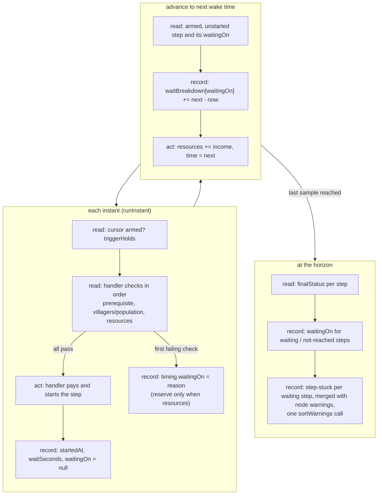

# SGS-042: Report why each step waits, and warn on steps still stuck at the horizon

- **Type**: Task
- **Component**: aoe4-build-order
- **Milestone / criteria**: M3 / M3.5 (engine side), M3.12 (`step-stuck` warning)
- **Priority**: medium
- **Risk**: high
  <!-- lib/** is a REPO.md criticalPath; the change lands in offerSteps and the main event loop. The plan rated merge risk medium; the template tier is the higher one. -->
- **Invariants**: A2 (a step that cannot be afforded waits and the wait appears in the reported timings; this ticket extends exactly that reporting), A3 (accrual is arithmetic on event times only, no wall clock)
- **LOC estimate**: ~130 (`simulate.ts` handler returns, `offerSteps`, interval accrual in `simulateBuildOrder`, horizon pass and `step-stuck` emission ~100; `research.ts` ~10; `model.ts` ~10; tests, docs and OpenAPI excluded)
- **Depends on**: SGS-037 (warnings contract, `StepWait`, `sortWarnings`), SGS-038 (`availableAt`, `gatherers` keyed by `NodeRef`, `move.count: number | 'all'`, `warnings` filled from `depletionResults`), SGS-041 (`researchEntry` in `researchHandler`) (respec 2); transitively SGS-035
- **On merge**: none
- **Source**: design/M3.md contracts (`StepWait`, `StepTiming`, `SimWarning`), "Step status" and "Warning messages" tables, rule rows "step status / waitingOn", "step status / waitBreakdown", "step-stuck / when"; plan M3-20261101 outline H

## Context

Today a step that has not started is just `waiting` or `not-reached`; nothing says what it waits on, and the engine
discards that information at the handler (`{ started: false }` in five places, only `reserve` hints at resources).
M3 reports the reason and the seconds spent per reason on every `StepTiming`, and raises a `step-stuck` warning for
each step still `waiting` at the horizon, so the page (SGS-047) and the prebuilt-build bar (SGS-039) can say why.

This ticket is written against the tree after SGS-035, SGS-037, SGS-038 and SGS-041 have merged (respec 2). Those
tickets move and rewrite the handlers this one edits, so every code location below is named by function; line
numbers are main's and are hints only.

## Scope

All paths under `lib/aoe4-build-order/` unless noted. Contract names come from design/M3.md and SGS-037 (`StepWait`,
`SimWarning`, `SimulationResult.warnings` and its sort are defined there; this ticket does not redefine them).

1. **`model.ts`**: `StepTiming` gains `waitingOn: StepWait | null` and
   `waitBreakdown: Partial<Record<'resources' | 'villagers' | 'population' | 'prerequisite', number>>`.
2. **`simulate.ts`, handler contract** (respec 2): `StepStart` becomes
   `{ started: true } | { started: false; waitingOn: StepWait; reserve?: Readonly<Record<ResourceKind, number>> }`,
   `reserve` present only when `waitingOn === 'resources'`. Handlers return the first failing check in the M2 order
   (`prerequisite`, then `villagers` or `population`, then `resources`). The meaning of each check in the merged tree:
   - `produce` (const `produce` in `simulate.ts`; main ~254-262): `prerequisite` when no target instance exists, or
     `resolveUnitEntry` returns no entry, or the entry is above the current age; `population` when
     `state.population + targets * popcap > state.supply`; `resources` with `reserve` as today.
   - `build` (const `build`; main ~345-353): `prerequisite` when the building entry is missing or above the current
     age; `villagers` when `availableAt(state, step.from) < builders` (the check SGS-038 introduces; gatherers plus
     idle at the `from` ref); `resources` with `reserve` as today.
   - `move` (const `move`; main ~359-361): `villagers` only when `step.count` is a number and
     `availableAt(state, step.from) < step.count`. `move` with `count: 'all'` never waits (SGS-038: it takes
     `availableAt(from)` at its start, possibly 0) and never returns `villagers`.
   - `research` (`researchHandler` in `research.ts`; main ~34-45): `prerequisite` when no producing instance exists
     (`researchTarget` returns nothing) or `researchEntry(step.tech, state)` returns `undefined` (every tier is above
     the current age; SGS-041 replaced the `entry.age > state.age` check with this case); `resources` with `reserve`
     as today.
   - `pause` and `rally` always start and need no change.
   Grep: `git grep -nF "{ started: false }" -- 'lib/aoe4-build-order' ':!*.test.ts'` finds 5 sites on main
   (`researchHandler`, `produce`, `build`, `move`, and the unregistered-handler fallback in `offerSteps`); the
   dependencies rewrite those handlers but keep a bare `{ started: false }` return in each. None may remain after
   this ticket.
   `houses.ts` is not touched: auto-houses are not steps and have no `StepStart` (the outline's "houses handlers
   return their reason" does not match the code).
3. **`simulate.ts`, `createEngine`**: each `StepTiming` starts with `waitingOn: null` and `waitBreakdown: {}`.
4. **`simulate.ts`, `offerSteps`**: on a failed attempt it stores the handler's `waitingOn` on the step's timing (and
   the reserve as today); on start it sets `waitingOn` to `null`. An unregistered action (the
   `handler ? ... : { started: false }` fallback) gets `waitingOn: 'prerequisite'` at every attempt (respec 1), stays
   blocking, and is `waiting` at the horizon with a `step-stuck` warning.
5. **`simulate.ts`, interval accrual**: in `simulateBuildOrder`'s main loop, immediately before `engine.time = next`,
   call `accrueWait(engine, stepIndexes, seconds)` (respec 1; name and signature fixed by design/M3.md) with the armed,
   unstarted step (the cursor step when it is armed) and `next - engine.time`. For each index whose timing's
   `waitingOn` is one of the four `waitBreakdown` reasons it adds `seconds` to `waitBreakdown[waitingOn]`, where
   `waitingOn` is the value after the instant's last `offerSteps`; other indexes (`trigger`, `earlier-step`, `null`) are
   skipped. It is exported from `simulate.ts` and is the only writer of `waitBreakdown`, so the reaction ticket
   (SGS-039) calls the same function for its reaction list instead of reimplementing it. Reasons with 0 seconds are
   never written.
6. **`simulate.ts`, horizon pass** (the `engine.steps.forEach` loop in `simulateBuildOrder` that sets
   `timing.status = finalStatus(timing)`; main ~693-695) (respec 2): after statuses are set, for a step that never
   started, set `waitingOn` as follows: `waiting` keeps its last handler reason; `not-reached` gets `trigger` when it
   is the cursor step (its trigger never held), else `earlier-step`. Started steps keep `null`. `not-reached` steps
   keep `waitBreakdown: {}`.
7. **`simulate.ts`, `step-stuck`** (respec 2): for every `waiting` step at the horizon, build
   `{ code: 'step-stuck', severity: 'warning', message, step, waitingOn, at: armedAt }` and merge it into the
   `warnings` list SGS-038 fills from `depletionResults`, before the one `sortWarnings` call that list already goes
   through (SGS-037). Do not add a second sort or a second `sortWarnings` call; `step-stuck` sorts last, by step index,
   per the sort rule. `not-reached` steps get none. Message shape (design/M3.md):
   `step <index + 1> (<action>) was still waiting on <waitingOn> at <m:ss of durationSeconds>, from <m:ss of at>.`, for
   example `step 12 (build) was still waiting on resources at 60:00, from 11:40.` The number is 1-based; the
   structured `step` field stays the 0-based index. The parenthetical is the step's `action` only (`formatBuildStep`
   does not exist yet). Times use `formatMinSec` imported from `lib/aoe4-build-order/format-time.ts` (moved there by
   SGS-035; no copy here) (respec 1).
8. **`docs/api/openapi.json`**: `StepTiming` gains `waitingOn` (nullable `$ref` to the `StepWait` schema SGS-037
   adds) and `waitBreakdown` (object, `additionalProperties: false`, the four reason keys, numbers `>= 0`), both in
   `required`; update the two `steps` examples (the 200 response example, main ~422-440) with
   `"waitingOn": null, "waitBreakdown": {}`. (respec 2) Reword the `SimulationResult.warnings` description (and the
   `SimWarning` or `depletions` description if it carries the same claim) so it no longer says the list is empty
   today or always empty: it holds node warnings when a finite node runs out and a `step-stuck` warning for each step
   still `waiting` at the horizon. Add `step-stuck` to the description where the codes are listed.
9. **`acceptance/aoe4-simulate-api-contract.spec.ts`**: add the two keys to the `stepTiming`
   `Record<keyof StepTiming, true>` literal (main ~324), or the ajv/type check fails.
10. **`docs/aoe4-build-order.md`** (respec 2, anchors by heading):
    - `## Outputs`: update the `steps` bullet to name `waitingOn` and `waitBreakdown`.
    - Same section: SGS-037 writes that `depletions` and `warnings` are "always empty today because no node runs
      out" (SGS-038 may already have reworded the `depletions` half). Reword whatever remains so no sentence says
      either list is empty today: `warnings` holds the node warnings and one `step-stuck` warning per step still
      `waiting` at the horizon (severity `warning`, message shape as in item 7).
    - Add a table mapping each non-reaction `StepWait` reason to when a handler produces it (design "Step status"
      table; the meanings in item 2, including that `move all` never waits on `villagers`) beside the `stateDiagram-v2`
      block, and state the check order.
    - Amend the paragraph beginning "A step waits while it cannot be paid" (main ~544) to say each reason is reported
      in `waitingOn` and `waitBreakdown`. Re-check the stateDiagram labels for accuracy.
11. **Existing tests that use `toEqual` on a whole `StepTiming`** need the two new fields: in `simulate.test.ts`,
    'completes a rally step the instant it arms' (main ~404) and 'pauses at once, lets the paid villager spawn and
    pays no more' (main ~438). Add new tests next to the existing wait tests (`simulate.test.ts` describes
    'produce waits' and 'handler seam'; `build-move.acceptance.test.ts` describe 'an age 2 building waits for the
    landmark'; `simulate-construction.test.ts` describe 'ages').

**Out of scope:** reactions and `earlier-step` for reactions (SGS-039, reusing the helper in item 5); `bank` and
`depleted` triggers; producing `node-depleted` and `idle-arrival` warnings (SGS-038; this ticket only merges into
that list); the page timeline (SGS-047); the paste grammar and `formatBuildStep` (SGS-040); `houses.ts`, auto-house
and order-payment waits (not steps); the multi-tier pick itself (SGS-041; this ticket only maps its `undefined` to
`prerequisite`).

## Diagrams

Changes `offerSteps` and the main loop, so a read, act, record diagram:

## Acceptance criteria

- [ ] `git grep -nF "{ started: false }" -- 'lib/aoe4-build-order' ':!*.test.ts'` finds 0 matches (5 on main), and a handler that returns `reserve` also returns `waitingOn: 'resources'`.
- [ ] A step that waits on an age it has not reached gets `waitingOn: 'prerequisite'` while waiting: in the 'an age 2 building waits for the landmark' fixture (`build-move.acceptance.test.ts`) the stable has `waitBreakdown` `{ prerequisite: 119 }` (within 1e-9), `startedAt` 119, `waitingOn: null`.
- [ ] A step that cannot afford its cost with everything else satisfied ends `{ resources: <seconds> }`, with `waitSeconds` equal to that value; a build short of builders at `from` (gatherers plus idle, `availableAt`) reports `villagers`; a numeric `move` short of villagers reports `villagers`; a produce held by supply (autoHouses off) reports `population`; a produce on an instance that does not exist reports `prerequisite`. (respec 2)
- [ ] (respec 2) `move all` from a ref with 0 villagers starts at its armed instant with `waitingOn: null` and `waitBreakdown: {}`, never `villagers`.
- [ ] (respec 2) A `research` step whose every tier is above the current age (`researchEntry` returns `undefined`) waits with `waitingOn: 'prerequisite'`; with no producing instance it also reports `prerequisite`; affordable on both counts but short of resources it reports `resources` with `reserve`.
- [ ] A step whose reason changes while it waits splits its seconds between reasons: a test built from two consecutive waits (for example `villagers` then `resources`) has both keys, each above 0, and their sum equals `startedAt - armedAt` within 1e-9.
- [ ] For every started step in a multi-step run, the `waitBreakdown` values sum to `waitSeconds`; for a `waiting` step at the horizon they sum to `durationSeconds - armedAt`; `not-reached` steps have `{}`; no key has value 0 (checked by a test over a run with both resource and prerequisite waits).
- [ ] At the horizon, a `waiting` step has `waitingOn` equal to its current reason; a `not-reached` cursor step has `trigger`; a `not-reached` step behind an unstarted one has `earlier-step`; `in-progress` and `completed` steps have `null`. Example: `[produce on instance 2 (missing), rally]` gives `['prerequisite', 'earlier-step']` (extends `simulate.test.ts` 'waits for a targeted instance that does not exist and blocks later steps').
- [ ] A run with one `waiting` step and one `not-reached` step has exactly one `step-stuck` warning: `step` is the waiting step's 0-based index, `waitingOn` its reason, `at` its `armedAt`, `severity` is `warning`, and `message` equals `step <index + 1> (<action>) was still waiting on <reason> at <m:ss of horizon>, from <m:ss of at>.` (respec 1), e.g. `step 12 (build) was still waiting on resources at 60:00, from 11:40.` for index 11. A step with no registered handler is `waiting` on `prerequisite` and gets the warning (respec 1). A run where every step started has no `step-stuck`.
- [ ] (respec 2) A run with a finite node that runs out (`nodeAmounts`) and a step stuck at the horizon has both the node warnings and the `step-stuck` warning in `warnings`, in `sortWarnings` order (`step-stuck` last among equal `at`); `git grep -n "sortWarnings(" -- lib/aoe4-build-order/simulate.ts` finds exactly one call (0 on main; SGS-037 adds it).
- [ ] A run where nothing waits is unchanged except the two new fields: every existing `simulate*.test.ts` and acceptance test passes after the `toEqual` fixtures in 'completes a rally step the instant it arms' and 'pauses at once, lets the paid villager spawn and pays no more' gain `waitingOn: null, waitBreakdown: {}`.
- [ ] `accrueWait(engine, stepIndexes, seconds)` is exported from `simulate.ts`, skips `trigger`, `earlier-step` and `null` indexes, and has its own unit test charging two steps over one interval (respec 1); `git grep -n "waitBreakdown\[" -- 'lib/aoe4-build-order' ':!*.test.ts'` finds writes only inside `accrueWait`; the main loop's only call site charges the cursor step.
- [ ] `docs/api/openapi.json`: `jq '.components.schemas.StepTiming.required'` includes `waitingOn` and `waitBreakdown` (it includes neither today); both examples validate; `acceptance/aoe4-simulate-api-contract.spec.ts` passes.
- [ ] (respec 2) No stale "empty" claim about the result lists: `git grep -n -i -E "empty today|always empty" -- docs/aoe4-build-order.md docs/api/openapi.json` finds 0 matches (0 on main; SGS-037 introduces at least one, this ticket removes the rest), and the `warnings` description in both files names `step-stuck`.
- [ ] `docs/aoe4-build-order.md` names `waitingOn`, `waitBreakdown` and `step-stuck`, and states the check order; the "A step waits while it cannot be paid" paragraph still describes every reason the new table lists.
- [ ] Determinism: two runs of the same order and data give identical `waitBreakdown` and `warnings`.
- [ ] No INVARIANTS.md regressions

## Open questions

None.

## Re-spec 2026-11-01

- Underspecified: SGS-037's "always empty today" wording for `warnings` (docs and OpenAPI) became untrue here and was not named; SGS-038 and SGS-041 rewrite the same handlers but were not dependencies, and line cites drift after SGS-035.
- Changed: Depends on adds SGS-038 and SGS-041; item 2 states the merged-tree meaning (research `prerequisite` = no producing instance or `researchEntry` undefined; `move` `villagers` only for numeric `count`; `availableAt`); item 7 merges `step-stuck` into SGS-038's list before the one `sortWarnings`; items 8 and 10 reword the empty claim; new criteria for `move all`, research, merged warnings, and the stale-phrase grep; all line cites anchored by function or test name.
- Branch work: none exists for this ticket (status `needs_spec`, no branch).
