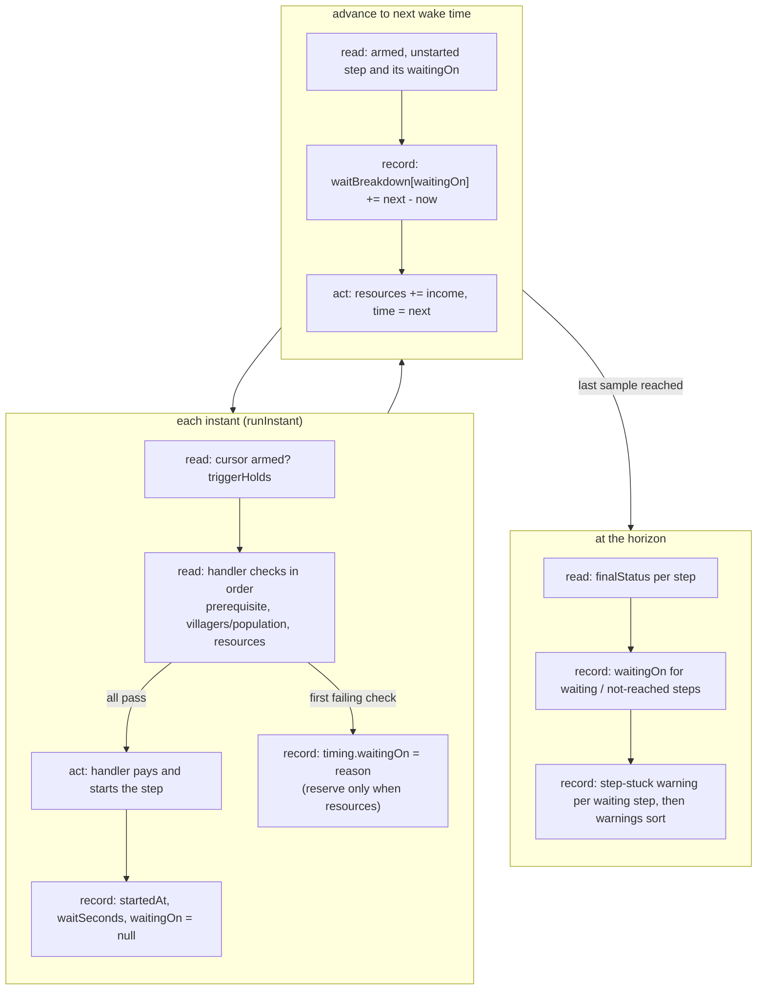

# SGS-042: Report why each step waits, and warn on steps still stuck at the horizon

- **Type**: Task
- **Component**: aoe4-build-order
- **Milestone / criteria**: M3 / M3.5 (engine side), M3.12 (`step-stuck` warning)
- **Priority**: medium
- **Risk**: high
  <!-- lib/** is a REPO.md criticalPath; the change lands in offerSteps and the main event loop. The plan rated merge risk medium; the template tier is the higher one. -->
- **Invariants**: A2 (a step that cannot be afforded waits and the wait appears in the reported timings; this ticket extends exactly that reporting), A3 (accrual is arithmetic on event times only, no wall clock)
- **LOC estimate**: ~130 (`simulate.ts` handler returns, `offerSteps`, interval accrual in `simulateBuildOrder`, horizon pass and `step-stuck` emission ~100; `research.ts` ~10; `model.ts` ~10; tests, docs and OpenAPI excluded)
- **Depends on**: SGS-037 (transitively SGS-035)
- **On merge**: none
- **Source**: design/M3.md contracts (`StepWait`, `StepTiming`, `SimWarning`), "Step status" and "Warning messages" tables, rule rows "step status / waitingOn", "step status / waitBreakdown", "step-stuck / when"; plan M3-20261101 outline H

## Context

Today a step that has not started is just `waiting` or `not-reached`; nothing says what it waits on, and the engine
discards that information at the handler (`{ started: false }` in five places, only `reserve` hints at resources).
M3 reports the reason and the seconds spent per reason on every `StepTiming`, and raises a `step-stuck` warning for
each step still `waiting` at the horizon, so the page (SGS-047) and the prebuilt-build bar (SGS-039) can say why.

## Scope

All paths under `lib/aoe4-build-order/` unless noted. Contract names come from design/M3.md and SGS-037 (`StepWait`,
`SimWarning`, `SimulationResult.warnings` and its sort are defined there; this ticket does not redefine them).

1. **`model.ts`**: `StepTiming` gains `waitingOn: StepWait | null` and
   `waitBreakdown: Partial<Record<'resources' | 'villagers' | 'population' | 'prerequisite', number>>`.
2. **`simulate.ts`, handler contract**: `StepStart` becomes
   `{ started: true } | { started: false; waitingOn: StepWait; reserve?: Readonly<Record<ResourceKind, number>> }`,
   `reserve` present only when `waitingOn === 'resources'`. Handlers return the first failing check in the M2 order
   (`prerequisite`, then `villagers` or `population`, then `resources`):
   - `produce` (`simulate.ts:255-262`): `prerequisite` when no target instance exists, the unit entry is missing or
     above the current age; `population` when `state.population + targets * popcap > state.supply`; `resources` with
     `reserve` as today.
   - `build` (`simulate.ts:345-353`): `prerequisite` when the building entry is missing or above the current age;
     `villagers` when `state.gatherers[step.from] < builders`; `resources` with `reserve` as today. (SGS-038 changes
     the villager check to `availableAt` in place; whichever merges second rebases.)
   - `move` (`simulate.ts:360-361`): `villagers` when `state.gatherers[step.from] < step.count`.
   - `research` (`research.ts:36-45`): `prerequisite` when no producing instance exists or the tech is above the
     current age; `resources` with `reserve` as today.
   - `pause` and `rally` always start and need no change.
   Grep today: `git grep -nF "{ started: false }" -- 'lib/aoe4-build-order' ':!*.test.ts'` finds 5 sites
   (`research.ts:38`, `simulate.ts:258`, `349`, `361`, `387`); none may remain.
   `houses.ts` is not touched: auto-houses are not steps and have no `StepStart` (the outline's "houses handlers
   return their reason" does not match the code).
3. **`simulate.ts`, `createEngine`**: each `StepTiming` starts with `waitingOn: null` and `waitBreakdown: {}`.
4. **`simulate.ts`, `offerSteps`** (`simulate.ts:375-399`): on a failed attempt it stores the handler's `waitingOn` on
   the step's timing (and the reserve as today); on start it sets `waitingOn` to `null`. An unregistered action
   (`handler` undefined, `simulate.ts:387`) also needs a value (see Open questions).
5. **`simulate.ts`, interval accrual**: in `simulateBuildOrder`, immediately before `engine.time = next`, call the
   wait-time helper with the armed, unstarted step (the cursor step when it is armed) and `next - engine.time`. The
   helper adds that many seconds to `waitBreakdown[waitingOn]`, where `waitingOn` is the value after the instant's
   last `offerSteps`. It is exported from `simulate.ts` and takes the step indexes to charge, so the reaction ticket
   (SGS-039) calls the same function for its reaction list instead of reimplementing it. Reasons with 0 seconds are
   never written.
6. **`simulate.ts`, horizon pass** (the `finalStatus` loop at `simulate.ts:683-685`): after statuses are set, for a
   step that never started, set `waitingOn` as follows: `waiting` keeps its last handler reason; `not-reached` gets
   `trigger` when it is the cursor step (its trigger never held), else `earlier-step`. Started steps keep `null`.
   `not-reached` steps keep `waitBreakdown: {}`.
7. **`simulate.ts`, `step-stuck`**: for every `waiting` step at the horizon, append
   `{ code: 'step-stuck', severity: 'warning', message, step, waitingOn, at: armedAt }` to `warnings`, then put
   `warnings` in order through the warnings sort SGS-037 defines (`step-stuck` last, by step index). `not-reached`
   steps get none. Message shape (design example): `step 12 (build kings-palace from wood) was still waiting on
   resources at 60:00, from 11:40.` with the horizon time and `armedAt` as `m:ss`.
8. **`docs/api/openapi.json`**: `StepTiming` gains `waitingOn` (nullable `$ref` to the `StepWait` schema SGS-037
   adds) and `waitBreakdown` (object, `additionalProperties: false`, the four reason keys, numbers `>= 0`), both in
   `required`; update the two `steps` examples (lines ~422-440) with `"waitingOn": null, "waitBreakdown": {}`.
9. **`acceptance/aoe4-simulate-api-contract.spec.ts:324`**: add the two keys to the `Record<keyof StepTiming, true>`
   map, or the ajv/type check fails.
10. **`docs/aoe4-build-order.md`**: update the `steps` bullet of the output list (~line 513) to name `waitingOn` and
    `waitBreakdown`; add a table mapping each `StepWait` reason to when a handler produces it (design "Step status"
    table, restricted to the non-reaction reasons) beside the state table at ~537; amend the "A step waits while..."
    paragraph (~line 543) to say each reason is reported; document `step-stuck` next to the `warnings` section
    SGS-037 adds. Re-check the stateDiagram labels for accuracy.
11. **Existing tests that use `toEqual` on a whole `StepTiming`** need the two new fields:
    `simulate.test.ts:404` and `:438`. Add new tests next to the existing wait tests
    (`simulate.test.ts` 'produce waits', 'handler seam'; `build-move.acceptance.test.ts:135-190`;
    `simulate-construction.test.ts:270-310`).

**Out of scope:** reactions and `earlier-step` for reactions (SGS-039, reusing the helper in item 5); `bank` and
`depleted` triggers; `node-depleted` and `idle-arrival` warnings (SGS-038); the page timeline (SGS-047); the paste
grammar and `formatBuildStep` (SGS-040); `houses.ts`, auto-house and order-payment waits (not steps); multi-tier
research (SGS-041).

## Diagrams

Changes `offerSteps` and the main loop, so a read, act, record diagram:

## Acceptance criteria

- [ ] `git grep -nF "{ started: false }" -- 'lib/aoe4-build-order' ':!*.test.ts'` finds 0 matches (5 today), and a handler that returns `reserve` also returns `waitingOn: 'resources'`.
- [ ] A step that waits on an age it has not reached gets `waitingOn: 'prerequisite'` while waiting: in the "age 2 building waits for the landmark" fixture (`build-move.acceptance.test.ts:178-190`) the stable has `waitBreakdown` `{ prerequisite: 119 }` (within 1e-9), `startedAt` 119, `waitingOn: null`.
- [ ] A step that cannot afford its cost with everything else satisfied ends `{ resources: <seconds> }`, with `waitSeconds` equal to that value; a build short of builders at `from` reports `villagers`; a produce held by supply (autoHouses off) reports `population`; a produce on an instance that does not exist reports `prerequisite`.
- [ ] A step whose reason changes while it waits splits its seconds between reasons: a test built from two consecutive waits (for example `villagers` then `resources`) has both keys, each above 0, and their sum equals `startedAt - armedAt` within 1e-9.
- [ ] For every started step in a multi-step run, the `waitBreakdown` values sum to `waitSeconds`; for a `waiting` step at the horizon they sum to `durationSeconds - armedAt`; `not-reached` steps have `{}`; no key has value 0 (checked by a test over a run with both resource and prerequisite waits).
- [ ] At the horizon, a `waiting` step has `waitingOn` equal to its current reason; a `not-reached` cursor step has `trigger`; a `not-reached` step behind an unstarted one has `earlier-step`; `in-progress` and `completed` steps have `null`. Example: `[produce on instance 2 (missing), rally]` gives `['prerequisite', 'earlier-step']` (extends `simulate.test.ts` 'waits for a targeted instance that does not exist').
- [ ] A run with one `waiting` step and one `not-reached` step has exactly one `step-stuck` warning: `step` is the waiting step's index, `waitingOn` its reason, `at` its `armedAt`, `severity` is `warning`, and `message` contains the reason and the `m:ss` of `at` and of the horizon. A run where every step started has no `step-stuck`. `warnings` stays sorted per SGS-037 when `step-stuck` coexists with another warning code.
- [ ] A run where nothing waits is unchanged except the two new fields: every existing `simulate*.test.ts` and acceptance test passes after the `toEqual` fixtures at `simulate.test.ts:404` and `:438` gain `waitingOn: null, waitBreakdown: {}`.
- [ ] The wait-time helper is exported from `simulate.ts`, takes the step indexes it charges, and has its own unit test charging two steps over one interval; `offerSteps`' only call site is the cursor step.
- [ ] `docs/api/openapi.json`: `jq '.components.schemas.StepTiming.required'` includes `waitingOn` and `waitBreakdown` (it includes neither today); both examples validate; `acceptance/aoe4-simulate-api-contract.spec.ts` passes.
- [ ] `docs/aoe4-build-order.md` names `waitingOn`, `waitBreakdown` and `step-stuck`, and states the check order; a grep for the old "waits while..." paragraph shows it still describes every reason the table lists.
- [ ] Determinism: two runs of the same order and data give identical `waitBreakdown` and `warnings`.
- [ ] No INVARIANTS.md regressions

## Open questions

- `designer`: the name and signature of the exported wait-time helper (item 5). Owner decision 10 fixes that H exposes it
  and E reuses it; design/M3.md has no name. Proposed: `accrueWait(engine, stepIndexes, seconds)`.
- `designer`: the `step-stuck` message text: the numbering in `step 12` (0-based `StepTiming.step` or 1-based, as
  paste lines are) and the parenthetical description (`build kings-palace from wood`). The natural renderer is
  `formatBuildStep` from SGS-040, which lands after this ticket, and the engine does not import `parse-text.ts` today.
  Criteria above pin only the structured fields, the reason and the two `m:ss` values.
- `designer`: where the engine's `m:ss` formatter lives. `formatMinSec` is in `components/apps/aoe4-build-order/chart-rows.ts`
  (lib must not import components), and `parse-text.ts:299-301` has an inline copy. SGS-037/SGS-038 messages need the same
  formatter, so one shared copy has to be placed once (`engine-common.ts` is a candidate) and imported here.
- `designer`: the `waitingOn` for an action with no registered handler (the existing 'handler seam' test, `simulate.test.ts:522`,
  keeps it `waiting` and blocking). The `StepWait` table has no row for it; `prerequisite` is the nearest fit.
