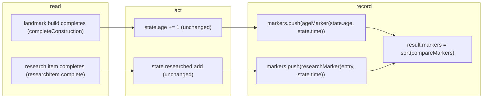

# SGS-044: Add chart marker data to the simulation result

- **Type**: Task
- **Component**: aoe4-build-order
- **Milestone / criteria**: M3 / M3.10 (engine side)
- **Priority**: medium
- **Risk**: standard
  <!-- (re-rated 2026-11-01, symbol-scoped criticalPaths) Adds recorded marker data only (new markers.ts and pushes); no listed symbol changes what it decides. Adds a response field, ~70 lines. -->
- **Invariants**: A1 (labels and kinds come from snapshot entries and the fixed age names, no game numbers), A3 (markers are derived from the event order, no wall clock), S3 (adds no input)
- **LOC estimate**: 70 (new `markers.ts` ~40; `model.ts` types ~15; `simulate.ts` and `research.ts` pushes and result field ~15; tests, docs and OpenAPI excluded)
- **Depends on**: SGS-041 (G: `researchEntry(baseId, state)` picks the entry whose completion is marked)
- **On merge**: none
- **Source**: M3.10; design/M3.md "Markers", "Behavior rules" rows `markers`, `ChartMarkerKind`/`ChartMarker` in the contracts and OpenAPI lists

## Context

M3.10 wants every chart to mark each age reached and each research completed. The charts only draw what the result
carries, so the engine must emit `SimulationResult.markers` first. This ticket is the data side; the chart
rendering is SGS-049. A marker changes nothing in the simulation.

## Scope

Contract names are the design's (design/M3.md Contracts and Markers); do not rename.

1. `lib/aoe4-build-order/model.ts`: add `ChartMarkerKind` (`'age-up' | 'economy' | 'unit-tier' | 'blacksmith' | 'other'`),
   `CHART_MARKER_KINDS` (that order, first `age-up`, last `other`), `ChartMarker` (`{ kind; label: string; at: number }`),
   `AGE_NAMES` (`Readonly<Record<2 | 3 | 4, string>>`: 2 Feudal, 3 Castle, 4 Imperial), and `SimulationResult.markers: ChartMarker[]`.
   Today `SimulationResult` ends at `ages`, `notes` (`model.ts:80`).
2. New `lib/aoe4-build-order/markers.ts` exporting:
   - `researchMarkerKind(entry): Exclude<ChartMarkerKind, 'age-up'>`: first match wins, in this order: `economy` when
     `entry.classes` includes `economic_upgrade`; `unit-tier` when `entry.type === 'upgrade'` or `entry.classes` includes
     `scar_unit_upgrade`; `blacksmith` when `entry.producedBy` includes `blacksmith`; else `other`.
   - `researchMarker(entry, at)` = `{ kind: researchMarkerKind(entry), label: entry.baseId, at }`.
   - `ageMarker(age, at)` = `{ kind: 'age-up', label: AGE_NAMES[age], at }`.
   - `compareMarkers(a, b)`: by `at`, then `CHART_MARKER_KINDS` index, then `label` ascending.
3. `lib/aoe4-build-order/simulate.ts`: `EngineState.markers: ChartMarker[]` (empty at creation, beside `ages` at
   `createEngine`); `completeConstruction` pushes `ageMarker(state.age, state.time)` beside the existing
   `ages.push` (`simulate.ts:333`), so the start age has no marker; `simulateBuildOrder` returns
   `markers: [...engine.markers].sort(compareMarkers)` (the return object near `ages: engine.ages`).
4. `lib/aoe4-build-order/research.ts`: the research item's `complete` callback (`researchItem`, where
   `state.researched.add` runs today at `research.ts:27`) pushes `researchMarker(entry, state.time)` using the entry
   the handler picked for that step (after SGS-041 that is `researchEntry`'s result; before it, `byBaseId.get(step.tech)[0]`).
   `at` equals that step's `completedAt`.
5. `docs/api/openapi.json`: new schemas `ChartMarkerKind` (enum, same order as `CHART_MARKER_KINDS`) and `ChartMarker`
   (`kind` `$ref`, `label` string, `at` number >= 0; `additionalProperties: false`, all required);
   `SimulationResult.properties.markers` (array of `ChartMarker`) added to `required`; extend the 200 example near
   `docs/api/openapi.json:440` (the one that has `ages`) with `markers` so it still validates.
6. `docs/aoe4-build-order.md`: in the result-fields list (the `ages` bullet, line ~515) add a `markers` bullet
   (kinds, classification order, label rule, sort order, no marker for the start age or for unfinished work, no
   effect on the simulation) and state in the research section that a completed tech adds a marker. The
   cross-cutting M3 sections are SGS-054's.
7. (respec 2) `components/apps/aoe4-build-order/result-series.test.ts`: add `markers: []` to the `result()` literal
   (`function result(): SimulationResult`, lines 6-22 on main). It is the only typed `SimulationResult` literal outside
   `lib/` (`git grep -n "): SimulationResult\|SimulationResult = " -- components pages` finds just this one), and
   `npx tsc --noEmit` fails without it once `markers` is required. SGS-037 (reached through SGS-041) already adds
   `depletions: []` and `warnings: []` to the same literal; this ticket adds only `markers`.

Result-shape contract (must hold; the design rows are `markers | age reached`, `research completed`, `ordering and ties`,
`repeat`, `no target`, `effects`, `x range`):
- one marker per age reached after the start age and per completed research; none for research or a landmark that is
  in progress, waiting or not reached at the horizon; `markers: []` when neither happened;
- sorted with `compareMarkers`; markers at the same `at` all appear, none merged or dropped;
- every `at` is at most `durationSeconds`;
- no simulation field other than `markers` changes for any input.

**Out of scope:** chart rendering, colors, labels and legend (`MARKER_COLORS`, `MARKER_KIND_LABELS`, `markerLabel`; SGS-049);
pinned-run markers; new `ChartMarkerKind` values; any combat effect of a tech; the audit of the whole docs/OpenAPI
(SGS-054); `pages/apps/aoe4-build-order.tsx` and `components/**` except the one `markers: []` line in
`components/apps/aoe4-build-order/result-series.test.ts` (Scope item 7).

## Diagrams

Records two new events in the engine's completion path; no new reads and no state change beyond appending to
`EngineState.markers`.

## Acceptance criteria

- [ ] `researchMarkerKind` returns `economy` for `wheelbarrow`, `double-broadax`, `horticulture`; `unit-tier` for
      `veteran-longbowmen`, `men-at-arms`, `elite-knights-or-lancers`; `blacksmith` for `steeled-arrow`, `bloomery`,
      `military-academy`; `other` for `textiles`, `professional-scouts`, `arrow-volley` (each taken from the loaded English
      snapshot, not hand-built entries). I checked these twelve against `english.json` before writing: each matches exactly one row's test.
- [ ] Priority is pinned with hand-built entries: an entry with `economic_upgrade` and `producedBy: ['blacksmith']` is `economy`;
      an entry with `type: 'upgrade'` and `producedBy: ['blacksmith']` is `unit-tier`; an entry matching none is `other`.
      `researchMarkerKind` never returns `age-up`.
- [ ] `researchMarker(entry, 870)` equals `{ kind: researchMarkerKind(entry), label: entry.baseId, at: 870 }`;
      `ageMarker(3, 804)` equals `{ kind: 'age-up', label: 'Castle', at: 804 }`; `AGE_NAMES` is `{2: 'Feudal', 3: 'Castle', 4: 'Imperial'}`.
- [ ] `compareMarkers` orders `at` first, then `CHART_MARKER_KINDS` index, then `label` ascending: markers with equal `at`
      and kinds `other`, `age-up`, `economy` sort as `age-up`, `economy`, `other`; equal `at` and kind sort by label.
      `CHART_MARKER_KINDS` is `['age-up','economy','unit-tier','blacksmith','other']`.
- [ ] A simulation of the shipped English build with a horizon that reaches Feudal returns an `age-up` marker labeled `Feudal`
      whose `at` equals the matching `ages` entry's `reachedAt`, and no marker for the start age. The first marker's label
      is `Feudal` and, for a horizon that reaches Imperial through test-edited game data, the last age marker is `Imperial`.
- [ ] A build that researches a tech yields one marker `{ kind, label: <baseId>, at }` with `at` equal to that step's
      `steps[i].completedAt`; a research step still in progress, waiting or not reached at the horizon yields no marker; a
      landmark still under construction at the horizon yields no marker; a run with neither returns `markers: []`.
- [ ] A research completing at the same instant as an age-up produces both markers, ordered by `compareMarkers`
      (the `age-up` first). Two techs completing at the same instant both appear.
- [ ] Every `markers[i].at <= durationSeconds`, `markers` is sorted per `compareMarkers`, and each age and each tech appears at most once.
- [ ] (respec 2) Adding `markers` changes nothing else: every existing unit test (`npm test`) stays green with no edit
      to its assertions; the only edit to an existing test file is the `markers: []` line in `result-series.test.ts`
      (Scope item 7).
- [ ] `docs/api/openapi.json` has `ChartMarkerKind` and `ChartMarker`, `SimulationResult.required` lists `markers`, and
      `acceptance/aoe4-simulate-api-contract.spec.ts` (ajv) passes against a live response that contains `markers`.
- [ ] `docs/aoe4-build-order.md` has a `markers` bullet beside `ages`; `git grep -n "markers" -- docs/aoe4-build-order.md` is no longer empty (it is empty today).
- [ ] `git grep -n "ages.push" -- lib ':!*.test.ts'` still finds exactly one site and `markers.push(ageMarker` appears next to it; (respec 2) `git grep -n "researchMarker(" -- lib/aoe4-build-order/research.ts` finds exactly one call site (the import line has no `(` and is not counted; today the grep finds none, and `git grep -n "researched.add" -- lib ':!*.test.ts'` finds exactly one, in `research.ts`).
- [ ] Mutation: swapping the first two checks in `researchMarkerKind` fails the priority test; dropping the `ageMarker` push fails the age-marker test; dropping the `.sort(compareMarkers)` fails the same-time ordering test.
- [ ] (respec 2) `npx tsc --noEmit` (including `components/apps/aoe4-build-order/result-series.test.ts`) and `npm test` pass; no INVARIANTS.md regressions.

## Open questions

None.
