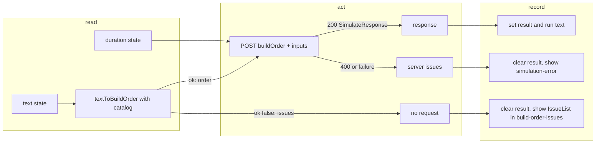

# SGS-059: Page converts the paste and posts `buildOrder`, with inline client issues

- **Type**: Task
- **Component**: aoe4-build-order
- **Milestone / criteria**: M4 / M4.1
- **Priority**: high
- **Risk**: standard
  <!-- No strongModelTriggers item: the route and its request shape are unchanged here (the route still
       accepts `buildOrder`, which the OpenAPI already documents); this ticket only changes what the page
       sends. Under ~100 lines of business logic, one component, but it changes page request behavior and
       is adjacent to S3, so not low. -->
- **Invariants**: S3 (the duration still goes to the route unchecked in the browser and the route enforces `SIM_INPUT_BOUNDS`; the browser conversion enforces the 20000-character text cap through `textToBuildOrder`, so no path reaches the engine unbounded)
- **LOC estimate**: about 75 (`pages/apps/aoe4-build-order.tsx` about 30 changed; new `issue-list.tsx` about 25; `build-input.tsx` about 6; `step-table.tsx` prop rename about 12 lines touched; `acceptance/helpers.ts` `runRejected` about 12). Spec rewrites and docs excluded.
- **Depends on**: SGS-075 (re-exports the model types from `schema.ts`, swaps the route, and adds `buildOrderFrom`); transitively SGS-057 (`textToBuildOrder`, the catalog)
- **On merge**: none
- **Source**: M4 design contracts C8 (`PageProps`, `IssueList`, `runRejected`, `StepTable` prop rename, `simulation-error` row), Behavior rules "Page run" (Run ordering steps 1 to 7, inline issues M4.1 ticket 3, page specs) and "M4.1 ticket order" row 3 (`design/M4.md`); plan outline D (`plans/M4-20261102.md`) as amended by designer pass 3 (`reports/M4-designer-3.md`: DQ3, DQ6, "Outline changes" 3)

## Context

Today the page posts the raw `text` and shows whatever the route answers, so a bad paste costs a round trip and
the browser never runs the checks. SGS-057 adds `textToBuildOrder` and the shared catalog; this ticket makes
the page use them: convert first, show client rejections under the editor, and POST only a checked
`buildOrder`. It must land before the route stops accepting `text`.

## Scope

All paths are relative to the repo root. Names are exactly those of SGS-057 (`design/M4.md` C2 and C4a):
`BuildOrderCatalog` and `buildOrderCatalog(data)` from `lib/aoe4-build-order/schema.ts`,
`textToBuildOrder(text, catalog)` and `TextToBuildResult` from `lib/aoe4-build-order/text-to-build.ts`.

**1. `pages/apps/aoe4-build-order.tsx`.**
- `PageProps` becomes `{ builds: PrebuiltBuild[]; catalog: BuildOrderCatalog }`. `getStaticProps` returns
  `catalog: buildOrderCatalog(loadGameData('english'))` in place of `options: stepOptions(...)`; the
  `StepOptions` import and `stepOptions` call leave the page. `catalog` is JSON-serializable (SGS-057), so it
  crosses `getStaticProps`.
- `StepTable` receives `catalog={catalog}`.
- `runSimulation` follows Run steps 1 to 7 of the design, without the tab, scroll and snapshot-name parts that
  later tickets add:
  1. Clear the shown issues (the new client-issue state) and `simulation-error` messages.
  2. `textToBuildOrder(runText, catalog)`.
  3. On `ok: false`: store `result.issues` as the client issues for `IssueList`, call `setResult(null)`, send
     no request, and do not touch `running` (Run stays enabled) or the pin.
  4. Otherwise POST `{ buildOrder: result.order, inputs: { durationSeconds: Number(duration) } }`. The body
     has no `text` key. Type the body as `SimulateRequest` as today (`api.ts` is not changed; `text` stays
     optional in it until the remove-`text` ticket).
  5. 200: `setResult(body)` and `setResultText(runText)`, as today.
  6. 400 and every other failure: unchanged. `errorMessages` and the `simulation-error` list keep showing the
     server's issue messages plus the omitted count, and the two network or HTTP failure messages. A browser
     rejection never goes to `simulation-error`.
- The duration stays unchecked in the browser: empty or non-numeric is sent as 0 and the server's 400 shows
  in `simulation-error`, as today.

**2. `components/apps/aoe4-build-order/issue-list.tsx` (new).** `export function IssueList(props: { issues:
readonly BuildOrderIssue[] }): JSX.Element | null`; returns `null` for an empty list. Renders a
`role="alert"` container with `data-testid="build-order-issues"` and one item per issue in order, each
`data-testid="build-order-issue"`, `data-code={issue.code}`, `data-line={issue.line}` (attribute absent when
the issue has no `line`), text exactly `issue.message`. No suggestion text, no gutter or line highlight, and
not live: the list is the issues of the last client rejection only (those are K's, a later ticket).
- `BuildInput` (`build-input.tsx`) gains an `issues: readonly BuildOrderIssue[]` prop and renders
  `<IssueList issues={issues} />` directly under the `build-order-text` textarea inside its column, so the
  list sits under the editor. This is the only `BuildInput` change here; the select stays local state (a later
  ticket lifts it).

**3. `components/apps/aoe4-build-order/step-table.tsx`.** The prop `options: StepOptions` becomes `catalog:
BuildOrderCatalog` (`StepTableProps`, `StepTable`'s destructure, and the call sites in the same file). The
table's internals still read `StepOptions` members, which `BuildOrderCatalog` extends, so helper signatures in
`step-table-model.ts` do not change; passing `catalog` where an `options` argument is expected is enough. No
behavior change.

**4. `acceptance/helpers.ts`.** Add `export async function runRejected(page: Page): Promise<void>`: start
recording requests whose URL ends with `SIMULATE_PATH` and method is POST, click `run-simulation`, wait for
`build-order-issues` to be visible, then fail (throw or `expect`) if any such request was recorded. It does
not touch `buildOrderFrom` (SGS-075 adds it).

**5. Page specs.** Rewrite to the design's "page specs" rows. Line numbers are on `origin/main` `d5c2549`; the
parallel `strictNullChecks` ticket may shift them, so find each by test title.
- Client rejections: `acceptance/aoe4-build-order.spec.ts` "an invalid paste shows the line and token with no
  chart; a valid run then clears it" and "a failed run after a successful one removes the charts" (107-131),
  the `INVALID_PASTE` run inside the notes test (304-307), "a failed run shows neither the warnings nor the
  info messages" (320-327), and "a 400 run and a start-only run show no timeline" (574-576);
  `acceptance/aoe4-build-order-pin-compare.spec.ts` "a 400 run removes charts and table but keeps the pin;
  the next valid run restores both" (173-178; its `run` helper waits for a response, so it needs a path that
  does not, for example calling `runRejected` after filling the text). Each replaces `runSimulation(...)` plus
  `status()).toBe(400)` and the `simulation-error` assertion with `runRejected(page)` and asserts: exactly one
  `build-order-issue` with `data-line="2"`, `data-code="syntax"` and text containing `fly`; `simulation-error`
  count 0; and every removed or kept element the test asserts today unchanged (charts, `simulation-notes`,
  `simulation-warnings`, `step-timeline`, `compare-key-numbers` removed; `unpin-run` enabled and `pin-run`
  disabled kept). A later valid run must still show no `build-order-issues` (cleared at the start of the run).
- Request body: `aoe4-build-order.spec.ts:92` asserts `postDataJSON().buildOrder` deep-equals
  `buildOrderFrom(RALLY_PASTE)` and that the body has no `text` key; `aoe4-step-table.spec.ts:203` asserts the
  posted `buildOrder` deep-equals `buildOrderFrom(<textarea value>)` (it currently parses `postData().text`).
- Unchanged: the duration tests (136-148), the mocked 500 and mocked 400 tests (150-187), and
  `acceptance/aoe4-build-order-m3-flow.spec.ts:92` (that test only checks `step-table-unavailable` and never
  runs). Each still asserts `simulation-error`.
- Rule for other tests: a test that runs the page and is not listed keeps its expected value. The implementer
  lists every test it edits.
- New test in `aoe4-build-order.spec.ts`: a paste that parses but fails the check (`start -> sheep` followed by
  `produce knigt from stable`) gives, via `runRejected`, one `build-order-issue` with `data-code="unknown-id"`,
  `data-line="2"` and a message containing `knigt`, and `simulation-error` count 0.

**6. Docs.** `docs/aoe4-build-order.md` "Page" section (line 762 on `origin/main`): the sentence "Run posts the
text and `inputs.durationSeconds` to the route" becomes: Run converts the text with `textToBuildOrder` and the
English catalog, posts the checked `buildOrder` and `inputs.durationSeconds`, and, when the text does not
convert, lists its issues under the textarea and sends nothing and clears the shown result; the paragraph's
"and Run reports it" for an unknown pasted id stays true and says the issue appears under the textarea. Server
400 issues, network and HTTP failures show in the error list as before. Grep `docs/` and the two READMEs for
other statements that the page posts `text` and fix each hit. `docs/api/openapi.json` is not changed.

**Out of scope:** removing `text` from the route, `api.ts` or OpenAPI (remove-`text` ticket); any other API
spec body (API-specs ticket); live issues, suggestions, gutter highlight, scroll-to-issue and the tabs, view
toggle, `BuildTextEditor`, `lineCount`, `issueLines` (later page tickets); lifting `selected` out of
`BuildInput`, pin naming and storage; the `StepTable` internals and `FIELD_LABELS`; `schema.ts`,
`text-to-build.ts`, `buildOrderFrom` (SGS-075); `golang/`.

## Diagrams

The change alters the page's Run path across the page and the shared check library, so the path is shown in
read, act, record phases.

## Acceptance criteria

- [ ] Running a valid paste (the default build, and the rally paste) sends a POST to `/api/aoe4-build-order/simulate` whose JSON body has a `buildOrder` deep-equal to `buildOrderFrom(<that text>)`, has no `text` key, and carries `inputs.durationSeconds`; charts draw (`aoe4-build-order.spec.ts` request-body test and the `aoe4-step-table.spec.ts` post-edit test).
- [ ] An unparseable paste (`start -> sheep` then `at 8 vils fly capital-town-center`) sends no POST (`runRejected` passes), shows exactly one `build-order-issue` with `data-line="2"`, `data-code="syntax"` and text containing `fly`, and `simulation-error` has count 0.
- [ ] A paste that parses but fails the check (`produce knigt from stable`) shows one `unknown-id` issue at its line with `knigt` in the text and sends no POST.
- [ ] After a successful run, a client rejection removes the charts, `simulation-notes`, `simulation-warnings`, `step-timeline` and `compare-key-numbers`, keeps the pin (`unpin-run` enabled, `pin-run` disabled), and leaves Run enabled; the next valid run hides `build-order-issues` and draws the charts again.
- [ ] A pasted text of 20001 characters shows one `out-of-range` issue `text: 20001 characters, more than 20000` in `build-order-issues` and sends no POST (new Playwright test).
- [ ] The duration tests (`59`, emptied) and the mocked 400 (with and without `omittedIssues`) and mocked 500 tests still assert `simulation-error` and pass unchanged; a server 400 never shows in `build-order-issues`.
- [ ] `PageProps` is `{ builds, catalog }` and `StepTable` takes `catalog`: `git grep -n "options" -- pages/apps/aoe4-build-order.tsx` prints nothing (5 hits today), and `git grep -nE "^\s+options: " -- components/apps/aoe4-build-order/step-table.tsx` prints nothing (1 hit today, the prop line; internal helper parameters may keep their names).
- [ ] `git grep -nE "postData(JSON)?\(\)[^;]*\.text" -- acceptance` prints nothing (2 hits today: `aoe4-build-order.spec.ts:92`, `aoe4-step-table.spec.ts:215`).
- [ ] `git grep -c "toBe(400)" -- acceptance/aoe4-build-order.spec.ts acceptance/aoe4-build-order-pin-compare.spec.ts` shows 2 and 0 (7 and 1 today): only the duration and mocked-400 tests keep a 400.
- [ ] Mutation: change the page's rejection branch to POST `{ buildOrder: ... }` anyway (or to put the issues in `simulation-error`); the `runRejected` specs fail. Confirm by applying it before handing over.
- [ ] `docs/aoe4-build-order.md` no longer says Run posts the text: `git grep -nE "Run posts the$|posts the text|posts the paste" -- docs` prints nothing.
- [ ] `npx tsc --noEmit`, `npm run lint:dup`, `npm test` and `npm run acceptance` (Node 24) pass.
- [ ] No INVARIANTS.md regressions

## Open questions

None. (The `issues` prop on `BuildInput` is this ticket's way to render the list under the textarea while the
textarea still lives in `BuildInput`; the design fixes only the placement and the later editor ticket moves
the textarea. No owner or designer decision is needed.)

## Re-spec 2026-11-02

- Underspecified: SGS-057 was split; `buildOrderFrom` and the model re-exports now come from SGS-075.
- Changed: Depends on SGS-075 (transitively SGS-057); `buildOrderFrom` references point to SGS-075.
- Stands: all Scope and criteria.
