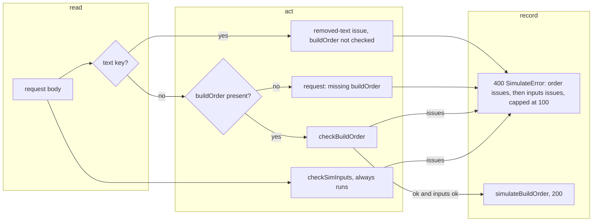

# SGS-061: The simulate API rejects `text` (breaking), OpenAPI 2.0.0

- **Type**: Task
- **Component**: aoe4-build-order
- **Milestone / criteria**: M4 / M4.1
- **Priority**: high
- **Risk**: high
  <!-- strongModelTriggers: changes an existing public API request contract that current callers depend on
       (`text` was accepted since 1.0.0; OpenAPI major version bump). Also adjacent to S3: the route's
       20000-character check leaves it (the cap moves to the page's conversion, added by SGS-057). The diff
       itself is small (about 25 lines of business logic). -->
- **Invariants**: S3 (every request stays bounded: a `text` body of any size is rejected before any parse or simulation, Next's 1 MB limit and the `steps` cap are unchanged, and the 20000-character cap still bounds the paste in `textToBuildOrder`), A3 (the same `buildOrder` and `inputs` still give the same response; only the rejection of `text` is new)
- **LOC estimate**: about 25 business-logic lines (`pages/api/aoe4-build-order/simulate.ts` about 20 changed, `api.ts` 2). OpenAPI JSON, docs and spec edits excluded.
- **Depends on**: SGS-059 (the page posts `buildOrder`, so nothing in the repo sends `text`), SGS-060 (the API specs send `buildOrder`, leaving only the 16 old-`text`-rule lines this ticket replaces), SGS-075 (swapped the route to `checkBuildOrder`/`checkSimInputs` and left a temporary `text` branch calling `textToBuildOrder`, which this ticket removes); transitively SGS-057
- **On merge**: none
- **Source**: M4 design C4 (the request-field table, `SimulateRequest`, OpenAPI `2.0.0` paragraph), Behavior rules "Validation (M4.1)" rows `route` (ordering, order part, the three `text` examples, `{}`), "API test rewrite" row `when` (ticket 5), "Docs and OpenAPI" row "M4.1 remove `text`" (`design/M4.md`); plan outline E2 as split by designer pass 3 (`reports/M4-designer-3.md`: "Outline changes" 1)

## Context

Owner decision (2026-11-02): `text` is removed from the API. A client that still sends it must be told why, so a
body with a `text` key is a 400, not ignored and not read. This is the one breaking change of M4.1, so OpenAPI
moves to `2.0.0`. It is safe to merge only after the page posts `buildOrder` (SGS-059) and every API spec sends
it (SGS-060).

## Scope

All paths are relative to the repo root. Names are those of SGS-057, SGS-075 and `design/M4.md` C2 and C4: `checkBuildOrder`,
`checkSimInputs`, `buildOrderCatalog`, `MAX_REPORTED_ISSUES`, `SimulateRequest`. Line numbers are from origin/main
`d5c2549` and move with SGS-056 to SGS-060; find things by name or test title.

**1. Route `pages/api/aoe4-build-order/simulate.ts`.** The order part of the request becomes (design rows `route`):
- Unchanged: the method check (405) runs first, and a body that is not a plain object gives one `syntax` issue
  `request body: must be a JSON object` with nothing else checked.
- If the body has an own `text` key (any value, `null` included): one issue `{ code: 'syntax', message: 'request:
  text is no longer accepted; convert the paste to buildOrder and send that' }` with no `step` or `line`, and
  `buildOrder` is not checked, even when valid.
- Else if `buildOrder` is absent (`undefined`): one issue `{ code: 'syntax', message: 'request: missing
  buildOrder' }`. `buildOrder: null` is present and goes to `checkBuildOrder`, which fails it as a non-object
  root (unchanged behavior of that check).
- Else `checkBuildOrder(body.buildOrder, catalog)` (no `lines`).
- The `inputs` part (`checkSimInputs(body.inputs ?? {}, catalog)`) always runs too; order issues first, then
  inputs issues; cap `MAX_REPORTED_ISSUES`, `omittedIssues`, `error` = first message, 400 body shape: all
  unchanged. So `{ buildOrder: <valid>, text: 'x', inputs: { durationSeconds: 59 } }` gives
  `[removed-text, inputs.durationSeconds out-of-range]`.
- SGS-075's temporary `text` branch (the call to `textToBuildOrder` that keeps the old specs passing) is removed here, replaced by the removed-`text` issue above.
- The `text` branch, the `text: must be a string` issue, the `request: send exactly one of text and buildOrder`
  issue, and the imports that served them leave the route (`textToBuildOrder`, `SIM_INPUT_BOUNDS` if only the
  text cap used it). The route does not import `parse-text.ts` or `text-to-build.ts`.
- Other top-level keys stay ignored.

**2. `lib/aoe4-build-order/api.ts`.** `SimulateRequest` becomes `{ buildOrder: BuildOrder; inputs?:
SimInputOverrides }`: `text` is removed and `buildOrder` is required. Fix any compile error this causes
(`npx tsc --noEmit`); the page (SGS-059) already builds its body with no `text`.

**3. `docs/api/openapi.json`.**
- `info.version` becomes `2.0.0`.
- Schema `SimulateRequest`: delete the `oneOf` and the `text` property; add `"required": ["buildOrder"]` and
  `"not": { "required": ["text"] }`; the description says `text` was removed in 2.0.0, that a body with a `text`
  key is rejected with the `syntax` issue `request: text is no longer accepted; convert the paste to buildOrder and
  send that` (even when `buildOrder` is also sent), and that the paste format is converted by the page or by
  `textToBuildOrder`. Keep "Unknown extra keys are ignored" except `text`. The `buildOrder` property description
  keeps "Issues on a step carry step and never line; issues on start carry neither".
- Operation `simulateBuildOrder` description: replace "exactly one of text and buildOrder; text is parsed then
  validated" with the new order stage (text key rejected; else buildOrder required and validated); replace the
  "Issue location" sentences so no issue carries `line` (a step issue carries `step`; start, inputs and request
  issues carry neither). Keep the two-stage, cap, framework-response (Invalid JSON, 413) sentences.
- Request examples: delete the `text` example. The 200 response description "Both request examples return this
  body" becomes "The request example returns this body".
- 400 examples: delete `pastedStep` and `pasteSyntax` (they promise `line`); rename `exactlyOne` to
  `missingBuildOrder` with summary "neither text nor buildOrder" changed to "no buildOrder" and the message
  `request: missing buildOrder`; add `removedText` (request `{ "text": "start 6 sheep -> sheep" }`, one `syntax`
  issue with the removed-`text` message, no `step`/`line`). `stepAndInputs` and `notAnObject` stay.
- `BuildOrderIssue.properties.line`: description no longer says "pasted text". `line` stays a property because
  `BuildOrderIssue` still declares it for the page's issues (SGS-057); the description says the route never
  sets it (set only by the page-side conversion). `SimulateError.properties.issues` description: "order-stage
  issues first (buildOrder), then inputs issues". Grep the file for `text` and `paste` and fix every other
  hit that is now untrue; the 405/FightError text is unrelated.

**4. `docs/aoe4-build-order.md`.**
- Route section (line 626 on origin/main): the request is `{ buildOrder, inputs? }` with `buildOrder` required
  (JSON, at most 200 steps); delete the "exactly one of `text`" and "`text: null`" sentences; add: a body with a
  `text` key is a 400 with one `syntax` issue (`request: text is no longer accepted; convert the paste to buildOrder
  and send that`), `buildOrder` is not checked then, and `inputs` still is; an absent `buildOrder` is `request:
  missing buildOrder`; one sentence telling paste users to use the page or `textToBuildOrder` (browser-safe, in
  `lib/aoe4-build-order/text-to-build.ts`). The 400 bullet: the order stage is `buildOrder` only, and no route
  issue carries `line`.
- Issues section (line 564) and the table row at line 55 (`text / steps | 20,000 chars / 200 steps`) and the
  sentence "The bounds apply to JSON and paste input alike" and the data-flow diagram (line 612): the 20,000
  character cap and `line` belong to the page-side conversion, not the route. Reword each so it says so, keep the
  per-bound table, and make the diagram show the paste entering through `textToBuildOrder` in the browser and
  only `BuildOrder JSON` reaching the route. Keep the field-vs-cross-field and issue-order text SGS-057 wrote.
- Grep `docs/`, `data/aoe4-build-order/README.md` and `README.md` for `exactly one of`, `text: null`, `send exactly
  one`, `posts the text`, `line` on a route issue; fix every hit that is now untrue.

**5. Specs that tested the old `text` rules (the 16 lines SGS-060 Scope 5 left, plus 8 in two specs added to main after this ticket was first written).** Replace them with the design's
rows; rewrite in place, same files. The raw-string bodies (`'{"text":'`, `'{"text": "start 6 sheep'`, the
`text/plain` Buffer) stay as they are.
- `aoe4-simulate-api.spec.ts`: in "each issue code over HTTP" `syntaxCases`, the three `text`-body cases and the
  neither-key case change to the C4 rows: `text` alone (a paste string), `text: null` beside `buildOrder`,
  `text: 42` and `text: ''` each give exactly the one removed-`text` issue (`syntax`, message contains
  `text is no longer accepted`, no `step`, no `line`); `{ inputs: {} }` gives `request: missing buildOrder`.
  Add: `{ buildOrder: JSON_ORDER, text: PASTE, inputs: { durationSeconds: 59 } }` gives exactly two issues in
  order, removed-`text` then `inputs.durationSeconds` `out-of-range`; a valid `buildOrder` beside `text` is still
  400 (not 200). Replace `out-of-range: text of 20,001 characters ...` with a test that a `text` of 20,001
  characters gives the one removed-`text` issue and no `out-of-range`; delete `text of exactly 20,000 characters`
  (accepted) because the route no longer has the cap (covered by the 20000-accepted case in `text-to-build.test.ts`).
  The 1 MB body (`JSON.stringify({ text: 'x'.repeat(1024 * 1024) })`) is the framework's 413 before the handler, so
  it stays unchanged.
- `aoe4-simulate-api-edges.spec.ts`: `text null alone` and `a numeric text` in `request shape` stay as rows (they
  still assert one `syntax` issue with no `line`); "the neither-key issue names both keys" becomes "the empty body
  issue is `request: missing buildOrder`" (one issue, message equals it); the 900,000-character `text` test
  becomes "a body under 1 MB with an oversized `text` is rejected by the handler, not the 413": 400, exactly one
  `syntax` issue with the removed-`text` message.
- `aoe4-simulate-api-contract.spec.ts`: `text and steps caps` keeps only the `steps` cap and adds that
  `SimulateRequest.properties` has no `text`, `required` equals `['buildOrder']` and `not.required` equals
  `['text']`; `errorRequests` drops `pastedStep` and `pasteSyntax`, renames `exactlyOne` to `missingBuildOrder`
  (body `{ inputs: { durationSeconds: 300 } }`) and adds `removedText` (body equal to the example's request), so
  its keys equal the OpenAPI example keys; the request-example loop `['buildOrder', 'text']` becomes
  `['buildOrder']` (the `the text request example ...` test goes); `text over maxLength is schema-invalid ...`
  becomes "a request with text is schema-invalid and the server rejects it with the removed-`text` issue" (any
  string, `expectInvalid('SimulateRequest', ...)`, 400); `both text and buildOrder ...` keeps its assertions
  and also asserts the one removed-`text` issue; the `simulateRequest` type map drops `text: true`.
- `aoe4-simulate-api-waits.spec.ts`: the helper `simulate(request, text, inputs)` keeps its signature (SGS-060)
  and is not edited; the two `text` lines that SGS-060 Scope 5 lists for this file are its parameter name and
  call, which are not request bodies, so nothing changes here.
- `aoe4-simulate-api-checks.spec.ts` (5 `text` lines: the pasted `knigt` case asserting `line`, and the 20001 and 20000 text-length cases) and `aoe4-simulate-api-issue-shape.spec.ts` (3 lines: the paste `knigt` case with `line`, test "an unknown unit is still one 400 unknown-id issue on its paste line with only documented keys", and the 20001-character text test "a text of 20001 characters is one out-of-range issue with the text message"; the file's 20,001 test expects `text: 20001 characters, more than 20000`). Rewrite in place (find by title; these two files may not yet be on every branch, so check they exist when starting):
  - The pasted `knigt` cases become JSON `buildOrder` cases: post a `buildOrder` with one step naming `knigt`, keep the `suggestion` and `unknown-id` and message-contains-`knigt` assertions, and assert `step` (the step's index) instead of `line`; `expect(issue.line).toBeUndefined()`. Rename titles from "paste line" to "step".
  - The 20001 and 20000 text-length cases are deleted, not converted: the route no longer has the cap, the `text` of 20,001 characters giving the `removedText` issue is already asserted in `aoe4-simulate-api.spec.ts` (Scope 5 above), and the cap is covered browser-side by `text-to-build.test.ts`. Leave a one-line comment at the deletion pointing to that unit test.
- Rule for other tests: a test of the changed behavior gets the new expected value; any other test keeps its
  expected value. The implementer lists every spec title it rewrites, adds or deletes, with the old and new
  expected issue message where it changed, in the PR body.

**Out of scope:** the page and `textToBuildOrder` (SGS-057, SGS-059); the page specs; `schema.ts` and its tests;
`acceptance/helpers.ts`; a `Deprecation` or `Sunset` header or any redirect for old clients; changing the
malformed-JSON plain-text 400 or the 413; other OpenAPI schemas (`UnitSeries`, `SimWarning`, later tickets);
`golang/`.

## Diagrams

The change alters what the route reads across the page, the route and the shared check library, so the request
path is shown in read, act, record phases.

## Acceptance criteria

- [ ] `POST` `{ text: <any value> }` (a paste string, `null`, `42`, `''`, a 20,001-character string) gives 400 with exactly one issue `{ code: 'syntax', message: 'request: text is no longer accepted; convert the paste to buildOrder and send that' }`, no `step`, no `line`, no `omittedIssues`.
- [ ] `{ buildOrder: <valid>, text: 'x' }` gives 400 with the same single issue (not 200, and not checked as `buildOrder`); `{ buildOrder: <valid>, text: 'x', inputs: { durationSeconds: 59 } }` gives exactly `[removed-text, inputs.durationSeconds out-of-range]` in that order.
- [ ] `{}` and `{ inputs: {} }` give 400 with one `syntax` issue `request: missing buildOrder`; `{ buildOrder: null }` gives one `syntax` issue from the check (a non-object root), not `missing buildOrder`.
- [ ] A valid `{ buildOrder, inputs }` request gives 200 with the same body as before this ticket (the existing 200 specs pass unchanged); no 400 issue the route produces carries `line` (after this ticket no `aoe4-simulate-api*.spec.ts` assertion expects a `line` value on a route issue; `toBeUndefined()` checks are allowed).
- [ ] `pages/api/aoe4-build-order/simulate.ts` no longer reads `text`: `git grep -nE "parse-text|parseBuildOrderText|textToBuildOrder|textChars" -- pages/api/aoe4-build-order/simulate.ts` prints nothing after the change (on origin/main, before SGS-075, 3 hits; after SGS-075 the hits are the `textToBuildOrder` import and call of its temporary branch, which this ticket removes); the only `text` literal left is the removed-`text` check and its message. `SimulateRequest` in `api.ts` has no `text` and a required `buildOrder` (`git grep -nE "\btext\b" -- lib/aoe4-build-order/api.ts` prints nothing; 1 hit today).
- [ ] `jq -r .info.version docs/api/openapi.json` prints `2.0.0` (`1.0.0` today); `jq -c '.components.schemas.SimulateRequest | [.required, .not, has("oneOf"), (.properties | keys)]'` prints `[["buildOrder"],{"required":["text"]},false,["buildOrder","inputs"]]` (today `[null,null,true,["buildOrder","inputs","text"]]`); the request examples have only `buildOrder`; the 400 examples are exactly `missingBuildOrder`, `notAnObject`, `removedText`, `stepAndInputs`; `jq '[.. | strings] | map(select(test("exactly one of text|pasted step|pasted text|line [0-9]")))' docs/api/openapi.json` prints `[]` (11 strings today).
- [ ] `docs/aoe4-build-order.md` Route section no longer says "exactly one of `text`" or `text: null`, states the removed-`text` 400 and `request: missing buildOrder`, and points paste users to the page or `textToBuildOrder`: `git grep -nE "exactly one of|text: null|send exactly" -- docs README.md data/aoe4-build-order/README.md` prints nothing (6 hits on origin/main, in `docs/aoe4-build-order.md` and `docs/api/openapi.json`; the `docs` pathspec covers both).
- [ ] `aoe4-simulate-api-contract.spec.ts` passes: request and 400 examples validate against their schemas, every 400 example equals the real response, `SimulateRequest` rejects a body with `text` (`not` required), `Record<keyof SimulateRequest, true>` is `{ buildOrder, inputs }`.
- [ ] Mutation: change the route to ignore `text` (skip the removed-`text` branch); the spec cases in Scope 5 for `text` alone, `text` beside a valid `buildOrder`, and the contract `removedText` example fail. Confirm by applying it before handing over.
- [ ] `git grep -nE "\btext *[:,}]" -- 'acceptance/aoe4-simulate-api*.spec.ts'` prints 24 lines when this ticket starts (after SGS-060: 16 old-`text`-rule lines plus 8 in `aoe4-simulate-api-checks.spec.ts` (5) and `aoe4-simulate-api-issue-shape.spec.ts` (3)) and, after this ticket, 0 `text` request bodies outside the removedText cases and the 1 MB 413 test of Scope 5 (the remaining hits are only those tests; no request body that sends `text` expecting a 200; none in `checks` or `issue-shape`).
- [ ] `npx tsc --noEmit`, `npm run lint:dup`, `npm test` and `npm run acceptance` (Node 24) pass.
- [ ] No INVARIANTS.md regressions

## Open questions

None. (Same-ticket choices, not owner questions: the removed-`text` check uses an own-key test so a `text: null` body is rejected, as the design requires. No `Deprecation` header is added; the design specifies none.)

## Re-spec 2026-11-02

- Underspecified: SGS-075 leaves a temporary `text` branch in the route calling `textToBuildOrder`, and this ticket must remove it.
- Changed: Depends on SGS-075 added; Scope 1 and the grep criterion state the branch removal.
- Stands: all other Scope and criteria.

## Re-spec 2026-11-02 (2)

- Underspecified: two specs added to main after this ticket (`aoe4-simulate-api-checks.spec.ts`, `aoe4-simulate-api-issue-shape.spec.ts`) also post `text`; SGS-060 left 24 grep lines, not 16.
- Changed: Scope 5 covers those 8 lines (knigt cases become `buildOrder` step cases; text-length cases deleted); the grep criterion says 24 today and 0 `text` bodies after.
- Stands: everything else.
