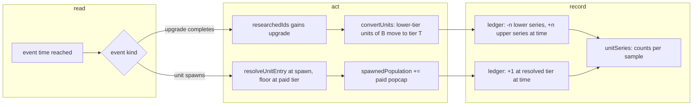

# SGS-062: Veterancy converts units already on the field

- **Type**: Task
- **Component**: aoe4-build-order
- **Milestone / criteria**: M4 / M4.2
- **Priority**: high
- **Risk**: high
  <!-- REPO.md criticalPaths: simulate.ts spawnUnit and unitSeries change behavior (result values decide every unitsProduced series); PROJECT.md strongModelTriggers: changes simulation rules and the meaning of a public response field (UnitSeries.counts). -->
- **Invariants**: A1 (tier lookups read versioned data only; no tier number in code), A3 (same build and data give the same series; conversion happens at a scheduled event time, no clock or randomness), A2 (spawn does not touch resources; the paid entry's cost and popcap stay as paid)
- **LOC estimate**: ~100 (`research.ts` `convertUnits` ~25; `simulate.ts` spawn ledger and `unitSeries` ~60; comment and doc text excluded)
- **Depends on**: SGS-056
- **On merge**: none. (`design/M2.md` line 222, "a unit paid before an upgrade completes keeps the lower tier", is superseded by `design/M4.md` C5; this ticket edits no state-dir file.)
- **Source**: M4.2; `design/M4.md` C5, Engine "unit tier conversion" table, "Docs and OpenAPI"; owner decision Q3=A (2026-11-02); BACKLOG line 47 ("13 longbowmen stay tier 2 after Veteran Longbowmen at 14:07")

## Context

Today a unit's tier is fixed when it is paid, so units already on the field, and units paid before the
upgrade that spawn after it, stay at the lower tier. The owner decided (Q3=A) that completing a veterancy
upgrade moves every existing unit of that type to the upper tier, so `unitsProduced` shows units by their
current tier. Knight + longbow today: `longbowman-2` 13 and `longbowman-3` 53 at 1800 s, with Veteran
Longbowmen completing at 846.86 s.

## Scope

All paths are in the repo; behavior is the design's "Engine: unit tier conversion" table.

**Engine (`lib/aoe4-build-order/research.ts`, `simulate.ts`)**

- Add `export function convertUnits(state: EngineState, upgrade: SnapshotEntry): void` in `research.ts`
  (C5). Let `B = state.data.upgradeTargets.get(upgrade.baseId)?.value` and `T = upgrade.age`. If there is
  no `B`, or no entry of `B` at age `T` (`state.data.byBaseId.get(B)`), do nothing. Otherwise every
  spawned unit of `B` at a tier below `T` moves to tier `T`.
- Call it from the `researchItem` completion callback in `research.ts` (line 22), after
  `state.researchedIds.add(entry.id)`. Only upgrades have a target: a technology (no `upgradeTargets`
  value) is a no-op.
- Spawn resolves the tier at spawn, not at pay. In `spawnUnit` (`simulate.ts` line 275) the unit joins the
  series of `resolveUnitEntry(entry.baseId, state)`, except that a spawn never lands below the tier it was
  paid at (when the resolved entry's `age` is lower than the paid `entry.age`, use the paid entry). Cost,
  production time and `entry.costs.popcap` added to `spawnedPopulation` stay those of the paid entry.
  `resolveUnitEntry` itself and every call to it at pay time (`produce` line 312, `payOrder` line 508,
  `houseDemand` line 560) are unchanged.
- Replace the spawn record (`Engine.spawns`, `simulate.ts` line 105) with a per-tier ledger that can
  move units between entries. Storage is the implementer's choice (for example a list of
  `(time, +1 / -n)` events per unit entry). Required behavior:
  - `counts[i]` of a series = units of that entry's `baseId` whose tier at `times[i]` is the entry's
    tier, counting an event at `t <= times[i]` (as today's `at <= t`).
  - Converting moves units in the same event: the lower series drops by `n` and the upper rises by `n` at
    the completion instant. Two upgrades completing at one instant apply in completion order; the final
    tier is the highest researched. A lower upgrade completing after a higher one converts nothing.
  - Series membership: one series per unit entry that held at least one unit at any instant, ordered by
    that first instant, then `unitId` (`unitSeries` line 853). A series reached only by conversion is
    first held at the conversion instant. A lower-tier series stays listed after it drops to 0. A
    conversion with no units yet creates no series.
  - Starting units are not in the ledger and are never converted (unchanged: they never appear).
  - Summed over the series of one `baseId`, `counts` equal the cumulative units produced (unchanged
    total).
- `lib/aoe4-build-order/model.ts` comment above `UnitSeries` (line 114): `counts` are the units of
  `baseId` at this entry's tier at each sample, not cumulative per entry; the per-`baseId` sum is
  cumulative produced.

**Docs and OpenAPI (same diff)**

- `docs/aoe4-build-order.md`: rewrite the **Tiers** paragraph (lines 212-217) so it no longer says a
  unit's tier is fixed when paid; state that on completion every spawned unit of the target type below
  the upgrade's tier moves up, that units paid before spawn at the highest researched tier, that cost
  and time stay those at pay, and keep the "no entry at its age" sentence. Update line 354-355 (units
  "after which produced units are the upgraded tier"), the `unitsProduced` bullet (lines 662-664: counts
  are units at that tier at each sample, summed per `baseId` they are cumulative produced), and add the
  knight + longbow expectation if the doc cites tier counts. Grep the doc for other sentences the change
  contradicts.
- `docs/api/openapi.json`: `SimulationResult.unitsProduced` description (line 1712), `UnitSeries`
  description (line 1904) and `UnitSeries.counts` description (line 1937) say "cumulative ... produced";
  rewrite to the by-current-tier meaning. No field, type or `required` change; the contract spec's
  `Record<keyof UnitSeries, true>` and description checks keep passing.
- `lib/aoe4-build-order/research.ts` comment above `resolveUnitEntry` (line 61): tier at pay sets cost and
  time only; the unit spawns at the highest researched tier.
- Data and build READMEs: grep `data/aoe4-build-order/README.md` and `docs/` for tier counts or
  "`longbowman-2`/`-3`" statements; today none cite a count, so expect no edit there.

**Tests (rule, not a list).** A test of tier behavior takes the new expected value: a test that asserts
a unit paid before an upgrade keeps the lower tier, or that counts are cumulative per entry, asserts the
conversion instead. Any other test keeps its expected value. A helper or spec that reads only the first
series of a `baseId` (`.find((u) => u.baseId === ...)`, for example `test-helpers.ts` line 67,
`build-move.acceptance.test.ts` lines 54 and 58, `acceptance/aoe4-simulate-api-timelines.spec.ts`
`finalCount`, `-spend-population.spec.ts` `finalCount`) must sum all series of that `baseId` in any test
whose build researches that unit's veterancy, so it keeps meaning "units produced". Known tier
assertions today: `research.test.ts` (describes at lines 69 and 107), `research.acceptance.test.ts`
(lines 76-88, 97-121), `simulate-construction.test.ts` lines 245-249. The implementer lists every test it
edits in its report.

New tests (unit, `research.test.ts` and `research.acceptance.test.ts`; use the existing `run`,
`tierCountAt` helpers):

- units on the field convert at the completion instant (counts at the sample before and after);
- a unit paid before completion and spawning after it appears at the upper tier, not the lower;
- an upgrade with no entry at its age converts nothing; an upgrade completing with no units yet is a
  no-op and a later spawn is at the new tier;
- two upgrades at one instant, and a lower upgrade completing after a higher one;
- series order and membership (conversion-only series, lower series stays at 0);
- per-`baseId` sum equals cumulative produced;
- API acceptance (`acceptance/aoe4-simulate-api*.spec.ts`, the file that already posts the knight +
  longbow build): `longbowman-2` is 13 at 845 s and 0 at 850 s; `longbowman-3` is 13 at 850 s and 66 at
  1800 s (design C5).

**Out of scope:** a `unitsByTier` response field (owner: not added); deaths or losses; changing
`resolveUnitEntry` or any pay-time check; any other tier-related behavior (age gating, `upgradeTargets`
data); the chart legend or UI (the series name stays `<name> (tier <tier>)`); the `design/M2.md` edit;
warnings and auto-house work in `simulate.ts` (separate tickets).

## Diagrams

## Acceptance criteria

- [ ] Knight + longbow, 1800 s, through `POST /api/aoe4-build-order/simulate`: `longbowman-2` counts read 13 at the 845 s sample and 0 at 850 s and every later sample; `longbowman-3` reads 13 at 850 s and 66 at 1800 s.
- [ ] A spearman paid before `veteran-spearmen` completes and spawning after it is counted in `spearman-3`, never in `spearman-2`, in a unit test.
- [ ] At the completion instant units of the target type below the upgrade's tier move up: the lower series drops and the upper rises by the same amount at the same sample, in a unit test.
- [ ] An upgrade with no entry at its age, or completing before any unit exists, changes no series; a later spawn uses the new tier.
- [ ] A lower upgrade completing after a higher one leaves counts unchanged; two upgrades at one instant leave the units at the highest researched tier.
- [ ] Series are ordered by first held instant, then `unitId`; a lower-tier series stays after dropping to 0; summing `counts` over one `baseId` at each sample equals the cumulative units produced, equal to the pre-change total at every sample for a build with no veterancy.
- [ ] `spawnedPopulation`, `population`, `spent`, step timings and every other `SimulationResult` field are identical to the pre-change run for the knight + longbow build (only `unitsProduced` changes), in a test comparing against pinned values or a run with conversion disabled.
- [ ] `git grep -n -i "keeps the lower tier\|tier is fixed when" -- docs lib acceptance` finds 6 lines today (docs/aoe4-build-order.md 216-217, research.test.ts 107 and 121, research.acceptance.test.ts 97, research.ts 61) and 0 after the change.
- [ ] `docs/api/openapi.json` `unitsProduced`, `UnitSeries` and `UnitSeries.counts` descriptions state the by-current-tier meaning, no schema field changes, and `npm run acceptance` contract spec passes.
- [ ] `npx tsc --noEmit`, `npm run lint:dup`, `npm test` and `npm run acceptance` pass, and the implementer's report lists every test edited and why.
- [ ] No INVARIANTS.md regressions

## Open questions

None. The one judgment call the design leaves, where the ledger stores moves, is the implementer's.
One edge case the design does not state is fixed above as a rule: a spawn never lands below the tier it
was paid at, because `resolveUnitEntry` falls back to the lowest entry when the highest researched
upgrade has no entry at its age.
