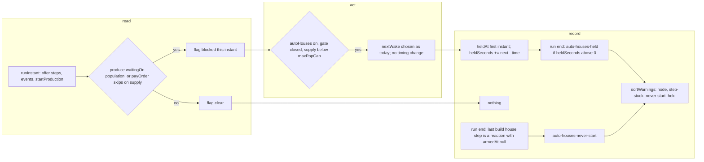

# SGS-063: Warn when the house gate keeps auto-houses off or holds production at the supply limit

- **Type**: Task
- **Component**: aoe4-build-order
- **Milestone / criteria**: M4 / M4.3, M4.5
- **Priority**: high
- **Risk**: high
  <!-- REPO.md criticalPaths: simulate.ts `simulateBuildOrder` and `runInstant` (a new per-instant record and a new accrual before `nextWake` advances time; step order and wake times themselves are unchanged), `payOrder` and `produce` get a record on their supply-block branch. PROJECT.md strongModelTriggers: adds two variants to the public `SimWarning` response type (the design specifies exact names, so that clause alone would not count; the critical path does). -->
- **Invariants**: A3 (the new state is a function of engine state at each instant: no clock, no randomness; the warnings change no timing), A2 (the record reads `population`, `supply` and never touches `resources`), A1 (the `maxPopCap` comparison reads `data.base.maxPopCap.value`, not a literal 200)
- **LOC estimate**: ~70 (`simulate.ts` held-seconds record, accrual, two warning builders ~50; `depletion.ts` `tieRank` ~4; `model.ts` two variants ~3; tests, OpenAPI JSON and docs excluded)
- **Depends on**: SGS-062
- **On merge**: none
- **Source**: M4.3, M4.5; `design/M4.md` C6, Engine "house gate warnings", "Docs and OpenAPI" (M4.3/M4.5 row); BACKLOG items on `houseGateOpen` ("a reaction `build house` step counts as the last build house step; if it never fires auto-houses stay off; owner: response must carry a warning" and "late explicit `build house` keeps auto-houses off; test variant stuck at 452 s")

## Context

`houseGateOpen` (`lib/aoe4-build-order/simulate.ts`) keeps auto-houses off until the order's last `build house` step has started. If that step is a reaction that never fires, no house is ever built; if it is a late explicit step, production can sit at the supply limit with no signal in the response. The owner decided the gate stays as it is and the response warns instead. `design/M4.md` C6 fixes both warning shapes.

## Scope

All names below are the design's (C6, "Engine: house gate warnings"). `simulate.ts` is edited by SGS-062 first (spawn ledger, `unitSeries`); this ticket is based on main after SGS-062 merges and locates its edits by function name, not line.

**Types (`lib/aoe4-build-order/model.ts`)**

- Add to `SimWarning` (line 180 on d5c2549):
  `{ code: 'auto-houses-never-start'; severity: Severity; message: string; step: number; at: 0 }` and
  `{ code: 'auto-houses-held'; severity: Severity; message: string; step: number; at: number; seconds: number }`.
  Both are emitted with severity `'warning'` (C6 types it as the literal `'warning'`; use `Severity` like the existing variants unless the implementer prefers the literal, either is wire-identical). `at: 0` on the first is a plain `number` in the existing union style.

**Engine (`lib/aoe4-build-order/simulate.ts`)**

- Add `heldSeconds` and `heldAt` (names the implementer may choose) to `Engine`, plus a per-instant flag that production hit the supply limit. The flag is raised in two places only: `produce` when it returns `waitingOn: 'population'`, and `payOrder` when it returns because `engine.population + entry.costs.popcap > engine.supply` (the other early-return clauses of `payOrder`, `!entry` and `entry.age > engine.age`, do not raise it). The flag is cleared after `applyDueEvents` and just before the second `offerSteps` of `runInstant` (rework 1), so only the last `runInstant` of an instant counts and a produce step that waits on population in the first pass but starts in the second pass (an earlier house completed at that instant) does not leave the flag set.
- Classify the instant after the last `runInstant` of an instant, in `simulateBuildOrder` where `accrueWait` runs: the instant is blocked when the flag is set, `inputs.autoHouses` is true, `houseGateOpen(engine)` is false (evaluated after the instant's steps ran, so a gate that opens later in the same instant does not count), and `engine.supply < engine.data.base.maxPopCap.value`. On a blocked instant, set `heldAt` if unset, and add `next - engine.time` to `heldSeconds` (the interval from this instant to the next wake). The final-sample break happens before this accrual, so a block only at the final instant adds nothing.
- At run end, build the warnings next to `stuck`:
  - `auto-houses-never-start`: when `inputs.autoHouses` is true, the last `build house` step `L` (the same search `houseGateOpen` does; extract the index lookup so both read it, not a copy) exists, `isReaction(order.steps[L])` is true, and `engine.steps[L].armedAt === null`. Once per run: `{ code, severity: 'warning', message, step: L, at: 0 }`, message `auto-houses never start: they wait for step ${L + 1} (build house), a reaction that did not fire by ${formatMinSec(inputs.durationSeconds)}, so no auto-house is built.`
  - `auto-houses-held`: when `heldSeconds > 0`: `{ code, severity: 'warning', message, step: L, at: heldAt, seconds: heldSeconds }`, `L` as above (a closed gate implies a `build house` step exists), message `production was held at the supply limit for ${formatMinSec(seconds)} from ${formatMinSec(at)} while auto-houses waited for step ${L + 1} (build house) to start.`
  - Both are independent; a never-firing reaction house can emit both. Neither is emitted when `autoHouses` is false, there is no `build house` step, or (never-start) `L` is not a reaction or it fired, even if it is still waiting (`step-stuck` covers that).
  - Pass both into the final `sortWarnings([...nodeResults.warnings, ...stuck, ...houseWarnings])`.
- `houseGateOpen` semantics, `startAutoHouses`, `planAutoHouse` and every wake time are unchanged.

**Ordering (`lib/aoe4-build-order/depletion.ts` `tieRank`)**

- Add ranks `auto-houses-never-start` `[2, step, 0]` and `auto-houses-held` `[2, step, 1]` (after node warnings `[0, ...]` and `step-stuck` `[1, step, 0]`); update the comment above `tieRank`. `tieRank` branches on `warning.node` for the remaining codes, so the new variants must be handled before that fall-through for the types to narrow.

**OpenAPI, contract spec, docs (same diff)**

- `docs/api/openapi.json`: `SimWarning.oneOf` gains two closed variants (`additionalProperties: false`, every property in `required`, `code` const, a description on the variant and every property, `at` on never-start documented as always 0, `seconds` `number` `exclusiveMinimum: 0`), in the order never-start, held after `step-stuck`. Update the `SimulationResult.warnings` description (line 1891 on d5c2549) for the two new codes and the new tie order. No other schema change.
- `acceptance/aoe4-simulate-api-contract.spec.ts`: the fixed tuple `simWarningVariants` (line 483) gains `WarningKeys<'auto-houses-never-start'>` and `WarningKeys<'auto-houses-held'>` entries with their key literals; the code-order assertion in "every SimWarning variant is closed..." (line 132) lists the five codes in schema order.
- `docs/aoe4-build-order.md`: house section (lines 296-316: the "Auto-houses are off until..." paragraph) states that a never-firing reaction house or a late explicit house now produces a warning and the gate is unchanged; Severity table (line 400-402) gains both codes as `warning`; `warnings` bullet (lines 704-710) lists the five codes, their fields and message forms, and the new tie order; the sentence at line 383-390 that lists the warnings and their sort order. Grep the doc for "step-stuck" and "node warnings come first" and fix every sentence that lists the codes. `docs/aoe4-build-order.md` needs no UI section: `components/apps/aoe4-build-order/messages.ts` reads `code`, `severity`, `message` generically.
- `data/aoe4-build-order/README.md` and the build READMEs: if a shipped build emits either warning at default inputs, its README states it with the numbers (design rule). The implementer runs each of the three shipped builds at default inputs and 1800 s and 3600 s and reports the observed warnings; no shipped README is edited otherwise. Fixing a shipped build is not in this ticket (M4.6 owns build data).

**Tests (rule, not a list).** A test of warnings that asserts an exact list or `[]` and now receives one of the two new warnings takes the new expected value only when the run is a true gate-closed case; any other test keeps its expected value and sets `autoHouses: false` or adds the missing house step in its setup. Known exact-list assertions today to re-run: `acceptance/aoe4-simulate-api-spear-longbow-build.spec.ts` line 42, `acceptance/aoe4-simulate-api-depletion-engine.spec.ts` lines 96, 216, 253, `-triggers.spec.ts` line 78, `-waits.spec.ts` line 225, `lib/aoe4-build-order/simulate.test.ts` lines 723 and 857. The implementer lists every test it edits.

New unit tests (`lib/aoe4-build-order/simulate.test.ts` or a new `simulate-house-warnings.test.ts`, whichever matches the nearest sibling) cover the design table:

- never-start: a reaction `build house` that never fires gives one `auto-houses-never-start` with `step` the reaction's index, `at` 0 and the exact message; not emitted with `autoHouses: false`, with no `build house` step, when `L` is not a reaction, or when `L` fired (a fired reaction still waiting on resources emits `step-stuck`, not never-start).
- held: a late explicit last `build house` (trigger past the time production first hits the cap) gives `auto-houses-held` with `at` the first blocked instant and `seconds` the sum of intervals from blocked instants (assert an exact pair); not emitted with `autoHouses: false`, with the gate open, or with `supply` at `maxPopCap` (use a data override of `maxPopCap`); a block only at the final instant emits nothing; a block at an instant where the gate opens within the same instant emits nothing.
- both together from one run; ordering at equal `at` (never-start before held, both after `step-stuck`, node warnings first) through `sortWarnings`.
- timing unchanged: the same run with the warnings has identical `spawnedPopulation`, `spent`, `steps` and `populationCapReachedAt` to the pre-change values (pinned in the test).
- API acceptance (`acceptance/aoe4-simulate-api*.spec.ts`, the file nearest the waits or triggers specs): the response for the late-explicit-house build carries `auto-houses-held` with the exact `at` and `seconds` values the unit test pins, and for a never-firing reaction carries `auto-houses-never-start`, both through the real route.

**Out of scope:** changing `houseGateOpen`, `startAutoHouses` or the lead/pending rules (`planAutoHouse`, M4.4 owns those); editing shipped build data (M4.6); any UI change (the message lists render `warning` entries generically); a warning for `autoHouses: false` blocking; chart markers for either warning; the strict-null and validation work (other M4 tickets).

## Diagrams

## Acceptance criteria

- [ ] A build whose last `build house` step is a reaction that never fires, run with `autoHouses: true`, returns exactly one `auto-houses-never-start` warning with `severity: 'warning'`, `step` the reaction's 0-based index, `at: 0` and message `auto-houses never start: they wait for step <step+1> (build house), a reaction that did not fire by <m:ss of durationSeconds>, so no auto-house is built.`, in a unit test and through `POST /api/aoe4-build-order/simulate`.
- [ ] No `auto-houses-never-start` with `autoHouses: false`, with no `build house` step, with a last `build house` that is not a reaction, or with a reaction that fired (including one still waiting on resources), each in a unit test.
- [ ] A build with a late explicit last `build house` whose production hits the supply limit before it starts returns one `auto-houses-held` with `step` that house step's index, `at` the first blocked instant, `seconds` the sum of every interval from a blocked instant to the next wake, and the C6 message, with the exact `at` and `seconds` pinned in a unit test and the same values through the API.
- [ ] No `auto-houses-held` with `autoHouses: false`, with the gate open at the block, with `supply` at `maxPopCap`, or when the only block is at the final instant (`seconds` 0), each in a unit test.
- [ ] A run can emit both warnings; at equal `at` they sort after node warnings and `step-stuck`, never-start before held.
- [ ] `spawnedPopulation`, `spent`, `steps`, `populationCapReachedAt`, `depletions` and `markers` for the late-explicit-house build are identical to the pre-change run, and for the three shipped builds at default inputs and 1800 s every field other than `warnings` is identical, in a test against pinned values.
- [ ] The report lists the `warnings` each shipped build returns at default inputs at 1800 s and 3600 s; any shipped build that returns either new warning has its README stating it with those numbers.
- [ ] `docs/api/openapi.json` `SimWarning.oneOf` has five variants, the two new ones closed with every property required and described; the contract spec `simWarningVariants` tuple has five entries and the contract spec passes.
- [ ] `git grep -n "step-stuck" -- docs/aoe4-build-order.md docs/api/openapi.json` finds 7 lines on d5c2549 (openapi 3: the `warnings` description at 1891 and the variant's const and description at 2277-2278; docs 4: lines 402, 704, 706, 710); after the change every line that enumerates the warning codes or their sort order (openapi 1891, docs 402, 704, 710) also names `auto-houses-never-start` and `auto-houses-held`, reviewed line by line in the implementer's report.
- [ ] `git grep -n "they stay off; with no" -- docs` finds 1 line today (`docs/aoe4-build-order.md` line 315) and 0 after the change (the sentence is reworded to mention the warnings).
- [ ] Mutation check: changing `houseGateOpen` to always return true makes the held and never-start unit tests fail (they depend on a closed gate), and changing the accrual to add the interval only at the first blocked instant makes the pinned `seconds` test fail.
- [ ] `npx tsc --noEmit`, `npm run lint:dup`, `npm test` and `npm run acceptance` pass, and the implementer's report lists every test edited and why.
- [ ] No INVARIANTS.md regressions

## Open questions

None. Two details the design leaves open are fixed above as rules: (1) the gate is evaluated after the instant's steps ran, so a block that the gate opening resolves within the same instant is not counted; (2) `payOrder` raises the flag only for its supply clause, not for age or missing-entry returns. The grep line numbers are for d5c2549; SGS-062 edits other lines of the same files, so the implementer re-counts on the post-SGS-062 base (the counts, 7 and 1, are expected unchanged).

## Rework 1 - 2026-11-02 (review)

Gate that bounced: review (reports/SGS-063-review-1.md). Tip reviewed: b924ee12f0cfc7db647ee7f480a2c95cce6e2dcf (stacked on sgs-062 c566e07). No earlier gate had passed it.

Findings:
- `lib/aoe4-build-order/simulate.ts:651`: `runInstant` clears `supplyBlocked` only before the first `offerSteps`. When a produce step waits on population in the first pass and starts in the second pass (because `applyDueEvents` completed an earlier house at that instant) the flag stays set, so the interval from that instant to the next wake is counted as held although production resumed. Repro on stock data: 9 villagers on wood, 200 s, steps `[pause capital-town-center, build house at(0), produce villager at(1), build house at(150)]`: the step waits 19 s (1 to 20) but the warning reports `seconds` 24; with the house at(5) it waits 20 s but reports 25. The message, the OpenAPI `seconds` description and the docs paragraph (docs ~324-327) all say production was held for that time.

Required fixes:
- [x] (rework 1) Clear the flag after `applyDueEvents`, just before the second `offerSteps` (not at the start of `runInstant`). The reviewer tried this: it gives 19 and 20 for the two repros and leaves the 220/80 pin, the knight+longbow pin, all three shipped builds and the 27 late-house variants unchanged.
- [x] (rework 1) Add a unit test pinning the repro: `at` 1, `seconds` 19 (and 20 with the house at(5)); mutation check: restoring the old clear point must fail it.
- [x] (rework 1) Non-blocking but do it: restore the single `autoHouses` condition in `accrueHeld` (or fix the field comment at simulate.ts ~148) so the comment is exact for runs with auto-houses off; the 3 other deviations are accepted.
- [x] (rework 1) The unit pin of 220 s / 80 s uses edited game data (two town centres, 5000 food), which the API cannot accept. Also pin a stock-data run in the unit test: start `{rally: sheep}`, steps `[build house from sheep at(300)]`, 400 s returns `auto-houses-held` with step 0, at 60, seconds 240 (this is the API test the acceptance gate will use).
