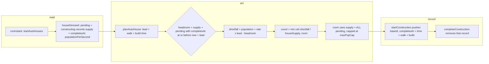

# SGS-064: Count only supply that lands within the house lead time when planning auto-houses

- **Type**: Bug
- **Component**: aoe4-build-order
- **Milestone / criteria**: M4 / M4.4
- **Priority**: high
- **Risk**: high
  <!-- REPO.md criticalPaths: simulate.ts `houseDemand`, `startConstruction`, `completeConstruction` and the `constructing` field decide when auto-houses start, which decides every population and timing result (A3); `planAutoHouse` changes which houses start. PROJECT.md strongModelTriggers: changes simulation rules and the order of operations a result depends on. -->
- **Invariants**: A3 (`completesAt` is the time the engine already schedules; no clock, no randomness), A2 (planning reads supply and population only; the existing affordability check still gates every house), A1 (the room cap reads `data.base.maxPopCap.value`)
- **LOC estimate**: ~30 (`houses.ts` `HouseDemand` and `planAutoHouse` ~12; `simulate.ts` `constructing` record, `startConstruction`, `completeConstruction`, `houseDemand` ~18; tests and docs excluded)
- **Depends on**: SGS-063
- **On merge**: none
- **Source**: M4.4; `design/M4.md` C7, Engine "auto-house planning" table, "Docs and OpenAPI" (M4.4 row); BACKLOG: "`planAutoHouse` counts supply under construction; King's Palace 10 supply, 220 s; pop sits at 40, nothing spent 660-764 s"

## Context

`planAutoHouse` (`lib/aoe4-build-order/houses.ts`) adds the supply of every building under construction to the supply it compares against the projected population. A King's Palace (10 supply, 220 s) counts as headroom the moment it starts, so no house is planned while it builds, production blocks at the supply limit, and the knight + longbow build sits at 40 population with nothing spent for over 100 s. Only supply that arrives before the population needs it should count as headroom.

## Scope

Names are the design's (C7, "Engine: auto-house planning"). `simulate.ts` is edited by SGS-062 and SGS-063 first; this ticket is based on main after SGS-063 merges and locates its edits by function name, not line. Line numbers and counts below are for origin/main d5c2549 (which includes the knight + longbow build) and drift.

**`lib/aoe4-build-order/houses.ts`**

- Replace `HouseDemand.pendingSupply: number` with `pending: { supply: number; completesAt: number }[]` (every building under construction, explicit or auto); `populationPerSecond` is unchanged. Update the comment above it. `planAutoHouse(state, inputs, data, demand)` keeps its signature.
- In `planAutoHouse`, `lead` is unchanged. Headroom for the shortfall is `state.supply + Σ supply of pending items with completesAt <= state.time + lead` (an item at exactly `now + lead` counts). `shortfall = population + populationPerSecond * lead - headroom` as today.
- The room cap uses every pending item: `room = ceil((maxPopCap - state.supply - Σ all pending.supply) / houseSupply)`, so planning never goes past `maxPopCap`. The return value stays `max(0, min(ceil(shortfall / houseSupply), room))`.
- `planAutoHouse` stays pure in its arguments.

**`lib/aoe4-build-order/simulate.ts`**

- `Engine.constructing` changes from `string[]` of baseIds to records holding `baseId` and `completesAt` (the field shape is the implementer's; design leaves where `completesAt` is stored to the ticket). `startConstruction` already computes `done = time + villagerWalk + constructionSeconds`: store that value on the record it pushes (it is the walk-plus-build time while builders walk and the scheduled completion once they build, the same number the engine schedules). `completeConstruction` removes its own record (today it `splice`s by `baseId`; with two buildings of one baseId in flight, remove the record whose `completesAt` equals the completing job's, so that the removed one is the right one).
- `houseDemand` builds `pending` from the records with `supply: supplyOf(engine, baseId)` evaluated at planning time as today, and drops `pendingSupply`.
- `startAutoHouses`, `houseGateOpen`, the house loop, affordability, and every wake time (`nextWake`, `affordableAt`) are unchanged. No new wake is added for the moment a pending item enters the lead window: planning re-runs at every existing instant, and samples occur every `SAMPLE_SECONDS` (5 s).

**Tests (rule, not a list).** `lib/aoe4-build-order/houses.test.ts` passes `{ pendingSupply: n, ... }` in 13 lines (`git grep -n pendingSupply -- lib acceptance docs` finds 17 lines on origin/main: houses.ts 2, simulate.ts 2, houses.test.ts 13); each moves to `pending` with a `completesAt` inside the lead to keep its expected value (a `pendingSupply: 0` becomes `pending: []`). A test of the changed behavior gets the new expected value; any other test, including engine and acceptance specs that now see an earlier house because a long build is no longer counted, keeps its expected value and pins the old setting in its setup (for example, a test that needs the old timing sets `autoHouses: false` with explicit `build house` steps, or uses a pending item within the lead). The implementer lists every test it edits.

New unit tests (`houses.test.ts` for the planner; `simulate-construction.test.ts` or `simulate.test.ts`, whichever is nearest, for the engine):

- `planAutoHouse`: pending item beyond the lead is not headroom (a 10-supply item at `now + lead + 1` plans the same houses as no pending item); at exactly `now + lead` it counts; at `now + lead - 1` it counts; the room cap counts every pending item even beyond the lead (supply 190, a 10-supply item far out, `maxPopCap` 200: returns 0 however large the shortfall); several pending items sum by the same rule; the function returns the same result when called twice with the same arguments.
- Engine: the shipped `data/aoe4-build-order/builds/english-knight-longbow.json`, loaded in the test with its three explicit pre-palace `build house` steps (the ones between the second `build archery-range` and `rally kings-palace`) filtered out, `autoHouses: true`; the shipped file is not edited and keeps those houses has `spawnedPopulation` strictly rising between 660 s and 764 s. Pin the values before the change (flat at 40; the implementer measures the exact pre-change series in a throwaway run and pins it as the "was" value in a comment-free assertion of the new rise only).
- Engine: while a 220 s landmark is building, a house starts as soon as projected population exceeds supply (assert the house's start time against an explicit expected number measured on the final code, not a range).
- Engine: two buildings of the same baseId in flight complete in either order and each completion removes its own record (assert `houseDemand`-visible behavior through the resulting house count, not the field shape).
- Timing unchanged where nothing long is in flight: the three shipped builds on origin/main (`english-1tc`, `english-knight-longbow`, `english-spear-longbow-maa-crossbow`) at default inputs and 1800 s have identical `spawnedPopulation`, `spent`, `steps`, `populationCapReachedAt` before and after, unless a pending item beyond the lead occurs in that run, in which case the report lists the difference (see Acceptance).

**Docs (same diff).** `docs/aoe4-build-order.md` "Houses and supply" paragraph (lines 296-302 on origin/main): the sentence "When it passes the supply plus the supply of buildings under construction" and "Planning stops once supply plus pending supply reaches `maxPopCap`" describe the old rule. Rewrite them to: headroom counts only supply from buildings finishing within the lead (a building completing exactly at the lead counts); supply from every building under construction still counts toward the 200 cap, so planning never passes it. State that a long build such as a landmark does not hold houses back. Grep the doc, `README.md` and `data/aoe4-build-order/README.md` for "under construction", "pending supply" and "supply of buildings" and fix any sentence the change contradicts (the README hit at line 49 is about builders joining a building and stays). No OpenAPI change: the response shape is unchanged. Build READMEs that quote numbers for a shipped build (population, timings) are re-checked against the post-change run; if a number changes, update it. `data/aoe4-build-order/README.md` lines 81-83 (knight + longbow entry) say auto-houses count the palace's supply at once and the three houses prevent a stall; that reason is false after this ticket. SGS-065 rewrites that sentence (the build keeps the houses); this ticket leaves it and reports it.

**Out of scope:** editing shipped build data, including the pre-palace houses, which stay (SGS-065 owns the build data and README sentence); a new wake time (see below); changing `houseGateOpen` or the house-gate warnings (SGS-063); changing `lead`, house cost, builder choice or any other `planAutoHouse` rule; a new wake time at `completesAt - lead`; UI and OpenAPI changes.

## Diagrams

## Acceptance criteria

- [ ] `planAutoHouse` counts a pending item as headroom only when `completesAt <= now + lead`: an item at `now + lead + 1` does not change the returned count, an item at exactly `now + lead` does, in unit tests.
- [ ] The room cap counts every pending item: with supply 190 and a 10-supply item due far beyond the lead, `planAutoHouse` returns 0 for any shortfall, in a unit test.
- [ ] A knight + longbow order without its three pre-palace explicit houses (filtered in the test from the shipped JSON, `autoHouses: true`) (respec 1) has `spawnedPopulation` rising between 660 s and 764 s, in a unit test; the same order on the pre-change code is flat at 40 over that interval (the implementer states in the report that they checked this on the base).
- [ ] While a landmark with 220 s construction is in flight, an auto-house starts at the first instant the projected population exceeds supply, with the start time asserted in a unit test.
- [ ] Two same-`baseId` buildings in flight each remove their own record on completion in either order, with the resulting house count asserted.
- [ ] `git grep -n "pendingSupply" -- lib acceptance docs` finds 17 lines on origin/main today (houses.ts 2, simulate.ts 2, houses.test.ts 13) (respec 1) and 0 after the change.
- [ ] `git grep -n "supply of buildings" -- docs` finds 1 line today (`docs/aoe4-build-order.md` 300) and 0 after the change; `git grep -n "pending supply reaches" -- docs` finds 1 line today (302) and 0 after; the reworded section states the within-lead rule, the exactly-at-lead inclusion and the unchanged 200 cap.
- [ ] The report lists, for each of the three shipped builds on origin/main at default inputs and 1800 s, whether `spawnedPopulation`, `spent`, `steps` and `populationCapReachedAt` changed from the base; every change is explained and any README number it makes untrue is fixed.
- [ ] Mutation check: changing the headroom filter to count every pending item (the old rule) makes the beyond-lead planner test and the 660-764 s engine test fail; dropping the room-cap's pending sum makes the supply-190 test fail. The named tests are new, so the implementer runs each mutation against them in a throwaway worktree.
- [ ] `npx tsc --noEmit`, `npm run lint:dup`, `npm test` and `npm run acceptance` pass; the implementer's report lists every test edited and why.
- [ ] No INVARIANTS.md regressions

## Open questions

None. Designer pass 4 answered both earlier questions: no new `nextWake` candidate (entering the lead window only adds headroom, so it can lower a house count but never start one; a house can start up to `SAMPLE_SECONDS` late), and the knight + longbow build keeps its three pre-palace houses.

## Re-spec 2026-11-02

- Underspecified: the ticket was written against a stale local main without the knight + longbow build; it called for a "test-local copy" and quoted old counts and line numbers.
- Changed: re-read origin/main d5c2549: engine test filters the shipped build's three houses, `pendingSupply` count is 17 (houses.test.ts 13), doc lines are 296-302, README lines 81-83 are SGS-065's; both open questions answered and removed.
- Stands: all planner and engine Scope, diagrams and mutation checks are unchanged.
