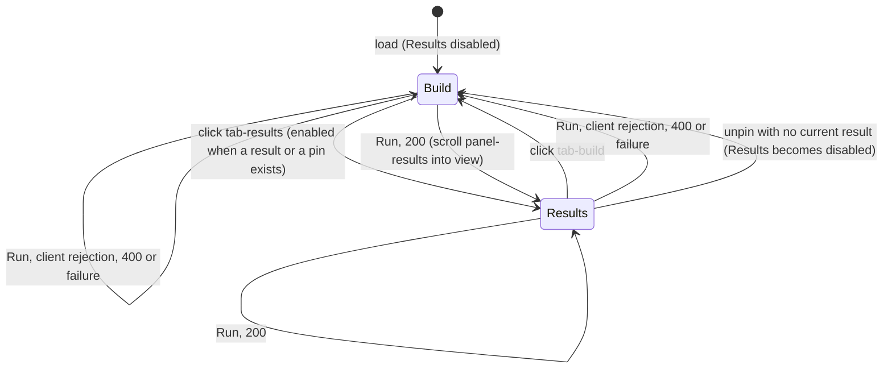
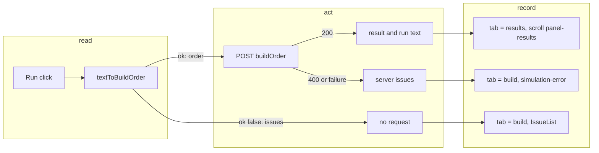

# SGS-066: Results-first workbench: tabs, sticky run bar, text/table toggle, auto-size editor with line numbers

- **Type**: Task
- **Component**: aoe4-build-order
- **Milestone / criteria**: M4 / M4.7
- **Priority**: medium
- **Risk**: standard
  <!-- No strongModelTriggers item: UI layout and page state only; no route, schema or engine change, and the
       contract names are the design's exact ones. Estimated about 190 lines of business logic, under 250, but
       it restructures the page and the run flow, so not low. -->
- **Invariants**: S2 (the page stays inside `Layout` and stays linked from the landing page); S1 (new components import only from `lib/aoe4-build-order/` and `components/apps/aoe4-build-order/`); S3 (the Run path and its unchecked duration are unchanged)
- **LOC estimate**: about 190 (`pages/apps/aoe4-build-order.tsx` about 60 changed; new `workbench-tabs.tsx` about 40; new `build-text-editor.tsx` about 45; new `text-lines.ts` about 8; `build-input.tsx` about 35 changed; CSS module not counted). Spec rewrites, helpers, unit test and docs excluded.
- **Depends on**: SGS-059
- **On merge**: none
- **Source**: M4 design contract C8 (test ids, `lineCount`, `BuildTextEditor`, `WorkbenchTab`, `BuildInput` props) and Behavior rules "Page run, editor and tabs" rows Run tabs, Run stays on screen, line numbers, auto-size, view toggle (both rows), tabs (both rows) (`design/M4.md`); plan outline J (`plans/M4-20261102.md`) as amended by designer pass 3 (`reports/M4-designer-3.md` and `reports/M4-designer-4.md`: the "Run tabs (from M4.7)" rule, the `text-lines.ts` and component paths under `components/apps/aoe4-build-order/`)

## Context

Today the page is one long column: editor, table, error list, then Results. A user who runs a build has to scroll
past the editor and the table to see the answer. M4.7 makes Results the first thing seen after a run: two tabs,
a run bar that stays on screen, one editor view at a time (text or table), and a textarea that grows to its
text with line numbers beside it. SGS-059 left the textarea in `BuildInput` with `IssueList` under it; this
ticket moves the textarea into the new editor and the issue list into the Build tab.

## Scope

All paths are relative to the repo root. Names are exactly those of `design/M4.md` C8 and SGS-059
(`PageProps { builds, catalog }`, `IssueList`, `BuildInput` `issues` prop, `StepTable` prop `catalog`,
`runRejected`, `textToBuildOrder`).

**1. `components/apps/aoe4-build-order/text-lines.ts` (new).** `export function lineCount(text: string):
number`: `''` gives 1, `'a\nb'` gives 2, `'a\n'` gives 2 (the count of `\n` plus 1). `issueLines` is not
added here (the inline issues ticket defines it). New `text-lines.test.ts` beside it covers those three
rows and a text with a blank line in the middle (`'a\n\nb'` gives 3).

**2. `components/apps/aoe4-build-order/build-text-editor.tsx` (new).** `export function BuildTextEditor(props:
{ text: string; onChange(text: string): void }): JSX.Element` (exactly these two props in M4.7; SGS-067 adds `errorLines`).
- A `<textarea>` with `data-testid="build-order-text"` and `id="build-order-text"` (the label `Build order`
  keeps `htmlFor`), the classes and `spellCheck={false}` it has today, `value={text}`, `onChange` calls
  `props.onChange`, and `rows={Math.max(8, lineCount(text))}` replacing today's `rows={16}`. The textarea never
  shows a vertical scrollbar (`overflow-y: hidden`, no manual resize): the page scrolls instead.
- A gutter beside it, `data-testid="build-order-gutter"`, `aria-hidden="true"`, with one
  `data-testid="build-order-line-number"` item for each of 1 to `lineCount(text)`, text the number,
  and `data-line` the number. No `data-error` attribute and no `errorLines` prop here (SGS-067 adds both). Gutter and textarea use the same font, font size and line height and the same top padding, so
  line N's number sits level with line N's text. Lines do not wrap (`wrap="off"`): alignment needs one visual
  row per line, and a line longer than the box scrolls sideways inside the textarea only.
- No `issueLines` and no error highlight here (the inline issues ticket, SGS-067).
- Styling: a CSS module next to the components (for example `workbench.module.css`) or Bootstrap classes;
  the design leaves this to the ticket.

**3. `components/apps/aoe4-build-order/workbench-tabs.tsx` (new).** `export type WorkbenchTab = 'build' |
'results'` and `export function WorkbenchTabs(props: { active: WorkbenchTab; onSelect(tab: WorkbenchTab):
void; resultsEnabled: boolean; build: ReactNode; results: ReactNode }): JSX.Element`.
- A `role="tablist"` container `data-testid="workbench-tabs"` with two `role="tab"` buttons in the order Build,
  Results: `tab-build` and `tab-results`, each with `aria-selected` true for the active tab only. `tab-results`
  has the `disabled` attribute while `resultsEnabled` is false; `tab-build` is never disabled.
- Two panels, `panel-build` and `panel-results` (`role="tabpanel"`), both always mounted. The inactive one has
  the `hidden` attribute. Mounting both keeps chart, table and editor state across tab switches.

**4. `components/apps/aoe4-build-order/build-input.tsx`.** It becomes the sticky run bar: the form keeps
`BuildInput` as its name and gets `data-testid="run-bar"` and `position: sticky; top: 0` with a background
and a z-index so content scrolls under it, in both tabs at every width. It holds, in one bar, `build-order-select`
(select stays local state; the lift is a later ticket), `duration-seconds`, `run-simulation`, and a view toggle:
two buttons `editor-view-text` and `editor-view-table` with `aria-pressed` (true on the active one).
- Props: drop `text`, `onTextChange` and SGS-059's `issues`; add `view: EditorView` and `onViewChange(view:
  EditorView): void`, where `export type EditorView = 'text' | 'table'` is exported from this file. Choosing a
  prebuilt build still replaces the text, so `onTextChange` stays: the select calls it with the build's text. Keep
  `builds`, `duration`, `onDurationChange`, `running`, `onRun`.
- The textarea and its label leave this file (they live in `BuildTextEditor`, item 2); `IssueList` leaves it
  too (item 5). `PrebuiltBuild` stays exported here.

**5. `pages/apps/aoe4-build-order.tsx`.**
- New state: `tab: WorkbenchTab` (initial `'build'`) and `view: EditorView` (initial `'text'`). Both live in
  the page, so the view and the tab survive runs and tab switches and reset on reload (no storage).
- Layout: the `h1`, then `BuildInput` (the run bar), then `WorkbenchTabs`.
  - `build` panel: when `view === 'text'`, `BuildTextEditor` (props `text`, `onChange`); when `view === 'table'`,
    `StepTable`, or the `step-table-unavailable` notice with the first parse issue while the text does not parse
    (the toggle stays usable). The two views are never mounted together. Switching view never rewrites the text.
    Directly under that view, in both views, `IssueList` with the client issues from SGS-059 (`build-order-issues`
    shows under whichever view is open, so a client rejection is visible in text and in table view; the view is
    never switched), then the `simulation-error` list (it moves here from
    its place under the table; same markup and test id).
  - `results` panel: today's `ComparePanel`, `Results` and the "Results" heading, unchanged inside.
- Tab rules (design Run tabs and tabs rows):
  - On load: Build. `resultsEnabled = result !== null || pinned !== null`. The shown tab is derived, not
    stored alone: `shown = resultsEnabled ? tab : 'build'`, passed to `WorkbenchTabs` as `active`. So unpinning
    while on Results with no current result shows Build with `tab-results` disabled, with no extra handler.
  - Run, after SGS-059's step 3 (a client rejection), step 6 (400) and step 7 (network or HTTP failure): set
    `tab` to `'build'`. After step 5 (200): set `tab` to `'results'` and scroll the top of `panel-results`
    into view (`scrollIntoView` on a ref, run after the panel is shown; the sticky bar must not cover it, so
    give the panel a `scroll-margin-top` of the run bar's height or equivalent).
  - A click on an enabled `tab-results` or on `tab-build` sets `tab` and does nothing else.
- `StepTable` and `parsed` are only rendered or computed as the page does today; moving the table into the
  table view must not change what it renders.

**6. Specs (`acceptance/`).** Every Playwright spec that runs the page is updated by these rules; find each by
test title because earlier tickets shift line numbers. Add small helpers to `acceptance/helpers.ts` (for
example `showTab(page, tab)` and `showView(page, view)`, each clicking `tab-*` or `editor-view-*`); `runRejected`
needs no change (a rejection selects Build, so `build-order-issues` is visible).
- Rule A, results: after a 200 the Results tab is selected, so assertions on charts, messages, timeline and
  compare table need no change. An assertion that something is absent or a button is enabled or disabled
  (`toHaveCount(0)`, `toBeEnabled`, `toBeDisabled`) needs no change either, since those do not need the
  element visible.
- Rule B, text after a 200: a step that fills `build-order-text` (or edits the table) after a run that
  returned 200 first clicks `tab-build`. Affected today: the pin-compare spec's `run` helper (`fill` of
  `opts.text` after an earlier run) and "the pin survives a text edit and a prebuilt change"; in
  `aoe4-build-order.spec.ts` every test that fills text after a 200 run (for example "a failed run after a
  successful one removes the charts", the notes test, "editing the text after a run keeps the labels until the
  next run", "a 400 run and a start-only run show no timeline", "a failed run shows neither..." when preceded
  by a run, the pin and marker tests that refill text); in `aoe4-build-order-m3-flow.spec.ts` the first test
  (edits `step-field-count` after a run and a pin).
- Rule C, table versus text: a test that reads or edits `step-*` elements (`step-table`, `step-row`,
  `step-add`, `step-field-*`, `step-table-unavailable`) first clicks `editor-view-table`; a test that reads
  `build-order-text` after table edits first clicks `editor-view-text`. A test that fills text and then
  reads the table does: fill in the text view, click the table view, assert rows, and click the text view
  again for any later `toHaveValue` on the textarea. This covers every test in `acceptance/aoe4-step-table.spec.ts`
  (22 `step-*` hits today; the "default build renders one row per step" test reads `inputValue()` in text
  view, then toggles) and the three tests in `acceptance/aoe4-build-order-m3-flow.spec.ts`. "table buttons
  never post to the simulate route" clicks `editor-view-table` before `step-add`.
- Rule D, other tests keep their expected values. The implementer lists every test it edits.
- New specs (`aoe4-build-order.spec.ts` unless stated), one per behavior:
  1. Load: `tab-build` has `aria-selected="true"`, `panel-build` visible, `panel-results` hidden,
     `tab-results` disabled, `editor-view-text` has `aria-pressed="true"`, `build-order-text` is visible and
     `step-table` has count 0.
  2. Run the default build: `tab-results` selected and enabled, `panel-results` visible, `panel-build` hidden,
     and `panel-results`'s top is inside the viewport and not above the bottom edge of `run-bar`. Click
     `tab-build`: `build-order-text` visible with the text it had; click `tab-results`: charts still drawn.
  3. Reject a paste with `runRejected` after a successful run: `tab-build` selected and `build-order-issues`
     visible; `tab-results` is still enabled when a pin exists and disabled when none was pinned. A 400 run
     (mocked, as the existing mocked-400 test does) and a mocked 500 run also select Build and show
     `simulation-error`.
  4. Unpin while on Results with no current result (run, pin, run a rejected paste, click `tab-results`,
     click `unpin-run`): `tab-build` is selected and `tab-results` is disabled.
  5. Sticky: at 1280x720 run the default build, scroll `window` to the bottom, and `run-bar`'s bounding box
     top is 0 (within 1 px) with `run-simulation` clickable; the same with the Build tab selected and the
     page scrolled (use the build with the longest text).
  6. Line numbers: `build-order-line-number` count equals the textarea's line count for the default build,
     the first has `data-line="1"` and the last `data-line` equals that count; filling `''` shows one item
     (`1`); filling `a\nb\n` shows three.
  7. Auto-size: after filling 30 lines, the textarea's `scrollHeight` is at most its `clientHeight` (no inner
     vertical scroll) and its `rows` attribute is `30`; after filling 3 lines `rows` is `8`. Line 20's number
     and line 20's text are level: the gutter item's box top matches the position of that line within the
     textarea to within 2 px (compute from the textarea's top, padding and line height).
  8. Toggle: `editor-view-table` sets `aria-pressed` true on it and false on the text button, hides
     `build-order-text` (count 0) and shows `step-table`; typing `start -> sheep\nat 8 vils fly capital-town-center`
     in the text view and switching to table shows `step-table-unavailable` containing `fly` and the toggle
     still works back to text; the textarea text is byte-for-byte what was typed after a round trip. The view
     survives a run and a tab switch (table view, run, `tab-build`: still table), and resets on reload.
- Unit: `components/apps/aoe4-build-order/text-lines.test.ts` (item 1).

**7. Docs.** `docs/aoe4-build-order.md` "Page" section (opens "The page is `/apps/aoe4-build-order`", about
line 762 on `origin/main` before SGS-059): its first paragraph lists the controls in a different layout.
Rewrite it to say: a sticky run bar (prebuilt select, `durationSeconds` input, Run, and a text/table
toggle), two tabs Build and Results (Results disabled until a run succeeds or a run is pinned; a successful run
selects Results and scrolls it into view; a rejected or failed run selects Build), the editor view (text:
line-numbered textarea growing to its text, minimum 8 rows; table: the step table), and the view and the tab
surviving runs but not reloads. The sentence "the textarea stays editable" in the "table is replaced by a
notice" sentence becomes: the toggle stays usable. Line 806 ("A step timeline sits above the charts...") and
line 814 ("Under the "Results" heading...") are about the Results tab and stay true; check them and the
SGS-059 text for any statement that the textarea and table are on the page at once, and fix each hit. Grep
the two READMEs and `docs/` for "textarea" and "step table" and fix any that say the table always shows.

**Out of scope:** `issueLines`, the `errorLines` prop, gutter `data-error`, live issues, suggestions, gutter
highlight and scroll-to-issue (the inline issues ticket, SGS-067); lifting `selected` out of `BuildInput`, pin naming, pin storage, `results-stale`, `pinned-label`
and restoring a pin (the pin ticket; `resultsEnabled` already reads `pinned`, so a restored pin needs no change
here); the step table internals, labels and cards (`step-table.tsx`, `step-table-model.ts`); 390 px checks
beyond what the sticky bar and the editor need; `lib/`, the route, `api.ts`, OpenAPI; the Results panel contents
and the timeline, compare and chart components.

## Diagrams

The ticket changes the page's Run path (which tab follows each outcome) and adds a tab state machine.

## Acceptance criteria

- [x] On load `tab-build` is selected, `panel-build` is visible, `panel-results` has the `hidden` attribute, `tab-results` is disabled, `editor-view-text` is pressed and `build-order-text` is visible with `step-table` absent (new spec 1).
- [x] After a 200 run the Results tab is selected, `panel-results` is visible and `panel-build` is hidden, and the top of `panel-results` is inside the viewport and below the `run-bar` bottom edge; both panels stay mounted (switching to Build and back keeps the text and the charts) (new spec 2).
- [x] A client rejection, a mocked 400 and a mocked 500 each select Build; the client rejection shows `build-order-issues` (visible) with `simulation-error` count 0, the other two show `simulation-error`; each clears the shown result and keeps the pin; `tab-results` stays enabled with a pin and is disabled without one (new spec 3).
- [x] Unpinning while on Results with no current result selects Build and disables `tab-results` (new spec 4).
- [x] `run-bar` stays at the viewport top (`top` 0 within 1 px) after scrolling the page to the bottom, in both tabs, and holds `build-order-select`, `duration-seconds`, `run-simulation`, `editor-view-text` and `editor-view-table` (new spec 5).
- [x] The gutter has one `build-order-line-number` per line: first `data-line="1"`, last `lineCount(text)`; `''` shows 1; `a\nb\n` shows 3; line numbers sit level with their lines; the gutter items carry no `data-error` attribute and `BuildTextEditor` takes only `text` and `onChange` (new spec 6 and 7). `rows` is `max(8, lineCount)` and the textarea has no inner vertical scroll at 30 lines (new spec 7).
- [x] The toggle shows exactly one of `build-order-text` and `step-table`; `step-table-unavailable` with the first parse issue shows in table view for unparseable text and the toggle still works; switching views leaves the text unchanged; the view survives a run and a tab switch (new spec 8).
- [x] `lineCount('')` is 1, `lineCount('a\nb')` 2, `lineCount('a\n')` 2, `lineCount('a\n\nb')` 3 (`text-lines.test.ts`).
- [x] Mutation: change `lineCount` to ignore the final empty line (`'a\n'` gives 1); `text-lines.test.ts` fails and the line-number spec fails. Confirm by applying it before handing over (the files are new, so this check runs after they exist).
- [x] `git grep -n "rows={16}" -- components pages` prints nothing (1 hit today, in `build-input.tsx`), and `git grep -n 'data-testid="build-order-text"' -- components pages` prints exactly one hit, in `build-text-editor.tsx` (1 hit today, in `build-input.tsx`).
- [x] `git grep -n "IssueList" -- components/apps/aoe4-build-order/build-input.tsx` prints nothing; `IssueList` renders only from the page, under the editor or table view.
- [x] Every spec that ran before still passes under rules A to D; `git grep -c "tab-build" -- acceptance` is greater than 0 in `aoe4-build-order.spec.ts`, `aoe4-build-order-pin-compare.spec.ts` and `aoe4-build-order-m3-flow.spec.ts`, and `git grep -c "editor-view-table" -- acceptance/aoe4-step-table.spec.ts` is greater than 0. The ticket lists every test it edited.
- [x] `docs/aoe4-build-order.md` describes the tabs, run bar, toggle and editor, and no longer says the textarea, step table and results are on the page at once: `git grep -nE "a build order textarea, a$|step table, a .durationSeconds" -- docs` prints nothing (the paragraph is rewritten).
- [x] `npx tsc --noEmit`, `npm run lint:dup`, `npm test` and `npm run acceptance` (Node 24) pass.
- [x] No INVARIANTS.md regressions

## Open questions

None.

## Re-spec 2026-11-02

- Underspecified: whether `errorLines` and gutter `data-error` belong here, where issues show per view, and how the tab behaves on unpin with no result (designer pass 4, `reports/M4-designer-4.md`).
- Changed: `BuildTextEditor` is `{text, onChange}` only, `errorLines` and `data-error` moved to SGS-067; shown tab is derived (`resultsEnabled ? tab : 'build'`); `build-order-issues` shows under whichever view is open; all three open questions answered and removed. Depends on stays SGS-059 (which now depends on SGS-075).
- Branch work still stands: tabs, run bar, `lineCount`, auto-size, toggle and spec rules are unchanged.

## Rework 1 - 2026-11-02 (review)

Gate that bounced: review (reports/SGS-066-review-1.md). Tip reviewed: 0d57ba110d8b027e417381225b9b1336488858ad (stacked on the old sgs-059 tip 41e648d). No earlier gate had passed it. All checks passed (tsc, lint:dup, 1225 unit, 620 acceptance, build); the reviewer's own mutations (rejection selects Results; Results enabled with no result; lineCount) failed the specs as they should.

Findings:
- `components/apps/aoe4-build-order/workbench.module.css:9`: the fixed `scroll-margin-top: 8rem` is 144 px (root font 18 px), too short once the run bar wraps: after a 200, `panel-results` top sits at 144 px, but at 768 px the bar is 187 px tall and at 390 px 247 px, so the Results heading is under the bar. The ticket says the bar must not cover the panel.
- `acceptance/aoe4-build-order.spec.ts:~712-786`: the 400 and 500 "selects Build" specs never pin, so the derived shown tab hides the code: removing `setTab('build')` from both the 400 and failure paths left all 85 `aoe4-build-order*` specs passing; keeping the pin on 400/500 is also unchecked.
- `docs/aoe4-build-order.md:~812-813`: says the textarea "never scrolls inside", but with `wrap="off"` and `overflow-x: auto` it scrolls sideways.
- `components/apps/aoe4-build-order/workbench-tabs.tsx:24,36`: class names built with template literals; ARCHITECTURE.md:14 says to combine with `cn` (as sibling build-input.tsx does).

Required fixes:
- [x] (rework 1) Scroll to Results by the run bar's measured height (e.g. set `scrollMargin`/scroll offset from the bar's `getBoundingClientRect().height` or a CSS variable updated on resize), not a fixed 8rem; extend new spec 2 to assert the Results heading is fully below the bar at 1280, 768 and 390 px (wrapped bar).
- [x] (rework 1) In `runThenFail`, pin the run after the 200, then assert after the 400 and after the 500 that Build is the selected tab AND `tab-results` is still enabled (pin kept). Mutation check: removing `setTab('build')` from both paths must fail these specs; report it.
- [x] (rework 1) Fix the docs sentence to say the textarea never scrolls vertically (it scrolls sideways when a line is long); also make the "Results is disabled until a run succeeds" wording precise (disabled until there is a result or a pin).
- [x] (rework 1) Use `cn(...)` for class names in workbench-tabs.tsx.
- [x] No other change. (Non-blocking, optional only if trivial: use the showTab/showView helpers consistently; trailing whitespace in aoe4-step-table.spec.ts lines you touched.)

## Rework 2 - 2026-11-02 (review)

Gate that bounced: review (reports/SGS-066-review-2.md). Tip reviewed: fb4ca86b9fc8452b883e52993828e6c994c40f16. All four rework-1 findings are fixed and verified (scroll offset at 1280/768/390 px within 0.5 px; pin and Build assertions mutation-checked; docs; cn).

Findings:
- `acceptance/aoe4-build-order-client-check.spec.ts:72-78` ("the issue list sits under the textarea"): the test calls `boundingBox()` twice (textarea, then issue list). On this branch the page is still smooth-scrolling between the calls (Bootstrap sets `scroll-behavior: smooth`), so the boxes come from different scroll offsets: the scroll position changed between reads in 31 of 60 probe runs on fb4ca86 and never in 60 on 41e648d, so the diff caused it. Full acceptance on port 3971: 630 passed, 1 failed (this test); the file run 10 times failed once; alone it passes 60 of 60, it fails only under parallel load.
- Non-blocking: `pages/apps/aoe4-build-order.tsx:76` finds the run bar with `closest('section')?.querySelector('form')`; no other component uses a DOM query like this and if the markup changes the offset silently drops to 0. The edited docs line (~812) is about 170 characters while the section wraps at ~110.

Required fixes:
- [x] (rework 2) Make the client-check test stable: read both rects in one `page.evaluate` and compare positions relative to the document (or use `expect.poll`); keep the assertion that the list sits under the textarea. Confirm with the file run `--repeat-each=20` under parallel load (run another spec file at the same time) and report the pass count. This client-check spec file is an allowed exception to the rework's earlier "no other change" rule.
- [x] (rework 2) Replace the DOM query at `pages/apps/aoe4-build-order.tsx:76` with a ref to the run bar's form (pass a ref through `BuildInput`, or place the ref on a wrapper the page owns), so the offset cannot silently become 0; keep the measured-height behavior and all test ids.
- [x] (rework 2) Rewrap the edited docs line to the section's ~110 width without changing words.
- [x] No other change.
