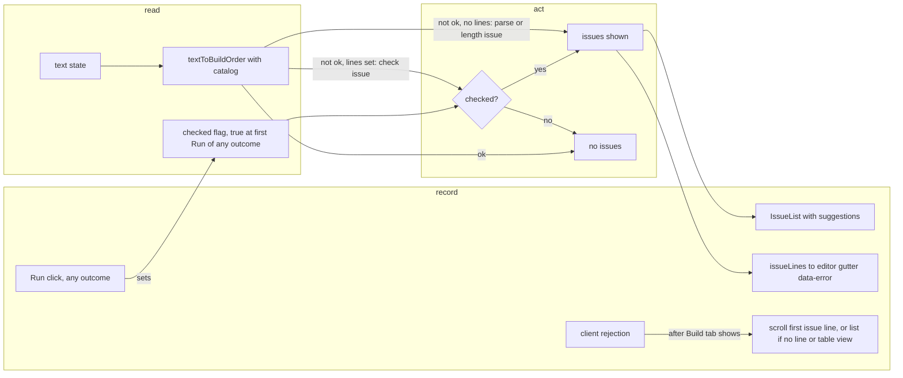

# SGS-067: Live inline issues with line highlight, suggestions and scroll-to-line; cover the gold run-out info list

- **Type**: Task
- **Component**: aoe4-build-order
- **Milestone / criteria**: M4 / M4.8
- **Priority**: medium
- **Risk**: standard
  <!-- No strongModelTriggers item: page state and UI only. Every name is the design's (C8) and a new contract
       the design specifies. About 60 lines of business logic, but it changes the page's Run path and shared
       page state, so not low. -->
- **Invariants**: S1 (new code imports only from `lib/aoe4-build-order/` and `components/apps/aoe4-build-order/`); S3 (the text cap stays enforced by `textToBuildOrder`; live conversion runs on at most 20000 characters per edit and sends nothing)
- **LOC estimate**: about 70 (`pages/apps/aoe4-build-order.tsx` about 30 changed: derived issues, `checked` flag, scroll effect; `build-text-editor.tsx` about 8: `errorLines` prop and `data-error`; `issue-list.tsx` about 12; `text-lines.ts` `issueLines` about 4; CSS `scroll-margin-top` on gutter items). Specs, unit test and docs excluded.
- **Depends on**: SGS-066
- **On merge**: none
- **Source**: M4 design contract C8 (`IssueList`, `issueLines(issues)`, test ids `build-order-issues`, `build-order-issue`, `build-order-issue-suggestion`, gutter `data-error`) and Behavior rules rows Run first issue (from M4.8), inline issues when shown, inline issues many, info list content and place (`design/M4.md`); plan outline K (`plans/M4-20261102.md`) as amended by designer pass 3 (`reports/M4-designer-3.md`: DQ3, DQ8, "Outline changes" 4: no server 400 mapping, `IssueList` already exists, `issueLines(issues)` takes only issues, info list changes no code unless the coverage finds a gap) and designer pass 4 (`reports/M4-designer-4.md`: Q6 `errorLines` and gutter `data-error` move from SGS-066 to this ticket; Q9 `checked`, scroll and table-view rules)

## Context

SGS-059 shows the issues of the last client rejection only, as plain messages, and SGS-066 ships `BuildTextEditor`
with only `{ text, onChange }` and a gutter whose items carry `data-line` but no `data-error`. M4.8 makes the issues useful while typing: they follow the
text, the offending lines are marked in the gutter, a near match is suggested ("did you mean knight?"), and a
rejected Run scrolls to the first bad line. M4.8 also asks that info notes such as gold run-outs sit in a collapsed
list; main already does that in `Results`, so this ticket only adds Playwright coverage for it.

## Scope

All paths are relative to the repo root. Names are exactly those of `design/M4.md` C8, SGS-057 (`textToBuildOrder`,
`TextToBuildResult`, `BuildOrderIssue.suggestion`), SGS-059 (`IssueList`, `runRejected`) and SGS-066 (`BuildTextEditor`
`{text, onChange}`, `build-order-gutter`, `build-order-line-number`, `lineCount`, `WorkbenchTab`, `panel-build`).

**1. `components/apps/aoe4-build-order/text-lines.ts`.** Add `export function issueLines(issues: readonly
BuildOrderIssue[]): number[]`: the `line` values of the issues that have one, sorted ascending, unique, 1-based; `[]`
when none has a line. It takes only issues (no `lines` argument; server 400 issues are not mapped to lines, they stay
in `simulation-error`). `text-lines.test.ts` (SGS-066) gains rows: no issues gives `[]`; issues with lines `[5, 2, 5]`
give `[2, 5]`; an issue without `line` is skipped; only line-less issues give `[]`.

**1b. `components/apps/aoe4-build-order/build-text-editor.tsx` (and its CSS).** Add the prop `errorLines: readonly
number[]` (required, as in C8: `BuildTextEditor(props: { text: string; onChange(text: string): void; errorLines:
readonly number[] })`). A gutter item (`build-order-line-number`) whose `data-line` is in `errorLines` carries
`data-error="true"`; the attribute is absent on every other item. Give the gutter items `scroll-margin-top` at least
the run bar's height. Every other editor behavior is SGS-066's and unchanged. SGS-066's editor spec rows are not edited
(they do not pass or assert `errorLines`); the page is the only caller.

**2. `components/apps/aoe4-build-order/issue-list.tsx`.** Per issue, keep SGS-059's `data-testid="build-order-issue"`,
`data-code`, `data-line` (absent when the issue has no `line`), and show `issue.message` in its own element. When
`issue.suggestion` is set, render inside the same item an element `data-testid="build-order-issue-suggestion"` with
text exactly `did you mean <suggestion>?`. No suggestion element when `suggestion` is absent. The container stays
`role="alert"` `data-testid="build-order-issues"` and `null` for an empty list. The item's text now contains the
message plus the suggestion, so specs assert the message with `toContainText`, not equality on the item.

**3. `pages/apps/aoe4-build-order.tsx`.**
- Replace SGS-059's "issues of the last client rejection" state with issues derived from the current text:
  `const converted = useMemo(() => textToBuildOrder(text, catalog), [text, catalog])`, plus a `checked` state (initial
  `false`, set to `true` at the first Run click of any outcome (client rejection, 200, 400 or failed request), never
  reset except by reload). The issues shown in `IssueList` are:
  `[]` when `converted.ok`; otherwise `converted.issues` when `converted.lines === undefined` (text did not parse, or
  exceeds the length cap: shown at once) or `checked` is true (check issues: shown after the first Run, then tracking
  every edit); otherwise `[]`. Every edit, prebuilt choice and table edit changes `text` and so updates the list
  and the gutter at once.
- `BuildTextEditor` gets `errorLines={issueLines(issues)}` (a new prop, item 1b; SGS-066's page passes none). Items
  in the gutter whose `data-line` is in the list carry `data-error="true"`.
- Run steps: step 1 no longer clears issues (they are derived; a Run on valid text shows none). Set `checked` true at the
  start of the Run click handler, so every Run (any outcome) sets it; step 3 (client rejection) then clears the shown
  result and sends no POST, as SGS-059 does, and, after the Build tab is visible, scrolls to the first issue (rule
  below). Steps 4 to 7 are unchanged.
- An edit never clears the shown result (it only becomes stale, which a later ticket labels): do not add a
  `setResult(null)` on text change.
- Scroll rule for step 3: the target is the first entry of the issues the Run produced (`result.issues[0]`). If it has a
  `line`, scroll the gutter item whose `data-line` equals it into view (`scrollIntoView({ block: 'center' })`); if it has
  none, scroll `build-order-issues` into view. Run it in an effect after the render that makes `panel-build` visible
  (a hidden panel has no layout), not inside the click handler. The gutter item's `scroll-margin-top` (item 1b) is at least the
  run bar's height so the sticky bar never covers the line (the same idea SGS-066 uses for `panel-results`).
  `build-order-issues` also gets that `scroll-margin-top`. The view is never switched by a rejection. When
  `view === 'table'` there is no gutter: scroll `build-order-issues` into view instead.
- The `simulation-error` list, tab rules and everything else on the page are unchanged.

**4. Specs (`acceptance/aoe4-build-order.spec.ts` unless stated).** New tests, one per behavior:
1. Live parse issue: fill `start -> sheep\nat 8 vils fly capital-town-center` and, with no Run, `build-order-issues`
   is visible with one `build-order-issue` (`data-line="2"`, `data-code="syntax"`, message containing `fly`); the gutter
   item with `data-line="2"` has `data-error="true"` and item 1 has no `data-error` attribute. Fill valid text: the list
   has count 0 and no gutter item has `data-error`.
2. Check issues wait for the first Run, then track the text: fill `start -> sheep\nproduce knigt from stable`; before
   any Run `build-order-issues` has count 0. `runRejected` shows one `unknown-id` issue at `data-line="2"` containing
   `knigt`, with `build-order-issue-suggestion` text `did you mean knight?`, and gutter line 2 has `data-error`. Fill
   `start -> sheep\nproduce knight from stable` (no Run): `build-order-issues` count 0 and no `data-error`. Fill
   `knigt` again: the issue returns at once without a Run. A valid Run also sets the flag: fill valid text, run
   (200), fill `produce knigt from stable`: the issue shows at once without a further Run.
3. An issue with no suggestion renders none: the live parse issue of test 1 has `build-order-issue-suggestion` count 0.
4. Many issues: a text that parses
   with two bad ids (`produce knigt from stable` and `produce spearmn from barracks`) after one Run lists two
   `build-order-issue` items in line order and two gutter items with `data-error`.
5. Scroll to the line: at 1280x720, fill `start -> sheep`, then 60 lines of `produce villager from
   capital-town-center x3 -> sheep`, then `at 8 vils fly capital-town-center` (error at line 62); call `runRejected`;
   the gutter item with `data-line="62"` is inside the viewport (top at or below `run-bar`'s bottom edge, bottom at or
   above the viewport height). An issue with no line scrolls to the list: a 20001-character text (SGS-059's) leaves
   `build-order-issues` inside the viewport after `runRejected`. In table view (fill a check-invalid text, switch
   with `editor-view-table`, which shows the table when the text parses) a rejection scrolls `build-order-issues`
   into view and `editor-view-table` stays selected.
6. A live issue never clears the result: run the default build (Results shows charts), `tab-build`, fill an invalid
   paste, `tab-results`: the charts are still drawn.
7. Info list, gold run-outs (coverage only): choose `ENG Knight/Longbow (King's Palace)` in `build-order-select`, fill
   `duration-seconds` with `1800`, run with `runSimulation`, read the response JSON (it is `SimulationResult`). The
   info entries are `[...warnings, ...notes]` with `severity === 'info'`; at least two have `code === 'node-depleted'`
   and a message starting `gold ran out` or `gold#2 ran out` (today `gold ran out at 15:32` and `gold#2 ran out at
   24:37`, `no villagers were left idle`). On the page: `simulation-notes-list` has count 0 and
   `simulation-notes-toggle` reads `Show <N> info messages` with N the info entry count; click it and the list's
   `simulation-message` items with `data-severity="info"` `data-code="node-depleted"` have exactly the response's
   gold messages as their text; `simulation-warnings` contains no message starting with `gold`. Read the messages from
   the response rather than hard-coding times, because the economy tickets in this milestone may move them. Without a
   gap this changes no `Results` code; if the test shows a gold info entry missing or shown outside the collapsed list,
   fix `messages.ts` or `message-lists.tsx` in this ticket and say so in the PR.
- Rule for existing tests: a test of the changed behavior (an invalid paste typed but not yet run now shows
  `build-order-issues`, and a check-invalid paste still shows none before a Run) gets the new expected value; any other
  test keeps its expected value. A test that fills an unparsable paste and then asserts `build-order-issues` count 0
  before a Run, or that reads `build-order-issue` text with equality, is edited. The implementer lists every test it
  edits.
- Unit: `text-lines.test.ts` rows from item 1.

**5. Docs.** `docs/aoe4-build-order.md` "Page" section, the sentences SGS-059 wrote about issues under the textarea and
SGS-066 wrote about the editor: say that the issues list is live (parse issues at once, check issues from the first Run
on, tracking edits; an edit never clears a shown result), lists every issue in check order with `did you mean <id>?`
where the issue has a near match, marks each issue's line in the gutter, and that a rejected Run scrolls to the first
issue's line (or to the list when it has no line or the table view is open); server 400 issues stay in the error list
without lines. Add one sentence that gold run-outs and other info notes are in the collapsed list in Results. Grep
`docs/` and the two READMEs for "under the textarea" and "last client rejection" and fix each hit. `docs/api/openapi.json`
is not changed.

**Out of scope:** mapping server 400 issues to lines or into `build-order-issues` (dropped by the design: they stay in
`simulation-error`); `BuildTextEditor` and `WorkbenchTabs` internals beyond `errorLines`, `data-error` and
`scroll-margin-top`; `textToBuildOrder`,
`checkBuildOrder`, `nearestId` and `suggestion` (SGS-057); the stale-result label and pin work (the pin ticket);
step table, timeline and chart changes; any `Results` code change unless item 4 test 7 finds a gap.

## Diagrams

The change makes the page's issue state derived from the text instead of set by Run, so the path is shown by phases.

## Acceptance criteria

- [ ] Typing `start -> sheep` then `at 8 vils fly capital-town-center` shows, without a Run, one `build-order-issue` with `data-line="2"`, `data-code="syntax"` and `fly` in its text, gutter line 2 has `data-error="true"` and line 1 has no `data-error` attribute; replacing it with valid text removes the list and every `data-error`.
- [ ] A paste that parses but fails the check (`produce knigt from stable`) shows no issue before the first Run; after `runRejected` it shows one `unknown-id` issue at line 2 containing `knigt` and a `build-order-issue-suggestion` with text `did you mean knight?`, gutter line 2 has `data-error`, and `simulation-error` has count 0. Editing it to `knight` hides the list at once; editing it back shows the issue at once, without a Run.
- [ ] An issue with no `suggestion` renders no `build-order-issue-suggestion` element.
- [ ] After a Run is rejected with an issue on line 62 of a 62-line text, at 1280x720 the gutter item with `data-line="62"` is in the viewport and not under `run-bar`; a rejection whose first issue has no line (20001 characters) leaves `build-order-issues` in the viewport.
- [ ] A text edit never removes the shown charts, timeline or messages (spec: run the default build, edit to an invalid paste, return to Results, charts still drawn).
- [ ] The first Run of any outcome sets `checked`: after a valid 200 Run, typing `produce knigt from stable` shows its `unknown-id` issue and gutter `data-error` at once, with no further Run (respec 1).
- [ ] In table view a rejection scrolls `build-order-issues` into view (not the gutter) and leaves the table view open (respec 1).
- [ ] `BuildTextEditor` takes `errorLines` and sets `data-error="true"` on exactly the gutter items whose `data-line` is listed (respec 1).
- [ ] A server 400 (mocked) still shows its issues in `simulation-error`, never in `build-order-issues`, and sets no `data-error`.
- [ ] `issueLines` unit rows pass: `[]` for none, `[2, 5]` for lines `[5, 2, 5]`, line-less issues skipped. `git grep -nE "issueLines\([^)]*,"  -- components pages` prints nothing (the function takes one argument).
- [ ] `git grep -n "errorLines={\[\]}" -- components pages` prints nothing (SGS-066 ships no `errorLines`, so none today and none in the end state); `git grep -n "errorLines" -- pages` prints one line containing `issueLines(issues)`; `git grep -n "errorLines" -- components/apps/aoe4-build-order/build-text-editor.tsx` finds the prop and its use (respec 1).
- [ ] `git grep -c "build-order-issue-suggestion" -- components/apps/aoe4-build-order/issue-list.tsx` prints 1 (0 today); `git grep -n "build-order-issue-suggestion" -- acceptance` finds the new specs.
- [ ] Info list coverage: with the knight + longbow build at 1800 s, the collapsed `simulation-notes-list` shows exactly the response's gold run-out info messages (at least `gold` and `gold#2`) once expanded, none are in `simulation-warnings`, and the list is absent from the DOM while collapsed. Run the new test against the current `Results` code first; it passes there unless a gap exists.
- [ ] Mutation: pass `errorLines={[]}` from the page; the gutter `data-error` specs fail. Make the editor ignore `errorLines`; the same specs fail. Set `checked` only on rejection; the "valid Run sets checked" spec fails. Remove the suggestion element from `issue-list.tsx`; the `did you mean knight?` spec fails. Make the check issues show before the first Run; the "no issue before the first Run" spec fails. Confirm each by applying it before handing over.
- [ ] `docs/aoe4-build-order.md` describes live issues, suggestions, gutter marks and scroll: `git grep -nE "last client rejection|issues of the last" -- docs` prints nothing.
- [ ] `npx tsc --noEmit`, `npm run lint:dup`, `npm test` and `npm run acceptance` (Node 24) pass.
- [ ] No INVARIANTS.md regressions

## Open questions

None.

## Re-spec 2026-11-02

- Underspecified: `errorLines` and `data-error` were assumed shipped by SGS-066 (page passing `[]`); `checked` was set only on a rejection; table-view scroll was a one-line note.
- Changed: item 1b adds the editor prop and attribute here; `checked` set at every Run click; table-view spec and criteria added; placeholder grep criterion rewritten; judgment-call open question removed (design fixed it).
- Still stands: `issueLines`, `IssueList` suggestion, derived issues, `block: 'center'` scroll, info-list coverage and docs scope.
