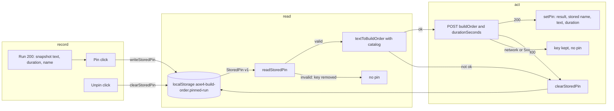

# SGS-072: Keep the pin across reloads, name it, mark stale results, disable Pin when already pinned

- **Type**: Task
- **Component**: aoe4-build-order
- **Milestone / criteria**: M4 / M4.12
- **Priority**: medium
- **Risk**: standard
  <!-- No strongModelTriggers item: page state, a new browser-storage contract the design specifies with exact
       names (C13), and display. No route, schema or engine change. About 115 lines of business logic, under 250;
       it adds page state and a restore request on load, so not low. -->
- **Invariants**: S1 (new code imports only from `lib/aoe4-build-order/` and `components/apps/aoe4-build-order/`); S3 (a restored pin goes through `textToBuildOrder`, which enforces the 20000-character cap, and the route, which enforces `SIM_INPUT_BOUNDS`, so a tampered storage value cannot reach the engine unbounded); A3 (a pin stores inputs, and the same inputs give the same result, so "already pinned" is decided on inputs)
- **LOC estimate**: about 115 (`pages/apps/aoe4-build-order.tsx` about 55: pin state, run snapshot, restore effect, stale flag; new `pin-storage.ts` about 35; new `pin-name.ts` about 8; `compare-panel.tsx` about 10; `build-input.tsx` about -6 net; `results.tsx` about 5). Business logic only; specs, unit tests and docs excluded.
- **Depends on**: SGS-067, SGS-069 (SGS-067 is last of the page chain SGS-059 -> SGS-066 -> SGS-067; SGS-069 declares the `ComparePanel` props `pinnedName` and `alreadyPinned` that this ticket uses). Also edits `results.tsx` after SGS-070 and SGS-071 (it is the last edit of that file in the milestone; SGS-071 depends on SGS-070 and the merge order on the page is enforced by SGS-067, so only a rebase is needed).
- **On merge**: none
- **Source**: M4 design C13, C8 (rows `results-stale`, `pinned-label`; `BuildInput` `selected`, `onSelectedChange`), C11 (`ComparePanel` props), Behavior rules "Compare and pin" rows pin name (source, label, restore), Pin (already pinned, repeat or replace), Unpin, stale, pin restore (on load, bad storage, race), pin cross-tab, and Run ordering step 5 (`design/M4.md`); plan outline P (`plans/M4-20261102.md`) as amended by designer pass 3 (`reports/M4-designer-3.md`: DQ4 and "Outline changes" 5)

## Context

The pinned run lives only in page memory, so a reload loses it, and it has no name: the compare table does not say which build
it came from. The shown result also gives no sign that the text or duration was edited after the Run, and "Pin this run" stays
enabled for a run that is already the pin. M4.12 stores the pin's inputs in `localStorage` and re-runs them on load, labels the
pin with its build name, marks a result whose inputs changed as stale, and disables Pin when the shown run equals the pin.

## Scope

All paths are relative to the repo root and were read on `origin/main` (`d5c2549`). Where SGS-059, SGS-066, SGS-067,
SGS-069, SGS-070 and SGS-071 have not merged, this ticket is written against their Scope text; the implementer re-reads the
real code first. Contract names are the design's (C13, C8, C11) and those tickets'.

**1. `components/apps/aoe4-build-order/pin-storage.ts` (new).** The design's modules table places it here, not under `lib/`
(the plan outline said `lib/`; the design wins, and it is a browser-only module). Exactly C13:
`export const PIN_STORAGE_KEY = 'aoe4-build-order.pinned-run'`, `export interface StoredPin { version: 1; name: string; text:
string; durationSeconds: number }`, `readStoredPin(storage: Storage): StoredPin | null`, `writeStoredPin(storage: Storage, pin:
StoredPin): void`, `clearStoredPin(storage: Storage): void`.
- `readStoredPin`: `null` when the key is absent. Otherwise parse the JSON and hand-check the four flat fields
  (`version === 1`, `name` string, `text` string, `durationSeconds` a finite number); return the pin. Invalid JSON,
  `version !== 1`, a wrong field type or a missing field: remove the key (so the bad value does not come back on every load) and
  return `null`. Extra fields are ignored. No zod: the shape is 4 flat fields.
- `writeStoredPin` and `clearStoredPin` call `setItem` / `removeItem`, and none of the three functions throws: a `Storage` whose
  methods throw (private mode, blocked storage, quota) makes read return `null` and write and clear do nothing.
- The page gets a `Storage` with a try/catch around `window.localStorage` (reading the property can throw); when it throws the
  page behaves as no pin and persists nothing.

**2. `components/apps/aoe4-build-order/pin-name.ts` (new).** `export function pinName(builds: readonly PrebuiltBuild[], text:
string, selected: string): string`:
- `builds` empty: `Custom build`.
- otherwise the `name` of the first build in `builds` order whose `text === text` exactly;
- otherwise `` `${selected} (edited)` `` (this includes a fully pasted build, because the select always holds a prebuilt name).
Not a design contract name; the design leaves the helper to the ticket. `PrebuiltBuild` is imported from `build-input.tsx`.

**3. `components/apps/aoe4-build-order/build-input.tsx`.** Add the props `selected: string` and `onSelectedChange(name: string):
void`. The select becomes controlled by `selected`; `selectBuild(name)` calls `onSelectedChange(name)` and still calls
`onTextChange(build.text)`. Delete the `useState` import and the local `selected` state (one `useState` and two `setSelected`
lines today). No other change (SGS-066's run bar, view toggle and props stay).

**4. `pages/apps/aoe4-build-order.tsx`.**
- New state `selected` (initial `builds[0]?.name ?? ''`), passed to `BuildInput` as `selected` and `onSelectedChange={setSelected}`.
- Run snapshot: replace `resultText` with one `run` state `{ text: string; durationSeconds: number; name: string } | null`, set at
  Run step 5 (200) together with the result: `{ text: runText, durationSeconds: Number(duration), name: pinName(builds,
  runText, selected) }`, with `text`, `duration` and `selected` read at the click, as `runText` is read today. Every failure that
  clears the shown result (client rejection, 400, network or HTTP failure) sets `run` to `null` too. `Results` keeps receiving the
  run's text for the step-timeline labels (`text={run.text}`).
- Pin state: `pinned: SimulateResponse | null` becomes `pin: { result: SimulateResponse; name: string; text: string;
  durationSeconds: number } | null`. `ComparePanel` gets `pinned={pin?.result ?? null}`, `pinnedName={pin?.name ?? null}` (replacing
  SGS-069's `pinnedName={null}`), `alreadyPinned` (replacing `alreadyPinned={false}`), `onPin` and `onUnpin`. `Results` gets
  `pinned={pin?.result ?? null}`. The Results tab rule (`resultsEnabled = result !== null || pin !== null`, SGS-066) is unchanged
  in effect.
- `alreadyPinned = result !== null && run !== null && pin !== null && pin.text === run.text && pin.durationSeconds ===
  run.durationSeconds`. It compares the run snapshot, never the live textarea, so editing the text does not enable Pin and a
  rerun of the same inputs stays disabled.
- `onPin`: only with a shown result. Sets `pin` to `{ result, name: run.name, text: run.text, durationSeconds:
  run.durationSeconds }` (the snapshot of the shown run, not the live text, even when the result is stale) and calls
  `writeStoredPin(storage, { version: 1, name, text, durationSeconds })`. Pinning a different run replaces the pin and the stored
  pin. `onUnpin` sets `pin` to `null` and calls `clearStoredPin(storage)`.
- Stale flag: `stale = result !== null && run !== null && (text !== run.text || Number(duration) !== run.durationSeconds)`;
  passed to `Results` as a new prop `stale: boolean`. Reverting the edit clears it. An edit still never clears the shown result
  (SGS-067).
- Restore on load: an effect with an empty dependency list that runs once on the client (not during the static render, so no
  hydration mismatch), with a cancelled flag in its cleanup so a Strict Mode second run does not apply twice:
  1. `readStoredPin(storage)`; `null` ends the effect.
  2. `textToBuildOrder(pin.text, catalog)`; on `ok: false` call `clearStoredPin` and stop (nothing shown).
  3. POST `{ buildOrder, inputs: { durationSeconds: pin.durationSeconds } }` to the simulate route, the same way Run does.
  4. 200: `setPin({ result, name: pin.name, text: pin.text, durationSeconds: pin.durationSeconds })`; the stored name is shown as
     stored. 400: `clearStoredPin`, show nothing. A network failure or any non-400 failure: keep the key, show nothing, no error
     list.
  5. A user Run that finishes before the restore POST does not change the restore (restore touches only `pin`, never `result`,
     `run`, `issues`, `tab` or `simulation-error`). If the user pinned or unpinned before the restore lands, drop the restore
     result and leave the stored value alone (a ref set by `onPin` and `onUnpin`); see Open questions.
  The restore selects no tab: the page opens on Build with `tab-results` enabled once the pin is restored (SGS-066's derived
  rule). A restored pin with no shown result shows the compare panel's pin controls and label only; no charts.
- Cross-tab: last write wins; no `storage` event listener.

**5. `components/apps/aoe4-build-order/compare-panel.tsx`.** Use the props SGS-069 declared and left unused:
- When `pinned !== null` and `pinnedName !== null`, render `` with the text `Pinned: <name>,
  <m:ss>` where `<m:ss>` is `formatMinSec(pinned.durationSeconds)` (the pinned result's own duration, equal to the stored
  `durationSeconds`), for example `Pinned: ENG 1TC, 20:00` and `Pinned: ENG 1TC (edited), 20:00`. It sits with the Pin and
  Unpin buttons, so it shows with or without a shown result and with or without the compare table.
- `pin-run` is `disabled` when `current === null || alreadyPinned`. `unpin-run` stays `disabled` when `pinned === null`.

**6. `components/apps/aoe4-build-order/results.tsx`.** New prop `stale: boolean`. When true, render at the top of `Results`
`
` with the text "These results are from an
earlier build or duration. Run again to update." The charts and everything else stay. Re-read the file first: SGS-070 and
SGS-071 edit its `SeriesChart` calls (the `pinnedMarkers` prop); keep their lines and add only the prop and the notice.

**7. Docs.** `docs/aoe4-build-order.md`, the paragraph "Under the "Results" heading, "Pin this run" ..." (lines 814 to 820 on
`origin/main`, to be re-located after the earlier tickets): say that the pin is kept in `localStorage` under
`aoe4-build-order.pinned-run` as the build text, duration and name (not the result) and re-run on load (a bad value, a text that
no longer converts, or a 400 drops it; a network or server failure keeps it); that `Pinned: <name>, <m:ss>` names it (the prebuilt
name when the run text equals one exactly, `<name> (edited)` otherwise, `Custom build` with no prebuilt builds); that "Pin this
run" is disabled when the shown run has the pinned text and duration; and that a shown result is marked stale (`results-stale`)
when the text or duration changed since its Run. Grep `docs/` and the two READMEs for "Pin this run", "pinned run" and
"survives" and fix every hit that this makes untrue (for example the sentence that the pin survives only "later runs, text and
build edits, and failed runs"). `docs/api/openapi.json` is not changed.

**8. Tests.**
- Unit `pin-storage.test.ts` (a Map-backed fake `Storage`, a throwing fake): write then read returns the pin; absent key gives
  `null`; invalid JSON, `version: 2`, a numeric `name`, a missing `durationSeconds`, a `NaN`-like value (`null` after JSON) each
  give `null` and remove the key; `clear` removes it; a throwing storage gives `null` on read and no throw on write and clear.
  Unit `pin-name.test.ts`: exact match gives the build's name; two builds with identical text give the first; one changed
  character gives `<selected> (edited)`; empty text gives `<selected> (edited)`; empty `builds` gives `Custom build`.
- Acceptance `acceptance/aoe4-build-order-pin-compare.spec.ts` (new tests, each one behavior; the file's `runOk`, `pin`, `run`
  helpers and `openPage` are reused; Playwright contexts isolate `localStorage` per test):
  1. Reload keeps the pin: run the default build at 1200, pin, `page.reload()`: `tab-results` is enabled (without any Run),
     `unpin-run` is enabled, `pinned-label` has text `Pinned: <first prebuilt name>, 20:00`, `build-order-text` holds the
     default text, and the page POSTed once with a `buildOrder` body and the stored `durationSeconds`. After a run, `pin-run`
     is enabled and the compare table appears (a different duration, so it is not already pinned).
  2. Label: unchanged default at 1200 gives `Pinned: <name>, 20:00`; after one edited line, `<name> (edited), 20:00`; choosing
     another prebuilt in the select and pasting the first prebuilt's exact text gives the first prebuilt's name; pasting a text
     that matches none under another selected prebuilt gives `<that selected name> (edited)`. The label never changes after the
     fact: change the text and the select after pinning and the label is unchanged, and a restored pin shows its stored name
     (edit `localStorage` to `name: "My name"` and reload).
  3. Already pinned: pin the shown run, `pin-run` is disabled; edit the text, still disabled (the shown run is unchanged); run
     again with the same inputs, still disabled; change the duration and run, enabled; pin, disabled; run the first duration
     again, enabled; Unpin, then with a result shown `pin-run` is enabled.
  4. Stale: after a run `results-stale` has count 0; edit the text, it is visible with the text "These results are from an
     earlier build or duration. Run again to update." and the charts are still drawn; revert the edit, count 0; change the
     duration, visible; a Run clears it.
  5. Replace and unpin write through: pin run A, pin run B (a different duration): `localStorage` holds B's text and duration;
     Unpin: `localStorage.getItem('aoe4-build-order.pinned-run')` is `null`; reload shows no pin and `tab-results` disabled.
  6. Bad or failing restore (each sets storage with `page.addInitScript` or `page.evaluate` and reloads): invalid JSON,
     `version: 2` and a missing field leave no pin, `tab-results` disabled and the key removed; a stored text that does not
     convert (`at 8 vils fly capital-town-center`) does the same and posts nothing; a mocked 400 from the simulate route removes
     the key and shows no pin and no `simulation-error`; a mocked 500 keeps the key, shows no pin and no `simulation-error`.
  7. Storage unavailable: an init script that makes the `window.localStorage` getter throw; run and pin still work and show
     the label, no error appears, and after a reload there is no pin.
  8. Race: delay the restore POST with `page.route` (for example 1.5 s), run the default build in the meantime: the Run's
     result is shown, and when the restore lands the pin appears and the shown result is unchanged. If the user pins a result
     before the restore lands, the user's pin stays and the stored value is the user's (this one pins the Open question's
     assumed rule).
- Rule for existing tests: a test of the changed behavior gets the new expected value; any other test keeps its expected value.
  Expected to change: any test that clicks `pin-run` while the shown run already equals the pin (it now finds the button
  disabled: grep `pin-run` in `acceptance/aoe4-build-order-pin-compare.spec.ts`, `aoe4-build-order-m3-flow.spec.ts` and
  `aoe4-build-order.spec.ts`, for example "pinning the shown result gives zero or dash deltas on every row"), and a test that
  edits the text after a run and asserts nothing about staleness keeps its value. No test needs a `localStorage` clear (each
  Playwright test has its own context). The implementer lists every test it edits.

**Out of scope:** pinned age-up markers (SGS-071); the compare table, delta and blank-key reason work (SGS-069); `line-chart.tsx`;
tab selection after restore (no auto-switch to Results); syncing the pin across tabs; persisting the view, tab or text (the design
reserves other keys for them); the 390 px layout (the narrow-layout ticket); any route, API, OpenAPI or engine change.

## Diagrams

The change adds page state that crosses the page, `localStorage` and the simulate route, so the flows are shown by phases.

## Acceptance criteria

- [ ] After pinning the default build at 1200 s and reloading, with no Run, `tab-results` is enabled, `unpin-run` is enabled, `pinned-label` reads `Pinned: <first prebuilt name>, 20:00`, and the page sent one POST whose body has `buildOrder` and `inputs.durationSeconds` 1200 (spec 1).
- [ ] `localStorage['aoe4-build-order.pinned-run']` after a pin is JSON `{ version: 1, name, text, durationSeconds }` with no result field; pinning a different run replaces it; Unpin removes it, and a reload then shows no pin (spec 5).
- [ ] `pinName` returns the exact-match prebuilt name (the first when two builds share the text), `<selected> (edited)` otherwise (also for a text matching no build or empty text), and `Custom build` when `builds` is empty (unit rows). In the browser an unchanged default at 1200 s gives `Pinned: <name>, 20:00` and one edited line gives `Pinned: <name> (edited), 20:00` (spec 2).
- [ ] The pin's name is fixed at Run: changing the select or the text after pinning, or after a Run, never changes `pinned-label` or the name stored; a restored pin shows the stored name (stored `name: "My name"` shows `Pinned: My name, ...`) (spec 2).
- [ ] `build-input.tsx` takes `selected` and `onSelectedChange` and holds no select state: `git grep -n "setSelected\|useState" -- components/apps/aoe4-build-order/build-input.tsx` finds 3 lines on `origin/main` (the import, the state, and the call in `selectBuild`) and none after the change. `git grep -n "PIN_STORAGE_KEY = 'aoe4-build-order.pinned-run'" -- components` finds exactly 1 line (0 today).
- [ ] `pin-run` is disabled while the shown run's text and duration equal the pin's; editing the text after a Run does not enable it; a rerun of the same inputs keeps it disabled; a different duration enables it; a failed Run (no result) disables it; after Unpin with a shown result it is enabled (spec 3).
- [ ] `results-stale` shows with the text "These results are from an earlier build or duration. Run again to update." when the text or duration differs from the shown run's, the charts stay, reverting the edit hides it, a Run hides it, and it is absent after a Run with unchanged inputs (spec 4).
- [ ] A stored value that is invalid JSON, has `version !== 1`, a wrong field type or a missing field, a text that does not convert, or whose restore POST returns 400, leaves no pin, `tab-results` disabled, no `simulation-error`, and the key removed; a mocked 500 or a failed request keeps the key and shows no pin and no error (spec 6 and unit rows).
- [ ] With the `localStorage` getter throwing, Run and Pin still work and show the label, no error appears, and a reload has no pin (spec 7); `pin-storage` functions never throw on a throwing `Storage` (unit rows).
- [ ] A Run that finishes while the restore POST is delayed keeps its result; when the restore lands only the pin appears (spec 8).
- [ ] No pin or storage code runs during the static render: `npx next build` succeeds and the page's first client render equals the server HTML (no hydration warning in the Playwright console during spec 1).
- [ ] `results.tsx` keeps the `pinnedMarkers` prop lines of SGS-071 and the legend changes of SGS-070 (rebase check: `git grep -n "pinnedMarkers" -- components/apps/aoe4-build-order/results.tsx` still finds the three `SeriesChart` lines).
- [ ] `docs/aoe4-build-order.md` describes persistence, the label, Pin disabled and the stale notice; `git grep -n "survives later runs" -- docs` prints nothing after the change (one hit, line 816 on `origin/main`, today).
- [ ] `npx tsc --noEmit`, `npm run lint:dup`, `npm test` and `npm run acceptance` (Node 24) pass; every edited existing test is listed in the PR description.
- [ ] No INVARIANTS.md regressions

## Open questions

- `designer`: the design says a user Run that finishes before the restore POST "does not change the restore; both land independently", but does not say what happens when the user pins or unpins before the restore lands. This ticket assumes the user's action wins (the restore result is dropped and storage is left as the user wrote it), because applying the restore would overwrite the user's pin in state while storage holds the user's pin. Confirm or give the rule.
- `designer`: the design says `StoredPin.name` is stored as is and shown as stored, with no length or content limit. This ticket renders it as React text (escaped) and applies no limit. Confirm that no cap on the name's length is wanted.
- `designer`: the design's modules table puts `pin-storage.ts` under `components/apps/aoe4-build-order/`, while plan outline P and the C13 heading do not name a folder (outline said `lib/aoe4-build-order/`). This ticket follows the modules table. Confirm.
- `designer`: the design does not say whether `readStoredPin` removes an invalid value itself or the page calls `clearStoredPin` after a `null`. This ticket has `readStoredPin` remove it (so a bad value never survives a load, whichever caller reads it). Confirm or move it to the page.
