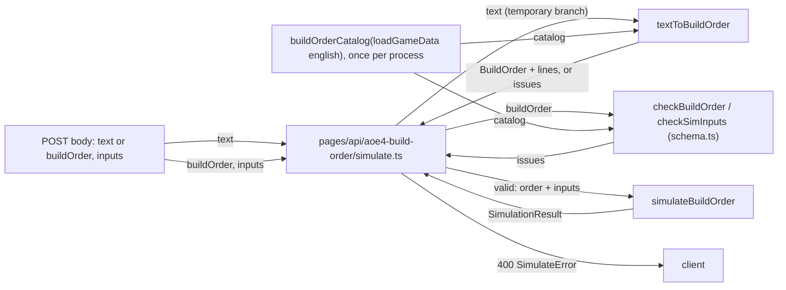

# SGS-075: Re-point importers, delete the hand-rolled validator and swap the route to the zod checks

- **Type**: Task
- **Component**: aoe4-build-order
- **Milestone / criteria**: M4 / M4.1
- **Priority**: high
- **Risk**: high
  <!-- strongModelTriggers: existing public API behavior changes (route validation swaps, issue order and
       combined-issue behavior change for `text` and `buildOrder`). No REPO.md critical path symbol changes. -->
- **Invariants**: S3 (every request bounded: `SIM_INPUT_BOUNDS` and the 20000-character text cap must still be enforced on every path that reaches the engine, now through `textToBuildOrder` and `checkSimInputs`), A1 (no game number in schema code; unchanged), A3 (checking is pure: same value and catalog, same issues in the same order)
- **LOC estimate**: about 25 added, about 450 deleted (business logic only: route about -10 net; `validate.ts` about -380 left after SGS-057 moved its shared parts; `model.ts` type declarations about -60 replaced by re-exports of about 5 lines; `acceptance/helpers.ts` `buildOrderFrom` about 15). Tests and docs excluded. Mostly deletion and mechanical re-pointing.
- **Depends on**: SGS-057 (adds `schema.ts`, `text-to-build.ts`, `StepOptions.names`; `validate.ts` still present and re-exporting)
- **On merge**: `CONTEXT.md Key surfaces`: `acceptance/helpers.ts` `buildOrderFrom` is the one way specs convert paste (no `REPO.md` command changes)
- **Source**: M4 design "M4.1 ticket order" row 2b, C1, C2, C4a and Behavior rules "Validation (M4.1)" and "Docs and OpenAPI (M4.14)" (`design/M4.md`); designer pass 4 (`reports/M4-designer-4.md`, Q1); split out of SGS-057 (reports/SGS-057-ticket-2.md)

## Context

After SGS-057 the zod `checkBuildOrder` / `checkSimInputs` and `textToBuildOrder` exist beside the hand-rolled
`validate.ts`, and nothing calls them. This ticket switches every caller to the schema, deletes the
validator and its two test files, and makes the route use the new checks. The route still accepts `text` and
`buildOrder` (a later ticket removes `text`); the only behavior change is the documented issue order and the
rule that a cross-field check runs only when the fields passed.

## Scope

All paths are relative to the repo root. Names are those of SGS-057 and C2, C3, C4a in `design/M4.md`.

**1. Delete and re-point.** Delete `lib/aoe4-build-order/validate.ts`, `validate.test.ts`,
`validate.acceptance.test.ts`. Re-point every importer (13 import lines in 12 files on origin/main `d5c2549`,
found with `git grep -nE "from '[^']*/validate'" -- '*.ts' '*.tsx'`; two of the files are the deleted tests):
`acceptance/aoe4-simulate-api-contract.spec.ts` (`SIM_INPUT_BOUNDS` from `schema`),
`components/apps/aoe4-build-order/step-table-model.test.ts`, `lib/aoe4-build-order/build-move.acceptance.test.ts`,
`builds.test.ts` (checks every shipped build with `checkBuildOrder(build, buildOrderCatalog(ENGLISH))`),
`parse-text.test.ts`, `research.acceptance.test.ts`, `simulate-triggers.test.ts`, `step-options.test.ts`,
`test-helpers.ts`, and the route. `validateBuildOrder(order, data)` calls become
`checkBuildOrder(order, buildOrderCatalog(data))`; `resolveSimInputs` calls keep their signature and import
from `schema`.

**2. Route `pages/api/aoe4-build-order/simulate.ts`.** Replace `validateBuildOrder` / `resolveSimInputs` with
`checkBuildOrder` / `checkSimInputs`, using a catalog built from `loadGameData('english')` once per process.
Behavior is otherwise unchanged: still exactly one of `text` and `buildOrder` (`request: send exactly one of
text and buildOrder`), `text: must be a string`, order issues before inputs issues, both parts always run,
issue cap `MAX_REPORTED_ISSUES`, 400 body shape, 405, non-object body. The `text` branch is temporary and calls
`textToBuildOrder(text, catalog)`; the 20000 check and `parseBuildOrderText` call leave the route (they live in
`textToBuildOrder`). SGS-061 removes this branch. The `buildOrder` branch calls `checkBuildOrder(buildOrder,
catalog)` without `lines`. `lib/aoe4-build-order/api.ts` is not changed.

**3. `lib/aoe4-build-order/model.ts`.** `BuildOrder`, `BuildStep`, `Trigger`, `BuildStart` become
`export type { ... }` re-exports of `z.infer` types from `schema.ts` (the inferred types equal the old
declarations; node fields infer `NodeRef` / `FiniteNodeRef`, id fields `string`, `move.count` `number |
'all'`). `schema.ts` drops the `z.ZodType<T>` annotation for these four, because the type now comes from the
schema (a type-only import cycle with `model.ts` is fine). `BuildOrderLines` stays. The existing test
`data.acceptance.test.ts` "model.ts exports exactly the 29 documented types and the shared lists" matches `^export (?:type|interface)
<Name>` and so stops seeing the four moved names; update its expected list (the four names leave it) and its title to "25 documented types"
(29 minus 4), and say so in the summary of edited tests. If `tsc --noEmit` reports a mismatch between a `z.infer`
type and the old declarations or their uses, fix the schema so the inferred type matches; do not add casts.

**4. `acceptance/helpers.ts`.** Add `export function buildOrderFrom(text: string): BuildOrder` (C4a): calls
`textToBuildOrder` with the English catalog and throws an `Error` whose message joins the issue messages when
the text does not convert. `lib/aoe4-build-order/data.ts` imports its JSON statically and `buildOrderFrom` is
synchronous, so the lazy mechanism is a memoised `require` inside the function: a module-level
`let catalog` and, on first call, `catalog ??= buildOrderCatalog((require('../lib/aoe4-build-order/data') as
typeof import('../lib/aoe4-build-order/data')).loadGameData('english'))`. `package.json` has no `"type"`, so
Playwright transpiles specs and helpers to CommonJS and `require` works; the implementer confirms this by
running the new spec, and if `require` does not resolve, falls back to a small non-spec module
(`acceptance/english-catalog.ts`) that `helpers.ts` loads the same way. `data` is the only module loaded lazily:
`schema.ts`, `text-to-build.ts` and the catalog builder are data-free and may be imported statically (value
imports of `data` are the only forbidden top-level ones). No other helper is added and no spec is migrated to it
here.

**5. Tests.**
- Every case in the two deleted validate test files is either already covered by SGS-057's `schema.test.ts` or
  `text-to-build.test.ts`, migrated to one of them or to `parse-text.test.ts`, or dropped because the design's
  rules remove it (for example a combined field and cross-field assertion). New cases are written fresh into
  those files, never pasted as a block from the deleted files (the `lint:dup` jscpd threshold is 0). The
  implementer lists each dropped or re-specified case in the PR body.
- `acceptance/aoe4-build-order-from.spec.ts` (new, Playwright, no page): `buildOrderFrom` returns the checked
  order for each prebuilt build's formatted text (via `formatBuildOrderText` of `listBuilds()`), and throws an
  error whose message contains an issue message for text with an unknown unit.
- Rule for existing tests (the issue-order and combined-issue behavior changes): a test whose expected issue
  list changes only because of the field vs cross-field rule, the new issue order (cross-step issues come after
  all per-step issues) or the rule that an unknown action hides that step's trigger issues (a spec that expects
  both issues on one step now expects the action issue only) gets the new expected list; any other test keeps
  its expected value. A test that builds a catalog by hand must give it `units` and `inputDefaults` as well as
  the other `BuildOrderCatalog` fields. The implementer lists every test it edits. No API acceptance spec
  is rewritten to `buildOrder` here.

**6. Docs.**
- `docs/aoe4-build-order.md`: the Issues section (line 564 on origin/main) adds `suggestion?` to the issue
  shape and says when it is set (`unknown-id` and `unknown-trigger-kind`, SGS-057 added it to the type and
  OpenAPI; the route starts producing it here); the validation text states that a step's cross-field rules run
  only when its fields passed, cross-step rules only when every step passed, and start rules only when `start`
  passed, and the issue order (cross-step issues come after all per-step issues), and that an unknown action
  hides that step's trigger issues; the data-flow diagram (lines 614 to 619) renames `validateBuildOrder +
  resolveSimInputs` to `checkBuildOrder + checkSimInputs` and shows `textToBuildOrder` as the paste path; line
  270's "validation rules in Issues" and line 877's "validation kind table" keep their meaning and are
  reworded only if they name the removed validator. Grep `docs/` and `data/aoe4-build-order/README.md` for
  `validateBuildOrder`, `validate.ts` and the old combined-issue wording and fix each hit. The Route section is
  not changed (the route still accepts `text`).

**7. Un-export dead helpers.** Once `validate.ts` is deleted, nothing imports `isKnownId`, `isBoundKey` or `issue`
from `schema.ts` (on the SGS-057 branch only `validate.ts` does). Un-export each that `schema.ts` still uses
itself, and delete any it no longer uses. The rest of the SGS-057 export list stays.

**Out of scope:** the zod schema (beyond item 7), `text-to-build.ts`, `StepOptions.names`, OpenAPI `suggestion` and the contract
spec rows (SGS-057); `data-schema.ts` and the `data.test.ts` rewrite (SGS-058); the page, `PageProps`, the
`StepTable` prop rename, `IssueList` and `runRejected` (SGS-059); rewriting any API spec body to `buildOrder`
and any spec edit beyond the contract spec import (SGS-060); removing `text` from the route, `api.ts`, OpenAPI
`2.0.0` (SGS-061); the paste grammar; engine, data files and `simulate.ts`; `golang/`.

## Diagrams

Crosses components (route, shared lib, acceptance helpers) with one request path:

## Acceptance criteria

- [ ] `git grep -nE "from '[^']*/validate'" -- '*.ts' '*.tsx'` prints nothing (13 lines in 12 files before the change), and `lib/aoe4-build-order/validate.ts`, `validate.test.ts`, `validate.acceptance.test.ts` do not exist.
- [ ] `git grep -n "validateBuildOrder" -- . ':!golang'` prints nothing (37 lines in 10 files before the change).
- [ ] The route uses `checkBuildOrder`, `checkSimInputs` and `textToBuildOrder` and none of `parseBuildOrderText` or `SIM_INPUT_BOUNDS` (`git grep -nE "parseBuildOrderText|SIM_INPUT_BOUNDS|validate'" -- pages/api/aoe4-build-order/simulate.ts` prints nothing; 4 lines on origin/main); a `POST` with a `text` of 20001 characters still returns 400 with `text: 20001 characters, more than 20000` and one with 20000 is accepted for conversion.
- [ ] The route behaves as before for requests that are valid and for every `text` / `buildOrder` / `inputs` rule except the documented issue-order and combined-issue change: the existing `aoe4-simulate-api*.spec.ts` suite passes, with every edited expectation listed in the PR body. A `buildOrder` step with a bad field returns that field's issue and no cross-field issue for the step; a `text` paste with unit `knigt` returns `line N: unknown unit "knigt" in unit` with `suggestion: "knight"`.
- [ ] `model.ts` re-exports `BuildOrder`, `BuildStep`, `Trigger`, `BuildStart` from `schema.ts` and no longer declares them (`git grep -nE "^export (type|interface) (BuildOrder|BuildStep|Trigger|BuildStart)\b" -- lib/aoe4-build-order/model.ts` prints nothing; it prints 4 lines before the change); `data.acceptance.test.ts` "model.ts exports exactly the 25 documented types and the shared lists" (renamed from 29) passes with those four names removed from its list.
- [ ] `buildOrderFrom` exists in `acceptance/helpers.ts`, returns the order for valid text, and throws with the joined issue messages for text that does not convert (`aoe4-build-order-from.spec.ts` passes). `acceptance/helpers.ts` has no top-level value import of the data module (`git grep -nE "^import [^t].*aoe4-build-order/data" -- acceptance/helpers.ts` prints nothing; `import type` is allowed), and a Playwright run of one WOTR-only spec that imports `helpers.ts` (for example `npx playwright test <wotr spec> --list` plus one run, with `require.cache` checked via a throwaway log or `NODE_DEBUG`) does not load `data/aoe4-build-order/aoe4world/english.json`.
- [ ] `builds.test.ts` checks every shipped build with `checkBuildOrder(build, buildOrderCatalog(ENGLISH))` and passes.
- [ ] Every case of the two deleted validate test files is migrated, already covered, or dropped with a reason listed in the PR body; `npm run lint:dup` passes.
- [ ] `docs/aoe4-build-order.md` and `data/aoe4-build-order/README.md` name no removed symbol (`git grep -nE "validateBuildOrder|validate\.ts" -- docs data` prints nothing; 1 hit in `docs/aoe4-build-order.md` today); the Issues section documents `suggestion` and the issue-order and field vs cross-field rules; the data-flow diagram names `checkBuildOrder + checkSimInputs`.
- [ ] `schema.ts` exports the SGS-057 list minus `isKnownId`, `isBoundKey` and `issue` (`git grep -nE "^export .*\b(isKnownId|isBoundKey|issue)\b" -- lib/aoe4-build-order/schema.ts` prints nothing; 3 lines before the change) and `git grep -nwE "isKnownId|isBoundKey" -- . ':!golang'` outside `schema.ts` prints nothing. (respec 3)
- [ ] An existing spec that expected both an action issue and a trigger issue on one step, or cross-step issues before later per-step issues, is edited to the new order and listed in the PR body (respec 3).
- [ ] `npx tsc --noEmit` passes; `npm test` passes; `npm run acceptance` passes (Node 24).
- [ ] No INVARIANTS.md regressions

## Open questions

None.

## Re-spec 2026-11-02

- Underspecified: the lazy AoE4 catalog mechanism and its criterion; test title count; tsc mismatch handling.
- Changed: Scope 3 and 4 and criteria 5 and 6 (memoised require, no top-level data import, 25 types, fix schema not casts).
- Stands: all other scope, criteria and the gate-verified counts.

## Re-spec 2026-11-02 (designer pass 5)

- Underspecified: the new issue order, the unknown-action-hides-trigger rule, dead helper exports, and the catalog's `units` and `inputDefaults` fields.
- Changed: Scope 5 rule, Scope 6 docs text, new Scope 7 and two criteria.
- Stands: all other scope and criteria.
