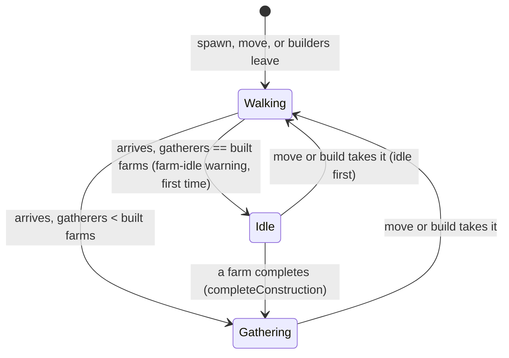

# SGS-080: Limit farm gathering to one villager per built farm

- **Type**: Task
- **Component**: aoe4-build-order
- **Milestone / criteria**: none yet (owner request 2026-11-03; backlog "One farm per farmer (AoE4 sim)")
- **Priority**: medium
- **Risk**: high
  <!-- The change decides who gathers, so it changes what simulateBuildOrder (REPO.md criticalPaths) computes for
       every build that uses farms, and it adds a warning code to the public simulate response (OpenAPI).
       Strong-model trigger: "changes combat or simulation rules ... what a run computes". About 80 lines of
       business logic. -->
- **Invariants**: A1 (the one-per-farm rule reads `gatherNodes.<node>.createdBy` from `rules/base.json`, not a
  hardcoded `'farm'`); A2 unchanged (no payment or affordability check changes; farmers only gather less); A3 (the
  same inputs give the same farmers and the same warning); S3 unchanged (no new input, no new loop)
- **LOC estimate**: about 80 lines of business logic (`lib/aoe4-build-order/simulate.ts` capacity check, promotion
  and idle-first move about 35; `depletion.ts` warning record, builder and sort rank about 30; `model.ts` union
  member about 5; engine state field and result wiring about 10); OpenAPI, docs and tests excluded
- **Depends on**: none (main `ee7ecb9`). Overlaps SGS-077 (see Scope, Overlap). Follow-up SGS-081 re-tunes the
  shipped builds (see Scope, Split); the two should land together.
- **On merge**: none
- **Source**: owner request in chat 2026-11-03: "add the one villager per farm limit to the engine"; BACKLOG.md
  "One farm per farmer (AoE4 sim)" (owner, 2026-11-02)

## Context

A farm holds one villager (`docs/aoe4-build-order.md`, "Farms and mill coverage"), but the engine does not enforce
it. `assignGatherers` in `lib/aoe4-build-order/simulate.ts` adds every arrival at `farm` to `state.gatherers.farm`,
so with zero farms built `start -> farm` gathers at the full farm rate with no warning (checked 2026-11-02). A
`build farm` step only costs 37 wood and one builder's time, so delaying farms (more hunting) never shows its saving.

## Scope

All paths are relative to the repo root.

**1. Capacity.** A node whose `gatherNodes.<node>.createdBy` is a building holds one gatherer per built instance of
that building (today only `farm`; `state.buildings.get(createdBy)` in `EngineState` is the count). In
`assignGatherers`, an arrival at such a node when `gatherers[ref]` is already at capacity goes to `state.idle[ref]`
instead of `gatherers[ref]` (the same bucket a depleted ref uses, so `aliveVillagers`, `availableAt`, population and
the `at N vils` trigger already count idle villagers and `move` / `build` can already take them). Capacity read in one
helper next to `isDry`; `isDry` and the finite-node stock path stay as they are. Every arrival already goes through
`assignGatherers` (spawn at a rally, `move`, `build` builders at `then`, auto-house builders returning), and the start
state (`createEngine`: `order.start.villagers` and the civ starting villagers are written straight into `gatherers`)
must be capped the same way: starting villagers on `farm` beyond the farms in `start.buildings` start idle.

**2. Waiting, not lost.** Excess villagers wait idle at the farm and take a farm as soon as one is built (default;
see Open questions). In `completeConstruction`, after `addBuildingInstance`, when `gatherNodes.<node>.createdBy ===
entry.baseId`, move `min(idle[ref], capacity - gatherers[ref])` villagers from `idle[ref]` to `gatherers[ref]`. Run
before the builders' own `arrive`, so builders that `then farm` find the slot taken if idle farmers waited (the counts
are the same either way). `sendWalking` for a capped node takes idle villagers first, then gatherers (today it takes
gatherers first, which stays for a depleted ref), so `idle[ref] > 0` always implies `gatherers[ref] == capacity` and
no promotion is needed when a slot frees.

**3. Warning.** New `SimWarning` member in `lib/aoe4-build-order/model.ts`: `{ code: 'farm-idle'; severity: Severity;
message: string; at: number; idleVillagers: number }`, severity `warning`. At most once per run: `at` is the first
instant a villager is left idle for lack of a farm, `idleVillagers` adds up every villager that arrived (or started)
without a free farm. Message (default text; see Open questions): `<n> villager(s) arrived at farm from <m:ss> on with
no free farm and wait idle until one is built.` using the existing `villagers()` count wording in `depletion.ts`
(`1 villager ... and waits idle`, `3 villagers ... and wait idle`) and `formatMinSec`. Record it on the engine state
beside `idle`, build it in `depletion.ts` next to `idleArrivalWarning`, and add it to the warnings assembled in
`simulateBuildOrder`. In `tieRank` it sorts after the node warnings and before `step-stuck` at one instant.

**4. Docs.** `docs/aoe4-build-order.md`: "Farms and mill coverage" (a farm holds one villager: say it is enforced and
what happens to the rest), "Idle villagers" (also the farm case, and that a built farm takes the waiting ones), the
Results warnings table and the sort-order sentence, the Severity table, and the `warnings` code list in the API
section (the lines that name `idle-arrival` and `auto-houses-held`). `docs/api/openapi.json`: the new warning variant
beside `idle-arrival`, the sort-order text in the `warnings` description, and the minor version bump (SGS-077 also
bumps it; whichever lands second takes the next minor). Grep `docs/` and `data/aoe4-build-order/README.md` for
`idle-arrival`, `one villager` and `farm` before finishing.

**5. Existing tests.** The rule is on for every run, with no input to switch it off. A test of the changed behavior
(farm gathering with too few farms) gets the new expected value. Any other test that has villagers at `farm` with fewer
built farms than villagers (for example `lib/aoe4-build-order/simulate-depletion.test.ts` `move ... to farm`,
`simulate.test.ts` reaction `to: 'farm'`) keeps its expected value and builds the farms in its setup (`start.buildings`
through the test helper, or `build farm` steps placed so the asserted times do not move), or moves to a node with no
cap when the farm is incidental. Digests of shipped-build runs (`lib/aoe4-build-order/simulate-house-warnings.test.ts`
three 1800 s digests, `acceptance/aoe4-simulate-api-house-lead-time.spec.ts` two digests and cap instants) are re-pinned
to the new engine output; SGS-081 re-pins them again after re-tuning. The implementer lists every test it edits.

**Overlap with SGS-077 (in progress).** SGS-077 adds `gathered: Resources` to `Engine`, zeroes it in `createEngine`,
adds to it in `creditIncome`, and samples it in `simulateBuildOrder`. This ticket does not touch `creditIncome`, and
needs no change to it: `creditIncome` already credits `engine.gatherers`, so idle farmers add nothing to
`gathered`. Textual overlap only: the `EngineState` / `Engine` field lists and `createEngine` (a new field each),
the result assembly at the end of `simulateBuildOrder` (warnings here, series there), `docs/api/openapi.json` (version
bump, different schemas) and `docs/aoe4-build-order.md`. Whichever lands second rebases. SGS-077 adds a field to every
result, so the 1800 s digests of "every field but warnings" in `simulate-house-warnings.test.ts` change in both; the
second to land re-pins from its own post-rebase output.

**Split.** The re-tuning of the shipped builds is not in this ticket; it is SGS-081 (manager creates it). Why: this
ticket is a high-risk engine change of about 80 lines that the owner's open questions below can still reshape, and it
is verified by unit cases with known numbers. Re-tuning is a separate kind of work: three builds
(`data/aoe4-build-order/builds/english-1tc.json` 12 farm references, `english-knight-longbow.json` 46,
`english-spear-longbow-maa-crossbow.json` 22; the backlog's "all four" is three files today) each need farm steps
added and timed, then run to the 1800 s and 3600 s bars the README states (no waiting step, no idle villager, gold
reactions), then the README Prebuilt-builds prose rewritten and the digests re-pinned. That is iterative tuning of
data, not logic, and its numbers depend on this ticket's merged behavior. Landing this ticket alone leaves the shipped
builds with idle farmers and a `farm-idle` warning, so merge 080 and 081 as one stack and do not release 080 alone.
If, after the engine change, a build-quality assertion on a shipped build (for example no step still waiting at the
horizon) fails, the implementer does not loosen it or skip it: it lists the failing test and the reason in the report
and the manager folds it into SGS-081.

**Out of scope:** editing any file under `data/aoe4-build-order/builds/`; the README Prebuilt-builds entries; a
farm-count or farm-position model beyond one villager per built farm (no per-farm rate or "farm#2" refs); deleting
farms; the page or chart changes (the page lists warnings generically by severity).

## Diagrams

Changes a state machine (a villager's assignment at the farm node). State diagram:

## Acceptance criteria

Cases use the unit-test run helper of `lib/aoe4-build-order/simulate.test.ts`, and name `farmRate` as the per-villager
food rate `gatherRatesOf` gives a farm at the case's data.

- [ ] Zero farms: `start -> farm` with no `build farm` step: `gatherRates.food` is 0 at every sample, `result.warnings`
  has exactly one `farm-idle` warning with `at` the first arrival and the exact message for its count, e.g.
  `3 villagers arrived at farm from 0:50 on with no free farm and wait idle until one is built.` for three arrivals,
  `1 villager arrived at farm from 0:50 on with no free farm and waits idle until one is built.` for one. Catches: the
  old behavior (full rate, no warning).
- [ ] One farm, three villagers: after one farm completes, `gatherers.farm` is 1, `idle.farm` is 2 and food income is
  `1 * farmRate`, not `3 * farmRate`. When a second farm completes, income steps to `2 * farmRate` at the completion
  instant (the waiting villagers are promoted). Catches: no cap; promotion missing (income stays at 1x forever).
- [ ] `idleVillagers` adds up arrivals: two separate arrivals of 1 and 2 villagers with no free farm give one warning
  with `idleVillagers: 3` and `at` the first arrival. Villagers promoted later are still counted. Catches: one warning
  per arrival; counting only the last.
- [ ] Move order: with 1 farm, `gatherers.farm` 1 and `idle.farm` 1, `move 1 from farm to wood` leaves `gatherers.farm` 1 and `idle.farm` 0 and wood gets the
  arrival; income at the farm is unchanged. Catches: taking the gatherer first, which drops income while a villager
  still idles.
- [ ] Builders: `build farm from wood then farm` with `builders: 1` and no other farmer: the builder gathers at the farm
  the instant it completes (`gatherers.farm` 1, no `farm-idle` warning). With `builders: 3` and one farm: 1 gathers,
  2 idle, one warning with `idleVillagers: 2`. Catches: the capacity read before `addBuildingInstance`.
- [ ] Start state: `start.villagers.farm = 4` (as `simulate.acceptance.test.ts` overrides the civ starting villagers) with the starting buildings holding 2 farms starts with `gatherers.farm` 2 and
  `idle.farm` 2 and the warning at `at` 0; with 4 farms there is no warning. Catches: capping only runtime arrivals.
- [ ] A farm is the only capped node: villagers at `wood`, `gold` and `sheep` are unchanged; `data.acceptance` /
  `gather.test.ts` rate cases are unchanged.
- [ ] Population: idle farmers count in `at N vils` triggers and in `spawnedPopulation` (a `villagers` trigger with
  farmers idle fires at the same time as before the change).
- [ ] The capacity comes from `gatherNodes.farm.createdBy` in `rules/base.json`: no `'farm'` string literal is added to
  `simulate.ts` for this rule (`git grep -n "'farm'" lib/aoe4-build-order/simulate.ts` finds no new line).
- [ ] Warning order: a run with a `node-depleted` warning and a `farm-idle` warning at the same instant lists the node
  warning first, then `farm-idle`, then any `step-stuck` (a `sortWarnings` case in `depletion.test.ts`).
- [ ] `docs/api/openapi.json` has the `farm-idle` variant with fields `code`, `severity`, `message`, `at`,
  `idleVillagers`, `additionalProperties: false`, and the existing OpenAPI / contract acceptance
  (`acceptance/aoe4-simulate-api-contract.spec.ts`) passes with a run that returns it.
- [ ] Docs listed in Scope 4 describe the rule and the warning; none still says a farm holds one villager without
  saying it is enforced. A warning-text example in the docs matches the message format above.
- [ ] Every test edited under Scope 5 is listed in the report with the reason; the 1800 s shipped-build digests are
  re-pinned and nothing else about those tests changes.
- [ ] `npm test`, `npx tsc --noEmit`, `npm run lint:dup` pass; shipped-build assertions that fail only because the
  builds are not yet re-tuned are listed in the report, not loosened.
- [ ] No INVARIANTS.md regressions

## Open questions

- `owner`: Do excess farmers wait idle until a farm is built (proposed default, and what this ticket specifies), or
  stay idle until a step moves them (like villagers at a depleted node)? Waiting matches the game (a villager stands at
  the town center until a farm opens) and makes `build farm` steps the only thing that matters; staying idle forces
  every build to add explicit `move` steps.
- `owner`: Confirm the warning text and severity. Proposed: severity `warning`, once per run, `3 villagers arrived at
  farm from 0:50 on with no free farm and wait idle until one is built.`
- `owner`: Should the rule have an input to turn it off (for comparing against the old no-limit model)? Proposed
  default: no; it is a model rule, and tests build their farms instead.
