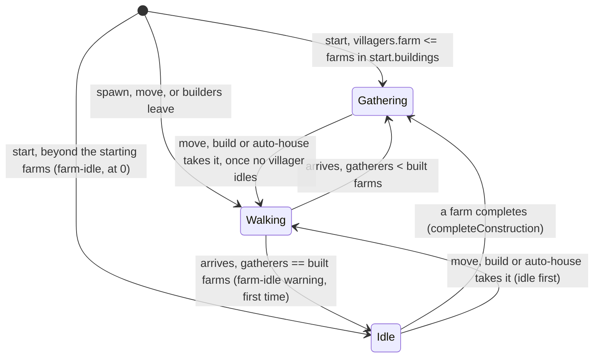

# SGS-080: Limit farm gathering to one villager per built farm

- **Type**: Task
- **Component**: aoe4-build-order
- **Milestone / criteria**: none yet (owner request 2026-11-03; backlog "One farm per farmer (AoE4 sim)")
- **Priority**: medium
- **Risk**: high
  <!-- The change decides who gathers, so it changes what simulateBuildOrder (REPO.md criticalPaths) computes for
       every build that uses farms, and it adds a warning code to the public simulate response (OpenAPI).
       Strong-model trigger: "changes combat or simulation rules ... what a run computes". About 85 lines of
       business logic. -->
- **Invariants**: A1 (the one-per-farm rule reads `gatherNodes.<node>.createdBy` from `rules/base.json`, not a
  hardcoded `'farm'`); A2 unchanged (no payment or affordability check changes; farmers only gather less); A3 (the
  same inputs give the same farmers and the same warning); S3 unchanged (no new input, no new loop)
- **LOC estimate**: about 85 lines of business logic (`lib/aoe4-build-order/simulate.ts` `slotsAt` helper, start-state
  cap, promotion and idle-first move about 40; `depletion.ts` warning record, builder and sort rank about 30;
  `model.ts` union member about 5; engine state field and result wiring about 10); OpenAPI, docs and tests excluded
- **Depends on**: none (main `1bdf1d6`; SGS-077 is integrated there, so `gathered` and OpenAPI `2.1.0` are the
  starting point). (respec 2) SGS-080 and SGS-081 ship as one stack in one batch: SGS-081 is stacked on this
  branch, the suite and tech-lead run on the top of the stack, and SGS-080 is never merged alone. (respec 2)
- **On merge**: none
- **Source**: owner request in chat 2026-11-03: "add the one villager per farm limit to the engine"; BACKLOG.md
  "One farm per farmer (AoE4 sim)" (owner, 2026-11-02)

## Context

A farm holds one villager (`docs/aoe4-build-order.md`, "Farms and mill coverage"), but the engine does not enforce
it. `assignGatherers` in `lib/aoe4-build-order/simulate.ts` adds every arrival at `farm` to `state.gatherers.farm`,
so with zero farms built `start -> farm` gathers at the full farm rate with no warning (checked 2026-11-02). A
`build farm` step only costs 37 wood and one builder's time, so delaying farms (more hunting) never shows its saving.

## Scope

All paths are relative to the repo root.

**1. Slots.** (respec 2) A node whose `gatherNodes.<node>.createdBy` is a building holds one gatherer per built
instance of that building (today only `farm`; `state.buildings.get(createdBy)` in `EngineState` is the count). The
count is read in one helper next to `isDry`, named `slotsAt(state, ref)` (not `capacity`: `gatherNodes.farm.capacity`
in `rules/base.json` is already the carry capacity); it returns `Infinity` for a node with no `createdBy`. `isDry` and
the finite-node stock path stay as they are. In `assignGatherers`, an arrival at a slotted node when `gatherers[ref]`
already equals `slotsAt` goes to `state.idle[ref]` instead of `gatherers[ref]` (the same bucket a depleted ref uses,
so `aliveVillagers`, `availableAt`, population and the `at N vils` trigger already count idle villagers and `move` /
`build` can already take them); a partial fit fills the free slots and idles the rest. Every runtime arrival already
goes through `assignGatherers` (spawn at a rally, `move`, `build` builders at `then`, auto-house builders returning).

**Start state.** (respec 2) In `createEngine`, `gatherers` is filled from `order.start?.villagers ?? start.villagers.value`
before `start.buildings.value.forEach(addBuildingInstance)` runs, so `state.buildings` is still empty at that point.
The cap uses `start`, the result of the `rules.startingState` override (or `data.civData.startingState` without one):
for each slotted node, its start slots are the number of entries in `start.buildings.value` equal to `createdBy`;
`gatherers[ref]` above that count moves to `idle[ref]` and is recorded as a farm-idle arrival at `at` 0 (Scope 3).
Population and `spawnedPopulation` are unchanged by the move (both read `aliveVillagers`, which counts idle).

**2. Waiting, not lost.** Excess villagers wait idle at the farm and take a farm as soon as one is built. This is a
simulation simplification, a sim rule and not a claim about AoE4 game behavior; docs word it that way. In
`completeConstruction`, after `addBuildingInstance`, when `gatherNodes.<node>.createdBy === entry.baseId`, move
`min(idle[ref], slotsAt - gatherers[ref])` villagers from `idle[ref]` to `gatherers[ref]`. Run before the builders'
own `arrive`, so builders that `then farm` find the slot taken if idle farmers waited (the counts are the same either
way). `sendWalking` for a slotted node takes idle villagers first, then gatherers (today it takes gatherers first,
which stays for every other ref, including a depleted one), so `idle[ref] > 0` always implies
`gatherers[ref] == slotsAt` and no promotion is needed when a slot frees.

**Auto-house builders.** (respec 2) `houseBuilderSource` keeps its check unchanged: a ref qualifies by its gatherers
only (`gatherers[ref] >= houseBuilders`), so idle farmers alone never make `farm` a house source. Once a slotted ref
is chosen, `startConstruction` takes the builders through `sendWalking`, so idle farmers go first, then gatherers.
Builders returning `then: from` arrive through `assignGatherers` and idle if no slot is free (and count toward
`idleVillagers` again). Replace the comment above `houseBuilderSource` ("Reads gatherers only: idle villagers never
build houses.") with the rule as it now holds: the source is picked by gatherers only; at a farm node waiting idle
villagers are taken first.

**3. Warning.** New `SimWarning` member in `lib/aoe4-build-order/model.ts`: `{ code: 'farm-idle'; severity: Severity;
message: string; at: number; idleVillagers: number }`, severity `warning`. At most once per run: `at` is the first
instant a villager is left idle for lack of a farm, `idleVillagers` adds up every villager that arrived (or started)
without a free farm. Message: `<n> villager(s) arrived at farm from <m:ss> on with no free farm and wait idle until
one is built.` using the existing `villagers()` count wording in `depletion.ts` (`1 villager ... and waits idle`,
`3 villagers ... and wait idle`) and `formatMinSec`. Record it on the engine state beside `idle`, build it in
`depletion.ts` next to `idleArrivalWarning`, and add it to the warnings assembled in `simulateBuildOrder`.
(respec 2) In `tieRank` it returns `[0, FINITE_NODE_REFS.length, 0]`, checked before the node fallthrough (it has no
`node`, so `FINITE_NODE_REFS.indexOf(warning.node)` must not see it): at one instant it sorts after every node warning
(`[0, 0..length-1, 0|1]`) and before `step-stuck` (`[1, step, 0]`). Update the comment above `tieRank` to name it.

**4. Docs.** `docs/aoe4-build-order.md`: "Farms and mill coverage" (a farm holds one villager: say it is enforced and
what happens to the rest: the simulation keeps an extra farmer idle at the farm and puts it on the next farm built,
worded as a simulation rule, not as AoE4 behavior), "Idle villagers" (also the farm case, and that a built farm takes
the waiting ones), (respec 2) the auto-house paragraph's "Builders are taken from gatherers only, never from idle
villagers." (now: the source is chosen by gatherers; at a farm, waiting idle villagers are taken first), the Results
warnings table and the sort-order sentence, the Severity table, and the `warnings` code list in the API section (the
lines that name `idle-arrival` and `auto-houses-held`). `docs/api/openapi.json`: the new warning variant beside
`idle-arrival`, the sort-order text in the `warnings` description, and (respec 2) the version bump `2.1.0` to `2.2.0`.
Grep `docs/` and `data/aoe4-build-order/README.md` for `idle-arrival`, `one villager`, `idle villagers` and `farm`
before finishing.

**5. Existing tests.** The rule is on for every run, with no input to switch it off (decided: tests build their farms
instead). A test of the changed behavior (farm gathering with too few farms) gets the new expected value. Any other
test that builds its own order and has villagers at `farm` with fewer built farms than villagers (for example
`lib/aoe4-build-order/simulate-depletion.test.ts` `move ... to farm`, `simulate.test.ts` reaction `to: 'farm'`) keeps
its expected value and builds the farms in its setup (`start.buildings` through the `withStart` test helper, or
`build farm` steps placed so the asserted times do not move), or moves to a node with no cap when the farm is
incidental. (respec 2) Tests over the shipped builds in `data/aoe4-build-order/builds/` are not edited, except the
digests below: a shipped-build assertion that fails only because the shipped builds still have idle farmers is left
failing (not loosened, not skipped, not re-pinned) and listed in the report by file and test name with the reason;
SGS-081 fixes it. Digests of shipped-build runs (`lib/aoe4-build-order/simulate-house-warnings.test.ts` the 1800 s
"every field ... but warnings and gathered" digests, `acceptance/aoe4-simulate-api-house-lead-time.spec.ts` digests
and cap instants) are re-pinned to the new engine output; SGS-081 re-pins them again after re-tuning. The implementer
lists every test it edits.

**Overlap.** (respec 2) SGS-077 is integrated on main, so there is no open overlap: `creditIncome` credits
`engine.gatherers` into `gathered`, so idle farmers add nothing to it, and this ticket does not touch `creditIncome`.

**Split.** The re-tuning of the shipped builds is SGS-081, stacked on this branch. Why: this ticket is a high-risk
engine change verified by unit cases with known numbers; re-tuning three builds
(`data/aoe4-build-order/builds/english-1tc.json`, `english-knight-longbow.json`,
`english-spear-longbow-maa-crossbow.json`) is iterative data tuning whose numbers depend on this ticket's behavior.
(respec 2) The two ship as one stack in one batch and SGS-080 is never merged alone; the suite and tech-lead run on
the top of the stack, where the shipped-build assertions listed under Scope 5 pass again.

**Out of scope:** editing any file under `data/aoe4-build-order/builds/`; the README Prebuilt-builds entries; a
farm-count or farm-position model beyond one villager per built farm (no per-farm rate or "farm#2" refs); deleting
farms; the page or chart changes (the page lists warnings generically by severity).

## Diagrams

Changes a state machine (a villager's assignment at the farm node). State diagram:

## Acceptance criteria

Cases use the unit-test run helper of `lib/aoe4-build-order/simulate.test.ts`, and name `farmRate` as the per-villager
food rate `gatherRatesOf` gives a farm at the case's data.

- [x] (respec 2) No request field, option or flag turns the rule off: `git diff --exit-code origin/main --
  lib/aoe4-build-order/schema.ts` exits 0, and
  `diff <(git show origin/main:docs/api/openapi.json | jq -S '.components.schemas | {SimulateRequest,BuildOrder,BuildStart,BuildStep,Trigger,SimInputOverrides,TripInputOverrides}') <(jq -S '.components.schemas | {SimulateRequest,BuildOrder,BuildStart,BuildStep,Trigger,SimInputOverrides,TripInputOverrides}' docs/api/openapi.json)`
  prints nothing.
- [x] Zero farms: `start -> farm` with no `build farm` step: `gatherRates.food` is 0 at every sample, `result.warnings`
  has exactly one `farm-idle` warning with `at` the first arrival and the exact message for its count, e.g.
  `3 villagers arrived at farm from 0:50 on with no free farm and wait idle until one is built.` for three arrivals,
  `1 villager arrived at farm from 0:50 on with no free farm and waits idle until one is built.` for one. Catches: the
  old behavior (full rate, no warning).
- [x] One farm, three villagers: after one farm completes, `gatherers.farm` is 1, `idle.farm` is 2 and food income is
  `1 * farmRate`, not `3 * farmRate`. When a second farm completes, income steps to `2 * farmRate` at the completion
  instant (the waiting villagers are promoted). Catches: no cap; promotion missing (income stays at 1x forever).
- [x] `idleVillagers` adds up arrivals: two separate arrivals of 1 and 2 villagers with no free farm give one warning
  with `idleVillagers: 3` and `at` the first arrival. Villagers promoted later are still counted. Catches: one warning
  per arrival; counting only the last.
- [x] Move order: with 1 farm, `gatherers.farm` 1 and `idle.farm` 1, `move 1 from farm to wood` leaves `gatherers.farm`
  1 and `idle.farm` 0 and wood gets the arrival; income at the farm is unchanged. Catches: taking the gatherer first,
  which drops income while a villager still idles.
- [x] Builders: `build farm from wood then farm` with `builders: 1` and no other farmer: the builder gathers at the farm
  the instant it completes (`gatherers.farm` 1, no `farm-idle` warning). With `builders: 3` and one farm: 1 gathers,
  2 idle, one warning with `idleVillagers: 2`. Catches: the slots read before `addBuildingInstance`.
- [x] (respec 2) Start state: with `withStart` setting `start.buildings` to hold 2 `farm` entries and
  `start.villagers.farm = 4` (as `simulate.acceptance.test.ts` overrides the civ starting villagers), the run starts
  with `gatherers.farm` 2 and `idle.farm` 2, population unchanged, and one `farm-idle` warning with `at` 0 and
  `idleVillagers: 2`; with 4 farm entries there is no warning. The same cap applies when the 2 farms come from a
  `rules.startingState` override instead of the civ data. Catches: capping only runtime arrivals; counting
  `state.buildings` before the starting buildings are added (always 0, so all 4 would idle); reading the civ start
  instead of the override's result.
- [x] (respec 2) Auto-house builders at a farm (`houseBuilderSource: 'farm'`, `houseBuilders: 2`, auto-houses on):
  with 3 starting farms and 4 starting farmers (`gatherers.farm` 3, `idle.farm` 1), the first auto-house takes its
  builders from `farm`, leaving `gatherers.farm` 2 and `idle.farm` 0 while it builds; when the builders return,
  `gatherers.farm` is 3 and `idle.farm` 1 and the `farm-idle` warning's `idleVillagers` is 2. With 0 starting farms,
  2 idle farmers and no gatherers at any other ref, no auto-house starts while that holds. Catches: builders taken
  gatherers-first (leaves `gatherers.farm` 1, `idle.farm` 1); `houseBuilderSource` counting idle villagers (a house
  starts in the second case).
- [x] A farm is the only slotted node: villagers at `wood`, `gold` and `sheep` are unchanged, and a depleted ref still
  gives builders gatherers first; `data.acceptance` / `gather.test.ts` rate cases are unchanged.
- [x] Population: idle farmers count in `at N vils` triggers and in `spawnedPopulation` (a `villagers` trigger with
  farmers idle fires at the same time as before the change).
- [x] The slots come from `gatherNodes.farm.createdBy` in `rules/base.json`: no `'farm'` string literal is added to
  `simulate.ts` (`git grep -c "'farm'" lib/aoe4-build-order/simulate.ts` is 0 today and stays 0), and no helper or
  field in the change is named `capacity`. (respec 2)
- [x] (respec 2) Warning order: a `sortWarnings` case in `depletion.test.ts` with, at one instant, a `step-stuck`, a
  `farm-idle`, an `idle-arrival` for `stone` and a `node-depleted` for `sheep` (given in that order) returns
  `node-depleted`, `idle-arrival`, `farm-idle`, `step-stuck`. Catches: `farm-idle` falling through to the node branch
  (`indexOf` of `undefined` is -1, so it would sort first).
- [x] `docs/api/openapi.json` has the `farm-idle` variant with fields `code`, `severity`, `message`, `at`,
  `idleVillagers`, `additionalProperties: false`, `info.version` `2.2.0` (respec 2), and the existing OpenAPI /
  contract acceptance (`acceptance/aoe4-simulate-api-contract.spec.ts`) passes with a run that returns it.
- [x] (respec 1) Docs listed in Scope 4 describe the rule and the warning; none still says a farm holds one villager
  without saying it is enforced, and none still says auto-house builders are never taken from idle villagers
  (respec 2); the idle-waiting behavior is worded as a simulation rule, not as AoE4 game behavior (no doc says the
  game makes villagers wait for a farm). A warning-text example in the docs matches the message format above.
- [x] Every test edited under Scope 5 is listed in the report with the reason; the 1800 s shipped-build digests are
  re-pinned and nothing else about those tests changes.
- [x] (respec 2) On this branch `npx tsc --noEmit` and `npm run lint:dup` pass, and `npm test` passes except
  shipped-build assertions that fail only because the shipped builds still have idle farmers. Each such failure is
  listed in the report by file and test name with its reason, and is not loosened, skipped or re-pinned; the manager
  folds the list into SGS-081. Every other test passes. At the top of the SGS-080 + SGS-081 stack, `npm test` passes
  in full.
- [x] No INVARIANTS.md regressions

## Open questions

None.

## Re-spec 2026-11-03

- Underspecified: three owner questions (idle-wait, warning text and severity, off switch).
- Changed: all three decided as proposed. Extra farmers wait idle and auto-take the next farm, documented as a sim
  rule; warning text and severity confirmed; no off switch. Scope 2, 3, 4, 5 and criteria updated, questions removed.
- Stands: all other Scope and criteria are unchanged.

## Re-spec 2026-11-03 (2)

- Underspecified (spec gate 1): the end state of `npm test` with shipped builds not yet re-tuned; whether idle farmers
  build auto-houses; how the start state counts farms before `start.buildings` is added; the `farm-idle` `tieRank`.
- Changed: SGS-080 and SGS-081 ship as one stack, `npm test` here may fail only on listed shipped-build assertions;
  `houseBuilderSource` unchanged and builders idle-first at a farm (comment and doc line fixed, new case); start slots
  are the `createdBy` entries in the override's `start.buildings.value`; `farm-idle` ranks `[0, FINITE_NODE_REFS.length,
  0]`; helper named `slotsAt`; no-new-input is a schema diff; SGS-077 integrated, OpenAPI goes to `2.2.0`.
- Stands: no branch work exists yet; all other Scope and criteria are unchanged.

## Rework 1 - 2026-11-03 (review)

Reviewed tip 61590e2 (review-1). Engine criteria all pass; no earlier gate has passed this task beyond implementer. Full findings and fixes: `reports/SGS-080-review-1.md`.

Findings:
1. `docs/aoe4-build-order.md:403` (text): "Nothing moves them on its own" is now false.
2. `acceptance/aoe4-simulate-api-depletion-engine.spec.ts:211-219`: "farm and wood never run out over an hour" has 3 farmers and no farm, so it gets `farm-idle` and zero food.
3. `acceptance/aoe4-simulate-api-contract.spec.ts:133` and `:485-497`: pinned warning-code list and per-variant key list lack `farm-idle`.
4. Version pins: `acceptance/aoe4-gathered-resources.spec.ts:68-70` and `acceptance/aoe4-simulate-api-issue-shape.spec.ts:13-16` expect OpenAPI version 2.1.0; now 2.2.0.

Required fixes:
- [x] Replace the sentence at docs line ~403 with exactly: "Nothing moves them on its own, except that a farm that completes takes villagers waiting idle at `farm` (below); `move` and `build` take them from their node like gatherers."
- [x] Depletion-engine spec: keep assertions; start `{ wood: 6 }` and add three `build farm from wood then farm` steps (review verified no warnings, food and wood > 0).
- [x] Contract spec: add `farm-idle` to the code list and per-variant key list (fix in review report).
- [x] Bump both version pins to 2.2.0.
- [x] Do NOT touch the 6 shipped-build acceptance failures (knight-longbow-page:12, spear-longbow-build:34/43, veterancy-conversion:38/44); they belong to SGS-081. Run `npm run acceptance` on Node 24 (nvm) and confirm only those fail.
